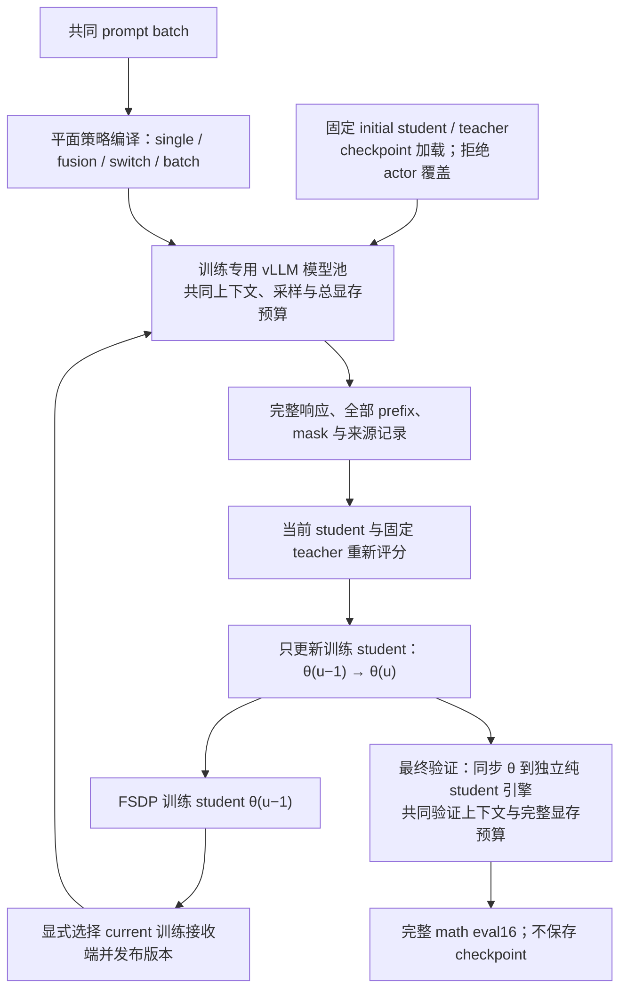
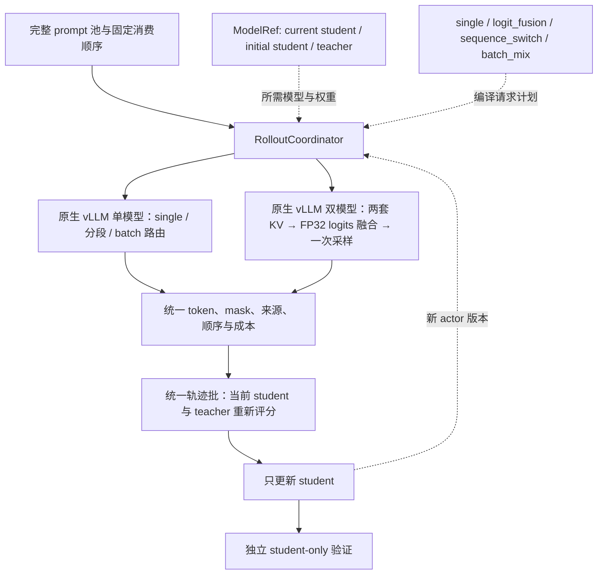

# Agent Note: 可组合 rollout 与原生 vLLM 推理

Status: proposed

## 问题

生成时机、模型来源与混合策略目前分别耦合到 trainer 分支、actor 参数同步和解码实现。用户要求统一实时生成，支持当前 student、初始 student、teacher、logit fusion、双向分段切换和 batch 内来源混合，并优先采用原生 vLLM。本文集中保存重构提案、真实替代方案、实现调研与实验依据；当前训练链路仍以[代码结构](../../../../docs/architecture.md)和[统一实验报告](../../../../docs/experiment/2026-10-19-rollout来源与logit融合实验.md)为准。

此提案补充已有的[源码根目录与文档归属决策](../../implemented/architecture/2026-10-17-训练基线与研究分层.md)，不取代其仓库布局、维护工具与 docs 归属。原有方案从 architecture.md 迁入本记录；实验数据仍归统一实验结果目录。

配置入口、算法包与后端分层的后续目标由[MirrorOPD 配置与架构对齐](2026-10-19-MirrorOPD配置与架构对齐.md)接管。该提案基于两仓实际配置和局部梯度对照，尚未切换生产入口；本记录继续维护生成策略、模型身份、KV、同步与推理验收合同。

## 提案

详细方法、目标接口和固定验证记录分别链接到所属页面。以下分配不改变原验收义务；尚未完成的要求继续保持 proposed，当前运行方式以使用指南和实际源码为准。

### 验证版本的目标与边界

目标问题是验证：分段续写与 batch 路由能否复用 vLLM 原生 token-in/token-out 生成，在保持响应总预算、终止语义、顺序和来源身份的条件下运行；计量重复 prefill、请求分组与模型驻留的成本。

首轮范围为三种单模型来源、两种独立 logit fusion、单模型之间的一次分段切换，以及单模型之间的简单 batch 混合。暂不考虑 batch 混合中包含分段策略、分段中包含 fusion 等嵌套组合；已有原型对此的历史测试不构成正式接入要求。

成功条件是 CPU 边界/随机属性检查通过，真实 student/teacher checkpoint 的分段与 batch 混合可运行，保存原始 token 和结束原因、证明配额与拼接正确，并得到同会话显存与耗时证据。否决条件包括二次模板化、提前 EOS 后继续生成、预算翻倍、路由后记录错配、跨权重复用 KV、隐式 HF 回退或无法界定资源所有权。

可变选择包括单引擎换权重/双引擎驻留、副本布局、批量分组与流水化、CUDA Graph 和后续 speculative fusion。验证原型保持已归档训练的源码和实验条件，也不以独立生成检查冒充完整 trainer 集成通过；真实训练热更新和两步端到端验收仍是正式接入前的独立条件。

正式 trainer 已接入可选原生路径。三种单模型、四种分段方向、两种 batch 混合与两种 fusion 均已有四卡两步和最终短验证证据；分段/batch 使用固定的 4994d2b，fusion 使用后续运行源码快照。统一训练/验证引擎后的完整质量矩阵和最终性能对照仍待验收；CUDA Graph 与原生排空已有独立场景证据，范围见下文。初始审阅基线为 `d17d6c6`，范围是当前 math 的 FSDP、vLLM/HF fusion、权重同步、teacher 评分与验证执行链，涉及 32 个相关文件；另核对安装环境的 vLLM 0.10.0 V1 模型注册、采样、键值缓存（KV cache）与 worker 扩展接口。[代码核验清单](../../../../docs/experiment/results/2026-10-18-rollout-refactor-code-audit.json)保存范围、哈希与源码观察。方案优先使用 vLLM 原生执行；正式实验保留各自固定的源码快照。后续流程图描述目标算法和接入方式，具体实现状态以“实施进展”与对应验收证据为准。

### 工程证据与未完成范围

<a id="实施进展"></a>

本主题的详细材料维护在[实施进展](../../../../docs/experiment/support/2026-10-19-原生rollout工程验证.md#分阶段验证证据)。

### 训练与验证引擎的实现边界

模型池将验证放在独立的纯 current-student 引擎中，训练 current 也使用训练专用副本。单模型、分段、batch 与 fusion 的训练引擎统一采用 prompt+response 的上下文和共同 token/batch 设置；训练来源共享一个总显存预算，最终验证始终使用完整的验证预算。该布局增加冷启动副本，消除了“current 使用长验证上下文、固定模型使用短训练上下文”和不同策略验证预算不同的混杂。验证序列并发现在可由 `generation_eval_max_num_seqs` 单独配置：默认 `null` 保留继承行为；显式设置时仅为验证 manager 克隆配置，训练原配置与各训练副本保持原值，不通过改写全局训练配置再回填私有值实现。初版成功条件是训练/验证的实际 worker 上限分别符合声明、最终验证仍为当前 student、数据与学习预算不变；错误 worker 值或覆盖训练设置均否决。参数正值、token 预算与冲突的 engine_kwargs 在 pre-Ray 阶段检查。配置变化可能改变有限随机样本输出，比较时须固定该参数，不能承诺逐 token 不变或未实测的加速。

actor 的 FSDP 权重流在每次导出前显式选择 sleeping current 接收端，核对角色、初始化路径、运行命名空间、用途与 frozen companion。fusion 只将原始 HF 命名张量交给 base loader，teacher 不参加 actor 的 post-load 变换；initial fusion 的两套生成权重均拒绝 actor 写入。可选完整参数摘要用于 GPU 验收，graph 模式还核对参数地址；这些检查不能代替实际 graph/缓存测试。



current 与 initial 的 λ=0.5 原生 fusion 均完成两步四卡更新和九十六条最终 student 响应，完整冻结参数摘要跨步骤/副本一致；见[current fusion](../../../../docs/experiment/results/native-rollout/trainer-current-fusion/native-acceptance.json)与[initial fusion](../../../../docs/experiment/results/native-rollout/trainer-initial-fusion/native-acceptance.json)。分段/batch 的六项矩阵也完成，包括 teacher 仅一条响应、其余三个推理副本无该来源请求的情况。一次并行调试导致 vLLM 显存探测失败，串行原参数重跑通过；共享负载结果不作独占速度证据。

[连续解码检查](../../../../docs/experiment/results/native-rollout/fusion-decode-eager/receipt.json)覆盖 λ=0/0.5/1、两条 prompt 各八步和完整有效词表；最大跨后端 logits 差为 0.125、TV 为 0.027081，满足已定 BF16 界限。λ=0.5 的[CUDA Graph 检查](../../../../docs/experiment/results/native-rollout/fusion-decode-graph/receipt.json)实际捕获 114 个图，十六个 prefix 的完整 logits 与参考相同，sleep/wake 后内容、地址和输出一致；该数值探针不覆盖训练热更新或原生 abort/drain，其独立结果见下文；长响应性能和完整质量对照仍未完成，Status 保持 proposed。

### 原生排空与缓存恢复

真实 native 请求检查补齐了取消路径：vLLM 0.10 abort 不唤醒等待输出的生成协程，单靠 frontend map 为空不足以确认完成。服务端保存实际生成 task，abort 后取消并等待 task，再等待 CUDA barrier 与 prefix reset；超时保持 drain-pending，禁止权重变更或重新开放。eager/graph 的长请求均在实际 decode 后成功排空，随后 logits 与发布恢复；见[运行检查](../../../../docs/experiment/results/native-rollout/runtime/receipt.json)。同一检查还验证生产 IPC 完整换权重后的 APC 零命中与完整 logits 等价。

[四卡 graph 训练](../../../../docs/experiment/results/native-rollout/trainer-current-fusion-graph/native-acceptance.json)在重复同题条件下完成两步和最终纯 student 验证，检查相同 prefix 跨 actor 版本更新、完整冻结摘要和参数地址。当前尚待最终版本的统一性能基准、正式 50 步完整质量矩阵和逐项完成审计，提案保持 proposed。

[独立验证并发的 CPU 验收](../../../../docs/experiment/results/native-rollout/eval-concurrency-cpu.json)覆盖默认继承、配置副本、重复解析、四类训练策略和 worker 参数读取；三组四卡短验收将对照 current 继承值、current 验证上限 64 和 initial-fusion 验证上限 64。它们共享 B8、两步和六题×16，额外核对默认完整数据清单及实际引擎回执。GPU 接入尚未验收，计时不作质量或吞吐结论；旧冻结任务保持原配置。

Validation 优化使用独立的 seq/token/显存预算与 Graph 参数副本，保持训练配置；KL 输入在 DP 补齐后按相近前缀长度分配，每 rank 行数一致，RPC 返回后先逆排再去掉补齐。整块词表归约保持 FP32 与原数值门槛，完整词表太大时仍可显式缩小词表块。有效 token 解码避免扫描 padding，并按验证阶段记录 API 耗时。候选 profile、头部/权重/KV 容量估算及四/八卡参数由[速度与显存](../../../../docs/experiment/速度与显存.md)维护；真实性能、分块选择与周期验证 GPU 恢复以各自验收结果为准，不用 CPU 检查声称加速。

四卡 p0/q 的固定真实 token 配对测试支持负载平衡和整块词表：原顺序、小块约 45.41 s，平衡且位置块 1,024 约 11.34 s，逐响应归一化统计最大差 $8.45\times10^{-7}$。位置块 2,048 仅再快约 2%，allocated 高水位却多约 5.2 GiB，先采用 1,024。前向 batch 2–16 的差约 $1.31\times10^{-3}$，未通过原 $10^{-5}$ 门槛，也未取得足够速度收益，默认维持 1。后续只有在重新通过配对精度与实际成本验收后才考虑启用批量前向；不能放宽误差门槛来接受这组结果。该微基准没有 optimizer/CPU offload，不能把其加速比直接套到完整 trainer；精确设置、工作量与图件归速度专题。

完整四卡优化复测覆盖 570×16、56,451,119 个主位置和原 bank，独立审计及 W&B 核验通过。验证窗口 64、seq128、预算 0.55、token32768、KL1024/full、前向 batch1，将整轮 validation 从 212.64min 降至 67.00min；这是完整流程的观测，非同最终 checkpoint 配对。源码与完整条件由速度专题和结果归档维护。末批采样出现某卡空闲而其他卡仍生成，按副本静态分配及批间等待是后续更大窗口/动态补位需检验的因素；不能仅据空闲显存承诺收益。八卡维持每卡参数，优先将验证窗口增至 128 题，并在八 worker/八卡遥测覆盖后验收。

### 完整 prompt 池与访问次数

[完整题库生成器](../../../../data/prep/build_fresh_math_data.py)按实际 token IDs 去重，剔除所有答案冲突题，独立于训练步数和 batch 大小。DAPO 的 17,917 行在 1,024 token 上限下过滤 8 行，去重 662 条额外记录，再移除 12 个答案冲突的唯一 prompt，得到 17,235 题。真实 RLHFDataset 和随机 sampler 已核对该行数，batch 64 时每 epoch 269 批、末尾 19 行按现有 drop-last 规则省略；前五十批恰好消费 3,200 道不同题，后续 epoch 重新打乱全题库。

默认入口现已对齐上述完整清单：`math_native.sh` 在未显式指定数据时绑定 `runs/native-data/math-full/manifest.json`，缺少准备产物时在下游训练启动前退出；显式 `TRAIN_FILES` 保留工程场景，显式 `NATIVE_DATA_MANIFEST` 继续绑定对应 Parquet。四项真实 Bash 入口检查覆盖默认值、缺失前置条件、带空格路径及覆盖优先级；实际 Hydra dry-run 和 pre-Ray 检查验证本机默认池为 17,235 题、tokenizer/模板/cap/文件哈希匹配，未初始化 CUDA。证据见[入口验收](../../../../docs/experiment/results/native-rollout/native-data-default-cpu.json)。后续[CLI 兼容性验收](../../../../docs/experiment/results/native-rollout/native-cli-data-cpu.json)补齐命令行自定义数据的边界：数据文件或清单由 CLI 显式选择时不注入默认绑定；六项真实 Bash 检查与实际 Hydra/pre-Ray 校验通过。

访问次数现在按题目内容而不是原始行号累加，原始行 ID 另存。相同题目即使出现在不同数据行，也使用递增 visit 重新采样；验证响应计数与训练 visit 分离。正式运行可通过 `NATIVE_DATA_MANIFEST` 绑定数据、词表/模板、prompt 上限和文件哈希。新原生路径暂不提供无偏 top-k tail 所需的已核验行为分数，显式拒绝该组合；历史 `policy=null` 路径继续可用。

### 目标与算法含义

本主题的详细材料维护在[目标与算法含义](../../../../docs/research/rollout/2026-10-19-多来源rollout的目标与策略.md#目标与算法含义)。

### 三种混合方式与参数

本主题的详细材料维护在[三种混合方式与参数](../../../../docs/research/rollout/2026-10-19-多来源rollout的目标与策略.md#三种混合方式与参数)。

### 当前代码的耦合与影响

| 当前位置                                                                                                                                                                                             | 已核对的行为                                                           | 重构影响                                                                              |
| ---------------------------------------------------------------------------------------------------------------------------------------------------------------------------------------------------- | ---------------------------------------------------------------------- | ------------------------------------------------------------------------------------- |
| [engine_workers.py](../../../../verl/verl/workers/engine_workers.py) `init_model`；[llm_server.py](../../../../verl/verl/workers/rollout/llm_server.py) `LLMServerManager`                           | actor 初始化和 rollout 共享 `actor_rollout_ref.model`                  | 不能用改该路径的方式选择 teacher 生成，否则连可训练 student 初始化与 tokenizer 都改变 |
| [ray_trainer.py](../../../../verl/verl/trainer/ppo/ray_trainer.py) `fit`                                                                                                                             | 生成处按 fusion、普通生成、固定缓存分三支；同步条件也依赖缓存是否存在  | trainer 应调用统一协调器，来源选择、恢复和休眠归协调器处理                            |
| [vllm_rollout.py](../../../../verl/verl/workers/rollout/vllm_rollout/vllm_rollout.py) `update_weights`；[utils.py](../../../../verl/verl/workers/rollout/vllm_rollout/utils.py) `on_bucket_received` | actor 参数流同时写入 HF fusion 的 student 槽和原生 vLLM                | 同步目标须按模型引用选择；不能让 actor 参数覆盖 $p_0$ 或 $q$                          |
| [engine_workers.py](../../../../verl/verl/workers/engine_workers.py) `generate_logit_fusion`；[decoder.py](../../../../verl/verl/workers/rollout/fusion/decoder.py) `load_student_weights`           | 固定要求 `expected_version=step-1`，只支持一个可变 student 槽          | 固定 initial fusion 需要不可变模型身份；不能假装它拥有当前 actor 版本                 |
| [vllm_async_server.py](../../../../verl/verl/workers/rollout/vllm_rollout/vllm_async_server.py) `_sleep_hybrid`                                                                                      | 全参数 HYBRID sleep level 2 释放原生权重，恢复依赖 actor 参数流        | 固定 checkpoint 必须有自己的恢复路径，单独跳过同步还不够                              |
| 同文件 `release_kv_cache`、`resume_kv_cache`                                                                                                                                                         | 当前只有条件检查和返回，没有实际释放/恢复操作                          | 不能按方法名认定 KV 已释放；需实现或改用真实生命周期操作，并用显存证据验收            |
| [hf_rollout.py](../../../../verl/verl/workers/rollout/hf_rollout.py)、[base.py](../../../../verl/verl/workers/rollout/base.py)                                                                       | 旧 HF 类使用同步接口，构造形式与当前基类不同，也不在 async registry 中 | 不能直接设置 `rollout.name=hf`；新默认使用原生 vLLM，现有 fusion decoder 保留作参考   |
| [math_online.sh](../../../../recipe/math_online.sh)、[math_cached.sh](../../../../recipe/math_cached.sh)、[math_fusion.sh](../../../../recipe/math_fusion.sh)                                        | 配对数据默认指向 3,200 条 schedule，epoch 数按每轮 50 步计算           | 数据池、训练预算与生成方式必须独立                                                    |
| `ray_trainer.py` 与 [plateau.py](../../../../verl/verl/trainer/ppo/plateau.py)                                                                                                                       | 平台检查显式限定固定缓存，比较缓存窗口残差                             | fresh 模式不能直接沿用相同 states 的解释或该提前停止条件                              |

普通异步生成会做 verifier 评分，缓存与 fusion 的打包则放入零 `rm_scores`。当前纯 `token_reward_direct` 会由 `OPDTrainerMixin.compute_opd_token_reward` 覆盖为 teacher 的逐 token 信号，因此这不证明当前主 loss 有差异；但训练准确率等诊断和以后启用的 GRPO 混合项需要共同的 verifier 阶段，不能因生成路径不同而改变。

生成端还会屏蔽 tokenizer 有效词表以外的 padded logits，HF fusion 也切到有效词表；当前 FSDP teacher 评分函数对完整输出 logits 做归一化。当前配对的 tokenizer 长度为 151,665，模型输出词表为 151,936。生成分数、当前 actor 分数和监督 teacher 分数的职责应分别保留，不能为省一次前向就直接复用生成分数；先验证词表支持、温度、mask、位置和精度的归一化口径。

### 建议保留的四个对象

| 对象                 | 职责                                                    | 关键约束                                                                           |
| -------------------- | ------------------------------------------------------- | ---------------------------------------------------------------------------------- |
| `ModelRef`           | 表达可变 actor 引用或固定 checkpoint 引用               | actor 用更新版本；$p_0/q$ 用不可变 fingerprint；相同初始数值不允许共享可写参数存储 |
| `RolloutPolicySpec`  | 表达单模型、fusion、分段切换与 batch 混合，编译请求计划 | `uses_actor` 从有效组件推导；零权重、空分组与端点先归约                            |
| `RolloutCoordinator` | 编排训练生成、权重激活、休眠、验证切换和统一轨迹结果    | 拒绝错误模型身份、未完成参数流、旧版本与不支持的后端组合                           |
| `GenerationBackend`  | 实现原生生成或双模型前向、采样和资源生命周期            | 声明支持能力；统一接口不等于底层 kernel 相同                                       |

模型引用表启动时解析一次：`current_student` 指向 actor，`initial_student` 指向 actor 的训练前 checkpoint 快照，`teacher` 指向现有 `distillation.fsdp_teacher.model_path`。生成 teacher 与监督 teacher 是两个逻辑职责，首版明确绑定同一 checkpoint。参数传输复用现有 BucketedWeightSender/Receiver 和 checkpoint engine；这里的 checkpoint engine 是权重传输机制，不意味着训练时保存 checkpoint。

每个 run 只编译选中的策略，去掉零比例与无效端点，再解析实际参与的模型；三个角色引用不要求同时建立三套 GPU 引擎。首轮每种策略最多涉及 base 与 teacher 两种生成来源，不同时驻留三个生成模型。teacher 评分和最终 student 验证的资源单独安排，冷启动成本与阶段恢复成本分别计时。



trainer 保留数据读取、teacher 信号、优势计算、actor 更新与评测指标，生成处收敛为一个入口。协调器可以提供拟议接口 `generate_train(batch, actor_version)` 与 `generate_eval(batch, actor_version)`；后者始终绑定当前 student，训练来源不决定评测来源。已有 `FixedRolloutCache` 作为 replay 适配器继续严格验证历史缓存，不必重建一套 trainer 或迁移上游安装结构。

### 配置示例与所有权

下面是拟议配置子树，不是当前可执行的 Hydra 命令；对应字段和后端尚未实现。保留现有路径作为单一事实源，不新增另一套顶层模型路径。

```yaml
actor_rollout_ref:
    model:
        path: ../models/DeepSeek-R1-Distill-Qwen-1.5B
    rollout:
        name: vllm
        generation_backend: vllm_native
        collection:
            mode: fresh
        policy:
            kind: sequence_switch
            first: { kind: single, model: teacher }
            second: { kind: single, model: current_student }
            boundary: { kind: response_tokens, value: 1024 }
distillation:
    fsdp_teacher:
        model_path: ../models/JustRL-DeepSeek-1.5B
```

`model.path` 仍只定义 learner 的初始化及 canonical tokenizer；`initial_student` 在启动时从它绑定固定引用。`policy` 选择一种模式及其模型来源，`generation_backend` 选择实际解码内核。单模型、分段与 batch 混合使用 `vllm_native`；精确 fusion 拟使用 `vllm_paired`。现有 HF fusion 只作为数值参考与历史复现路径；即使 RPC 容器来自 vLLM，也继续按 HF 计算后端记录其历史吞吐。

下面分别示意精确配额的简单 batch 混合与固定初始 student 的独立 fusion，也尚非可执行参数。

```yaml
batch_mix_example:
    kind: batch_mix
    routing_unit: trajectory
    assignment: exact_count
    components:
        - weight: 0.5
          policy: { kind: single, model: teacher }
        - weight: 0.5
          policy: { kind: single, model: current_student }
fusion_example:
    kind: logit_fusion
    base: initial_student
    teacher_weight: 0.5
```

切换方向只需交换 `first/second`；batch 中的组件限定为 `single`，不能替换成 `sequence_switch` 或 `logit_fusion`。采样、batch、数据和学习率沿共同配置继承，避免为组合复制配方。旧 math recipe 保留复现入口，新配方在同一公共启动器上选择策略。

配置编译时验证模型引用、后端能力、有限数值及范围：λ/α/ρ 在 $[0,1]$ 内，token 边界为非负整数，混合权重非负且总和为正，响应总预算为正。先归一化混合权重与化简端点，再决定需要哪些模型和同步目标；不支持的组合在启动前报错。

### 每步生命周期

第 $k$ 次更新前，actor 为 $\theta_{k-1}$；新模式仍遵循以下顺序。

1. 从共同 dataloader 取得 prompt，完成一次 canonical tokenization，固定模板、assistant 前缀、EOS/PAD 与有效 token ID 语义。组件不能各自切换 chat template。
2. 协调器确认 active policy。仅当策略实际使用 current student 时同步 $\theta_{k-1}$；$p_0/q$ 只校验固定引用和设备状态，按需恢复自己的权重。
3. 按请求计划生成响应。分段期间 actor 版本锁定，batch 各来源也使用同一更新前版本；不能在仍有旧请求时覆盖权重。保存 prompt ID、访问轮次、响应 token、mask、采样设置、seed、路由、实际切换位置、逐 token 来源、组件身份与 actor 版本。不同后端或 batch 布局不承诺逐 token 完全一致。
4. 结束生成请求，释放应释放的 GPU 资源；当前 student 重新计算 `old_log_probs`，冻结 teacher 重新评分，保持现有 token reward 与 actor 更新，得到 $\theta_k$。
5. 到验证点时，协调器切到当前 $\theta_k$ 的单模型验证，完成三基准 eval16；下一步恢复训练所选的生成策略，并清除旧模型或旧版本对应的 KV/prefix cache。

行为策略 $\mu$ 的分数仅保存为独立的 `behavior_log_probs` 诊断。MVP 继续使用当前 actor 重算的 proximal anchor，拒绝为这些新策略启用 `bypass_mode` 或自动 rollout correction；否则可能把 teacher/fusion 的概率误当成 actor 锚点，或在重构中顺带加入重要性修正。off-policy 生成下，采样 log-ratio 也不能直接宣称为当前 student 的完整条件 KL。

轨迹结果用显式有效长度和 mask 保留 EOS，即使 EOS 与 PAD 使用同一 token ID，也不能用 `token != pad` 推断响应。每题响应数只在一个位置展开；现有验证已在 trainer 重复 16 次，后端每条请求只返回一次，重构不能再次展开成 256 次。

原子参数流与 CUDA Graph 的所有权必须一同保留：完整 named-tensor 流收到后才发布新 actor 版本；固定引用拒绝写入。actor 参数原地更新且地址稳定时可重用 graph，但搬迁模型或重建 tensor 会使捕获地址失效，需要失效处理和重新捕获。KV 内容每次生成重置，graph 的 key 包含组件存储身份、batch bucket、容量与 dtype，而不应仅因 actor 版本变化就强制重新捕获。

### vLLM 后端能力与实现边界

本主题的详细材料维护在[vLLM 后端能力与实现边界](../../../../docs/research/rollout/2026-10-19-原生推理与课程机制调研.md#vllm-后端能力与实现边界)。

### 相关推理实现与复用判断

本主题的详细材料维护在[相关推理实现与复用判断](../../../../docs/research/rollout/2026-10-19-原生推理与课程机制调研.md#相关推理实现与复用判断)。

### 分段切换与 batch 混合的实现调研

本主题的详细材料维护在[分段切换与 batch 混合的实现调研](../../../../docs/research/rollout/2026-10-19-原生推理与课程机制调研.md#分段切换与-batch-混合的实现调研)。

### TCOD：时序课程与 teacher 前缀条件化

本主题的详细材料维护在[TCOD：时序课程与 teacher 前缀条件化](../../../../docs/research/rollout/2026-10-19-原生推理与课程机制调研.md#tcod时序课程与-teacher-前缀条件化)。

### 独立原型与测试合约

本主题的详细材料维护在[独立原型与测试合约](../../../../docs/experiment/support/2026-10-19-原生rollout工程验证.md#独立原型与测试合约)。

### 实测设置、结果与否决的假设

本主题的详细材料维护在[实测设置、结果与否决的假设](../../../../docs/experiment/support/2026-10-19-原生rollout工程验证.md#实测设置结果与否决的假设)。

### 调度、显存与优化次序

本主题的详细材料维护在[调度、显存与优化次序](../../../../docs/experiment/support/2026-10-19-原生rollout工程验证.md#调度显存与优化次序)。

### 数据、指标与收敛

本主题的详细材料维护在[数据、指标与收敛](../../../../docs/experiment/support/2026-10-19-KL诊断方法与验收.md#数据指标与收敛)。

### 验证 KL 与 rollout 诊断提案

本主题的详细材料维护在[验证 KL 与 rollout 诊断提案](../../../../docs/experiment/support/2026-10-19-KL诊断方法与验收.md#验证-kl-与-rollout-诊断提案)。

### 修改范围与实施顺序

以下路径列出修改归属；已建立的策略、执行器、模型池与协调器继续接受端到端验收。

| 位置                                                | 建议变化                                                                   |
| --------------------------------------------------- | -------------------------------------------------------------------------- |
| `workers/config/rollout.py`                         | 新增模型引用、策略和 collection 的类型及组合校验；旧字段映射到共同描述     |
| `workers/rollout/policy.py`（拟新增）               | 编译平面策略配置、分配全局配额和阶段预算，解析模型身份、能力与同步目标     |
| `trainer/ppo/rollout_coordinator.py`（拟新增）      | 封装生成/同步/验证切换，适配历史 replay，移走 trainer 的来源分支           |
| `workers/rollout/vllm_rollout/`                     | 原生模型池、按来源分组、分段 token 续写、生命周期与性能采集                |
| `workers/rollout/fusion/vllm_model.py`（拟新增）    | 仓外注册双模型，原生 Qwen2 前向、独立 KV、FP32 logits 与单次采样           |
| `workers/rollout/fusion/decoder.py`                 | 保留 HF 参考实现与历史复现，用于原生扩展数值对照，不作为自动回退           |
| `workers/engine_workers.py`、vLLM adapter/extension | 为明确目标传输 actor 权重，避免写错固定模型或同时恢复无用引擎              |
| `experimental/agent_loop/` 与批打包                 | 统一输入 token、输出 schema、reward 诊断和 provenance，保持既有 async 合约 |
| `recipe/` 与 `data/prep/`                           | 共用启动器和策略覆盖；独立完整数据清单与训练预算，保留历史复现配置         |
| `eval/` 与既有测试                                  | 扩展身份/指标采集、端点、生命周期、后端等价与 GPU 成本验收                 |

实施按依赖顺序推进：

1. 先定义 `ModelRef`、平面策略配置与轨迹合约，把现有来源入口包到协调器。CPU 检查比例取整、端点、空分组、全局顺序、预算、EOS/PAD mask 与固定模型写保护，旧实验入口继续保留。
2. 优先接入三种单模型原生生成，补齐 $p_0/q$ 的加载、恢复与身份；再实现双向分段及 batch 配额路由。两种混合先采用分阶段归组，避免同时引入异步流水与算法变化。
3. 独立验证原生双模型扩展，按 λ=0/0.5/1 对照完整 logits、共同 prefix 与采样分布；检查双 KV 是否完整计入预算、参数名映射及 graph。比较现有 0.10 的受控 wrapper 与独立 0.15 环境的插件/batch-invariance 路线；选定后同一正式对照固定一个版本，现有生产环境不原地升级。
4. 在空闲 GPU 0–3 做各已开放策略两步训练，覆盖 current→initial→teacher→切换/混合→current-eval 的恢复，验证固定模型不变、actor 版本正确、分段 mask 完整、验证始终来自最终 student。原生 fusion 单独验收后纳入。
5. 建立同 checkpoint、输入、采样和实际 batch 的原生基线。短确定长度序列测内核，真实 math 长度分布测端到端；扫描有效 batch 与 KV 预算，比较单引擎换权重/双引擎驻留，再测 graph 与流水。先披露冷启动和热成本，不承诺尚未实测的提升比例。
6. 固定新数据 manifest、学习率、全局 batch 与预算后开展正式对照：单模型端点；分段方向与 $k\in\{0,1024,2048,4096\}$；batch 比例 $\alpha\in\{0,0.5,1\}$；fusion 的 λ 对照。端点复用相同基线，先用一个内部参数值筛选，首轮不安排嵌套组合。每组先 50 步、完整 eval16，质量结论补充训练 seed；历史缓存结果保留原算法和实验条件。

首版目标是三种来源、双向分段与 batch 混合在同一训练链上使用原生 vLLM，student 初始化/更新/验证独立于生成来源；原生精确 fusion 是独立的第二项验收。成功证据须包括参数版本、固定权重不变、配额/阶段语义、两步恢复与完整 eval16；只通过构造测试不等于真实训练可用。若固定模型被 actor 覆盖、验证来自错误来源、分段预算或训练 mask 改变、评分归一化改变主 loss，或执行中静默回退 HF，该版本不能进入正式对照。引擎布局、副本映射、graph 与预取仍由基准结果决定。

## 考虑过的替代方案

当前已验收的 HF fusion 保留为数值参考与历史复现。统一退回 HF 会失去本轮希望验证的原生调度能力。直接复制外部 vLLM fork 或升级整个训练环境会同时改变过多依赖，优先在现有 0.10.0 上建立最小适配。单引擎换权重与多引擎驻留均保留为真实候选，由联合显存预算和热调用成本决定。

## 验收条件

源码及外部实现调研、CPU 语义检查、真实原生生成、资源与速度测量分开留证。后续 trainer 接入还需覆盖参数版本、冻结引用、共同评分、最终 student-only 验证与完整训练短测；原型结果不能跳过这些条件。

四卡两步接入须覆盖某 rank 的某来源为空、teacher 提前 EOS、响应重排、n 的单次展开和验证切换。FSDP 所有 rank 仍需参加匹配次数的参数收集与 teacher 评分，不能因为本地无某来源请求就跳过全局 collective。原生 abort/排空、APC 开启后的权重版本失效、CUDA Graph 与 actor 热更新也要分别验收。

生产路由 seed 应含独立的 batch 标识，生成 seed 则按 prompt、访问轮次、响应序号和阶段派生；不能在每个训练 batch 循环复用原型的同一位置分配。固定来源再次遇到同题时递增 visit，才能重新抽样；相同身份的相同 seed 重放只服务复核。

## 风险

共享 GPU 负载会影响吞吐；短响应测试不能代表 4K/32K 长上下文。固定模型实时采样改变有限 states 的复用条件，必须与历史 Semi replay 区分。不同 vLLM 版本的 attention 注册、请求元数据、sleep 和采样接口仍需适配；任何近似融合或 KV 跨权重复用都不能默认为精确算法。
