# Agent Note: 可组合 rollout 与原生 vLLM 推理

Status: proposed

## 问题

生成时机、模型来源与混合策略目前分别耦合到 trainer 分支、actor 参数同步和解码实现。用户要求统一实时生成，支持当前 student、初始 student、teacher、logit fusion、双向分段切换和 batch 内来源混合，并优先采用原生 vLLM。本文集中保存重构提案、真实替代方案、实现调研与实验依据；当前训练链路仍以[代码结构](../../../../docs/architecture.md)和[统一实验报告](../../../../docs/experiment/2026-10-19-rollout来源与logit融合实验.md)为准。

此提案补充已有的[源码根目录与文档归属决策](../../implemented/architecture/2026-10-17-训练基线与研究分层.md)，不取代其仓库布局、维护工具与 docs 归属。原有方案从 architecture.md 迁入本记录；实验数据仍归统一实验结果目录。

## 提案

### 验证版本的目标与边界

目标问题是验证：分段续写与 batch 路由能否复用 vLLM 原生 token-in/token-out 生成，在保持响应总预算、终止语义、顺序和来源身份的条件下运行；计量重复 prefill、请求分组与模型驻留的成本。

首轮范围为三种单模型来源、两种独立 logit fusion、单模型之间的一次分段切换，以及单模型之间的简单 batch 混合。暂不考虑 batch 混合中包含分段策略、分段中包含 fusion 等嵌套组合；已有原型对此的历史测试不构成正式接入要求。

成功条件是 CPU 边界/随机属性检查通过，真实 student/teacher checkpoint 的分段与 batch 混合可运行，保存原始 token 和结束原因、证明配额与拼接正确，并得到同会话显存与耗时证据。否决条件包括二次模板化、提前 EOS 后继续生成、预算翻倍、路由后记录错配、跨权重复用 KV、隐式 HF 回退或无法界定资源所有权。

可变选择包括单引擎换权重/双引擎驻留、副本布局、批量分组与流水化、CUDA Graph 和后续 speculative fusion。验证原型保持已归档训练的源码和实验条件，也不以独立生成检查冒充完整 trainer 集成通过；真实训练热更新和两步端到端验收仍是正式接入前的独立条件。

正式 trainer 已接入可选原生路径。三种单模型、四种分段方向、两种 batch 混合与两种 fusion 均已有四卡两步和最终短验证证据；分段/batch 使用固定的 4994d2b，fusion 使用后续运行源码快照。统一训练/验证引擎后的完整质量矩阵和最终性能对照仍待验收；CUDA Graph 与原生排空已有独立场景证据，范围见下文。初始审阅基线为 `d17d6c6`，范围是当前 math 的 FSDP、vLLM/HF fusion、权重同步、teacher 评分与验证执行链，涉及 32 个相关文件；另核对安装环境的 vLLM 0.10.0 V1 模型注册、采样、键值缓存（KV cache）与 worker 扩展接口。[代码核验清单](../../../../docs/experiment/results/2026-10-18-rollout-refactor-code-audit.json)保存范围、哈希与源码观察。方案优先使用 vLLM 原生执行；正式实验保留各自固定的源码快照。后续流程图描述目标算法和接入方式，具体实现状态以“实施进展”与对应验收证据为准。

### 实施进展

正式矩阵的三种单模型来源与两种 fusion 均完成五十步、完整 570×16 最终评测、独立路由/版本审计和 W&B finished 核验，无 checkpoint；current/initial/teacher/current-fusion/initial-fusion 的 macro mean@16 为 64.30%/64.17%/63.80%/63.89%/63.85%。相对 current 的四个题目 bootstrap 区间均跨零，不据此排序。三种单模型原生生成接近 15k token/s，两种 fusion 为 8.79k/8.55k；完整结果与五组图见[准确率与训练指标](../../../../docs/experiment/2026-10-19-rollout准确率与训练指标.md)。Bank 首次 GPU 尝试未通过跨接口 UUID 校验；PCI 映射修复后，v2 已发布 180 条两来源轨迹，长响应 KL 已通过，完整 570×16 验证 KL 已通过独立覆盖与 W&B 核验，原始证据已归档。Bank 的独立 artifact 审计已核对 180 条轨迹、1,440 个抽样位置、八个 worker 与冻结源码，长响应验收覆盖九十六条准确率响应的全部 605,977 个位置。神经网络源码与 bank 输入保持原值。剩余质量、布局、参数扫描与探针未完成，Status 保持 proposed。

原生单模型、四个分段方向、两种 batch 混合与两种 fusion 已完成四卡短训练；连续解码、graph 热更新和原生排空也已有下文的独立证据。正式十五组 50 步/570 题×16 矩阵已使用 d59a7c3 冻结源码启动，质量比较尚未完成。新增 `generation_layout=split` 的生产副本映射仍在验收：默认 `overlap`，不改变已启动矩阵；[CPU 路由证据](../../../../docs/experiment/results/native-rollout/placement-cpu.json)覆盖小组集中、分卡、响应顺序、冻结恢复和 current 写入前置条件，真实四卡新布局训练尚待验证。下文早期检查按其实际覆盖范围保留，不代表所有后续验收均已完成。

生产目录新增 [policy.py](../../../../verl/verl/workers/rollout/policy.py)，实现不可变模型身份、平面配置解析、全局响应配额、分段预算与端点归约，显式拒绝嵌套和 TCOD。[十三项 CPU 合约检查](../../../../verl/tests/opd/test_native_policy_on_cpu.py)已通过，包含五百组随机配额；Hydra 配置往返也已验证。新增配置默认关闭，现有路径继续使用原入口。这些 CPU 结果只覆盖契约层，不能单独证明 worker、权重生命周期或 trainer 集成；对应 GPU 证据单列。

随后新增 [native_executor.py](../../../../verl/verl/workers/rollout/native_executor.py)、[lifecycle.py](../../../../verl/verl/workers/rollout/lifecycle.py)与原生服务端接口，生产 CPU 检查合计四十四项通过。执行层保持原 prompt 与完整响应，保留原始结束原因，核对来源/版本/λ；失败时要求原生 abort/drain。服务端将 actor 权重接收、完整 HF 名称集合、最终 bucket、实际写入序号、缓存失效与 CUDA barrier 纳入发布条件，同版本恢复也不能沿用上一次写入回执。固定来源在服务端和真实 inference worker 均拒绝 actor 流。

真实 GPU 检查已覆盖冻结 $p_0$ 与 $q$：生产 worker 扩展拒绝 actor 写入，写入尝试前后及 sleep/wake 后输出一致，EOS=PAD 且原生 finish reason 为 length 时仍保留有效 EOS。每引擎 sleep 释放 8,090 MiB，两个自有进程退出后整卡占用回到基线；见[GPU 身份与恢复证据](../../../../docs/experiment/results/native-rollout/identity-gpu.json)。该证据只覆盖 native worker 与生产 executor，不能代替异步 server 或 FSDP/trainer 验收；协调器与真实训练证据另列如下。

实施前的原生 vLLM 基准已完成三十八个场景，其中三十六个为 B=2/8/16、cap=128 的三次重复，见[基准记录](../../../../docs/experiment/results/native-rollout/baseline-throughput.json)。启动时 GPU 0 已有 6,921 MiB 其他负载，按共享 GPU 微基准记录，不当作独占或四卡训练吞吐。

[rollout_coordinator.py](../../../../verl/verl/trainer/ppo/rollout_coordinator.py)与[native_pool.py](../../../../verl/verl/workers/rollout/native_pool.py)已接入 trainer 的可选原生路径：生成来源独立于 actor 初始化，复用同一 verifier，固定来源跳过训练权重同步，验证显式切回最新 student；数据遍历轮数由实际 dataloader 长度和更新预算计算。每次运行使用独立的权重传输命名空间，避免不同 Ray 集群重复 job ID。四十七项原生 CPU 检查与五项训练环境桥接检查通过，后者使用真正的 metadata-only DataProto 输入。

[current-student 四卡接入证据](../../../../docs/experiment/results/native-rollout/trainer-current/native-acceptance.json)包含两步 FSDP 更新和六题各十六次最终验证。训练生成版本为 0/1，验证独占最终 student 版本 2；完整响应、阶段身份和配额由独立采集器复核，实际 verifier 指标与日志一致，没有保存 checkpoint。运行源码以 d187a4b 为基线的完整文件哈希快照标识，不能只用基线提交代替运行身份。该接入证据仅覆盖当前来源；其他来源、分段、batch、fusion 与 graph/缓存/排空的独立结果见下文。正式矩阵仍有未完成项，提案保持 proposed。

[teacher-fresh 四卡接入](../../../../docs/experiment/results/native-rollout/trainer-teacher/native-acceptance.json)随后通过：训练始终使用固定 q，无 actor→生成权重同步，最终验证仍是更新后的 student 版本 2。独立数值检查也已验证[native 双 Qwen2 模型](../../../../verl/verl/workers/rollout/fusion/vllm_model.py)：λ=0/0.5/1 的两条短 prefix 在完整有效词表上与 HF 参考逐值相同，paired 有 56 个独立 KV 区域，端点有 28 个，sleep/wake 后一致；见[数值证据](../../../../docs/experiment/results/native-rollout/fusion-numerics/receipt.json)。该数值检查每条只生成一个 token，不覆盖连续 decode、actor 热更新、graph 或 fusion trainer；这些能力须依据各自的独立验收，不能由单 token 结果外推。

[initial-student 四卡接入](../../../../docs/experiment/results/native-rollout/trainer-initial/native-acceptance.json)也已通过：生成身份保持为固定 p0，两步重新采样，actor 正常更新，验证仍是最终 student 版本 2。分段和简单 batch 的独立矩阵固定使用 4994d2b 源码，逐项成功后才继续，任意失败均保留现场；它们不复用正在修改的训练代码。

### 训练与验证引擎的实现边界

模型池将验证放在独立的纯 current-student 引擎中，训练 current 也使用训练专用副本。单模型、分段、batch 与 fusion 的训练引擎统一采用 prompt+response 的上下文和共同 token/batch 设置；训练来源共享一个总显存预算，最终验证始终使用完整的验证预算。该布局增加冷启动副本，消除了“current 使用长验证上下文、固定模型使用短训练上下文”和不同策略验证预算不同的混杂。验证序列并发现在可由 `generation_eval_max_num_seqs` 单独配置：默认 `null` 保留继承行为；显式设置时仅为验证 manager 克隆配置，训练原配置与各训练副本保持原值，不通过改写全局训练配置再回填私有值实现。初版成功条件是训练/验证的实际 worker 上限分别符合声明、最终验证仍为当前 student、数据与学习预算不变；错误 worker 值或覆盖训练设置均否决。参数正值、token 预算与冲突的 engine_kwargs 在 pre-Ray 阶段检查。配置变化可能改变有限随机样本输出，比较时须固定该参数，不能承诺逐 token 不变或未实测的加速。

actor 的 FSDP 权重流在每次导出前显式选择 sleeping current 接收端，核对角色、初始化路径、运行命名空间、用途与 frozen companion。fusion 只将原始 HF 命名张量交给 base loader，teacher 不参加 actor 的 post-load 变换；initial fusion 的两套生成权重均拒绝 actor 写入。可选完整参数摘要用于 GPU 验收，graph 模式还核对参数地址；这些检查不能代替实际 graph/缓存测试。

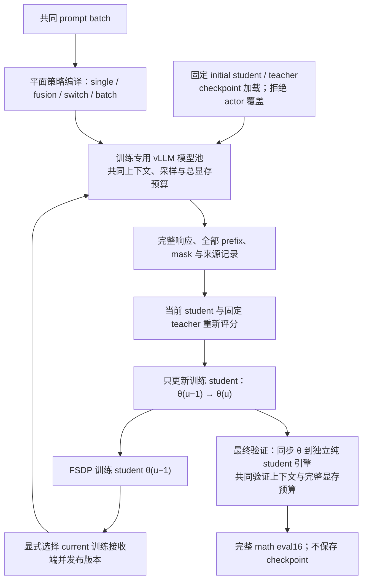

current 与 initial 的 λ=0.5 原生 fusion 均完成两步四卡更新和九十六条最终 student 响应，完整冻结参数摘要跨步骤/副本一致；见[current fusion](../../../../docs/experiment/results/native-rollout/trainer-current-fusion/native-acceptance.json)与[initial fusion](../../../../docs/experiment/results/native-rollout/trainer-initial-fusion/native-acceptance.json)。分段/batch 的六项矩阵也完成，包括 teacher 仅一条响应、其余三个推理副本无该来源请求的情况。一次并行调试导致 vLLM 显存探测失败，串行原参数重跑通过；共享负载结果不作独占速度证据。

[连续解码检查](../../../../docs/experiment/results/native-rollout/fusion-decode-eager/receipt.json)覆盖 λ=0/0.5/1、两条 prompt 各八步和完整有效词表；最大跨后端 logits 差为 0.125、TV 为 0.027081，满足已定 BF16 界限。λ=0.5 的[CUDA Graph 检查](../../../../docs/experiment/results/native-rollout/fusion-decode-graph/receipt.json)实际捕获 114 个图，十六个 prefix 的完整 logits 与参考相同，sleep/wake 后内容、地址和输出一致；该数值探针不覆盖训练热更新或原生 abort/drain，其独立结果见下文；长响应性能和完整质量对照仍未完成，Status 保持 proposed。

### 原生排空与缓存恢复

真实 native 请求检查补齐了取消路径：vLLM 0.10 abort 不唤醒等待输出的生成协程，单靠 frontend map 为空不足以确认完成。服务端保存实际生成 task，abort 后取消并等待 task，再等待 CUDA barrier 与 prefix reset；超时保持 drain-pending，禁止权重变更或重新开放。eager/graph 的长请求均在实际 decode 后成功排空，随后 logits 与发布恢复；见[运行检查](../../../../docs/experiment/results/native-rollout/runtime/receipt.json)。同一检查还验证生产 IPC 完整换权重后的 APC 零命中与完整 logits 等价。

[四卡 graph 训练](../../../../docs/experiment/results/native-rollout/trainer-current-fusion-graph/native-acceptance.json)在重复同题条件下完成两步和最终纯 student 验证，检查相同 prefix 跨 actor 版本更新、完整冻结摘要和参数地址。当前尚待最终版本的统一性能基准、正式 50 步完整质量矩阵和逐项完成审计，提案保持 proposed。

[独立验证并发的 CPU 验收](../../../../docs/experiment/results/native-rollout/eval-concurrency-cpu.json)覆盖默认继承、配置副本、重复解析、四类训练策略和 worker 参数读取；三组四卡短验收将对照 current 继承值、current 验证上限 64 和 initial-fusion 验证上限 64。它们共享 B8、两步和六题×16，额外核对默认完整数据清单及实际引擎回执。GPU 接入尚未验收，计时不作质量或吞吐结论；旧冻结任务保持原配置。

Validation 优化使用独立的 seq/token/显存预算与 Graph 参数副本，保持训练配置；KL 输入在 DP 补齐后按相近前缀长度分配，每 rank 行数一致，RPC 返回后先逆排再去掉补齐。整块词表归约保持 FP32 与原数值门槛，完整词表太大时仍可显式缩小词表块。有效 token 解码避免扫描 padding，并按验证阶段记录 API 耗时。候选 profile、头部/权重/KV 容量估算及四/八卡参数由[速度与显存](../../../../docs/experiment/速度与显存.md)维护；真实性能、分块选择与周期验证 GPU 恢复以各自验收结果为准，不用 CPU 检查声称加速。

四卡 p0/q 的固定真实 token 配对测试支持负载平衡和整块词表：原顺序、小块约 45.41 s，平衡且位置块 1,024 约 11.34 s，逐响应归一化统计最大差 $8.45\times10^{-7}$。位置块 2,048 仅再快约 2%，allocated 高水位却多约 5.2 GiB，先采用 1,024。前向 batch 2–16 的差约 $1.31\times10^{-3}$，未通过原 $10^{-5}$ 门槛，也未取得足够速度收益，默认维持 1。后续只有在重新通过配对精度与实际成本验收后才考虑启用批量前向；不能放宽误差门槛来接受这组结果。该微基准没有 optimizer/CPU offload，不能把其加速比直接套到完整 trainer；精确设置、工作量与图件归速度专题。

### 完整 prompt 池与访问次数

[完整题库生成器](../../../../data/prep/build_fresh_math_data.py)按实际 token IDs 去重，剔除所有答案冲突题，独立于训练步数和 batch 大小。DAPO 的 17,917 行在 1,024 token 上限下过滤 8 行，去重 662 条额外记录，再移除 12 个答案冲突的唯一 prompt，得到 17,235 题。真实 RLHFDataset 和随机 sampler 已核对该行数，batch 64 时每 epoch 269 批、末尾 19 行按现有 drop-last 规则省略；前五十批恰好消费 3,200 道不同题，后续 epoch 重新打乱全题库。

默认入口现已对齐上述完整清单：`math_native.sh` 在未显式指定数据时绑定 `runs/native-data/math-full/manifest.json`，缺少准备产物时在下游训练启动前退出；显式 `TRAIN_FILES` 保留工程场景，显式 `NATIVE_DATA_MANIFEST` 继续绑定对应 Parquet。四项真实 Bash 入口检查覆盖默认值、缺失前置条件、带空格路径及覆盖优先级；实际 Hydra dry-run 和 pre-Ray 检查验证本机默认池为 17,235 题、tokenizer/模板/cap/文件哈希匹配，未初始化 CUDA。证据见[入口验收](../../../../docs/experiment/results/native-rollout/native-data-default-cpu.json)。后续[CLI 兼容性验收](../../../../docs/experiment/results/native-rollout/native-cli-data-cpu.json)补齐命令行自定义数据的边界：数据文件或清单由 CLI 显式选择时不注入默认绑定；六项真实 Bash 检查与实际 Hydra/pre-Ray 校验通过。

访问次数现在按题目内容而不是原始行号累加，原始行 ID 另存。相同题目即使出现在不同数据行，也使用递增 visit 重新采样；验证响应计数与训练 visit 分离。正式运行可通过 `NATIVE_DATA_MANIFEST` 绑定数据、词表/模板、prompt 上限和文件哈希。新原生路径暂不提供无偏 top-k tail 所需的已核验行为分数，显式拒绝该组合；历史 `policy=null` 路径继续可用。

### 目标与算法含义

建议将新实验统一为训练时实时生成（fresh rollout），把生成权重来源单独配置。所有设置都只训练当前 student $p_\theta$，teacher $q$ 始终冻结；初始 student $p_0$ 是训练开始前的固定权重。实时生成描述生成时机，on-policy 描述生成分布与当前 student 的关系，二者不能混用。

#### State 的定义与共同训练阶段

第 $u$ 次训练更新前使用 actor 参数 $\theta_{u-1}$。对题目 $x$ 和实际生成的响应 $y$，第 $t$ 个动作之前的 state 定义为

$$
s_t=(x,y_{<t}),\qquad a_t=y_t,\qquad s_{t+1}=(x,y_{\le t}).
$$

state 是 token 前缀；同一个前缀在不同模型中的隐藏表示和 KV 数值可以不同。训练对每个有效响应 token 取其生成前的 prefix；返回的 EOS 也是有效动作，终止后的前缀不再额外产生训练位置。对同一道题，所有来源的第一个 state 都是题目本身，差异从生成动作及其后续前缀开始。方案中的变体通过改变采样策略 $\mu$ 形成不同的轨迹及 state 访问分布；它们也同时改变 action、长度和截断，不能仅凭最终准确率把效果全部归因于 state。

下图是所有变体共用的训练阶段。生成组件只决定响应及前缀；当前 student 和冻结 teacher 都在相同的实际 prefix/action 上重新评分。$p_0$ 和生成用的 teacher 都不接收优化器更新。

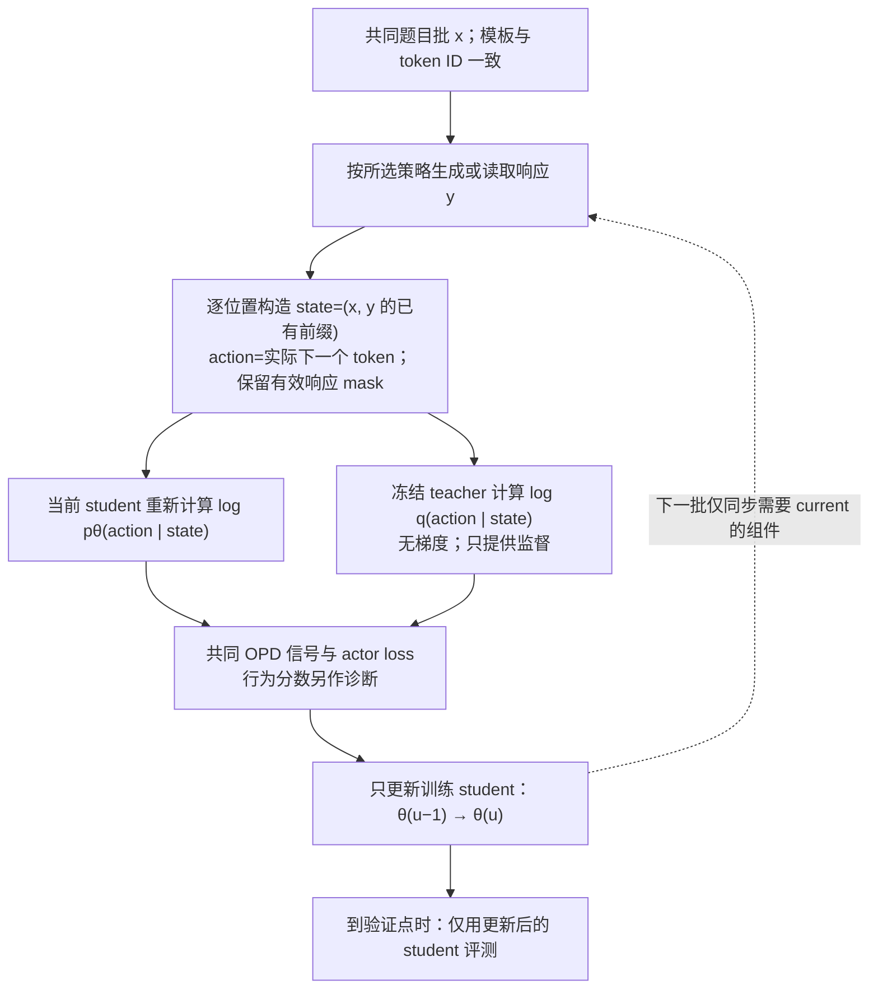

#### 基础变体与模型版本

`single` 选择一个模型负责整条响应。`student_fresh` 随 actor 更新改变生成分布；`initial_student_fresh` 和 `teacher_fresh` 保持生成权重固定，每次消费 prompt 时仍重新采样。后两者的分布固定，不意味着每次抽到同一条有限轨迹。

| 设置名                   | 生成策略                   | 生成权重是否随 student 更新 | 需要每步同步 actor 的生成组件 |
| ------------------------ | -------------------------- | --------------------------- | ----------------------------- |
| `student_fresh`          | 当前 $p_\theta$            | 是                          | 当前 student                  |
| `initial_student_fresh`  | 固定 $p_0$                 | 否                          | 无                            |
| `teacher_fresh`          | 固定 $q$                   | 否                          | 无                            |
| `student_teacher_fusion` | 当前 $p_\theta$ 与固定 $q$ | λ<1 时更新                  | λ<1 时为当前 student          |
| `initial_teacher_fusion` | 固定 $p_0$ 与固定 $q$      | 否                          | 无                            |

#### 三种单模型 state 来源

表中前三行对应下面三个互斥分支；后两行的双模型流程见“逐 token 融合的 state 来源”。

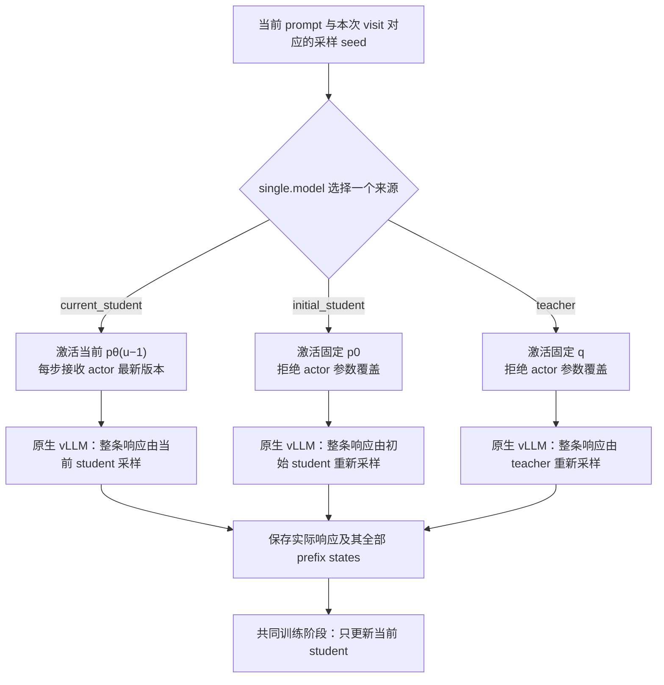

执行上复用原生 `generate`，区别在模型引用和权重恢复路径。第 $u$ 步中 current 的生成版本固定为 $u-1$；$p_0/q$ 按不可变 checkpoint 身份恢复。不能因为生成来源是 teacher 就将 actor 初始化改成 teacher。三种模式使用同一 prompt 清单与训练预算，state 来源不决定题目池大小。

#### 固定模型 fresh 与固定轨迹 replay

`initial_student_fresh` 每次消费 prompt 都重新采样，不能继续称为论文的固定缓存 Semi-OPD。历史缓存保留为 `collection=replay` 的复现适配器；新实验默认 `fresh`，响应复用策略与模型来源分开。固定生成来源可以更早预取，但首轮公平对照先统一逐步生成，避免只给固定来源跨步大批量预取而引入另一个性能变量。

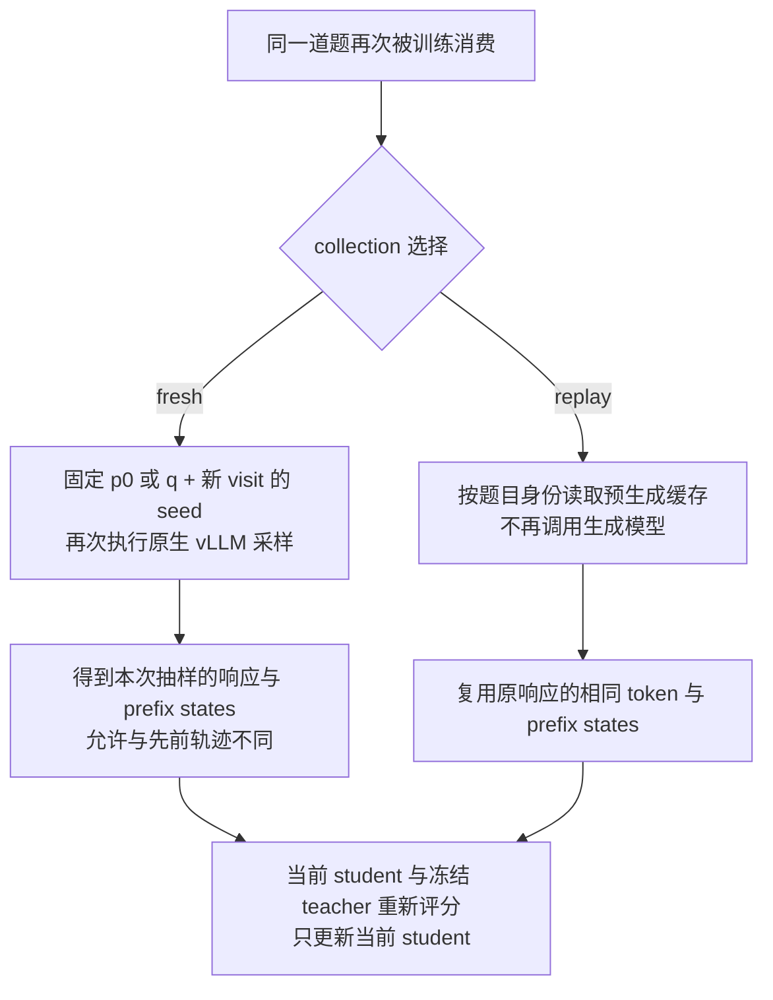

Semi-OPD 的 replay 固定的是有限响应和 state 集；initial fresh 固定的是模型 $p_0$，抽样的有限 state 集可随访问变化。缓存 teacher 与 teacher fresh 也有同样区别。重复消费多少题、每题访问几次仍由数据清单与训练预算决定，不能从 `fresh/replay` 自动推导。

#### 逐 token 融合的 state 来源

双模型模式保持现有 logit fusion 的数学语义：对同一 state $s$，取 base 模型 $b\in\{p_\theta,p_0\}$ 和 teacher 的 logits，先在 FP32 中组合，再使用共同的词表支持、温度与采样规则。

$$
z_\lambda(s)=(1-\lambda)z_b(s)+\lambda z_q(s),\qquad
\mu_\lambda(\cdot\mid s)=\operatorname{softmax}(z_\lambda(s)/T).
$$

上式在共同有效词表内定义，首版保持 $T=1$、top-p=1、top-k=-1、repetition penalty=1。两个模型每次都接收同一个实际采样 token，保留各自 KV；不能让它们先独立续写再混合答案。λ=0/1 的计划可以归约为只激活相应单模型，避免无用前向；端点的分布与正常采样仍需核验。

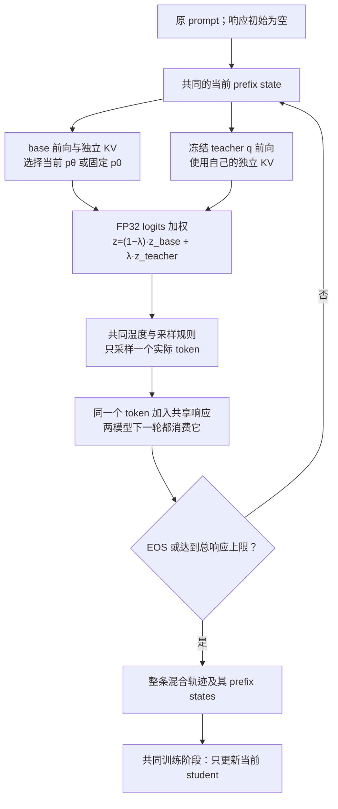

图示为 $0<\lambda<1$ 的执行语义。`student_teacher_fusion` 的 base 是当前 actor 的推理副本，state 分布会随训练更新；`initial_teacher_fusion` 的 base 固定为 $p_0$，teacher 也固定，因此在固定采样设置下行为分布不随 actor 更新，但每次 fresh 抽样的轨迹仍可不同。两者都由融合分布逐 token 形成一条连续前缀，不能把每个 token 简单归为“teacher 生成”或“student 生成”。

历史 current fusion 使用 HF 双模型；原生扩展现已将两套 backbone、独立 KV 和 logits 融合接入同一个 vLLM 采样循环，两种 base 均通过四卡短训练。完整 50 步质量矩阵尚未完成，历史 HF 结果保留原运行身份。

在 $T=1$、共同有效词表 $V$ 上 logits 有限的条件下，令 $p_V=\operatorname{softmax}(z_b)$、$q_V=\operatorname{softmax}(z_q)$。对 $0<\lambda<1$，将 $z_b(v)=\log p_V(v)+\log Z_b$ 与 $z_q(v)=\log q_V(v)+\log Z_q$ 代入并消去与 token 无关的归一化因子，可得

$$
\mu_\lambda(v\mid s)=
\frac{p_V(v\mid s)^{1-\lambda}q_V(v\mid s)^\lambda}
{\sum_{u\in V}p_V(u\mid s)^{1-\lambda}q_V(u\mid s)^\lambda}.
$$

因此 λ=0.5 是归一化的几何平均，通常不同于概率算术平均 $0.5p_V+0.5q_V$。λ=0/1 直接取单模型端点；此处 $p_V/q_V$ 是生成端有效词表上的分布，不能据此忽略后文说明的 FSDP 评分归一化差异。

### 三种混合方式与参数

逐 token 的 logit fusion、轨迹内分段切换和 batch 内分配生成来源改变分布的方式不同，分别配置。四类平面配置共用统一生成入口，各自独立选择，首轮不递归嵌套。

| 策略类型          | 控制参数                      | 生成行为                                              | 默认训练范围                 |
| ----------------- | ----------------------------- | ----------------------------------------------------- | ---------------------------- |
| `single`          | `model`                       | 整条响应由一个来源生成                                | 整条响应，只更新当前 student |
| `logit_fusion`    | `base`、`teacher_weight=λ`    | 每个 token 都在同一 prefix 上融合两模型 logits 后采样 | 整条响应，只更新当前 student |
| `sequence_switch` | `first`、`second`、`boundary` | 前 $k$ 个响应 token 用第一模型，随后换第二模型续写    | 两段响应，只更新当前 student |
| `batch_mix`       | `components`、权重、分配规则  | 一个 batch 的不同完整响应分别交给选定单模型           | 所有响应，只更新当前 student |

#### 双向分段切换的 state 来源

分段切换的第一版支持两个单模型叶节点：teacher→current student、current student→teacher，以及把 current 换成 initial 的设置。给定 prompt $x$、生成中的响应 $y_{<t}$ 与切换位置 $k$，第 $t$ 个响应 token 的行为分布为

$$
\mu_t(\cdot\mid x,y_{<t})=
\begin{cases}
a(\cdot\mid x,y_{<t}), & t\le k,\\
b(\cdot\mid x,y_{<t}), & t>k.
\end{cases}
$$

这里 $a,b$ 是选定来源及共同采样变换后的分布，位置从 1 开始，只计算新生成的响应 token。优先支持 `response_tokens: k`；也可用 `budget_fraction: ρ`，规定 $k=\lfloor\rho L_{\max}\rfloor$，其中 $L_{\max}$ 为总响应上限。ρ 不能解释成“最终实际响应的前 ρ 比例”，因为生成前不知道 EOS 会出现在哪里。$k=0$ 直接使用第二来源，$k\ge L_{\max}$ 直接使用第一来源。第一段遇到 EOS 或共同停止条件就结束整条响应，禁止为了凑够比例继续生成。第一段因达到 $k$ 而停止只代表阶段完成，不代表整条响应被截断。

第二阶段接收原 prompt token 与第一段响应 token 的直接拼接，不再应用 chat template，也不经过文本解码再编码。总响应预算始终是 $L_{\max}$，不是每段各生成 $L_{\max}$。第一段 token 仍属于训练响应，训练 mask 覆盖两段；若以后研究仅训练某一段，需要另设实验条件。

| 方向            | 前 $k$ 个 token 的来源 | 第二段如何形成 state                                                  |
| --------------- | ---------------------- | --------------------------------------------------------------------- |
| teacher→current | 冻结 $q$               | 当前 $p_\theta$ 在 teacher 已生成的前缀上继续采样，随后继承自己的续写 |
| current→teacher | 当前 $p_\theta$        | $q$ 在 student 已生成的前缀上继续采样，保留已有 token                 |
| teacher→initial | 冻结 $q$               | 固定 $p_0$ 在 teacher 前缀上继续采样                                  |
| initial→teacher | 固定 $p_0$             | $q$ 在初始 student 前缀上继续采样                                     |

下面两条路径显示方向差异，均以第一段没有提前结束为前提。第二段起点的 state 由第一模型已经生成的 token 决定；换模型不会重置题目或改写第一段。

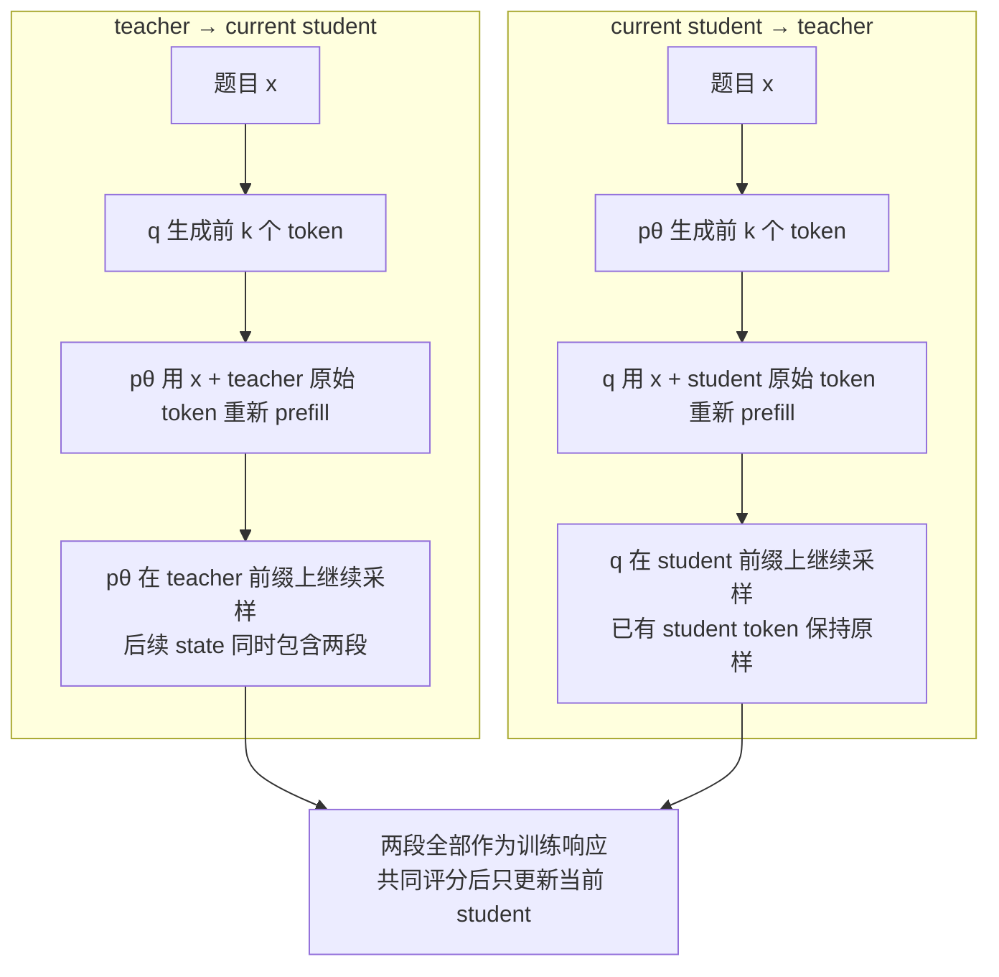

具体执行计划将 `first=A`、`second=B` 和边界编译为最多两次原生调用。两模型之间仅传递实际 token，B 用自己的权重建立 KV，A 的 KV 不直接交给 B。下面的结束判断使用实际 EOS token 和语义停止状态，而非只看原生 `finish_reason`。

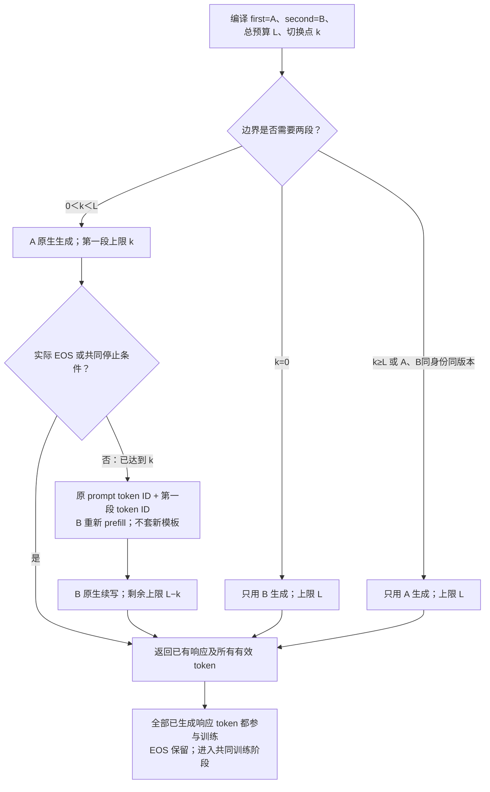

例如总 cap 为 4,096、$k=2,048$ 时，第一段最多生成 2,048 个 token，第二段最多再生成 2,048 个。切换后第一个 action 所处的 state 仍是完整第一段前缀；B 的第一个 token 只从下一个 state 起加入访问轨迹。`budget_fraction=0.5` 表示总预算的一半，提前 EOS 时不保证实际响应恰好一半来自各模型。原型已支持整数 `boundary`，比例到整数的配置编译仍属正式接入方案。

第一版沿当前 math 设置使用 EOS 与长度停止，不新增文字 stop、最小响应长度或非平凡的 frequency/presence penalty。以后开放这些选项时，判定必须针对完整响应，包含跨切换边界的 stop 字符串，不能在第二段重新从零计数。

#### Batch 混合的 state 来源

batch 混合默认以响应为路由单位，用最大余数法分配整数配额：先对每个组件的理想条数向下取整，再将剩余名额依次分给余数最大的组件，余数平局按 `components` 声明顺序决定，与原型 `exact_routes` 一致。二来源的 teacher 配置权重为 α，base 为 $1-\alpha$；记 teacher 在 $B$ 条响应中实际分到 $N_q$ 条，其余交给 base。用有 seed 的随机排列分配位置，再按来源聚合请求，生成后恢复原顺序。多来源也使用相同取整规则，保证总数为 $B$；独立 Bernoulli 分配可作为另一选项，但不保证每个 batch 的比例相同，必须记录实际数量。

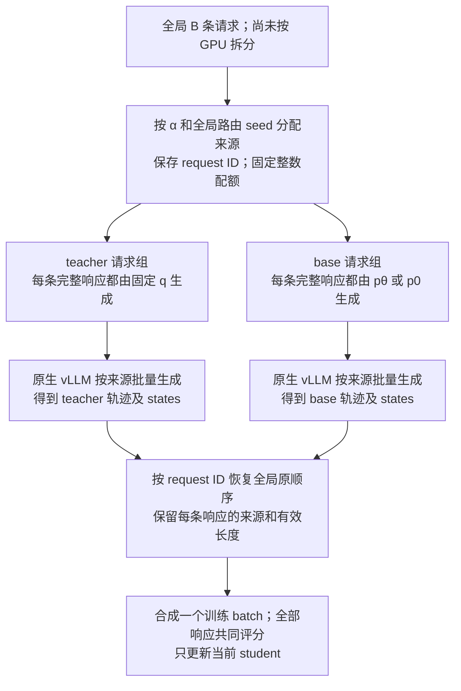

base 选 $p_\theta$ 时为 current/teacher batch 混合，选 $p_0$ 时为 initial/teacher batch 混合；首轮分别比较这两种二来源设置。单条响应不会在模型之间接力，批内 state 集来自各来源的不同完整轨迹。比如 $B=64,\alpha=0.25$ 时有 16 条 teacher 和 48 条 base 响应；这不能解释为每条响应有 25% teacher token，也不能解释为逐 token 的 λ=0.25 fusion。图中的分叉表示来源分组；两组可以串行执行，是否并发由模型驻留与联合显存预算决定。

路由在全局 batch 上决定，随后按模型负载分发到副本，避免每个 GPU 单独取整造成比例偏差。每题多响应时，选择“每题同一来源”还是“每条响应独立来源”必须显式配置；当前训练 $n=1$，两者相同。来源占 50% 的响应不等于占 50% 的 token：不同来源的响应长度和提前 EOS 比例会改变实际 token 占比。

batch 混合先采样整条响应的来源，再从该来源生成。精确配额的实际比例为 $\alpha_B=N_q/B$，对随机路由取边缘后，每条响应的序列分布为

$$
P_{\mathrm{mix}}(y\mid x)=(1-\alpha_B)P_b(y\mid x)+\alpha_B P_q(y\mid x).
$$

整数取整时 $\alpha_B$ 可以与配置的 α 不同；Bernoulli 分配的边缘权重才直接为 α。精确配额会让同批来源选择相关，但每条响应仍只有一个来源。batch 混合与每步融合 logits 的 $\mu_\lambda$ 不相同，α、λ 和切换位置 $k$ 分别控制三个独立维度。若记录行为分数，应同时标记来源条件分数与是否计算了边缘混合分数，不能把前者冒充后者。

首轮将单模型、logit fusion、单次分段与简单 batch 混合列为独立模式。`sequence_switch` 的两段均为单模型，`batch_mix` 的组件也均为单模型；暂不设计或安排“batch 混合包含分段”和“分段中使用 fusion”这两类嵌套组合。配置编译阶段拒绝这些嵌套设置，已有原型的相关测试仅保留为历史能力证据，不扩大首轮实施与实验范围。

### 当前代码的耦合与影响

| 当前位置                                                                                                                                                                                             | 已核对的行为                                                           | 重构影响                                                                              |
| ---------------------------------------------------------------------------------------------------------------------------------------------------------------------------------------------------- | ---------------------------------------------------------------------- | ------------------------------------------------------------------------------------- |
| [engine_workers.py](../../../../verl/verl/workers/engine_workers.py) `init_model`；[llm_server.py](../../../../verl/verl/workers/rollout/llm_server.py) `LLMServerManager`                           | actor 初始化和 rollout 共享 `actor_rollout_ref.model`                  | 不能用改该路径的方式选择 teacher 生成，否则连可训练 student 初始化与 tokenizer 都改变 |
| [ray_trainer.py](../../../../verl/verl/trainer/ppo/ray_trainer.py) `fit`                                                                                                                             | 生成处按 fusion、普通生成、固定缓存分三支；同步条件也依赖缓存是否存在  | trainer 应调用统一协调器，来源选择、恢复和休眠归协调器处理                            |
| [vllm_rollout.py](../../../../verl/verl/workers/rollout/vllm_rollout/vllm_rollout.py) `update_weights`；[utils.py](../../../../verl/verl/workers/rollout/vllm_rollout/utils.py) `on_bucket_received` | actor 参数流同时写入 HF fusion 的 student 槽和原生 vLLM                | 同步目标须按模型引用选择；不能让 actor 参数覆盖 $p_0$ 或 $q$                          |
| [engine_workers.py](../../../../verl/verl/workers/engine_workers.py) `generate_logit_fusion`；[decoder.py](../../../../verl/verl/workers/rollout/fusion/decoder.py) `load_student_weights`           | 固定要求 `expected_version=step-1`，只支持一个可变 student 槽          | 固定 initial fusion 需要不可变模型身份；不能假装它拥有当前 actor 版本                 |
| [vllm_async_server.py](../../../../verl/verl/workers/rollout/vllm_rollout/vllm_async_server.py) `_sleep_hybrid`                                                                                      | 全参数 HYBRID sleep level 2 释放原生权重，恢复依赖 actor 参数流        | 固定 checkpoint 必须有自己的恢复路径，单独跳过同步还不够                              |
| 同文件 `release_kv_cache`、`resume_kv_cache`                                                                                                                                                         | 当前只有条件检查和返回，没有实际释放/恢复操作                          | 不能按方法名认定 KV 已释放；需实现或改用真实生命周期操作，并用显存证据验收            |
| [hf_rollout.py](../../../../verl/verl/workers/rollout/hf_rollout.py)、[base.py](../../../../verl/verl/workers/rollout/base.py)                                                                       | 旧 HF 类使用同步接口，构造形式与当前基类不同，也不在 async registry 中 | 不能直接设置 `rollout.name=hf`；新默认使用原生 vLLM，现有 fusion decoder 保留作参考   |
| [math_online.sh](../../../../recipe/math_online.sh)、[math_cached.sh](../../../../recipe/math_cached.sh)、[math_fusion.sh](../../../../recipe/math_fusion.sh)                                        | 配对数据默认指向 3,200 条 schedule，epoch 数按每轮 50 步计算           | 数据池、训练预算与生成方式必须独立                                                    |
| `ray_trainer.py` 与 [plateau.py](../../../../verl/verl/trainer/ppo/plateau.py)                                                                                                                       | 平台检查显式限定固定缓存，比较缓存窗口残差                             | fresh 模式不能直接沿用相同 states 的解释或该提前停止条件                              |

普通异步生成会做 verifier 评分，缓存与 fusion 的打包则放入零 `rm_scores`。当前纯 `token_reward_direct` 会由 `OPDTrainerMixin.compute_opd_token_reward` 覆盖为 teacher 的逐 token 信号，因此这不证明当前主 loss 有差异；但训练准确率等诊断和以后启用的 GRPO 混合项需要共同的 verifier 阶段，不能因生成路径不同而改变。

生成端还会屏蔽 tokenizer 有效词表以外的 padded logits，HF fusion 也切到有效词表；当前 FSDP teacher 评分函数对完整输出 logits 做归一化。当前配对的 tokenizer 长度为 151,665，模型输出词表为 151,936。生成分数、当前 actor 分数和监督 teacher 分数的职责应分别保留，不能为省一次前向就直接复用生成分数；先验证词表支持、温度、mask、位置和精度的归一化口径。

### 建议保留的四个对象

| 对象                 | 职责                                                    | 关键约束                                                                           |
| -------------------- | ------------------------------------------------------- | ---------------------------------------------------------------------------------- |
| `ModelRef`           | 表达可变 actor 引用或固定 checkpoint 引用               | actor 用更新版本；$p_0/q$ 用不可变 fingerprint；相同初始数值不允许共享可写参数存储 |
| `RolloutPolicySpec`  | 表达单模型、fusion、分段切换与 batch 混合，编译请求计划 | `uses_actor` 从有效组件推导；零权重、空分组与端点先归约                            |
| `RolloutCoordinator` | 编排训练生成、权重激活、休眠、验证切换和统一轨迹结果    | 拒绝错误模型身份、未完成参数流、旧版本与不支持的后端组合                           |
| `GenerationBackend`  | 实现原生生成或双模型前向、采样和资源生命周期            | 声明支持能力；统一接口不等于底层 kernel 相同                                       |

模型引用表启动时解析一次：`current_student` 指向 actor，`initial_student` 指向 actor 的训练前 checkpoint 快照，`teacher` 指向现有 `distillation.fsdp_teacher.model_path`。生成 teacher 与监督 teacher 是两个逻辑职责，首版明确绑定同一 checkpoint。参数传输复用现有 BucketedWeightSender/Receiver 和 checkpoint engine；这里的 checkpoint engine 是权重传输机制，不意味着训练时保存 checkpoint。

每个 run 只编译选中的策略，去掉零比例与无效端点，再解析实际参与的模型；三个角色引用不要求同时建立三套 GPU 引擎。首轮每种策略最多涉及 base 与 teacher 两种生成来源，不同时驻留三个生成模型。teacher 评分和最终 student 验证的资源单独安排，冷启动成本与阶段恢复成本分别计时。

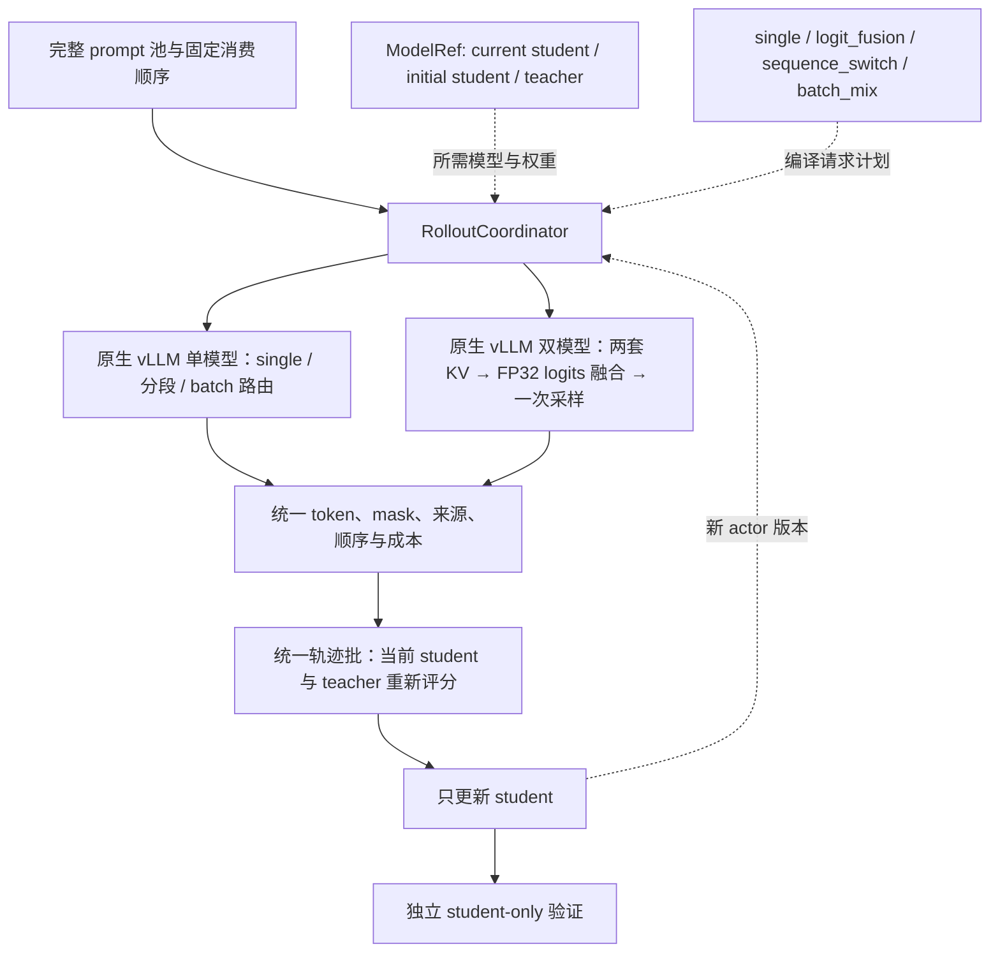

trainer 保留数据读取、teacher 信号、优势计算、actor 更新与评测指标，生成处收敛为一个入口。协调器可以提供拟议接口 `generate_train(batch, actor_version)` 与 `generate_eval(batch, actor_version)`；后者始终绑定当前 student，训练来源不决定评测来源。已有 `FixedRolloutCache` 作为 replay 适配器继续严格验证历史缓存，不必重建一套 trainer 或迁移上游安装结构。

### 配置示例与所有权

下面是拟议配置子树，不是当前可执行的 Hydra 命令；对应字段和后端尚未实现。保留现有路径作为单一事实源，不新增另一套顶层模型路径。

```yaml
actor_rollout_ref:
    model:
        path: ../models/DeepSeek-R1-Distill-Qwen-1.5B
    rollout:
        name: vllm
        generation_backend: vllm_native
        collection:
            mode: fresh
        policy:
            kind: sequence_switch
            first: { kind: single, model: teacher }
            second: { kind: single, model: current_student }
            boundary: { kind: response_tokens, value: 1024 }
distillation:
    fsdp_teacher:
        model_path: ../models/JustRL-DeepSeek-1.5B
```

`model.path` 仍只定义 learner 的初始化及 canonical tokenizer；`initial_student` 在启动时从它绑定固定引用。`policy` 选择一种模式及其模型来源，`generation_backend` 选择实际解码内核。单模型、分段与 batch 混合使用 `vllm_native`；精确 fusion 拟使用 `vllm_paired`。现有 HF fusion 只作为数值参考与历史复现路径；即使 RPC 容器来自 vLLM，也继续按 HF 计算后端记录其历史吞吐。

下面分别示意精确配额的简单 batch 混合与固定初始 student 的独立 fusion，也尚非可执行参数。

```yaml
batch_mix_example:
    kind: batch_mix
    routing_unit: trajectory
    assignment: exact_count
    components:
        - weight: 0.5
          policy: { kind: single, model: teacher }
        - weight: 0.5
          policy: { kind: single, model: current_student }
fusion_example:
    kind: logit_fusion
    base: initial_student
    teacher_weight: 0.5
```

切换方向只需交换 `first/second`；batch 中的组件限定为 `single`，不能替换成 `sequence_switch` 或 `logit_fusion`。采样、batch、数据和学习率沿共同配置继承，避免为组合复制配方。旧 math recipe 保留复现入口，新配方在同一公共启动器上选择策略。

配置编译时验证模型引用、后端能力、有限数值及范围：λ/α/ρ 在 $[0,1]$ 内，token 边界为非负整数，混合权重非负且总和为正，响应总预算为正。先归一化混合权重与化简端点，再决定需要哪些模型和同步目标；不支持的组合在启动前报错。

### 每步生命周期

第 $k$ 次更新前，actor 为 $\theta_{k-1}$；新模式仍遵循以下顺序。

1. 从共同 dataloader 取得 prompt，完成一次 canonical tokenization，固定模板、assistant 前缀、EOS/PAD 与有效 token ID 语义。组件不能各自切换 chat template。
2. 协调器确认 active policy。仅当策略实际使用 current student 时同步 $\theta_{k-1}$；$p_0/q$ 只校验固定引用和设备状态，按需恢复自己的权重。
3. 按请求计划生成响应。分段期间 actor 版本锁定，batch 各来源也使用同一更新前版本；不能在仍有旧请求时覆盖权重。保存 prompt ID、访问轮次、响应 token、mask、采样设置、seed、路由、实际切换位置、逐 token 来源、组件身份与 actor 版本。不同后端或 batch 布局不承诺逐 token 完全一致。
4. 结束生成请求，释放应释放的 GPU 资源；当前 student 重新计算 `old_log_probs`，冻结 teacher 重新评分，保持现有 token reward 与 actor 更新，得到 $\theta_k$。
5. 到验证点时，协调器切到当前 $\theta_k$ 的单模型验证，完成三基准 eval16；下一步恢复训练所选的生成策略，并清除旧模型或旧版本对应的 KV/prefix cache。

行为策略 $\mu$ 的分数仅保存为独立的 `behavior_log_probs` 诊断。MVP 继续使用当前 actor 重算的 proximal anchor，拒绝为这些新策略启用 `bypass_mode` 或自动 rollout correction；否则可能把 teacher/fusion 的概率误当成 actor 锚点，或在重构中顺带加入重要性修正。off-policy 生成下，采样 log-ratio 也不能直接宣称为当前 student 的完整条件 KL。

轨迹结果用显式有效长度和 mask 保留 EOS，即使 EOS 与 PAD 使用同一 token ID，也不能用 `token != pad` 推断响应。每题响应数只在一个位置展开；现有验证已在 trainer 重复 16 次，后端每条请求只返回一次，重构不能再次展开成 256 次。

原子参数流与 CUDA Graph 的所有权必须一同保留：完整 named-tensor 流收到后才发布新 actor 版本；固定引用拒绝写入。actor 参数原地更新且地址稳定时可重用 graph，但搬迁模型或重建 tensor 会使捕获地址失效，需要失效处理和重新捕获。KV 内容每次生成重置，graph 的 key 包含组件存储身份、batch bucket、容量与 dtype，而不应仅因 actor 版本变化就强制重新捕获。

### vLLM 后端能力与实现边界

| 生成策略                  | vLLM 实现路径                                  | 当前状态                                       |
| ------------------------- | ---------------------------------------------- | ---------------------------------------------- |
| 当前 student 单模型       | 现有原生 `generate` 与 actor 参数同步          | 已有正式在线结果                               |
| 固定 initial / teacher    | 原生 `generate`，增加独立加载与恢复            | 离线与独立原型已验证；训练内生命周期待接入     |
| teacher→student，反向亦然 | 两次原生 token-in/token-out 请求，传递已有前缀 | 独立原型已验证；正式 worker/coordinator 待接入 |
| batch 内来源混合          | 原生请求按来源聚合、路由与重排                 | 独立原型已验证；正式 worker/coordinator 待接入 |
| 同 prefix 的精确 fusion   | 注册原生双模型，必要时适配 V1 model runner     | 新扩展待验证；现有已验收版本仍是 HF 计算后端   |

本仓原生服务已接受 token ID 前缀和显式 `max_tokens`。分段协调器预先核对两个模型的上下文容量：第二段输入长度是原 prompt 加第一段响应，不能再次套用原始 prompt 的 1,024 token 截断。服务目前会把预算限制到可用上下文，且把 0 提升到 1；协调器必须提前跳过零长度阶段并拒绝不满足总预算的请求，避免静默多生成或少生成。

原生返回适配器目前还将 vLLM 的 `finish_reason=stop/length` 都映射为 `stop_reason=completed`。分段实现需要保留原始 finish reason 与具体 stop reason，区别阶段 token 配额用尽、EOS/stop 条件和总响应上限；不能仅凭响应正好长 $k$ 就决定续写。abort/取消也不能当成切换边界。每个请求和阶段使用独立的采样参数副本，避免当前 `generate` 的 `pop` 修改影响后续阶段；seed 由 run、prompt ID、访问轮次、响应序号与阶段确定，路由和生成 seed 分开记录。

第一阶段返回之后，第二模型必须用自己的权重为整段输入建立 KV。teacher 与 student 的 token 相同也不代表各层 K/V 相同，PagedAttention 或 KV-transfer 都不能直接跨权重复用这段 KV。若同一模型、同一权重版本存在命中的 prefix cache，可以按实际命中减少 prefill；切换模型或更新 actor 后不能沿用旧身份的命中。相邻同源阶段应在编译时合并。

精确 fusion 优先尝试 vLLM 的仓外模型注册机制：将两套原生 Qwen2 组件封装为一个组合模型，forward 对同一批 token 和 position 分别前向，`compute_logits` 在有效词表中融合 FP32 logits，再交给同一个原生 sampler。模型注册是已有扩展入口，组合模型可用性是待验证方案。[^vllm-register] 一个调度器管理同一组请求与位置，两套 attention 层保留独立 KV 存储；复用逻辑 block 编号不等于共享 K/V 数值。

源码中存在需要先解决的限制：`get_kv_cache_spec` 从已注册 attention 层收集缓存规格，有机会让两组 full-attention 层共同计入容量；但 `bind_kv_cache` 仍按单个整数层号排序，两个原生模型都从第 0 层开始会触发 `NotImplementedError`。只给层名加 `base/teacher` 前缀不足以解决冲突。组合模型需要全局唯一的缓存层编号或一个局部绑定适配器，同时保持 checkpoint 参数名与 attention 层身份的映射。双 hidden-state 的返回、`logits_indices` 选择、profile、参数加载与 CUDA Graph 也必须核验。若仅注册模型不能满足这些约束，再用受控的 V1 worker/model-runner 适配器；不直接改共享环境的 site-packages。[^vllm-runner]

当前 0.10.0 V1 明确拒绝请求级自定义 `SamplingParams.logits_processors`；`worker_extension_cls` 用于增加 RPC 方法，还会检查与 worker 既有名称的冲突，也不能直接覆盖 `execute_model`。因此“加一个 processor”与“添加一个 RPC”都不等于把第二模型接入原生采样循环。[^vllm-extension] 不采用每个 token 经 Python/Ray 往返两个引擎、导出完整词表再采样的主路径，也不把 top-k logits 近似或以单模型为目标的普通 speculative decoding 当成精确 fusion。以融合分布为验证目标的 CoS 是不同方案，见下面的调研。

Fusion 的优先收益是复用 vLLM 的分页 KV、连续批处理和调度能力，减少已有 HF 路径的固定 padding 与逐步调度开销；它仍然要做两个模型的前向，不能承诺与单模型一样快。原生双模型扩展按相同 prefix 比较完整 logits、分布和实际 token 成本，现有 HF decoder 用作参考实现，不作为新 pipeline 的自动回退。

### 相关推理实现与复用判断

2026-10-18 核对了两个公开仓库的固定提交，以及两篇论文的相关实现章节。代码保存在忽略的研究缓存，提交、文件哈希与 CPU 语义核验归[同一代码核验清单](../../../../docs/experiment/results/2026-10-18-rollout-refactor-code-audit.json)。以下区分源码支持的行为、作者报告与本项目待验证事项，未运行这些项目的 GPU 推理。

| 项目或论文           | 已核对的实现                                              | 对本项目的用途与限制                                                                   |
| -------------------- | --------------------------------------------------------- | -------------------------------------------------------------------------------------- |
| `vllm-logits`        | 单个 vLLM 模型内的双原生 backbone 与两个 LM head          | 最接近 paired wrapper；依赖 0.15.x，需移植并补训练热更新与严格数值验收                 |
| CoS，ICML 2025       | vLLM fork 的 ensemble worker/sampler 与融合目标拒绝采样   | 可参考双 KV 预算和后续 speculative fusion；基于 0.6.5 安装路径，不能替换当前 V1 worker |
| UltraFuser，ACL 2025 | 附录 C 描述多个 vLLM 实例逐步交换 hidden/logits、统一采样 | 证明独立引擎协作路线有先例；这里仅核对论文，未核验独立可运行源码和同条件吞吐           |
| ThinkMerge           | 多条 reasoning context 的共享答案 logits 聚合             | 可参考多流同步；主要是同模型多上下文，不是本项目同 prefix 的两套权重                   |

`vllm-logits` 的审阅提交为 `a987755`，提交日期为 2026-08-18。`forward` 分别计算两个 native backbone，将 hidden states 拼接；`compute_logits` 分别经过两个 LM head 后组合 logits。源码注释中的“hidden-state mixing”与 README 的“no extra forward”不能理解为省掉第二模型计算，更不能在两个 LM head 不同的情况下直接混 hidden 再投影。普通 logit 模式可借鉴，但原实现默认为部分 token 保留 specialist 的值，`alpha=1` 仍先执行 ancestor 前向，且以进程环境变量选择模式；这些都不能照搬为当前实验语义或请求级策略。[^vllm-logits-backbones]

该项目声明 `vllm>=0.15,<0.16`，用 general plugin 注册模型；现有 Qwen GPU canary 是同一 checkpoint 作为两分支、eager 模式生成 5 个确定 token。它支持作者的短加载检查，尚不足以证明本项目两个不同 checkpoint、长上下文、CUDA Graph、actor 热更新和冻结引用正确。[^vllm-logits-package][^vllm-logits-test] 层号平移的思路可参考，但该提交在模型构造后重排 ModuleList；移植到 0.10.0 时必须同时检查 attention 注册表与 KV 层名，不能假设参数注册名的变化已经修改缓存身份。权重加载器最后返回全部参数名，也应改为只报告实际成功加载的集合，拒绝缺失或错误映射。

CoS 的审阅提交为 `b7c5553`，提交日期为 2025-06-16。`EnsembleDecodeWorker` 用相同请求调用多个原生 worker，分别维护 KV，再交给一个 sampler；其缓存块容量按各 worker 每块 KV 字节总和计算。[^cos-worker] `EnsembleSampler` 区分 `raw-logits/logits/probs` 三种目标，但默认 `we.yaml` 是概率加权，不能直接当作当前 logit fusion 的复现。移植应选择 raw-logits、在 FP32 混合后应用共同温度/截断；行为分数须从最终融合分布重算，不能沿用默认配方返回的第一模型 log-prob。[^cos-sampler]

CoS 的 speculative 路径先得到候选 token，再以组合分布做验证与残差重采样；因此优化目标可以保持为融合分布，而非单一 teacher 分布。论文报告相对普通协作解码 1.11–2.23 倍加速，该数字属于其模型与配置，未在本项目复现。[^cos-paper] 本项目两个 1.5B 组件规模相近，收益还取决于接受率、block 长度、有效 batch 和 KV 回退开销。先完成非 speculative 的原生精确基线，再以同一个 $\mu_\lambda$ 为目标验证 CoS；不直接迁入整个旧 vLLM fork。接受/拒绝统计、拒绝后的 KV 截断、actor 版本锁定与融合 log-prob 是额外验收项。

UltraFuser 附录 C 采用分割显存、多实例分别计算、逐步返回 hidden states 后融合并恢复生成的方案；不同模板与多模型 KV 是其动机。该路线适合参考协议，跨实例同步和逐步交换成本仍需本项目实测，论文的描述不能替代可用代码。[^ultrafuser] ThinkMerge 则先生成多条推理轨迹，再将各自的问题、推理轨迹和共同答案前缀拼接计算 logits；其两阶段实验使用 vLLM，单阶段 FlexAttention 版本使用 HF，不能因摘要提到 vLLM/SGLang 就视为现成双 checkpoint 插件。[^thinkmerge]

最终目标保持四层职责：不可变/可变模型引用 → 可组合策略计划 → 原生执行与资源管理 → 统一轨迹及 student 训练。单模型叶节点直接走单模型引擎；分段和 batch 混合在请求或阶段边界调度；真正需要两份 logits 时才使用 paired 模型。λ=0/1、空配额与同源相邻阶段在编译时消去，不为统一接口让所有请求都跑两套 backbone。第一版按同一策略聚合请求，后续若支持同引擎不同请求的 λ，须把系数随请求重排传到 GPU logits 行，替代进程全局环境变量。

复用次序是：借鉴 `vllm-logits` 的仓外注册、双 hidden/LM head 与权重映射，结合本仓已审阅的 V1 缓存身份和 actor 传输规则实现最小 paired wrapper；若 runner 限制阻碍正确执行，再局部适配。CoS 的双 worker 和拒绝采样作为后续优化参考；选择是否升级 vLLM 或引入更大改动，取决于独立环境中的长序列基准与训练恢复证据。

### 分段切换与 batch 混合的实现调研

进一步核对了 Relay-OPD、Prefix-RFT、TRL GKD 和 LUFFY 的固定提交，文件、审阅范围和 SHA 归[组合生成源码核验](../../../../docs/experiment/results/rollout-composition/review.json)。这些项目提供了不同层面的实现先例，生成来源、损失和复用方式需要分别比较，不能因都出现 teacher/student 就当作同一算法。

| 实现与审阅提交        | 实际生成方式                                                              | 可复用机制                                                    | 与拟议实验的差别                                                                             |
| --------------------- | ------------------------------------------------------------------------- | ------------------------------------------------------------- | -------------------------------------------------------------------------------------------- |
| Relay-OPD `eab21451`  | student 草稿流在条件触发后由 teacher 接管，按段落/token 预算交还或终止    | 请求级接管状态、实际输出 token 的来源标记、切换与停止事件     | 动态触发和多次接管，运行锁定 vLLM 0.21.0；不是固定位置的一次切换                             |
| Prefix-RFT `5f5d2a1f` | 从离线示范切前缀，student 续写；重建完整响应和 prefix mask                | 前缀/后缀分别保留来源，再统一送入 learner                     | 比例以已知示范长度为分母，代码经过文本和模板再编码；不是实时 teacher 生成                    |
| TRL GKD `6d6901c5`    | 每次 training_step 整批随机选择 student；否则在 seq_kd 开启时调用 teacher | 来源选择与 learner 分离，EOS-aware mask 与 prompt loss mask   | 不是同 batch 精确配额；seq_kd 关闭时另一来源是已有数据，所审阅生成函数调用 HF model.generate |
| LUFFY `01f4ae06`      | 每 prompt 展开多响应，其中部分拼接离线示范 token 前缀，其他纯 student     | n 只展开一次，raw token 拼接、prefix mask、on/off-policy 诊断 | teacher 轨迹来自离线数据，且带 mixed-policy GRPO/policy shaping，不能直接沿用其 loss         |

Relay-OPD 在原生 rejection-sampler 路径记录每次实际输出的 token，而非只记录每个 speculative chunk 的一个来源。teacher takeover 分支还会丢弃越过已验证前缀的 bonus token，以保留清楚的控制来源；段落预算和接管次数在请求状态中维护。[^relay-opd] 它说明原生 worker 内多次切换有公开先例，但引入的是动态策略及更深的版本适配。本轮先验证固定 k 的两阶段原生请求，不复制其触发器、反射词表或私有停止标记。

Prefix-RFT 的 `_get_prefix` 对完整示范 tokenize 后按示范长度取比例，decode 为文本，再通过 `continue_final_message=True` 构造带前缀的输入；trainer 将前缀重新放回 responses 并建立 prefix mask。[^prefix-rft] 这可参考数据归属，不能证明跨模型 token 序列精确保留。我们的实时分段直接传递原 token IDs，ρ 的分母为共同总预算；结束后前段仍属于响应，两段默认都参与现有 OPD 更新。

TRL GKD 的来源随机数在 `training_step` 中抽取一次，作用于整批输入。只有 `seq_kd=True` 才在非 student 分支调用 teacher；否则沿用输入数据。[^trl-gkd] 本项目的 batch_mix 是对全局响应身份分配精确配额，再按来源聚合到引擎，含义与整批 Bernoulli 切换不同。LUFFY 的 vLLM rollout 则先展开每题 n 份，在一部分样本上追加离线 target 前缀，生成后重建 prefix mask；来源元数据值得复用，其优势归约和重要性修正不随生成重构一起迁入。[^luffy]

原生 multi-LoRA 也是一种高效请求级混合：多个 adapter 共享基座并可与基座请求共同调度。[^vllm-lora] 当前 teacher、初始 student 和训练 actor 都是完整 checkpoint/全参数更新，不能假设它们可无损表示为共享冻结基座加 LoRA；这条路线保留为未来明确采用 adapter 训练时的候选，不作为当前双全参数模型的替代。

### TCOD：时序课程与 teacher 前缀条件化

TCOD（Temporal Curriculum On-Policy Distillation，时序课程式 on-policy 蒸馏）研究多轮 agent，state 包含环境观察和动作历史，每轮动作又包含一段模型响应。论文 v3 的 F2B 从初始环境状态出发，逐渐放宽 student 的交互轮数；B2F 先执行成功 expert 轨迹的前缀，再把 student 的接管位置逐渐向轨迹起点移动。两者均只更新 student。[^tcod-paper]

以初始 student 窗口为一轮为例，记 $n$ 为课程进度、$\eta$ 为增长间隔、$T_{\max}$ 为环境总轮数上限、$L$ 为成功 expert 轨迹长度，则 F2B 的最大 student 轮数和 B2F 的 expert 前缀长度分别为

$$
K_n^{\mathrm{F2B}}=\min\!\left(1+\left\lfloor\frac{n}{\eta}\right\rfloor,T_{\max}\right),\qquad
m_n^{\mathrm{B2F}}=\max\!\left(L-1-\left\lfloor\frac{n}{\eta}\right\rfloor,0\right).
$$

这里的 $K_n,m_n$ 均以环境 turn 计数，与本方案按 response token 定义的切换位置 $k$ 不同。F2B 的截断后没有 teacher 续写；B2F 的 expert 前缀不计直接蒸馏 loss，student 的后续响应才是训练目标。[^tcod-paper]

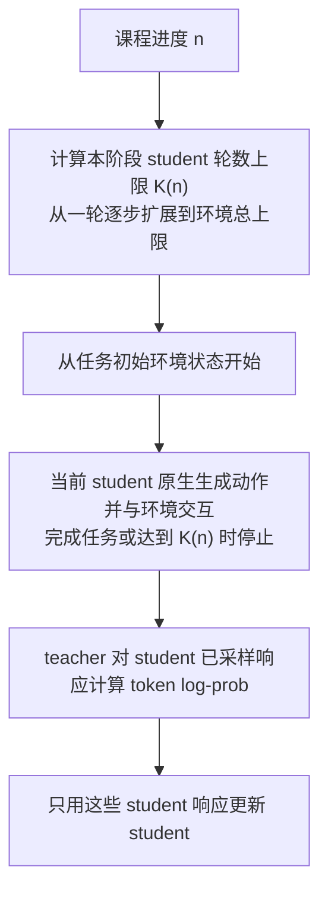

公开实现固定审阅到 `465eef4406ad0cff675b36bd46f37f28b1736ff9`。三个环境都有单独的 F2B/B2F workflow；下面的 B2F 图按公开代码的阶段与训练样本归属绘制。ALFWorld、WebShop 从任务的 `actions` 读取 expert 动作并在环境中回放，接管阶段只返回 student 的 `Experience`，没有把 expert 前段变成训练响应。[^tcod-b2f-code]

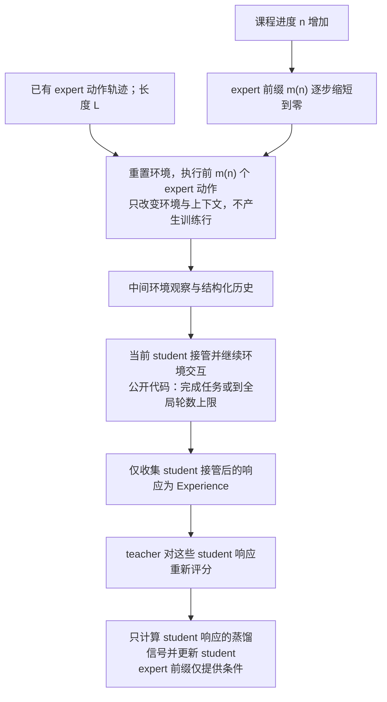

论文与公开实现需要分开使用，以下源码行为已逐项核对。

| 核对项         | 固定提交中的实际行为                                                                                                   | 对本项目的含义                                                                        |
| -------------- | ---------------------------------------------------------------------------------------------------------------------- | ------------------------------------------------------------------------------------- |
| F2B 轮数       | `_compute_distill_window()` 为 `1 + batch_id // checkpoint_steps`，训练时取与 `max_env_steps` 的最小值；评测用完整上限 | F2B 是 student 交互深度课程，不是 student→teacher 接力                                |
| B2F 起点与后段 | 前缀为 `max(L−1−batch_id//checkpoint_steps, 0)`；student 循环为 `range(start_step, max_env_steps)`                     | expert 起点由 $L$ 决定，student 实际可用轮数由全局上限决定，不能承诺后段恰好 $K_n$ 轮 |
| Expert 来源    | ALFWorld/WebShop 用任务中的离线 `actions`；ScienceWorld 调用环境 `get_gold_action_sequence()`                          | 不能将三个公开 workflow 都描述成训练时实时调用 teacher 生成前段                       |
| 接管上下文     | ALFWorld 历史满两轮时格式化最近两轮，不足时使用无 history 模板；接管后的 student 对话继续累积                          | 这与本方案原始 token 直接拼接、保留完整 teacher token 前缀不同                        |
| 训练行归属     | 仅 student 的响应进入 `turn_responses`；expert 前缀回放已完成任务则返回空列表，评测跳过 expert 前缀                    | 借鉴 B2F 时需明确 prefix 的直接 loss mask，不能沿用“两段全部作为目标”的默认值         |

F2B 的循环与评测分支见其 workflow；[^tcod-f2b-code] B2F 的前缀来源、接管循环与返回训练行见对应 workflow 和环境恢复函数，ScienceWorld 的 gold 路径需单独识别。[^tcod-b2f-code][^tcod-sci-code] 对原始 ALFWorld workflow 的 AST 做了十个纯 CPU 控制流检查，用替身环境与模型验证前缀回放、训练行排除、评测绕过、缺 expert 回退和后段预算：例如 expert 长六轮、全局上限三十轮、初始课程阶段回放五轮后，student 可以继续二十五轮，并非只允许一轮。这些检查没有运行真实环境、GPU 模型或复现论文成绩；源码哈希、输入和结果见[TCOD 核验](../../../../docs/experiment/results/rollout-composition/tcod-review.json)。

训练信号也需按源码解释：论文公式写 $D_{\mathrm{KL}}(q\Vert p_\theta)$，公开 `multi_turn_opd` 实现则在 student 已采样 token 上计算 `teacher_logprobs - old_log_probs` 作为 advantage，默认通过 PPO policy loss 更新，并按轨迹累计 sampled log-ratio 指标。它没有为每个位置枚举全词表计算该论文公式，不能将累计日志值直接当成精确 forward KL。[^tcod-paper][^tcod-opd-code]

推理走 Trinity 的异步模型接口：student 使用 `chat_async`，teacher 使用 `logprobs_async`；默认 vLLM 后端通过已有 token 的 prompt log-prob 评分，不需要逐 token 协调两个生成模型。公开 ALFWorld 配置使用过期版本过滤、最大滞后二，TP=2 的两个 student 引擎与一个 teacher 引擎；`checkpoint_steps=5`，不能把论文讨论的其他增长间隔当作该配置实际参数。这里的 workflow checkpoint 表示环境中间状态，与保存模型 checkpoint 是两件事。[^tcod-runtime-code][^tcod-config-code]

对当前 math 方案的判断是：可以借鉴“课程进度控制接管位置”和“前缀只作条件、只训练后段”这两个独立选择；它们均不要求嵌套生成策略。本方案现有 teacher→student 使用 fresh token 前缀、固定切换位置，并默认训练两段；TCOD-B2F 使用 expert 环境前缀、逐渐前移的接管位置和 student-only 目标。若后续比较 TCOD 风格的 token 迁移，应单列前缀来源、成功筛选、进度调度与直接 loss 范围，保留原全响应对照；单轮 math 的 token 课程结果不等于原论文多轮环境复现。该方向作为调研候选保留，首轮实施范围保持前述四类平面模式。

### 独立原型与测试合约

[组合原型](../../../../eval/rollout_composition.py)只依赖 Python 标准库，支持 Single、一次 Switch 和包含两者的 Mixture；没有连接正式 trainer。该原型已包含的嵌套能力超出当前首轮范围，历史测试结果保留，正式配置仍限制为单模型之间的一次切换或单模型之间的 batch 配额。Request 以 prompt ID、访问轮次、响应序号共同标识；Completion 同时返回模型身份、原始输入 token、输出 token 和原生结束原因。全局配额使用最大余数法，平局按组件顺序决定，再以独立 seed 排列位置。先化简零阶段和同源阶段，再按来源聚合；生成后恢复原始顺序。

每个阶段按累计位置检查该来源的上下文容量，后一段预算是共同 cap 减去前段预算。返回结果验证模型身份、请求身份、前缀、条数、有效词表、阶段长度与 EOS；abort/未知结束原因不作为可训练响应。Segment 保留原生 finish/stop reason，Trajectory 另有语义 termination；mask 根据有效长度生成，EOS 与 PAD 同 ID 也保留。原始 Request 不变，给后段模型的扩展前缀只存在于后端 Call 中；交给 learner 的响应仍包含前段，不能把 teacher 前段迁进 prompt 后丢掉对应 loss。

来源标记描述 action 的行为策略，本轮普通解码中就是选定的单个模型；state 则包含此前整个混合前缀，不能用当前 action 来源冒充 state 的单一来源。若未来加入 CoS/Relay 的推测生成，另记 proposal 模型、目标行为分布与接受事件；被接受的 student draft 可以服从 teacher 目标分布，不能按物理计算来源标成 student rollout。真正的 fusion token 标记为融合策略及其系数，不虚构一个 teacher/student 二选一的来源比例。

[CPU 测试](../../../../verl/tests/opd/test_rollout_composition_on_cpu.py)覆盖端点、空组、比例、原顺序、嵌套混合、跨阶段总预算、上下文、不同访问身份和错误响应；包含 500 组随机全局配额及 864 组短序列边界/EOS 组合。并发故障测试验证协调器取消其他任务并等待其退出。实际 RPC 后端还必须确认原生请求被 abort 或排空；取消 Python coroutine 不等于 CUDA 生成已经停止，正式权重更新前不能跳过这层确认。

[GPU 验证入口](../../../../eval/probe_vllm_composition.py)在物理 GPU 0 建立两个有独立进程组的原生 vLLM 0.10.0 引擎，各限 0.10 显存预算；父进程只在来源/阶段边界发送 token 批，不调用 HF 模型前向。实际 checkpoint 是初始 R1-Distill student 与冻结 JustRL teacher，尚未接入在线 actor 热同步。测试安排包括双向 k 端点与中间点、五种 batch 比例、嵌套策略、EOS 恰在阶段边界、同模型断点续写、固定 seed 采样、sleep/wake、长前缀及原生权重切换。吞吐测试单列默认多进程调度，与严格复现条件分开。

初始默认 V1 多进程测试中，两次相同的 16 条 greedy 请求只有 9 条逐 token 一致，输入参数完全相同。按官方说明，严格重放需要 `VLLM_ENABLE_V1_MULTIPROCESSING=0` 固定调度；因此正确性模式在各自独立 worker 中关闭该开关，吞吐模式保留默认多进程。[^vllm-repro] 固定 seed 本身不保证在线服务跨调度逐 token 一致，这个结果不能解释为来源混合的算法效果。

第二轮真实 EOS 边界测试还表明：输出为 EOS=151643、max_tokens=1 时，原生 finish_reason 是 length、stop_reason 为 null。vLLM 的 `check_stop` 先检查长度上限，再检查 EOS。[^vllm-stop-order] 原型已改为保留原始 reason，同时根据最终实际 token 判定整条响应结束，增加回归测试；不能只要求 `reason=stop` 才停，也不能因 `reason=length` 就一定进入第二模型。

首版限定现有单 EOS 的 Qwen2 配对。多 EOS、字符串 stop、min_tokens、非平凡的重复惩罚与多次动态接管仍须补全跨阶段状态；不把按独立请求重置计数的行为默认为完整响应语义。GPU 原型与正式 learner 的桥接、current actor 版本确认、失败后的原生 abort 和 CUDA Graph 地址稳定性仍是后续验收项。

### 实测设置、结果与否决的假设

correctness 模式完成 71 个场景，包含功能、恢复、长序列与 36 个吞吐子测；默认调度 throughput 模式完成 38 个场景，包含 2 个 warmup。两组分别产生 774/316 条场景响应与 135,668/39,968 个有效输出 token。这些是对固定 16 个 prompt 的重复对照，长响应取其中 2 个，不是 1,090 道独立题目，也不支持数学准确率或收敛结论。汇总程序独立检查段落位置连续、原始身份唯一、总预算、来源 token 数和重复输入 token 数。[逐场景数据](../../../../docs/experiment/results/rollout-composition/cases.csv)、[功能与恢复证据](../../../../docs/experiment/results/rollout-composition/correctness.json)、[默认调度吞吐](../../../../docs/experiment/results/rollout-composition/throughput.json)保留原始输入哈希与运行源码哈希。

| 设置           | 实际值                                                                                                    |
| -------------- | --------------------------------------------------------------------------------------------------------- |
| checkpoint     | 初始 DeepSeek-R1-Distill-Qwen-1.5B、冻结 JustRL-DeepSeek-1.5B；两份 config 除 transformers_version 外一致 |
| 环境           | Python 3.12.15、vLLM 0.10.0+cu126、Torch 2.7.1+cu126、Transformers 4.57.6                                 |
| GPU / 模型布局 | 物理 H800 0；两个独立原生引擎，TP=1、BF16，各预算 0.10                                                    |
| 执行           | eager；prefix caching 关闭；max_model_len=5120、max_num_seqs=16、max_num_batched_tokens=2048              |
| 采样           | 主体 greedy，top-p=1、top-k=-1；另有两次 T=1 的固定 seed 重放；EOS 边界例强制只允许 EOS                   |
| 短序列         | response cap=128，切换位置 0/1/64/128/133；batch 比例 0/0.25/0.5/0.75/1                                   |
| 长序列         | response cap=4096，batch=2，双向切换点 2048；总 cap 不翻倍                                                |
| 吞吐重复       | batch=2/8/16，每种策略 3 次，单模型、串行混合、并发混合、分段交错测量                                     |
| 负载条件       | GPU 0 同时运行已有长时验证；只做同会话比较，不当作独占卡的性能上限                                        |

35 项明确的生成/恢复检查通过，覆盖原生请求重放、两方向端点、比例、身份和顺序、EOS、固定 seed、长前缀、sleep/wake、换权重与恢复后参考输出；另有 1 项“同模型分两次请求与一次到底逐 token 相同”的强假设不成立。原始 correctness 结果的 `all_checks_passed=false` 保留；投影程序仅在显式 `--allow-numerical-observation` 下接受这一已知负对照，其他失败仍拒绝。不能将该结果简写为全部 GPU 检查通过。

额外[数值复测](../../../../docs/experiment/results/rollout-composition/numerics.json)再次得到 14/16 条逐 token 相同，两个首次分歧位于响应位置 109、126；两条分歧前的 token 前缀完全相同。对应候选的原始模型 log-odds 间隔在一条路径为 0、另一条为 0.125，共同 Top-5 的最大 log-prob 差约 0.069。这个现象符合 BF16 计算路径变化在近并列候选处改变 argmax，尚未做逐算子归因，也没有全词表 TV/KL 上界。固定调度不等于跨 batch/跨 prefill 形状的不变性；后者需要额外的 batch-invariant kernel 条件。[^batch-invariance]

因此正式质量对照需要保留“同模型两段请求”的执行控制组，不能把所有分段后差异都归因于 teacher/student 来源。跨布局以固定 prefix 的完整分布误差和质量重复实验验收；相同请求、相同布局仍保留严格重放检查。vLLM 0.15 提供 batch invariance 选项，它也与已调研的双模型插件版本接近，可作为独立环境候选；不能在现有 0.10 中仅设置同名环境变量便认定已启用。升级仍需验证 actor 权重传输、FSDP 生命周期、teacher 冻结及最终评测，不能原地替换现有训练环境。

同模型执行控制的 MVP 已在平面 `sequence_switch` 中接入显式 `keep_request_boundary=true`，仅允许 first/second 相同；默认仍将相同模型合并，零点和总 cap 端点继续只有一段。成功条件为未提前终止时实际调用两段、原始 token prefix 连续、每段身份/版本相同且总预算不变，EOS 恰在边界时不再调用第二段；验证仍只生成最终 student。身份改变、预算扩大、额外模型实例或训练对象改变均否决该实现。先比较同源码单次/两段请求，再分别控制 APC 开/关；APC 开启时可能复用第一段缓存，不能将其耗时直接解释成强制重新 prefill。两阶段保持独立的既有 seed 派生，不承诺与一次请求逐 token 相同；这个控制也不能消除训练 seed 不确定性。正式 GPU 短训练和五十步控制尚待完成，已有十五组冻结协议不增加新参数。

`recipe/math_native.sh` 新增 current/initial/teacher 的 `*_request_split` 入口。`eval/run_request_split_controls.py` 先安排三角色×APC 开/关的六组两步 B8/64-token 验收、边界 32、六题×16 最终验证，再安排当前 student 单次/两次请求×APC 开/关的四组五十步控制；正式 B64、cap4096、边界 2048、完整 570×16/cap31744，启用完整词表 KL 与同一固定 bank。独立审计必须实际见到两段、相同模型身份/版本和边界，完全未触发边界也不算通过；远端 APC 布尔量逐组核验。日志区分 `segmented_responses` 和实际身份改变的 `switched_responses`，相同来源的响应数不重复计数。[CPU 证据](../../../../docs/experiment/results/native-rollout/request-boundary-cpu.json)包含八十七项原生检查、五十二项运行环境检查、四项控制协议与八项 W&B 检查；真实 launcher 的 Hydra 配置也已核对。队列等待既有 residency 与 bank/全量 KL 前置验收，GPU 结果仍未产生。

独立候选环境已按插件实际测试版本固定为 vLLM 0.15.1、Torch 2.9.1/cu129、Transformers 4.57.6；[依赖清单](../../../../eval/requirements-vllm015-cu129.txt)锁定一百八十五项发行包和插件 a987755 提交，已在独立目录同步安装。[环境 CPU 证据](../../../../docs/experiment/results/native-rollout/vllm015-environment-cpu.json)覆盖实际导入、模型注册、十九项上游 routing/demo 检查，以及开关在独立进程中的读取；检查全程隐藏 GPU，CUDA 未初始化。安装前后原训练环境二百二十九个发行包的版本与 METADATA 校验值相同。当前主机内核驱动为 550.163.01，既有 libcuda 560.35.03 报告 Driver API 12.6；新栈的 CUDA 12.9 GPU/JIT 兼容性仍需实测，CPU 导入不能代替 CUDA 小版本兼容性的实际验证。[^cuda-minor-version] 两套环境同时改变 Torch/CUDA 依赖，后续性能差异也不能只归因于 vLLM 版本。

两项开关相关源码与 v0.15.1 标签逐字节核对后确认，batch invariance 在 `model_executor/layers/batch_invariant.py` 导入时读取并缓存开关，不由 `vllm.envs` 中的同名属性证明是否启用；各实验须在导入前设置，并使用独立进程。源码对非 FLASH_ATTN 的受支持后端仅声明 decode 不变性，跨 prefill/decode 的控制应明确选择 FLASH_ATTN，再分别测 batch/顺序变化与同模型分段。[^vllm015-invariance-source] 插件的实际 `load_weights` 方法另经单参数 CPU 模块与空 checkpoint 迭代器对照：给定权重流未被读取、零参数写入，仍声称载入全部参数名；该证据不涉及原生 GPU 更新，但已足以拒绝将这个入口直接接到当前 actor 权重流。双 checkpoint logits、独立 KV、graph、冻结 teacher 与 actor 热更新仍须另行验收。

版本推理探针的 MVP 固定真实训练 prompt 中相同的十六个原始 token prefix、greedy、共同有效词表、单卡与显存预算，比较 batch 1/4/16、逆序、相同形状重放，以及同模型两段请求；APC 关闭，以免缓存命中混入重新 prefill 的控制。批次不变性的成功条件为所测 batch/顺序改变后相同 prompt 的输出一致；同模型两段与一次到底另作观察，不以开关名称保证结果。还保存两个固定 state 的完整词表 logits，在独立审计中重算不同形状的 max error、TV 与 KL。Worker 的实际物理身份、后端、KV 区域及 kernel override 状态须记录；声明启用但 worker 未初始化、KV 共享、原始 prefix/身份被改写或静默退回 HF 均否决。插件仅测试固定 p0/q，完整 logits 须对照同栈独立单模型的组合参考；即使推理通过，未适配的 actor 权重入口仍不得用于训练。所有 GPU 探针等待既有串行窗口，不修改主训练环境。

默认多进程调度的短序列请求墙钟均值如下，每格为 3 次重复，单位为秒。模型始终驻留，测试过程中没有切换权重；“串行/并发”指两个来源分组的执行方式。

| 全局响应 batch | 单 student | 50% batch 混合串行 | 50% batch 混合同卡并发 | teacher→student，k=64 |
| -------------- | ---------- | ------------------ | ---------------------- | --------------------- |
| 2              | 1.294      | 2.496              | 1.522                  | 1.463                 |
| 8              | 1.681      | 2.898              | 1.725                  | 2.195                 |
| 16             | 2.206      | 3.400              | 1.975                  | 3.199                 |

在这组共享负载、128 token 的测量中，并发混合比串行混合快约 1.64–1.72 倍。分段会重新 prefill 后段前缀，也会多一次请求执行；不能把分段耗时简单归为模型读盘。这里没有用 CUDA events/Nsight 将 kernel、prefill 和主机调度逐项分离，不以这些墙钟数字反推唯一瓶颈。四卡布局、长上下文大 batch、CUDA Graph 和同总显存预算的单引擎吞吐仍待单独基准。

内核计时的独立 MVP 使用原生 vLLM profiler 保存 Kineto trace，按调度器的实际 prompt 长度、已计算位置和查询数标记纯 prefill、纯 decode 与 mixed 步骤。目标是把已有调用墙钟拆到可核验的设备事件；成功要求实际物理 GPU 0、完整独立 KV、实际 graph 状态、输入/输出固定工作量和两次无 profiler 对照的 token 一致。trace 必须包含真实 CUDA kernel，kernel 依 CPU launch 的 correlation/External id 归属，不能按异步 GPU 时间戳落在哪个 CPU 区间猜测。缺失或歧义关联保留为未归属，不接受完整归因；低 token-budget 条件还必须实际出现 mixed。CPU 范围、CUDA event 的 stream envelope、kernel 时长和按设备求并集的 busy 时间分别保存；mixed 不按 token 比例分摊。vLLM 官方说明 profiler 会显著增加开销，因此这项诊断不替代无 profiler 的吞吐基准。[^vllm-profiler]

`eval/run_native_profile_controls.py` 安排十条件：eager/graph 各包含 p0 B4、p0/q/固定 p0+q 原生 fusion B16，以及 B16、64-token 调度预算的混合步骤对照；其余调度预算 8,192，生成固定 32 个 token，共同显存预算 0.4，APC 关闭。仅微基准设置 ignore_eos 以固定工作量，不作为 math 回答或训练轨迹。源码与冻结训练模块绑定提交，模型及输入身份、原始调度记录、响应和压缩 trace 全部保留；归档重新校验字节和原始 trace 的归约。块大小和 trace 关联实现仍可按真实 GPU 证据调整。[CPU 与安装接口证据](../../../../docs/experiment/results/native-rollout/kernel-profile-cpu.json)覆盖八项协议/数值检查、真实 vLLM 调度 dataclass 和实际 CPU profiler trace 的两项运行检查；未执行 CUDA profiling，CPU trace 被明确拒绝为 GPU 证据。真实条件继续等待既有串行队列。

原生权重激活在一个引擎内往返 teacher/student 两轮，每次验证实际加载集合覆盖 199 个原生参数，恢复后的 16 条短响应与对应独立引擎逐 token 相同；另一个 teacher 引擎恢复后也保持参考输出。首次 CPU 权重映射后的激活约 0.80 秒，CPU 缓存命中的两次激活约 0.62/0.67 秒，计时包含 native loader 与 CUDA 同步，不是纯 PCIe 带宽测试。这证明同结构配对可以复用引擎换权重，不证明已接通在线 actor 的分桶同步。

单引擎 level-1 sleep API 约 2.32/2.60 秒，wake API 约 0.084/0.114 秒；每次实际让出约 8,040 MiB，唤醒后输出通过参考检查。这些是 API 墙钟，不能拆成已测的磁盘、CPU 分配和设备复制分项。`LLM.reset_prefix_cache` 虽标注 bool，0.10 V1 的包装层实际返回 None；原型先确认无 active request，再调用并保留返回值。prefix cache 在本轮关闭，不能把这一结果当作 APC 开启时旧版本 KV 已正确失效的证据。

共享 GPU 0 基线为 48,503 MiB，功能实验整卡最高采样为 66,540 MiB；所有测试退出后回到基线。这是整卡采样，包含其他训练进程与初始化峰值，不能全归为本原型的活跃 KV。已保存[共享负载区间](../../../../docs/experiment/results/rollout-composition/shared-load-intervals.json)，原长时实验同期的 GPU 0 峰值和验证速度不能当作无额外负载的指标。

[CPU 诊断](../../../../docs/experiment/results/rollout-composition/cpu-diagnostics.json)还给出两个可复核的边界：本 tokenizer 的 `[64,65]` 解码为 `ab` 后再编码得到 `[370]`，文本相同不保证 token 前缀相同；全局 10 条、teacher 比例 0.3 应分 3 条，若在 3/3/2/2 四个分片各自四舍五入会变成 4 条。实时续写使用原 token IDs，来源配额在全局确定。

原始大文件与失败尝试归忽略的 runs；源码快照与哈希保留，失败不被覆盖。下列是已执行命令，重跑需换新输出目录。correctness 的严格位等价负对照会使该版本返回非零，应结合上述 35 项契约与数值复测解读，不据退出状态隐去已完成或失败的检查。

```bash
.venv/bin/python -m unittest discover -s verl/tests/opd -p test_rollout_composition_on_cpu.py -v
env OMP_NUM_THREADS=2 TOKENIZERS_PARALLELISM=false ../envs/opd-state/bin/python eval/probe_vllm_composition.py --gpu 0 --memory-fraction 0.10 --context 5120 --cap 128 --repeats 3 --mode correctness --long-cap 4096 --weight-switch --output runs/composition-probe-20261018-correctness-v4
env OMP_NUM_THREADS=2 TOKENIZERS_PARALLELISM=false ../envs/opd-state/bin/python eval/probe_composition_numerics.py --output runs/composition-probe-20261018-numerics
env OMP_NUM_THREADS=2 TOKENIZERS_PARALLELISM=false ../envs/opd-state/bin/python eval/probe_vllm_composition.py --gpu 0 --memory-fraction 0.10 --context 5120 --cap 128 --repeats 3 --mode throughput --output runs/composition-probe-20261018-throughput
.venv/bin/python eval/summarize_rollout_composition.py --run runs/composition-probe-20261018-correctness-v4 --run runs/composition-probe-20261018-throughput --allow-numerical-observation --output docs/experiment/results/rollout-composition
```

### 调度、显存与优化次序

单模型、分段与 batch 混合先复用原生引擎，资源安排提供两种候选布局并用基准选择。

| 布局                   | 执行方式                                                                | 成本与适用条件                                                             |
| ---------------------- | ----------------------------------------------------------------------- | -------------------------------------------------------------------------- |
| 同 GPU 多模型引擎      | 固定模型与当前 student 各有引擎，统一安排预算；按需唤醒、按来源聚合请求 | 可减少每次换权重，但重复保留权重/graph/KV pool；同卡并发未必增加吞吐       |
| 同引擎按来源分阶段切换 | 排空 active requests，同来源整组完成后原地换权重，清理旧 KV             | 复用单套大 KV pool；增加权重传输与 prefill，分段响应按阶段归组避免逐条切换 |

优先用前一种布局验证语义与真实内存预算，并以后一种布局作为吞吐对照。两套引擎不能各沿用历史 `gpu_memory_utilization=0.55`，各实例预算总和还必须为 actor/teacher 评分、通信与非 KV 临时张量留空间。vLLM 0.10.0 的 sleep allocator 限定每进程一个实例，多引擎应有独立 worker 进程及明确的 Ray 资源归属，不能在原 worker 内直接重复建立两个启用 sleep 的 LLM。固定 $p_0/q$ 首次读盘后保留只读 CPU 权重或使用保留权重的 sleep；恢复不得依赖 actor 流。引擎 sleep/wake 要实测显存和恢复时间，本仓 KV-only 空接口不能作为已释放的证据。[^vllm-sleep]

换权重候选已加入独立基准，尚未进入 trainer 默认路径。`eval/run_native_residency_controls.py` 先做驻留/换权重两个单卡 B4 短测，再按驻留串行、换权重串行、驻留并发及其逆序做六组四卡控制；共同 B64、联合预算 0.4、graph、固定 128 token 和自然 EOS 上限 4,096，五种单模型/双向分段/batch 混合策略各预热一次、计量三次。驻留引擎各占每卡 0.2，单个可写容器占 0.4；固定 checkpoint 从锁页 CPU 缓存经生产 CUDA IPC 完整写入，不修改只读 worker。每次先排空、写完、清理 KV 并提交版本，物理容器版本与逻辑冻结来源分别记录。测量前后均保存两个来源的完整词表 logits，由独立审计重算相对驻留参考的误差和总变差距离；权重激活、设备传输、生成、CPU 缓存准备与冷启动分别记录。[CPU 证据](../../../../docs/experiment/results/native-rollout/weight-residency-cpu.json)覆盖八十四项原生检查、十二项基准检查与历史二十八条件回归，真实 GPU 数值/吞吐/显存对照仍待执行。这项基准不包含 FSDP 导出或训练，不能直接替代训练全流程的速度结论。

当前 Qwen2 配对每模型 BF16 权重约 3.31 GiB，双模型权重约 6.62 GiB；单模型 KV 每序列每 token 为 28 KiB。以每卡 16 条、每条总上下文上限 5,120 计算，一套完整 KV 为 2.1875 GiB，两套为 4.375 GiB。这只是有效 KV 的容量估计，未包含 graph、临时张量、分页浪费、引擎预留与训练对象；不能用约 11 GiB 的权重加 KV 之和承诺整卡峰值。实测历史显存与预算差异见[速度与显存专题](../../../../docs/experiment/速度与显存.md)。

batch 路由按来源聚合后，在其可用副本内做负载均衡；小分组优先集中到较少副本，避免全局 64 条再按四卡、两来源拆成每来源每卡约 8 条。副本映射必须显式实现，保留四卡各分组的布局作基线。分段请求先用按阶段归组的简单实现验证，再考虑完成一条第一段就送入第二段的有界队列；后一方案仅在两套引擎都可驻留且实测提高吞吐时启用。同 GPU 两引擎同时跑可能竞争带宽，不能把流水化本身视为加速证据。

`generation_layout=overlap` 将每个来源分配到最多请求数个副本，`split` 为同一阶段的来源分配互不重叠的物理副本；例如 current/teacher 为 7/1 条时使用 3+1 卡，32/32 条时使用 2+2 卡。当前实现只改变请求路由和按需激活，保持来源原 KV 预算与四卡 actor 权重发布次数；未用 current 副本可以休眠，下次使用前仍需完整参数发布。来源预算不会随分卡自动扩大，因此不能把推理基准中每个分卡引擎 0.40 的吞吐直接当成该训练布局的速度。每个 batch 保存阶段请求数和实际选择的副本索引，最终纯 student 验证始终使用验证副本。

新增物理执行记录从 native worker 获取 CUDA UUID、进程和本地设备信息，由服务端附加副本编号；协调器核对实际应答编号后记录各 RPC 的请求身份和数量。后续验收对照 GPU 0–3 的 UUID，避免只用声明的映射证明分卡。正确性六组两步开启冻结摘要，速度四组五步按 overlap/split/split/overlap 观察并关闭摘要，二者使用独立结果目录。[CPU 审计证据](../../../../docs/experiment/results/native-rollout/physical-routing-cpu.json)已具备，真实新版本 GPU 验收和速度结论尚待完成。后续短验证显式绑定每基准两题的六题子集，保存源文件和 Parquet 输出哈希，并在每组前检查字节完整性；最终审计要求九十六条响应。原始 570×16 正式矩阵不使用该子集，已具备的[子集 CPU 证据](../../../../docs/experiment/results/native-rollout/validation-subset-cpu.json)不构成 GPU 验收。

首次 bank 的物理核验失败后，[独立设备身份检查](../../../../docs/experiment/results/native-rollout/device-identity-cpu.json)确认该机 CUDA 与 NVML 在相同 PCI 地址上返回不同 UUID。`eval/native_devices.py` 现在以唯一 PCI 地址关联两个命名空间，保留原值；初始化和生成后的 worker UUID 都须匹配该物理卡的已验证标识，未知设备、重复 PCI 和跨卡别名仍拒绝。布局审计先转为统一 NVML 身份，再检查 rank 稳定性和分卡互斥，不能用不同别名把同一硬件算成两卡。该机的 CUDA UUID 掩码还出现 Driver 可见一张卡、Torch/NVML 计数为零的情况；因此执行使用 PCI 验证过的 CUDA 序号，并在加载模型前验证完整可见性掩码。检查只枚举元数据，没有创建 CUDA context。Bank 每个引擎启动后立即保存并核验身份，生成轨迹和执行记录先落盘，再决定是否发布正式 bank；失败不再丢失已生成的审计输入。三十二项维护检查、六项 bank 运行环境检查及历史二十八条件回归通过，仍须真实 GPU 重测。

独立微基准保留来源内局部编号和显式物理 GPU 映射，已修复新执行记录接口接入后的 split 编号不匹配。十五条件扫描器覆盖 1/2/4 卡、并发序列数、batched-token 预算、chunked prefill、KV 预算与 graph；使用冻结源码/配置、实际 UUID 和整卡显存采样，按固定工作量与自然长度分别记录预热和重复。[CPU 与历史数据回归](../../../../docs/experiment/results/native-rollout/benchmark-controls-cpu.json)通过；实际 GPU 扫描及单引擎换权重成本仍待完成，不以参数可配置代替性能证据。

优化在不改变算法的前提下进行：

1. 先对齐真实输入、全局 batch、每卡活跃请求、response cap、采样与日志分数需求。训练上下文按 1,024+4,096 配置，不因最终验证需 32,768 就让所有训练组件按验证容量预留。若分离训练与验证引擎，额外驻留和启动成本一起核算。
2. 使用原生连续批处理，扫描 `max_num_seqs`、`max_num_batched_tokens`、KV 预算和 chunked prefill；同时报告 preemption/recompute。单卡放得下不代表用 TP=4 更快，当前 1.5B 先以 TP=1 副本为基线。[^vllm-tuning]
3. 当前 actor 每更新版本仅向需要它的槽同步一次，固定模型不接收 actor 流；只为真实需要的 GPU 阶段恢复权重与 KV。验证前排空请求，单独切到最终 student，避免验证与混合生成同时占资源。
4. 语义通过后逐项比较 eager 与 CUDA Graph、分组布局与流水化；graph 捕获开销单列。前几个 run 禁止依靠跨步预取扩大冻结来源 batch 来掩盖来源执行差异；若后来开启预取，固定来源可安全使用其固定版本，当前 actor 来源必须标注策略滞后并另做实验。

当前 HF fusion RPC 通过 actor DP 分发，原生 replica 数也从 actor world size 推导。四卡训练但生成仅使用 1/2 卡，或将四卡分给不同来源，均需要资源池、请求路由与同步映射；现在没有可直接使用的独立 `replicas` 开关。不同结构的 checkpoint 也不能装入按 actor 配置建立的同一个引擎。第一版限定已有同结构、同 tokenizer 的 Qwen2 配对、TP=PP=1，不同时扩展 LoRA、FP8、多模态与多轮。

若忽略提前 EOS，一个 A→B 响应的成本可分为

$$
T_{A\to B}\approx T_A^{\mathrm{prefill}}(x)+T_A^{\mathrm{decode}}(k)
+T^{\mathrm{switch}}+T_B^{\mathrm{prefill}}(x\mathbin\Vert y_{1:k})
+T_B^{\mathrm{decode}}(L-k).
$$

这里 $L$ 是该响应的实际长度，假设 $L>k$；实际 batch 还包含排队与并行重叠。两段没有重复生成前 $k$ 个 token，但 B 的 prefill 是额外计算，切换成本取决于布局。计时中单列这段重算；不能将分段两次请求都当成一次普通 decode 的成本。

### 数据、指标与收敛

prompt 池由 `data.train_files`、清洗、去重与 sampler 决定，训练步数由独立预算决定。新 fresh 配方默认指向完整、明确去重规则的数据清单；若同内容 ground truth 冲突须显式处理，不静默保留第一行。epoch 容量按实际 `len(train_dataloader)` 推导，移除 `ceil(steps/50)` 的假设。所有策略共享同一清单、过滤、顺序与每题响应数；全量语料的实际条数由新的数据 manifest 核验，不沿用论文 14,116 或历史 3,200 的数字。

统一生成结果只负责 token、mask、结束原因与来源身份，verifier 和 teacher 信号在共同阶段产生。训练轨迹保存在忽略的运行目录，至少包含 prompt/response token、访问轮次和模型身份；复用现有异步 dump 设施，支持后来对初始、teacher 与混合 states 做同口径诊断。所有策略均记录有效 token 数，既按相同更新步数比较，也报告实际 token 与生成成本，避免将长度变化隐藏在“相同 50 步”里。混合策略额外记录每来源的响应数、token 数、提前 EOS 比例、实际切换位置，以及切换前后分层的 state 指标。

[原生轨迹分析器](../../../../eval/analyze_native_states.py)已复用历史 prefix 计数，按同题、visit、sample 和实际训练顺序配对，检查完整 batch、EOS 与分段覆盖，并分层报告 action 策略对应位置的已有前缀深度。[真实两步计数验收](../../../../docs/experiment/results/native-rollout/state-prefix-canary/summary.json)有 128 对响应；它是不同源码快照下的工程验收，不是来源效应实验。精确前缀重合对随机分叉敏感，不能代替固定 teacher 表示的覆盖或共同 probe 上完整条件 KL；后两项保持独立的待验证诊断。四组正式训练现已完成三组全五十步配对，各为 3,200 条同题首次访问响应；相对 current 的平均共同响应前缀为 2.8441/2.7403/2.5044 token，原始 token 的独立重算与图见统一报告。阶段 slot 参与生成 seed 派生，跨来源不是共同随机数对照，这些数值不用于来源效应或语义覆盖排名。

新增 `generation_state_metrics` 以每行的分段元数据保留来源，随 DataProto 重排，不依赖生成前的全局行号。共同评分后统计实际 action 的 sampled log-ratio、RMS、teacher 所选 action 概率与前缀深度，按来源、分段和绝对深度分层；fusion 独立标记，padding 与空组不产生 NaN。该实现不增加模型前向；[十八项运行检查](../../../../docs/experiment/results/native-rollout/state-metrics-cpu.json)覆盖真实 DataProto 转换及 OPD 评分 hook，未改变 reward。四卡实际训练和后续表示空间诊断仍待验收，冻结 d59a7c3 矩阵不含这项后加指标。

计时分开记录磁盘首次加载、权重激活/同步、KV 分配与释放、队列等待、各阶段 prefill/decode、切换重算、student 评分、teacher 评分、更新和验证；以整卡采样补充 allocator 指标，不将嵌套 timer 重复相加。冷启动与热调用、训练与验证、单模型与双模型的显存和吞吐分别呈现。报告端到端输出 token/s、引擎 decode token/s、完成响应/s、每卡活跃 batch、有效/预留 KV 与 preemption；分段的总 prefill token 不能漏算，GPU busy 也不能代替吞吐。

现有固定缓存平台判据继续只服务历史 replay。fresh 的训练 RMS 同时受访问 state 与 action 变化影响，不再代表同一缓存上的拟合残差。新模式先用固定步数完成比较；若要提前停止，结合多验证点和固定 prefix/action probe 的 teacher–student 残差另定判据，不能直接删除旧 guard 后沿用原解释。验证始终保留 MATH-500/AMC23/AIME25 的 570 题、每题 16 次和精确 mean/pass@k。

### 验证 KL 与 rollout 诊断提案

开发源码已用 `trainer.validation_kl.enabled=True` 接入完整条件 KL 的可选验证 hook，默认关闭以保留原实验协议。输入校验对整个调用复用一次有效词表大小；本环境 tokenizer 的长度查询存在实测开销，不能放在逐响应循环内重复执行。缓存值同时用于记录支持集、worker metadata 和报告，保持词表解释一致。[CPU 对照](../../../../docs/experiment/results/native-rollout/tokenizer-vocab-cache-cpu.json)在相同 180 条真实 bank 记录上验证位置/权重输出逐值一致，只描述校验成本，不作为神经网络评分加速证据。它复用整轮准确率响应，在原生引擎休眠后使用同卡的最终 student 和冻结 teacher 评分，保存逐响应累计量、均值、分层统计及原始 token。开发版长度/EOS/解析/多样性指标和 KL 链路已通过真实 Torch/DataProto、实际 trainer 方法与小型 Qwen2 的 CPU 检查；两进程 CPU FSDP 还验证优化器更新后读取新 student、teacher 参数不变。真实四卡短响应、固定 bank 与长响应评分已通过下文验收；完整 570×16 评分已覆盖 56,737,088 个有效位置，wall time 45.70 min；资源与负载分解见[速度专题](../../../../docs/experiment/速度与显存.md#完整验证-kl-的成本与瓶颈)，尚未据此宣称吞吐已优化。冻结的 d59a7c3 矩阵不含新增指标，已结束且未保存最终权重的运行不能仅凭响应文本补算最终 KL。

KL hook 服务每次 `_validate()` 调用，读取当前 `global_steps` 的实时 student；末步是验证版本等于训练总步数的特例。中间验证结束通过 `end_eval(..., resume_training=True)` 恢复训练，末步不恢复；按 step 分别写出原始 token 与报告，共同 bank 跨验证保持不变。真实小 Qwen2 的 step0/2/4 连续验证、两段 SGD 更新、版本/输出隔离和恢复标志已通过 [CPU 回归](../../../../docs/experiment/results/native-rollout/periodic-validation-cpu.json)；该证据模拟 DP RPC，同一四卡训练中的中间 KL 与训练恢复仍待实际验收。配置和语义归 [KL 专题](../../../../docs/experiment/2026-10-19-rollout验证KL与状态诊断.md#每个验证点的版本与训练恢复)。

#### 散度方向、状态来源与归约

记 $p=p_\theta$ 为被评测的最终 student，$q$ 为冻结 teacher，二者均使用 temperature=1 的原始分布，并在共同有效词表 $\mathcal V$ 上归一化，排除输出 head 的填充词表项。在同一个实际前缀 $s_t=(x,y_{<t})$ 上定义

$$
k_{p\Vert q}(s_t)=\sum_{a\in\mathcal V}p(a\mid s_t)\log\frac{p(a\mid s_t)}{q(a\mid s_t)},\qquad
k_{q\Vert p}(s_t)=\sum_{a\in\mathcal V}q(a\mid s_t)\log\frac{q(a\mid s_t)}{p(a\mid s_t)}.
$$

主指标采用 student→teacher 的反向 KL $k_{p\Vert q}$，teacher→student 的正向 KL $k_{q\Vert p}$ 作补充。前者衡量 student 概率质量落在 teacher 低概率动作上的程度，后者补充 teacher 高概率动作的覆盖；两者均不直接代表答案正确率。日志名称显式写 `student_teacher` 或 `teacher_student`，不单独用方向易混淆的 `kl`。GKD 将轨迹来源与条件分布散度作为独立选择；本文沿用该区分，不把 teacher 前缀上的 student→teacher KL 称为 teacher 轨迹分布的 sequence KL。[^gkd-valid-kl]

对一条长度为 $L_i$ 的响应，保留累计量 $S_i=\sum_{t=1}^{L_i}k_{p\Vert q}(s_{i,t})$ 和长度归一化量 $A_i=S_i/L_i$。`token_kl` 报告 token 加权的 $\sum_i S_i/\sum_i L_i$，另报先按响应平均、再按题目平均的 $A_i$；`validation_kl/on_validation_states/<benchmark>/student_teacher_kl/cumulative_on_states` 报告验证轨迹的累计量均值。累计量的单位是 nat/sequence，归一化量的单位是 nat/token；长度归一化后的量不再命名为 sequence KL。三个 benchmark 分别报告，macro 是三个 benchmark 均值的等权平均；总量直接汇总的 micro 单列，避免 MATH-500 的题数决定总体结果。

严格的 sequence KL 需要明确轨迹采样分布与停止规则。令 $P_H,Q_H$ 分别是 $p,q$ 在遇到 EOS 或共同上限 $H$ 时停止的响应分布，$L(y)\le H$；EOS 是有效动作，上限处不额外添加虚构 EOS。共同词表上的 teacher 概率为正时，自回归分解和条件期望给出

$$
\begin{aligned}
D_{\mathrm{KL}}(P_H(\cdot\mid x)\Vert Q_H(\cdot\mid x))
&=\mathbb E_{y\sim P_H}\left[\log\frac{P_H(y\mid x)}{Q_H(y\mid x)}\right]\\
&=\mathbb E_{y\sim P_H}\left[\sum_{t=1}^{L(y)}\log\frac{p(y_t\mid s_t)}{q(y_t\mid s_t)}\right]\\
&=\sum_{t=1}^{H}\mathbb E_{s_t\sim P_H}\left[\mathbf 1_{\{L\ge t\}}\sum_{a\in\mathcal V}p(a\mid s_t)\log\frac{p(a\mid s_t)}{q(a\mid s_t)}\right]\\
&=\mathbb E_{y\sim P_H}\left[\sum_{t=1}^{L(y)}k_{p\Vert q}(s_t)\right].
\end{aligned}
$$

第三行的前缀分布只作用于尚未终止的轨迹；有限上限允许交换求和与期望，再对下一动作取条件期望。完整条件 KL 对每个前缀非负；采样动作上的 $\log p(y_t\mid s_t)-\log q(y_t\mid s_t)$ 可以为负，只有轨迹确实从 $P_H$ 采样时，其累计量才是上述 sequence KL 的蒙特卡洛估计。该估计不确定性来自轨迹采样，不能将单条响应的值当成精确 sequence KL。

现有准确率评测使用 temperature=0.7、top-p=0.9，实际策略记为 $\mu$。在这些响应上计算的完整条件 KL 是合法的逐前缀诊断，但其累计均值是 $\mathbb E_{y\sim\mu}\sum_t k_{p\Vert q}(s_t)$，不等于上式的 $D_{\mathrm{KL}}(P_H\Vert Q_H)$；采样 log-ratio 也不能直接沿用无偏解释。采用用户要求的全量复用方案：准确率设置保持原值，直接对已有 570×16 响应的全部有效位置评分，不另生成 student KL 探针；累计指标明确标注验证状态来源。若后续研究需要严格原始分布的 sequence KL，再单独引入 temperature=1、无 top-p/top-k 截断的生成协议。

#### 探针规模与 rollout 指标

主评测复用完整 570 题×16 条最终 student 响应及其 31,744 token 上限，在全部有效 response 位置计算双向完整词表 KL 与 entropy。按响应、位置和词表分块执行无梯度前向与归约，保留每条响应的累计量、归一化量和实际有效长度；完整 token 分布无需整体驻留或保存。置信区间按题目聚类重采样，不能把同题十六条响应或多个 token 当成独立题目。不反向传播减少显存占用，但 student/teacher backbone 与输出 head 的前向计算仍有成本，实测归约、前向与数据移动耗时后调整块大小。

主指标固定使用 full-vocab，当前配对的共同有效词表为 151,665 项。只取 top-k 并在其中重新归一化，测量的是截断后的条件分布；student 与 teacher 各取不同集合还会人为引入支持集差异。普通输出 head 通常已经投影出完整词表 logits，随后 top-k 主要减少保留与传输的数据量，不能据此声称省去完整 head 的计算。无梯度评分仍需控制临时 logits；例如两个模型各保留 128 个位置的 BF16 logits，合计约 74.1 MiB，另外还有 hidden states、模型权重、前向临时量和 FP32 归约缓冲。该数字是张量大小，不是整段评分的峰值显存。

若 full-vocab 的实测成本需要近似对照，可取两个模型 top-k 的并集 $S$，保留完整 softmax 的原始概率，再将剩余词表合并为一个 tail 类别。令 $P_T=\sum_{a\notin S}p_a$、$Q_T=\sum_{a\notin S}q_a$，合并后的 $K_S=\sum_{a\in S}p_a\log(p_a/q_a)+P_T\log(P_T/Q_T)$ 满足

$$
D_{\mathrm{KL}}(p\Vert q)=K_S+P_T D_{\mathrm{KL}}(p(\cdot\mid T)\Vert q(\cdot\mid T))\ge K_S.
$$

等式由 tail 内写成 $p_a=P_Tp(a\mid T)$、$q_a=Q_Tq(a\mid T)$ 后展开对数得到；空 tail 的附加项取零。因此合并 tail 的量是完整 KL 的下界，但只记录两侧 tail mass 小并不能保证缺失项小；还需与同一批 prefix 的 full-vocab 对照。这条近似路线不替换主实验指标，当前评分器继续使用完整词表。

固定前缀对照的起始预算为每个 benchmark 固定抽取 30 题，共 90 题；AIME25 使用全部 30 题，其余按固定 ID 抽取。由 $p_0$ 和 $q$ 各生成每题一条、上限 4,096 的响应，每条初版选至多八个固定位置，合计至多 1,440 个抽样位置（包含两来源共同的 prompt-only 前缀）。第一个动作必选，将其余 $L_i-1$ 个位置划为最多七个非空连续区间，每区间均匀抽一个位置；短响应直接选取全部位置。若区间 $h$ 有 $n_h$ 个位置、抽中位置为 $T_h$，固定来源轨迹上的累计估计为 $\widehat S_i=k(s_{i,1})+\sum_h n_h k(s_{i,T_h})$；对区间采样取期望即恢复 $S_i$，归一化时除以实际有效长度。该位置抽样仅服务固定前缀 bank，不缩减主验证的评分范围。

固定前缀 bank 保存完整生成 token IDs、抽中位置、区间权重、采样配置与清单哈希，所有变体使用相同 bank。分别报告 `on_initial_states` 和 `on_teacher_states` 的完整条件 KL，不把两者合并后称为 sequence KL。它衡量相同状态下分布如何变化；全量验证响应则衡量模型实际访问到的状态。固定前缀的 teacher 结果可按完整身份缓存，student 每次重算；当前 student 新生成的前缀不能套用旧 bank 的 teacher 分数。下文已记录真实 bank 与长响应验收；完整规模结果与资源成本已归[KL 专题](../../../../docs/experiment/2026-10-19-rollout验证KL与状态诊断.md#完整规模验收结果)。

| 范围           | 必备指标                                                                                  | 统计条件                                                               |
| -------------- | ----------------------------------------------------------------------------------------- | ---------------------------------------------------------------------- |
| 全部准确率响应 | mean@16、pass@1/2/4/8/16、答案解析成功率                                                  | 保持 570×16；失败与缺失显式计数                                        |
| 全部准确率响应 | response length 的均值、p50/p90/p95/max、有效 token 总数；prompt length                   | 原始 token/mask 统计，EOS 计入，prompt 与 padding 分开                 |
| 全部准确率响应 | EOS 比例、非 EOS 的 cap 截断比例、空响应和 abort/error 数量                               | 原始 finish/stop reason 与实际 token 联合判断；EOS 恰在 cap 时仍按 EOS |
| 全部准确率响应 | 正确/错误/截断响应的长度分布、每题答案多样性、重复 4-gram 比例                            | 重复率定义为重复出现次数除以有效 4-gram 总数，长度不足四时单列         |
| KL 探针        | student→teacher 与 teacher→student 条件 KL、student/teacher entropy、按前缀深度分层的 KL  | 全词表归一化；固定 bank 与当前 student 轨迹分别记录                    |
| 全部准确率响应 | `…/student_teacher_kl/cumulative_on_states`、token 加权 KL、题目等权 KL、题目聚类置信区间 | 全有效位置；原验证采样设置；保存有效长度与截断比例                     |
| 资源           | 准确率生成、KL 生成、student 评分、teacher 评分、归约/写盘的独立耗时与峰值显存            | KL 新增成本单列；端到端 token/s 与响应/s 不混入评分耗时                |

固定 bank 已新增 `data/prep/prepare_prefix_bank.py` 输入准备、`eval/generate_prefix_bank.py` 原生生成入口与 `trainer/ppo/prefix_bank.py` 组装器。题目按身份哈希和固定 seed 均衡选择，两套冻结模型使用完全相同的原始 token prefix；组装时拒绝缺失/重复问题、错误 checkpoint 身份、改写 prefix、提前 EOS 后继续生成和不完整预算。四卡初始化逐引擎绑定端口后再并行生成，保存实际 worker UUID、冻结摘要、布局、冷启动/生成时间和整卡采样。已准备真实九十题并通过[六项 CPU 检查](../../../../docs/experiment/results/native-rollout/prefix-bank-cpu.json)，实际生成与新模型评分仍待 GPU 验收。

#### 接入、开销与验收

实现复用 `rollout_coordinator.py` 的原始 token 和身份记录，在 `_validate` 保留后续评分所需的 IDs、有效 mask、题目/样本 ID、长度和结束原因，避免 decode 后重新 tokenize。准确率响应与固定 bank 均由原生 vLLM 生成；生成结束后统一排空并休眠验证引擎，再调用无梯度的 student/teacher 评分 worker，在相同 prefix 上比较两套分布。评分不是 HF 自回归生成回退；诊断不更新权重、不要求保存 checkpoint，发生在最终 student 仍存活时。

新增 teacher worker 的 `compute_validation_kl` 读取同卡 actor 的实时 FSDP 模型，旧 `old_log_probs`/`teacher_log_probs` 仍只服务采样动作评分。评分器通过临时输出 head hook 保留隐藏状态，跳过常规整段词表投影，再分位置计算两套 head；student head 只复制一次，teacher head 在参数已收集的 forward 内读取。FP32 主权重在需要时先转换一次，避免每个位置块反复转换。完整词表归一化和散度归约使用 FP32，只返回标量与分层统计。位置子采样仅服务固定 bank；主验证要求覆盖每个有效动作，输入 token 哈希、版本或位置数不匹配会拒绝输出结果。

验收先覆盖 $p=q$ 时 KL 为零、已知小词表的双向 KL、有限长度序列枚举与链式分解、位置抽样权重、EOS=PAD、EOS 恰在 cap、padding/无效值排除，以及不同 batch 重排后的题目身份。随后四卡短训练验证最终 student 版本、teacher 冻结、所有 rank 完成评分、结果有限及原准确率流程可复现；实测额外耗时、显存与位置抽样误差后确定预算，再进入新的完整协议。只把 top-k 内概率重新归一化会改变被测分布，不能替代这里的完整条件 KL。

实际日志同时提供 `…/token_weighted`、`…/question_mean` 和 `…/cumulative_on_states`；macro 是各 benchmark 对应统计的等权平均。准确率 JSONL 保留在验证目录顶层，KL 报告与原始 token 放到 `validation/kl/`，避免原采集器把诊断文件名误读为 step。保存评分起止时间戳、引擎休眠时间及 worker 内 actor 恢复/释放、student forward、teacher forward、head/KL 耗时；teacher forward 扣除内部 head/KL 区间，避免重复相加。这些是带通信与管理成本的调用耗时，不等于纯 GPU kernel 时间。

`eval/audit_validation_kl.py` 独立校验原始 token 哈希、响应身份、全位置/深度覆盖、固定 bank、四 worker 记录与归约数值，可绑定原准确率 JSONL；主验证缺失响应或多算 padding 都会拒绝。统计按 benchmark 分层，对题目成组 bootstrap，同题样本共用抽样索引，分别计算题目均值、累计量和 token 总量比值。区间条件于已训练模型及固定 bank，不能充当训练 seed 或 bank/位置构造的不确定性。[八项 CPU 与 CLI 检查](../../../../docs/experiment/results/native-rollout/validation-kl-audit-cpu.json)已通过；它审计证据与聚合，不声称重新执行了神经网络。

真实[四卡 KL canary](../../../../docs/experiment/results/native-rollout/validation-kl-canary/kl-short-gpu.json)固定 f1bcea0：两次更新后对最终 student2 的九十六条原生验证响应逐有效位置评分，共 12,288 个位置。独立 artifact 审计与 W&B 最终行 110 项指标核对通过，生成和准确率采集保持原路径；评分 wall time 5.955 s，四 worker 调用各约 5.47 s，阶段整卡采样约 8.1 GiB，之后 GPU 释放并恢复原矩阵。该证据不覆盖长上下文、完整 570×16 或固定 bank；相关门槛继续保留。调用时间含通信、参数恢复与框架开销，不能解释成纯 head kernel 吞吐。

真实 [bank 独立审计](../../../../docs/experiment/results/native-rollout/prefix-bank-gpu/audit.json)与[四卡长响应审计](../../../../docs/experiment/results/native-rollout/validation-kl-long/kl-independent-audit.json)随后通过。v2 的输入与 0f2c1d8 神经网络源码不变，设备选择使用已核验的 PCI/序号映射；两来源共 180 条轨迹和 1,440 个位置对应 1,350 个不同的完整 token 前缀。两次工程更新后的六题×16 验证覆盖 605,977 个有效位置，实际最长 31,744；固定 bank 另计 1,440 个位置。完整词表评分 wall time 为 46.749 s，四卡区间采样最高 10,761 MiB，W&B 1sndtege 与最终行 KL 核对通过。它不包含完整 570 题，不能外推全量成本或来源训练效果；完整规模 gate 随后通过，结果与范围见[KL 专题](../../../../docs/experiment/2026-10-19-rollout验证KL与状态诊断.md#完整规模验收结果)。

完整规模验收使用 `eval/run_validation_kl_gate.py` 和 `eval/collect_validation_kl.py`，已在真实 bank/长响应前置验收通过后串行完成；十八批生成及全部 56,737,088 个有效位置评分通过，W&B azusc532 finished，额外 bank 覆盖不变。两次 B8、64-token 工程更新后，以原准确率采样、31,744 cap 验证完整 500/40/30 题×16；主指标对 9,120 条响应的全部有效位置评分，另算固定 bank 的 180 条轨迹，不把 bank 选中的九十题当成完整验证。核对最终版本、完整词表、同一 bank、输入哈希、逐题 bootstrap 与 W&B 最终行；评分阶段的整卡采样和 worker 分项单列，缺少阶段采样时不宣称显存覆盖。归档保留原始报告/输入校验值与每类实际长度范围；`--audit-only` 可重试归档而不重新训练。[九项 CPU 检查](../../../../docs/experiment/results/native-rollout/validation-kl-full-cpu.json)包括完整 9,120+180 条合成记录、缺失采样、错误版本/输入/范围及 CLI 计划；真实三个 Parquet 的行数、data_source 和文件哈希也已核对。合成记录只验证归档器；真实完整规模结果另见[KL 专题](../../../../docs/experiment/2026-10-19-rollout验证KL与状态诊断.md#完整规模验收结果)，两步工程验收不替代五十步质量对照。

### 修改范围与实施顺序

以下路径列出修改归属；已建立的策略、执行器、模型池与协调器继续接受端到端验收。

| 位置                                                | 建议变化                                                                   |
| --------------------------------------------------- | -------------------------------------------------------------------------- |
| `workers/config/rollout.py`                         | 新增模型引用、策略和 collection 的类型及组合校验；旧字段映射到共同描述     |
| `workers/rollout/policy.py`（拟新增）               | 编译平面策略配置、分配全局配额和阶段预算，解析模型身份、能力与同步目标     |
| `trainer/ppo/rollout_coordinator.py`（拟新增）      | 封装生成/同步/验证切换，适配历史 replay，移走 trainer 的来源分支           |
| `workers/rollout/vllm_rollout/`                     | 原生模型池、按来源分组、分段 token 续写、生命周期与性能采集                |
| `workers/rollout/fusion/vllm_model.py`（拟新增）    | 仓外注册双模型，原生 Qwen2 前向、独立 KV、FP32 logits 与单次采样           |
| `workers/rollout/fusion/decoder.py`                 | 保留 HF 参考实现与历史复现，用于原生扩展数值对照，不作为自动回退           |
| `workers/engine_workers.py`、vLLM adapter/extension | 为明确目标传输 actor 权重，避免写错固定模型或同时恢复无用引擎              |
| `experimental/agent_loop/` 与批打包                 | 统一输入 token、输出 schema、reward 诊断和 provenance，保持既有 async 合约 |
| `recipe/` 与 `data/prep/`                           | 共用启动器和策略覆盖；独立完整数据清单与训练预算，保留历史复现配置         |
| `eval/` 与既有测试                                  | 扩展身份/指标采集、端点、生命周期、后端等价与 GPU 成本验收                 |

实施按依赖顺序推进：

1. 先定义 `ModelRef`、平面策略配置与轨迹合约，把现有来源入口包到协调器。CPU 检查比例取整、端点、空分组、全局顺序、预算、EOS/PAD mask 与固定模型写保护，旧实验入口继续保留。
2. 优先接入三种单模型原生生成，补齐 $p_0/q$ 的加载、恢复与身份；再实现双向分段及 batch 配额路由。两种混合先采用分阶段归组，避免同时引入异步流水与算法变化。
3. 独立验证原生双模型扩展，按 λ=0/0.5/1 对照完整 logits、共同 prefix 与采样分布；检查双 KV 是否完整计入预算、参数名映射及 graph。比较现有 0.10 的受控 wrapper 与独立 0.15 环境的插件/batch-invariance 路线；选定后同一正式对照固定一个版本，现有生产环境不原地升级。
4. 在空闲 GPU 0–3 做各已开放策略两步训练，覆盖 current→initial→teacher→切换/混合→current-eval 的恢复，验证固定模型不变、actor 版本正确、分段 mask 完整、验证始终来自最终 student。原生 fusion 单独验收后纳入。
5. 建立同 checkpoint、输入、采样和实际 batch 的原生基线。短确定长度序列测内核，真实 math 长度分布测端到端；扫描有效 batch 与 KV 预算，比较单引擎换权重/双引擎驻留，再测 graph 与流水。先披露冷启动和热成本，不承诺尚未实测的提升比例。
6. 固定新数据 manifest、学习率、全局 batch 与预算后开展正式对照：单模型端点；分段方向与 $k\in\{0,1024,2048,4096\}$；batch 比例 $\alpha\in\{0,0.5,1\}$；fusion 的 λ 对照。端点复用相同基线，先用一个内部参数值筛选，首轮不安排嵌套组合。每组先 50 步、完整 eval16，质量结论补充训练 seed；历史缓存结果保留原算法和实验条件。

首版目标是三种来源、双向分段与 batch 混合在同一训练链上使用原生 vLLM，student 初始化/更新/验证独立于生成来源；原生精确 fusion 是独立的第二项验收。成功证据须包括参数版本、固定权重不变、配额/阶段语义、两步恢复与完整 eval16；只通过构造测试不等于真实训练可用。若固定模型被 actor 覆盖、验证来自错误来源、分段预算或训练 mask 改变、评分归一化改变主 loss，或执行中静默回退 HF，该版本不能进入正式对照。引擎布局、副本映射、graph 与预取仍由基准结果决定。

## 考虑过的替代方案

当前已验收的 HF fusion 保留为数值参考与历史复现。统一退回 HF 会失去本轮希望验证的原生调度能力。直接复制外部 vLLM fork 或升级整个训练环境会同时改变过多依赖，优先在现有 0.10.0 上建立最小适配。单引擎换权重与多引擎驻留均保留为真实候选，由联合显存预算和热调用成本决定。

## 验收条件

源码及外部实现调研、CPU 语义检查、真实原生生成、资源与速度测量分开留证。后续 trainer 接入还需覆盖参数版本、冻结引用、共同评分、最终 student-only 验证与完整训练短测；原型结果不能跳过这些条件。

四卡两步接入须覆盖某 rank 的某来源为空、teacher 提前 EOS、响应重排、n 的单次展开和验证切换。FSDP 所有 rank 仍需参加匹配次数的参数收集与 teacher 评分，不能因为本地无某来源请求就跳过全局 collective。原生 abort/排空、APC 开启后的权重版本失效、CUDA Graph 与 actor 热更新也要分别验收。

生产路由 seed 应含独立的 batch 标识，生成 seed 则按 prompt、访问轮次、响应序号和阶段派生；不能在每个训练 batch 循环复用原型的同一位置分配。固定来源再次遇到同题时递增 visit，才能重新抽样；相同身份的相同 seed 重放只服务复核。

## 风险

共享 GPU 负载会影响吞吐；短响应测试不能代表 4K/32K 长上下文。固定模型实时采样改变有限 states 的复用条件，必须与历史 Semi replay 区分。不同 vLLM 版本的 attention 注册、请求元数据、sleep 和采样接口仍需适配；任何近似融合或 KV 跨权重复用都不能默认为精确算法。

### 参考文献

[^gkd-valid-kl]: Rishabh Agarwal et al. On-Policy Distillation of Language Models: Learning from Self-Generated Mistakes. ICLR，2024，§2–3. [原始论文](https://arxiv.org/html/2306.13649v3).

[^tcod-paper]: Jiaqi Wang, Wenhao Zhang, Weijie Shi, Yaliang Li, James Cheng. TCOD: Exploring Temporal Curriculum in On-Policy Distillation for Multi-turn Autonomous Agents. arXiv 2604.24005v3, 2026. [论文 §3–4 与附录 C](https://arxiv.org/html/2604.24005v3).

[^tcod-b2f-code]: TCOD authors. ALFWorld B2F workflow and environment replay. GitHub，提交 465eef4406ad0cff675b36bd46f37f28b1736ff9，2026. [接管、student 训练行与后段上限](https://github.com/kokolerk/TCOD/blob/465eef4406ad0cff675b36bd46f37f28b1736ff9/trinity/common/workflows/envs/TCOD/alfworld/TCOD_b2f_workflow.py)、[动作回放与历史格式](https://github.com/kokolerk/TCOD/blob/465eef4406ad0cff675b36bd46f37f28b1736ff9/trinity/common/workflows/envs/TCOD/alfworld/utils.py).

[^tcod-f2b-code]: TCOD authors. ALFWorld F2B workflow. GitHub，提交 465eef4406ad0cff675b36bd46f37f28b1736ff9，2026. [训练轮数窗口与完整评测](https://github.com/kokolerk/TCOD/blob/465eef4406ad0cff675b36bd46f37f28b1736ff9/trinity/common/workflows/envs/TCOD/alfworld/TCOD_f2b_workflow.py).

[^tcod-sci-code]: TCOD authors. ScienceWorld B2F workflow. GitHub，提交 465eef4406ad0cff675b36bd46f37f28b1736ff9，2026. [环境 gold action sequence 与接管](https://github.com/kokolerk/TCOD/blob/465eef4406ad0cff675b36bd46f37f28b1736ff9/trinity/common/workflows/envs/TCOD/scienceworld/TCOD_b2f_workflow.py).

[^tcod-opd-code]: TCOD authors. OPD advantage and algorithm defaults. GitHub，提交 465eef4406ad0cff675b36bd46f37f28b1736ff9，2026. [逐 token 信号与轨迹累计指标](https://github.com/kokolerk/TCOD/blob/465eef4406ad0cff675b36bd46f37f28b1736ff9/trinity/algorithm/advantage_fn/on_policy_distill_advantage.py)、[默认 PPO policy loss](https://github.com/kokolerk/TCOD/blob/465eef4406ad0cff675b36bd46f37f28b1736ff9/trinity/algorithm/algorithm.py).

[^tcod-runtime-code]: TCOD authors. Native vLLM inference and staleness control. GitHub，提交 465eef4406ad0cff675b36bd46f37f28b1736ff9，2026. [vLLM 生成与 prompt log-prob](https://github.com/kokolerk/TCOD/blob/465eef4406ad0cff675b36bd46f37f28b1736ff9/trinity/common/models/vllm_model.py)、[过期版本过滤](https://github.com/kokolerk/TCOD/blob/465eef4406ad0cff675b36bd46f37f28b1736ff9/trinity/algorithm/sample_strategy/sample_strategy.py).

[^tcod-config-code]: TCOD authors. ALFWorld TCOD-B2F example configuration. GitHub，提交 465eef4406ad0cff675b36bd46f37f28b1736ff9，2026. [课程参数与模型资源设置](https://github.com/kokolerk/TCOD/blob/465eef4406ad0cff675b36bd46f37f28b1736ff9/TCOD_examples/alfworld/tcod_b2f.yaml).

[^vllm-register]: vLLM contributors. Registering a Model. vLLM v0.10.0, 2025. [仓外模型注册](https://docs.vllm.ai/en/v0.10.0/contributing/model/registration.html).

[^vllm-runner]: vLLM contributors. V1 GPU model runner and KV binding. vLLM v0.10.0, 2025. [gpu_model_runner.py](https://github.com/vllm-project/vllm/blob/v0.10.0/vllm/v1/worker/gpu_model_runner.py)、[worker/utils.py](https://github.com/vllm-project/vllm/blob/v0.10.0/vllm/v1/worker/utils.py).

[^vllm-extension]: vLLM contributors. V1 input processor and worker extension loader. vLLM v0.10.0, 2025. [processor.py](https://github.com/vllm-project/vllm/blob/v0.10.0/vllm/v1/engine/processor.py)、[worker_base.py](https://github.com/vllm-project/vllm/blob/v0.10.0/vllm/worker/worker_base.py).

[^vllm-sleep]: vLLM contributors. GPU worker sleep/wake implementation. vLLM v0.10.0, 2025. [gpu_worker.py](https://github.com/vllm-project/vllm/blob/v0.10.0/vllm/v1/worker/gpu_worker.py).

[^vllm-tuning]: vLLM contributors. Optimization and Tuning. vLLM v0.10.0, 2025. [连续批处理、chunked prefill 与资源调参](https://docs.vllm.ai/en/v0.10.0/configuration/optimization.html).

[^vllm-logits-backbones]: Nizar Islah. vllm-logits, DualQwen2ForCausalLM. GitHub，提交 a987755，2026. [双模型前向、logits 与权重映射源码](https://github.com/NizarIslah/vllm-logits/blob/a987755aad1a94689745843676d491bc77201e51/src/vllm_logits/backbones.py).

[^vllm-logits-package]: Nizar Islah. vllm-logits package configuration. GitHub，提交 a987755，2026. [版本范围与插件入口](https://github.com/NizarIslah/vllm-logits/blob/a987755aad1a94689745843676d491bc77201e51/pyproject.toml).

[^vllm-logits-test]: Nizar Islah. vllm-logits Qwen dual-load canary. GitHub，提交 a987755，2026. [GPU 短生成检查的实际范围](https://github.com/NizarIslah/vllm-logits/blob/a987755aad1a94689745843676d491bc77201e51/tests/test_dual_load_qwen.py).

[^cos-worker]: Jiale Fu et al. CoS EnsembleDecodeWorker. GitHub，提交 b7c5553，2025. [原生 worker 与双 KV 预算](https://github.com/Kamichanw/CoS/blob/b7c555324539bb476d39a4002922973e296d1e18/vllm/vllm/ensemble_decode/ensemble_decode_worker.py).

[^cos-sampler]: Jiale Fu et al. CoS ensemble sampling and weighted-ensemble configuration. GitHub，提交 b7c5553，2025. [三种融合目标](https://github.com/Kamichanw/CoS/blob/b7c555324539bb476d39a4002922973e296d1e18/vllm/vllm/ensemble_decode/ensemble_sampler.py)、[默认概率混合配置](https://github.com/Kamichanw/CoS/blob/b7c555324539bb476d39a4002922973e296d1e18/configs/method/we.yaml).

[^cos-paper]: Jiale Fu, Yuchu Jiang, Junkai Chen et al. Fast Large Language Model Collaborative Decoding via Speculation. ICML，2025. [论文与官方代码入口](https://proceedings.mlr.press/v267/fu25c.html).

[^ultrafuser]: Ning Ding, Yulin Chen, Ganqu Cui et al. Fusing Highly Specialized Language Models for Comprehensive Expertise. ACL，2025，附录 C. [多实例 vLLM 推理](https://aclanthology.org/2025.acl-long.42.pdf).

[^thinkmerge]: Haonan Wang, Chao Du, Kenji Kawaguchi, Tianyu Pang. Think in Parallel, Answer as One: Logit Averaging for Open-Ended Reasoning. arXiv:2512.02874v1，2025，§4.1. [两阶段 vLLM 与单阶段 HF 的实现区别](https://arxiv.org/html/2512.02874v1#S4.SS1).

[^relay-opd]: ZJU-REAL. Relay-OPD native vLLM sampler patch and locked runtime. GitHub，提交 eab21451，2026. [接管状态与 token 来源](https://github.com/ZJU-REAL/Relay-OPD/blob/eab21451f99e1a40fbb244f556de766d153c88f5/relay-opd/opd/patches/vllm/speculative_decode.py)、[锁定依赖](https://github.com/ZJU-REAL/Relay-OPD/blob/eab21451f99e1a40fbb244f556de766d153c88f5/relay-opd/environment/requirements.lock.txt).

[^prefix-rft]: Zeyu Huang et al. Prefix-RFT. GitHub，提交 5f5d2a1f，2025. [示范前缀与输入构造](https://github.com/ZeroYuHuang/prefix_rft/blob/5f5d2a1fb18f0efb6d5ac51839b2750490cefaf8/recipe/prefix_rft/rl_dataset.py)、[完整响应和 prefix mask](https://github.com/ZeroYuHuang/prefix_rft/blob/5f5d2a1fb18f0efb6d5ac51839b2750490cefaf8/recipe/prefix_rft/ray_trainer.py).

[^trl-gkd]: Hugging Face. GKDTrainer. GitHub，提交 6d6901c5，2026. [training_step 的整批来源选择](https://github.com/huggingface/trl/blob/6d6901c5e3963108076131ac4979d344566b13a2/trl/experimental/gkd/gkd_trainer.py).

[^luffy]: Jianhao Yan et al. LUFFY. GitHub，提交 01f4ae06，2026. [多响应展开、原生生成与离线前缀](https://github.com/ElliottYan/LUFFY/blob/01f4ae066249e6965ce0d5512ccdf99a12895c74/luffy/verl/verl/mix_src/mix_vllm_rollout.py).

[^vllm-lora]: vLLM contributors. LoRA Adapters. vLLM v0.10.0，2025. [请求级多 adapter 调度](https://docs.vllm.ai/en/v0.10.0/features/lora.html).

[^vllm-repro]: vLLM contributors. Reproducibility. vLLM v0.10.0，2025. [V1 确定性调度条件](https://docs.vllm.ai/en/v0.10.0/usage/reproducibility.html).

[^vllm-stop-order]: vLLM contributors. V1 scheduler check_stop. vLLM v0.10.0，2025. [长度与 EOS 的判定顺序](https://github.com/vllm-project/vllm/blob/v0.10.0/vllm/v1/core/sched/utils.py).

[^batch-invariance]: Horace He et al. Defeating Nondeterminism in LLM Inference. Thinking Machines Lab，2025. [不同形状下的数值不变性](https://thinkingmachines.ai/blog/defeating-nondeterminism-in-llm-inference/). vLLM contributors. Batch Invariance. vLLM v0.15.0，2026. [版本对应的功能与限制](https://docs.vllm.ai/en/v0.15.0/features/batch_invariance/).

[^vllm015-invariance-source]: vLLM contributors. Batch invariant kernels and initialization. vLLM v0.15.1，2026. [导入时开关、后端限制与初始化](https://github.com/vllm-project/vllm/blob/v0.15.1/vllm/model_executor/layers/batch_invariant.py).

[^cuda-minor-version]: NVIDIA. Minor Version Compatibility. CUDA Compatibility，2026. [版本范围、特性与 PTX 限制](https://docs.nvidia.com/deploy/cuda-compatibility/minor-version-compatibility.html).

[^vllm-profiler]: vLLM. Profiling vLLM. v0.10.0 官方文档，2025. [原生 worker profiler 与测量开销](https://docs.vllm.ai/en/v0.10.0/contributing/profiling.html).
