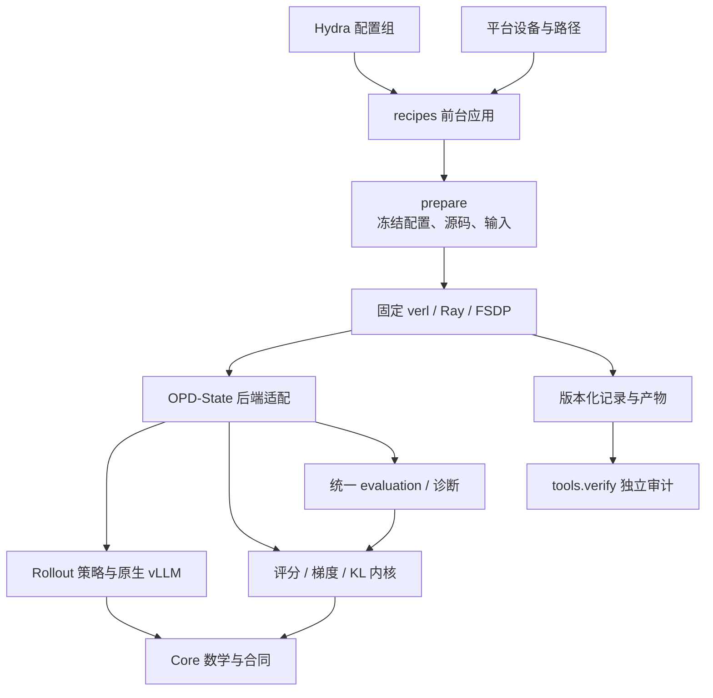
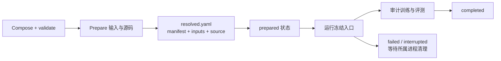

# Agent Note: MirrorOPD 配置与架构对齐

Status: proposed

## 问题

OPD-State 的生成策略已经统一，但实验配置仍分散在 `math_native.sh → math_baseline.sh → opd.sh → _common.sh → Hydra`、验证 profile、验收脚本和正式矩阵脚本中。Shell 同时负责科学参数、机器路径、运行目录、日志和环境；增加一个变体时，需要知道哪些默认值会被哪一层覆盖。用户要求采用 MirrorOPD 的配置系统和架构，使两套 OPD 可以使用相近的运行与维护方式。

结论是采用 MirrorOPD 的**原生 Hydra 组合、统一 Python 前台、算法包与后端适配分层、冻结运行与统一审计**。普通 verl 字段继续使用原名，新增类型只覆盖 OPD-State 自有语义。保持我们的轨迹来源、共同 sampled-token 更新、独立验证引擎和 full-vocab KL 能力；算法默认值与后端版本分别建立等价基线后迁移。

本记录已进入实施，状态保持 proposed。配置组合与静态校验已新增，完整前台生命周期、模块抽取和 GPU 验收尚未完成，生产训练入口仍未切换。它部分取代[源码根目录与文档归属](../../implemented/architecture/2026-10-17-训练基线与研究分层.md)中“自有训练实现长期放在 vendored verl 内”的分工，并接管[可组合 rollout 提案](2026-10-18-可组合rollout与原生vLLM推理.md)中的配置入口与模块归属；后者继续维护模型身份、切换、KV、权重发布、推理实现和性能证据。研究资料仍统一归 docs，原始实验结果保留自己的源码身份。

### 实施进展

[根配置](../../../../configs/train.yaml)已通过单一[composer](../../../../recipes/configuration.py)继承现有后端，支持 11 种基本来源、普通与完整 KL 评测、Graph 配方及日志/保存配置组。旧真实 Shell 入口的 15 个正式条件、validation_fast 和 Graph 配置共 17 份完整解析结果保存在[独立基线](../../../../tests/oracles/configuration-baseline.json)；新实现逐项比较所有原生子树，仅明确迁移运行目录、源码提交标识和后端绝对路径。基线生成器只替换最终 Python 执行为 argv 记录，不启动模型、Ray 或 CUDA。

[配置测试](../../../../tests/configuration/test_composition.py)覆盖完整字段等价、CLI 优先级、含空格路径、四/八卡组合、验证资源隔离、非法目标/来源/预算及周期与末步触发去重。配置代码和 CPU 测试只依赖项目维护环境中的 Hydra/OmegaConf，训练环境未安装或升级依赖。配置组合通过不代表运行生命周期或 GPU 行为已验收。

当前评测仍通过受检查的派生字段连接原生验证 hook；该过渡桥只接一个 live 数学 suite，未知多 suite 组合和不可表达的调度显式拒绝。阶段 E 将提取 suite 执行器并移除这层 stock 验证投影。来源解析暂复用所选后端的既有纯 Policy 解析器，阶段 D 抽取后改为包内唯一实现。后续还需完成输入/源码冻结、prepared 执行、状态审计、无偏 head-tail 迁移、全部策略四卡接入与完整 570×16 验收，不能据配置层通过将整体重构标记完成。

前台的 [prepare/run](../../../../recipes/application.py)、[输入检查](../../../../recipes/inputs.py)、[源码冻结](../../../../recipes/snapshots.py)和[独立审计](../../../../tools/verify.py)已进入验收。准备阶段核对真实模型张量名称与形状、tokenizer、训练题池和验证题目；执行阶段从冻结入口加载，记录所属进程，并检查实际更新、轨迹来源、准确率与 KL 产物。已补充相对运行目录切换工作目录后的路径回归，所有输出路径在冻结前转换为绝对路径。

真实资产的 CPU 预检已覆盖 17,235 道训练题、570 道验证题及两个各含 339 个存储张量的模型，证据位于 `runs/config-refactor-20261019/real-prepare-v1`。维护环境的配置与应用测试通过 80 项，真实 Qwen2 小模型布局与安装包路径测试通过 5 项；维护环境没有 Torch 时显式跳过模型布局测试，由训练环境单独执行。真实启动还核验了相对输出路径、Ray socket 长度与共享文件系统元数据延迟：输出路径在冻结前固化；scratch 使用按用户隔离的短 `/tmp` 路径；时间戳刷新时要求两次完整内容读取一致且第二次元数据稳定。Ray 的零 GPU 启动与清理已通过，共享盘 100 个新文件的哈希复测通过；四卡短测试使用新目录继续验收。以上证据不表示已完成四卡训练、全部来源策略或完整验证规模的迁移。

### 审计范围与版本

参考 MirrorOPD 的 HEAD 为 `84f5039636ee77a73facc6fdc9a0802e6fecee0f`，工作区存在未提交重构。审计冻结了 242 个相关文件，对配置、前台、数学核心、后端接口、评测及测试中的 34 个关键文件记录了阅读范围与 SHA-256；这些关键文件在冻结后复核未变化。OPD-State 基线为 `cd562f1d896a2e38138e6a2118b19e3a6fa32245`。

[审计记录](../../../../docs/provenance/mirroropd-config-audit-20261019.json)保存源文件身份、实际组合结果、CLI 行为及 CPU 梯度对照。MirrorOPD 的文档仍提到 `final_task`、`sampled-r16` 和部分已迁移的 `recipes/evaluation` 文件；当前代码已改为 `evaluation.suites` 与 `src/mirroropd/evaluation`，因此接口判断以冻结代码和实际执行为准。相邻仓库的文件链接便于阅读，精确版本以审计中的哈希为准。

### 现有配置链的问题

| 当前位置                                 | 实际职责与问题                                                                    | 迁移要求                                             |
| ---------------------------------------- | --------------------------------------------------------------------------------- | ---------------------------------------------------- |
| `recipe/math_native.sh`                  | Shell case 构造策略字典；把λ、切换位置、batch 配额转换为字符串                    | 策略成为 Hydra 配置组，CLI 直接覆盖最终字段          |
| `recipe/math_baseline.sh`                | 同时设置训练预算、验证、W&B、设备、CUDA 和缓存路径                                | 科学设置进配置；路径进应用；设备继承平台分配         |
| `recipe/_common.sh`                      | 环境变量默认值再次转换为大量 Hydra 覆盖；命令替换会分词，注释明确不支持含空格路径 | 用参数数组传递原生覆盖，取消科学参数的环境变量翻译层 |
| `config/experiment/validation_fast.yaml` | 隐藏在后端目录中的评测资源组合                                                    | 根配置组选择，保持训练与验证资源独立                 |
| `eval/run_native_math_suite.py`          | Python 内硬编码十五条件、公共超参数及 Graph 覆盖                                  | Study 只枚举配置组合，共用单次运行入口               |
| `ray_trainer.py`                         | 包含来源、缓存、plateau、KL 记录、指标与恢复分支                                  | 提取自有执行器，后端只保留必要调用点                 |

现有 bash 链能运行，不意味着默认值是单一来源。例如全局 batch 同时参与学习 mini-batch、rollout 序列上限和设备配置；验证 profile 只覆盖验证参数；`MODEL_DTYPE`主要传给 teacher，不能凭该变量推断 actor 主参数精度。迁移以实际解析结果为基准。

## 提案

### 1. 对齐配置系统的实际机制

MirrorOPD 使用 [configs/train.yaml](../../../../../MirrorOPD/configs/train.yaml)继承固定后端的 `ppo_trainer`，通过 defaults 组合功能组。它没有先构造一份自定义 Job，再把 Job 编译成 verl 配置。

| 机制         | MirrorOPD 当前实现                                                                                                      | OPD-State 采用方式                                          |
| ------------ | ----------------------------------------------------------------------------------------------------------------------- | ----------------------------------------------------------- |
| 单一组合入口 | [recipes/configuration.py](../../../../../MirrorOPD/recipes/configuration.py)的 `configure` / `compose_config`          | 同样供训练、预检、study 和测试调用                          |
| 后端配置来源 | Hydra searchpath 指向 `--backend` 的原生配置目录                                                                        | 来自我们锁定的 One-Shot-OPD 后端，不替换成 TA-OPD           |
| 配置组       | backend、student、teacher、dataset、algorithm、evaluation、checkpoint、logging、experiment、training                    | 保留同名分工；增加独立 rollout 策略组                       |
| 原生字段     | `actor_rollout_ref.*`、`data.*`、`trainer.*` 等继续使用原名                                                             | 优化器、FSDP、vLLM 不再包一套同义字段                       |
| 扩展类型     | Objective/Memory注册到ConfigStore；评测对象经严格decoder校验                                                            | 定义自有 Objective、RolloutPolicy、KL 诊断等小型类型        |
| 插值         | 显式 paths、run.dir 及路径/context resolver                                                                             | 使用独立训练 context 与验证 context，保留 5,120/32,768 分离 |
| 前台入口     | [recipes/train.py](../../../../../MirrorOPD/recipes/train.py)选择 `--backend` 或 `--prepared`，其余参数交给 Hydra       | 相同 CLI 形态；prepared 模式拒绝追加覆盖                    |
| Shell 包装   | [scripts/_training.sh](../../../../../MirrorOPD/scripts/_training.sh)归一化路径、选择 Python 及运行目录，按数组转发参数 | 只保留环境便利入口，科学默认值只在配置中                    |
| Study        | [tools/study.py](../../../../../MirrorOPD/tools/study.py)调用同一 compose/prepare/run/verify                            | 十五条件与 seed 矩阵不再拥有独立训练启动逻辑                |

配置组的文件使用 `# @package _global_` 覆盖相关原生字段；已有后端 group 使用带 package 的 defaults 项。需要测试组名与后端已有 `algorithm`、`rollout` group 的共存，不能靠重命名原生字段绕过冲突。

组合优先级显式固定为：后端原生 defaults → 自有 schema 默认值 → 公共执行设置 → 模型/数据/算法/来源/评测等组 → 领域 experiment → training 实验配方 → CLI 覆盖。`training`可以像 MirrorOPD 的 normal-opd50 一样覆盖已选组，但必须在 resolved 配置和 study 计划中展示最终结果。环境变量只提供路径和平台上下文，不在组合完成后再次改写学习率、长度或采样。

### 2. 两个 OPD 的共同点与不能混用的设置

MirrorOPD 不只实现普通 OPD，还包含 MDPO/BPO 及冻结窗口内多次更新。它的 `algorithm=on_policy` 只选择算法和一次 inner，仍保留 signal 的κ=0.5、η=0.2 和 Top-J=16 默认值。`training=normal-opd50`才显式设置κ=0、η=1、J=0、sampled 积分、无额外诊断。

| 项目                     | MirrorOPD normal-opd50                            | 当前 OPD-State 来源实验                                 | 迁移原则                                               |
| ------------------------ | ------------------------------------------------- | ------------------------------------------------------- | ------------------------------------------------------ |
| 基础信号                 | κ=0、η=1 时退化为 teacher 与 anchor 的 log-ratio  | `log q(a\|s) − log p_old(a\|s)`                         | 可建立共同的信号定义和数值参照                         |
| 更新形式                 | 冻结系数乘当前 action log-prob 的 score surrogate | `token_reward_direct`加 PPO surrogate                   | 先保持现有 PPO 行为，再用配对梯度决定是否统一实现      |
| 更新次数                 | on_policy 一次；MDPO/BPO 默认 16 次 inner         | 每批新轨迹一次完整更新                                  | 不能导入 16 次 inner 或不同 scheduler 计量             |
| 生成来源                 | 当前 student                                      | 当前/初始/teacher/fusion/分段/batch 混合                | 保留独立 RolloutPolicy，行为分布不等于 learner         |
| 参数与计算精度           | FP32 主参数，显式 BF16 前向、FP32 归约            | 解析为 FP32 主参数；默认混合精度为 BF16 前向、FP32 归约 | 两边此处已接近，按实际 worker 回执核验，不制造精度差异 |
| Weight decay / grad clip | 0 / 2                                             | 0.01 / 1                                                | 保持现有数值，另开实验才改变                           |
| 训练 prompt/response cap | 2048 / 7168                                       | 1024 / 4096                                             | 配置迁移不改变数据可接受集合与工作量                   |
| 数据                     | 原始 DAPO 配方                                    | 已清洗的 17,235 唯一题池                                | 保留去重、冲突排除、顺序、UID 与清单哈希               |
| 评测与保存               | normal-opd50 关闭 evaluation，每 5 步保存         | 最终 570×16、无 checkpoint；新 profile 增加 KL          | 使用自己的显式 training/evaluation/checkpoint 组       |
| 后端                     | TA-OPD 固定基线与补丁                             | One-Shot-OPD 加本仓修改                                 | 配置架构和后端版本分别迁移                             |

对同一固定 prefix 和 action，在更新起点 $p_\theta=p_{\mathrm{old}}$，当前 PPO 未触发 clip 时，令 $r=\log q-\log p_{\mathrm{old}}$ 为停止梯度的系数，有

$$
\left.\nabla_\theta\left[-r\frac{p_\theta(a\mid s)}{p_{\mathrm{old}}(a\mid s)}\right]\right|_{\theta=\theta_{\mathrm{old}}}
=-r\nabla_\theta\log p_\theta(a\mid s).
$$

MirrorOPD 在上述普通 OPD 设置下给出相同的局部 score 梯度。实际调用两边实现的四组 CPU FP64 对照，每组五个有效 prefix、词表 17，并包含 padding，最大 logits 梯度误差为$1.94\times10^{-16}$；J=0 的 reward 中心为 0。两个 surrogate 的标量 loss 不同，不能要求日志 loss 逐值相等。这项检查只证明共同 anchor 处的局部梯度关系，不能证明 FSDP、动态 micro-batch、完整模型参数梯度或训练轨迹等价。

Teacher/fusion/initial来源同时改变prefix与action分布，当前没有行为重要性修正。配置重构保持这一语义；将其改成纯state对照、full-vocab训练目标或MDPO/BPO属于另一个算法变更。MirrorOPD的Top-J中心也不等于OPD-State的top-k训练reward或validation的完整词表KL，不能用同一个 `top_k` 开关代替三种含义。

### 3. 目标目录与依赖方向

目标整体采用 MirrorOPD 的分层，名称使用本项目的 `opd_state`。下列目录是拟议交付，不表示已经存在。

```text
configs/
  train.yaml
  backend/  student/  teacher/  dataset/
  algorithm/  rollout/  evaluation/
  checkpoint/  logging/  experiment/  training/
recipes/
  train.py  configuration.py  application.py
  inputs.py  snapshots.py  scoring.py
src/opd_state/
  core/                 # 数学信号、策略/轨迹合同、不可变身份
  kernels/              # 训练评分与KL的张量实现
  rollout/              # 策略编译与执行，不持有机器资源
  evaluation/           # suites、响应记录、任务指标、固定bank与KL诊断
  integrations/verl/    # trainer/FSDP/Ray/序列布局与生命周期适配
  integrations/vllm/   # 原生模型注册、paired fusion与worker能力
platforms/              # 已分配设备、所属进程和遥测
patches/verl/           # backend.json + 完整可重放补丁
upstream/pinned-verl/   # 生成/准备的固定后端，Git忽略
tools/                  # prepare_backend、study、verify、collect与plot
scripts/                # 维护hooks及薄启动包装
benchmarks/             # 固定token/模型的性能与数值对照
tests/                  # CPU合同、独立参照、原生集成与GPU验收
```



Core 不导入 Ray、verl、vLLM 或 recipes；kernel 只依赖 core 和张量库；integration 把后端布局转换成明确的张量/记录合同；recipes 负责运行生命周期，不在 Shell、study 或 scorer 中复制损失公式。原生 vLLM paired 模型仍执行双 backbone，配置分层本身不承诺减少其计算量。

第一阶段可继续把当前仓库作为 `--backend .`，保持现有引擎；最终后端由 `patches/verl/backend.json` 和 patch 唯一确定。选择 One-Shot-OPD 导入版本作为候选基线时，必须导出当前所有必要差异并在干净基线上重放。MirrorOPD 锁定的 TA-OPD 提交 `62669afb...` 和它的 20 个后端补丁文件不能直接替换本仓后端。

### 4. 目标配置组及字段归属

| 组/对象                    | 唯一职责                                           | 示例或约束                                                       |
| -------------------------- | -------------------------------------------------- | ---------------------------------------------------------------- |
| `backend=fsdp`             | 原生执行、精度、micro-batch、offload 及引擎配置    | 保留 `actor_rollout_ref.*` 原名                                  |
| `student` / `teacher`      | learner 和监督模型资产                             | 初始 student 来源绑定 student 初始化资产，不另设第二个可漂移路径 |
| `dataset=dapo-math-unique` | 训练输入、清洗策略、列映射、UID 和清单             | 兼容既有完整去重池的内容身份                                     |
| `algorithm=sampled_opd`    | 当前 sampled-token 信号、surrogate、归约及修正策略 | 名称描述更新目标，不把所有来源误称为 on-policy                   |
| `rollout`                  | single、fusion、sequence_switch、batch_mix 之一    | 对应现有 11 种基本策略；端点仍归约为单模型                       |
| `evaluation`               | suites、benchmark、触发时机、采样、预算和诊断      | 纯当前 student；live 无须 checkpoint                             |
| `checkpoint=none/periodic` | 是否保存及保存内容                                 | 默认来源实验明确选择 none                                        |
| `logging=local/wandb-*`    | 本地记录与 W&B 模式                                | project 仍为 OPD-State，密钥只来自运行环境                       |
| `experiment=math`          | 领域的 student/teacher/dataset/判分组合            | 不夹带未声明的算法变化                                           |
| `training=opd50`           | 明确的 50 步学习协议                               | lr、weight decay、clip、batch、长度、保存和验证全部可核对        |
| `paths` / `run`            | 资产根目录、新运行目录和冻结目录                   | 不使用日期字符串充当内容身份                                     |

`rollout`配置组直接填写原生扩展字段 `actor_rollout_ref.rollout.policy`；它是科学来源选择的唯一值。初期保留已经验收的 Policy 解析与端点归约，抽取后仍使用同一实现。领域 schema 不再创建 `student.batch_size`、`optimizer.learning_rate` 等普通 verl 字段的同义副本。

根配置沿用 MirrorOPD 的 defaults/searchpath 形态。以下是目标骨架；扩展 schema 与后端接收字段须同步实现，不能只有 driver 能识别新增节点。

```yaml
# configs/train.yaml — 目标骨架，尚未接入当前生产入口
defaults:
    - ppo_trainer
    - _self_
    - schema@distillation.opd.objective: objective
    - schema@evaluation: evaluation
    - backend: fsdp
    - student: deepseek-r1-1.5b
    - teacher: justrl-1.5b
    - dataset: dapo-math-unique
    - rollout: student-fresh
    - evaluation: math-final-kl
    - checkpoint: none
    - logging: wandb-online
    - experiment: math
    - algorithm: sampled_opd
    - training: opd50
hydra:
    searchpath:
        - file://${opd_backend_config:}
    run:
        dir: .
    output_subdir: null
    job:
        chdir: false
paths:
    model_root: null
    data_root: null
run:
    dir: null
    source_dir: ${run.dir}/source
    prepare_only: false
```

下列为目标配置片段，尚不是当前 main 的可运行入口：

```yaml
# configs/rollout/teacher-current.yaml
# @package _global_
actor_rollout_ref:
    rollout:
        policy:
            kind: sequence_switch
            first: teacher
            second: current_student
            boundary:
                kind: response_tokens
                value: 2048
```

```yaml
# configs/rollout/current-teacher-fusion.yaml
# @package _global_
actor_rollout_ref:
    rollout:
        policy:
            kind: logit_fusion
            base: current_student
            teacher_weight: 0.5
```

Batch 混合沿用 `components`、`assignment: exact_count`、`routing_unit: trajectory`；不在 CLI 或 Shell 中再算第二个权重字符串。配置使用非负相对权重，统一解析器归一化并分配整数配额。分段的 token 数与 budget_fraction 是互斥的 boundary 类型。

### 5. 校验、派生值和配置身份

MirrorOPD 的 [validate_native_config](../../../../../MirrorOPD/src/mirroropd/integrations/verl/config.py)负责数学与支持范围，输入读取由 [prepare_inputs](../../../../../MirrorOPD/recipes/inputs.py)承担。采用同样的分层，而不是在每个脚本里重复校验。

1. **组合**：Hydra 读取配置组、处理插值和 CLI 覆盖；只注册必要的扩展 schema。普通原生字段的类型继续由后端负责。
2. **静态约束**：不读取模型、不初始化 CUDA，检查有限参数、未知扩展字段、版本、策略互斥、全局 batch 整除、上下文和端点、sampled-token 协议与 KL 设置。
3. **输入准备**：读取实际模型/tokenizer/data，核对共同词表与特殊 token、模板、长度、题目清单、资产哈希、判分依赖及资源预算。
4. **运行绑定**：记录实际 worker 设备、引擎上限、模型角色与版本；静态配置不能代替这些回执。
5. **完成审计**：核对更新数、终止原因、验证覆盖和逐步身份，完成条件不能只有子进程 exit code=0。

冻结 Objective/Policy 等对象由一个 decoder 产生；`prepare_native_config`中的纯字段检查和读模型/tokenizer 检查拆开。所有派生字段从同一个配置节点计算，并在 prepared 阶段固化；例如 global batch 不再隐式等于 vLLM 最大活跃序列。验证 chunk 大小也不从训练 micro-batch 推导。

`--cfg job --resolve`应保持原生 Hydra 含义：打印组合结果。实测 MirrorOPD 对“on_policy 却设置两次 inner”的配置仍能成功打印，而 `compose_config` 的语义校验会拒绝；因此配置打印不等于完整预检。实际运行在占用 GPU 前执行同一 validator，`run.prepare_only=true`进一步做资产准备。

扩展字段即使用 `++` 强行加入，也必须在 decoder 处拒绝未知项。公开路径和原生覆盖支持空格；不允许未声明的配置键静默掉回默认值。新结构只保留一套权威配置，旧字段的临时转换仅用于迁移比对，不能长期作为第二解析入口。

### 6. Prepare、冻结与运行生命周期

采用 [MirrorOPD 前台应用](../../../../../MirrorOPD/recipes/application.py)的前台所有权模型：



每个 run 使用新目录及互斥锁，保存原生 resolved 配置、命令行、完整执行源码、输入清单、独立配置/源码/资产身份、环境版本和 worker 回执。配置身份排除密钥及纯易变时间戳；run_id 区分一次运行，不能替代科学配置身份。

源码冻结包含 `opd_state`、后端、recipes、configs、scorer 辅助文件与资源。当前 `OPD_FREEZE_SOURCE` 只归档 verl，其他启动器/数据/采集器仍可能来自工作区；新生命周期覆盖所有实际执行组件。worker 从冻结 PYTHONPATH 加载包，新增未跟踪运行源码也必须显式纳入或拒绝启动，不能只记录 HEAD。

`--prepared`拒绝追加普通覆盖，复核配置、源码、输入和路径，切到冻结入口执行；修改参数必须 prepare 新目录。Prepare-only 不申请 GPU。失败或取消后只清理经 PID/start-time 验证的所属进程，后代退出后释放 scratch 与设备；清理失败保留状态和诊断。平台设备分配位于应用外层，既有 0–3 卡限制继续生效。

模型权重和输入数据不因每个 run 盲目复制；使用显式资产路径与内容身份，生成的小型规范化数据/选择清单归 run。固定轨迹缓存、Mirror 式批内评分缓存和 vLLM KV 属于不同生命周期，分别命名和验证。

### 7. 统一评测，同时保留现有 KL 与速度能力

MirrorOPD 当前用 `evaluation.suites` 定义触发和 live/checkpoint 执行，用 `evaluation.benchmarks` 定义数据、workflow、sampling、budget、scoring、aggregation。它显式关闭原生 `data.val_files` / `trainer.test_freq`，避免两套验证同时触发。目标也采用这一公开结构，把我们已验收的验证实现抽取成 suite 执行器。

默认来源实验使用 `execution: live`、`initial: false`、`training_end: true`；周期实验设置 `every_outer_steps`。当末步同时命中 periodic 和 training_end 时，同一个 suite 只执行一次，并记录两个 reason。无 checkpoint 实验仍能验证当前版本；只有 checkpoint suite 要求完整保存与发布。

我们的必要扩展是 suite 下的 KL 诊断：完整准确率轨迹、固定初始 student bank、固定 teacher bank，以及分块与覆盖配置。以下为目标 schema 示意；`diagnostics`属于 OPD-State 扩展，不声称 MirrorOPD 已经有该字段。

```yaml
evaluation:
    suites:
        validation:
            execution: live
            trigger:
                initial: false
                every_outer_steps: null
                training_end: true
            benchmarks: [math]
            engine: null
            diagnostics:
                kl:
                    enabled: true
                    full_vocabulary: true
                    position_chunk_size: 1024
                    vocab_chunk_size: 151665
                    forward_batch_size: 1
                    fixed_prefix_bank: null
```

Benchmark 使用同一数学 570 题×16 采样和逐题统计。Live suite 通过 integration 借用**独立纯 student 验证引擎**，不把 MirrorOPD 的单一最大 context 推导原样套到训练引擎。保留每卡 seq128、budget0.55、batched tokens32768 和 Graph 的已测验证配置，以及训练 context5120 与验证 context32768 的隔离。

整轮准确率生成结束后让推理引擎休眠，读取当前 actor 与 teacher 做完整词表 KL；完成后恢复正确训练来源。记录同一 student_version，主响应所有有效位置必须覆盖；bank 仍使用原 180 轨迹/1440 分层位置及权重。实际验证采样 T=0.7/top-p=0.9，因此累计条件 KL 仍不冒称原始模型分布的严格 sequence KL。

第一阶段提取现有评测和指标实现，不同步替换随机种子方案、题面模板、grader 或聚合。MirrorOPD 的 `mirror-v2` seed 坐标、checkpoint 评测、多轮 workflow 可以按接口接入，但不能在配置整理时改变已完成实验的评测协议。

### 8. 文件迁移与复用边界

| 当前 OPD-State 实现                                         | 目标归属                                               | 处理方式                                                     |
| ----------------------------------------------------------- | ------------------------------------------------------ | ------------------------------------------------------------ |
| `recipe/math_native.sh`的 case 与环境参数                   | `configs/rollout/*.yaml`                               | 等价搬迁 11 种策略与控制参数                                 |
| `math_baseline.sh`、`_common.sh`的科学默认值                | `configs/backend`、`training`、`evaluation`、`logging` | 以解析后的字段快照为比对基准                                 |
| `policy.py`、`native_executor.py`                           | `opd_state/core`与`rollout`                            | 保留身份、预算、EOS、配额和顺序合同                          |
| `rollout_coordinator.py`、`native_pool.py`                  | `integrations/verl`的生成适配                          | 保留 FSDP/Ray 接线和生命周期，纯策略不导入后端               |
| `fusion/vllm_model.py`、server/weights 扩展                 | `integrations/vllm`与 verl 接线                        | 保留原生双模型、独立 KV、Graph 和 current 热更新             |
| `opd_core_algos.py`、teacher 评分、top-k tail               | `core` / `kernels` / verl 注册适配                     | 公式一处定义；普通 sampled 目标与其他研究目标分开配置        |
| `validation_kl.py`、`validation_kl_runner.py`及 worker 评分 | `evaluation` / `kernels` / verl 评分适配               | 保留 FP32 完整归约、逆排、位置覆盖和实时版本                 |
| `_validate()`中的 math 指标、记录和恢复                     | `evaluation` suite 执行器                              | 将后端主循环缩减为明确回调                                   |
| `build_fresh_math_data.py`与 manifest 检查                  | `recipes`输入准备                                      | 复用清洗与内容身份，不改训练题池                             |
| `run_native_acceptance.py`、suite 与 W&B 核验               | `tools` / `benchmarks` / 集成测试                      | 共用 prepare/run/verify，保留独立审计                        |
| GPU 监控、run 进程与 scratch                                | `platforms`与应用资源所有者                            | 继承设备集合，不全局 ray stop                                |
| 缓存、HF fusion 和 plateau 旧运行分支                       | 历史证据读取与显式实验能力清单                         | 最终常规生产入口不保留并行旧配置链；删除前逐项核对现存消费者 |

`math_alignment.sh` 的无偏 head-tail 与相关研究不能因常规来源实验用不上而直接丢弃。将它登记为单独算法配方，保留其仅支持 fresh student 的约束；验收覆盖完成前不宣称全面迁移结束。历史结果、源码快照和可重算统计保留原身份，重构不修改既有 CSV/JSON 的科学含义。

### 9. 目标操作方式与迁移顺序

Python 前台已经提供 `--backend`、`--prepared` 与 prepare-only 接口，当前验收使用 `--backend .` 绑定现有后端。下列固定后端路径属于阶段 D 的目标交付；全部迁移验收通过前，正式训练仍使用 README 中的现有入口。

```bash
python -m recipes.train --backend upstream/pinned-verl \
  paths.model_root=/models paths.data_root=/datasets \
  experiment=math training=opd50 algorithm=sampled_opd \
  rollout=teacher-current \
  actor_rollout_ref.rollout.policy.boundary.value=2048 \
  evaluation=math-final-kl checkpoint=none logging=wandb-online \
  run.dir=/persistent/runs/teacher-current-001
```

同一入口用 `--cfg job --resolve` 查看原生配置、`run.prepare_only=true` 准备，之后通过 `--prepared /persistent/runs/...` 执行。Study 只持有 base overrides、grid、显式 trial 上限与失败策略；所有 trial 调用同一 composer，先冻结，再顺序运行，新目录重试。不能用 Hydra sweep 直接在共享 GPU 上无约束并发。

| 阶段              | 交付与退出条件                                                                                                        |
| ----------------- | --------------------------------------------------------------------------------------------------------------------- |
| A：固化基线       | 保存现有全部有效配置、数据/模型身份、固定 token 和数值参照；区分现有质量协议与 validation_fast 协议                   |
| B：配置入口       | 根 Hydra groups、统一 composer/validator、Python 入口和薄 Shell；先调用当前后端，逐字段比较 11 种来源及 15 个正式条件 |
| C：前台生命周期   | prepare-only、完整源码/输入冻结、prepared 不可变、状态与进程所有权；单次/study 共享应用                               |
| D：模块与后端     | 提取 core/kernels/rollout/integration，锁定 One-Shot 后端并重放完整 patch；测试从旧路径迁到同一实现                   |
| E：统一评测       | suite 触发与现有 math/KL 执行器接线；验证独立资源、版本、恢复和无 checkpoint 模式                                     |
| F：等价与性能验收 | 固定 token 参数梯度、四卡全部策略短训练、周期/末步验证、完整 570×16 与同工作量性能对照；通过后移除旧生产配置链        |

阶段划分用于定位回归原因；最终交付只有新入口与新 schema。过渡脚本不长期保留两套默认值。配置迁移、loss/kernel 替换和后端升级分别提交，避免出现结果变化时无法定位是算法、数据还是执行参数的差异。

## 考虑过的替代方案

| 方案                                                | 判断                                                                       |
| --------------------------------------------------- | -------------------------------------------------------------------------- |
| 只把环境变量搬到一个大 YAML                         | 没有解决应用、资源、冻结与后端的耦合；不满足完整架构对齐                   |
| 增加 Job/schema/compiler，把全部 verl 字段重新命名  | 与 MirrorOPD 当前方向相反，增加类型、默认值和翻译的重复维护                |
| 直接依赖相邻 MirrorOPD 工作目录或整体复制其当前代码 | 工作区正在变更，后端与算法默认值不同；会使 OPD-State 无法独立冻结与发布    |
| 同时切换到 TA-OPD、Mirror loss、优化器和数据设置    | 无法证明配置重构的行为等价，应拆成独立算法/后端实验                        |
| 永久保留旧 Shell 与新 Hydra 两条生产链              | 默认值、验收和故障路径持续分叉；只允许迁移期间的比对工具                   |
| 立刻建立跨仓共享基础库                              | 两边仍在重构，接口没有稳定的双消费者证据；先采用相同边界，稳定后再抽共同库 |

可以直接参考 MirrorOPD 的 composer、snapshot、study、backend 准备和进程所有权实现，但复制时需要固定来源、保留归属，并验证 OPD-State 自己的数据与运行合同。算法及 KV 生命周期具有当前消费者约束，按接口移植，不按目录名机械搬运。

## 验收条件

### 已完成的方案核验

- MirrorOPD 真实配置组合：8 个有效案例通过，覆盖默认 BPO、单独 on_policy、normal-opd50、code、IF、学习率覆盖、含空格路径和 live 评测；6 类非法组合按预期拒绝，包括未知扩展字段、多次 on-policy 更新、截断训练采样、退役 final_task、原生验证频率及错误原生键名。
- 真实 CLI 的两次 `--cfg job --resolve` 都成功，包括一个语义无效但可打印的配置，确认打印与运行校验的区别。
- OPD-State 真实 Shell 入口由只记录 argv 的 Python 替身捕获，再交给实际 Hydra 组合；普通入口与 validation_fast 分别解析为正确的学习与验证设置。未启动训练后端。
- 两边真实 loss 函数在共同 anchor 上的四组 CPU 梯度比较通过，最大误差$1.94\times10^{-16}$；CUDA 未初始化。

以上为配置/局部数学证据，不替代后续重构的模型参数梯度、GPU 运行或性能验收。

### 代码落地必须通过的条件

| 层次       | 必须核对的行为                                                                                                           |
| ---------- | ------------------------------------------------------------------------------------------------------------------------ |
| 配置       | 11 种来源、15 个正式条件、四/八卡参数组合；CLI 优先级、带空格路径、未知字段、非法端点/预算、dtype 和有效模型参数回执     |
| 科学协议   | lr、weight decay、clip、batch、每批更新数、采样、有效 token 归约与 teacher 温度逐项一致；source/action/reward 语义不漂移 |
| 数据       | 17,235 题清洗清单、前 50 批 3,200 次唯一访问、UID/顺序/seed、评测重合审计与 grader 身份                                  |
| 冻结       | 准备后修改源码、tokenizer、数据或 bank 必须拒绝；prepared 不能覆盖配置或重用运行目录；缺失输入在 GPU 启动前报错          |
| 来源执行   | 冻结模型写保护、current 版本、端点等价、分段预算/EOS、batch 整数配额/逆排、独立 KV 及无 HF 回退                          |
| 更新       | 固定真实 token 上的 reward、old log-prob、梯度方向/尺度、参数梯度与 optimizer 状态；CPU 和真实四卡均核验                 |
| 验证       | 每个触发点使用实时 student；末步重合触发不重复；570×16 完整覆盖、bank 固定、KL 全部位置/词表、periodic 后恢复训练        |
| 数值与性能 | 原有 KL 误差门槛保留；固定工作量对照阶段时间、峰值与吞吐，输出长度不同则明确归一化，不外推 3.17×                         |
| 完成与清理 | exit0 但缺 step/响应/版本/记录不能 completed；异常后等待所属进程退出；只在已分配卡 0–3 验收，八卡单独记录                |
| 交付       | wheel 只含自有生产包；后端 patch 可干净重放；测试统一收集；旧生产入口及无消费者兼容层退出，历史证据仍可定位              |

验收失败时定位到配置、输入、后端、生成、更新或评测阶段，停止启动后续 trial 并等待当前所属进程清理。修复后使用新运行目录复测，不能把失败 run 原地改成成功证据。

## 风险

MirrorOPD 工作区尚在重构，统一评测等新接口的 GPU 成熟度不足以从代码存在直接推断。移植基于冻结阅读快照，实施时先审阅其后续差异。

名称相近的 OPD、Top-J、cache、step 和 dtype 具有不同语义。配置默认值、中心项、outer/inner 计数、seed 坐标或采样支持集变化都可能改变训练结果；即使共同 anchor 的梯度相同，量化、FSDP 归约和 optimizer 也可能产生差异。

抽出包后，Ray worker、vLLM 进程和冻结源码的导入路径必须一致；错误 PYTHONPATH 可能让 driver 运行新代码、worker 运行旧模块。模型切换、KV 释放和验证恢复的所有权不能在目录迁移时丢失。

完整词表 KL 与原生 fusion 仍有实际计算和显存成本。配置系统统一不会自动提高训练吞吐；性能结论继续来自相同模型/token/范围的测量。当前已经通过的验证优化应作为迁移约束，不能因模仿 MirrorOPD 而重新耦合训练与验证资源。
