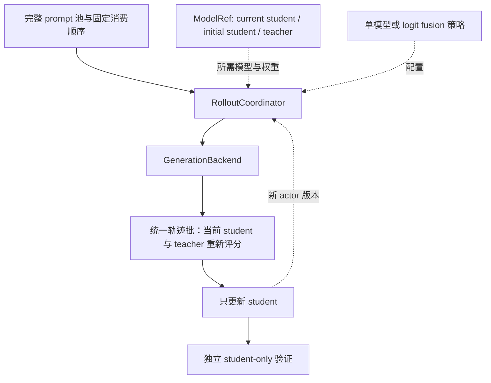

# 代码结构与修改入口

本仓以 One-Shot-OPD 的根目录作为开发根目录。训练代码直接在原位置修改，hooks 和研究资料是添加到代码库中的辅助内容。

## 训练与维护

| 位置            | 职责与修改方式                                                         |
| --------------- | ---------------------------------------------------------------------- |
| `recipe/`       | 启动训练、选择模型和数据、传递 Hydra 参数；新增实验配方从这里进入      |
| `data/prep/`    | 数据下载与转换；`data/README.md` 定义数据布局，实际数据文件由 Git 忽略 |
| `eval/`         | 评测入口；沿用原有任务协议，指标调整与实现一同提交                     |
| `verl/verl/`    | PPO 训练循环、rollout、教师打分、策略损失与分布式 worker               |
| `verl/scripts/` | 原框架的模型与运行辅助脚本                                             |
| `scripts/`      | 我们接入的维护检查、工具安装与 hooks                                   |

`verl/` 内部的 `setup.py`、`pyproject.toml` 和 `verl/` 包目录是上游原有结构。保留这一层可继续使用原安装入口和 recipe 的 PYTHONPATH 解析；日常改训练代码直接进入 `verl/verl/`。

## 研究与开发资料

所有人工阅读的项目资料统一归 `docs/`。`docs/research/occupancy/` 包含研究正文，以及随正文复现的 `experiments/`、`results/` 和 `figures/`；`docs/notes/` 保存需求、尝试和工作记录。两者是同一文档目录中的不同用途，使用说明通过链接引用结果。

开发说明归 [development.md](development.md)，导入版本与许可归 [provenance.md](provenance.md)。`.agents/` 保留工具要求的技能入口和决策格式。模型、数据、checkpoint、日志与大文件输出按 `.gitignore` 排除；`node_modules/` 只供本地维护工具使用。

## 算法修改链路

`recipe/opd.sh`、`mopd.sh`、`grpo.sh` 通过 `_common.sh` 解析根目录的数据与 vendored verl，再调用 `verl.trainer.main_ppo`。`DOMAIN` 选择模型与数据，`MODE` 选择 full、oneshot 或 template。训练命令从仓库根目录执行，例如 `MODE=oneshot bash -o pipefail recipe/opd.sh`。

PPO 主循环在 `verl/verl/trainer/ppo/ray_trainer.py`，OPD 的教师注册和逐 token 信号处理在 `opd_trainer_mixin.py`，教师打分在 `verl/verl/workers/fsdp_teacher_worker.py`，优势与策略损失在 `verl/verl/trainer/ppo/core_algos.py`。实验直接修改这些源码和对应 recipe，使用普通 Git 提交记录。

固定 teacher 与初始 student 轨迹由 `data/prep/build_rollout_cache.py` 生成，`fixed_rollout.py` 验证并读取缓存；当前 student 和冻结 teacher 仍在训练时重新评分。`recipe/math_cached.sh` 选择缓存来源，所有设置均只更新 student。长时固定缓存训练由 `plateau.py` 合并每 50 步的验证与训练残差，记录经验平台判断。

共享 prefix 的 logit fusion 已在 `verl/verl/workers/rollout/fusion/` 实现，通过 vLLM worker 扩展接收当前 actor 参数并生成融合轨迹，`recipe/math_fusion.sh` 提供训练入口。验证始终使用独立 student；完整两步调试与 λ=0.5 的正式 50 步实验均已完成。缓存身份、权重版本、后端限制、测试和结果见[统一实验协议](experiment/2026-10-18-rollout来源与logit融合实验.md)。轨迹内 teacher/student 切换及 batch 混合尚未实现；相关假设与判分归[研究正文](research/occupancy/2026-10-17-OPD访问测度与收敛机制研究.md)。

## 拟议重构：实时生成与模型来源解耦

此节是代码审阅后的实施方案，尚未落地为新的生成模式。审阅基线为 `d17d6c6`，范围是当前 math 的 FSDP、vLLM/HF fusion、权重同步、teacher 评分与验证执行链，涉及 32 个相关文件；没有宣称通读所有上游后端和算法。[代码核验清单](experiment/results/2026-10-18-rollout-refactor-code-audit.json)保存文件范围、哈希与 13 项源码观察。运行中的实验使用自己的固定源码快照，方案不改变其设置。

### 目标与算法含义

建议将新实验统一为训练时实时生成（fresh rollout），把生成权重来源单独配置。所有设置都只训练当前 student $p_\theta$，teacher $q$ 始终冻结；初始 student $p_0$ 是训练开始前的固定权重。实时生成描述生成时机，on-policy 描述生成分布与当前 student 的关系，二者不能混用。

| 设置名                   | 生成策略                   | 生成权重是否随 student 更新 | 需要每步同步 actor 的生成组件 |
| ------------------------ | -------------------------- | --------------------------- | ----------------------------- |
| `student_fresh`          | 当前 $p_\theta$            | 是                          | 当前 student                  |
| `initial_student_fresh`  | 固定 $p_0$                 | 否                          | 无                            |
| `teacher_fresh`          | 固定 $q$                   | 否                          | 无                            |
| `student_teacher_fusion` | 当前 $p_\theta$ 与固定 $q$ | 是，λ=0.5 时                | 当前 student                  |
| `initial_teacher_fusion` | 固定 $p_0$ 与固定 $q$      | 否                          | 无                            |

`initial_student_fresh` 每次消费 prompt 都重新采样，不能继续称为论文的固定缓存 Semi-OPD。历史缓存保留为 `collection=replay` 的复现适配器；新实验默认 `fresh`，响应复用策略与模型来源分开。固定生成来源可以更早预取，但首轮公平对照先统一逐步生成，避免只给固定来源跨步大批量预取而引入另一个性能变量。

双模型模式保持现有 logit fusion 的数学语义：对同一 state $s$，取 base 模型 $b\in\{p_\theta,p_0\}$ 和 teacher 的 logits，先在 FP32 中组合，再使用共同的词表支持、温度与采样规则。

$$
z_\lambda(s)=(1-\lambda)z_b(s)+\lambda z_q(s),\qquad
\mu_\lambda(\cdot\mid s)=\operatorname{softmax}(z_\lambda(s)/T).
$$

上式在共同有效词表内定义，首版保持 $T=1$、top-p=1、top-k=-1、repetition penalty=1。两个模型每次都接收同一个实际采样 token，保留各自 KV；不能让它们先独立续写再混合答案。λ=0/1 的计划可以归约为只激活相应单模型，避免无用前向；端点的分布与正常采样仍需核验。

### 当前代码的耦合与影响

| 当前位置                                                                                                                                                                           | 已核对的行为                                                           | 重构影响                                                                              |
| ---------------------------------------------------------------------------------------------------------------------------------------------------------------------------------- | ---------------------------------------------------------------------- | ------------------------------------------------------------------------------------- |
| [engine_workers.py](../verl/verl/workers/engine_workers.py) `init_model`；[llm_server.py](../verl/verl/workers/rollout/llm_server.py) `LLMServerManager`                           | actor 初始化和 rollout 共享 `actor_rollout_ref.model`                  | 不能用改该路径的方式选择 teacher 生成，否则连可训练 student 初始化与 tokenizer 都改变 |
| [ray_trainer.py](../verl/verl/trainer/ppo/ray_trainer.py) `fit`                                                                                                                    | 生成处按 fusion、普通生成、固定缓存分三支；同步条件也依赖缓存是否存在  | trainer 应调用统一协调器，来源选择、恢复和休眠归协调器处理                            |
| [vllm_rollout.py](../verl/verl/workers/rollout/vllm_rollout/vllm_rollout.py) `update_weights`；[utils.py](../verl/verl/workers/rollout/vllm_rollout/utils.py) `on_bucket_received` | actor 参数流同时写入 HF fusion 的 student 槽和原生 vLLM                | 同步目标须按模型引用选择；不能让 actor 参数覆盖 $p_0$ 或 $q$                          |
| [engine_workers.py](../verl/verl/workers/engine_workers.py) `generate_logit_fusion`；[decoder.py](../verl/verl/workers/rollout/fusion/decoder.py) `load_student_weights`           | 固定要求 `expected_version=step-1`，只支持一个可变 student 槽          | 固定 initial fusion 需要不可变模型身份；不能假装它拥有当前 actor 版本                 |
| [vllm_async_server.py](../verl/verl/workers/rollout/vllm_rollout/vllm_async_server.py) `_sleep_hybrid`                                                                             | 全参数 HYBRID sleep level 2 释放原生权重，恢复依赖 actor 参数流        | 固定 checkpoint 必须有自己的恢复路径，单独跳过同步还不够                              |
| 同文件 `release_kv_cache`、`resume_kv_cache`                                                                                                                                       | 当前只有条件检查和返回，没有实际释放/恢复操作                          | 不能按方法名认定 KV 已释放；需实现或改用真实生命周期操作，并用显存证据验收            |
| [hf_rollout.py](../verl/verl/workers/rollout/hf_rollout.py)、[base.py](../verl/verl/workers/rollout/base.py)                                                                       | 旧 HF 类使用同步接口，构造形式与当前基类不同，也不在 async registry 中 | 不能直接设置 `rollout.name=hf`；应复用已经跑通的 fusion 解码能力构造适配器            |
| [math_online.sh](../recipe/math_online.sh)、[math_cached.sh](../recipe/math_cached.sh)、[math_fusion.sh](../recipe/math_fusion.sh)                                                 | 配对数据默认指向 3,200 条 schedule，epoch 数按每轮 50 步计算           | 数据池、训练预算与生成方式必须独立                                                    |
| `ray_trainer.py` 与 [plateau.py](../verl/verl/trainer/ppo/plateau.py)                                                                                                              | 平台检查显式限定固定缓存，比较缓存窗口残差                             | fresh 模式不能直接沿用相同 states 的解释或该提前停止条件                              |

普通异步生成会做 verifier 评分，缓存与 fusion 的打包则放入零 `rm_scores`。当前纯 `token_reward_direct` 会由 `OPDTrainerMixin.compute_opd_token_reward` 覆盖为 teacher 的逐 token 信号，因此这不证明当前主 loss 有差异；但训练准确率等诊断和以后启用的 GRPO 混合项需要共同的 verifier 阶段，不能因生成路径不同而改变。

生成端还会屏蔽 tokenizer 有效词表以外的 padded logits，HF fusion 也切到有效词表；当前 FSDP teacher 评分函数对完整输出 logits 做归一化。当前配对的 tokenizer 长度为 151,665，模型输出词表为 151,936。生成分数、当前 actor 分数和监督 teacher 分数的职责应分别保留，不能为省一次前向就直接复用生成分数；先验证词表支持、温度、mask、位置和精度的归一化口径。

### 建议保留的四个对象

| 对象                 | 职责                                                  | 关键约束                                                                           |
| -------------------- | ----------------------------------------------------- | ---------------------------------------------------------------------------------- |
| `ModelRef`           | 表达可变 actor 引用或固定 checkpoint 引用             | actor 用更新版本；$p_0/q$ 用不可变 fingerprint；相同初始数值不允许共享可写参数存储 |
| `RolloutPolicySpec`  | 表达单模型或双模型 logit fusion，解析需要的组件与系数 | `uses_actor` 从有效组件推导；λ=1 时不为未使用的 actor 做生成同步                   |
| `RolloutCoordinator` | 编排训练生成、权重激活、休眠、验证切换和统一轨迹结果  | 拒绝错误模型身份、未完成参数流、旧版本与不支持的后端组合                           |
| `GenerationBackend`  | 实现单/双模型前向、采样和资源生命周期                 | 声明支持能力；统一接口不等于底层 kernel 相同                                       |

模型引用表启动时解析一次：`current_student` 指向 actor，`initial_student` 指向 actor 的训练前 checkpoint 快照，`teacher` 指向现有 `distillation.fsdp_teacher.model_path`。生成 teacher 与监督 teacher 是两个逻辑职责，首版明确绑定同一 checkpoint。参数传输复用现有 BucketedWeightSender/Receiver 和 checkpoint engine；这里的 checkpoint engine 是权重传输机制，不意味着训练时保存 checkpoint。

每个 run 只编译选中的策略，加载实际参与的一个或两个生成模型；三个角色引用不等于同时建立三套 GPU 生成引擎。teacher 评分和最终 student 验证的资源单独安排，冷启动成本与阶段恢复成本分别计时。



trainer 保留数据读取、teacher 信号、优势计算、actor 更新与评测指标，生成处收敛为一个入口。协调器可以提供拟议接口 `generate_train(batch, actor_version)` 与 `generate_eval(batch, actor_version)`；后者始终绑定当前 student，训练来源不决定评测来源。已有 `FixedRolloutCache` 作为 replay 适配器继续严格验证历史缓存，不必重建一套 trainer 或迁移上游安装结构。

### 配置示例与所有权

下面是拟议配置子树，不是当前可执行的 Hydra 命令；对应字段和后端尚未实现。保留现有路径作为单一事实源，不新增另一套顶层模型路径。

```yaml
actor_rollout_ref:
    model:
        path: ../models/DeepSeek-R1-Distill-Qwen-1.5B
    rollout:
        name: vllm
        generation_backend: hf_cuda_graph_flash
        collection:
            mode: fresh
        policy:
            kind: logit_fusion
            base: initial_student
            teacher_weight: 0.5
distillation:
    fsdp_teacher:
        model_path: ../models/JustRL-DeepSeek-1.5B
```

`model.path` 仍只定义 learner 的初始化及 canonical tokenizer；`initial_student` 在启动时从它绑定固定引用。`policy` 选择模型和组合，`generation_backend` 选择实际解码内核。第一阶段复用现有 vLLM worker/RPC 容器承载 HF 解码，因此旧 `name: vllm` 仍对应原生服务与验证设施，不能把 HF 训练吞吐标为原生 vLLM。完整记录 transport 与 compute backend，后续再决定是否将 HF worker 独立出来。

五种模式仅切换 `kind` 与 `base`：单模型的 base 为 `current_student`、`initial_student` 或 `teacher`；双模型的 base 为前两者，另一个组件固定是 `teacher`。采样、batch、数据和学习率沿共同配置继承，避免五份配方逐渐偏离。旧 math recipe 保留复现入口，新配方在同一公共启动器上选择策略。

### 每步生命周期

第 $k$ 次更新前，actor 为 $\theta_{k-1}$；新模式仍遵循以下顺序。

1. 从共同 dataloader 取得 prompt，完成一次 canonical tokenization，固定模板、assistant 前缀、EOS/PAD 与有效 token ID 语义。组件不能各自切换 chat template。
2. 协调器确认 active policy。仅当策略实际使用 current student 时同步 $\theta_{k-1}$；$p_0/q$ 只校验固定引用和设备状态，按需恢复自己的权重。
3. 在共同 prefix 上生成响应，保存 prompt ID、响应 token、mask、采样设置、seed、请求顺序、各组件身份与 actor 版本。不同后端或 batch 布局不承诺逐 token 完全一致。
4. 结束生成请求，释放应释放的 GPU 资源；当前 student 重新计算 `old_log_probs`，冻结 teacher 重新评分，保持现有 token reward 与 actor 更新，得到 $\theta_k$。
5. 到验证点时，协调器切到当前 $\theta_k$ 的单模型验证，完成三基准 eval16；下一步恢复训练所选的生成策略，并清除旧模型或旧版本对应的 KV/prefix cache。

行为策略 $\mu$ 的分数仅保存为独立的 `behavior_log_probs` 诊断。MVP 继续使用当前 actor 重算的 proximal anchor，拒绝为这些新策略启用 `bypass_mode` 或自动 rollout correction；否则可能把 teacher/fusion 的概率误当成 actor 锚点，或在重构中顺带加入重要性修正。off-policy 生成下，采样 log-ratio 也不能直接宣称为当前 student 的完整条件 KL。

轨迹结果用显式有效长度和 mask 保留 EOS，即使 EOS 与 PAD 使用同一 token ID，也不能用 `token != pad` 推断响应。每题响应数只在一个位置展开；现有验证已在 trainer 重复 16 次，后端每条请求只返回一次，重构不能再次展开成 256 次。

原子参数流与 CUDA Graph 的所有权必须一同保留：完整 named-tensor 流收到后才发布新 actor 版本；固定引用拒绝写入。actor 参数原地更新且地址稳定时可重用 graph，但搬迁模型或重建 tensor 会使捕获地址失效，需要失效处理和重新捕获。KV 内容每次生成重置，graph 的 key 包含组件存储身份、batch bucket、容量与 dtype，而不应仅因 actor 版本变化就强制重新捕获。

### 后端与显存安排

建议第一版用同一 HF 解码实现支持单模型和双模型，基于现有 `LogitFusionDecoder` 将模型槽位泛化为一个或两个组件，保留已验收的 dynamic/static/CUDA Graph/Flash KV 能力。单模型不加载无用第二模型；固定 initial fusion 不订阅 actor 流。这样先比较五种来源的算法差异，再独立比较单模型 vLLM 与 HF 的执行性能。

原生 vLLM 作为单模型高速适配器保留；其固定 checkpoint 模式需要独立 loader 和 sleep 后恢复，不能继续无条件写 actor。当前的原生 vLLM 路径没有双模型共同 prefix 的 logits 融合实现，改一个路径或 logits processor 不会省掉 teacher 前向和 teacher KV。把所有来源强行改成原生 vLLM 双模型内核会扩大维护范围，适合在公共策略语义通过后单独评估。

当前同结构、同词表的 Qwen2 配对可以评估同引擎权重切换；不同结构的 checkpoint 不能假定能载入按 actor 配置创建的引擎，需要独立的模型配置与资源安排。首版能力边界按已有配对验收，不对未测试结构静默开放。

第一版仍使用四个单卡推理副本与当前四卡训练布局，不同时增加 TP/PP、LoRA、FP8、多模态或多轮对话支持。当前 HF fusion RPC 通过 actor 的 DP 分发，原生 replica 数也从 actor world size 推导；四卡训练但只用 1/2 卡生成需要额外的资源池、请求路由与同步映射，不能声称已有一个 `replicas` 开关即可完成。先用独立推理基准测副本数与 batch，再决定完整训练资源布局。

HF 图解码器的双模型与 cache 可以常驻一部分 GPU 以保留图地址；避免无谓恢复未参与训练生成的原生 vLLM KV pool。验证时再恢复原生引擎并同步当前 actor。现有 KV-only 控制方法尚无实际操作，必须先补齐并用整卡采样证明释放/恢复，也可以选择已验证的完整 sleep 路径；方案不能把接口名当成显存验收结果。

第一版可以优先使用现有完整 sleep 路径，并将 HF 参数接收与原生 vLLM 的参数写入/唤醒拆开；HF RPC 在该生命周期中的可用性必须做两步 GPU 验收。只有验证阶段需要原生 KV 时再恢复，随后再决定是否实现 KV-only 控制；不应为了统一接口先引入未经核验的私有 allocator 操作。

### 数据、指标与收敛

prompt 池由 `data.train_files`、清洗、去重与 sampler 决定，训练步数由独立预算决定。新 fresh 配方默认指向完整、明确去重规则的数据清单；若同内容 ground truth 冲突须显式处理，不静默保留第一行。epoch 容量按实际 `len(train_dataloader)` 推导，移除 `ceil(steps/50)` 的假设。所有策略共享同一清单、过滤、顺序与每题响应数；全量语料的实际条数由新的数据 manifest 核验，不沿用论文 14,116 或历史 3,200 的数字。

统一生成结果只负责 token、mask、结束原因与来源身份，verifier 和 teacher 信号在共同阶段产生。训练轨迹保存在忽略的运行目录，至少包含 prompt/response token、访问轮次和模型身份；复用现有异步 dump 设施，支持后来对初始、teacher 与融合 states 做同口径诊断。五种来源均记录有效 token 数，既按相同更新步数比较，也报告实际 token 与生成成本，避免将长度变化隐藏在“相同 50 步”里。

计时分开记录磁盘首次加载、权重激活/同步、KV 分配与释放、prefill/decode、student 评分、teacher 评分、更新和验证；以整卡采样补充 allocator 指标，不将嵌套 timer 重复相加。冷启动与热调用、训练与验证、单模型与双模型的显存和吞吐分别呈现。

现有固定缓存平台判据继续只服务历史 replay。fresh 的训练 RMS 同时受访问 state 与 action 变化影响，不再代表同一缓存上的拟合残差。新模式先用固定步数完成比较；若要提前停止，结合多验证点和固定 prefix/action probe 的 teacher–student 残差另定判据，不能直接删除旧 guard 后沿用原解释。验证始终保留 MATH-500/AMC23/AIME25 的 570 题、每题 16 次和精确 mean/pass@k。

### 修改范围与实施顺序

以下路径是建议的修改归属，尚未建立新模块。

| 位置                                                | 建议变化                                                                   |
| --------------------------------------------------- | -------------------------------------------------------------------------- |
| `workers/config/rollout.py`                         | 新增模型引用、策略和 collection 的类型及组合校验；旧字段映射到共同描述     |
| `workers/rollout/policy.py`（拟新增）               | 编译单/双模型计划，解析不可变 checkpoint 与可变 actor 的所有权             |
| `trainer/ppo/rollout_coordinator.py`（拟新增）      | 封装生成/同步/验证切换，适配历史 replay，移走 trainer 的来源分支           |
| `workers/rollout/fusion/decoder.py`                 | 泛化单/双模型组件，保留共享 prefix、FP32 fusion、KV 和 graph 数值检查      |
| `workers/engine_workers.py`、vLLM adapter/extension | 为明确目标传输 actor 权重，避免写错固定模型或同时恢复无用引擎              |
| `experimental/agent_loop/` 与批打包                 | 统一输入 token、输出 schema、reward 诊断和 provenance，保持既有 async 合约 |
| `recipe/` 与 `data/prep/`                           | 共用启动器和策略覆盖；独立完整数据清单与训练预算，保留历史复现配置         |
| `eval/` 与既有测试                                  | 扩展身份/指标采集、端点、生命周期、后端等价与 GPU 成本验收                 |

实施按依赖顺序推进：

1. 先定义 `ModelRef`/策略与结果合约，把现有三条来源路径包到协调器，旧设置的输入、评分与权重版本保持可复现。
2. 将 HF 解码器扩为单/双模型，补齐固定 $p_0/q$ 和两种 fusion 的身份与同步规则；先跑 tiny Qwen2 CPU 数值与所有权检查。
3. 在空闲 GPU 0–3 做五模式各两步短训练，并做 current→initial→teacher→fusion→current-eval 的恢复测试；证明固定模型未变、当前版本正确、KV 无跨模型污染、验证来自最终 student。
4. 单独测同 checkpoint/输入/长度/实际 batch 的冷启动和热解码成本；真实证明 KV 控制有效。原生 vLLM 单模型加速作为独立后端比较，不混成来源效应。
5. 再固定新数据 manifest、学习率、全局 batch 与预算，完成五模式 50 步和完整 eval16；质量结论补充训练 seed。新 fresh 长时实验单独编号，当前缓存长时实验不在中途换算法。

首版目标是五种来源可在同一数据与训练链上运行，student 初始化/更新/验证独立于生成来源。成功证据须包括完整参数版本、固定权重不变、同 prefix 的融合端点/数值、两步恢复和完整 eval16；只通过构造测试不等于真实训练可用。若出现固定模型被 actor 覆盖、验证来自错误来源、评分归一化改变主 loss，或性能结论依赖未披露的后端切换，该版本不能进入正式对照。后端选择、GPU 驻留与副本数仍可随基准证据调整。
