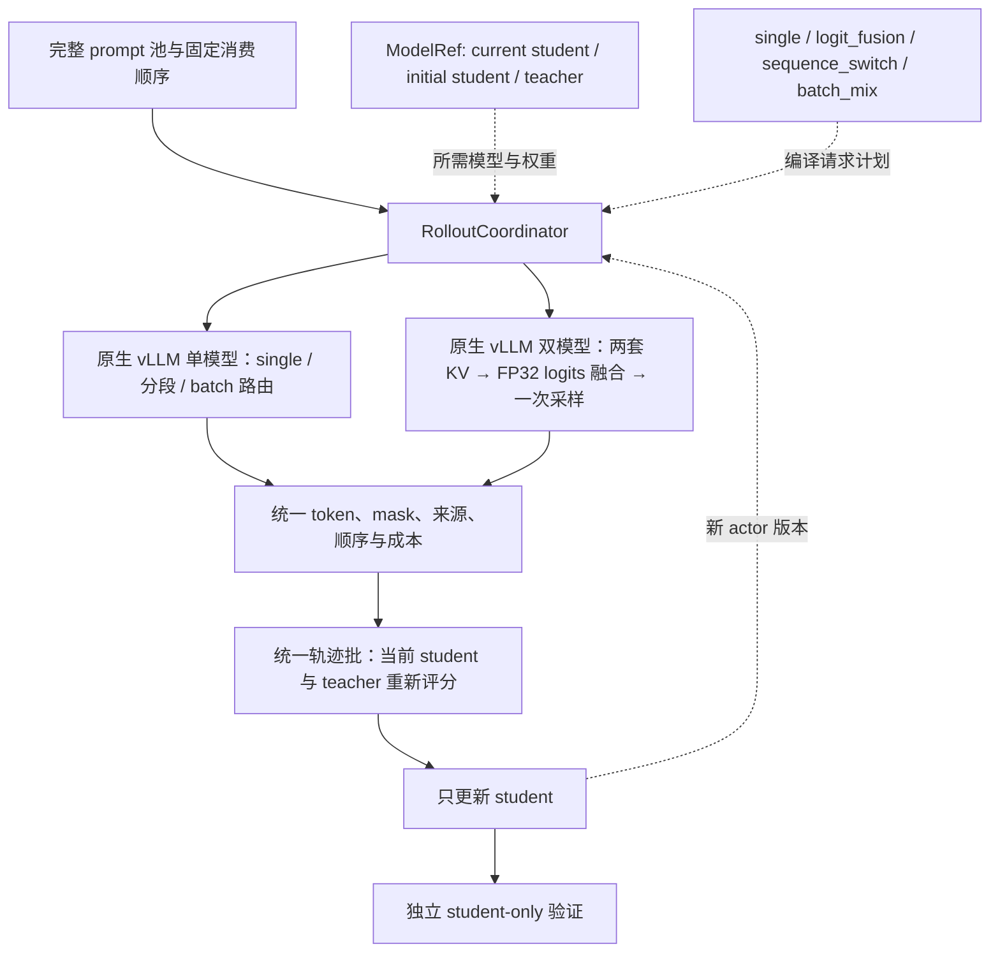

# 代码结构与修改入口

本仓以 One-Shot-OPD 的根目录作为开发根目录。训练代码直接在原位置修改，hooks 和研究资料是添加到代码库中的辅助内容。

## 训练与维护

| 位置            | 职责与修改方式                                                         |
| --------------- | ---------------------------------------------------------------------- |
| `recipe/`       | 启动训练、选择模型和数据、传递 Hydra 参数；新增实验配方从这里进入      |
| `data/prep/`    | 数据下载与转换；`data/README.md` 定义数据布局，实际数据文件由 Git 忽略 |
| `eval/`         | 评测入口；沿用原有任务协议，指标调整与实现一同提交                     |
| `verl/verl/`    | PPO 训练循环、rollout、教师打分、策略损失与分布式 worker               |
| `verl/scripts/` | 原框架的模型与运行辅助脚本                                             |
| `scripts/`      | 我们接入的维护检查、工具安装与 hooks                                   |

`verl/` 内部的 `setup.py`、`pyproject.toml` 和 `verl/` 包目录是上游原有结构。保留这一层可继续使用原安装入口和 recipe 的 PYTHONPATH 解析；日常改训练代码直接进入 `verl/verl/`。

## 研究与开发资料

所有人工阅读的项目资料统一归 `docs/`。`docs/research/occupancy/` 包含研究正文，以及随正文复现的 `experiments/`、`results/` 和 `figures/`；`docs/notes/` 保存需求、尝试和工作记录。两者是同一文档目录中的不同用途，使用说明通过链接引用结果。

开发说明归 [development.md](development.md)，导入版本与许可归 [provenance.md](provenance.md)。`.agents/` 保留工具要求的技能入口和决策格式。模型、数据、checkpoint、日志与大文件输出按 `.gitignore` 排除；`node_modules/` 只供本地维护工具使用。

## 算法修改链路

`recipe/opd.sh`、`mopd.sh`、`grpo.sh` 通过 `_common.sh` 解析根目录的数据与 vendored verl，再调用 `verl.trainer.main_ppo`。`DOMAIN` 选择模型与数据，`MODE` 选择 full、oneshot 或 template。训练命令从仓库根目录执行，例如 `MODE=oneshot bash -o pipefail recipe/opd.sh`。

PPO 主循环在 `verl/verl/trainer/ppo/ray_trainer.py`，OPD 的教师注册和逐 token 信号处理在 `opd_trainer_mixin.py`，教师打分在 `verl/verl/workers/fsdp_teacher_worker.py`，优势与策略损失在 `verl/verl/trainer/ppo/core_algos.py`。实验直接修改这些源码和对应 recipe，使用普通 Git 提交记录。

固定 teacher 与初始 student 轨迹由 `data/prep/build_rollout_cache.py` 生成，`fixed_rollout.py` 验证并读取缓存；当前 student 和冻结 teacher 仍在训练时重新评分。`recipe/math_cached.sh` 选择缓存来源，所有设置均只更新 student。长时固定缓存训练由 `plateau.py` 合并每 50 步的验证与训练残差，记录经验平台判断。

共享 prefix 的 logit fusion 已在 `verl/verl/workers/rollout/fusion/` 实现，通过 vLLM worker 扩展接收当前 actor 参数并生成融合轨迹，`recipe/math_fusion.sh` 提供训练入口。验证始终使用独立 student；完整两步调试与 λ=0.5 的正式 50 步实验均已完成。缓存身份、权重版本、后端限制、测试和结果见[统一实验协议](experiment/2026-10-18-rollout来源与logit融合实验.md)。轨迹内 teacher/student 切换及 batch 混合尚未实现；相关假设与判分归[研究正文](research/occupancy/2026-10-17-OPD访问测度与收敛机制研究.md)。

### 当前 fusion 的计算与训练

当前 `name=vllm` 表示服务容器、RPC 和验证设施，fusion 的训练生成实际由 `LogitFusionDecoder` 中两套 Transformers 模型执行。每个 actor rank 对应一个单卡 fusion 副本；生成用 student 是训练 actor 的独立推理副本，另一套是冻结 teacher。actor 更新后的 named tensors 经 BucketedWeightSender/Receiver 原地写入推理 student，完整接收后才发布版本；第 $k$ 步生成要求版本为 $k-1$。同一参数流目前还更新原生 vLLM student，原生引擎用于 student-only 验证。

每个 prompt 只使用一个 token 序列。两个模型分别 prefill 相同 prompt，保存各自 KV；每个解码位置分别得到 logits，在有效词表内转为 FP32 做加权，softmax 后只采样一个 token，再把同一个 token 送给两个模型。正式配方的 λ=0.5、温度为 1、无 top-p/top-k 截断。生成结束后，训练 actor 重新计算 student log-prob，FSDP teacher 重新评分；现有 OPD 信号与优化器只更新训练 student，fusion 不是一个新增的可训练混合模型。

默认 `cuda_graph_flash` 的 prefill 使用 eager 前向，decode 捕获两套模型的前向并使用 Flash KV attention；FP32 logits 融合、softmax 和随机采样仍在图外执行。StaticCache 按 batch 与总长度容量建立，已结束行不会被新请求补入，只以 mask 排除；长短响应混批仍有空槽计算。λ=0/1 虽有正确的融合端点，当前生成循环仍执行两个模型，尚未剪去无用前向。行为 log-prob 在 decoder 中返回，但 worker 当前只汇总为指标，未作为逐 token 字段交给 learner。

这些限制使当前实现适合作为已跑通的算法基线和数值参考。下一步的原生 vLLM 改造要保留共享 token、独立 KV、权重版本、评分和 student-only 验证，同时消除手写固定 batch 解码与重复引擎驻留的成本。

## 拟议重构：实时生成与模型来源解耦

此节是代码审阅后的实施方案，尚未落地为新的生成模式。审阅基线为 `d17d6c6`，范围是当前 math 的 FSDP、vLLM/HF fusion、权重同步、teacher 评分与验证执行链，涉及 32 个相关文件；另核对安装环境的 vLLM 0.10.0 V1 模型注册、采样、KV 与 worker 扩展接口。[代码核验清单](experiment/results/2026-10-18-rollout-refactor-code-audit.json)保存范围、哈希与源码观察。方案优先使用 vLLM 原生执行；运行中的实验保留自己的固定源码快照。

### 目标与算法含义

建议将新实验统一为训练时实时生成（fresh rollout），把生成权重来源单独配置。所有设置都只训练当前 student $p_\theta$，teacher $q$ 始终冻结；初始 student $p_0$ 是训练开始前的固定权重。实时生成描述生成时机，on-policy 描述生成分布与当前 student 的关系，二者不能混用。

| 设置名                   | 生成策略                   | 生成权重是否随 student 更新 | 需要每步同步 actor 的生成组件 |
| ------------------------ | -------------------------- | --------------------------- | ----------------------------- |
| `student_fresh`          | 当前 $p_\theta$            | 是                          | 当前 student                  |
| `initial_student_fresh`  | 固定 $p_0$                 | 否                          | 无                            |
| `teacher_fresh`          | 固定 $q$                   | 否                          | 无                            |
| `student_teacher_fusion` | 当前 $p_\theta$ 与固定 $q$ | λ<1 时更新                  | λ<1 时为当前 student          |
| `initial_teacher_fusion` | 固定 $p_0$ 与固定 $q$      | 否                          | 无                            |

`initial_student_fresh` 每次消费 prompt 都重新采样，不能继续称为论文的固定缓存 Semi-OPD。历史缓存保留为 `collection=replay` 的复现适配器；新实验默认 `fresh`，响应复用策略与模型来源分开。固定生成来源可以更早预取，但首轮公平对照先统一逐步生成，避免只给固定来源跨步大批量预取而引入另一个性能变量。

双模型模式保持现有 logit fusion 的数学语义：对同一 state $s$，取 base 模型 $b\in\{p_\theta,p_0\}$ 和 teacher 的 logits，先在 FP32 中组合，再使用共同的词表支持、温度与采样规则。

$$
z_\lambda(s)=(1-\lambda)z_b(s)+\lambda z_q(s),\qquad
\mu_\lambda(\cdot\mid s)=\operatorname{softmax}(z_\lambda(s)/T).
$$

上式在共同有效词表内定义，首版保持 $T=1$、top-p=1、top-k=-1、repetition penalty=1。两个模型每次都接收同一个实际采样 token，保留各自 KV；不能让它们先独立续写再混合答案。λ=0/1 的计划可以归约为只激活相应单模型，避免无用前向；端点的分布与正常采样仍需核验。

在 $T=1$、共同有效词表 $V$ 上 logits 有限的条件下，令 $p_V=\operatorname{softmax}(z_b)$、$q_V=\operatorname{softmax}(z_q)$。对 $0<\lambda<1$，将 $z_b(v)=\log p_V(v)+\log Z_b$ 与 $z_q(v)=\log q_V(v)+\log Z_q$ 代入并消去与 token 无关的归一化因子，可得

$$
\mu_\lambda(v\mid s)=
\frac{p_V(v\mid s)^{1-\lambda}q_V(v\mid s)^\lambda}
{\sum_{u\in V}p_V(u\mid s)^{1-\lambda}q_V(u\mid s)^\lambda}.
$$

因此 λ=0.5 是归一化的几何平均，通常不同于概率算术平均 $0.5p_V+0.5q_V$。λ=0/1 直接取单模型端点；此处 $p_V/q_V$ 是生成端有效词表上的分布，不能据此忽略后文说明的 FSDP 评分归一化差异。

### 三种混合方式与参数

逐 token 的 logit fusion、轨迹内分段切换和 batch 内分配生成来源改变分布的方式不同，分别配置。策略描述采用可组合的结构，不为每个组合增加一条 trainer 分支。

| 策略类型          | 控制参数                      | 生成行为                                                | 默认训练范围                 |
| ----------------- | ----------------------------- | ------------------------------------------------------- | ---------------------------- |
| `single`          | `model`                       | 整条响应由一个来源生成                                  | 整条响应，只更新当前 student |
| `logit_fusion`    | `base`、`teacher_weight=λ`    | 每个 token 都在同一 prefix 上融合两模型 logits 后采样   | 整条响应，只更新当前 student |
| `sequence_switch` | `first`、`second`、`boundary` | 前 $k$ 个响应 token 用第一策略，随后换第二策略续写      | 两段响应，只更新当前 student |
| `batch_mix`       | `components`、权重、分配规则  | 一个 batch 的不同响应交给不同策略；同一响应保持已选策略 | 所有响应，只更新当前 student |

分段切换的第一版支持两个单模型叶节点：teacher→current student、current student→teacher，以及把 current 换成 initial 的设置。给定 prompt $x$、生成中的响应 $y_{<t}$ 与切换位置 $k$，第 $t$ 个响应 token 的行为分布为

$$
\mu_t(\cdot\mid x,y_{<t})=
\begin{cases}
a(\cdot\mid x,y_{<t}), & t\le k,\\
b(\cdot\mid x,y_{<t}), & t>k.
\end{cases}
$$

这里 $a,b$ 是选定来源及共同采样变换后的分布，位置从 1 开始，只计算新生成的响应 token。优先支持 `response_tokens: k`；也可用 `budget_fraction: ρ`，规定 $k=\lfloor\rho L_{\max}\rfloor$，其中 $L_{\max}$ 为总响应上限。ρ 不能解释成“最终实际响应的前 ρ 比例”，因为生成前不知道 EOS 会出现在哪里。$k=0$ 直接使用第二来源，$k\ge L_{\max}$ 直接使用第一来源。第一段遇到 EOS 或共同停止条件就结束整条响应，禁止为了凑够比例继续生成。第一段因达到 $k$ 而停止只代表阶段完成，不代表整条响应被截断。

第二阶段接收原 prompt token 与第一段响应 token 的直接拼接，不再应用 chat template，也不经过文本解码再编码。总响应预算始终是 $L_{\max}$，不是每段各生成 $L_{\max}$。第一段 token 仍属于训练响应，训练 mask 覆盖两段；若以后研究仅训练某一段，需要另设实验条件。

第一版沿当前 math 设置使用 EOS 与长度停止，不新增文字 stop、最小响应长度或非平凡的 frequency/presence penalty。以后开放这些选项时，判定必须针对完整响应，包含跨切换边界的 stop 字符串，不能在第二段重新从零计数。

batch 混合默认以响应为路由单位。对一个有 $B$ 条响应的 batch，teacher 比例 α 对应 $N_q=\lfloor\alpha B+0.5\rfloor$ 条 teacher 响应；其余交给 student。用有 seed 的随机排列分配位置，再按来源聚合请求，生成后恢复原顺序。多来源时用最大余数法分配整数条数，并固定平局规则，保证总数为 $B$。独立 Bernoulli 分配可以作为另一选项，但必须记录每步实际数量；它不保证每个 batch 的比例相同。

路由在全局 batch 上决定，随后按模型负载分发到副本，避免每个 GPU 单独取整造成比例偏差。每题多响应时，选择“每题同一来源”还是“每条响应独立来源”必须显式配置；当前训练 $n=1$，两者相同。来源占 50% 的响应不等于占 50% 的 token：不同来源的响应长度和提前 EOS 比例会改变实际 token 占比。

batch 混合先采样整条响应的来源，再从该来源生成。精确配额的实际比例为 $\alpha_B=N_q/B$，对随机路由取边缘后，每条响应的序列分布为

$$
P_{\mathrm{mix}}(y\mid x)=(1-\alpha_B)P_b(y\mid x)+\alpha_B P_q(y\mid x).
$$

整数取整时 $\alpha_B$ 可以与配置的 α 不同；Bernoulli 分配的边缘权重才直接为 α。精确配额会让同批来源选择相关，但每条响应仍只有一个来源。batch 混合与每步融合 logits 的 $\mu_\lambda$ 不相同，α、λ 和切换位置 $k$ 分别控制三个独立维度。若记录行为分数，应同时标记来源条件分数与是否计算了边缘混合分数，不能把前者冒充后者。

组合结构可以表达“半个 batch 为纯 teacher，另半个先 student 后 teacher”，也可以表达分段的一段使用 fusion。第一版只开放已经通过后端验收的组合：原生单模型、单模型之间的一次切换、这些策略之间的 batch 混合；fusion 叶节点通过原生双模型扩展验收后再开放。配置编译阶段拒绝能力不匹配，避免运行时静默换后端。

### 当前代码的耦合与影响

| 当前位置                                                                                                                                                                           | 已核对的行为                                                           | 重构影响                                                                              |
| ---------------------------------------------------------------------------------------------------------------------------------------------------------------------------------- | ---------------------------------------------------------------------- | ------------------------------------------------------------------------------------- |
| [engine_workers.py](../verl/verl/workers/engine_workers.py) `init_model`；[llm_server.py](../verl/verl/workers/rollout/llm_server.py) `LLMServerManager`                           | actor 初始化和 rollout 共享 `actor_rollout_ref.model`                  | 不能用改该路径的方式选择 teacher 生成，否则连可训练 student 初始化与 tokenizer 都改变 |
| [ray_trainer.py](../verl/verl/trainer/ppo/ray_trainer.py) `fit`                                                                                                                    | 生成处按 fusion、普通生成、固定缓存分三支；同步条件也依赖缓存是否存在  | trainer 应调用统一协调器，来源选择、恢复和休眠归协调器处理                            |
| [vllm_rollout.py](../verl/verl/workers/rollout/vllm_rollout/vllm_rollout.py) `update_weights`；[utils.py](../verl/verl/workers/rollout/vllm_rollout/utils.py) `on_bucket_received` | actor 参数流同时写入 HF fusion 的 student 槽和原生 vLLM                | 同步目标须按模型引用选择；不能让 actor 参数覆盖 $p_0$ 或 $q$                          |
| [engine_workers.py](../verl/verl/workers/engine_workers.py) `generate_logit_fusion`；[decoder.py](../verl/verl/workers/rollout/fusion/decoder.py) `load_student_weights`           | 固定要求 `expected_version=step-1`，只支持一个可变 student 槽          | 固定 initial fusion 需要不可变模型身份；不能假装它拥有当前 actor 版本                 |
| [vllm_async_server.py](../verl/verl/workers/rollout/vllm_rollout/vllm_async_server.py) `_sleep_hybrid`                                                                             | 全参数 HYBRID sleep level 2 释放原生权重，恢复依赖 actor 参数流        | 固定 checkpoint 必须有自己的恢复路径，单独跳过同步还不够                              |
| 同文件 `release_kv_cache`、`resume_kv_cache`                                                                                                                                       | 当前只有条件检查和返回，没有实际释放/恢复操作                          | 不能按方法名认定 KV 已释放；需实现或改用真实生命周期操作，并用显存证据验收            |
| [hf_rollout.py](../verl/verl/workers/rollout/hf_rollout.py)、[base.py](../verl/verl/workers/rollout/base.py)                                                                       | 旧 HF 类使用同步接口，构造形式与当前基类不同，也不在 async registry 中 | 不能直接设置 `rollout.name=hf`；新默认使用原生 vLLM，现有 fusion decoder 保留作参考   |
| [math_online.sh](../recipe/math_online.sh)、[math_cached.sh](../recipe/math_cached.sh)、[math_fusion.sh](../recipe/math_fusion.sh)                                                 | 配对数据默认指向 3,200 条 schedule，epoch 数按每轮 50 步计算           | 数据池、训练预算与生成方式必须独立                                                    |
| `ray_trainer.py` 与 [plateau.py](../verl/verl/trainer/ppo/plateau.py)                                                                                                              | 平台检查显式限定固定缓存，比较缓存窗口残差                             | fresh 模式不能直接沿用相同 states 的解释或该提前停止条件                              |

普通异步生成会做 verifier 评分，缓存与 fusion 的打包则放入零 `rm_scores`。当前纯 `token_reward_direct` 会由 `OPDTrainerMixin.compute_opd_token_reward` 覆盖为 teacher 的逐 token 信号，因此这不证明当前主 loss 有差异；但训练准确率等诊断和以后启用的 GRPO 混合项需要共同的 verifier 阶段，不能因生成路径不同而改变。

生成端还会屏蔽 tokenizer 有效词表以外的 padded logits，HF fusion 也切到有效词表；当前 FSDP teacher 评分函数对完整输出 logits 做归一化。当前配对的 tokenizer 长度为 151,665，模型输出词表为 151,936。生成分数、当前 actor 分数和监督 teacher 分数的职责应分别保留，不能为省一次前向就直接复用生成分数；先验证词表支持、温度、mask、位置和精度的归一化口径。

### 建议保留的四个对象

| 对象                 | 职责                                                    | 关键约束                                                                           |
| -------------------- | ------------------------------------------------------- | ---------------------------------------------------------------------------------- |
| `ModelRef`           | 表达可变 actor 引用或固定 checkpoint 引用               | actor 用更新版本；$p_0/q$ 用不可变 fingerprint；相同初始数值不允许共享可写参数存储 |
| `RolloutPolicySpec`  | 表达单模型、fusion、分段切换与 batch 混合，编译请求计划 | `uses_actor` 从有效组件推导；零权重、空分组与端点先归约                            |
| `RolloutCoordinator` | 编排训练生成、权重激活、休眠、验证切换和统一轨迹结果    | 拒绝错误模型身份、未完成参数流、旧版本与不支持的后端组合                           |
| `GenerationBackend`  | 实现原生生成或双模型前向、采样和资源生命周期            | 声明支持能力；统一接口不等于底层 kernel 相同                                       |

模型引用表启动时解析一次：`current_student` 指向 actor，`initial_student` 指向 actor 的训练前 checkpoint 快照，`teacher` 指向现有 `distillation.fsdp_teacher.model_path`。生成 teacher 与监督 teacher 是两个逻辑职责，首版明确绑定同一 checkpoint。参数传输复用现有 BucketedWeightSender/Receiver 和 checkpoint engine；这里的 checkpoint engine 是权重传输机制，不意味着训练时保存 checkpoint。

每个 run 只编译选中的策略，去掉零比例与无效端点，再解析实际参与的模型；三个角色引用不要求同时建立三套 GPU 引擎。复杂组合若确实需要三个来源，须为三个来源安排资源，不能仍按双模型预算估计。teacher 评分和最终 student 验证的资源单独安排，冷启动成本与阶段恢复成本分别计时。



trainer 保留数据读取、teacher 信号、优势计算、actor 更新与评测指标，生成处收敛为一个入口。协调器可以提供拟议接口 `generate_train(batch, actor_version)` 与 `generate_eval(batch, actor_version)`；后者始终绑定当前 student，训练来源不决定评测来源。已有 `FixedRolloutCache` 作为 replay 适配器继续严格验证历史缓存，不必重建一套 trainer 或迁移上游安装结构。

### 配置示例与所有权

下面是拟议配置子树，不是当前可执行的 Hydra 命令；对应字段和后端尚未实现。保留现有路径作为单一事实源，不新增另一套顶层模型路径。

```yaml
actor_rollout_ref:
    model:
        path: ../models/DeepSeek-R1-Distill-Qwen-1.5B
    rollout:
        name: vllm
        generation_backend: vllm_native
        collection:
            mode: fresh
        policy:
            kind: sequence_switch
            first: { kind: single, model: teacher }
            second: { kind: single, model: current_student }
            boundary: { kind: response_tokens, value: 1024 }
distillation:
    fsdp_teacher:
        model_path: ../models/JustRL-DeepSeek-1.5B
```

`model.path` 仍只定义 learner 的初始化及 canonical tokenizer；`initial_student` 在启动时从它绑定固定引用。`policy` 选择模型和组合，`generation_backend` 选择实际解码内核。单模型、分段与 batch 混合使用 `vllm_native`；精确 fusion 拟使用 `vllm_paired`。现有 HF fusion 只作为数值参考与历史复现路径；即使 RPC 容器来自 vLLM，也继续按 HF 计算后端记录其历史吞吐。

下面的策略子树分别示意精确配额的 batch 混合与固定初始 student 的 fusion，也尚非可执行参数。

```yaml
batch_mix_example:
    kind: batch_mix
    routing_unit: trajectory
    assignment: exact_count
    components:
        - weight: 0.5
          policy: { kind: single, model: teacher }
        - weight: 0.5
          policy: { kind: single, model: current_student }
fusion_example:
    kind: logit_fusion
    base: initial_student
    teacher_weight: 0.5
```

切换方向只需交换 `first/second`；batch 中的组件也可以替换成已支持的 `sequence_switch`。采样、batch、数据和学习率沿共同配置继承，避免为组合复制配方。旧 math recipe 保留复现入口，新配方在同一公共启动器上选择策略。

配置编译时验证模型引用、后端能力、有限数值及范围：λ/α/ρ 在 $[0,1]$ 内，token 边界为非负整数，混合权重非负且总和为正，响应总预算为正。先归一化混合权重与化简端点，再决定需要哪些模型和同步目标；不支持的组合在启动前报错。

### 每步生命周期

第 $k$ 次更新前，actor 为 $\theta_{k-1}$；新模式仍遵循以下顺序。

1. 从共同 dataloader 取得 prompt，完成一次 canonical tokenization，固定模板、assistant 前缀、EOS/PAD 与有效 token ID 语义。组件不能各自切换 chat template。
2. 协调器确认 active policy。仅当策略实际使用 current student 时同步 $\theta_{k-1}$；$p_0/q$ 只校验固定引用和设备状态，按需恢复自己的权重。
3. 按请求计划生成响应。分段期间 actor 版本锁定，batch 各来源也使用同一更新前版本；不能在仍有旧请求时覆盖权重。保存 prompt ID、访问轮次、响应 token、mask、采样设置、seed、路由、实际切换位置、逐 token 来源、组件身份与 actor 版本。不同后端或 batch 布局不承诺逐 token 完全一致。
4. 结束生成请求，释放应释放的 GPU 资源；当前 student 重新计算 `old_log_probs`，冻结 teacher 重新评分，保持现有 token reward 与 actor 更新，得到 $\theta_k$。
5. 到验证点时，协调器切到当前 $\theta_k$ 的单模型验证，完成三基准 eval16；下一步恢复训练所选的生成策略，并清除旧模型或旧版本对应的 KV/prefix cache。

行为策略 $\mu$ 的分数仅保存为独立的 `behavior_log_probs` 诊断。MVP 继续使用当前 actor 重算的 proximal anchor，拒绝为这些新策略启用 `bypass_mode` 或自动 rollout correction；否则可能把 teacher/fusion 的概率误当成 actor 锚点，或在重构中顺带加入重要性修正。off-policy 生成下，采样 log-ratio 也不能直接宣称为当前 student 的完整条件 KL。

轨迹结果用显式有效长度和 mask 保留 EOS，即使 EOS 与 PAD 使用同一 token ID，也不能用 `token != pad` 推断响应。每题响应数只在一个位置展开；现有验证已在 trainer 重复 16 次，后端每条请求只返回一次，重构不能再次展开成 256 次。

原子参数流与 CUDA Graph 的所有权必须一同保留：完整 named-tensor 流收到后才发布新 actor 版本；固定引用拒绝写入。actor 参数原地更新且地址稳定时可重用 graph，但搬迁模型或重建 tensor 会使捕获地址失效，需要失效处理和重新捕获。KV 内容每次生成重置，graph 的 key 包含组件存储身份、batch bucket、容量与 dtype，而不应仅因 actor 版本变化就强制重新捕获。

### vLLM 后端能力与实现边界

| 生成策略                  | vLLM 实现路径                                  | 当前状态                                      |
| ------------------------- | ---------------------------------------------- | --------------------------------------------- |
| 当前 student 单模型       | 现有原生 `generate` 与 actor 参数同步          | 已有正式在线结果                              |
| 固定 initial / teacher    | 原生 `generate`，增加独立加载与恢复            | 离线生成已有；训练内生命周期待接入            |
| teacher→student，反向亦然 | 两次原生 token-in/token-out 请求，传递已有前缀 | API 可表达；分段协调器、mask 与资源切换待实现 |
| batch 内来源混合          | 原生请求按来源聚合、路由与重排                 | API 可表达；配额和多模型调度待实现            |
| 同 prefix 的精确 fusion   | 注册原生双模型，必要时适配 V1 model runner     | 新扩展待验证；现有已验收版本仍是 HF 计算后端  |

本仓原生服务已接受 token ID 前缀和显式 `max_tokens`。分段协调器预先核对两个模型的上下文容量：第二段输入长度是原 prompt 加第一段响应，不能再次套用原始 prompt 的 1,024 token 截断。服务目前会把预算限制到可用上下文，且把 0 提升到 1；协调器必须提前跳过零长度阶段并拒绝不满足总预算的请求，避免静默多生成或少生成。

原生返回适配器目前还将 vLLM 的 `finish_reason=stop/length` 都映射为 `stop_reason=completed`。分段实现需要保留原始 finish reason 与具体 stop reason，区别阶段 token 配额用尽、EOS/stop 条件和总响应上限；不能仅凭响应正好长 $k$ 就决定续写。abort/取消也不能当成切换边界。每个请求和阶段使用独立的采样参数副本，避免当前 `generate` 的 `pop` 修改影响后续阶段；seed 由 run、prompt ID、访问轮次、响应序号与阶段确定，路由和生成 seed 分开记录。

第一阶段返回之后，第二模型必须用自己的权重为整段输入建立 KV。teacher 与 student 的 token 相同也不代表各层 K/V 相同，PagedAttention 或 KV-transfer 都不能直接跨权重复用这段 KV。若同一模型、同一权重版本存在命中的 prefix cache，可以按实际命中减少 prefill；切换模型或更新 actor 后不能沿用旧身份的命中。相邻同源阶段应在编译时合并。

精确 fusion 优先尝试 vLLM 的仓外模型注册机制：将两套原生 Qwen2 组件封装为一个组合模型，forward 对同一批 token 和 position 分别前向，`compute_logits` 在有效词表中融合 FP32 logits，再交给同一个原生 sampler。模型注册是已有扩展入口，组合模型可用性是待验证方案。[^vllm-register] 一个调度器管理同一组请求与位置，两套 attention 层保留独立 KV 存储；复用逻辑 block 编号不等于共享 K/V 数值。

源码中存在需要先解决的限制：`get_kv_cache_spec` 从已注册 attention 层收集缓存规格，有机会让两组 full-attention 层共同计入容量；但 `bind_kv_cache` 仍按单个整数层号排序，两个原生模型都从第 0 层开始会触发 `NotImplementedError`。只给层名加 `base/teacher` 前缀不足以解决冲突。组合模型需要全局唯一的缓存层编号或一个局部绑定适配器，同时保持 checkpoint 参数名与 attention 层身份的映射。双 hidden-state 的返回、`logits_indices` 选择、profile、参数加载与 CUDA Graph 也必须核验。若仅注册模型不能满足这些约束，再用受控的 V1 worker/model-runner 适配器；不直接改共享环境的 site-packages。[^vllm-runner]

当前 0.10.0 V1 明确拒绝请求级自定义 `SamplingParams.logits_processors`；`worker_extension_cls` 用于增加 RPC 方法，还会检查与 worker 既有名称的冲突，也不能直接覆盖 `execute_model`。因此“加一个 processor”与“添加一个 RPC”都不等于把第二模型接入原生采样循环。[^vllm-extension] 不采用每个 token 经 Python/Ray 往返两个引擎、导出完整词表再采样的主路径，也不把 top-k logits 近似或以单模型为目标的普通 speculative decoding 当成精确 fusion。以融合分布为验证目标的 CoS 是不同方案，见下面的调研。

Fusion 的优先收益是复用 vLLM 的分页 KV、连续批处理和调度能力，减少已有 HF 路径的固定 padding 与逐步调度开销；它仍然要做两个模型的前向，不能承诺与单模型一样快。原生双模型扩展按相同 prefix 比较完整 logits、分布和实际 token 成本，现有 HF decoder 用作参考实现，不作为新 pipeline 的自动回退。

### 相关推理实现与复用判断

2026-10-18 核对了两个公开仓库的固定提交，以及两篇论文的相关实现章节。代码保存在忽略的研究缓存，提交、文件哈希与 CPU 语义核验归[同一代码核验清单](experiment/results/2026-10-18-rollout-refactor-code-audit.json)。以下区分源码支持的行为、作者报告与本项目待验证事项，未运行这些项目的 GPU 推理。

| 项目或论文           | 已核对的实现                                              | 对本项目的用途与限制                                                                   |
| -------------------- | --------------------------------------------------------- | -------------------------------------------------------------------------------------- |
| `vllm-logits`        | 单个 vLLM 模型内的双原生 backbone 与两个 LM head          | 最接近 paired wrapper；依赖 0.15.x，需移植并补训练热更新与严格数值验收                 |
| CoS，ICML 2025       | vLLM fork 的 ensemble worker/sampler 与融合目标拒绝采样   | 可参考双 KV 预算和后续 speculative fusion；基于 0.6.5 安装路径，不能替换当前 V1 worker |
| UltraFuser，ACL 2025 | 附录 C 描述多个 vLLM 实例逐步交换 hidden/logits、统一采样 | 证明独立引擎协作路线有先例；这里仅核对论文，未核验独立可运行源码和同条件吞吐           |
| ThinkMerge           | 多条 reasoning context 的共享答案 logits 聚合             | 可参考多流同步；主要是同模型多上下文，不是本项目同 prefix 的两套权重                   |

`vllm-logits` 的审阅提交为 `a987755`，提交日期为 2026-08-18。`forward` 分别计算两个 native backbone，将 hidden states 拼接；`compute_logits` 分别经过两个 LM head 后组合 logits。源码注释中的“hidden-state mixing”与 README 的“no extra forward”不能理解为省掉第二模型计算，更不能在两个 LM head 不同的情况下直接混 hidden 再投影。普通 logit 模式可借鉴，但原实现默认为部分 token 保留 specialist 的值，`alpha=1` 仍先执行 ancestor 前向，且以进程环境变量选择模式；这些都不能照搬为当前实验语义或请求级策略。[^vllm-logits-backbones]

该项目声明 `vllm>=0.15,<0.16`，用 general plugin 注册模型；现有 Qwen GPU canary 是同一 checkpoint 作为两分支、eager 模式生成 5 个确定 token。它支持作者的短加载检查，尚不足以证明本项目两个不同 checkpoint、长上下文、CUDA Graph、actor 热更新和冻结引用正确。[^vllm-logits-package][^vllm-logits-test] 层号平移的思路可参考，但该提交在模型构造后重排 ModuleList；移植到 0.10.0 时必须同时检查 attention 注册表与 KV 层名，不能假设参数注册名的变化已经修改缓存身份。权重加载器最后返回全部参数名，也应改为只报告实际成功加载的集合，拒绝缺失或错误映射。

CoS 的审阅提交为 `b7c5553`，提交日期为 2025-06-16。`EnsembleDecodeWorker` 用相同请求调用多个原生 worker，分别维护 KV，再交给一个 sampler；其缓存块容量按各 worker 每块 KV 字节总和计算。[^cos-worker] `EnsembleSampler` 区分 `raw-logits/logits/probs` 三种目标，但默认 `we.yaml` 是概率加权，不能直接当作当前 logit fusion 的复现。移植应选择 raw-logits、在 FP32 混合后应用共同温度/截断；行为分数须从最终融合分布重算，不能沿用默认配方返回的第一模型 log-prob。[^cos-sampler]

CoS 的 speculative 路径先得到候选 token，再以组合分布做验证与残差重采样；因此优化目标可以保持为融合分布，而非单一 teacher 分布。论文报告相对普通协作解码 1.11–2.23 倍加速，该数字属于其模型与配置，未在本项目复现。[^cos-paper] 本项目两个 1.5B 组件规模相近，收益还取决于接受率、block 长度、有效 batch 和 KV 回退开销。先完成非 speculative 的原生精确基线，再以同一个 $\mu_\lambda$ 为目标验证 CoS；不直接迁入整个旧 vLLM fork。接受/拒绝统计、拒绝后的 KV 截断、actor 版本锁定与融合 log-prob 是额外验收项。

UltraFuser 附录 C 采用分割显存、多实例分别计算、逐步返回 hidden states 后融合并恢复生成的方案；不同模板与多模型 KV 是其动机。该路线适合参考协议，跨实例同步和逐步交换成本仍需本项目实测，论文的描述不能替代可用代码。[^ultrafuser] ThinkMerge 则先生成多条推理轨迹，再将各自的问题、推理轨迹和共同答案前缀拼接计算 logits；其两阶段实验使用 vLLM，单阶段 FlexAttention 版本使用 HF，不能因摘要提到 vLLM/SGLang 就视为现成双 checkpoint 插件。[^thinkmerge]

最终目标保持四层职责：不可变/可变模型引用 → 可组合策略计划 → 原生执行与资源管理 → 统一轨迹及 student 训练。单模型叶节点直接走单模型引擎；分段和 batch 混合在请求或阶段边界调度；真正需要两份 logits 时才使用 paired 模型。λ=0/1、空配额与同源相邻阶段在编译时消去，不为统一接口让所有请求都跑两套 backbone。第一版按同一策略聚合请求，后续若支持同引擎不同请求的 λ，须把系数随请求重排传到 GPU logits 行，替代进程全局环境变量。

复用次序是：借鉴 `vllm-logits` 的仓外注册、双 hidden/LM head 与权重映射，结合本仓已审阅的 V1 缓存身份和 actor 传输规则实现最小 paired wrapper；若 runner 限制阻碍正确执行，再局部适配。CoS 的双 worker 和拒绝采样作为后续优化参考；选择是否升级 vLLM 或引入更大改动，取决于独立环境中的长序列基准与训练恢复证据。

### 调度、显存与优化次序

单模型、分段与 batch 混合先复用原生引擎，资源安排提供两种候选布局并用基准选择。

| 布局                   | 执行方式                                                                | 成本与适用条件                                                             |
| ---------------------- | ----------------------------------------------------------------------- | -------------------------------------------------------------------------- |
| 同 GPU 多模型引擎      | 固定模型与当前 student 各有引擎，统一安排预算；按需唤醒、按来源聚合请求 | 可减少每次换权重，但重复保留权重/graph/KV pool；同卡并发未必增加吞吐       |
| 同引擎按来源分阶段切换 | 排空 active requests，同来源整组完成后原地换权重，清理旧 KV             | 复用单套大 KV pool；增加权重传输与 prefill，分段响应按阶段归组避免逐条切换 |

优先用前一种布局验证语义与真实内存预算，并以后一种布局作为吞吐对照。两套引擎不能各沿用历史 `gpu_memory_utilization=0.55`，各实例预算总和还必须为 actor/teacher 评分、通信与非 KV 临时张量留空间。vLLM 0.10.0 的 sleep allocator 限定每进程一个实例，多引擎应有独立 worker 进程及明确的 Ray 资源归属，不能在原 worker 内直接重复建立两个启用 sleep 的 LLM。固定 $p_0/q$ 首次读盘后保留只读 CPU 权重或使用保留权重的 sleep；恢复不得依赖 actor 流。引擎 sleep/wake 要实测显存和恢复时间，本仓 KV-only 空接口不能作为已释放的证据。[^vllm-sleep]

当前 Qwen2 配对每模型 BF16 权重约 3.31 GiB，双模型权重约 6.62 GiB；单模型 KV 每序列每 token 为 28 KiB。以每卡 16 条、每条总上下文上限 5,120 计算，一套完整 KV 为 2.1875 GiB，两套为 4.375 GiB。这只是有效 KV 的容量估计，未包含 graph、临时张量、分页浪费、引擎预留与训练对象；不能用约 11 GiB 的权重加 KV 之和承诺整卡峰值。实测历史显存与预算差异见[统一实验报告](experiment/2026-10-18-rollout来源与logit融合实验.md#显存速度与运行设置)。

batch 路由按来源聚合后，在其可用副本内做负载均衡；小分组优先集中到较少副本，避免全局 64 条再按四卡、两来源拆成每来源每卡约 8 条。副本映射必须显式实现，保留四卡各分组的布局作基线。分段请求先用按阶段归组的简单实现验证，再考虑完成一条第一段就送入第二段的有界队列；后一方案仅在两套引擎都可驻留且实测提高吞吐时启用。同 GPU 两引擎同时跑可能竞争带宽，不能把流水化本身视为加速证据。

优化在不改变算法的前提下进行：

1. 先对齐真实输入、全局 batch、每卡活跃请求、response cap、采样与日志分数需求。训练上下文按 1,024+4,096 配置，不因最终验证需 32,768 就让所有训练组件按验证容量预留。若分离训练与验证引擎，额外驻留和启动成本一起核算。
2. 使用原生连续批处理，扫描 `max_num_seqs`、`max_num_batched_tokens`、KV 预算和 chunked prefill；同时报告 preemption/recompute。单卡放得下不代表用 TP=4 更快，当前 1.5B 先以 TP=1 副本为基线。[^vllm-tuning]
3. 当前 actor 每更新版本仅向需要它的槽同步一次，固定模型不接收 actor 流；只为真实需要的 GPU 阶段恢复权重与 KV。验证前排空请求，单独切到最终 student，避免验证与混合生成同时占资源。
4. 语义通过后逐项比较 eager 与 CUDA Graph、分组布局与流水化；graph 捕获开销单列。前几个 run 禁止依靠跨步预取扩大冻结来源 batch 来掩盖来源执行差异；若后来开启预取，固定来源可安全使用其固定版本，当前 actor 来源必须标注策略滞后并另做实验。

当前 HF fusion RPC 通过 actor DP 分发，原生 replica 数也从 actor world size 推导。四卡训练但生成仅使用 1/2 卡，或将四卡分给不同来源，均需要资源池、请求路由与同步映射；现在没有可直接使用的独立 `replicas` 开关。不同结构的 checkpoint 也不能装入按 actor 配置建立的同一个引擎。第一版限定已有同结构、同 tokenizer 的 Qwen2 配对、TP=PP=1，不同时扩展 LoRA、FP8、多模态与多轮。

若忽略提前 EOS，一个 A→B 响应的成本可分为

$$
T_{A\to B}\approx T_A^{\mathrm{prefill}}(x)+T_A^{\mathrm{decode}}(k)
+T^{\mathrm{switch}}+T_B^{\mathrm{prefill}}(x\mathbin\Vert y_{1:k})
+T_B^{\mathrm{decode}}(L-k).
$$

这里 $L$ 是该响应的实际长度，假设 $L>k$；实际 batch 还包含排队与并行重叠。两段没有重复生成前 $k$ 个 token，但 B 的 prefill 是额外计算，切换成本取决于布局。计时中单列这段重算；不能将分段两次请求都当成一次普通 decode 的成本。

### 数据、指标与收敛

prompt 池由 `data.train_files`、清洗、去重与 sampler 决定，训练步数由独立预算决定。新 fresh 配方默认指向完整、明确去重规则的数据清单；若同内容 ground truth 冲突须显式处理，不静默保留第一行。epoch 容量按实际 `len(train_dataloader)` 推导，移除 `ceil(steps/50)` 的假设。所有策略共享同一清单、过滤、顺序与每题响应数；全量语料的实际条数由新的数据 manifest 核验，不沿用论文 14,116 或历史 3,200 的数字。

统一生成结果只负责 token、mask、结束原因与来源身份，verifier 和 teacher 信号在共同阶段产生。训练轨迹保存在忽略的运行目录，至少包含 prompt/response token、访问轮次和模型身份；复用现有异步 dump 设施，支持后来对初始、teacher 与混合 states 做同口径诊断。所有策略均记录有效 token 数，既按相同更新步数比较，也报告实际 token 与生成成本，避免将长度变化隐藏在“相同 50 步”里。混合策略额外记录每来源的响应数、token 数、提前 EOS 比例、实际切换位置，以及切换前后分层的 state 指标。

计时分开记录磁盘首次加载、权重激活/同步、KV 分配与释放、队列等待、各阶段 prefill/decode、切换重算、student 评分、teacher 评分、更新和验证；以整卡采样补充 allocator 指标，不将嵌套 timer 重复相加。冷启动与热调用、训练与验证、单模型与双模型的显存和吞吐分别呈现。报告端到端输出 token/s、引擎 decode token/s、完成响应/s、每卡活跃 batch、有效/预留 KV 与 preemption；分段的总 prefill token 不能漏算，GPU busy 也不能代替吞吐。

现有固定缓存平台判据继续只服务历史 replay。fresh 的训练 RMS 同时受访问 state 与 action 变化影响，不再代表同一缓存上的拟合残差。新模式先用固定步数完成比较；若要提前停止，结合多验证点和固定 prefix/action probe 的 teacher–student 残差另定判据，不能直接删除旧 guard 后沿用原解释。验证始终保留 MATH-500/AMC23/AIME25 的 570 题、每题 16 次和精确 mean/pass@k。

### 修改范围与实施顺序

以下路径是建议的修改归属，尚未建立新模块。

| 位置                                                | 建议变化                                                                   |
| --------------------------------------------------- | -------------------------------------------------------------------------- |
| `workers/config/rollout.py`                         | 新增模型引用、策略和 collection 的类型及组合校验；旧字段映射到共同描述     |
| `workers/rollout/policy.py`（拟新增）               | 编译策略树、分配全局配额和阶段预算，解析模型身份、能力与同步目标           |
| `trainer/ppo/rollout_coordinator.py`（拟新增）      | 封装生成/同步/验证切换，适配历史 replay，移走 trainer 的来源分支           |
| `workers/rollout/vllm_rollout/`                     | 原生模型池、按来源分组、分段 token 续写、生命周期与性能采集                |
| `workers/rollout/fusion/vllm_model.py`（拟新增）    | 仓外注册双模型，原生 Qwen2 前向、独立 KV、FP32 logits 与单次采样           |
| `workers/rollout/fusion/decoder.py`                 | 保留 HF 参考实现与历史复现，用于原生扩展数值对照，不作为自动回退           |
| `workers/engine_workers.py`、vLLM adapter/extension | 为明确目标传输 actor 权重，避免写错固定模型或同时恢复无用引擎              |
| `experimental/agent_loop/` 与批打包                 | 统一输入 token、输出 schema、reward 诊断和 provenance，保持既有 async 合约 |
| `recipe/` 与 `data/prep/`                           | 共用启动器和策略覆盖；独立完整数据清单与训练预算，保留历史复现配置         |
| `eval/` 与既有测试                                  | 扩展身份/指标采集、端点、生命周期、后端等价与 GPU 成本验收                 |

实施按依赖顺序推进：

1. 先定义 `ModelRef`、策略树与轨迹合约，把现有来源入口包到协调器。CPU 检查比例取整、端点、空分组、全局顺序、预算、EOS/PAD mask 与固定模型写保护，旧实验入口继续保留。
2. 优先接入三种单模型原生生成，补齐 $p_0/q$ 的加载、恢复与身份；再实现双向分段及 batch 配额路由。两种混合先采用分阶段归组，避免同时引入异步流水与算法变化。
3. 独立验证原生双模型扩展，按 λ=0/0.5/1 对照完整 logits、共同 prefix 与采样分布；检查双 KV 是否完整计入预算、参数名映射及 graph。wrapper 不足时再适配 model runner，保持 vLLM 0.10.0 版本固定。
4. 在空闲 GPU 0–3 做各已开放策略两步训练，覆盖 current→initial→teacher→切换/混合→current-eval 的恢复，验证固定模型不变、actor 版本正确、分段 mask 完整、验证始终来自最终 student。原生 fusion 单独验收后纳入。
5. 建立同 checkpoint、输入、采样和实际 batch 的原生基线。短确定长度序列测内核，真实 math 长度分布测端到端；扫描有效 batch 与 KV 预算，比较单引擎换权重/双引擎驻留，再测 graph 与流水。先披露冷启动和热成本，不承诺尚未实测的提升比例。
6. 固定新数据 manifest、学习率、全局 batch 与预算后开展正式对照：单模型端点；分段方向与 $k\in\{0,1024,2048,4096\}$；batch 比例 $\alpha\in\{0,0.5,1\}$；fusion 的 λ 对照。端点复用相同基线，先用一个内部参数值筛选，避免一开始枚举所有嵌套组合。每组先 50 步、完整 eval16，质量结论补充训练 seed；当前缓存长时实验保留原算法。

首版目标是三种来源、双向分段与 batch 混合在同一训练链上使用原生 vLLM，student 初始化/更新/验证独立于生成来源；原生精确 fusion 是独立的第二项验收。成功证据须包括参数版本、固定权重不变、配额/阶段语义、两步恢复与完整 eval16；只通过构造测试不等于真实训练可用。若固定模型被 actor 覆盖、验证来自错误来源、分段预算或训练 mask 改变、评分归一化改变主 loss，或执行中静默回退 HF，该版本不能进入正式对照。引擎布局、副本映射、graph 与预取仍由基准结果决定。

### 参考文献

[^vllm-register]: vLLM contributors. Registering a Model. vLLM v0.10.0, 2025. [仓外模型注册](https://docs.vllm.ai/en/v0.10.0/contributing/model/registration.html).

[^vllm-runner]: vLLM contributors. V1 GPU model runner and KV binding. vLLM v0.10.0, 2025. [gpu_model_runner.py](https://github.com/vllm-project/vllm/blob/v0.10.0/vllm/v1/worker/gpu_model_runner.py)、[worker/utils.py](https://github.com/vllm-project/vllm/blob/v0.10.0/vllm/v1/worker/utils.py).

[^vllm-extension]: vLLM contributors. V1 input processor and worker extension loader. vLLM v0.10.0, 2025. [processor.py](https://github.com/vllm-project/vllm/blob/v0.10.0/vllm/v1/engine/processor.py)、[worker_base.py](https://github.com/vllm-project/vllm/blob/v0.10.0/vllm/worker/worker_base.py).

[^vllm-sleep]: vLLM contributors. GPU worker sleep/wake implementation. vLLM v0.10.0, 2025. [gpu_worker.py](https://github.com/vllm-project/vllm/blob/v0.10.0/vllm/v1/worker/gpu_worker.py).

[^vllm-tuning]: vLLM contributors. Optimization and Tuning. vLLM v0.10.0, 2025. [连续批处理、chunked prefill 与资源调参](https://docs.vllm.ai/en/v0.10.0/configuration/optimization.html).

[^vllm-logits-backbones]: Nizar Islah. vllm-logits, DualQwen2ForCausalLM. GitHub，提交 a987755，2026. [双模型前向、logits 与权重映射源码](https://github.com/NizarIslah/vllm-logits/blob/a987755aad1a94689745843676d491bc77201e51/src/vllm_logits/backbones.py).

[^vllm-logits-package]: Nizar Islah. vllm-logits package configuration. GitHub，提交 a987755，2026. [版本范围与插件入口](https://github.com/NizarIslah/vllm-logits/blob/a987755aad1a94689745843676d491bc77201e51/pyproject.toml).

[^vllm-logits-test]: Nizar Islah. vllm-logits Qwen dual-load canary. GitHub，提交 a987755，2026. [GPU 短生成检查的实际范围](https://github.com/NizarIslah/vllm-logits/blob/a987755aad1a94689745843676d491bc77201e51/tests/test_dual_load_qwen.py).

[^cos-worker]: Jiale Fu et al. CoS EnsembleDecodeWorker. GitHub，提交 b7c5553，2025. [原生 worker 与双 KV 预算](https://github.com/Kamichanw/CoS/blob/b7c555324539bb476d39a4002922973e296d1e18/vllm/vllm/ensemble_decode/ensemble_decode_worker.py).

[^cos-sampler]: Jiale Fu et al. CoS ensemble sampling and weighted-ensemble configuration. GitHub，提交 b7c5553，2025. [三种融合目标](https://github.com/Kamichanw/CoS/blob/b7c555324539bb476d39a4002922973e296d1e18/vllm/vllm/ensemble_decode/ensemble_sampler.py)、[默认概率混合配置](https://github.com/Kamichanw/CoS/blob/b7c555324539bb476d39a4002922973e296d1e18/configs/method/we.yaml).

[^cos-paper]: Jiale Fu, Yuchu Jiang, Junkai Chen et al. Fast Large Language Model Collaborative Decoding via Speculation. ICML，2025. [论文与官方代码入口](https://proceedings.mlr.press/v267/fu25c.html).

[^ultrafuser]: Ning Ding, Yulin Chen, Ganqu Cui et al. Fusing Highly Specialized Language Models for Comprehensive Expertise. ACL，2025，附录 C. [多实例 vLLM 推理](https://aclanthology.org/2025.acl-long.42.pdf).

[^thinkmerge]: Haonan Wang, Chao Du, Kenji Kawaguchi, Tianyu Pang. Think in Parallel, Answer as One: Logit Averaging for Open-Ended Reasoning. arXiv:2512.02874v1，2025，§4.1. [两阶段 vLLM 与单阶段 HF 的实现区别](https://arxiv.org/html/2512.02874v1#S4.SS1).
