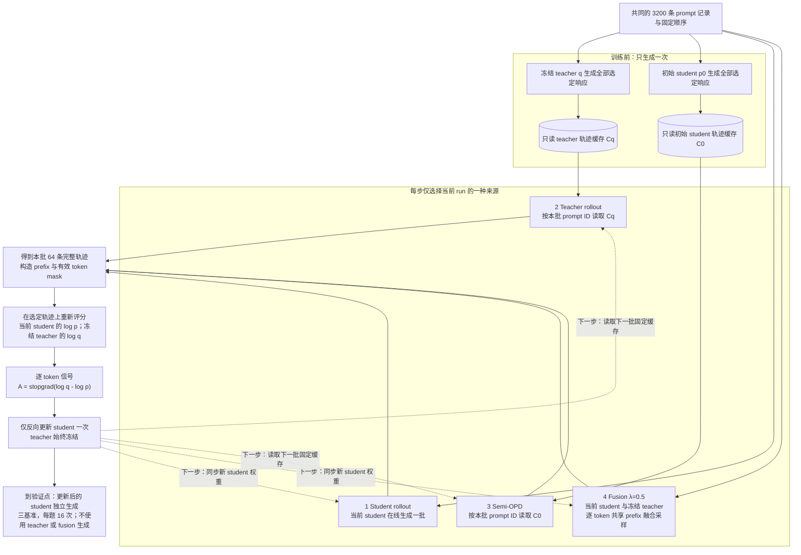

# Rollout 来源与 logit 融合实验

## 进度与主要结果

这是一组统一的 math 蒸馏实验：比较当前 student、固定 teacher、初始 student 缓存三种轨迹来源，再加入共享 prefix 的 logit fusion。四个设置均已完成 50 次 student 更新和最终三基准 eval16，日志、逐题输出与 W&B 指标核对一致。训练、缓存生成和结果处理脚本均随仓保存；正式运行只使用物理 GPU 0–3，不保存模型 checkpoint。

在线 student、teacher 轨迹、Semi-OPD、fusion 的 macro mean@16（三个基准等权平均）分别为 **64.84%、62.52%、64.59%、64.16%**。目前没有证据表明 λ=0.5 fusion 稳定提高平均正确率。四组都只有一个验证预算点，不能据此判断收敛。长时 Semi-OPD 正在运行，同一缓存最多重复训练 800 步，每 50 步执行完整三基准 eval16；第 50 步完整验证已完成，macro mean@16 为 64.80%，已继续第二轮缓存训练；当前仍只有一个长时验证点。

用户指定的两个独立评测 run 分别是 `math_teacher`（u87buult）与 `math_student`（6uorrk2k）。[^reference-teacher][^reference-student] API 已核对模型名称、finished 状态、val_only、三个基准、每题 16 个响应及采样和长度配置；它们提供 teacher 与初始 student 的准确率参考。远端原始响应、数据和权重哈希尚未核对，因此图中将其标为外部参考，不视为本地同一次训练的 step-0 测量。筛选后的配置和指标保存在[参考数据](results/reference-accuracy.json)。

## 基准组成、难度与统计粒度

以下题目数和组成来自本地上游缓存，已逐题核对 problem、answer 与实际评测 parquet 完全一致，来源文件哈希保存在[基准元数据](results/state-diagnostics/summary.json)。三组评测都比较最终数学答案，不按推理过程逐步评分。

| 基准     | 实际题数 / 每次验证响应数 | 题目组成                                                    | 难度解释                                                                 |
| -------- | ------------------------- | ----------------------------------------------------------- | ------------------------------------------------------------------------ |
| MATH-500 | 500 / 8,000               | OpenAI 从 MATH 选取的 500 题，覆盖七类数学主题及 level 1–5  | 难度混合的竞赛数学集合；不能当作 500 道同等难度题                        |
| AMC23    | 40 / 640                  | 本地 `knoveleng/AMC-23` 版本，2023 AMC 12A 22 题、12B 18 题 | 高中竞赛数学，含容易题和后段难题；这 40 题是子集，不是两套完整 25 题试卷 |
| AIME25   | 30 / 480                  | `opencompass/AIME2025` 的 2025 AIME I、II，各 15 题         | AMC 高分选手参加的邀请赛，答案为 0–999 整数；竞赛定位比 AMC 更难         |

MATH-500 的来源与抽样关系见数据卡；[^math500] 本地 level 1/2/3/4/5 分别为 43/90/105/128/134 题，level 4–5 合计 262 题（52.4%）。七类主题分别为 Algebra 124、Intermediate Algebra 97、Prealgebra 82、Number Theory 62、Precalculus 56、Geometry 41、Counting & Probability 38。该结构比单一平均分更能说明测试覆盖。

AMC 的原考试为选择题，但当前数据准备使用题面与实际数值答案，不能将成绩解释为选项猜测率。数据卡确认该版本有 40 条记录，[^amc23] 12A/12B 的 22/18 分布由各题来源 URL 核对。AIME 的 I/II 组成由数据文件核对；[^aime25] MAA 对 AIME 的官方介绍也明确其难度高于 AMC 10/12。[^maa-aime]

在当前模型与协议下，teacher 的 MATH-500/AMC23/AIME25 mean@16 为 89.11%/89.38%/39.17%，初始 student 为 83.25%/72.03%/23.75%。AIME25 对两个模型都最难；MATH-500 与 AMC23 的相对顺序依模型变化，不存在对所有模型固定不变的难度排序。

AIME25 一题的 pass@16 改变会使该基准变化 3.33 个百分点，AMC23 为 2.5，MATH-500 为 0.2。每题采样 16 次减少采样噪声，但不会把 30 道 AIME 题变成 480 个独立问题。macro 让三个基准等权，可避免 500 道 MATH 题淹没其他基准，同时也会受到小基准题目波动影响；应同时保留逐题分析与 micro。

### Macro 与 micro 的含义

Macro 是基准之间的等权平均。记 MATH-500、AMC23、AIME25 各自的 mean@16 为 $a_{\mathrm{math}},a_{\mathrm{amc}},a_{\mathrm{aime}}$，则

$$
a_{\mathrm{macro}}=\frac{a_{\mathrm{math}}+a_{\mathrm{amc}}+a_{\mathrm{aime}}}{3}.
$$

每个基准各占三分之一权重，与题目数无关。在线 student 的三项分数约为 86.24%、80.16%、28.12%，macro 约为 64.84%；实际指标用未舍入值计算。macro pass@k 也按同样方式平均三个基准各自的 pass@k。

Micro 是全部题目的等权平均：

$$
a_{\mathrm{micro}}=\frac{500a_{\mathrm{math}}+40a_{\mathrm{amc}}+30a_{\mathrm{aime}}}{570}.
$$

同一在线 student 的 micro 为 82.75%。MATH-500 在 micro 中占约 87.72%，在 macro 中只占 33.33%；AIME25 在 micro 中占约 5.26%。所以较高的 micro 不能解释为三个基准都达到该水平。报告同时保留各基准原分数、macro 和 micro，避免只看一个总分。

## 50 步准确率与 pass@k

下表单位为百分比。前两行是独立模型评测，其余四行均是经过 50 步训练后的 student。macro 对三个基准等权；micro 对全部 570 个题目等权。

| 模型或训练设置               | MATH-500 mean@16 | AMC23 mean@16 | AIME25 mean@16 | macro mean@16 | micro mean@16 |
| ---------------------------- | ---------------: | ------------: | -------------: | ------------: | ------------: |
| 初始 student，外部参考       |            83.25 |         72.03 |          23.75 |         59.68 |         79.33 |
| Teacher，外部参考            |            89.11 |         89.38 |          39.17 |         72.55 |         86.50 |
| 在线 student rollout         |            86.24 |         80.16 |          28.12 |         64.84 |         82.75 |
| Teacher rollout 后的 student |            85.38 |         75.31 |          26.88 |         62.52 |         81.59 |
| Semi-OPD 后的 student        |            86.70 |         78.75 |          28.33 |         64.59 |         83.07 |
| Fusion λ=0.5 后的 student    |            86.28 |         78.91 |          27.29 |         64.16 |         82.65 |


准确率图用点表示实际完成的 step-50 结果，各基准独立缩放纵轴，范围包含全部训练结果和两个参考，不从零起画柱高。没有连接训练前后两点来伪造中间验证曲线。所有训练后 student 的平均正确率高于给定初始 student 参考、低于 teacher 参考；严格的训练增益估计仍需在本地核对同一模型资产和数据，并补充训练 seed。

| 设置         | MATH-500 pass@16 | AMC23 pass@16 | AIME25 pass@16 | macro pass@16 | micro pass@16 |
| ------------ | ---------------: | ------------: | -------------: | ------------: | ------------: |
| 在线 student |            95.60 |         95.00 |          50.00 |         80.20 |         93.16 |
| Teacher 轨迹 |            96.20 |         95.00 |          53.33 |         81.51 |         93.86 |
| Semi-OPD     |            96.40 |         95.00 |          46.67 |         79.36 |         93.68 |
| Fusion λ=0.5 |            95.80 |         95.00 |          53.33 |         81.38 |         93.51 |


pass@k 图也按基准独立缩放，保留全部六条曲线：四个训练后 student、虚线初始 student、点线 teacher。两个外部参考直接使用用户指定 run 的精确 `acc/pass@k`，不以 bootstrap best@k 替代；$k=1$ 使用 mean@16，macro 在三个基准间等权平均。不同面板的纵轴范围不同，不能凭图上斜率或垂直距离跨基准比较效应大小。

Fusion 的 macro mean@16 比在线组低 0.682 个百分点，macro pass@16 高 1.178 个百分点；AIME25 至少一次正确的题数分别为 16/30 与 15/30。平均正确率与多次采样覆盖表达不同性质，不能只选较高的一项宣布整体更好。

四设置共有的 570 个题目以基准名、输入、标准答案构成的内容哈希配对。以下区间以在线组为参考，按基准分层成对 bootstrap 题目，5,000 次、seed 42，单位为百分点。

| 设置减在线 student | macro mean@16 差值 | 95% 题目 bootstrap 区间 |
| ------------------ | -----------------: | ----------------------: |
| Teacher 轨迹       |             -2.319 |        [-4.055, -0.755] |
| Semi-OPD           |             -0.245 |         [-1.829, 1.310] |
| Fusion λ=0.5       |             -0.682 |         [-2.149, 0.681] |

这些区间表示对题目选择的敏感性，不覆盖训练 seed 方差，也未作多重比较校正。teacher 组在当前单 seed 运行的平均正确率较低；Semi 与 fusion 相对在线组的区间都包含零。它们不能证明算法普遍排序或不同渐近平台。完整逐基准差值、未舍入指标和来源哈希见[四设置比较](results/2026-10-18-four-setting-comparison/analysis.json)。

## 训练指标与图的含义


每条线是一个真实训练 run 的 50 个原始步骤，没有平滑，也没有将 batch 波动画成训练 seed 置信带。颜色在所有图中固定对应同一轨迹来源。绘图数据、输入文件哈希、调色板、脚本版本和机器审计保存在 `figures/`。

对有效 token，记当前 student 与冻结 teacher 的对数概率差为

$$
d_{it}=\log p_{\theta_k}(a_{it}\mid s_{it})-\log q(a_{it}\mid s_{it}),\qquad
r_{it}=-d_{it}.
$$

图中的指标采用以下语义。

| 图中指标                    | 日志字段或计算           | 含义与解释限制                                                                                                           |
| --------------------------- | ------------------------ | ------------------------------------------------------------------------------------------------------------------------ |
| Sampled log-ratio，KL proxy | `-opd/token_reward_mean` | 实际来源轨迹上的 $\operatorname{mean}(d)$；缓存和融合的 action 分布不是当前 student，均值可为负，不能当作完整条件 KL     |
| Teacher token reward        | `opd/token_reward_mean`  | 有效 token 平均 $\operatorname{mean}(r)$，来自 teacher 的稠密蒸馏信号，不是答题正确率奖励                                |
| Log-ratio RMS               | `opd/log_ratio_rms`      | $\sqrt{\operatorname{mean}(d^2)}$，避免 signed mean 的正负抵消；不同来源的取样分布不同，不能直接作为共同测度上的对齐排名 |
| Gradient norm               | `actor/grad_norm`        | 裁剪前的全局梯度 L2 范数；阈值为 1，日志可大于 1                                                                         |
| Student entropy             | `actor/entropy`          | student 在该来源 prefix 上的条件熵平均，prefix 集随来源变化                                                              |
| Actor surrogate loss        | `actor/loss`             | 当前 PPO surrogate；单次更新起点与负 token reward 接近，负值不表示 KL 为负                                               |

当前运行没有保存全词表条件 KL。仅对给定 prefix、由当前 student 采样的 action，$\mathbb E_{a\sim p_\theta}[d]$ 才是该 prefix 上的 reverse KL；有限样本均值还存在采样误差。在线更新又对 prefix 采样路径停止梯度，因此该局部解释也不等于完整序列 KL 的全部梯度。图中保留“KL proxy”标识，避免把不同数学量混为一谈。

| 来源         | 第 50 步 loss | 第 50 步 grad_norm | 第 50 步 RMS | 前十步 RMS 均值 | 后十步 RMS 均值 |
| ------------ | ------------: | -----------------: | -----------: | --------------: | --------------: |
| 在线 student |      0.054435 |           0.572402 |     0.371102 |        0.546104 |        0.383639 |
| Teacher 轨迹 |     -0.046815 |           0.519051 |     0.296459 |        0.438914 |        0.309305 |
| Semi-OPD     |      0.092669 |           0.803625 |     0.414405 |        0.547853 |        0.424606 |
| Fusion λ=0.5 |     -0.002646 |           0.529680 |     0.314388 |        0.427681 |        0.324119 |

四组 RMS 的后十步均值低于前十步，但这只描述各自训练轨迹上的残差。Fusion 的 signed mean 接近零，RMS 仍为 0.314；奖励均值接近零不足以支持对齐完成。非零 batch 梯度本身也不能证明期望梯度没有收敛，长时判断需要共同缓存上的多个窗口。


响应长度与触顶比例用于判断 4K 训练预算的影响。`clip_ratio` 表示长度达到 cap，不单独判定该位置是否恰好为自然 EOS。缓存保留 finish reason，但上图使用四组共同记录的长度指标。序列奖励为 token reward 的逐响应求和均值，会受长度影响；actor update time 仅含参数更新阶段，不包含轨迹生成、缓存准备或验证。

### Semi-OPD 固定长度与 batch 波动

Semi-OPD 固定的是每条 prompt 记录的响应 token 序列，其长度 $L_i$ 不随 student 更新变化。图中记录的是当前 batch 的平均值，而不是整份缓存的平均值：

$$
\overline L_k=\frac1{64}\sum_{i\in B_k}L_i.
$$

不同 batch 含不同记录，因此 $\overline L_k$ 可以波动。当前 schedule 有 50 个 batch，长时组不 shuffle，重复同一顺序；重复消费同一批记录时应满足 $\overline L_{k+50}=\overline L_k$。整份初始 student 缓存的平均长度始终为 3,900.651875 token。

已实际读取只读 SQLite 并校验数据库哈希：3,200 条初始 student 响应的长度从 417 到 4,096；50 个 batch 均值从 3,728.21875 到 4,028.828125。第 1 批均值 3,993.6875，第 50 批 3,959.734375；全部 50 步的日志均值都与对应缓存精确一致。独立长时组截至诊断快照第 71 步，全部 1–71 步也逐步精确匹配同一缓存；其中 51–71 步重现了首轮 1–21 批的长度，已实际验证跨轮复用。波动来自 batch 内容，没有证据显示 Semi 训练时重新生成了响应。

长度核验、每批缓存统计和长时观测保存在[缓存诊断](results/state-diagnostics/summary.json)与同目录 CSV。缓存中的实际 `finish_reason=length` 分别为初始 student 的 2,684/3,200（83.875%）、teacher 的 2,549/3,200（79.65625%）；它们说明当前 4K 预算下大部分轨迹没有自然结束，state 比较须控制深度和截断。

## State 的测量与后续诊断

### 已测量的固定缓存与精确 prefix

自回归 state 是 action 之前的 prefix $s_{it}=(x_i,y_{i,<t})$。Semi-OPD 的响应固定，所以同一记录的全部 token state 也固定；每轮覆盖同一集合，student 在这些 state 上的概率、熵和梯度仍会变化。固定 state 集上的准确率提升属于吸收已有监督的现象，不需要假定每轮访问了新 state。response length、action overlap、state 覆盖和模型对齐分别是不同的量。

以同一 prompt 记录配对初始 student 与 teacher 缓存，令响应长度为 $L_i^S,L_i^T$，共同响应前缀长度为 $c_i$。共享的 action 前 state 数为

$$
I_i=\min(c_i+1,L_i^S,L_i^T),\qquad
J_{\mathrm{paired}}=\frac{\sum_i I_i}{\sum_i(L_i^S+L_i^T-I_i)}.
$$

第一个分歧 action 仍由相同 prefix 出发，因此是 $c_i+1$；不能多算生成结束后的终止位置。该计数已用二元 token 表、长度 1–4 的全部轨迹对与显式 prefix 集合穷举核对。

真实缓存的 3,200 对响应中，没有完全相同的响应；共同前缀中位数为 10 token、均值 16.675625、90 分位为 43，最长 183。配对共享 prefix 位置共 56,562，$J_{\mathrm{paired}}=0.227\%$；初始 student 的 token 位置对应的 state 有约 0.453% 出现在配对 teacher 轨迹上。这是按 prompt 记录条件化的精确文本 prefix 重合，**不是语义 state 覆盖率**，也不代表两组只共享 0.453% 的可迁移知识。

精确 prefix 对字符串分叉非常敏感：一处措辞不同后，后面的完整 prefix 都不同，即使推理意图相似。同一模型独立采样两次也可能很早分叉，因此缺少同来源重复采样对照时，不能将小重合率单独归因于 teacher/student 分布差异。它适合核验固定缓存、是否重复采样和分叉位置，不能作为主要的泛化机制指标。在线 student 与 fusion 的实际配置均为 `rollout_data_dir=None`，没有保留完整训练轨迹；现有验证响应也不能替代训练访问分布来补算这两组的历史覆盖。

### 建议优先记录的三个 state 指标

我建议把状态供给与状态吸收分开测量，优先记录下列三个互补指标。它们尚未在当前运行上完成，不能与上面的 CPU 缓存结果混称为实测。

| 指标                          | 固定的测量对象                                                | 回答的问题                                                  |
| ----------------------------- | ------------------------------------------------------------- | ----------------------------------------------------------- |
| 表示簇覆盖率与新增簇比例      | 冻结 teacher 的 prefix 隐表示、一次拟合的 PCA/聚类            | 相同采样预算下访问了多大范围，还有多少新状态区域            |
| 访问频率分布与 teacher 的距离 | 同一簇划分上的占用频率，按深度分层                            | 两组是否访问同一批区域但训练权重不同                        |
| 固定 probe 上的完整条件 KL    | 同一批固定 prefix、当前 student 与冻结 teacher 的完整词表分布 | 已经供给的状态是否被 student 吸收，避免状态更换混入对齐曲线 |

One-Shot-OPD 的覆盖分析使用冻结 teacher 最后一层、prefix 最后一个 token 的隐向量，将参考表示经 PCA 后聚为 200 簇，每条轨迹均匀抽取八个位置。[^oneshot-state] 这里可沿用 PCA 50 维、$C=200$ 的起点，并对 $C=50/100/200$ 检查敏感性。编码器、PCA 和簇中心必须固定；每 50 步重新聚类或使用不断变化的 student 编码器，都会让坐标系漂移，无法直接比较覆盖变化。

设 $M$ 个 probe state 的固定簇标签为 $c(s_j)$，归一化访问频率为

$$
\widehat d_\mu(c)=\frac1M\sum_{j=1}^{M}\mathbf1\{c(s_j)=c\},\qquad
\operatorname{Cov}_\mu=\frac1C\sum_{c=1}^C\mathbf1\{\widehat d_\mu(c)>0\}.
$$

覆盖相同也可以有完全不同的权重。用 $m=(\widehat d_\mu+\widehat d_q)/2$，再记录

$$
\operatorname{JSD}(\widehat d_\mu,\widehat d_q)
=\tfrac12D_{\mathrm{KL}}(\widehat d_\mu\Vert m)
+\tfrac12D_{\mathrm{KL}}(\widehat d_q\Vert m),\qquad
N_{\mathrm{eff}}=\exp\!\left(-\sum_c\widehat d_\mu(c)\log\widehat d_\mu(c)\right).
$$

Jensen–Shannon 散度（JSD）衡量访问权重差异，有效簇数 $N_{\mathrm{eff}}$ 区分集中访问少数簇与较均匀访问。零频项按 $0\log0=0$ 处理；这里的 KL 位于离散簇频率空间，与 token 条件分布的 KL 不同。对固定 Semi，在跨轮复用同一组抽样位置时，第一轮之后累计新增簇应为零，但固定 probe 上的 KL 仍可以下降；这可量化继续吸收已有状态监督的过程。零新增本身是固定数据的结果，不证明缓存已充分覆盖目标分布。若每轮随机换位置，观测到的新簇也可能只是首次看见原缓存里未抽中的位置。

固定 prefix 集 $\mathcal P$ 在训练前确定，不随各组 rollout 更新。完整条件 KL 采用共同测度：

$$
K_{\mathrm{probe}}(\theta)=\frac1{|\mathcal P|}\sum_{s\in\mathcal P}\sum_{a\in\mathcal V}
p_\theta(a\mid s)\log\frac{p_\theta(a\mid s)}{q(a\mid s)}.
$$

它使用完整有效词表，当前配对为 151,665 个 token，直接回答共同 prefix 上的对齐程度。可同时记录条件分布 overlap

$$
O_{\mathrm{probe}}(\theta)=\frac1{|\mathcal P|}\sum_{s\in\mathcal P}\sum_a\min\{p_\theta(a\mid s),q(a\mid s)\}.
$$

该 overlap 是 action 分布兼容性，不是 state 覆盖。两者分开后，才能区分“缺少目标 state”与“到达相同 state 后仍未学好目标 action”。若只保存 top-k，必须把结果另命名为截断或聚合诊断，不能继续标成完整词表 KL。

### 最小测量设置与机制辨识

下一轮从每组相同的 128 个训练 prompt、每题一条实际训练轨迹抽取八个有效 response 位置，各组每个时间点共 1,024 个 state；缓存来源的八个位置按固定 seed 一次选定，跨轮复用。参考聚类使用各来源平衡、与测量 prompt 分开的固定训练 prompt 池；不能只在 teacher 轨迹上拟合后把 teacher 高覆盖当作结果，也不使用评测题生成训练诊断样本。固定 KL probe 可从 teacher 与初始 student 轨迹各取一半，共 512 个 prefix，同时分别报告两个来源子集，避免混合平均掩盖差异。另以 teacher–teacher、初始 student–初始 student 独立 rollout 配对校准同来源采样噪声；聚类 JSD 和覆盖差异也须相对这一基线解释。

位置选择要对齐 action 之前的 prefix：第一个 response action 对应 prompt 的最后一个隐藏位置，之后依次取前一个 response token 的位置。除整体结果，还按绝对生成深度及轨迹前/中/后段分层；只看相对位置会混入长度变化，只看总覆盖会被 4K 截断支配。采样预算按 prompt/轨迹等权，另报 token 等权占用，明确归约差异。区间重采样 prompt，不能把同一长轨迹中的上千个相邻 token 当作独立样本。

在 rollout 生成后、teacher 评分前保存选中 prefix 的 token ID、prompt 身份、来源、student 权重版本、原响应长度与位置。冻结 teacher 编码时只提取最后层选中位置，不保存全部层和全部 token 的隐藏向量；固定 KL probe 的 LM head 也只投影选中位置。这样可以复用 teacher 前向并控制存储与显存。当前正在运行的私有源码快照未改动，因此上述新指标不会追溯出现在已完成的 50 步运行中。

表示空间聚类仍是代理：邻近隐藏向量未必给共享参数提供同一更新方向。若覆盖相近但收敛速率仍不同，可进一步在小型固定 probe 上比较末层或 LM head 梯度的余弦冲突与有效秩，明确其只代表所选参数子空间。更直接的辨识实验是在相同固定 prefix 上统一 action 为当前 student 采样，或使用完整条件 KL 更新，再与原 action 缓存更新比较；否则更换 rollout 同时改变 state 与 action，无法把准确率差异单独归因于 state。

CPU 诊断复现命令如下，不占用 GPU：

```bash
CUDA_VISIBLE_DEVICES='' ../envs/opd-state/bin/python eval/analyze_cached_states.py \
    --long-run runs/rollout-sources/math-semi-opd-long-800steps-eval16-20261018-092912
```

## 共同设置与数据范围

| 项目           | 正式对照设置                                                                                                        |
| -------------- | ------------------------------------------------------------------------------------------------------------------- |
| 可训练 student | DeepSeek-R1-Distill-Qwen-1.5B，每组从相同初始资产和全新 optimizer 开始                                              |
| 冻结 teacher   | JustRL-DeepSeek-1.5B；生成 teacher 轨迹与训练监督使用同一资产                                                       |
| 设备与环境     | 物理 GPU 0–3，四张 H800 80GB；独立 `envs/opd-state`；Torch 2.7.1+cu126、vLLM 0.10.0+cu126、Transformers 4.57.6      |
| Prompt 数据    | 相邻 `MD-OPD/data/math/DAPO/train.parquet`，17,917 行，prompt cap 过滤后 17,909 行                                  |
| 配对消费顺序   | 原 RLHFDataset、StatefulDataLoader、seed 42 的前 50 batch，共 3,200 条消费记录；不声称是全量去重语料                |
| Batch 与更新   | 每批 64 prompt、每题一条响应；全局 mini-batch 64、每步一个 PPO epoch，micro-batch 只作梯度累积                      |
| 长度与采样     | prompt cap 1,024；训练响应 cap 4,096；temperature 1、top-p 1、top-k 不截断、repetition penalty 1                    |
| 优化           | AdamW，恒定学习率 $10^{-6}$、无 warmup、梯度裁剪 1；有效 response token 的 token-mean                               |
| 蒸馏目标       | `token_reward_direct`，sampled-token 信号，`LOG_PROB_TOP_K=0`；无额外 reference KL 正则或行为重要性修正             |
| 验证           | MATH-500 500 题、AMC23 40 题、AIME25 30 题，每题 16 次，共 9,120 条响应；temperature 0.7、top-p 0.9、cap 31,744     |
| 验证批量       | `data.val_batch_size=32`，共 18 批；不减少每题的 16 次采样                                                          |
| 保存与记录     | 50 步组仅最终验证；长时组每 50 步验证；无训练前验证；`save_freq=-1`、`resume_mode=disable`；W&B project `OPD-State` |

配对 schedule 的 50 个 batch 的 prompt 长度最小值、均值和最大值与原在线 baseline 日志全部匹配。用随仓配置独立重建后，全部索引、prompt token、parquet 和 prompts JSONL 的 SHA-256 都与生产 schedule 一致，见[重建证据](results/2026-10-18-schedule-reproduction.json)。长时 Semi 重复消费同一 3,200 条记录，每 50 步覆盖一轮。

研究来源是 Zhao 等的 _When Do We Need On-Policy Distillation?_[^semi]。该论文的 Semi-OPD 固定初始 student 的轨迹，teacher 来源消融替换轨迹生成方。本实验采用本地已有的 R1-Distill/JustRL 配对、batch 64、4K 训练响应和三基准 eval16，不是该论文 14,116 条去重 DAPO、batch 128、AIME/HMMT avg@32 的严格复现。论文的不同配对还区分思考模式与 4K/16K cap；本地格式化 prompt 去重后 17,255 条，也不等于论文数据。

若后续检验低 overlap 下的来源效应，可准备 Qwen3-1.7B non-thinking 与 Qwen3-4B-Instruct-2507，固定 revision、模板、长度和数据，再增加 seed 42/43/44；这是后续可变选择，尚未执行。当前没有测量该模型配对的 top-64 overlap，不用模型名称替代测量。

## 四种轨迹来源与 student 更新

### 四种流程合图

下图表示四个独立 run 的可选训练路径，每个 run 只选择一种来源，从同一初始 student 权重和全新 optimizer 开始。共用的评分与更新框表示复用同一实现，不把四组轨迹混成一个 batch，也不共享训练后的参数。实线表示轨迹数据与训练顺序，虚线表示下一步的重复入口。



当前正式四组都只在第 50 步验证；长时 Semi 每 50 步验证。缓存组的下一步入口直接返回读缓存，不返回训练前生成节点。在线和 fusion 下一步使用更新后的 student 权重；fusion 采样一个 token 后将同一个 token 送入两模型的 KV cache。

### Semi-OPD 的 state 池如何确定

论文在训练开始前，用初始 student 为全部训练 prompt 各采样一次响应，再把 teacher 在这些响应上的 log-probability 预计算下来；后续更新只重算当前 student 概率。其附录明确为去重后的 14,116 个 prompt、每题一条响应，训练时按与在线 OPD 相同的 prompt 顺序读取。[^semi] 这属于一次性离线准备，不是在训练中维护一个初始 student 持续生成新响应。

当前本地实现的来源规则相同，但缓存范围和 teacher 打分实现不同。数据准备先对本地 DAPO 做 prompt 长度过滤，得到 17,909 条记录；按原在线 baseline 的 sampler 和 seed 42 选取前 50 个 batch，共 3,200 条消费记录。它们不是 parquet 文件的前 3,200 行，也没有覆盖全部过滤后的训练 prompt。两个缓存组和两个在线来源组都消费这份相同的 prompt 顺序。

Semi 的准备阶段加载未更新的初始 student，对这 3,200 条记录各生成一次响应，遇到 EOS 或 4,096 token 上限停止。缓存按 prompt ID 保存 prompt token、完整 response token 和结束原因。每条响应对应的 state 池是该 prompt 与响应的所有有效前缀；不是只取最开始的一段 token，也不是缓存某个模型的 hidden state。

训练随后从同一初始 student 权重重新开始。每步读取 64 个 prompt ID 对应的固定响应，在同一批 prefix/action 上重新计算当前 student 和冻结 teacher 的 log-probability，再只更新 student。当前版本仅缓存 token，teacher 分数每步重算；论文预缓存 teacher 分数的效率优化尚未实现。训练期间不调用初始 student 生成，不因当前 student 改变而替换缓存，cache miss 直接失败。

首轮 50 步读完全部 3,200 条记录；长时组再从同一固定顺序的第一批开始。因此同一记录的 state 不变、同一 batch 的长度应每 50 步复现，但 student 在这些固定 state 上的概率和梯度会随更新变化。当前实现的数据选择、生成和读取位置分别是 `data/prep/build_rollout_cache.py` 的 `schedule`/`cache`、`recipe/math_cached.sh` 与 `verl/verl/trainer/ppo/fixed_rollout.py`。

### 更新公式与来源差异

所有设置只更新 student，teacher 始终冻结并处于 eval/no_grad 模式。Teacher rollout 意味着 teacher 生成响应，student 接受训练；最终验证仍由 student 独立生成。各组的生成方和生成时机如下。

| 设置            | 行为分布                                                                    | 生成时机               | 参数更新方 |
| --------------- | --------------------------------------------------------------------------- | ---------------------- | ---------- |
| Student rollout | 当前 student $p_{\theta_k}$                                                 | 每次更新前在线生成     | student    |
| Teacher rollout | 固定 teacher $q$                                                            | 训练前预生成一次并缓存 | student    |
| Semi-OPD        | 初始 student $p_0$                                                          | 训练前预生成一次并缓存 | student    |
| Logit fusion    | 当前 student 与固定 teacher 的共享 prefix 融合策略 $\mu_{\theta_k,\lambda}$ | 每次更新前在线生成     | student    |

Teacher rollout 的在线重新采样变体尚未运行。重复使用有限缓存与持续生成新 teacher 响应的差异需要单独验证。Semi-OPD 在这里始终指初始 student 一次性生成缓存，不是单条轨迹前段 student、后段 teacher。

令第 $k$ 步更新前的 student 为 $p_{\bar\theta}$，$\bar\theta=\theta_{k-1}$，teacher 为 $q$。对 prefix $s_{it}=(x_i,y_{i,<t})$、实际 action $a_{it}$ 和有效 token mask $m_{it}$，每步重新计算

$$
\ell^S_{it}=\log p_{\bar\theta}(a_{it}\mid s_{it}),\qquad
\ell^T_{it}=\log q(a_{it}\mid s_{it}),\qquad
A_{it}=\operatorname{stopgrad}(\ell^T_{it}-\ell^S_{it}).
$$

EOS 属于有效响应，padding 不参与 loss。一次完整 optimizer update 在更新起点的局部梯度对应

$$
\mathcal L_k(\theta)=-\frac{1}{N_k}\sum_{i,t}m_{it}A_{it}\log p_\theta(a_{it}\mid s_{it}),\qquad
N_k=\sum_{i,t}m_{it}.
$$

实现复用 PPO clipped surrogate，比率分母是本步重算的当前 student 锚点 $p_{\bar\theta}$。单个全局 mini-batch、单 PPO epoch 的更新起点比率为 1，对应上述局部梯度；若增加 epoch 或拆分多个 optimizer mini-batch，需重新核对 clipping 和 dual-clip 的影响，不能继续假定相同。

```pseudocode
\begin{algorithm}
\caption{统一轨迹来源蒸馏\\{\small\textit{Semantics: 根据正文重构}}}
\begin{algorithmic}
\INPUT initial student $p_0$; frozen teacher $q$; ordered prompt batches $X_1,\ldots,X_K$; source $\mu$; response cap $H$
\OUTPUT updated student $p_{\theta_K}$
\IF{$\mu\in\{q,p_0\}$}
    \STATE independently sample and cache one response per scheduled record from frozen $\mu$, stopping at EOS or $H$
    \STATE store token IDs, source identity and finish reason; reject missing or mismatched records
\ENDIF
\STATE $\theta_0\gets\theta(p_0)$
\FOR{$k=1$ \TO $K$}
    \STATE $\bar\theta\gets\theta_{k-1}$
    \IF{$\mu\in\{q,p_0\}$}
        \STATE read the fixed responses for $X_k$; never fill a cache miss by online generation
    \ELSE
        \STATE synchronize the student inference replica to $\bar\theta$
        \STATE independently sample one response per prompt from current student or shared-prefix fusion, stopping at EOS or $H$
    \ENDIF
    \STATE construct valid response masks including EOS and excluding padding; reject an empty valid-token batch
    \STATE recompute current $\ell^S_{it}$ and frozen-teacher $\ell^T_{it}$ on these exact trajectories
    \STATE $A_{it}\gets\operatorname{stopgrad}(\ell^T_{it}-\ell^S_{it})$
    \STATE update only student parameters once with the current-student PPO anchor, producing $\theta_k$
    \IF{$k$ is a validation step}
        \STATE synchronize the updated student and evaluate student-only responses on all three benchmarks
    \ENDIF
\ENDFOR
\RETURN $p_{\theta_K}$
\end{algorithmic}
\end{algorithm}
```

该伪代码概括来源选择和更新顺序；当前缓存版本只保存轨迹，teacher 的 token 分数在每步重算，没有保存 teacher log-probability 或旧 student 概率。缓存 miss 或协议不符直接失败，不改用在线采样。论文预缓存 teacher 分数的效率收益没有包含在当前实现中。

固定来源同时改变 prefix 与 action。设固定缓存 token 测度为 $\nu_\mu(s,a)$，其权重与 $\theta$ 无关，teacher 也固定。在更新起点，未作行为重要性修正的梯度为

$$
g_\mu(\theta)=\mathbb E_{(s,a)\sim\nu_\mu}\left[(\log p_\theta(a\mid s)-\log q(a\mid s))\nabla_\theta\log p_\theta(a\mid s)\right].
$$

记 $d_\theta=\log p_\theta-\log q$，则固定测度下的平方残差满足

$$
\begin{aligned}
F_\mu(\theta)&=\frac12\sum_{s,a}\nu_\mu(s,a)d_\theta(s,a)^2,\\
\nabla_\theta F_\mu(\theta)
&=\frac12\sum_{s,a}\nu_\mu(s,a)\,2d_\theta(s,a)\nabla_\theta d_\theta(s,a)\\
&=\sum_{s,a}\nu_\mu(s,a)d_\theta(s,a)\left(\nabla_\theta\log p_\theta(a\mid s)-0\right)\\
&=g_\mu(\theta).
\end{aligned}
$$

这里的等式依赖固定缓存测度与冻结 teacher；在线 student 或 fusion 的行为分布随更新变化，不能直接将整段训练解释为同一个固定 $F_\mu$ 的下降。来源差异同时包含 prefix、action、长度和内容差异，末步正确率不能单独识别 prefix 访问测度的因果作用；相关推导见[访问测度研究](../research/occupancy/2026-10-17-OPD访问测度与收敛机制研究.md)。

Fusion 每个 token 都在同一 prefix 上计算

$$
\mu_{\theta,\lambda}(a\mid s)=\operatorname{softmax}\!\left(\frac{(1-\lambda)z_{p_\theta}(s)+\lambda z_q(s)}{T}\right)_a,\qquad \lambda=0.5,\quad T=1.
$$

每次只从融合分布采样一个 token，再将同一个 token 送入两个模型各自的 KV cache。两个模型不能各自生成后拼接。teacher 固定，student 推理副本随 actor 完整权重流更新；第 $k$ 步生成版本必须为 $k-1$，不完整或过期权重拒绝生成。融合策略的 log-probability 只作诊断，不用作 PPO old-log-probability 或重要性权重；监督仍来自原始 $q$。

## 评测计算与收敛条件

某题 $n=16$ 个响应中 $c$ 个正确，题内 mean@16 为 $c/16$，再在题目间平均。标准无放回 pass@k 为

$$
\widehat{\operatorname{pass@k}}=1-\frac{\binom{n-c}{k}}{\binom{n}{k}},\qquad k\in\{1,2,4,8,16\}.
$$

当 $n-c<k$ 时分子为零。pass@1 等于 mean@16；pass@16 是 16 个响应中是否至少一个正确。原生 veRL 的 bootstrap best@k 使用有放回采样，语义不同；例如恰好一个正确时，标准 pass@16 为 1，有放回 best@16 的期望为 $1-(15/16)^{16}$。原生 mean/std/best/worst/maj 保留，额外输出精确 pass@k，不相互改名。

验证必须包含三个完整基准、570 个不同题目和每题恰好 16 次二值评分。采集器从原始 JSONL 独立重算，与日志和 W&B 全部精确指标逐项核对，保存逐题 CSV 哈希及内容身份。CSV 固定 LF，避免 Git 换行归一化改变校验值。

长时 Semi-OPD 运行名为 `math-semi-opd-long-800steps-eval16-20261018-092912`，W&B 为 uq1riryx。[^long-run] 其[启动配置证据](results/2026-10-18-semi-long-startup.json)确认完整 eval16、test_freq=50、16 个 epoch、最大 800 步、恒定学习率、无 warmup 和无 checkpoint。模型每 50 步重复同一缓存，适合比较共同状态上的残差窗口；完整验证每次约 95–101 分钟，远长于约七分钟的 50 步缓存更新阶段。

第 50 步阶段结果已完成独立采集：MATH-500 mean@16 为 86.3875%、AMC23 为 80.3125%、AIME25 为 27.7083%，macro 为 64.8028%、micro 为 82.8728%。570 题、9,120 条响应及全部精确指标与训练日志一致，见[阶段摘要](results/long-semi-progress/step-50/summary.json)。该摘要明确为运行中的完整验证快照，不是长时训练已结束。第 50 步的[平台报告](results/long-semi-progress/step-50/plateau-at-step50.json)状态为 `insufficient_observation`；训练已继续，不能从一个验证点宣布平台。

经验平台判据在长时结果产生前固定：至少 300 步，最后四个连续、间隔 50 步的验证点，macro mean@16 极差不超过 0.01；对应四个训练窗口的 token 加权 RMS 相对极差不超过 5%，平均 grad_norm 相对极差不超过 10%。相对极差为最大值减最小值后除以均值，分母下限 $10^{-12}$。

第 $b$ 批有效 token 数 $N_b$、RMS $r_b$ 的窗口合并值为

$$
r_{\mathrm{window}}=\sqrt{\frac{\sum_b N_b r_b^2}{\sum_b N_b}}.
$$

batch 均为 64，使用平均响应长度作权重与 $N_b$ 等价。训练器和事后分析共用 `plateau.py`：观察不足为 `insufficient_observation`，达到条件为 `observed_plateau`，其余为 `criterion_not_met`。达到条件后在验证结束时正常退出；800 步仍不满足则记录 `budget_exhausted=true`，再按实际趋势决定预算。该判据是有限预算经验平台，不证明梯度为零、已与 teacher 对齐或渐近收敛。

## 实现核验与性能

| 实现层             | 已核验的行为与证据                                                                                                                      |
| ------------------ | --------------------------------------------------------------------------------------------------------------------------------------- |
| 固定缓存           | SQLite 只读完整性、模型完整文件签名、tokenizer/模板、prompt ID/内容、响应 cap/EOS 与配对数据哈希；miss 拒绝；50 步全命中                |
| 当前 student 更新  | 缓存不含 old_log_probs，当前 actor 每步重算；teacher requires_grad=False、eval/no_grad；验证前同步最终 student                          |
| CPU 与维护         | 12 项原生 CPU 测试覆盖融合端点、共享 prefix、EOS、padding、缓存重置、teacher 冻结和版本；37 项维护测试涵盖指标、缓存、RPC 与平台控制    |
| Fusion 数值        | 同 FlashAttention KV 内核 graph/eager logits 最大差为零；静态/动态 FP32 最大 logits 差 $4.96\times10^{-5}$、分布 TV $2.27\times10^{-6}$ |
| Attention 独立核验 | 含左 padding、GQA、prefill/decode 的原始 Q/K/V 对 FP32 数学内核，相对 L2 误差 0.00159–0.00199，阈值 0.005                               |
| 权重流与训练桥接   | GPU 版本 0→1→2 原地更新、改变 lm_head 后输出变化、恢复后还原、teacher 探针不变；完整两步训练和 96 条短验证通过                          |
| 正式 Fusion        | 50 步版本严格为 0–49、λ=0.5、loss/梯度/行为 log-probability 有限；12,436,547 个有效响应 token 与四 worker mask 计数对应                 |

数值与训练证据见 [FP32 检查](results/2026-10-18-fusion-gpu-fp32.json)、[独占 GPU 基准](results/2026-10-18-fusion-gpu-isolated.json)、[两步训练](results/2026-10-18-fusion-two-step-smoke.json)和[Fusion 不变量](results/2026-10-18-math-fusion-lambda05-50steps-eval16-20261018-065746/fusion-invariants.json)。两步调试使用训练 cap 64、验证 cap 128，六题各 16 次，只验证集成，不计为任务成绩。

跨 BF16 attention 内核存在多层舍入差异：batch 1/8/16 的最大分布 TV 约 0.029–0.0314，最大 logits 差不超过 0.375。最初 TV 0.01 阈值未通过；完成 FP32 mask 和独立 attention 核验后，跨 BF16 阈值设为 TV 0.05、logits 差 0.5，同内核 graph/eager 阈值保持 $10^{-5}$。该验收不保证跨后端逐 token 相同。Fusion 使用 Hugging Face 双模型解码，其他来源使用原生 vLLM，因此实验比较包含后端实现差异，不能单独识别完全相同内核下的 λ 效应。

生产后端 `cuda_graph_flash` 以两个独立 StaticCache 保留 KV，用物理有效长度与左 padding 约束注意力，并保留 GQA，避免复制 KV。prefill 使用 eager，单 token 双模型 decode 捕获 CUDA Graph。当前限 full-attention、同 dtype、固定 default RoPE、CUDA BF16/FP16、单 GPU 推理副本、单轮纯文本、每题一个 rollout、全参数 actor；LoRA、FP8、TP/PP>1 和多模态拒绝启用。

独占 H800、固定 KV 容量 5,120、生成 128 个新 token 的热调用微基准如下。它比较两种双模型实现，不代表完整 4K 训练相对原生 vLLM 的加速。

| Batch | DynamicCache eager，token/s | CUDA Graph + FlashAttention KV，token/s | 加速比 | 图路径峰值分配显存，GiB |
| ----: | --------------------------: | --------------------------------------: | -----: | ----------------------: |
|     1 |                       36.69 |                                  119.78 |   3.26 |                    7.03 |
|     8 |                      219.06 |                                  872.09 |   3.98 |                    9.10 |
|    16 |                      445.93 |                                1,663.44 |   3.73 |                   11.46 |

### 阶段耗时与显存

已有数据包括逐步训练阶段计时、actor 自报的 PyTorch 分配/保留显存高水位、W&B 系统事件里的整卡显存/利用率/功率采样，以及独立 Fusion GPU 基准的显存。下载、环境准备、部分初始化与模型哈希核验没有统一的独立计时；历史离线缓存生成也没有独立的整卡显存时间线。因此下面是已记录时段的分解，不是每个微阶段都已连续测量的端到端 profiler。

| 来源         | 缓存预生成一次，分钟 | 50 步训练，分钟 | 最终完整验证，分钟 |
| ------------ | -------------------: | --------------: | -----------------: |
| 在线 student |               不适用 |           39.14 |              95.39 |
| Teacher 轨迹 |                 9.09 |            6.83 |             101.14 |
| Semi-OPD     |                 8.96 |            6.84 |              95.14 |
| Fusion λ=0.5 |               不适用 |           49.98 |              98.46 |

训练内部按 50 步累计秒数进一步分解。`opd_teacher` 位于 `adv` 计时内部，已从优势计算中扣除，避免重复相加。

| 训练阶段                     | 在线 student | Teacher 轨迹 | Semi-OPD | Fusion λ=0.5 |
| ---------------------------- | -----------: | -----------: | -------: | -----------: |
| 生成或读取缓存               |     1,787.12 |         3.32 |     3.46 |     2,450.59 |
| 当前 student log-probability |        99.26 |        85.51 |    81.92 |       102.30 |
| 冻结 teacher 评分            |        99.77 |        96.70 |    95.89 |        98.81 |
| 优势计算，扣除 teacher       |         0.19 |         0.03 |     0.03 |         0.03 |
| Actor 更新                   |       247.80 |       218.13 |   222.86 |       233.66 |
| 权重同步                     |       114.17 |         5.59 |     5.65 |       113.25 |
| 其余训练开销                 |         0.40 |         0.34 |     0.36 |         0.36 |
| 训练合计                     |     2,348.70 |       409.61 |   410.17 |     2,999.00 |

生成/缓存读取、评分、更新与同步之和在未舍入值上与 `timing_s/step` 相同。验证位于该训练计时块之外，未混入训练合计；各列启动范围不完全相同，也不能把缓存预生成和这些计时直接相加当作严格端到端总时间。原始分阶段表及其输入/输出哈希见[资源汇总](results/resources/summary.json)与 `training-phases.csv`。

显存单位均为 GiB。Actor 两列是各 rank 报告的 PyTorch allocator 历史高水位，再取最大值；它们不含独立 teacher/vLLM 进程的全部开销。整卡两列来自 W&B 已记录系统采样的最大值，训练/验证分界按训练日志时间戳和 testing 时长估计，不能定位到单次前向或反向。

| 来源         | Actor 已分配峰值 | Actor 已保留峰值 | 整卡训练期最高采样 | 整卡验证期最高采样 |
| ------------ | ---------------: | ---------------: | -----------------: | -----------------: |
| 在线 student |            15.59 |            20.90 |              45.17 |              45.77 |
| Teacher 轨迹 |            15.61 |            37.18 |              34.02 |              62.32 |
| Semi-OPD     |            15.62 |            37.46 |              37.15 |              47.43 |
| Fusion λ=0.5 |            15.59 |            20.88 |              59.30 |              59.21 |

整卡数据按 W&B 索引 0–3 导出，不保留其他 GPU 的遥测。事件 API 返回的是采样数据，短时峰值可能未被捕获；W&B 启动前的初始化也不在该窗口内，不能把表中的数值当作真实峰值上界。已保留[整卡事件数据、估计阶段边界和逐卡统计](results/resources/wandb-gpu/summary.json)。当前长时验证另从 2026-10-18 11:09 起用独立 `nvidia-smi` 每两秒采样物理 GPU 0–3，记录整卡显存、GPU 利用率、功率及粗粒度日志阶段；监控随原队列 PID 结束而停止，不改变训练进程。

当前两个模型的 BF16 checkpoint 文件各约 3.31 GiB。按本地 Qwen2 配置，单模型 KV 存储为

$$
2\times28\times2\times128\times2=28{,}672\ \mathrm{bytes/token},
$$

其中第一个 2 表示 K/V，28 为层数，第二个 2 为 KV head 数，128 为 head 维度，最后的 2 为 BF16 字节数。每 GPU 16 条、每条容量 5,120 token 时，单模型 KV 为 2.1875 GiB，双模型 Fusion 为 4.375 GiB；这只是 KV 张量估计，不包含 CUDA context、激活、logits、workspace、图缓冲和 allocator 预留。不能仅按 3.31 GiB 的权重文件大小估算生成引擎占用。

actor 参数与 optimizer、teacher 参数已配置 CPU offload，生成后会 sleep vLLM，再执行训练。这使不同阶段可以复用显存。当前 vLLM `gpu_memory_utilization=0.55` 是整个推理实例的预算，不是仅模型权重；[^vllm-memory]新增两个同时活跃、各按相同比例配置的引擎，不能直接沿用原预算。单个 80GB GPU 的两个 55% 预算之和已超过容量，需时分唤醒、重设 KV 预算或复用一个引擎。

资源脚本可重现历史统计并持续记录后续运行；监控命令须填现场存活 PID 和新输出路径，不能照抄历史 PID。运行记录中的 CSV 持续追加，汇总保存读取时的字节前缀哈希。

```bash
.venv/bin/python eval/profile_math_resources.py summarize
# 以下 monitor 参数仅表示格式，PID 与运行目录必须现场核验后填写。
.venv/bin/python eval/profile_math_resources.py monitor --pid 实际PID \
    --run runs/rollout-sources/实际运行名 --output runs/资源记录新目录/gpu.csv
# 已有鉴权下导出四个正式运行的系统采样；只保存 GPU 0–3 的选定指标。
env -u WANDB_API_KEY NETRC="$PWD/../.secrets/netrc" WANDB_CONFIG_DIR="$PWD/../config/wandb" \
    WANDB_BASE_URL=https://api.wandb.ai ../envs/opd-state/bin/python eval/export_math_gpu_history.py
```

## 固定 checkpoint 实时生成的重构取舍

工程上支持按需从固定 checkpoint 生成是合理的，但要把“生成来源”与“轨迹复用”拆开。固定初始 student 或固定 teacher 的权重不会随训练更新；每次重新采样仍会产生新 prefix。保持来源分布固定与保持有限 state 集固定是两种不同设置。

| 轨迹复用方式         | 何时生成                              | 相同 prompt 再出现时 | 与当前实验的关系                                   |
| -------------------- | ------------------------------------- | -------------------- | -------------------------------------------------- |
| 预生成、只读重放     | 训练前为选定 prompt 一次生成          | 读取相同响应         | 当前 teacher-cache / Semi-OPD                      |
| 首次遇到时生成并缓存 | 训练过程中遇到该 prompt 的第一次      | 后续读取相同响应     | 推荐的按需缓存入口，减少一次性准备等待；尚未实现   |
| 每次重新生成         | 每次消费 prompt 时用固定 q 或 p0 采样 | 产生新响应和 state   | 固定来源的 fresh 变体；不是论文的有限缓存 Semi-OPD |

我建议默认保留当前只读缓存作为已审计实验条件，新增按需首次生成的缓存方式，并将每次重采样作为独立对照开关。已有密封缓存不自动补 miss；按需写入使用新模式和独立目录，记录模型/模板/采样身份、每 prompt seed 与实际 token。冻结来源还可以一次预取数个训练 batch，再让 vLLM sleep、执行这些更新，兼顾起步等待和生成批量效率。当前 student 与 fusion 的来源权重每步变化，不能不加标记地复用这种多步预取，否则会引入旧策略轨迹。

每步从固定 q/p0 生成不保证更快。现有在线 student 的生成累计 29.79 分钟；一次性初始 student 缓存准备约 8.96 分钟，长时后续只需重复读取。两种生成方式的批量、启动和执行路径不同，这不是严格同条件吞吐对照，但足以说明多轮复用时的缓存成本不能忽略。实时 fresh 会在每轮重新支付生成成本。长时 Semi 每 50 步训练约七分钟、完整验证约 95 分钟，验证约占两者之和的 93.3%，当前首要时间开销也不是初始缓存准备。

训练步数本来就可以与缓存大小分开。当前长时最大 800 步是在 3,200 条轨迹上重复 16 轮，并没有被缓存限制在 50 步；按需生成进一步解决的是遇到新 prompt 时如何扩展轨迹池，而不是训练能否超过一轮。fresh 与固定缓存的后期 state 覆盖不同，若比较它们，应先保持相同 prompt 清单、优化预算与评测，不能同时扩大 prompt 集后把结果全归因于实时生成。

实现需要独立的 actor 初始化路径、生成 checkpoint 与轨迹复用策略。不能直接把共用的 `actor_rollout_ref.model.path` 改为 teacher，否则会改变可训练 student 的初始化。固定 q/p0 生成也必须屏蔽 actor 的初始及每步参数覆盖；当前全参数 HYBRID sleep level 2 会释放权重，恢复时默认依赖 actor 参数同步，新增 frozen source 必须有自己的权重恢复路径。[^vllm-sleep]固定 checkpoint 可只读盘一次保留 CPU 权重副本，之后按需恢复 GPU，不需要每步重新读磁盘。

无论选择哪个生成 checkpoint，训练仍需每步重算当前 student 的 log-probability。固定来源的生成概率只作行为诊断，不能直接替代 PPO 的当前 student 锚点，也不自动增加当前缓存协议没有使用的重要性修正。

当前两个模型同为相同结构和词表的 Qwen2 1.5B，可优先复用单个 vLLM 引擎，在验证前切换到当前 student，验证后恢复固定生成 checkpoint，并清理旧模型的 prefix/KV cache。若采用两个引擎，则应轮流唤醒，避免各自预留大块 KV 同时占卡。不同架构或词表的 teacher 不能照搬同引擎权重切换方案。source 身份、恢复后的参数、student-only 验证与实际整卡峰值都需要真实短训练核验，当前历史结果不算作这个新模式已通过的证据。

这项重构仍是方案，尚未改变正在运行的固定缓存长时实验。它保留了“固定 states 上持续学习”的收敛对照；fresh 变体应另行记录，不能中途替换其数据后沿用原收敛解释。

## 复现与结果位置

从仓库根目录执行。正式模型、数据和独立环境位于工作区相邻目录。已有缓存或 schedule 时生成器拒绝覆盖；独立复核应换输出目录。`OPD_SOURCE_COMMIT` 可固定历史提交；正式生产源码使用每个 run 的私有快照，后续开发不会改变已运行任务。

```bash
CUDA_VISIBLE_DEVICES='' PYTHONPATH="$PWD/verl" \
    ../envs/opd-state/bin/python data/prep/build_rollout_cache.py schedule \
    --baseline-config data/prep/configs/math-rollout-schedule.json \
    --output runs/rollout-sources/paired-schedule --steps 50 --batch-size 64
OPD_FREEZE_SOURCE=1 bash recipe/prepare_math_cache.sh cached_teacher runs/rollout-sources/teacher-cache
OPD_FREEZE_SOURCE=1 bash recipe/prepare_math_cache.sh cached_initial_student runs/rollout-sources/student-cache
OPD_FREEZE_SOURCE=1 bash recipe/math_online.sh
OPD_FREEZE_SOURCE=1 bash recipe/math_cached.sh cached_teacher runs/rollout-sources/teacher-cache
OPD_FREEZE_SOURCE=1 bash recipe/math_cached.sh cached_initial_student runs/rollout-sources/student-cache
FUSION_LAMBDA=0.5 FUSION_BACKEND=cuda_graph_flash OPD_FREEZE_SOURCE=1 \
    bash recipe/math_fusion.sh
STEPS=800 TOTAL_EPOCHS=16 OPD_FREEZE_SOURCE=1 \
    bash recipe/math_cached.sh cached_initial_student runs/rollout-sources/student-cache \
    +trainer.plateau_min_steps=300
```

这些训练依次运行，不能同时占用同一四张卡。持久串行调度入口 `recipe/run_math_sources.py` 保存 source commit、命令、日志和退出码，等待指定 teacher pipeline 完成后安排 GPU 核验和后续阶段；复用它时必须填写现场 PID 和实际运行目录。失败阶段先检查日志，不覆盖缓存，也不停止其他 Ray 作业。W&B 使用既有 netrc，配方设置 project 为 OPD-State 并清除不匹配的继承 API key。

长时运行可以在每次验证完成后归档阶段结果。采集器的 `--snapshot` 模式要求 1 至指定步数的训练记录连续、指定步完整验证的原始响应和全部精确指标已写出；后续步数与仍在写入的后续验证文件不影响该快照。摘要标记 `collection_scope=through_step_snapshot`，不会据此宣称运行结束。每次使用新的输出目录，例如 `results/long-semi-progress/step-50`，拒绝覆盖已有快照。日志哈希对应采集时的前 `training_log_observed_bytes` 字节，即使日志继续追加也可以重算核验。已有真实在线组的 9,120 条响应已分别按快照和默认模式重新采集，两者的验证记录与训练 CSV 均与原归档完全一致，见[核验记录](results/2026-10-18-snapshot-collector-verification.json)。

目标验证步完成后，阶段采集命令在下方普通命令上加 `--snapshot`，`--steps` 填已完成的验证步；默认模式仍要求最终验证成功标志。阶段结果不能通过默认的 finished-run 远端核验冒充完整运行，最终结束后仍重新采集并核对 W&B。

结果采集、远端核验和题目比较：

```bash
python3 eval/collect_math_experiment.py --run runs/rollout-sources/实际运行名 \
    --output docs/experiment/results/实际结果目录 --steps 实际步数 --interval 50
env -u WANDB_API_KEY NETRC="$PWD/../.secrets/netrc" WANDB_CONFIG_DIR="$PWD/../config/wandb" \
    WANDB_BASE_URL=https://api.wandb.ai ../envs/opd-state/bin/python \
    eval/verify_wandb_math.py --result docs/experiment/results/实际结果目录
.venv/bin/python eval/analyze_math_sources.py \
    --result student-online=在线结果目录 --result teacher=teacher结果目录 \
    --result semi-opd=Semi结果目录 --result fusion-lambda05=融合结果目录 \
    --reference student-online --output 比较结果目录 --step 50
```

参考 run 导出与 Python 绘图已实际执行。绘图只读取已归档结果，离线重画不访问 W&B；`FIGURE_VIZ_HOME` 可指定外部 figure-viz 技能根目录，默认使用工作区 `.agents/skills/figure-viz`。该资源不随训练仓库复制，跨机器须另外准备。

```bash
env -u WANDB_API_KEY NETRC="$PWD/../.secrets/netrc" WANDB_CONFIG_DIR="$PWD/../config/wandb" \
    WANDB_BASE_URL=https://api.wandb.ai ../envs/opd-state/bin/python \
    eval/export_math_references.py --output docs/experiment/results/reference-accuracy.json
.venv/bin/python eval/plot_math_experiment.py
```

图件提供 PNG 和 PDF，`figures/training-plotted.csv` 保存 200 个训练点，`accuracy-plotted.csv` 保存四设置、四聚合范围的末步指标，`references-plotted.csv` 保存两个外部参考的精确 pass@k，`audit.json` 保存输入和输出哈希、各面板纵轴范围及机器审计。原始逐题表、训练 CSV、精确验证 JSON 和 W&B 核验保留在各结果目录，合并报告不删除数据证据。

| 设置         | W&B run                | 结果摘要                                                                                            |
| ------------ | ---------------------- | --------------------------------------------------------------------------------------------------- |
| 在线 student | g50xyfia[^online-run]  | [summary.json](results/2026-10-18-math-student-online-50steps-eval16-20261018-044021/summary.json)  |
| Teacher 轨迹 | va2nhhra[^teacher-run] | [summary.json](results/2026-10-18-math-teacher-cache-50steps-eval16-20261018-005033/summary.json)   |
| Semi-OPD     | scodl08e[^semi-run]    | [summary.json](results/2026-10-18-math-semi-opd-50steps-eval16-20261018-025524/summary.json)        |
| Fusion λ=0.5 | g5m60gys[^fusion-run]  | [summary.json](results/2026-10-18-math-fusion-lambda05-50steps-eval16-20261018-065746/summary.json) |

Teacher 组训练源码固定于 `350a286be0d586f04e4cd0b0e89624a336b17a81`，其余正式来源组、fusion 与长时组固定于 `4eb96bb1ab62fc7bac735c463dd54bafd315a62a`。采集、远端核验、分析和绘图源码分别记录哈希，不把后续分析提交误当作训练版本。配对 parquet SHA-256 为 `a98110172a296c791ceb10c27de9f335b905ffb46f98ab119383ddcb9886c760`；完整模型和缓存签名见各组 manifest 与 fusion model-provenance。

## 历史调试与后续范围

最初在线链路验证采用 MATH-500 greedy@1、8,192 cap，结果为 355/500，即 71%，W&B 为 finished，50 次更新和无 checkpoint 已核对。它只作为工程链路证据，不能与当前 eval16 三基准成绩直接比较；[原摘要](results/2026-10-18-math-baseline-summary.json)、[训练记录](results/2026-10-18-math-baseline-steps.csv)和[逐题分数](results/2026-10-18-math-baseline-scores.csv)继续保留。早期四卡两步 smoke 的[环境与数据证据](results/2026-10-17-math-smoke.json)同样不作为准确率结论。

剩余工作是取得长时 Semi 的每 50 步完整评测，检查共同缓存上的残差与经验平台；若仍有持续趋势，再决定延长预算。更强的来源效应结论还需多 seed、长度与有效 token 预算控制，以及相同 prefix/action 测度的诊断。缓存 miss 在线补采样、旧学生概率替代当前 PPO 锚点、teacher 被更新、fusion 两模型接收不同 prefix、验证使用 teacher/fusion、缺基准或缺采样数均属于失败条件，不能计为有效结果。

### 参考文献

[^semi]: Zhao 等。When Do We Need On-Policy Distillation? arXiv 2610.11291, 2026. [论文](https://arxiv.org/abs/2610.11291). 设置按工作区论文源码 sections/02_method.tex、05_why.tex、06_more.tex、09_appendix.tex 核对。

[^reference-teacher]: wncfht. One-Shot-OPD math_teacher u87buult. W&B 2026. [用户指定 teacher 评测](https://forge.coreweave.com/wandb/wncfht/One-Shot-OPD/runs/u87buult).

[^reference-student]: wncfht. One-Shot-OPD math_student 6uorrk2k. W&B 2026. [用户指定初始 student 评测](https://forge.coreweave.com/wandb/wncfht/One-Shot-OPD/runs/6uorrk2k).

[^online-run]: wncfht. OPD-State g50xyfia. W&B 2026. [在线 student 训练](https://wandb.ai/wncfht/OPD-State/runs/g50xyfia).

[^teacher-run]: wncfht. OPD-State va2nhhra. W&B 2026. [Teacher 轨迹训练 student](https://wandb.ai/wncfht/OPD-State/runs/va2nhhra).

[^semi-run]: wncfht. OPD-State scodl08e. W&B 2026. [Semi-OPD 训练](https://wandb.ai/wncfht/OPD-State/runs/scodl08e).

[^fusion-run]: wncfht. OPD-State g5m60gys. W&B 2026. [Fusion 训练](https://wandb.ai/wncfht/OPD-State/runs/g5m60gys).

[^long-run]: wncfht. OPD-State uq1riryx. W&B 2026. [长时 Semi-OPD](https://wandb.ai/wncfht/OPD-State/runs/uq1riryx).

[^math500]: Hugging Face H4. MATH-500 dataset card. Hugging Face 2024. [MATH-500](https://huggingface.co/datasets/HuggingFaceH4/MATH-500).

[^amc23]: Knovel Engineering. AMC-23 dataset card. Hugging Face 2025. [AMC-23](https://huggingface.co/datasets/knoveleng/AMC-23).

[^aime25]: OpenCompass. AIME2025 dataset. Hugging Face 2025. [AIME2025](https://huggingface.co/datasets/opencompass/AIME2025).

[^maa-aime]: Mathematical Association of America. MAA Invitational Competitions. MAA 2026. [AIME 介绍](https://maa.org/maa-invitational-competitions/).

[^oneshot-state]: Fu 等。Rethinking On-Policy Distillation of Large Language Models II: One Training Example. arXiv 2609.04172, 2026. [论文](https://arxiv.org/abs/2609.04172). 状态定义和覆盖方法按工作区 Sections/4_Mechanism-Data.tex 与 Appendix.tex 核对。

[^vllm-memory]: vLLM Team. Engine Arguments, v0.10.0. vLLM 文档，访问于 2026. [显存预算参数](https://docs.vllm.ai/en/v0.10.0/configuration/engine_args.html).

[^vllm-sleep]: vLLM Team. GPU worker sleep/wake implementation, v0.10.0. GitHub，访问于 2026. [gpu_worker.py](https://github.com/vllm-project/vllm/blob/v0.10.0/vllm/v1/worker/gpu_worker.py).
