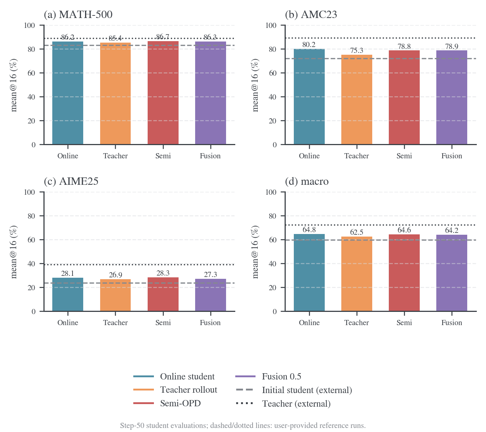
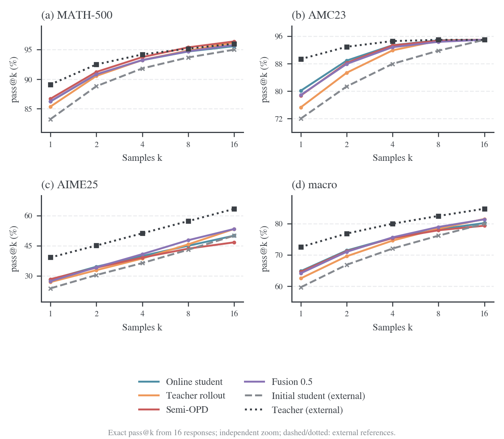
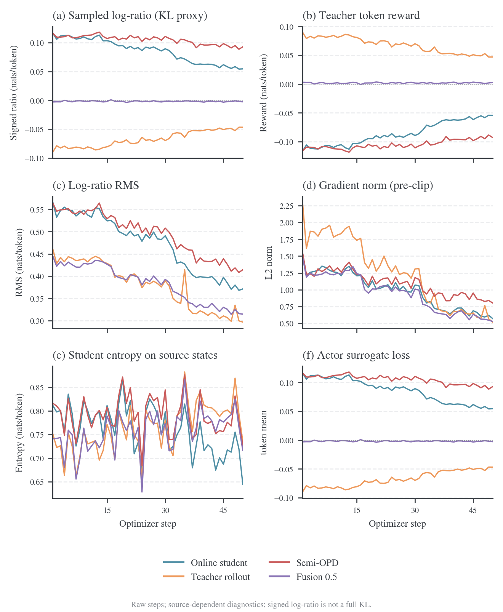
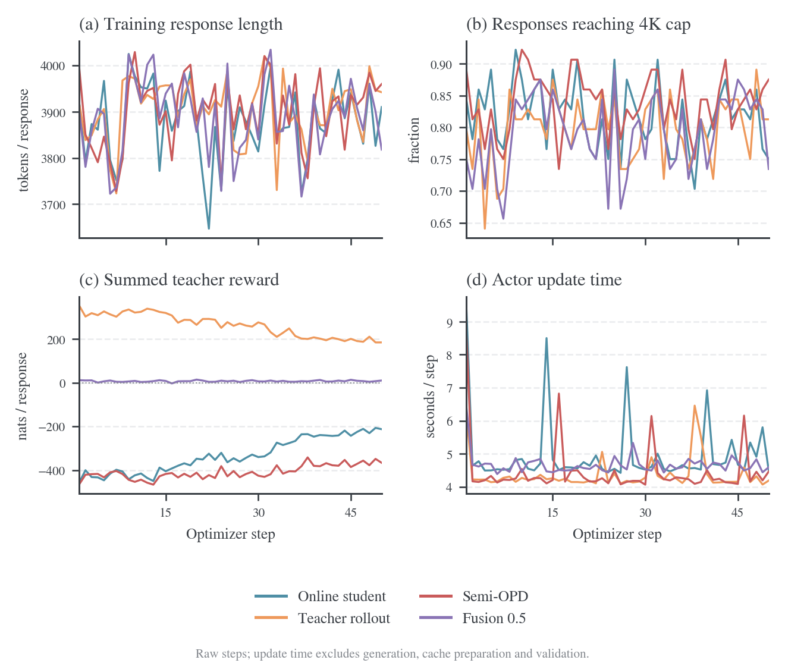
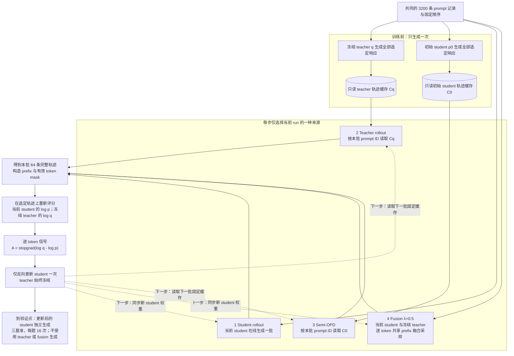
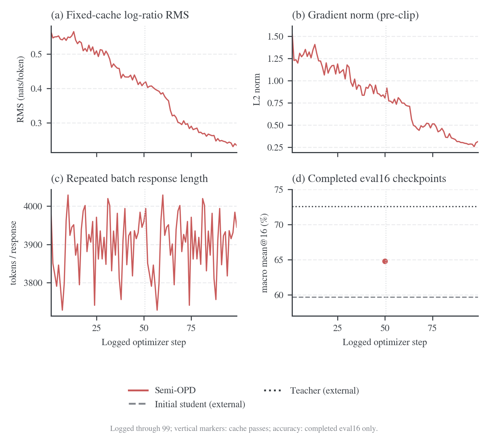
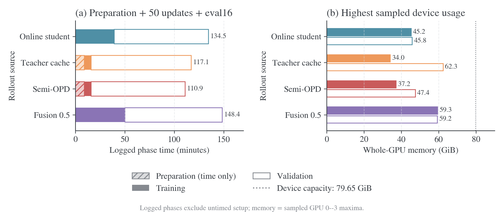
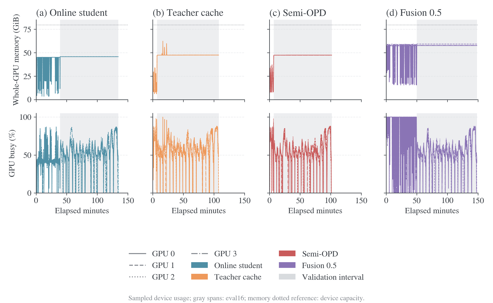
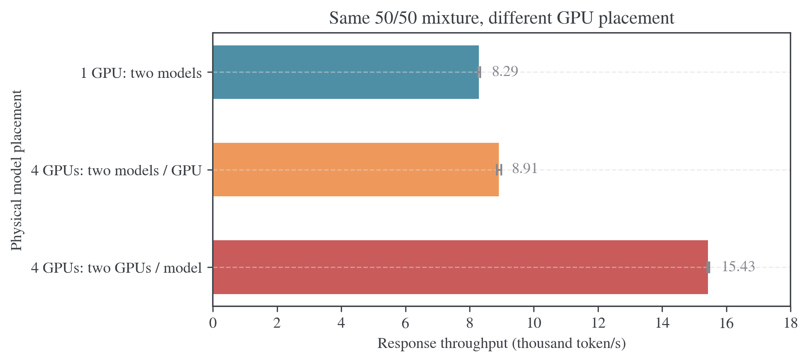

# Rollout 来源与 logit 融合实验

## 进度与主要结果

这是一组统一的 math 蒸馏实验：比较当前 student、固定 teacher、初始 student 缓存三种轨迹来源，再加入共享 prefix 的 logit fusion。四个设置均已完成 50 次 student 更新和最终三基准 eval16，日志、逐题输出与 W&B 指标核对一致。训练、缓存生成和结果处理脚本均随仓保存；正式运行只使用物理 GPU 0–3，不保存模型 checkpoint。

在线 student、teacher 轨迹、Semi-OPD、fusion 的 macro mean@16（三个基准等权平均）分别为 **64.84%、62.52%、64.59%、64.16%**。目前没有证据表明 λ=0.5 fusion 稳定提高平均正确率。四组都只有一个验证预算点，不能据此判断收敛。独立长时 Semi-OPD 已按用户要求于 2026-10-18 14:58（Asia/Shanghai）停止：完成 200 次更新，完整训练日志到第 199 步；第 50/100/150 步的 macro 分别为 **64.80%/66.92%/67.34%**，第 200 步验证中断，没有最终准确率或 checkpoint。训练队列、每小时观察器和 GPU 遥测均已退出，物理 GPU 0–3 已释放；停止状态与指标见[停止归档](results/long-semi-progress/stopped/summary.json)。

用户指定的两个独立评测 run 分别是 `math_teacher`（u87buult）与 `math_student`（6uorrk2k）。[^reference-teacher][^reference-student] API 已核对模型名称、finished 状态、val_only、三个基准、每题 16 个响应及采样和长度配置；它们提供 teacher 与初始 student 的准确率参考。远端原始响应、数据和权重哈希尚未核对，因此图中将其标为外部参考，不视为本地同一次训练的 step-0 测量。筛选后的配置和指标保存在[参考数据](results/reference-accuracy.json)。

## 基准组成、难度与统计粒度

以下题目数和组成来自本地上游缓存，已逐题核对 problem、answer 与实际评测 parquet 完全一致，来源文件哈希保存在[基准元数据](results/state-diagnostics/summary.json)。三组评测都比较最终数学答案，不按推理过程逐步评分。

| 基准     | 实际题数 / 每次验证响应数 | 题目组成                                                    | 难度解释                                                                 |
| -------- | ------------------------- | ----------------------------------------------------------- | ------------------------------------------------------------------------ |
| MATH-500 | 500 / 8,000               | OpenAI 从 MATH 选取的 500 题，覆盖七类数学主题及 level 1–5  | 难度混合的竞赛数学集合；不能当作 500 道同等难度题                        |
| AMC23    | 40 / 640                  | 本地 `knoveleng/AMC-23` 版本，2023 AMC 12A 22 题、12B 18 题 | 高中竞赛数学，含容易题和后段难题；这 40 题是子集，不是两套完整 25 题试卷 |
| AIME25   | 30 / 480                  | `opencompass/AIME2025` 的 2025 AIME I、II，各 15 题         | AMC 高分选手参加的邀请赛，答案为 0–999 整数；竞赛定位比 AMC 更难         |

MATH-500 的来源与抽样关系见数据卡；[^math500] 本地 level 1/2/3/4/5 分别为 43/90/105/128/134 题，level 4–5 合计 262 题（52.4%）。七类主题分别为 Algebra 124、Intermediate Algebra 97、Prealgebra 82、Number Theory 62、Precalculus 56、Geometry 41、Counting & Probability 38。该结构比单一平均分更能说明测试覆盖。

AMC 的原考试为选择题，但当前数据准备使用题面与实际数值答案，不能将成绩解释为选项猜测率。数据卡确认该版本有 40 条记录，[^amc23] 12A/12B 的 22/18 分布由各题来源 URL 核对。AIME 的 I/II 组成由数据文件核对；[^aime25] MAA 对 AIME 的官方介绍也明确其难度高于 AMC 10/12。[^maa-aime]

在当前模型与协议下，teacher 的 MATH-500/AMC23/AIME25 mean@16 为 89.11%/89.38%/39.17%，初始 student 为 83.25%/72.03%/23.75%。AIME25 对两个模型都最难；MATH-500 与 AMC23 的相对顺序依模型变化，不存在对所有模型固定不变的难度排序。

AIME25 一题的 pass@16 改变会使该基准变化 3.33 个百分点，AMC23 为 2.5，MATH-500 为 0.2。每题采样 16 次减少采样噪声，但不会把 30 道 AIME 题变成 480 个独立问题。macro 让三个基准等权，可避免 500 道 MATH 题淹没其他基准，同时也会受到小基准题目波动影响；应同时保留逐题分析与 micro。

### Macro 与 micro 的含义

Macro 是基准之间的等权平均。记 MATH-500、AMC23、AIME25 各自的 mean@16 为 $a_{\mathrm{math}},a_{\mathrm{amc}},a_{\mathrm{aime}}$，则

$$
a_{\mathrm{macro}}=\frac{a_{\mathrm{math}}+a_{\mathrm{amc}}+a_{\mathrm{aime}}}{3}.
$$

每个基准各占三分之一权重，与题目数无关。在线 student 的三项分数约为 86.24%、80.16%、28.12%，macro 约为 64.84%；实际指标用未舍入值计算。macro pass@k 也按同样方式平均三个基准各自的 pass@k。

Micro 是全部题目的等权平均：

$$
a_{\mathrm{micro}}=\frac{500a_{\mathrm{math}}+40a_{\mathrm{amc}}+30a_{\mathrm{aime}}}{570}.
$$

同一在线 student 的 micro 为 82.75%。MATH-500 在 micro 中占约 87.72%，在 macro 中只占 33.33%；AIME25 在 micro 中占约 5.26%。所以较高的 micro 不能解释为三个基准都达到该水平。报告同时保留各基准原分数、macro 和 micro，避免只看一个总分。

## 50 步准确率与 pass@k

下表单位为百分比。前两行是独立模型评测，其余四行均是经过 50 步训练后的 student。macro 对三个基准等权；micro 对全部 570 个题目等权。

| 模型或训练设置               | MATH-500 mean@16 | AMC23 mean@16 | AIME25 mean@16 | macro mean@16 | micro mean@16 |
| ---------------------------- | ---------------: | ------------: | -------------: | ------------: | ------------: |
| 初始 student，外部参考       |            83.25 |         72.03 |          23.75 |         59.68 |         79.33 |
| Teacher，外部参考            |            89.11 |         89.38 |          39.17 |         72.55 |         86.50 |
| 在线 student rollout         |            86.24 |         80.16 |          28.12 |         64.84 |         82.75 |
| Teacher rollout 后的 student |            85.38 |         75.31 |          26.88 |         62.52 |         81.59 |
| Semi-OPD 后的 student        |            86.70 |         78.75 |          28.33 |         64.59 |         83.07 |
| Fusion λ=0.5 后的 student    |            86.28 |         78.91 |          27.29 |         64.16 |         82.65 |



准确率图用点表示实际完成的 step-50 结果，各基准独立缩放纵轴，范围包含全部训练结果和两个参考，不从零起画柱高。没有连接训练前后两点来伪造中间验证曲线。所有训练后 student 的平均正确率高于给定初始 student 参考、低于 teacher 参考；严格的训练增益估计仍需在本地核对同一模型资产和数据，并补充训练 seed。

| 设置         | MATH-500 pass@16 | AMC23 pass@16 | AIME25 pass@16 | macro pass@16 | micro pass@16 |
| ------------ | ---------------: | ------------: | -------------: | ------------: | ------------: |
| 在线 student |            95.60 |         95.00 |          50.00 |         80.20 |         93.16 |
| Teacher 轨迹 |            96.20 |         95.00 |          53.33 |         81.51 |         93.86 |
| Semi-OPD     |            96.40 |         95.00 |          46.67 |         79.36 |         93.68 |
| Fusion λ=0.5 |            95.80 |         95.00 |          53.33 |         81.38 |         93.51 |



pass@k 图也按基准独立缩放，保留全部六条曲线：四个训练后 student、虚线初始 student、点线 teacher。两个外部参考直接使用用户指定 run 的精确 `acc/pass@k`，不以 bootstrap best@k 替代；$k=1$ 使用 mean@16，macro 在三个基准间等权平均。不同面板的纵轴范围不同，不能凭图上斜率或垂直距离跨基准比较效应大小。

Fusion 的 macro mean@16 比在线组低 0.682 个百分点，macro pass@16 高 1.178 个百分点；AIME25 至少一次正确的题数分别为 16/30 与 15/30。平均正确率与多次采样覆盖表达不同性质，不能只选较高的一项宣布整体更好。

四设置共有的 570 个题目以基准名、输入、标准答案构成的内容哈希配对。以下区间以在线组为参考，按基准分层成对 bootstrap 题目，5,000 次、seed 42，单位为百分点。

| 设置减在线 student | macro mean@16 差值 | 95% 题目 bootstrap 区间 |
| ------------------ | -----------------: | ----------------------: |
| Teacher 轨迹       |             -2.319 |        [-4.055, -0.755] |
| Semi-OPD           |             -0.245 |         [-1.829, 1.310] |
| Fusion λ=0.5       |             -0.682 |         [-2.149, 0.681] |

这些区间表示对题目选择的敏感性，不覆盖训练 seed 方差，也未作多重比较校正。teacher 组在当前单 seed 运行的平均正确率较低；Semi 与 fusion 相对在线组的区间都包含零。它们不能证明算法普遍排序或不同渐近平台。完整逐基准差值、未舍入指标和来源哈希见[四设置比较](results/2026-10-18-four-setting-comparison/analysis.json)。

## 训练指标与图的含义



每条线是一个真实训练 run 的 50 个原始步骤，没有平滑，也没有将 batch 波动画成训练 seed 置信带。颜色在所有图中固定对应同一轨迹来源。绘图数据、输入文件哈希、调色板、脚本版本和机器审计保存在 `figures/`。

对有效 token，记当前 student 与冻结 teacher 的对数概率差为

$$
d_{it}=\log p_{\theta_k}(a_{it}\mid s_{it})-\log q(a_{it}\mid s_{it}),\qquad
r_{it}=-d_{it}.
$$

图中的指标采用以下语义。

| 图中指标                    | 日志字段或计算           | 含义与解释限制                                                                                                           |
| --------------------------- | ------------------------ | ------------------------------------------------------------------------------------------------------------------------ |
| Sampled log-ratio，KL proxy | `-opd/token_reward_mean` | 实际来源轨迹上的 $\operatorname{mean}(d)$；缓存和融合的 action 分布不是当前 student，均值可为负，不能当作完整条件 KL     |
| Teacher token reward        | `opd/token_reward_mean`  | 有效 token 平均 $\operatorname{mean}(r)$，来自 teacher 的稠密蒸馏信号，不是答题正确率奖励                                |
| Log-ratio RMS               | `opd/log_ratio_rms`      | $\sqrt{\operatorname{mean}(d^2)}$，避免 signed mean 的正负抵消；不同来源的取样分布不同，不能直接作为共同测度上的对齐排名 |
| Gradient norm               | `actor/grad_norm`        | 裁剪前的全局梯度 L2 范数；阈值为 1，日志可大于 1                                                                         |
| Student entropy             | `actor/entropy`          | student 在该来源 prefix 上的条件熵平均，prefix 集随来源变化                                                              |
| Actor surrogate loss        | `actor/loss`             | 当前 PPO surrogate；单次更新起点与负 token reward 接近，负值不表示 KL 为负                                               |

当前运行没有保存全词表条件 KL。仅对给定 prefix、由当前 student 采样的 action，$\mathbb E_{a\sim p_\theta}[d]$ 才是该 prefix 上的 reverse KL；有限样本均值还存在采样误差。在线更新又对 prefix 采样路径停止梯度，因此该局部解释也不等于完整序列 KL 的全部梯度。图中保留“KL proxy”标识，避免把不同数学量混为一谈。

| 来源         | 第 50 步 loss | 第 50 步 grad_norm | 第 50 步 RMS | 前十步 RMS 均值 | 后十步 RMS 均值 |
| ------------ | ------------: | -----------------: | -----------: | --------------: | --------------: |
| 在线 student |      0.054435 |           0.572402 |     0.371102 |        0.546104 |        0.383639 |
| Teacher 轨迹 |     -0.046815 |           0.519051 |     0.296459 |        0.438914 |        0.309305 |
| Semi-OPD     |      0.092669 |           0.803625 |     0.414405 |        0.547853 |        0.424606 |
| Fusion λ=0.5 |     -0.002646 |           0.529680 |     0.314388 |        0.427681 |        0.324119 |

四组 RMS 的后十步均值低于前十步，但这只描述各自训练轨迹上的残差。Fusion 的 signed mean 接近零，RMS 仍为 0.314；奖励均值接近零不足以支持对齐完成。非零 batch 梯度本身也不能证明期望梯度没有收敛，长时判断需要共同缓存上的多个窗口。



响应长度与触顶比例用于判断 4K 训练预算的影响。`clip_ratio` 表示长度达到 cap，不单独判定该位置是否恰好为自然 EOS。缓存保留 finish reason，但上图使用四组共同记录的长度指标。序列奖励为 token reward 的逐响应求和均值，会受长度影响；actor update time 仅含参数更新阶段，不包含轨迹生成、缓存准备或验证。

### Semi-OPD 固定长度与 batch 波动

Semi-OPD 固定的是每条 prompt 记录的响应 token 序列，其长度 $L_i$ 不随 student 更新变化。图中记录的是当前 batch 的平均值，而不是整份缓存的平均值：

$$
\overline L_k=\frac1{64}\sum_{i\in B_k}L_i.
$$

不同 batch 含不同记录，因此 $\overline L_k$ 可以波动。当前 schedule 有 50 个 batch，长时组不 shuffle，重复同一顺序；重复消费同一批记录时应满足 $\overline L_{k+50}=\overline L_k$。整份初始 student 缓存的平均长度始终为 3,900.651875 token。

已实际读取只读 SQLite 并校验数据库哈希：3,200 条初始 student 响应的长度从 417 到 4,096；50 个 batch 均值从 3,728.21875 到 4,028.828125。第 1 批均值 3,993.6875，第 50 批 3,959.734375；全部 50 步的日志均值都与对应缓存精确一致。早期长时诊断快照覆盖第 1–71 步；停止归档进一步核对了全部 199 条完整日志，第 51–199 步按 50 步周期精确复现首轮对应 batch 的响应长度，缓存命中率始终为 1。波动来自 batch 内容，没有证据显示 Semi 训练时重新生成了响应。

长度核验、每批缓存统计和长时观测保存在[缓存诊断](results/state-diagnostics/summary.json)与同目录 CSV。缓存中的实际 `finish_reason=length` 分别为初始 student 的 2,684/3,200（83.875%）、teacher 的 2,549/3,200（79.65625%）；它们说明当前 4K 预算下大部分轨迹没有自然结束，state 比较须控制深度和截断。

## State 的测量与后续诊断

### 已测量的固定缓存与精确 prefix

自回归 state 是 action 之前的 prefix $s_{it}=(x_i,y_{i,<t})$。Semi-OPD 的响应固定，所以同一记录的全部 token state 也固定；每轮覆盖同一集合，student 在这些 state 上的概率、熵和梯度仍会变化。固定 state 集上的准确率提升属于吸收已有监督的现象，不需要假定每轮访问了新 state。response length、action overlap、state 覆盖和模型对齐分别是不同的量。

以同一 prompt 记录配对初始 student 与 teacher 缓存，令响应长度为 $L_i^S,L_i^T$，共同响应前缀长度为 $c_i$。共享的 action 前 state 数为

$$
I_i=\min(c_i+1,L_i^S,L_i^T),\qquad
J_{\mathrm{paired}}=\frac{\sum_i I_i}{\sum_i(L_i^S+L_i^T-I_i)}.
$$

第一个分歧 action 仍由相同 prefix 出发，因此是 $c_i+1$；不能多算生成结束后的终止位置。该计数已用二元 token 表、长度 1–4 的全部轨迹对与显式 prefix 集合穷举核对。

真实缓存的 3,200 对响应中，没有完全相同的响应；共同前缀中位数为 10 token、均值 16.675625、90 分位为 43，最长 183。配对共享 prefix 位置共 56,562，$J_{\mathrm{paired}}=0.227\%$；初始 student 的 token 位置对应的 state 有约 0.453% 出现在配对 teacher 轨迹上。这是按 prompt 记录条件化的精确文本 prefix 重合，**不是语义 state 覆盖率**，也不代表两组只共享 0.453% 的可迁移知识。

精确 prefix 对字符串分叉非常敏感：一处措辞不同后，后面的完整 prefix 都不同，即使推理意图相似。同一模型独立采样两次也可能很早分叉，因此缺少同来源重复采样对照时，不能将小重合率单独归因于 teacher/student 分布差异。它适合核验固定缓存、是否重复采样和分叉位置，不能作为主要的泛化机制指标。在线 student 与 fusion 的实际配置均为 `rollout_data_dir=None`，没有保留完整训练轨迹；现有验证响应也不能替代训练访问分布来补算这两组的历史覆盖。

### 原生 fresh 轨迹的前缀诊断

`eval/analyze_native_states.py` 复用已有的精确 prefix 计数，将配对身份扩展为 prompt、visit 和 sample，同时核对实际 prompt token 与训练步骤。脚本拒绝不完整 batch、EOS 后继续生成、分段覆盖缺口和不相同的配对集合；保存输入、源码与逐条 CSV 的哈希。每个有效 action 前恰有一个训练 state，EOS 自身的 action 计入，响应结束后的额外 prefix 不计入。来源分层表示选择下一 action 的策略，另报该位置已有响应前缀的平均深度，不把后段 student 的 state 全部归给 student。

[真实轨迹计数验收](results/native-rollout/state-prefix-canary/summary.json)配对完整清单两步 canary 与正式 student_fresh 的前两步，共 128 条响应。两者为不同源码快照下的工程运行，不能当作严格相同训练的独立 seed 对照；这里只核验工具和解释边界。

| 步骤 | 配对响应 | 完全相同的响应 | 平均共同响应前缀 | 配对训练 state 的 pooled Jaccard |
| ---- | -------: | -------------: | ---------------: | -------------------------------: |
| 1    |       64 |             64 |  3,854.828 token |                             100% |
| 2    |       64 |              0 |    161.734 token |                           2.129% |

第一步的全部训练响应逐 token 一致，第二步已经分叉；该结果不能单独确定分叉原因。即使配置使用相同来源模型，精确文本 state 的重合也不能充当分布距离或质量排序。跨访问汇总仍将每个 visit 分开配对计数，不宣称对全部历史 state 去重。完整矩阵后续按同题、同 visit 比较，表示簇覆盖与完整条件 KL 仍属下文独立测量。

```bash
.venv/bin/python eval/analyze_native_states.py \
    --reference runs/native-rollout-implementation/trainer-manifest-long-v1 \
    --candidate runs/native-formal-suite-20261018/student_fresh \
    --steps 2 --output docs/experiment/results/native-rollout/state-prefix-canary
```

### 按来源与深度分层的训练诊断

原生路径新增 `generation_state_metrics=true`，把紧凑的分段来源元数据随 DataProto 行传递；DP 平衡重排、切片和 TensorDict 转换后仍与响应对齐。评分后复用已经计算的当前 student 与 teacher 对数概率，按 action 来源、第一/第二段及绝对响应深度统计下表指标，不增加模型前向。最终验证不携带这项训练元数据，旧缓存路径继续使用原行为。

| 新增日志                                   | 含义                                                                  |
| ------------------------------------------ | --------------------------------------------------------------------- |
| `native_state/*/tokens`                    | 所选分层中的有效训练位置数，包含 EOS 的 action                        |
| `response_prefix_depth_mean`               | 选择该 action 之前已有的响应 token 数均值                             |
| `sampled_log_ratio_mean`、`log_ratio_rms`  | 所选实际 prefix/action 上的 $\log p_\theta-\log q$ 均值与 RMS         |
| `teacher_selected_action_probability_mean` | teacher 对实际 action 的概率均值，既不是 teacher 熵，也不是其最大概率 |
| `student_logp_mean`、`teacher_logp_mean`   | 两模型对实际 action 的对数概率均值                                    |

`action_teacher` 等来源标签描述下一 action 的策略，`segment_1/action_current_student` 对应 student 续写位置，其 state 保留前段的全部 token；fusion 使用独立标签。深度按 0–255、256–1023、1024–2047、2048 至响应上限分层。空分层只记录 token 数，不写 NaN 均值；padding 中的无效值不进入统计。这些 sampled-action 指标仍受 state、action 和长度共同影响，不能替代下面的共同 probe 或表示覆盖。

[CPU 与训练环境验收](results/native-rollout/state-metrics-cpu.json)覆盖十八项运行检查和六十六项原生合约检查。额外 CPU 计量使用真实 B64 轨迹的 246,709 个有效位置、合成对数概率与分段标签，单线程五次均值 0.0569 s；它仅描述统计开销，不是实际 teacher 置信度或 GPU 训练速度。新的真实四卡训练验收尚未完成；已启动的 d59a7c3 正式矩阵没有这项新增诊断，不能追溯补出其逐来源对数概率。

### 建议优先记录的三个 state 指标

我建议把状态供给与状态吸收分开测量，优先记录下列三个互补指标。它们尚未在当前运行上完成，不能与上面的 CPU 缓存结果混称为实测。

| 指标                          | 固定的测量对象                                                | 回答的问题                                                  |
| ----------------------------- | ------------------------------------------------------------- | ----------------------------------------------------------- |
| 表示簇覆盖率与新增簇比例      | 冻结 teacher 的 prefix 隐表示、一次拟合的 PCA/聚类            | 相同采样预算下访问了多大范围，还有多少新状态区域            |
| 访问频率分布与 teacher 的距离 | 同一簇划分上的占用频率，按深度分层                            | 两组是否访问同一批区域但训练权重不同                        |
| 固定 probe 上的完整条件 KL    | 同一批固定 prefix、当前 student 与冻结 teacher 的完整词表分布 | 已经供给的状态是否被 student 吸收，避免状态更换混入对齐曲线 |

One-Shot-OPD 的覆盖分析使用冻结 teacher 最后一层、prefix 最后一个 token 的隐向量，将参考表示经 PCA 后聚为 200 簇，每条轨迹均匀抽取八个位置。[^oneshot-state] 这里可沿用 PCA 50 维、$C=200$ 的起点，并对 $C=50/100/200$ 检查敏感性。编码器、PCA 和簇中心必须固定；每 50 步重新聚类或使用不断变化的 student 编码器，都会让坐标系漂移，无法直接比较覆盖变化。

设 $M$ 个 probe state 的固定簇标签为 $c(s_j)$，归一化访问频率为

$$
\widehat d_\mu(c)=\frac1M\sum_{j=1}^{M}\mathbf1\{c(s_j)=c\},\qquad
\operatorname{Cov}_\mu=\frac1C\sum_{c=1}^C\mathbf1\{\widehat d_\mu(c)>0\}.
$$

覆盖相同也可以有完全不同的权重。用 $m=(\widehat d_\mu+\widehat d_q)/2$，再记录

$$
\operatorname{JSD}(\widehat d_\mu,\widehat d_q)
=\tfrac12D_{\mathrm{KL}}(\widehat d_\mu\Vert m)
+\tfrac12D_{\mathrm{KL}}(\widehat d_q\Vert m),\qquad
N_{\mathrm{eff}}=\exp\!\left(-\sum_c\widehat d_\mu(c)\log\widehat d_\mu(c)\right).
$$

Jensen–Shannon 散度（JSD）衡量访问权重差异，有效簇数 $N_{\mathrm{eff}}$ 区分集中访问少数簇与较均匀访问。零频项按 $0\log0=0$ 处理；这里的 KL 位于离散簇频率空间，与 token 条件分布的 KL 不同。对固定 Semi，在跨轮复用同一组抽样位置时，第一轮之后累计新增簇应为零，但固定 probe 上的 KL 仍可以下降；这可量化继续吸收已有状态监督的过程。零新增本身是固定数据的结果，不证明缓存已充分覆盖目标分布。若每轮随机换位置，观测到的新簇也可能只是首次看见原缓存里未抽中的位置。

固定 prefix 集 $\mathcal P$ 在训练前确定，不随各组 rollout 更新。完整条件 KL 采用共同测度：

$$
K_{\mathrm{probe}}(\theta)=\frac1{|\mathcal P|}\sum_{s\in\mathcal P}\sum_{a\in\mathcal V}
p_\theta(a\mid s)\log\frac{p_\theta(a\mid s)}{q(a\mid s)}.
$$

它使用完整有效词表，当前配对为 151,665 个 token，直接回答共同 prefix 上的对齐程度。可同时记录条件分布 overlap

$$
O_{\mathrm{probe}}(\theta)=\frac1{|\mathcal P|}\sum_{s\in\mathcal P}\sum_a\min\{p_\theta(a\mid s),q(a\mid s)\}.
$$

该 overlap 是 action 分布兼容性，不是 state 覆盖。两者分开后，才能区分“缺少目标 state”与“到达相同 state 后仍未学好目标 action”。若只保存 top-k，必须把结果另命名为截断或聚合诊断，不能继续标成完整词表 KL。

### 最小测量设置与机制辨识

下一轮从每组相同的 128 个训练 prompt、每题一条实际训练轨迹抽取八个有效 response 位置，各组每个时间点共 1,024 个 state；缓存来源的八个位置按固定 seed 一次选定，跨轮复用。参考聚类使用各来源平衡、与测量 prompt 分开的固定训练 prompt 池；不能只在 teacher 轨迹上拟合后把 teacher 高覆盖当作结果，也不使用评测题生成训练诊断样本。固定 KL probe 可从 teacher 与初始 student 轨迹各取一半，共 512 个 prefix，同时分别报告两个来源子集，避免混合平均掩盖差异。另以 teacher–teacher、初始 student–初始 student 独立 rollout 配对校准同来源采样噪声；聚类 JSD 和覆盖差异也须相对这一基线解释。

位置选择要对齐 action 之前的 prefix：第一个 response action 对应 prompt 的最后一个隐藏位置，之后依次取前一个 response token 的位置。除整体结果，还按绝对生成深度及轨迹前/中/后段分层；只看相对位置会混入长度变化，只看总覆盖会被 4K 截断支配。采样预算按 prompt/轨迹等权，另报 token 等权占用，明确归约差异。区间重采样 prompt，不能把同一长轨迹中的上千个相邻 token 当作独立样本。

在 rollout 生成后、teacher 评分前保存选中 prefix 的 token ID、prompt 身份、来源、student 权重版本、原响应长度与位置。冻结 teacher 编码时只提取最后层选中位置，不保存全部层和全部 token 的隐藏向量；固定 KL probe 的 LM head 也只投影选中位置。这样可以复用 teacher 前向并控制存储与显存。正式训练的私有源码快照未加入上述新指标，因此这些指标不会追溯出现在已有运行中。

表示空间聚类仍是代理：邻近隐藏向量未必给共享参数提供同一更新方向。若覆盖相近但收敛速率仍不同，可进一步在小型固定 probe 上比较末层或 LM head 梯度的余弦冲突与有效秩，明确其只代表所选参数子空间。更直接的辨识实验是在相同固定 prefix 上统一 action 为当前 student 采样，或使用完整条件 KL 更新，再与原 action 缓存更新比较；否则更换 rollout 同时改变 state 与 action，无法把准确率差异单独归因于 state。

CPU 诊断复现命令如下，不占用 GPU：

```bash
CUDA_VISIBLE_DEVICES='' ../envs/opd-state/bin/python eval/analyze_cached_states.py \
    --long-run runs/rollout-sources/math-semi-opd-long-800steps-eval16-20261018-092912
```

## 共同设置与数据范围

| 项目           | 正式对照设置                                                                                                        |
| -------------- | ------------------------------------------------------------------------------------------------------------------- |
| 可训练 student | DeepSeek-R1-Distill-Qwen-1.5B，每组从相同初始资产和全新 optimizer 开始                                              |
| 冻结 teacher   | JustRL-DeepSeek-1.5B；生成 teacher 轨迹与训练监督使用同一资产                                                       |
| 设备与环境     | 物理 GPU 0–3，四张 H800 80GB；独立 `envs/opd-state`；Torch 2.7.1+cu126、vLLM 0.10.0+cu126、Transformers 4.57.6      |
| Prompt 数据    | 相邻 `MD-OPD/data/math/DAPO/train.parquet`，17,917 行，prompt cap 过滤后 17,909 行                                  |
| 配对消费顺序   | 原 RLHFDataset、StatefulDataLoader、seed 42 的前 50 batch，共 3,200 条消费记录；不声称是全量去重语料                |
| Batch 与更新   | 每批 64 prompt、每题一条响应；全局 mini-batch 64、每步一个 PPO epoch，micro-batch 只作梯度累积                      |
| 长度与采样     | prompt cap 1,024；训练响应 cap 4,096；temperature 1、top-p 1、top-k 不截断、repetition penalty 1                    |
| 优化           | AdamW，恒定学习率 $10^{-6}$、无 warmup、梯度裁剪 1；有效 response token 的 token-mean                               |
| 蒸馏目标       | `token_reward_direct`，sampled-token 信号，`LOG_PROB_TOP_K=0`；无额外 reference KL 正则或行为重要性修正             |
| 验证           | MATH-500 500 题、AMC23 40 题、AIME25 30 题，每题 16 次，共 9,120 条响应；temperature 0.7、top-p 0.9、cap 31,744     |
| 验证批量       | `data.val_batch_size=32`，共 18 批；不减少每题的 16 次采样                                                          |
| 保存与记录     | 50 步组仅最终验证；长时组每 50 步验证；无训练前验证；`save_freq=-1`、`resume_mode=disable`；W&B project `OPD-State` |

配对 schedule 的 50 个 batch 的 prompt 长度最小值、均值和最大值与原在线 baseline 日志全部匹配。用随仓配置独立重建后，全部索引、prompt token、parquet 和 prompts JSONL 的 SHA-256 都与生产 schedule 一致，见[重建证据](results/2026-10-18-schedule-reproduction.json)。长时 Semi 重复消费同一 3,200 条记录，每 50 步覆盖一轮。

研究来源是 Zhao 等的 _When Do We Need On-Policy Distillation?_[^semi]。该论文的 Semi-OPD 固定初始 student 的轨迹，teacher 来源消融替换轨迹生成方。本实验采用本地已有的 R1-Distill/JustRL 配对、batch 64、4K 训练响应和三基准 eval16，不是该论文 14,116 条去重 DAPO、batch 128、AIME/HMMT avg@32 的严格复现。论文的不同配对还区分思考模式与 4K/16K cap；本地格式化 prompt 去重后 17,255 条，也不等于论文数据。

若后续检验低 overlap 下的来源效应，可准备 Qwen3-1.7B non-thinking 与 Qwen3-4B-Instruct-2507，固定 revision、模板、长度和数据，再增加 seed 42/43/44；这是后续可变选择，尚未执行。当前没有测量该模型配对的 top-64 overlap，不用模型名称替代测量。

## 四种轨迹来源与 student 更新

### 四种流程合图

下图表示四个独立 run 的可选训练路径，每个 run 只选择一种来源，从同一初始 student 权重和全新 optimizer 开始。共用的评分与更新框表示复用同一实现，不把四组轨迹混成一个 batch，也不共享训练后的参数。实线表示轨迹数据与训练顺序，虚线表示下一步的重复入口。



当前正式四组都只在第 50 步验证；长时 Semi 每 50 步验证。缓存组的下一步入口直接返回读缓存，不返回训练前生成节点。在线和 fusion 下一步使用更新后的 student 权重；fusion 采样一个 token 后将同一个 token 送入两模型的 KV cache。

### Semi-OPD 的 state 池如何确定

论文在训练开始前，用初始 student 为全部训练 prompt 各采样一次响应，再把 teacher 在这些响应上的 log-probability 预计算下来；后续更新只重算当前 student 概率。其附录明确为去重后的 14,116 个 prompt、每题一条响应，训练时按与在线 OPD 相同的 prompt 顺序读取。[^semi] 这属于一次性离线准备，不是在训练中维护一个初始 student 持续生成新响应。

原文 §2.2 的公式 (2) 定义固定数据集 $\mathcal D_0=\{(x_i,y_i)\}_{i=1}^{N}$，其中 $y_i\sim p_0(\cdot\mid x_i)$；公式 (3) 在这份数据集上取样更新 student。附录 A 写明每步 128 个 prompt，每题一条响应，约 110 步覆盖一轮。因此“初始 student”限定响应的生成权重，“一次生成”限定每条响应的复用；训练 prompt 池覆盖全部 14,116 题，不由第一个训练 batch 或预设训练步数截断。[^semi]

当前本地实现的来源规则相同，但缓存范围和 teacher 打分实现不同。数据准备先对本地 DAPO 做 prompt 长度过滤，得到 17,909 条记录；按原在线 baseline 的 sampler 和 seed 42 选取前 50 个 batch，共 3,200 条消费记录。它们不是 parquet 文件的前 3,200 行，也没有覆盖全部过滤后的训练 prompt。两个缓存组和两个在线来源组都消费这份相同的 prompt 顺序。

按完整 chat prompt 的内容哈希核验，这 3,200 个源数据行与 prompt ID 均不重复，但只有 3,175 个不同内容：源数据中有 25 个 prompt 各出现两次，分布在不同 batch。50 步只消费每个源数据行一次，PPO epoch 为 1；内容重复来自原数据，不能声称每道题仅训练一次。四组共用同一清单，因此重复情况相同。后续若要求严格每题一次，应在构造配对 schedule 前按内容去重；已完成对照的输入保持归档。重复记录的两个源索引、位置与步数见[逐对清单](results/rollout-cost-audit/duplicate-prompt-pairs.csv)。

Semi 的准备阶段加载未更新的初始 student，对这 3,200 条记录各生成一次响应，遇到 EOS 或 4,096 token 上限停止。缓存按 prompt ID 保存 prompt token、完整 response token 和结束原因。每条响应对应的 state 池是该 prompt 与响应的所有有效前缀；不是只取最开始的一段 token，也不是缓存某个模型的 hidden state。

训练随后从同一初始 student 权重重新开始。每步读取 64 个 prompt ID 对应的固定响应，在同一批 prefix/action 上重新计算当前 student 和冻结 teacher 的 log-probability，再只更新 student。当前版本仅缓存 token，teacher 分数每步重算；论文预缓存 teacher 分数的效率优化尚未实现。训练期间不调用初始 student 生成，不因当前 student 改变而替换缓存，cache miss 直接失败。

首轮 50 步读完全部 3,200 条记录；长时组再从同一固定顺序的第一批开始。因此同一记录的 state 不变、同一 batch 的长度应每 50 步复现，但 student 在这些固定 state 上的概率和梯度会随更新变化。当前实现的数据选择、生成和读取位置分别是 `data/prep/build_rollout_cache.py` 的 `schedule`/`cache`、`recipe/math_cached.sh` 与 `verl/verl/trainer/ppo/fixed_rollout.py`。

当前长时组验证的是 3,200 条有限轨迹上的持续拟合；它不能替代全量训练 prompt 的 Semi-OPD 实验。若比较更长预算，在线组也必须使用同一 prompt 池和顺序，避免同时改变轨迹来源与题目覆盖。全量缓存的大小应由明确的数据清洗与 prompt 清单决定，再独立设置训练步数；不能把最初配对 50 步的缓存大小当作论文要求。

### 更新公式与来源差异

所有设置只更新 student，teacher 始终冻结并处于 eval/no_grad 模式。Teacher rollout 意味着 teacher 生成响应，student 接受训练；最终验证仍由 student 独立生成。各组的生成方和生成时机如下。

| 设置            | 行为分布                                                                    | 生成时机               | 参数更新方 |
| --------------- | --------------------------------------------------------------------------- | ---------------------- | ---------- |
| Student rollout | 当前 student $p_{\theta_k}$                                                 | 每次更新前在线生成     | student    |
| Teacher rollout | 固定 teacher $q$                                                            | 训练前预生成一次并缓存 | student    |
| Semi-OPD        | 初始 student $p_0$                                                          | 训练前预生成一次并缓存 | student    |
| Logit fusion    | 当前 student 与固定 teacher 的共享 prefix 融合策略 $\mu_{\theta_k,\lambda}$ | 每次更新前在线生成     | student    |

Teacher rollout 的在线重新采样变体尚未运行。重复使用有限缓存与持续生成新 teacher 响应的差异需要单独验证。Semi-OPD 在这里始终指初始 student 一次性生成缓存，不是单条轨迹前段 student、后段 teacher。

令第 $k$ 步更新前的 student 为 $p_{\bar\theta}$，$\bar\theta=\theta_{k-1}$，teacher 为 $q$。对 prefix $s_{it}=(x_i,y_{i,<t})$、实际 action $a_{it}$ 和有效 token mask $m_{it}$，每步重新计算

$$
\ell^S_{it}=\log p_{\bar\theta}(a_{it}\mid s_{it}),\qquad
\ell^T_{it}=\log q(a_{it}\mid s_{it}),\qquad
A_{it}=\operatorname{stopgrad}(\ell^T_{it}-\ell^S_{it}).
$$

EOS 属于有效响应，padding 不参与 loss。一次完整 optimizer update 在更新起点的局部梯度对应

$$
\mathcal L_k(\theta)=-\frac{1}{N_k}\sum_{i,t}m_{it}A_{it}\log p_\theta(a_{it}\mid s_{it}),\qquad
N_k=\sum_{i,t}m_{it}.
$$

实现复用 PPO clipped surrogate，比率分母是本步重算的当前 student 锚点 $p_{\bar\theta}$。单个全局 mini-batch、单 PPO epoch 的更新起点比率为 1，对应上述局部梯度；若增加 epoch 或拆分多个 optimizer mini-batch，需重新核对 clipping 和 dual-clip 的影响，不能继续假定相同。

```pseudocode
\begin{algorithm}
\caption{统一轨迹来源蒸馏\\{\small\textit{Semantics: 根据正文重构}}}
\begin{algorithmic}
\INPUT initial student $p_0$; frozen teacher $q$; ordered prompt batches $X_1,\ldots,X_K$; source $\mu$; response cap $H$
\OUTPUT updated student $p_{\theta_K}$
\IF{$\mu\in\{q,p_0\}$}
    \STATE independently sample and cache one response per scheduled record from frozen $\mu$, stopping at EOS or $H$
    \STATE store token IDs, source identity and finish reason; reject missing or mismatched records
\ENDIF
\STATE $\theta_0\gets\theta(p_0)$
\FOR{$k=1$ \TO $K$}
    \STATE $\bar\theta\gets\theta_{k-1}$
    \IF{$\mu\in\{q,p_0\}$}
        \STATE read the fixed responses for $X_k$; never fill a cache miss by online generation
    \ELSE
        \STATE synchronize the student inference replica to $\bar\theta$
        \STATE independently sample one response per prompt from current student or shared-prefix fusion, stopping at EOS or $H$
    \ENDIF
    \STATE construct valid response masks including EOS and excluding padding; reject an empty valid-token batch
    \STATE recompute current $\ell^S_{it}$ and frozen-teacher $\ell^T_{it}$ on these exact trajectories
    \STATE $A_{it}\gets\operatorname{stopgrad}(\ell^T_{it}-\ell^S_{it})$
    \STATE update only student parameters once with the current-student PPO anchor, producing $\theta_k$
    \IF{$k$ is a validation step}
        \STATE synchronize the updated student and evaluate student-only responses on all three benchmarks
    \ENDIF
\ENDFOR
\RETURN $p_{\theta_K}$
\end{algorithmic}
\end{algorithm}
```

该伪代码概括来源选择和更新顺序；当前缓存版本只保存轨迹，teacher 的 token 分数在每步重算，没有保存 teacher log-probability 或旧 student 概率。缓存 miss 或协议不符直接失败，不改用在线采样。论文预缓存 teacher 分数的效率收益没有包含在当前实现中。

固定来源同时改变 prefix 与 action。设固定缓存 token 测度为 $\nu_\mu(s,a)$，其权重与 $\theta$ 无关，teacher 也固定。在更新起点，未作行为重要性修正的梯度为

$$
g_\mu(\theta)=\mathbb E_{(s,a)\sim\nu_\mu}\left[(\log p_\theta(a\mid s)-\log q(a\mid s))\nabla_\theta\log p_\theta(a\mid s)\right].
$$

记 $d_\theta=\log p_\theta-\log q$，则固定测度下的平方残差满足

$$
\begin{aligned}
F_\mu(\theta)&=\frac12\sum_{s,a}\nu_\mu(s,a)d_\theta(s,a)^2,\\
\nabla_\theta F_\mu(\theta)
&=\frac12\sum_{s,a}\nu_\mu(s,a)\,2d_\theta(s,a)\nabla_\theta d_\theta(s,a)\\
&=\sum_{s,a}\nu_\mu(s,a)d_\theta(s,a)\left(\nabla_\theta\log p_\theta(a\mid s)-0\right)\\
&=g_\mu(\theta).
\end{aligned}
$$

这里的等式依赖固定缓存测度与冻结 teacher；在线 student 或 fusion 的行为分布随更新变化，不能直接将整段训练解释为同一个固定 $F_\mu$ 的下降。来源差异同时包含 prefix、action、长度和内容差异，末步正确率不能单独识别 prefix 访问测度的因果作用；相关推导见[访问测度研究](../research/occupancy/2026-10-17-OPD访问测度与收敛机制研究.md)。

Fusion 每个 token 都在同一 prefix 上计算

$$
\mu_{\theta,\lambda}(a\mid s)=\operatorname{softmax}\!\left(\frac{(1-\lambda)z_{p_\theta}(s)+\lambda z_q(s)}{T}\right)_a,\qquad \lambda=0.5,\quad T=1.
$$

每次只从融合分布采样一个 token，再将同一个 token 送入两个模型各自的 KV cache。两个模型不能各自生成后拼接。teacher 固定，student 推理副本随 actor 完整权重流更新；第 $k$ 步生成版本必须为 $k-1$，不完整或过期权重拒绝生成。融合策略的 log-probability 只作诊断，不用作 PPO old-log-probability 或重要性权重；监督仍来自原始 $q$。

## 评测计算与收敛条件

某题 $n=16$ 个响应中 $c$ 个正确，题内 mean@16 为 $c/16$，再在题目间平均。标准无放回 pass@k 为

$$
\widehat{\operatorname{pass@k}}=1-\frac{\binom{n-c}{k}}{\binom{n}{k}},\qquad k\in\{1,2,4,8,16\}.
$$

当 $n-c<k$ 时分子为零。pass@1 等于 mean@16；pass@16 是 16 个响应中是否至少一个正确。原生 veRL 的 bootstrap best@k 使用有放回采样，语义不同；例如恰好一个正确时，标准 pass@16 为 1，有放回 best@16 的期望为 $1-(15/16)^{16}$。原生 mean/std/best/worst/maj 保留，额外输出精确 pass@k，不相互改名。

验证必须包含三个完整基准、570 个不同题目和每题恰好 16 次二值评分。采集器从原始 JSONL 独立重算，与日志和 W&B 全部精确指标逐项核对，保存逐题 CSV 哈希及内容身份。CSV 固定 LF，避免 Git 换行归一化改变校验值。

长时 Semi-OPD 运行名为 `math-semi-opd-long-800steps-eval16-20261018-092912`，W&B 为 uq1riryx。[^long-run] 其[启动配置证据](results/2026-10-18-semi-long-startup.json)确认完整 eval16、test_freq=50、16 个 epoch、最大 800 步、恒定学习率、无 warmup 和无 checkpoint。实际在第 200 次更新后按用户要求停止，3,200 条缓存轨迹已消费四轮；800 步是配置上限。训练器先完成 actor 更新，再验证，验证完成后才记录该步指标；日志已明确进入第 200 步验证，因此完成更新数为 200，完整训练指标只有第 1–199 步。第 200 步没有验证响应文件，不能算成完整评测或最终成绩。

第 50、100、150 步各包含 570 题、9,120 条响应，均已从原始 JSONL 独立重算，全部精确指标与训练日志、W&B 对应 history 行一致，见[完整阶段归档](results/long-semi-progress/step-150/summary.json)与[远端核验](results/long-semi-progress/step-150/wandb-snapshot-verification.json)。下表单位为百分比，三次评测均只使用当时的 student。

| 更新步 | MATH-500 mean@16 | AMC23 mean@16 | AIME25 mean@16 | macro mean@16 | micro mean@16 | macro pass@16 |
| ------ | ---------------: | ------------: | -------------: | ------------: | ------------: | ------------: |
| 50     |          86.3875 |       80.3125 |        27.7083 |       64.8028 |       82.8728 |       82.4889 |
| 100    |          86.0250 |       82.6563 |        32.0833 |       66.9215 |       82.9496 |       84.3000 |
| 150    |          85.1000 |       83.5938 |        33.3333 |       67.3424 |       82.2697 |       83.4556 |

第 150 步相比第 50 步，macro mean@16 增加 2.5396 个百分点，micro 降低 0.6031 个百分点：AMC23、AIME25 的 mean@16 上升，MATH-500 下降。macro pass@16 也没有逐次上升。三个验证点支持记录这些方向差异，不能据此宣布所有基准持续改善或已经收敛。停止原因是用户终止，不是平台判据命中或训练预算耗尽；最近的[平台记录](results/long-semi-progress/stopped/plateau-at-step150.json)仍为 `insufficient_observation`。



图中训练观测到第 199 步，准确率只画完整的第 50、100、150 步。按每轮相同的前 49 个 batch 配对，第 1–49/51–99/101–149/151–199 步的 token 加权 log-ratio RMS 为 0.49846/0.31001/0.20287/0.15866，平均裁剪前 grad_norm 为 1.10335/0.49712/0.20530/0.13734；后三轮各自 49/49 批的 RMS 均低于首轮对应批，响应长度逐批精确相同。这支持 student 持续拟合固定轨迹上的监督，不等于全词表 KL 已归零。[绘图审计](figures/long/audit.json)记录日志字节前缀、数据与程序哈希及配对统计，全部 199 步的奖励、熵、梯度与阶段耗时保存在[训练 CSV](results/long-semi-progress/stopped/training-1-199.csv)。

训练时间与验证时间分别统计如下，单位为分钟；第 151–199 步只有 49 条完整记录。训练器的 `timing_s/step` 不包含另行计时的 `timing_s/testing`，表中可相加；初始化、缓存准备、第 200 步更新与中断验证、清理均不在这些日志合计中。

| 已记录训练步 | 缓存读取、评分与更新等训练时间 | 该窗口末完整验证时间 |
| ------------ | -----------------------------: | -------------------: |
| 1–50         |                           6.82 |                98.51 |
| 51–100       |                           7.51 |                97.04 |
| 101–150      |                           7.47 |               100.94 |
| 151–199      |                           7.23 |                    — |
| 合计         |                          29.03 |               296.49 |

完整验证占上述训练与验证合计的 91.08%。GPU 0 在部分验证期间还承载了独立生成原型测试，其[共享负载时间记录](results/rollout-composition/shared-load-intervals.json)已保存；这里报告实际运行成本，不把整卡峰值或验证速度解释为独占环境性能。停止核验确认原训练进程及其专属子进程全部退出，GPU 0–3 各剩 1 MiB 占用。W&B 第 1–198 步的 loss/grad_norm 与本地逐项相同，第 199 步已保存在本地但没有远端 history 行；远端标记为 `failed` 表示用户中断，没有标成成功完成，见[停止核验](results/long-semi-progress/stopped/wandb-stop-verification.json)。

经验平台判据在长时结果产生前固定：至少 300 步，最后四个连续、间隔 50 步的验证点，macro mean@16 极差不超过 0.01；对应四个训练窗口的 token 加权 RMS 相对极差不超过 5%，平均 grad_norm 相对极差不超过 10%。相对极差为最大值减最小值后除以均值，分母下限 $10^{-12}$。

第 $b$ 批有效 token 数 $N_b$、RMS $r_b$ 的窗口合并值为

$$
r_{\mathrm{window}}=\sqrt{\frac{\sum_b N_b r_b^2}{\sum_b N_b}}.
$$

batch 均为 64，使用平均响应长度作权重与 $N_b$ 等价。训练器和事后分析共用 `plateau.py`：观察不足为 `insufficient_observation`，达到条件为 `observed_plateau`，其余为 `criterion_not_met`。预设控制规则是在达到条件后于验证结束时正常退出，800 步仍不满足则记录 `budget_exhausted=true`；此次用户停止发生在上述两种退出之前。该判据是有限预算经验平台，不证明梯度为零、已与 teacher 对齐或渐近收敛。

## 实现核验与性能

| 实现层             | 已核验的行为与证据                                                                                                                      |
| ------------------ | --------------------------------------------------------------------------------------------------------------------------------------- |
| 固定缓存           | SQLite 只读完整性、模型完整文件签名、tokenizer/模板、prompt ID/内容、响应 cap/EOS 与配对数据哈希；miss 拒绝；50 步全命中                |
| 当前 student 更新  | 缓存不含 old_log_probs，当前 actor 每步重算；teacher requires_grad=False、eval/no_grad；验证前同步最终 student                          |
| CPU 与维护         | 12 项原生 CPU 测试覆盖融合端点、共享 prefix、EOS、padding、缓存重置、teacher 冻结和版本；43 项维护测试涵盖指标、缓存、RPC 与平台控制    |
| Fusion 数值        | 同 FlashAttention KV 内核 graph/eager logits 最大差为零；静态/动态 FP32 最大 logits 差 $4.96\times10^{-5}$、分布 TV $2.27\times10^{-6}$ |
| Attention 独立核验 | 含左 padding、GQA、prefill/decode 的原始 Q/K/V 对 FP32 数学内核，相对 L2 误差 0.00159–0.00199，阈值 0.005                               |
| 权重流与训练桥接   | GPU 版本 0→1→2 原地更新、改变 lm_head 后输出变化、恢复后还原、teacher 探针不变；完整两步训练和 96 条短验证通过                          |
| 正式 Fusion        | 50 步版本严格为 0–49、λ=0.5、loss/梯度/行为 log-probability 有限；12,436,547 个有效响应 token 与四 worker mask 计数对应                 |

数值与训练证据见 [FP32 检查](results/2026-10-18-fusion-gpu-fp32.json)、[独占 GPU 基准](results/2026-10-18-fusion-gpu-isolated.json)、[两步训练](results/2026-10-18-fusion-two-step-smoke.json)和[Fusion 不变量](results/2026-10-18-math-fusion-lambda05-50steps-eval16-20261018-065746/fusion-invariants.json)。两步调试使用训练 cap 64、验证 cap 128，六题各 16 次，只验证集成，不计为任务成绩。

跨 BF16 attention 内核存在多层舍入差异：batch 1/8/16 的最大分布 TV 约 0.029–0.0314，最大 logits 差不超过 0.375。最初 TV 0.01 阈值未通过；完成 FP32 mask 和独立 attention 核验后，跨 BF16 阈值设为 TV 0.05、logits 差 0.5，同内核 graph/eager 阈值保持 $10^{-5}$。该验收不保证跨后端逐 token 相同。Fusion 使用 Hugging Face 双模型解码，其他来源使用原生 vLLM，因此实验比较包含后端实现差异，不能单独识别完全相同内核下的 λ 效应。

生产后端 `cuda_graph_flash` 以两个独立 StaticCache 保留 KV，用物理有效长度与左 padding 约束注意力，并保留 GQA，避免复制 KV。prefill 使用 eager，单 token 双模型 decode 捕获 CUDA Graph。当前限 full-attention、同 dtype、固定 default RoPE、CUDA BF16/FP16、单 GPU 推理副本、单轮纯文本、每题一个 rollout、全参数 actor；LoRA、FP8、TP/PP>1 和多模态拒绝启用。

独占 H800、固定 KV 容量 5,120、生成 128 个新 token 的热调用微基准如下。它比较两种双模型实现，不代表完整 4K 训练相对原生 vLLM 的加速。

| Batch | DynamicCache eager，token/s | CUDA Graph + FlashAttention KV，token/s | 加速比 | 图路径峰值分配显存，GiB |
| ----: | --------------------------: | --------------------------------------: | -----: | ----------------------: |
|     1 |                       36.69 |                                  119.78 |   3.26 |                    7.03 |
|     8 |                      219.06 |                                  872.09 |   3.98 |                    9.10 |
|    16 |                      445.93 |                                1,663.44 |   3.73 |                   11.46 |

## 显存、速度与运行设置

四组依次使用物理 GPU 0–3，没有同时占卡。历史采样中，在线 student、teacher 轨迹、Semi-OPD、Fusion 的最高整卡占用分别为 **45.77、62.32、47.43、59.30 GiB**，都低于每卡约 **79.65 GiB** 的可见容量。在线吞吐低的直接配置差别是每步全局只有 64 条请求，分到四卡平均约 16 条；离线固定来源可以每卡一次生成 64 条。现有证据不支持“在线更新权重常驻 GPU，显存不足迫使并发降到 16”这一解释。

### 四组实际设置

共同训练条件为四张 H800 80GB、student 为 R1-Distill-Qwen-1.5B、teacher 为 JustRL-DeepSeek-1.5B；全局 batch 64、每记录一条响应、PPO epoch 1、50 次更新，学习率 $10^{-6}$ 恒定、无 warmup。训练 prompt/response cap 为 1,024/4,096，采样温度与 top-p 均为 1。验证统一为三基准 570 题、每题 16 次，温度 0.7、top-p 0.9、响应 cap 31,744；只在末步验证，不保存 checkpoint。数据范围与重复题目见[共同设置与数据范围](#共同设置与数据范围)及[缓存来源](#semi-opd-的-state-池如何确定)。

| 设置                          | 在线 student               | Teacher 轨迹       | Semi-OPD           | Fusion λ=0.5                             |
| ----------------------------- | -------------------------- | ------------------ | ------------------ | ---------------------------------------- |
| 训练响应来源                  | 每步当前 student           | 训练前冻结 teacher | 训练前初始 student | 每步当前 student 与 teacher 融合         |
| 生成后端                      | vLLM 0.10.0                | 离线 vLLM 0.10.0   | 离线 vLLM 0.10.0   | HF 双模型、CUDA Graph、FlashAttention KV |
| 每次提交量                    | 全局 64                    | 每卡 64，共 256    | 每卡 64，共 256    | 全局 64                                  |
| 每卡生成请求                  | 平均约 16                  | 64，末批 32        | 64，末批 32        | 16                                       |
| 推理并行                      | 四个单卡副本，TP/DP/PP=1   | 同左               | 同左               | 四个单卡双模型副本                       |
| 生成时的 log-probability      | vLLM 返回已采样 token 分数 | 不请求             | 不请求             | 记录融合行为分数                         |
| 生成引擎长度上限              | 32,768                     | 5,120              | 5,120              | 双 StaticCache 容量 5,120                |
| vLLM `max_num_seqs`           | 64                         | 64                 | 64                 | 原生验证引擎为 64；HF 训练不使用此调度器 |
| vLLM `max_num_batched_tokens` | 32,768                     | 8,192              | 8,192              | 原生验证引擎为 32,768                    |
| vLLM `gpu_memory_utilization` | 0.55                       | 离线生成 0.65      | 离线生成 0.65      | 原生验证引擎为 0.55；不是 HF 总显存限制  |
| 原生 vLLM eager 模式          | 开启                       | 开启               | 开启               | 验证开启；HF decode 使用 CUDA Graph      |
| 训练时的 teacher 评分         | 每步计算                   | 每步计算           | 每步计算           | 每步计算                                 |

四组 actor 均使用 FSDP 混合精度，actor 参数和 optimizer 状态开启 CPU offload；teacher 参数也开启 CPU offload。actor 每 GPU 动态 token 预算 8,192，teacher 每 GPU micro-batch 为 1。缓存组在训练阶段只读响应，不调用上述离线生成引擎；它们仍创建原生 vLLM，用于最终的当前 student 验证。Fusion 的验证也由当前 student 单独完成。

实际配置从每个 run 的打印配置与冻结源码读取，保存在[资源图审计](figures/resources/audit.json)的 `runtime_settings`。`max_model_len=32768` 允许长验证，不代表每条 4K 训练响应都占用 32K 有效 KV；`max_num_seqs=64` 是引擎上限，也不代表每卡实际收到 64 条请求。

### 速度与显存总表

时间单位为分钟，显存单位为 GiB。整卡数值为 GPU 0–3 中的最高采样，覆盖训练与验证，不包含未记录的离线生成显存。总时间是已计时阶段之和，尚未覆盖每个启动和初始化环节。

| 设置         | 缓存准备 | 50 步训练 | 完整验证 | 三者合计 | 训练期整卡最高采样 | 验证期整卡最高采样 | 最高占容量比例 |
| ------------ | -------: | --------: | -------: | -------: | -----------------: | -----------------: | -------------: |
| 在线 student |   不适用 |     39.14 |    95.39 |   134.53 |              45.17 |              45.77 |         57.47% |
| Teacher 轨迹 |     9.09 |      6.83 |   101.14 |   117.06 |              34.02 |              62.32 |         78.25% |
| Semi-OPD     |     8.96 |      6.84 |    95.14 |   110.93 |              37.15 |              47.43 |         59.55% |
| Fusion λ=0.5 |   不适用 |     49.98 |    98.46 |   148.44 |              59.30 |              59.21 |         74.45% |



左图堆叠准备、训练与验证时间；右图分别画训练和验证的最高采样，虚线为设备可见容量。Teacher/Semi 的历史离线生成没有整卡显存记录，右图没有把这一缺失值填成零。约 95–101 分钟的完整验证是各组最大的独立阶段；在线对 Semi 的比值在仅训练循环中为 5.73，计入缓存准备为 2.48，再计入末次验证为 1.21。这三个比值回答不同范围的成本问题。

| 设置         | 生成或准备阶段吞吐，响应 token/s | 50 步训练循环吞吐，响应 token/s | Actor 分配高水位 | Actor 保留高水位 | 训练期 GPU busy 均值 | 验证期 GPU busy 均值 |
| ------------ | -------------------------------: | ------------------------------: | ---------------: | ---------------: | -------------------: | -------------------: |
| 在线 student |                            6,943 |                           5,283 |            15.59 |            20.90 |               42.69% |               51.45% |
| Teacher 轨迹 |                           22,907 |                          30,501 |            15.61 |            37.18 |               67.25% |               56.37% |
| Semi-OPD     |                           23,223 |                          30,432 |            15.62 |            37.46 |               66.00% |               52.69% |
| Fusion λ=0.5 |                            5,075 |                           4,147 |            15.59 |            20.88 |               83.82% |               53.01% |

吞吐均为四卡合计。缓存组第一列使用完整离线准备时间作分母，在线与 Fusion 使用训练中的生成阶段时间；两者包含的附加工作不同。第二列以实际响应 token 数除以 50 步训练时间，缓存组已经省去了循环内生成，不能将其约 30K token/s 当作解码速度。Actor 两列为各 rank 自报的 PyTorch allocator 历史高水位再取最大值，不含独立 teacher/vLLM 进程的全部开销；它们不能与整卡最高采样相加。

GPU busy 均值先按每张卡在对应阶段的有效采样求算术平均，再对四卡等权平均。它衡量采样窗口内至少一个 kernel 正在执行的时间比例，不等于 SM occupancy、峰值 FLOPs 利用率或显存容量占用。[^nvml-util] 在线训练期的均值也包含评分、反向、CPU offload 与同步，不能当作纯生成阶段的利用率。

### 时间的具体组成

下表为 50 步累计秒数。Teacher 评分嵌套在优势计算 `adv` 内，已扣除重复项；最终验证在训练 `step` 计时块之外。

| 阶段                   | 在线 student | Teacher 轨迹 | Semi-OPD | Fusion λ=0.5 |
| ---------------------- | -----------: | -----------: | -------: | -----------: |
| 训练前缓存准备         |       不适用 |       545.42 |   537.48 |       不适用 |
| 训练中生成或读取缓存   |     1,787.12 |         3.32 |     3.46 |     2,450.59 |
| 当前 student 评分      |        99.26 |        85.51 |    81.92 |       102.30 |
| 冻结 teacher 评分      |        99.77 |        96.70 |    95.89 |        98.81 |
| 优势计算，扣除 teacher |         0.19 |         0.03 |     0.03 |         0.03 |
| Actor 更新             |       247.80 |       218.13 |   222.86 |       233.66 |
| 权重同步与恢复         |       114.17 |         5.59 |     5.65 |       113.25 |
| 其余训练开销           |         0.40 |         0.34 |     0.36 |         0.36 |
| 训练循环合计，不含准备 |     2,348.70 |       409.61 |   410.17 |     2,999.00 |

在线生成阶段包含请求分发、生成、评分返回、整理与 vLLM sleep；`update_weights` 包含 actor 到 rollout 的权重传输与恢复 KV。引擎在训练前创建，在线 `load_format=dummy`，随后接收 actor 参数；循环没有每步从磁盘读取 checkpoint、重建引擎。缓存组只在末次验证前同步一次，在线与 Fusion 每步都同步。

在线逐步最慢生成请求的延迟累计 1,723.94 秒，占生成阶段的 96.47%；按生成加评分的最慢请求链计为 1,754.49 秒，其外残差为 32.63 秒。请求延迟仍包含路由、排队、prefill/decode、生成 log-probability 与返回，不能把 1,723.94 秒全当作 GPU kernel 时间，也不能再与嵌套的 1,787.12 秒相加。

缓存准备的 537.48 秒从四个生成子进程启动前计起，包含子进程导入、vLLM 构造与加载、生成、shard 汇总、SQLite 写入和模型签名计算；较早的父进程 tokenizer 与 schedule 检查不在其中。因此它既不是纯 decode 时间，也不是整个命令的完整墙钟时间。原始阶段表与互斥求和核验见[资源汇总](results/resources/summary.json)。

### 在线与离线吞吐差异的来源

首轮两组都生成 3,200 条响应：在线为 12,407,645 个响应 token，初始 student 离线为 12,482,086，离线反而多约 0.60%。首轮没有靠重放缓存减少生成次数。离线每卡 800 条响应，以 64 条为一批，形成 12 个满批和一个 32 条末批；在线有 50 个全局 batch，分四卡后平均约 16 条/卡。实际离线 13 批和在线 50 批都存在达到 4,096 token 的响应。

固定生成权重允许离线把多个训练 batch 的题目集中送入引擎；当前 student 每步更新，使在线必须先完成当前批再生成下一批。在相近的最长解码链下，一次处理更多序列可以提高整体 token/s。增加 vLLM 显存预算并不会凭空增加在线已有的 64 条全局请求；即使引擎允许更多并发，每卡平均可用量仍约为 16。

| 因素                 | 已核验事实                                                             | 对吞吐差异的判断                                                 |
| -------------------- | ---------------------------------------------------------------------- | ---------------------------------------------------------------- |
| 实际生成批量         | 在线平均约 16/卡，离线 64/卡；50 批对 13 批                            | 明确的结构差异，与整段吞吐差距一致；独立贡献尚未受控测量         |
| 更新权重的 GPU 驻留  | actor 参数与 optimizer 开启 CPU offload；权重同步后 actor 参数移回 CPU | 不支持“更新权重持续占满显存，迫使并发降到 16”的解释              |
| 切换与同步           | 在线累计 114.17 秒，Semi 5.65 秒                                       | 有实际成本，但不足以解释生成阶段约 20.8 分钟差额                 |
| 生成 log-probability | 在线请求 `logprobs=0`，离线为 `None`                                   | 在线多做工作；其独立耗时尚未测量                                 |
| vLLM 预算与路径      | 在线 0.55、离线 0.65；模型/调度长度与服务路径也不同                    | 配置确有差异；缺少同配置测速和历史离线显存，不能断言实际内存瓶颈 |
| 响应长度与次数       | 响应数相同，离线 token 多约 0.60%                                      | 不能解释离线更快                                                 |

训练引擎与生成引擎共享 GPU，确实需要为不同阶段的激活、梯度、权重传输和 workspace 留余量。但当前 actor 参数与 optimizer 状态可卸载，teacher 参数也可卸载；生成结束后 vLLM sleep，训练后再恢复生成。当前主要可见限制是请求批量与阶段执行方式，尚无证据证明 GPU 容量耗尽限制了在线生成。

四组都会更新 student，并保有当前参数和 optimizer 状态；离线轨迹没有免去这些训练状态。在线特有的工作是每步将当前参数同步给生成副本。参数更新改变数值，不改变参数数量；仅凭模型持续更新，不能推断它持续挤占越来越多的生成显存。

计入准备后的净差为 1,401.05 秒：生成/准备与读缓存的差占 1,246.18 秒（88.95%），同步差占 108.52 秒，其余评分、更新等占 46.35 秒。这是时间位置的分解，不是各配置因素的因果贡献。要识别 batch、log-probability 与引擎预算的贡献，应固定同一 checkpoint、prompt/token 工作量和 GPU 数，逐项切换每卡 batch 16/64、log-probability 与 0.55/0.65 预算；该受控 GPU 对照尚未运行。

若固定同一 checkpoint、实际每卡 batch、输入和输出长度分布、采样与 log-probability、vLLM 后端及执行路径，并保持相同硬件负载，纯 rollout 的算子工作相同，吞吐应接近。只统一 YAML 的上限不足以满足这些条件：两组 `max_num_seqs` 已经同为 64，实际可用请求却仍不同。完整首轮成本还包含参数同步、推理/训练切换、缓存写读与初始化；即使纯生成吞吐接近，总耗时仍可有差异。训练后的当前 student 还可能改变 EOS 和响应长度分布，因此相同 response cap 也不保证相同实际工作量。

论文成本表也计入准备与评分，比较 100 步、每步 128 条，尚不足其约 110 步的一轮数据消费。前两个配对的 Semi/OPD 还分别采用 4K/16K 训练 cap；不能把最高 11.4 倍加速直接套用到我们的同 4K 首轮。[^semi] 只有再次消费已缓存记录时，才会实际省去对应的重复生成；当前长时 Semi 从第 51 步起属于这种复用。

### 显存占用、利用率与可优化空间



横轴统一为从训练开始计的分钟数，四列分别是四个已完成的 run；上排为整卡显存，下排为 GPU busy，灰色区间是完整验证，线型对应 GPU 0–3。显存虚线为约 79.65 GiB 的可见容量。验证边界由 W&B 时间戳和验证计时估计；没有把不同 run 对齐成相同的优化步数轴，也没有插入离线生成阶段的虚构轨迹。

四组的最高历史采样均低于容量，但这不保证未采到的瞬时峰值同样低，也不能将差额全部视为可安全分配的空间。在线在生成与训练切换时有明显占用下降，缓存组短训练后进入较稳定的验证占用；Fusion 的训练期 GPU busy 更高，同时有双模型和双 KV cache 的额外占用。teacher 轨迹组验证时 GPU 0 的较高采样已保留，现有遥测不能进一步归因该瞬时峰值。

vLLM 的 `gpu_memory_utilization=0.55` 是推理实例的预算，包括权重、非 KV 开销与 KV pool，不是只给权重的比例，也不是整个作业的整卡上限。[^vllm-memory] 增大 KV pool 可以使显存占用升高，却不保证更多有效请求或更高吞吐。Fusion 训练在 vLLM worker 进程中另建 HF student/teacher 与双 StaticCache；同步后原生 vLLM KV 也会恢复，HF 解码器不受原生调度器的 `max_num_seqs` 控制。这里存在重复驻留与时分释放的优化空间，尚未用新配置做 GPU 验收。

### 推理阶段、batch 与多卡关系

自回归推理分为预填充（prefill）与逐 token 解码（decode）。prefill 的 prompt token 已知，各层可并行处理这些位置并建立 K/V；decode 对每条序列每次产生一个新 token，下一 token 依赖已生成结果，随后继续前向。KV cache 保存每层过去位置的 K/V，避免重新计算旧 token 的这些投影；新 token 仍需经过模型各层，并读取过去的 K/V 做注意力。[^hf-kv] 这里的 KV cache 是生成过程内部的中间张量，与 Semi 保存整条响应的 SQLite 轨迹缓存不同。

以单卡单模型、全注意力、固定 KV 精度且不计 prefix sharing 为例，设活跃序列数为 $b$、第 $i$ 条当前上下文长度为 $L_i$，推理显存可分为

$$
M_{\mathrm{GPU}}\approx M_W+c_{\mathrm{KV}}\sum_{i=1}^{b}L_i+M_{\mathrm{temp}}(b,\{L_i\})+M_{\mathrm{runtime}}.
$$

$M_W$ 是固定模型权重，$c_{\mathrm{KV}}$ 是单序列每 token 的 KV 字节数，$M_{\mathrm{temp}}$ 包括激活、logits 和 kernel workspace，$M_{\mathrm{runtime}}$ 包括 context、调度缓冲等。减小 batch 会降低活跃 KV 和部分临时工作量，但不会减小同一模型的参数量。分页取整、共享 prefix、量化和静态预分配会改变实际分配量，因此该式不是整卡最高采样的预测式。

两个 BF16 权重文件各约 3.31 GiB。按本地配置，单模型的 KV 系数为

$$
2\times28\times2\times128\times2=28{,}672\ \mathrm{bytes/token}.
$$

各因子依次为 K/V、层数、KV head 数、head 维度、BF16 字节数，即每序列每 token 28 KiB。模型有 12 个 query head，但只有 2 个 KV head，KV 存储按后者计算。若每条上下文都达到 5,120 token，单卡 batch 16/64/128 的单模型 KV 分别约为 2.19/8.75/17.50 GiB；Fusion 双模型在 batch 16 时约 4.38 GiB。把上下文从 5,120 增到 32,768，KV 需求再乘 6.4；短训练与长验证的可用 batch 因此可能不同。

vLLM 0.10.0 先按实例预算减去非 KV 开销，确定 KV 容量，再分配底层缓存张量。[^vllm-kv-pool] 活跃 batch 下降可以增加池内空闲块，却不自动降低整个池的预留量。若要把这部分空间交给另一个模型，需要调整预算或释放缓存池；仅把请求数从 64 降到 16 不保证整卡占用随之下降。StaticCache 与 CUDA Graph 也可能保留按容量建立的缓冲，须同时检查容量与生命周期。

在单卡 decode 中，较大 batch 可以让多个序列共同摊销权重读取和 kernel 调度，将更多工作合成较大的矩阵运算。prefill 通常更偏计算受限，decode 则常受访存限制；上下文更长时，读取 KV 的成本也会上升。[^nvidia-inference] 设相近长度 $L$ 下、一轮 decode 的耗时为 $\tau(b,L)$，忽略起步、收尾与请求排队，单卡输出吞吐约为

$$
Q_{\mathrm{GPU}}(b,L)\approx\frac{b}{\tau(b,L)}.
$$

同一轮每条序列贡献一个 token，因此合计 $b$ 个 token；单条序列的 token 间隔约为 $\tau(b,L)$。增加 batch 若使每轮耗时增长慢于 $b$，总吞吐就提高，但单条响应可能变慢。达到算力或带宽饱和后，收益会减小；KV 不足时还可能排队或抢占重算，进一步伤害吞吐与延迟。[^vllm-tuning] 空闲显存能容纳更长上下文、更大模型或额外缓冲，但不会自动增加显存带宽或减少前向算子。

当前四卡生成属于四个独立的完整模型副本，按请求分发，类似数据并行；每个引擎自己的 TP/DP/PP 均为 1。这与把一个模型切到四卡的张量并行（TP）不同：TP 每轮需要卡间通信，主要用于模型放不下或需要降低每卡权重压力的情况。[^vllm-dp][^vllm-tuning] 在完整副本模式下，$G$ 张卡均衡分担全局 batch $B$，每卡约 $b=B/G$，稳态总输出吞吐约为

$$
Q_{\mathrm{total}}\approx G\frac{B/G}{\tau(B/G,L)}=\frac{B}{\tau(B/G,L)}.
$$

这不是关于 $G$ 的线性保证：增加卡数同时减小每卡 batch，会改变 $\tau$ 与每卡效率。固定每卡 batch 并提供足够请求，更有机会接近线性扩展，但全局工作量也随卡数增加。以下为上下文全部达到 5,120 token 的张量存储估计，不是实测显存或测速结果。

| 推理卡数 | 全局活跃 batch | 平均每卡 batch | 每卡单模型 KV 估计 |
| -------- | -------------: | -------------: | -----------------: |
| 1        |             64 |             64 |           8.75 GiB |
| 2        |             64 |             32 |           4.38 GiB |
| 4        |             64 |             16 |           2.19 GiB |
| 4        |            256 |             64 |           8.75 GiB |

每卡仍需完整模型权重；增加副本会增加总权重存储。较多卡可以分担相同的 64 条请求，但每卡更小的 batch 也可能降低每 GPU 的吞吐效率，不能仅按总显存或卡数判断速度。我们实际在线与离线处于表中后两种提交规模，batch/预算/生成分数等贡献仍待受控实验，不由这些近似公式直接给出实际加速比。

### 固定训练预算下的性能验证

优化应以吞吐、阶段耗时和准确率协议为目标，而不是将显存数字填到 100%。在线可先测生成 log-probability 的必要性，以及全局 batch 64 不变时 1/2/4 个推理副本的吞吐；直接把全局 batch 改到 256 或增加每题 rollout 数会改变实验预算与更新频率，需要另列对照。Fusion 可测 HF 解码期间是否能释放原生 KV pool，并核验之后的权重恢复与 student-only 验证。已有正式结果保持原设置，不能用尚未运行的新方案解释实测加速。

### 数据范围与复现

历史数据来自 W&B 系统采样，仅保存物理 GPU 0–3 的显存、busy 与功率字段；短时峰值和 W&B 启动前的初始化可能漏记。Actor 高水位来自训练日志；缓存预生成没有历史整卡采样。长时 Semi 在 2026-10-18 11:09 至 14:58 另用 `nvidia-smi` 每两秒监控，原始 CSV 保存在忽略的运行目录中，随训练停止后不再追加，不替代上表四个已完成 run 的统计。

此前按用户要求，训练状态复核每 3,600 秒一次，由 `eval/watch_math_progress.py` 在后台执行，第一次检查也等待完整一小时。它核对原队列 PID 的启动身份，每小时读取完整日志行和验证记录；有新的完整验证时，在运行目录的 `hourly-watch/` 下调用独立采集器保存阶段快照，完整性条件保持不变。它不重启或修改训练，不发送消息；队列结束或 PID 被复用时停止。两秒 GPU 遥测与每小时状态检查是两个独立任务，现均已随用户停止指令退出。

每小时检查的 PID、下次检查时间与检查记录保存在该目录的 `state.json`；同一目录通过文件锁防止重复启动，归档失败保留日志，后续检查使用新的快照目录。只出现响应文件、尚无完整验证指标的步骤不会归档；仍在写入的后续日志行也不会被计为完成。启动新监控时填现场队列 PID 和运行目录：`.venv/bin/python eval/watch_math_progress.py --pid 实际队列PID --run 实际运行目录 --interval-seconds 3600`。

[绘图数据与审计](figures/resources/audit.json)保存实际设置、逐卡/逐阶段统计、绘图 CSV 和全部输入/输出哈希；[设备容量记录](results/resources/device-capacity.json)保存仅针对 GPU 0–3 的现场查询。两张图均提供同目录 PDF。首轮吞吐与重复 prompt 的独立核验见[时间与数据核验](results/rollout-cost-audit/summary.json)，逐对重复记录保存在同目录 CSV。

```bash
# 使用已归档采样和容量记录重画，不占 GPU。
.venv/bin/python eval/plot_math_resources.py
# 独立核对首轮工作量、批量、请求耗时与重复内容。
.venv/bin/python eval/analyze_math_rollout_costs.py
# 重新汇总训练阶段与 actor 高水位。
.venv/bin/python eval/profile_math_resources.py summarize
# 以下 monitor 参数表示格式；PID、目录和新输出路径需现场核验。
.venv/bin/python eval/profile_math_resources.py monitor --pid 实际PID \
    --run runs/rollout-sources/实际运行名 --output runs/资源记录新目录/gpu.csv
```

绘图器首次建立现场容量记录时可用 `--capture-capacity`，已有记录则拒绝覆盖。历史 W&B 采样导出入口为 `eval/export_math_gpu_history.py`，使用已有 netrc 鉴权，原始采样与估计边界保存在[整卡事件记录](results/resources/wandb-gpu/summary.json)。新增派生结果需统一执行仓库的格式化与检查流程。

## 固定 checkpoint 实时生成的重构取舍

工程上支持按需从固定 checkpoint 生成是合理的，但要把“生成来源”与“轨迹复用”拆开。固定初始 student 或固定 teacher 的权重不会随训练更新；每次重新采样仍会产生新 prefix。保持来源分布固定与保持有限 state 集固定是两种不同设置。

“从 p0/q 重新采样”中的斜线表示二选一：$p_0$ 是初始 student，$q$ 是冻结 teacher，不表示概率比值。对当前 prompt $x$，重新执行 $y^{\mathrm{new}}\sim p_0(\cdot\mid x)$ 或 $y^{\mathrm{new}}\sim q(\cdot\mid x)$，响应由相同权重、更新后的随机数状态生成，可能与上次不同。训练对象仍是当前 student $p_\theta$。新响应使有限轨迹池发生变化；论文 Semi-OPD 则直接复用已保存的 $y_i$。

| 轨迹复用方式         | 何时生成                              | 相同 prompt 再出现时 | 与当前实验的关系                                   |
| -------------------- | ------------------------------------- | -------------------- | -------------------------------------------------- |
| 预生成、只读重放     | 训练前为选定 prompt 一次生成          | 读取相同响应         | 当前 teacher-cache / Semi-OPD                      |
| 首次遇到时生成并缓存 | 训练过程中遇到该 prompt 的第一次      | 后续读取相同响应     | 可选的按需缓存变体，减少一次性准备等待；尚未实现   |
| 每次重新生成         | 每次消费 prompt 时用固定 q 或 p0 采样 | 产生新响应和 state   | 固定来源的 fresh 变体；不是论文的有限缓存 Semi-OPD |

当前只读缓存保留为已审计实验条件；后续新实验默认考虑每次消费 prompt 都重新生成，把来源模型与生成时机分开配置。按需首次生成并缓存仍可作为独立 replay 变体，不能把它与 fresh 混称为同一算法。已有密封缓存不自动补 miss；新轨迹记录模型/模板/采样身份、每 prompt seed 与实际 token。冻结来源也可预取数个训练 batch，但首轮对照统一逐步生成；后续若比较预取加速，应单独报告批量变化。当前 student 与 fusion 的来源权重每步变化，跨步预取须标注策略滞后。

每步从固定 q/p0 生成不保证更快。现有在线 student 的生成累计 29.79 分钟；一次性初始 student 缓存准备约 8.96 分钟，长时后续只需重复读取。两种生成方式的批量、启动和执行路径不同，这不是严格同条件吞吐对照，但足以说明多轮复用时的缓存成本不能忽略。实时 fresh 会在每轮重新支付生成成本。已停止的长时 Semi 每 50 步训练约 6.8–7.5 分钟，三次完整验证各约 97–101 分钟；全部 199 条完整日志对应的训练加验证时间中，验证占 91.08%。验证是该次长时运行的主要时间开销。

训练步数本来就可以与缓存大小分开。长时配置上限 800 步对应在 3,200 条轨迹上重复 16 轮，实际停止时完成了 200 次更新、四轮消费，并没有被缓存限制在 50 步；按需生成解决的是遇到新 prompt 时如何扩展轨迹池。fresh 与固定缓存的后期 state 覆盖不同，若比较它们，应先保持相同 prompt 清单、优化预算与评测，不能同时扩大 prompt 集后把结果全归因于实时生成。

实现需要独立的 actor 初始化路径、生成 checkpoint 与轨迹复用策略。不能直接把共用的 `actor_rollout_ref.model.path` 改为 teacher，否则会改变可训练 student 的初始化。固定 q/p0 生成也必须屏蔽 actor 的初始及每步参数覆盖；当前全参数 HYBRID sleep level 2 会释放权重，恢复时默认依赖 actor 参数同步，新增 frozen source 必须有自己的权重恢复路径。[^vllm-sleep]固定 checkpoint 可只读盘一次保留 CPU 权重副本，之后按需恢复 GPU，不需要每步重新读磁盘。

无论选择哪个生成 checkpoint，训练仍需每步重算当前 student 的 log-probability。固定来源的生成概率只作行为诊断，不能直接替代 PPO 的当前 student 锚点，也不自动增加当前缓存协议没有使用的重要性修正。

当前两个模型同为相同结构和词表的 Qwen2 1.5B，可优先复用单个 vLLM 引擎，在验证前切换到当前 student，验证后恢复固定生成 checkpoint，并清理旧模型的 prefix/KV cache。若采用两个引擎，则应轮流唤醒，避免各自预留大块 KV 同时占卡。不同架构或词表的 teacher 不能照搬同引擎权重切换方案。source 身份、恢复后的参数、student-only 验证与实际整卡峰值都需要真实短训练核验，当前历史结果不算作这个新模式已通过的证据。

这项重构仍是方案，没有改变现已停止的固定缓存长时实验。已有结果保留为“固定 states 上持续学习”的对照；fresh 变体应另行记录，不能替换其数据后沿用原实验身份。

按源码执行链梳理后的[统一 fresh rollout 架构方案](../../.agents/notes/proposed/architecture/2026-10-18-可组合rollout与原生vLLM推理.md)集中定义当前 student、初始 student、teacher、两种 fusion，以及双向分段切换与 batch 混合；所有设置继续只更新当前 student。新 pipeline 优先使用原生 vLLM：单模型、分段与 batch 混合复用原生生成，精确 fusion 优先验证双原生模型扩展，现有 HF 实现保留作数值参考。模型引用、组合规则、执行后端和复用策略分别配置；方案详细定义切换 token/比例、全局配额、EOS/mask、跨权重重新 prefill、模型驻留与吞吐基准。固定初始 student 的实时采样名为 `initial_student_fresh`，与历史 Semi-OPD replay 区分；这些新模式尚未实现为正式运行。

## 原生 rollout 重构验收

重构沿用同一实验报告，分阶段接入原生 vLLM。三种单模型、双向分段、简单 batch 混合与两种独立 fusion 的目标语义见对应 Agent Note；TCOD 与嵌套组合排除在实现范围外。三种单模型、四个分段方向、两种 batch 混合和两种 fusion 均已通过四卡短训练。新增布局后累计六十六项原生 CPU 检查和十三项训练环境检查通过，完整质量对照仍需正式矩阵验收。

`trainer-current-v5` 使用物理 GPU 0–3，各卡 TP=1 的原生 vLLM 副本，actor 与评分 teacher 均采用 FSDP/CPU offload。它消费原始 DAPO 数据集，不把题目池截成训练步数乘 batch；两次更新各使用八题，prompt 上限 512，训练响应上限 64，验证上限 128，T=1/top-p=1/top-k=-1，推理预算每卡 0.15，eager 与 prefix caching 开启。最终仅验证三基准各两题、每题十六次，共九十六条响应；短长度使得准确率不具备质量比较意义。调试只写 console，正式 50 步仍要求 W&B 项目 `OPD-State`、完整 570 题和最终 eval16。

| 项目                     | 实测或验收结果                                                                    |
| ------------------------ | --------------------------------------------------------------------------------- |
| actor 更新与生成版本     | 两步成功，生成版本依次为 0、1，最终验证仅使用 student 版本 2                      |
| 训练有效响应 token       | 每步 512；两步 loss 为 0.036162、0.062390，grad norm 为 2.203238、7.066389        |
| 训练 step wall time      | 22.31 s、5.71 s；首次 verifier 与训练内核初始化单列观察，样本数不足以估计稳定吞吐 |
| 最终短验证               | 11.90 s；96 条响应，独立重算 mean/pass@k 与 trainer 日志逐项一致                  |
| 启动至进程结束           | 182.40 s，包含数据准备、引擎和 worker 初始化、训练、验证及退出                    |
| 整卡采样峰值 GPU 0/1/2/3 | 17,375 / 17,157 / 17,157 / 17,157 MiB；每两秒采样，不能代替连续峰值               |
| checkpoint 与退出资源    | 未保存 checkpoint；四卡占用均回到 1 MiB                                           |

结果保存在[current 接入证据](results/native-rollout/trainer-current/native-acceptance.json)与[逐步指标](results/native-rollout/trainer-current/training-1-2.csv)。采集器核对完整运行源码哈希、全局路由、阶段预算、固定身份、actor 版本和最终 student 验证；原始 token、生成分组与整卡遥测留在忽略的 run 目录。推理预算不是整卡作业上限，FSDP 更新时的内存也计入整卡采样。

`teacher_fresh` 随后使用同一短训练条件完成两步和最终九十六条 student 验证。两步生成身份均为固定 JustRL teacher，actor 从原 student 初始化并得到有限 loss/梯度，训练期间的 actor→rollout 同步次数为零；最终验证显式加载 student 版本 2。其[独立接入证据](results/native-rollout/trainer-teacher/native-acceptance.json)核对身份、版本、响应数和全部精确指标。

`initial_student_fresh` 的[独立接入](results/native-rollout/trainer-initial/native-acceptance.json)也通过同一流程：两步从固定初始 student 实时重新采样，actor 正常更新，训练不向生成端同步，最终九十六条响应全部来自 student 版本 2。它没有使用历史 Semi-OPD 缓存。两步 loss 为 0.047954、0.085354，grad norm 为 3.285007、3.493234。

| 短训练来源       | 第二步原生生成 / 训练 step | 第一步训练 step | 最终短验证 | 启动至退出 | 四卡最大整卡采样峰值 |
| ---------------- | -------------------------- | --------------- | ---------- | ---------- | -------------------- |
| 当前 student     | 0.541 / 5.712 s            | 22.312 s        | 11.905 s   | 182.405 s  | 17,375 MiB           |
| 固定 teacher     | 0.668 / 3.539 s            | 20.824 s        | 10.146 s   | 224.949 s  | 17,889 MiB           |
| 固定初始 student | 0.844 / 4.846 s            | 22.537 s        | 16.144 s   | 251.828 s  | 18,051 MiB           |

三组没有复用响应，均实时生成。teacher 的第二步生成没有更快，但训练 step 省去了 current 所需的权重同步：current 的 `update_weights` 为 2.349 s，teacher 为跳过同步后的约 0.000006 s。固定来源总耗时还包含额外引擎初始化；两步测试不足以估计稳定性能，后续基准将分离冷启动、热生成、同步和验证。

原生精确 fusion 的[独立数值检查](results/native-rollout/fusion-numerics/receipt.json)已覆盖 λ=0/0.5/1、两条短 prefix、完整 151,665 词表和 sleep/wake。λ=0.5 使用两个原生 Qwen2 backbone，56 个 KV 区域互不重叠；端点只使用 28 层单模型。六个 prefix/λ 组合的原生与 HF BF16 FlashAttention2 logits 和概率分布逐值相同，休眠恢复也逐值相同。每条仅生成一个 token，此结果只证明这些 prefill 条件下的数值与缓存布局，尚未覆盖连续 decode、actor 热更新、CUDA Graph 或 fusion trainer；HF 只在独立数值参考中执行。

### 原生分段、batch 与 fusion 的接入结果

四种分段方向与两种 batch 混合均已完成两步四卡训练和最终九十六条纯 student 响应，独立核验来源、阶段预算、全局配额及全部精确指标。下表只作实现验收；短 cap 的准确率和两步耗时不能替代正式质量或稳定吞吐。前三个分段及 batch 运行使用 4994d2b 的私有源码快照；initial→teacher 的首次启动受另一项自有 GPU 调试干扰，vLLM 显存探测失败，停止后以相同参数串行重跑成功。

| 训练变体                                                                                                    | 设置                                  | 第二步生成 / step | 最终短验证 | 整卡采样最大值         |
| ----------------------------------------------------------------------------------------------------------- | ------------------------------------- | ----------------- | ---------- | ---------------------- |
| [teacher→current](results/native-rollout/trainer-switch-q-current/native-acceptance.json)                   | k=32，总 cap=64                       | 0.761 / 7.425 s   | 6.798 s    | 20,904 MiB             |
| [current→teacher](results/native-rollout/trainer-switch-current-q/native-acceptance.json)                   | k=32，总 cap=64                       | 0.709 / 6.727 s   | 7.100 s    | 14,157 MiB             |
| [teacher→initial](results/native-rollout/trainer-switch-q-initial/native-acceptance.json)                   | k=32，总 cap=64；GPU 0 有并行调试负载 | 3.463 / 7.557 s   | 17.552 s   | 40,021 MiB，含并行作业 |
| [initial→teacher](results/native-rollout/trainer-switch-initial-q/native-acceptance.json)                   | k=32，总 cap=64；串行重跑             | 0.821 / 4.007 s   | 10.708 s   | 17,540 MiB             |
| [batch current/teacher](results/native-rollout/trainer-batch-current-empty-replicas/native-acceptance.json) | teacher=1/8，三副本无 teacher 请求    | 0.729 / 7.343 s   | 6.911 s    | 14,015 MiB             |
| [batch initial/teacher](results/native-rollout/trainer-batch-initial/native-acceptance.json)                | teacher=1/2                           | 0.957 / 4.023 s   | 10.342 s   | 20,976 MiB             |
| [current/teacher fusion](results/native-rollout/trainer-current-fusion/native-acceptance.json)              | λ=0.5，完整 teacher 参数摘要校验      | 7.904 / 27.257 s  | 16.003 s   | 18,331 MiB             |
| [initial/teacher fusion](results/native-rollout/trainer-initial-fusion/native-acceptance.json)              | λ=0.5，完整两模型参数摘要校验         | 14.935 / 17.617 s | 15.936 s   | 20,407 MiB             |

两种 fusion 的生成计时包含完整 GPU→CPU 参数摘要计算，后者校验两套模型，因此该列不能与关闭校验的前六项比较推理吞吐。current 的生成版本为 0/1，最终验证为纯 student 版本 2；teacher 的全部 native 参数摘要保持一致。initial fusion 的 initial 与 teacher 摘要均保持一致，训练不向生成端同步 actor；其 final eval 也只使用 student 版本 2。所有运行未保存 checkpoint。

后续训练与验证使用独立引擎，统一训练上下文为 prompt+response，最终验证始终使用共同预算。该布局和新增的内容 visit 计数继续接受完整实验验收；旧短测只支持其各自源码快照中的行为。新的完整题库由[数据审计](results/native-rollout/fresh-data-summary.json)固定为 17,235 道唯一题，前五十批 batch 64 消费 3,200 道不同题，题库没有截成 3,200 行；长训练每 epoch 269 批后重新打乱全库。

### 连续解码与 graph 数值检查

[eager 连续解码](results/native-rollout/fusion-decode-eager/receipt.json)扩展到两条 prompt 各八步，共四十八个 prefix/λ 位置，每个位置比较完整 151,665 词表。λ=0 的跨 HF/native 最大 logits 差为 0.125、TV 为 0.027081；λ=0.5/1 的误差为零，全部满足预先采用的 BF16 界限。固定模型完整参数摘要和 sleep/wake 后原生输出均保持一致。

[CUDA Graph 检查](results/native-rollout/fusion-decode-graph/receipt.json)使用 λ=0.5、相同两条 prompt 与八步生成，实际捕获 114 个图，十六个位置的完整 logits/分布与 HF 参考相同。恢复后的参数内容、参数地址、输出和 logits 一致。该证据证明所测固定权重条件；重复 prompt 下的 FSDP 热更新、实际原生 abort/drain 与正式长响应性能仍需独立验收。

## 复现与结果位置

### 统一原生推理基准与正式矩阵

[四卡重叠布局基准](results/native-rollout/throughput/overlap4-graph.json)完成三十六次原生生成，包含每项一次预热与两次计量。固定工作量为每条 128 token、全局 batch 16/64，测时时屏蔽 EOS，清理 APC 后执行；它只测推理，不包含 FSDP 更新。每个 GPU 同时承载 initial/teacher 两引擎，各分配 0.20 预算；fusion 使用单个双模型引擎、预算 0.40，全部使用 CUDA Graph。B64 的单模型均值约 16.35k token/s，双向分段约 15.60k，batch 混合约 8.91k，fusion 约 9.36k。两次重复不构成稳定性能置信区间；不同模型分卡、单副本和 4K 自然 EOS 条件另行核验。

`eval/run_native_math_suite.py` 保存固定源码、数据清单、参数与逐项状态，顺序执行十五组正式 case：三种单模型、两种 λ=0.5 fusion、四个分段方向各 k=2048/1024，以及两种 teacher 占比 0.5 的 batch 混合。λ/α 的 0/1 与 k 的 0/4096 端点复用编译后完全相同的单模型基线。所有设置统一 50 步、batch 64、lr=1e-6、T=1/top-p=1/top-k=-1、训练 1,024+4,096、验证 1,024+31,744，最终仅做 570 题×16，保存频率 -1，W&B 项目 `OPD-State`。完整 CLI 已核验三份验证文件、完整评测开关、数据清单和最终验证设置；正式结果须等进程与独立采集器成功，不能用预检代替。

正式矩阵已固定 d59a7c3 源码和 17,235 题清单启动，使用 `overlap` 布局，首组为 `student_fresh`。工作区后续布局修改不会进入该矩阵；待所有 run 结束、逐题结果与 W&B 核对后再形成质量结论。[同清单两步长响应验收](results/native-rollout/trainer-manifest-long/native-acceptance.json)此前以 B64、4K 响应和 CUDA Graph 完成，两步各生成 246,709/246,491 token，最终仅验证六题×16，整卡采样峰值为 50,897/50,679/49,751/50,679 MiB；该短验证不提供正式准确率结论。

[首组正式 student_fresh](results/native-rollout/formal/student_fresh/native-acceptance.json)已完成五十次更新、完整 570 题×16 最终评测，无 checkpoint；[W&B 核验](results/native-rollout/formal/student_fresh/wandb-verification.json)确认 finished、五十条训练记录和唯一的 step50 验证。它消费 3,200 道不同题，生成 12,370,198 个有效训练响应 token，574 条响应以 EOS 结束，最终仅使用 student 版本 50。其余正式变体尚未全部完成，当前不作来源优劣结论。

| 基准     |       题数 | Mean@16 | Pass@16 |
| -------- | ---------: | ------: | ------: |
| MATH-500 |        500 |  86.59% |  96.40% |
| AMC23    |         40 |  78.59% |  95.00% |
| AIME25   |         30 |  27.71% |  53.33% |
| Macro    | 三基准等权 |  64.30% |  81.58% |

五十个训练 step timer 合计 24.65 min，其中 native generate 为 13.76 min；最终评测 timer 为 63.74 min，不能再次计入训练时间。运行计时合计 92.16 min，另有 3.76 min 未归入上述两个 timer；源码归档复制在该计时之外。GPU 0/1/2/3 的整卡采样峰值为 50,369/50,759/48,905/50,759 MiB。具体条件和原始步骤见同目录附件，不能与历史不同题目清单或计时范围直接计算架构加速比。

[训练与评测题面核验](results/native-rollout/formal/student_fresh/train-test-overlap.json)确认全训练池与评测集存在九道规范化 user 题面精确重合：MATH-500 四道、AMC23 五道、AIME25 零道。首组实际训练消费其中三道 MATH 题；排除后共 567 题，macro mean@16 为 64.2989%。保守排除全部九道后共 561 题，macro mean@16 为 64.1634%。完整 570 题结果继续保留，后续每组按实际消费记录附加这两种敏感性分析；这些检查不覆盖语义近重复或预训练数据暴露。

### 副本布局与自然长度结果

[统一基准数据](results/native-rollout/throughput/combined/receipt.json)核对每次实际输出 token、原生分组计数、时间与吞吐，预热单列，不以两次重复计算置信区间。全局 B64、cap128、相同 prompt 和相同 50/50 整轨迹配额下，batch 混合的单卡双模型为 8.29k token/s，四卡各双模型为 8.91k，四卡按 2+2 分模型为 15.43k。对应实际模型副本数为 2/8/4，吞吐不能只按卡数推算。



图中横线仅表示两次观察的范围，坐标从零开始；数据、图源与图件审计可独立重算。2+2 分卡相对四卡重叠提高约 73%，支持后续为 batch 混合配置专门映射；不能将这个结论直接套到序列分段。两种方向的分段在四卡重叠约 15.60k，而 2+2 分卡约 13.91–13.99k，固定长度下重叠略快。

2+2 布局还完成真实 math prompt、B64、T=1、cap4096、自然 EOS 的单次观测，batch 混合生成 259,012 个 token、耗时 16.56 s，约 15.64k token/s。该值是推理观测，包含自然长度变化，不含 actor 更新或权重同步；可分配 KV 区域和权重字节见[memory.csv](results/native-rollout/throughput/combined/memory.csv)，它们不等于整卡训练峰值。

生产配置新增 `actor_rollout_ref.rollout.generation_layout=split`，默认仍为 `overlap`。分卡按同阶段来源请求数分配副本，7/1 条使用 3+1 卡，32/32 条使用 2+2 卡；少量请求只唤醒实际使用的冻结副本，current 未使用副本休眠后须经下次 actor 发布恢复。该版本保持原 KV 预算，未将分卡引擎自动扩为完整预算；因此与上述分卡微基准仍有预算差异。阶段请求数和副本索引写入 batch 审计。[CPU 验收](results/native-rollout/placement-cpu.json)已通过，包含五百组随机分配；新生产布局的四卡训练验收尚未完成，不计入现有正式矩阵。

后续原生响应还携带 worker 实际读取的 CUDA UUID、进程号和副本编号，协调器按 RPC 保存实际请求数与身份。`eval/verify_native_layout.py` 对照 `nvidia-smi` 的 GPU 0–3 UUID，核对来源配额、分卡、请求唯一性、物理副本稳定性，以及分层统计与共同 OPD reward 的归约一致性。[CPU 验收](results/native-rollout/physical-routing-cpu.json)包含六十八项原生检查、十八项训练环境检查和五项审计检查；真实 GPU 结果仍待产生，配置索引不能替代物理执行证据。

`eval/run_native_followups.py` 安排六组 B8/cap64 的两步正确性验收：两种 batch 混合、两个 current/teacher 切换方向和两种 fusion；batch teacher 占比 1/8，覆盖 7/1 条请求与空副本。另按 overlap→split→split→overlap 顺序运行四组 B64/cap4096 的五步观测，排除首步，保持来源原预算与诊断设置相同，并关闭昂贵的完整冻结参数摘要。正确性阶段的摘要开销不混入布局速度比较。每组最终只做六题×16 的短验证，用来检查 student 恢复，不形成正式准确率结论；全部任务等现有正式矩阵结束后串行执行，任一训练或审计失败就停止后续任务。

独立分卡微基准的副本编号为来源内局部序号，通过 `engines[slot].gpus` 映射到物理卡；例如 teacher 的局部副本 0 可以在 GPU 2。新执行记录接入后已补齐这一映射，并逐 RPC 核对实际 UUID。基准支持冻结指定提交，Hydra 也从私有快照读取；新增调度参数、短/长响应分别预热与重复，以及约两秒一次的整卡显存采样。采集器检查 warmup、实际工作量、物理请求分配和显存文件哈希。[八项 CPU 检查与历史 28 条件回归](results/native-rollout/benchmark-controls-cpu.json)已通过，新 GPU 扫描尚未运行。

`eval/run_native_scheduler_sweep.py` 定义十五个独立条件，统一 B64，比较 initial student、50/50 batch 混合和 initial→teacher 分段。每项固定长度为 cap128、一次预热和三次计量，另用自然 EOS 的 cap4096、一次预热和三次采样；采样序号写入记录。下表以四卡 overlap、预算 0.40、64 个最大并发请求、8,192 batched tokens、开启 chunked prefill 和 CUDA Graph 为共同基准，每行仅改变对应设置。

| 扫描项           | 比较设置                             |
| ---------------- | ------------------------------------ |
| GPU 与布局       | overlap 的 1/2/4 卡，split 的 2/4 卡 |
| 最大并发请求数   | 4/8/16/32/64，每个引擎分别生效       |
| 调度 token 预算  | 512/2,048/8,192                      |
| Chunked prefill  | 开启；关闭时 token 预算保持 8,192    |
| 每卡联合显存预算 | 0.30/0.40/0.55                       |
| CUDA Graph       | 开启与 eager                         |

它们是原生推理成本观测，不含 FSDP 更新；split 的单来源阶段仅使用分配给该来源的卡。显存最大值是采样峰值，不能代替连续峰值或把 inactive GPU 的占用归给当前来源。源/调度参数、实际 token、分段重算的 prefill token、GPU UUID 和显存时间序列共同保留，仍须实际运行后才能形成调参结论。双引擎驻留与单引擎换权重的对照保持独立，尚未由这项扫描完成。

### 真实排空与权重缓存检查

[真实服务端检查](results/native-rollout/runtime/receipt.json)覆盖 eager 与 CUDA Graph。current 通过生产 CUDA IPC 接收 p0→teacher→p0 的完整权重流，prefix cache 原先命中 128/80 个 token，切换后两条请求均为零命中；完整词表 logits 与独立 teacher 引擎逐值相同，恢复 p0 后 logits 逐值恢复。APC 命中改变 BF16 的计算形状，复用前后最大 logits 差为 0.15625、TV 为 $1.293\times10^{-5}$，满足既定跨内核界限。

长请求分别在实际解码到 6/12 个 token 后被终止。排空后 active 和 frontend request 数均为零，后续生成与原输出相同，并成功发布下一版参数。首轮真实检查暴露了 vLLM 0.10 的 abort 只删除 frontend state、未唤醒等待输出协程的问题；服务端现在登记、取消并等待实际生成任务，再等待 native barrier 与缓存重置。失败或超时保留 drain-pending，禁止重新开放、修改权重或休眠；CPU 回归覆盖不唤醒的队列与超时 RPC。后续检查保存完整运行源码快照，早期 GPU 结果与后加的超时保护分开标注。

### 四卡 graph 训练检查

[重复题目四卡训练](results/native-rollout/trainer-current-fusion-graph/native-acceptance.json)以同一道真实 DAPO 题的十六行副本运行两步 current fusion，开启 CUDA Graph、APC、冻结参数和地址检查。两步 current 版本为 0/1，teacher 摘要和参数地址不变，最终九十六条响应仅来自纯 student 版本 2；visit 计数按内容累积。该结果支持真实训练热更新的接入，仍不代替完整 50 步和长上下文质量评测。

从仓库根目录执行。正式模型、数据和独立环境位于工作区相邻目录。已有缓存或 schedule 时生成器拒绝覆盖；独立复核应换输出目录。`OPD_SOURCE_COMMIT` 可固定历史提交；正式生产源码使用每个 run 的私有快照，后续开发不会改变已运行任务。

```bash
CUDA_VISIBLE_DEVICES='' PYTHONPATH="$PWD/verl" \
    ../envs/opd-state/bin/python data/prep/build_rollout_cache.py schedule \
    --baseline-config data/prep/configs/math-rollout-schedule.json \
    --output runs/rollout-sources/paired-schedule --steps 50 --batch-size 64
OPD_FREEZE_SOURCE=1 bash recipe/prepare_math_cache.sh cached_teacher runs/rollout-sources/teacher-cache
OPD_FREEZE_SOURCE=1 bash recipe/prepare_math_cache.sh cached_initial_student runs/rollout-sources/student-cache
OPD_FREEZE_SOURCE=1 bash recipe/math_online.sh
OPD_FREEZE_SOURCE=1 bash recipe/math_cached.sh cached_teacher runs/rollout-sources/teacher-cache
OPD_FREEZE_SOURCE=1 bash recipe/math_cached.sh cached_initial_student runs/rollout-sources/student-cache
FUSION_LAMBDA=0.5 FUSION_BACKEND=cuda_graph_flash OPD_FREEZE_SOURCE=1 \
    bash recipe/math_fusion.sh
STEPS=800 TOTAL_EPOCHS=16 OPD_FREEZE_SOURCE=1 \
    bash recipe/math_cached.sh cached_initial_student runs/rollout-sources/student-cache \
    +trainer.plateau_min_steps=300
```

这些训练依次运行，不能同时占用同一四张卡。持久串行调度入口 `recipe/run_math_sources.py` 保存 source commit、命令、日志和退出码，等待指定 teacher pipeline 完成后安排 GPU 核验和后续阶段；复用它时必须填写现场 PID 和实际运行目录。失败阶段先检查日志，不覆盖缓存，也不停止其他 Ray 作业。W&B 使用既有 netrc，配方设置 project 为 OPD-State 并清除不匹配的继承 API key。

长时运行可以在每次验证完成后归档阶段结果。采集器的 `--snapshot` 模式要求 1 至指定步数的训练记录连续、指定步完整验证的原始响应和全部精确指标已写出；后续步数与仍在写入的后续验证文件不影响该快照。摘要标记 `collection_scope=through_step_snapshot`，不会据此宣称运行结束。每次使用新的输出目录，例如 `results/long-semi-progress/step-50`，拒绝覆盖已有快照。日志哈希对应采集时的前 `training_log_observed_bytes` 字节，即使日志继续追加也可以重算核验。已有真实在线组的 9,120 条响应已分别按快照和默认模式重新采集，两者的验证记录与训练 CSV 均与原归档完全一致，见[核验记录](results/2026-10-18-snapshot-collector-verification.json)。

目标验证步完成后，阶段采集命令在下方普通命令上加 `--snapshot`，`--steps` 填已完成的验证步；默认模式仍要求最终验证成功标志。阶段结果不能通过默认的 finished-run 远端核验冒充完整运行，最终结束后仍重新采集并核对 W&B。

远端核验器也提供显式 `--snapshot` 模式，只接受已声明的阶段快照。该模式按验证步从 W&B history 读取全部精确指标，而不是使用可能已被后续验证覆盖的 summary；同时逐步比对本地与远端 loss、grad_norm，后续记录保留在观察范围信息中。默认模式继续要求 finished 状态、全部步骤与最终 summary 一致。归档 history 若为普通训练行填入空验证字段，按 macro 字段是否有值识别验证行；已存在的验证行仍要求全部指标完整且有限。长时运行已通过[第 150 步阶段核验](results/long-semi-progress/step-150/wandb-snapshot-verification.json)，覆盖三次完整验证及第 1–150 步训练；这一快照核验不要求运行正常完成。四项回归覆盖 summary 已变化、未来记录、空字段、非 macro 指标篡改、训练缺步/非有限值及默认完成条件。

```bash
env -u WANDB_API_KEY NETRC="$PWD/../.secrets/netrc" \
    WANDB_CONFIG_DIR="$PWD/../config/wandb" WANDB_BASE_URL=https://api.wandb.ai \
    ../envs/opd-state/bin/python eval/verify_wandb_math.py \
    --result docs/experiment/results/long-semi-progress/step-150 --snapshot
```

结果采集、远端核验和题目比较：

```bash
python3 eval/collect_math_experiment.py --run runs/rollout-sources/实际运行名 \
    --output docs/experiment/results/实际结果目录 --steps 实际步数 --interval 50
env -u WANDB_API_KEY NETRC="$PWD/../.secrets/netrc" WANDB_CONFIG_DIR="$PWD/../config/wandb" \
    WANDB_BASE_URL=https://api.wandb.ai ../envs/opd-state/bin/python \
    eval/verify_wandb_math.py --result docs/experiment/results/实际结果目录
.venv/bin/python eval/analyze_math_sources.py \
    --result student-online=在线结果目录 --result teacher=teacher结果目录 \
    --result semi-opd=Semi结果目录 --result fusion-lambda05=融合结果目录 \
    --reference student-online --output 比较结果目录 --step 50
```

参考 run 导出与 Python 绘图已实际执行。绘图只读取已归档结果，离线重画不访问 W&B；`FIGURE_VIZ_HOME` 可指定外部 figure-viz 技能根目录，默认使用工作区 `.agents/skills/figure-viz`。该资源不随训练仓库复制，跨机器须另外准备。

```bash
env -u WANDB_API_KEY NETRC="$PWD/../.secrets/netrc" WANDB_CONFIG_DIR="$PWD/../config/wandb" \
    WANDB_BASE_URL=https://api.wandb.ai ../envs/opd-state/bin/python \
    eval/export_math_references.py --output docs/experiment/results/reference-accuracy.json
.venv/bin/python eval/plot_math_experiment.py
```

图件提供 PNG 和 PDF，`figures/training-plotted.csv` 保存 200 个训练点，`accuracy-plotted.csv` 保存四设置、四聚合范围的末步指标，`references-plotted.csv` 保存两个外部参考的精确 pass@k，`audit.json` 保存输入和输出哈希、各面板纵轴范围及机器审计。原始逐题表、训练 CSV、精确验证 JSON 和 W&B 核验保留在各结果目录，合并报告不删除数据证据。

| 设置         | W&B run                | 结果摘要                                                                                            |
| ------------ | ---------------------- | --------------------------------------------------------------------------------------------------- |
| 在线 student | g50xyfia[^online-run]  | [summary.json](results/2026-10-18-math-student-online-50steps-eval16-20261018-044021/summary.json)  |
| Teacher 轨迹 | va2nhhra[^teacher-run] | [summary.json](results/2026-10-18-math-teacher-cache-50steps-eval16-20261018-005033/summary.json)   |
| Semi-OPD     | scodl08e[^semi-run]    | [summary.json](results/2026-10-18-math-semi-opd-50steps-eval16-20261018-025524/summary.json)        |
| Fusion λ=0.5 | g5m60gys[^fusion-run]  | [summary.json](results/2026-10-18-math-fusion-lambda05-50steps-eval16-20261018-065746/summary.json) |

Teacher 组训练源码固定于 `350a286be0d586f04e4cd0b0e89624a336b17a81`，其余正式来源组、fusion 与长时组固定于 `4eb96bb1ab62fc7bac735c463dd54bafd315a62a`。采集、远端核验、分析和绘图源码分别记录哈希，不把后续分析提交误当作训练版本。配对 parquet SHA-256 为 `a98110172a296c791ceb10c27de9f335b905ffb46f98ab119383ddcb9886c760`；完整模型和缓存签名见各组 manifest 与 fusion model-provenance。

### 验证长度与 KL 的开发验收

开发源码的 `_validate` 已接入有效 token 长度与 p50/p90/p95、EOS/非 EOS 截断、答案解析、每题答案多样性、重复 4-gram，以及正确/错误响应的长度分布。DP padding 去除后再收集，逐响应保存原始 finish/stop reason 与最终 student 版本，整轮按响应汇总，避免平均不等大 batch 的均值。EOS=PAD 与 EOS 恰在 cap 时仍计入有效长度。真实 DataProto 重排、实际验证与合并方法的 CPU 检查通过，尚无该新增 hook 的四卡验收。

早期的 [KL 数值与验证链路证据](results/native-rollout/validation-metrics-cpu.json)记录七十七项原生 CPU 检查与二十六项训练环境运行检查；后者使用真实 Torch/DataProto，未运行 GPU 模型。BF16 输入、151,665 个有效词表项和 151,936 宽输出 head 在三种分块下的双向 KL/entropy 均满足相对独立 FP64 参考的绝对误差上限 $10^{-5}$；词表外 NaN 填充未参与归一化。该证据只验证数值函数与长度统计，不表示最终 student/teacher 的验证 KL 已经算出。该证据绑定 a0eb8d3，保留其实际验收范围。

KL 主方案复用全部 570×16 验证响应，对全部有效位置计算完整词表散度，不另生成 student 探针；共享的 initial-student/teacher 固定 bank 用于相同状态对照。开发源码已接入可选评分 hook，`trainer.validation_kl.enabled=True` 时先休眠原生引擎，再直接读取最终 actor 与冻结 teacher。验证采样维持 temperature=0.7、top-p=0.9，累计量标注验证状态来源。KL 原始 token 与报告放在 `validation/kl/`，原准确率采集器继续只读取顶层数字 step 文件。冻结的 d59a7c3 矩阵保持原协议，已结束且未保存最终权重的运行不能仅由文本补算最终 KL。

[完整评分链路 CPU 验收](results/native-rollout/validation-scoring-cpu.json)通过七十七项原生 CPU 与四十二项训练环境运行检查，包含真实小型 Qwen2 的分块/直接前向比较、临时 hook 清理、RNG/模式/参数保持、DP 补齐和输入哈希/版本校验，以及新增诊断文件不干扰原准确率采集。[两进程 CPU FSDP 实验](results/native-rollout/validation-fsdp-cpu.json)进一步验证不同 rank 响应长度、正常参数收集、真实优化器更新后读取新 student，以及 teacher 参数不变；它使用随机初始化的小模型，不代表真实 1.5B checkpoint 或 GPU 性能。完整 bank 生成、四卡评分、长响应显存/耗时和完整数据验收仍待完成，整体实施状态见 [Agent Note](../../.agents/notes/proposed/architecture/2026-10-18-可组合rollout与原生vLLM推理.md)。

## 历史调试与后续范围

可组合原生 rollout 已完成生产策略、模型身份、执行与协调器接入，current-student 四卡两步通过；其他变体仍需分别验证。已有三十八场景的[实施前原生基准](results/native-rollout/baseline-throughput.json)保留实际输入、源码哈希、引擎冷启动和三十六个性能子测；GPU 0 启动占用 6,921 MiB，属于共享负载测试。后续生成、更新、验证和资源结果继续并入本文，不另建实验正文；实施状态归对应 Agent Note。

生产执行器与生命周期接口继续推进，CPU 检查增至四十四项。两个固定来源的[真实 worker GPU 检查](results/native-rollout/identity-gpu.json)通过：$p_0/q$ 均拒绝 actor 参数写入，拒绝前后及 sleep/wake 后响应恢复，EOS/PAD 有效 mask 保留；每引擎 sleep 释放 8,090 MiB，自有进程退出后整卡回到基线。测试使用原生 vLLM 默认 EngineCore 多进程布局、两个 prompt、greedy 32 token 与强制 EOS，不能作为数学准确率或真实 FSDP 接入结果。两次早期失败与修复条件保留在证据中，后续仍需四卡训练和 native fusion 验收。

最初在线链路验证采用 MATH-500 greedy@1、8,192 cap，结果为 355/500，即 71%，W&B 为 finished，50 次更新和无 checkpoint 已核对。它只作为工程链路证据，不能与当前 eval16 三基准成绩直接比较；[原摘要](results/2026-10-18-math-baseline-summary.json)、[训练记录](results/2026-10-18-math-baseline-steps.csv)和[逐题分数](results/2026-10-18-math-baseline-scores.csv)继续保留。早期四卡两步 smoke 的[环境与数据证据](results/2026-10-17-math-smoke.json)同样不作为准确率结论。

长时 Semi 已停止并归档，不安排继续观察或自动重启。后续重构以可组合原生 rollout 的 Agent Note 为依据，独立生成原型不能替代正式 trainer 的权重同步、评分、反向传播与 student-only 验证验收。更强的来源效应结论还需多 seed、长度与有效 token 预算控制，以及相同 prefix/action 测度的诊断。缓存 miss 在线补采样、旧学生概率替代当前 PPO 锚点、teacher 被更新、fusion 两模型接收不同 prefix、验证使用 teacher/fusion、缺基准或缺采样数均属于失败条件，不能计为有效结果。

### 参考文献

[^semi]: Zhao 等。When Do We Need On-Policy Distillation? Distilling on Offline Student Rollouts Is Often Better. arXiv 2610.11291v1, 2026. [英文原文](https://arxiv.org/html/2610.11291v1). 固定数据定义核对 §2.2 公式 (2)–(3)，全量 prompt 与 batch 核对附录 A，预生成与预评分成本核对附录 C；另与工作区对应翻译源码核对。

[^reference-teacher]: wncfht. One-Shot-OPD math_teacher u87buult. W&B 2026. [用户指定 teacher 评测](https://forge.coreweave.com/wandb/wncfht/One-Shot-OPD/runs/u87buult).

[^reference-student]: wncfht. One-Shot-OPD math_student 6uorrk2k. W&B 2026. [用户指定初始 student 评测](https://forge.coreweave.com/wandb/wncfht/One-Shot-OPD/runs/6uorrk2k).

[^online-run]: wncfht. OPD-State g50xyfia. W&B 2026. [在线 student 训练](https://wandb.ai/wncfht/OPD-State/runs/g50xyfia).

[^teacher-run]: wncfht. OPD-State va2nhhra. W&B 2026. [Teacher 轨迹训练 student](https://wandb.ai/wncfht/OPD-State/runs/va2nhhra).

[^semi-run]: wncfht. OPD-State scodl08e. W&B 2026. [Semi-OPD 训练](https://wandb.ai/wncfht/OPD-State/runs/scodl08e).

[^fusion-run]: wncfht. OPD-State g5m60gys. W&B 2026. [Fusion 训练](https://wandb.ai/wncfht/OPD-State/runs/g5m60gys).

[^long-run]: wncfht. OPD-State uq1riryx. W&B 2026. [长时 Semi-OPD](https://wandb.ai/wncfht/OPD-State/runs/uq1riryx).

[^math500]: Hugging Face H4. MATH-500 dataset card. Hugging Face 2024. [MATH-500](https://huggingface.co/datasets/HuggingFaceH4/MATH-500).

[^amc23]: Knovel Engineering. AMC-23 dataset card. Hugging Face 2025. [AMC-23](https://huggingface.co/datasets/knoveleng/AMC-23).

[^aime25]: OpenCompass. AIME2025 dataset. Hugging Face 2025. [AIME2025](https://huggingface.co/datasets/opencompass/AIME2025).

[^maa-aime]: Mathematical Association of America. MAA Invitational Competitions. MAA 2026. [AIME 介绍](https://maa.org/maa-invitational-competitions/).

[^oneshot-state]: Fu 等。Rethinking On-Policy Distillation of Large Language Models II: One Training Example. arXiv 2609.04172, 2026. [论文](https://arxiv.org/abs/2609.04172). 状态定义和覆盖方法按工作区 Sections/4_Mechanism-Data.tex 与 Appendix.tex 核对。

[^nvml-util]: NVIDIA. NVML API Reference Guide, nvmlUtilization_t. NVIDIA 2024. [GPU utilization 定义](https://docs.nvidia.com/deploy/archive/R535/nvml-api/structnvmlUtilization__t.html).

[^hf-kv]: Hugging Face. Caching. Transformers v4.57.1, 2025. [Caching](https://huggingface.co/docs/transformers/v4.57.1/cache_explanation).

[^nvidia-inference]: Verma S, Vaidya N. Mastering LLM Techniques: Inference Optimization. NVIDIA Technical Blog 2023. [Prefill、decode、batch 与访存](https://developer.nvidia.com/blog/mastering-llm-techniques-inference-optimization/).

[^vllm-kv-pool]: vLLM contributors. GPU worker and GPU model runner. vLLM v0.10.0, 2025. [KV 预算与初始化](https://github.com/vllm-project/vllm/blob/v0.10.0/vllm/v1/worker/gpu_worker.py)、[KV 张量分配](https://github.com/vllm-project/vllm/blob/v0.10.0/vllm/v1/worker/gpu_model_runner.py).

[^vllm-tuning]: vLLM contributors. Optimization and Tuning. vLLM v0.10.0, 2025. [Prefill、decode 与调参](https://docs.vllm.ai/en/v0.10.0/configuration/optimization.html).

[^vllm-dp]: vLLM contributors. Data Parallel Deployment. vLLM v0.10.0, 2025. [完整模型副本与独立 KV cache](https://docs.vllm.ai/en/v0.10.0/serving/data_parallel_deployment.html).

[^vllm-memory]: vLLM Team. Engine Arguments, v0.10.0. vLLM 文档，访问于 2026. [显存预算参数](https://docs.vllm.ai/en/v0.10.0/configuration/engine_args.html).

[^vllm-sleep]: vLLM Team. GPU worker sleep/wake implementation, v0.10.0. GitHub，访问于 2026. [gpu_worker.py](https://github.com/vllm-project/vllm/blob/v0.10.0/vllm/v1/worker/gpu_worker.py).
