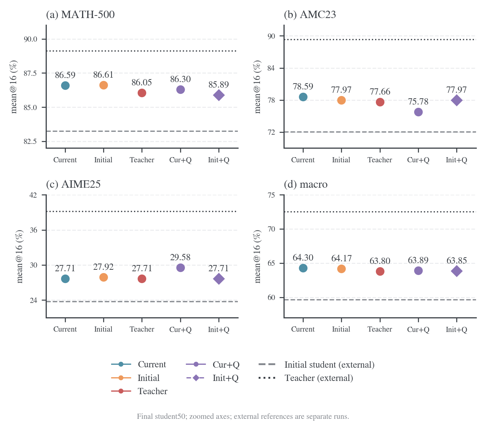
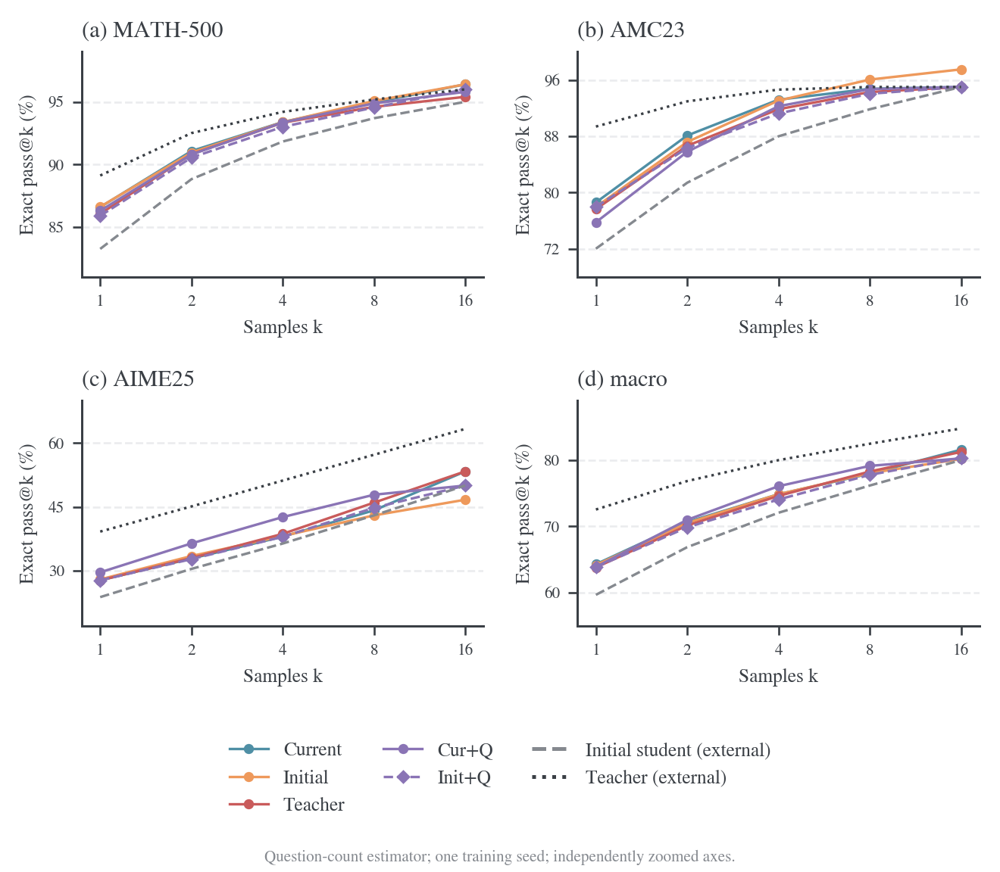
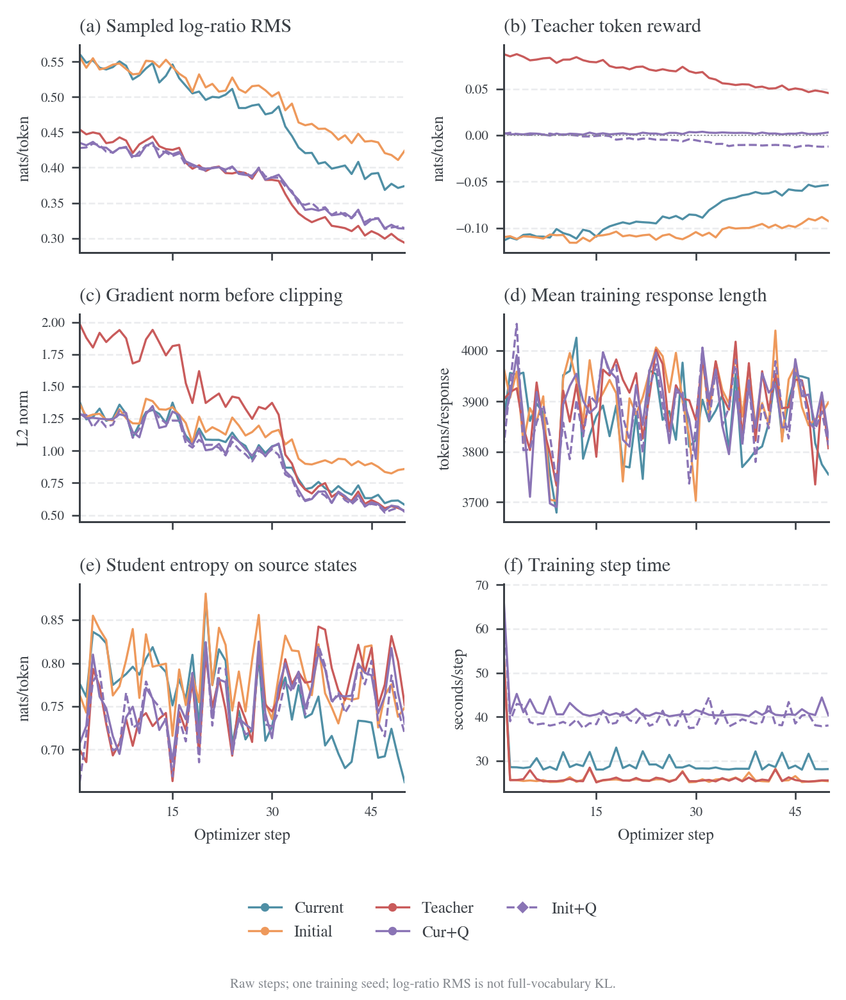

# Rollout 准确率与训练指标

共同模型、数据与学习预算见[实验入口](2026-10-19-rollout来源与logit融合实验.md)。本页先说明基准和统计粒度，再列正式结果。原生实时生成与固定缓存对照采用各自冻结协议，分别比较。

## 基准组成、难度与统计粒度

以下题目数和组成来自本地上游缓存，已逐题核对 problem、answer 与实际评测 parquet 完全一致，来源文件哈希保存在[基准元数据](results/state-diagnostics/summary.json)。三组评测都比较最终数学答案，不按推理过程逐步评分。

| 基准     | 实际题数 / 每次验证响应数 | 题目组成                                                    | 难度解释                                                                 |
| -------- | ------------------------- | ----------------------------------------------------------- | ------------------------------------------------------------------------ |
| MATH-500 | 500 / 8,000               | OpenAI 从 MATH 选取的 500 题，覆盖七类数学主题及 level 1–5  | 难度混合的竞赛数学集合；不能当作 500 道同等难度题                        |
| AMC23    | 40 / 640                  | 本地 `knoveleng/AMC-23` 版本，2023 AMC 12A 22 题、12B 18 题 | 高中竞赛数学，含容易题和后段难题；这 40 题是子集，不是两套完整 25 题试卷 |
| AIME25   | 30 / 480                  | `opencompass/AIME2025` 的 2025 AIME I、II，各 15 题         | AMC 高分选手参加的邀请赛，答案为 0–999 整数；竞赛定位比 AMC 更难         |

MATH-500 的来源与抽样关系见数据卡；[^math500] 本地 level 1/2/3/4/5 分别为 43/90/105/128/134 题，level 4–5 合计 262 题（52.4%）。七类主题分别为 Algebra 124、Intermediate Algebra 97、Prealgebra 82、Number Theory 62、Precalculus 56、Geometry 41、Counting & Probability 38。该结构比单一平均分更能说明测试覆盖。

AMC 的原考试为选择题，但当前数据准备使用题面与实际数值答案，不能将成绩解释为选项猜测率。数据卡确认该版本有 40 条记录，[^amc23] 12A/12B 的 22/18 分布由各题来源 URL 核对。AIME 的 I/II 组成由数据文件核对；[^aime25] MAA 对 AIME 的官方介绍也明确其难度高于 AMC 10/12。[^maa-aime]

在当前模型与协议下，teacher 的 MATH-500/AMC23/AIME25 mean@16 为 89.11%/89.38%/39.17%，初始 student 为 83.25%/72.03%/23.75%。AIME25 对两个模型都最难；MATH-500 与 AMC23 的相对顺序依模型变化，不存在对所有模型固定不变的难度排序。

AIME25 一题的 pass@16 改变会使该基准变化 3.33 个百分点，AMC23 为 2.5，MATH-500 为 0.2。每题采样 16 次减少采样噪声，但不会把 30 道 AIME 题变成 480 个独立问题。macro 让三个基准等权，可避免 500 道 MATH 题淹没其他基准，同时也会受到小基准题目波动影响；应同时保留逐题分析与 micro。

### Macro 与 micro 的含义

Macro 是基准之间的等权平均。记 MATH-500、AMC23、AIME25 各自的 mean@16 为 $a_{\mathrm{math}},a_{\mathrm{amc}},a_{\mathrm{aime}}$，则

$$
a_{\mathrm{macro}}=\frac{a_{\mathrm{math}}+a_{\mathrm{amc}}+a_{\mathrm{aime}}}{3}.
$$

每个基准各占三分之一权重，与题目数无关。原生当前来源的三项分数约为 86.59%、78.59%、27.71%，macro 约为 64.30%；实际指标用未舍入值计算。macro pass@k 也按同样方式平均三个基准各自的 pass@k。

Micro 是全部题目的等权平均：

$$
a_{\mathrm{micro}}=\frac{500a_{\mathrm{math}}+40a_{\mathrm{amc}}+30a_{\mathrm{aime}}}{570}.
$$

同一原生当前来源的 micro 为 82.93%。MATH-500 在 micro 中占约 87.72%，在 macro 中只占 33.33%；AIME25 在 micro 中占约 5.26%。所以较高的 micro 不能解释为三个基准都达到该水平。报告同时保留各基准原分数、macro 和 micro，避免只看一个总分。

### Mean@16 与 pass@k

每题生成 $n=16$ 条响应，记题 $i$ 的正确响应数为 $c_i$、题数为 $N$。平均正确率与标准 pass@k 估计为

$$
\operatorname{mean@16}=\frac1N\sum_{i=1}^N\frac{c_i}{16},\qquad
\widehat{\operatorname{pass@k}}=\frac1N\sum_{i=1}^N\left(1-\frac{\binom{16-c_i}{k}}{\binom{16}{k}}\right),\quad 1\le k\le16.
$$

当 $16-c_i<k$ 时，分子组合数取零。Pass@1 与 mean@16 相同；pass@16 是至少一条响应正确的题目比例。两者分别衡量单次平均成功率和多次采样覆盖，不选择其中较高的一项宣布总体更好。

## 原生实时生成的五十步结果

五组均完成 student 的五十次更新与唯一 step50 完整评测，来源身份、最终 student 版本和 W&B finished 核验通过，无 checkpoint。Initial 指初始 student 每步重新生成；Cur+Q/Init+Q 是 λ=0.5 的 logit fusion。表中全部训练结果均是最终 student 的成绩。

| 基准     |       题数 | 当前来源 Mean / Pass@16 | 初始来源 Mean / Pass@16 | Teacher 来源 Mean / Pass@16 | Cur+Q 0.5 Mean / Pass@16 | Init+Q 0.5 Mean / Pass@16 |
| -------- | ---------: | ----------------------: | ----------------------: | --------------------------: | -----------------------: | ------------------------: |
| MATH-500 |        500 |         86.59% / 96.40% |         86.61% / 96.40% |             86.05% / 95.40% |          86.30% / 95.80% |           85.89% / 96.00% |
| AMC23    |         40 |         78.59% / 95.00% |         77.97% / 97.50% |             77.66% / 95.00% |          75.78% / 95.00% |           77.97% / 95.00% |
| AIME25   |         30 |         27.71% / 53.33% |         27.92% / 46.67% |             27.71% / 53.33% |          29.58% / 50.00% |           27.71% / 50.00% |
| Macro    | 三基准等权 |         64.30% / 81.58% |         64.17% / 80.19% |             63.80% / 81.24% |          63.89% / 80.27% |           63.85% / 80.33% |

准确率和 pass@k 按基准独立缩放，保留外部初始 student 与 teacher 参考。每个面板包含所有设置，纵轴不从零强行起画；跨面板比较以数值为准。外部参考来自用户指定的 student/teacher 独立评测，已核对名称、val_only、finished、三基准及采样配置，原始响应与资产哈希未核对，因此不作为本地配对 step0。[^reference-student][^reference-teacher]

[逐题配对比较](results/native-rollout/formal/comparison-first-five/analysis.json)按 benchmark 分层、对同题成组 bootstrap 5,000 次。初始来源减当前来源的 macro mean@16 差为 −0.131 个百分点，95% 题目 bootstrap 区间为 [−1.695, 1.336] 个百分点。Teacher 来源减当前来源差为 −0.492 个百分点，区间为 [−1.997, 0.904] 个百分点；Fusion 0.5 减当前来源为 −0.408 个百分点，区间 [−1.779, 0.998] 个百分点。Init+Q 减当前来源为 −0.442 个百分点，区间 [−2.178, 1.178] 个百分点。四个区间均跨零；它们只描述题目选择不确定性，不覆盖训练 seed 变化，不能据此给设置排序，也不把五十步当作收敛证明。

完整逐题分数和配对差值见[五组比较](results/native-rollout/formal/comparison-first-five/analysis.json)。训练/评测题面存在精确重合：完整训练池与评测集重合九道题，五十步实际消费其中三道 MATH 题。当前来源排除已消费重合题后为 567 题，macro=64.2989%；保守排除全部九题后为 561 题，macro=64.1634%。主结果继续保留同一完整 570 题，并附[重合敏感性核验](results/native-rollout/formal/student_fresh/train-test-overlap.json)；该核验不覆盖语义近重复或预训练暴露。

## 训练指标的含义

每条线包含真实五十步，没有平滑，也不把单 run 的 batch 波动画成训练 seed 置信带。图件及其输入/输出哈希见[绘图审计](figures/native-formal/first-five/audit.json)。

对有效 token，记当前 student 与冻结 teacher 的对数概率差为

$$
d_{it}=\log p_{\theta_k}(a_{it}\mid s_{it})-\log q(a_{it}\mid s_{it}),\qquad
r_{it}=-d_{it}.
$$

图中的指标采用以下语义。

| 图中指标                    | 日志字段或计算           | 含义与解释限制                                                                                                           |
| --------------------------- | ------------------------ | ------------------------------------------------------------------------------------------------------------------------ |
| Sampled log-ratio，KL proxy | `-opd/token_reward_mean` | 实际来源轨迹上的 $\operatorname{mean}(d)$；缓存和融合的 action 分布不是当前 student，均值可为负，不能当作完整条件 KL     |
| Teacher token reward        | `opd/token_reward_mean`  | 有效 token 平均 $\operatorname{mean}(r)$，来自 teacher 的稠密蒸馏信号，不是答题正确率奖励                                |
| Log-ratio RMS               | `opd/log_ratio_rms`      | $\sqrt{\operatorname{mean}(d^2)}$，避免 signed mean 的正负抵消；不同来源的取样分布不同，不能直接作为共同测度上的对齐排名 |
| Gradient norm               | `actor/grad_norm`        | 裁剪前的全局梯度 L2 范数；阈值为 1，日志可大于 1                                                                         |
| Student entropy             | `actor/entropy`          | student 在该来源 prefix 上的条件熵平均，prefix 集随来源变化                                                              |
| Actor surrogate loss        | `actor/loss`             | 当前 PPO surrogate；单次更新起点与负 token reward 接近，负值不表示 KL 为负                                               |

这些训练指标计算于实际 rollout 的 prefix/action；缓存、teacher 和 fusion 的 action 分布均可能不同于当前 student。Sampled log-ratio 的均值允许为负，RMS 也不是完整条件 KL，不能据此作共同状态上的对齐排名。完整条件 KL 的定义与评分证据见[验证 KL](2026-10-19-rollout验证KL与状态诊断.md)。

下表是各组前十步与后十步均值，直接从归档 training-1-50.csv 计算。

| 来源         | RMS 前十步→后十步 | 后十步 token reward | 后十步 grad_norm | 五十步平均响应长度 |
| ------------ | ----------------: | ------------------: | ---------------: | -----------------: |
| 当前 student |     0.5434→0.3860 |           -0.058265 |           0.6391 |            3865.69 |
| 初始 student |     0.5431→0.4312 |           -0.095055 |           0.8775 |            3901.32 |
| Teacher      |     0.4405→0.3059 |            0.049120 |           0.5934 |            3897.97 |
| 当前融合     |     0.4270→0.3239 |            0.001898 |           0.5853 |            3887.47 |
| 初始融合     |     0.4258→0.3237 |           -0.011522 |           0.5723 |            3881.15 |

五组后十步 RMS 均低于前十步，loss/grad 记录均有限。它们描述各组自身采样测度上的残差，不证明到达相同平台。Fusion 的 signed reward 接近零时 RMS 仍可非零，不能以奖励均值判断对齐完成。4K 上限下响应长度接近 cap，还需同时观察自然 EOS 与截断。

## 固定缓存与 HF fusion 对照

这组对照使用固定的 3,200 条配对消费记录。Teacher/Semi 在训练前各生成一次响应；Semi 来源为初始 student。在线组逐步实时生成，fusion 为 HF 双模型 CUDA Graph 路径。四组仍共同训练 student，不能与原生矩阵混成同协议重复实验；其具体执行参数见[速度与显存](2026-10-19-rollout速度与显存.md#固定缓存对照的运行设置)。

| 模型或训练设置               | MATH-500 mean@16 | AMC23 mean@16 | AIME25 mean@16 | macro mean@16 | micro mean@16 |
| ---------------------------- | ---------------: | ------------: | -------------: | ------------: | ------------: |
| 初始 student，外部参考       |            83.25 |         72.03 |          23.75 |         59.68 |         79.33 |
| Teacher，外部参考            |            89.11 |         89.38 |          39.17 |         72.55 |         86.50 |
| 在线 student rollout         |            86.24 |         80.16 |          28.12 |         64.84 |         82.75 |
| Teacher rollout 后的 student |            85.38 |         75.31 |          26.88 |         62.52 |         81.59 |
| Semi-OPD 后的 student        |            86.70 |         78.75 |          28.33 |         64.59 |         83.07 |
| Fusion λ=0.5 后的 student    |            86.28 |         78.91 |          27.29 |         64.16 |         82.65 |

| 设置         | MATH-500 pass@16 | AMC23 pass@16 | AIME25 pass@16 | macro pass@16 | micro pass@16 |
| ------------ | ---------------: | ------------: | -------------: | ------------: | ------------: |
| 在线 student |            95.60 |         95.00 |          50.00 |         80.20 |         93.16 |
| Teacher 轨迹 |            96.20 |         95.00 |          53.33 |         81.51 |         93.86 |
| Semi-OPD     |            96.40 |         95.00 |          46.67 |         79.36 |         93.68 |
| Fusion λ=0.5 |            95.80 |         95.00 |          53.33 |         81.38 |         93.51 |

| 设置减在线 student | macro mean@16 差值 | 95% 题目 bootstrap 区间 |
| ------------------ | -----------------: | ----------------------: |
| Teacher 轨迹       |             -2.319 |        [-4.055, -0.755] |
| Semi-OPD           |             -0.245 |         [-1.829, 1.310] |
| Fusion λ=0.5       |             -0.682 |         [-2.149, 0.681] |

区间按 benchmark 分层、同题配对 bootstrap 5,000 次，seed=42，单位为百分点；不覆盖训练 seed 方差，也未作多重比较校正。Teacher 缓存组在该单 seed 结果中平均正确率较低，Semi/fusion 区间跨零，不推断普遍算法排序。未舍入指标和输入身份见[四组比较](results/2026-10-18-four-setting-comparison/analysis.json)。

### 固定轨迹的长度与重复训练

Semi 固定的是每条响应及其长度，batch 均值会因题目内容变化而波动。当前固定 schedule 不 shuffle，每五十步重复一轮，因此相同 batch 的响应均长每五十步精确复现。只读缓存共有 3,200 条响应，长度 417–4,096，整库均长 3,900.651875；各 batch 均值 3,728.21875–4,028.828125。全部可用日志与相应缓存长度一致，命中率为 1，见[缓存核验](results/state-diagnostics/summary.json)。

重复训练组完成 step50/100/150 的完整评测，macro mean@16 分别为 **64.80%/66.92%/67.34%**。共执行 200 次更新，只有 199 条完整训练日志，step200 验证未完成且无 checkpoint；最后有效评测点是 step150。该结果说明固定 state 集上的继续学习可以伴随准确率变化，不证明收敛或持续增长。数据、已完成区间和终止范围见[运行摘要](results/long-semi-progress/stopped/summary.json)。

### 参考文献

[^reference-teacher]: wncfht. One-Shot-OPD math_teacher u87buult. W&B 2026. [用户指定 teacher 评测](https://forge.coreweave.com/wandb/wncfht/One-Shot-OPD/runs/u87buult).

[^reference-student]: wncfht. One-Shot-OPD math_student 6uorrk2k. W&B 2026. [用户指定初始 student 评测](https://forge.coreweave.com/wandb/wncfht/One-Shot-OPD/runs/6uorrk2k).

[^math500]: Hugging Face H4. MATH-500 dataset card. Hugging Face 2024. [MATH-500](https://huggingface.co/datasets/HuggingFaceH4/MATH-500).

[^amc23]: Knovel Engineering. AMC-23 dataset card. Hugging Face 2025. [AMC-23](https://huggingface.co/datasets/knoveleng/AMC-23).

[^aime25]: OpenCompass. AIME2025 dataset. Hugging Face 2025. [AIME2025](https://huggingface.co/datasets/opencompass/AIME2025).

[^maa-aime]: Mathematical Association of America. MAA Invitational Competitions. MAA 2026. [AIME 介绍](https://maa.org/maa-invitational-competitions/).
