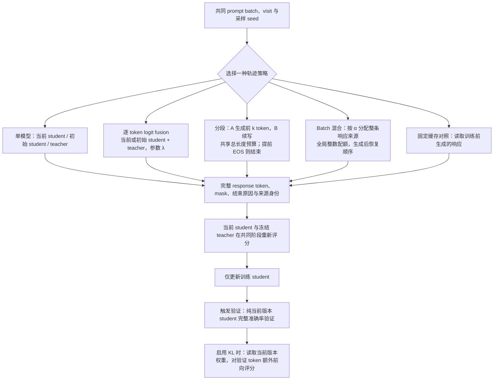

# Rollout 来源与 logit 融合实验

研究问题是：保持训练 student、teacher、prompt 顺序和学习预算一致时，改变生成轨迹的模型与混合方式，会怎样影响最终准确率、训练残差及计算成本。所有设置均只更新 student，teacher rollout 指由 teacher 生成训练响应。

## 文档入口

| 文档                                                        | 内容                                                                |
| ----------------------------------------------------------- | ------------------------------------------------------------------- |
| [准确率与训练指标](2026-10-19-rollout准确率与训练指标.md)   | 基准组成与难度、mean/pass@k、训练曲线、固定缓存对照与统计限制       |
| [速度与显存](速度与显存.md)                                 | 实际运行参数、阶段耗时、吞吐、逐卡显存、batch/KV 原理与性能对照     |
| [验证 KL 与状态诊断](2026-10-19-rollout验证KL与状态诊断.md) | 完整验证响应评分、固定前缀、full-vocab、累计 KL、状态诊断与验收结果 |

算法设计、替代实现与待验证取舍归 [Agent Note](../../.agents/notes/proposed/architecture/2026-10-18-可组合rollout与原生vLLM推理.md)，推导与研究依据归[访问测度研究](../research/occupancy/2026-10-17-OPD访问测度与收敛机制研究.md)。实验正文保留设置、结果、解释和复现依据；工作过程归 [工作记录](../notes/2026-10-19-rollout来源与fusion工作记录.md)。

## 当前结果与进度

原生实时生成矩阵共十五组，已完成三种单模型来源、两种 λ=0.5 fusion，以及 teacher→当前 student 的 2,048-token 分段，共六组五十步训练与完整最终评测。六组的路由/参数身份审计及 W&B 核验均通过，没有保存 checkpoint。前五组的 macro mean@16 为 64.30%、64.17%、63.80%、63.89%、63.85%；相对当前来源的四个题目 bootstrap 区间均跨零，不能据此排序。新增分段组为 64.51%，尚未纳入前五组的配对分析和图件。

| 实验                        | 当前证据                                                           | 尚待完成                                                                |
| --------------------------- | ------------------------------------------------------------------ | ----------------------------------------------------------------------- |
| 三种单模型、两种 fusion     | 五十步、570×16 最终评测、逐题比较、训练/资源图、W&B finished       | 多训练 seed 与更长预算                                                  |
| 四方向分段、两种 batch 混合 | 四卡两步接入核验；teacher→当前 student、k=2,048 完成五十步完整评测 | 其余九组完整五十步质量对照                                              |
| 原生生成基础能力            | 连续解码、独立 KV、CUDA Graph、热更新、APC 失效与请求排空          | 统一性能扫描与内核归因                                                  |
| 验证 KL                     | 固定 p0/q 前缀库及六题×16 的长响应评分通过                         | 完整 570×16、56,737,088 个有效位置评分与 W&B 核验通过；吞吐优化仍待对照 |
| 固定缓存对照                | 四组五十步结果；重复训练至 step150 的完整评测                      | 不据已有单 seed 结果推断算法排序或收敛                                  |

所有自有 GPU 实验顺序使用物理设备 0–3。六组正式质量运行未启用新增 validation KL；完整 KL 工程验收另列。剩余正式矩阵暂停，当前执行 validation 速度、显存及周期恢复测试；排队项不计为已通过。

## 共同训练与验证设置

| 项目           | 设置                                                                                                           |
| -------------- | -------------------------------------------------------------------------------------------------------------- |
| 可训练 student | DeepSeek-R1-Distill-Qwen-1.5B；各组从同一资产和全新 optimizer 开始                                             |
| 冻结 teacher   | JustRL-DeepSeek-1.5B；teacher 生成与监督使用相同资产                                                           |
| 设备与环境     | 四张 H800 80GB，物理 GPU 0–3；独立 `envs/opd-state`；Torch 2.7.1+cu126、vLLM 0.10.0+cu126、Transformers 4.57.6 |
| 更新预算       | 50 steps，全局 batch/mini-batch 64，每题一条响应，每步一个 PPO epoch                                           |
| 训练长度与采样 | prompt cap=1,024，response cap=4,096；T=1、top-p=1、top-k=-1、repetition penalty=1                             |
| 优化           | AdamW，恒定 lr=1e-6，无 warmup，梯度裁剪 1，有效 response token 的 token-mean                                  |
| 蒸馏信号       | `token_reward_direct`，sampled-token；`LOG_PROB_TOP_K=0`，无额外 reference KL 或行为重要性修正                 |
| 最终验证       | MATH-500/AMC23/AIME25 共 500/40/30 题；每题 16 次，共 9,120 条响应                                             |
| 验证采样       | T=0.7、top-p=0.9、top-k=-1；response cap=31,744，context=32,768                                                |
| 验证与保存     | 五十步组仅末步验证，无训练前验证；`save_freq=-1`、`resume_mode=disable`                                        |
| 记录           | W&B project=`OPD-State`；保存源码、配置、数据身份、逐题结果与运行遥测                                          |

原生矩阵固定源码 d59a7c3463244ef7533ca4acf73855e988043848，CUDA Graph 开启，训练引擎共同 context=5,120，生成总预算 0.55，验证使用独立的纯当前 student 引擎。不同协议的缓存对照、HF fusion 和 KL 工程验收分别列在对应专题，不混用其耗时或准确率。

## Prompt 池与重复访问

原生矩阵使用独立完整题库，条数与训练步数分开决定。DAPO 原始 17,917 行在 1,024-token prompt 上限下移除 8 行，去除 662 条额外重复，再移除 12 道答案冲突的唯一题，得到 **17,235 道唯一题**。清洗与数据身份见[数据审计](results/native-rollout/fresh-data-summary.json)。

Batch 64、drop-last 时每 epoch 有 269 批，末尾 19 行不消费；前五十批消费 3,200 道不同题，后续 epoch 重新打乱全库。三千二百是本轮消费量，不是原生数据池大小。固定缓存对照另用固定的 3,200 条消费记录；其长时组每五十步重放同一轮轨迹。

新原生入口未指定数据时读取 `runs/native-data/math-full/manifest.json`，缺少准备产物时在启动训练前退出。准备方法和显式覆盖规则见 [data README](../../data/README.md#fresh-math-prompt-pool)。

## 轨迹来源与共同更新

记当前 student 为 pθ、初始 student 为 p0、冻结 teacher 为 q。实时模式每次访问 prompt 都重新生成；固定缓存模式在训练前生成一次轨迹，后续读取其原始 token。固定模型来源和固定轨迹缓存是两个独立选择，`initial_student_fresh` 不命名为 Semi-OPD。

原生十五组包括三种单模型、两种 λ=0.5 fusion、teacher↔当前 student 与 teacher↔初始 student 四个方向各 k=1,024/2,048，以及两种 teacher 占比 0.5 的 batch 混合。端点 λ/α=0 或 1、k=0 或 4,096 经策略编译后复用相同单模型基线；不安排嵌套组合或 TCOD。

验证 KL 支持每个配置的验证点；当前五十步质量协议只在末步验证，这是频率设置。中间验证使用对应 step 的实时 student，并在评分结束后恢复训练；具体设置与验收范围见[KL 专题](2026-10-19-rollout验证KL与状态诊断.md#每个验证点的版本与训练恢复)。

改变 rollout 同时改变 prefix 和 action 的采样测度。因此准确率差异不能只归因于 state 覆盖；共同固定前缀上的 KL 用于补充辨识，不能替代任务评测。

## 结果与复现入口

| 产物         | 位置与用途                                                                                                                                                                                                                                |
| ------------ | ----------------------------------------------------------------------------------------------------------------------------------------------------------------------------------------------------------------------------------------- |
| 原生正式结果 | [`results/native-rollout/formal/`](results/native-rollout/formal/)；每组摘要、逐步 CSV、逐题成功数、来源审计与 W&B 核验                                                                                                                   |
| 五组质量比较 | [分析](results/native-rollout/formal/comparison-first-five/analysis.json)、[分数](results/native-rollout/formal/comparison-first-five/scores.csv)、[配对差值](results/native-rollout/formal/comparison-first-five/paired-differences.csv) |
| 图件         | [`figures/native-formal/first-five/`](figures/native-formal/first-five/)；PNG/PDF、绘图 CSV 与输入/输出哈希                                                                                                                               |
| 原始运行     | `runs/native-formal-suite-20261018/` 的 protocol、state、日志、源码快照、token 与 GPU CSV；大型产物保持忽略                                                                                                                               |
| 训练入口     | [`recipe/math_native.sh`](../../recipe/math_native.sh)；策略与默认完整题库                                                                                                                                                                |
| 正式矩阵     | [`eval/run_native_math_suite.py`](../../eval/run_native_math_suite.py)；冻结源码与顺序运行                                                                                                                                                |
| 结果采集     | [`eval/collect_native_acceptance.py`](../../eval/collect_native_acceptance.py)、[`eval/verify_wandb_math.py`](../../eval/verify_wandb_math.py)                                                                                            |
| 绘图         | [`eval/plot_native_formal.py`](../../eval/plot_native_formal.py)；离线读取已归档结果，不访问 W&B、不占 GPU                                                                                                                                |

每个 run 的源码身份以完整快照及哈希为准，不能仅用基线提交代替未提交改动。只有完整验证结束且逐题记录、来源审计和最终版本一致的结果才列为完成；两步短 cap 检查只证明对应链路可用。
