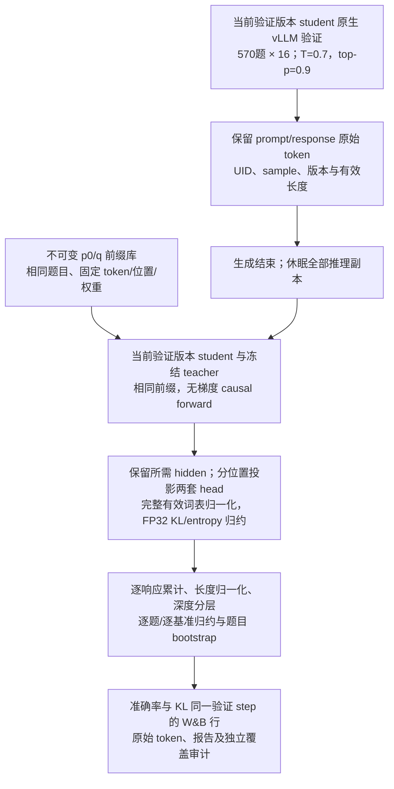
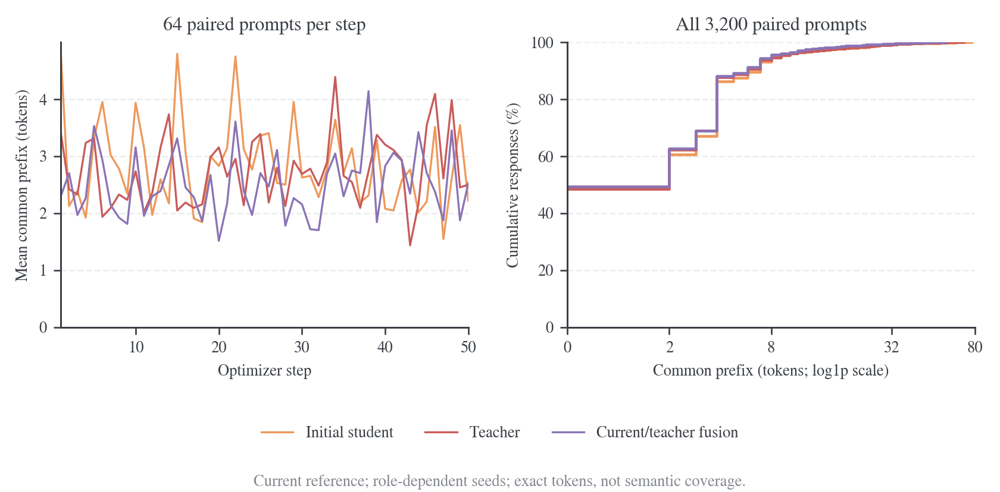

# 验证 KL 与状态诊断

共同设置见[实验入口](2026-10-19-rollout来源与logit融合实验.md)，任务成绩见[准确率与训练指标](2026-10-19-rollout准确率与训练指标.md)。本页区分条件分布散度、轨迹上的累计量与 state 覆盖，分别记录其测度和验收范围。

## 方案与当前进度

| 状态集合               | 输入                                | 评分范围                         | 用途                                    |
| ---------------------- | ----------------------------------- | -------------------------------- | --------------------------------------- |
| `on_validation_states` | 完整 570×16 的本次 student 验证响应 | 每个有效 response 位置，不抽样   | 实际验证状态上的条件 KL 与累计量        |
| `on_initial_states`    | 固定初始 student 的九十条响应       | 每条至多八个分层位置，带区间权重 | 不同训练变体在相同初始模型状态上的对照  |
| `on_teacher_states`    | 固定 teacher 的九十条响应           | 同样的位置预算与权重规则         | 不同训练变体在相同 teacher 状态上的对照 |

固定前缀库、六题×16 长响应及完整 570×16 工程验收均已通过。完整规模的两次 B8、64-token 更新后，对 9,120 条响应的全部 56,737,088 个有效位置评分，并核对四 worker、原始 token、逐题归约与 W&B 最终行。该任务验收完整覆盖与资源，不是五十步质量对照。

六组已结束的正式训练使用冻结 d59a7c3 协议，不含新增验证 KL，且未保存最终权重；只有响应文本无法追溯补算。开发入口的 `trainer.validation_kl.enabled` 默认关闭，`+experiment=validation_fast` 会显式开启。完整规模正确性已通过，负载平衡与整块词表也已通过真实四卡配对测试；生成资源配置和完整验证成本的证据归[速度与显存](速度与显存.md)。

## 每个验证点的版本与训练恢复

KL hook 挂在通用的 `_validate()` 内，`trainer.validation_kl.enabled=True` 时每次调用都执行，不要求当前 step 等于训练总步数。记当前验证发生在训练更新 $v$ 后、总更新数为 $T$，生成与评分均使用实时 $p_{\theta_v}$；末步只是 $v=T$。无需先保存 checkpoint 再读取权重。

验证频率由 `trainer.test_freq` 决定。例如在原生配方上合并下面配置，验证发生在 step20/40/60/80/100，每次都计算 KL；打开 `val_before_train` 还会评估 step0。

```yaml
trainer:
    total_training_steps: 100
    test_freq: 20
    val_before_train: false
    validation_kl:
        enabled: true
```

每轮验证先同步版本 $v$ 到纯 student 引擎，收集该版本的准确率响应；整轮生成完成后再评分当前 actor 与冻结 teacher。中间验证结束时 `end_eval(v, resume_training=True)` 休眠验证引擎，恢复需要当前 actor 的训练来源；固定 p0/q 来源保持冻结。训练随后继续更新至 $v+1$。末步使用 `resume_training=False`，省去训练恢复。

原始 token 与报告分别写入 `validation/kl/kl-tokens-step-<v>.jsonl` 和 `kl-step-<v>.json`，均记录 `student_version=v`，acc、KL、长度等指标返回同一训练 step。固定前缀 bank 跨验证点不变，student 概率每次按实时权重重算，不沿用上次 head 快照或 KL。

[连续验证 CPU 回归](results/native-rollout/periodic-validation-cpu.json)使用真实小型 Qwen2 与 SGD，在 step0/2/4 调用实际 trainer/teacher 评分方法，检查版本隔离、实时权重、固定 bank 与恢复标志。随后[真实四卡周期验收](results/native-rollout/validation-performance/periodic/periodic-gpu.json)完成四次工程更新：step2、step4 各评估六题×16，分别覆盖 577,796、591,509 个主响应位置，另各评估同一固定 bank。step2 评分后继续完成 step3/4 更新，teacher 在共同 bank 上的归一化熵逐响应差为零，student 的 bank KL 随更新改变；两轮来源、全位置和 W&B 精确 history 行均核对通过。这证明所测配置下的中间验证与恢复，不替代五十步质量对照或八卡测试。

采集周期运行时，`collect_native_acceptance.py --validation-interval 2` 绑定每轮准确率和对应 student 版本；`collect_validation_kl.py --validation-step 2 --native-result <原生验收目录>` 可独立归档中间报告，不改写最终版本。`verify_wandb_math.py` 可重复提供 `--kl-report`，逐轮核对同一 step 的 history，避免用最终 summary 代替中间指标。

## 复用准确率响应的评分流程



响应已知，因果前向可以一次计算多个位置，无需重新逐 token 生成。生成继续使用 vLLM；评分读取同卡现有 FSDP student/teacher，不使用 HF 生成回退。模型 eval、无梯度；恢复原 training flags，保留参数与 RNG 状态。

主验证必须保留准确的 token IDs、response mask 与当前验证 step 的 student 版本；不从解码文本重新 tokenize，也不以 old_log_probs 代替当前分布。第一个 action 的预测位置是 prompt 最后一个 token，EOS 是有效 action，padding 和响应结束后的额外位置不计。各 FSDP rank 使用匹配次数的参数收集，DP 补齐行在返回后去除。

## Full-vocab 条件 KL 与归约

令 $p=p_\theta$ 为本次验证的 student、$q$ 为冻结 teacher；在同一 prefix $s$ 上，以 T=1 原始 logits 和共同有效词表 $\mathcal V$ 归一化：

$$
k_{p\Vert q}(s)=\sum_{a\in\mathcal V}p(a\mid s)\log\frac{p(a\mid s)}{q(a\mid s)},\qquad
k_{q\Vert p}(s)=\sum_{a\in\mathcal V}q(a\mid s)\log\frac{q(a\mid s)}{p(a\mid s)}.
$$

主方向为 student→teacher，补充 teacher→student 与两侧 entropy。前者关注 student 概率质量落在 teacher 低概率动作上的程度；后者补充 teacher 高概率动作的覆盖。它们均不直接等于答案正确率，也不同于训练的 sampled log-ratio。

当前共同有效词表为 **151,665**，输出 head 的填充项不参与归一化。主指标采用 full-vocab；top-k 内重归一化会改成截断分布并遗漏尾部差异。普通 head 通常已经完成全词表投影，不能按保留 k 个值就声称省去了该投影。

不反向传播仍需模型前向与临时 logits。评分跳过常规整段序列×词表输出，student head 只复制一次；teacher head 在 FSDP 参数已收集时读取。默认采用 128 个位置和 8,192 个词表项分块；`validation_fast` 使用已验收的 1,024 位置块与完整词表 FP32 归约，前向 batch 保持 1。两套 1,024×151,665 BF16 logits 约 593.5 MiB，除此之外仍有权重、hidden、前向临时量与 FP32 缓冲；组件估算与实测峰值分别见速度专题。

对响应 $i$ 的有效长度 $L_i$，保留

$$
S_i=\sum_{t=1}^{L_i} k_{p\Vert q}(s_{i,t}),\qquad A_i=S_i/L_i.
$$

| 归约                   | 定义与单位                                            |
| ---------------------- | ----------------------------------------------------- |
| `token_weighted`       | 所有响应 $S_i$ 之和除以 $L_i$ 之和，nat/token         |
| `question_mean`        | 每条响应 $A_i$ 先在题内平均，再对题平均，nat/token    |
| `cumulative_on_states` | 每条响应 $S_i$ 先在题内平均，再对题平均，nat/response |
| `macro`                | 三个 benchmark 对应指标等权平均                       |
| `micro`                | 合并全部题/响应后按对应公式计算                       |

同题十六条响应共同重采样，bootstrap 按 benchmark 分层、以题目为单位；相邻 token 或同题响应不视为独立问题。区间条件于已训练模型和固定 bank，不覆盖训练 seed、bank 构造与位置抽样的不确定性。

### 累计量与严格 sequence KL

对使用相同 EOS 与共同上限 H 停止的原始模型分布 P_H、Q_H，在共同支持集上，自回归分解和条件期望给出

$$
\begin{aligned}
D_{\mathrm{KL}}(P_H\Vert Q_H)
&=\mathbb E_{y\sim P_H}\log\frac{P_H(y\mid x)}{Q_H(y\mid x)}\\
&=\mathbb E_{y\sim P_H}\sum_{t=1}^{L(y)}\log\frac{p(y_t\mid s_t)}{q(y_t\mid s_t)}\\
&=\sum_{t=1}^{H}\mathbb E_{s_t\sim P_H}\left[\mathbf1_{\{L\ge t\}}\sum_a p(a\mid s_t)\log\frac{p(a\mid s_t)}{q(a\mid s_t)}\right]\\
&=\mathbb E_{y\sim P_H}\sum_{t=1}^{L(y)}k_{p\Vert q}(s_t).
\end{aligned}
$$

有限 H 允许交换求和与期望，第三行对尚未终止的 prefix 条件化并对下一 action 求期望。EOS 计入，触及上限时不添加虚构 EOS。只有轨迹从 P_H 采样时，累计条件 KL 的轨迹平均才估计该方向的 sequence KL。

准确率响应使用 T=0.7、top-p=0.9，实际策略为 μ；复用后的量是 $\mathbb E_{y\sim\mu}\sum_t k(s_t)$，不等于上式的原始分布 sequence KL。主方案保持准确率采样与全部响应，明确标注验证状态累计量；不为严格 sequence KL 额外生成 student 探针。teacher 前缀上的 student→teacher 条件 KL 也不自动成为 teacher 轨迹分布的 sequence KL。

## 验证响应的配套指标

新验证路径在 DP 去除补齐后保留逐响应指标，再整轮归约；不平均不等大 batch 的均值。EOS=PAD 或 EOS 恰在 cap 时，仍按实际 token 与结束原因判断。

| 范围       | 指标                                                                |
| ---------- | ------------------------------------------------------------------- |
| 长度       | response 均值、p50/p90/p95/max、有效 token 总数；prompt length 单列 |
| 结束状态   | EOS 比例、非 EOS 的 cap 截断比例、空响应、abort/error 数量          |
| 答案       | 解析成功率、每题答案多样性；失败和缺失显式计数                      |
| 退化与分层 | 重复 4-gram 比例；正确/错误/截断响应的长度分布                      |
| 来源       | 当前验证版本、UID/sample、原始 finish/stop reason                   |
| KL 深度    | 0–255、256–1023、1024–2047、2048 及以上位置分别归约                 |

以上实现与 KL hook 已完成全量链路验收；冻结 d59a7c3 的已结束五组不追溯增加未保存字段。

## 固定前缀对照

每基准确定性选三十题，共九十题；AIME25 使用全部题，MATH/AMC 按固定身份与 seed 选择。p0、q 各生成每题一条，T=1、top-p=1、top-k=-1、cap=4,096，使用相同题目和原始 prompt。

实际 bank 含 **180 条轨迹、1,440 个选中位置、1,350 个不同的完整 token 前缀**；九十个 prompt-only state 在两个来源中各出现一次。两套轨迹共 652,012 response token，完整 token、位置/权重、tokenizer/model 身份和哈希固定，所有变体共用；bank 只用于验证，不参与训练更新。[独立审计](results/native-rollout/prefix-bank-gpu/audit.json)绑定原始准备输入、冻结源码、八个 worker 身份和参数摘要。

每条响应强制选择第一个 action 之前的 state，其余位置分至多七个非空连续区间，每区间均匀抽一个，短响应直接全选。若区间 h 含 nₕ 个位置，抽中 Tₕ，则

$$
\widehat S_i=k(s_{i,1})+\sum_h n_h k(s_{i,T_h}),\qquad
\mathbb E_{\{T_h\}}[\widehat S_i\mid y_i]=S_i.
$$

第二式来自各区间均匀抽样的条件期望，且各区间完整划分剩余位置。归一化除以真实 $L_i$，权重之和必须等于 $L_i$。该抽样不减少主验证的全位置范围；固定 bank 内的位置固定后，跨训练变体比较的是相同 prefix。

## 真实长响应验收

两次 B8、64-token 工程更新后，以六题×16、T=0.7、top-p=0.9、cap=31,744 验证最终 student2；实际最长响应达到 31,744。[独立 KL 审计](results/native-rollout/validation-kl-long/kl-independent-audit.json)绑定九十六条准确率响应的 **605,977 个有效位置**，另计 bank 的 1,440 个位置。下表为三基准等权平均的 student→teacher 条件 KL。

| 状态来源     | 响应数 | 评分位置数 | Token 加权 KL | 题目等权 KL | 累计条件 KL |
| ------------ | -----: | ---------: | ------------: | ----------: | ----------: |
| 当前验证轨迹 |     96 |    605,977 |      0.089226 |    0.080735 |     631.559 |
| 固定 p0 前缀 |     90 |        720 |      0.107019 |    0.105274 |     394.084 |
| 固定 q 前缀  |     90 |        720 |      0.101336 |    0.098971 |     367.806 |

累计量单位 nat/response，其余 nat/token；bank 使用分层抽样权重。三个集合的题目与深度分布不同，不能用三行数值作来源质量排名。

[评分资源](results/native-rollout/validation-kl-long/kl-resource-profile.json)记录 wall time **46.749 s**，四卡评分区间各二十次二秒整卡采样，峰值分别为 **10,761/10,363/8,817/8,817 MiB**；每 worker student head 快照 466,747,392 byte。worker 分项包含通信与等待，不是纯 kernel 时间。W&B 1sndtege 的两步训练、唯一末步验证及同一最终行 KL 已[核验](results/native-rollout/validation-kl-long/wandb-verification.json)。它不替代完整规模或五十步质量对照。

## 完整规模验收结果

完整规模 gate 固定 b528c6d，[独立审计](results/native-rollout/validation-kl-full/kl-independent-audit.json)确认 500/40/30 题×16 的 **9,120 条主响应、56,737,088 个有效位置**，另加 bank 180 条响应的 1,440 个位置。主响应长度为 158–31,744、均值 6,221.17。四 worker、输入/token 哈希、题目 bootstrap 与 [W&B azusc532](results/native-rollout/validation-kl-full/wandb-verification.json)最终行一致。

下表三行均评估同一个“两次 online 更新后的 student2”，只有评分前缀来源不同；不是三种来源训练到五十步后的 KL。各指标先在基准内归约，再对三基准等权平均。

| 评分状态来源          | Student→teacher token KL | Teacher→student token KL | Student→teacher 累计量 |
| --------------------- | -----------------------: | -----------------------: | ---------------------: |
| 全量验证响应          |                 0.108592 |                 0.136892 |              1,163.635 |
| 固定初始 student 前缀 |                 0.107984 |                 0.105910 |                397.703 |
| 固定 teacher 前缀     |                 0.101650 |                 0.090255 |                369.004 |

Token KL 单位为 nat/token，累计量为 nat/response；后两行使用分层权重。原始统计见[KL 摘要](results/native-rollout/validation-kl-full/kl-summary.json)。评分 wall time 为 **2,742.18 s（45.70 min）**，四卡阶段采样峰值为 **10,911/10,931/10,909/10,911 MiB**，每卡 1,242 次采样；完整阶段分解与负载问题归[速度与显存](速度与显存.md#完整验证-kl-的成本与瓶颈)。正确性通过不代表效率已优化，也不替代五十步研究对照。

优化后的完整复测已[通过独立审计](results/native-rollout/validation-performance/full/kl-independent-audit.json)：9,120 条主响应、56,451,119 个有效位置，同一 bank 另含 1,440 个位置；[W&B k59jf84e](results/native-rollout/validation-performance/full/wandb-verification.json)核验通过。该轮主验证 macro student→teacher token KL=0.110645、反向 KL=0.146365，student→teacher 累计量=1,153.468 nat/response。KL RPC 为 796.06 s（13.27 min），整轮 validation 为 67.00 min。它同样是两次工程更新，未复用旧最终 checkpoint；两轮实际轨迹与共同 bank 上的 student 统计有差异，不将数值变化解释为优化提高或降低对齐。数值一致性由固定 p0/q、相同 token 的配对测试支撑，完整参数、资源和比较边界归速度专题。

## 已有 state 诊断与限制

State 是下一 action 前的完整 prefix；响应长度、精确 prefix 重合、表示覆盖与 action 对齐属于不同量。固定缓存重复同一轨迹时，state 集固定，但 student 概率、熵和梯度仍会变化。

三组原生来源与 current 的正式配对按 prompt/visit/sample/实际 step 匹配，各有 3,200 条首次访问轨迹：

| 配对来源               | 完全相同的回答 | 平均共同响应前缀 | 配对训练 state 的 pooled Jaccard |
| ---------------------- | -------------: | ---------------: | -------------------------------: |
| Initial                |      0 / 3,200 |     2.8441 token |                         0.04952% |
| Teacher                |      0 / 3,200 |     2.7403 token |                         0.04820% |
| Current/teacher fusion |      0 / 3,200 |     2.5044 token |                         0.04522% |

图与独立原始 token 重算见[前缀审计](figures/native-formal/state-prefix/audit.json)；生成 seed 还包含 stage slot/phase，同为 seed42 也不保证跨来源共同随机数。一处分叉会改变后续所有精确 prefix，所以这些比例不能作为语义覆盖或来源质量排名。



固定 p0/q 缓存的 3,200 对轨迹共同前缀均值为 16.675625 token、中位数十、p90=43，paired Jaccard 为 0.227%；完整定义和实际计数见[缓存诊断](results/state-diagnostics/summary.json)。这仍是精确 token prefix 重合，不能推断只共享相同比例的可迁移知识。

开发路径的 `generation_state_metrics=true` 复用共同评分的 log-prob，按 action 来源、第一/第二段和绝对响应深度记录有效 token、prefix 深度、sampled log-ratio/RMS 与 teacher 对所选 action 的概率。DP 重排后来源元数据仍与行对齐，空组不产生 NaN；[运行检查](results/native-rollout/state-metrics-cpu.json)通过，真实四卡集成仍待验收。d59a7c3 正式矩阵没有此后加诊断，不能追溯补出未保存的逐来源概率。

固定 teacher 表示中的 PCA/聚类覆盖、占用分布 JSD 与同来源重复采样对照仍未完成；拟合编码器、PCA 和簇中心须固定，按 prompt 与深度控制预算，不能用精确 prefix 计数替代这些测量。研究依据与待验证设计见[State 诊断专题](../research/occupancy/2026-10-18-State诊断与实验设计.md)及 [Agent Note](../../.agents/notes/proposed/architecture/2026-10-18-可组合rollout与原生vLLM推理.md#数据指标与收敛)。

## 实现与证据入口

| 组件                                                                           | 职责                                                                 |
| ------------------------------------------------------------------------------ | -------------------------------------------------------------------- |
| [validation_kl_runner.py](../../src/opd_state/integrations/verl/validation.py) | 保留 raw token、绑定 bank、休眠引擎、分布式调用、校验版本/顺序与报告 |
| [workers/validation_kl.py](../../src/opd_state/kernels/causal_scoring.py)      | 相同前缀 causal forward、head capture、全位置覆盖及分块评分          |
| [validation_kl.py](../../src/opd_state/kernels/divergence.py)                  | 完整词表双向 KL/entropy 与分层位置抽样                               |
| [generate_prefix_bank.py](../../eval/generate_prefix_bank.py)                  | 原生 vLLM 生成固定两来源 bank                                        |
| [audit_validation_kl.py](../../eval/audit_validation_kl.py)                    | 原始 token/准确率绑定、位置与深度覆盖、独立归约和逐题区间            |
| [run_validation_kl_gate.py](../../eval/run_validation_kl_gate.py)              | 完整规模冻结运行与资源门槛；`--audit-only` 仅重试归档                |

有效词表的 BF16/分块数值已相对独立 FP64 参考检查，双向 KL/entropy 绝对误差上限 1e-5，填充词表不参与计算；真实小 Qwen2 和两进程 CPU FSDP 检查覆盖 head hook、更新后读取 student 与 teacher 不变。[数值证据](results/native-rollout/validation-metrics-cpu.json)和[分布式证据](results/native-rollout/validation-fsdp-cpu.json)各保留实际范围，不代替完整规模 GPU 验收。

报告和原始 token 位于每个 run 的 `validation/kl/`；准确率 JSONL 保留顶层数字 step 文件名，避免原采集器误读。结果只保存累计与分层统计，不保存所有位置×词表分布；独立审计验证完整性和聚合，不宣称重跑神经网络。
