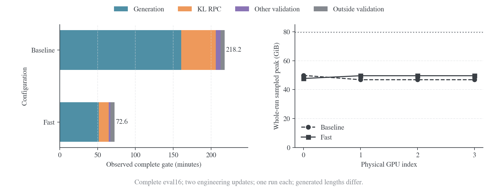
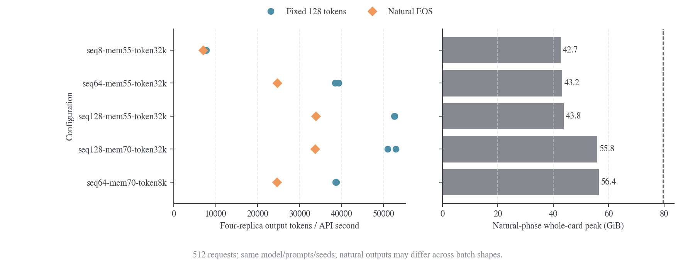

# 速度与显存

四卡原生来源实验的五十步训练耗时约 22–35 分钟，rollout 是训练内最大的成本；加上完整评测与启动，一轮约 89–106 分钟。性能比较需要分别计量生成、训练更新和验证，也需要区分实际请求量与引擎容量。准确率与研究结论见[实验入口](2026-10-19-rollout来源与logit融合实验.md)及[准确率与训练指标](2026-10-19-rollout准确率与训练指标.md)。

## 端到端流程与总体瓶颈

每个训练 step 先用指定来源生成响应，再由当前 student 和冻结 teacher 对响应评分，计算 token reward 并更新 student；需要当前权重的生成副本随后接收更新。到达 valid step 时，统一评测当前 student，按配置追加完整词表 KL，然后恢复训练。末步验证省去训练恢复。

| 阶段       | 主要工作                                                | 时间与显存的主要来源                             |
| ---------- | ------------------------------------------------------- | ------------------------------------------------ |
| 初始化     | 加载 actor/teacher、创建推理副本、编译和捕获 CUDA Graph | 权重加载、进程启动、推理池与 Graph 缓冲          |
| Rollout    | 当前 student、初始 student、teacher 或混合策略生成      | 自回归 decode、实际活跃 batch、上下文与 KV cache |
| 训练评分   | Student 重新评分、teacher token 评分                    | FSDP 前向、参数收集、临时激活                    |
| 训练更新   | Token advantage、student 反向与 optimizer step          | 激活、梯度、优化器与 offload                     |
| 权重发布   | 将新 student 权重交给需要它的生成副本                   | 参数导出、传输、sleep/wake                       |
| Validation | 当前 student 生成、答案判分、可选完整词表 KL            | 长响应生成、评分前向与词表投影                   |

以下两类实测承担不同用途，不能混成同一训练的前后对照。

| 实测范围            | 共同条件                                                                             | 支持的判断                                        |
| ------------------- | ------------------------------------------------------------------------------------ | ------------------------------------------------- |
| 六组正式来源实验    | 四卡、B64、50 步、4K 训练响应、最终 570×16 验证；冻结 d59a7c3 协议，无 validation KL | 不同来源的训练、生成、验证与显存成本              |
| Validation 优化对照 | 四卡、两步 B8 工程更新、训练响应 cap=64，随后完整 570×16、cap=31,744 和完整 KL       | 验证工程性能；组件测试另固定模型和 token 核验数值 |

### 六组正式训练的总体成本

硬件为物理 GPU 0–3，四张 H800 80GB；student 为 DeepSeek-R1-Distill-Qwen-1.5B，teacher 为 JustRL-DeepSeek-1.5B。本机独立环境使用 vLLM 0.10.0、Torch 2.7.1+cu126、Transformers 4.57.6。训练每题一条响应、T=1、全局 batch 64、prompt cap=1,024；最终验证为 MATH-500/AMC23/AIME25 共 570 题，每题 16 次，T=0.7、top-p=0.9，不保存 checkpoint。

下表单位均为分钟。“训练”包含 rollout、评分、更新和权重发布；“其他”是运行总时间减训练和验证的残差，包含初始化与退出等工作。

| 来源                          | 50 步训练 | 最终验证，无 KL | 其他 | 运行总时间 |
| ----------------------------- | --------: | --------------: | ---: | ---------: |
| 当前 student                  |     24.65 |           63.74 | 3.76 |      92.16 |
| 固定初始 student              |     21.96 |           63.58 | 3.81 |      89.35 |
| 固定 teacher                  |     22.02 |           68.82 | 3.89 |      94.72 |
| 当前 student + teacher，λ=0.5 |     34.66 |           66.96 | 4.15 |     105.77 |
| 初始 student + teacher，λ=0.5 |     33.25 |           65.59 | 4.10 |     102.94 |
| Teacher→student，k=2,048      |     25.34 |           66.20 | 4.90 |      96.45 |

完整验证是各组最大的独立阶段。以当前 student 为例，验证占运行时间约 69%；在训练内部，原生生成占约 56%，actor 更新占约 17%。优化优先级因此是验证生成、训练 rollout，再细分评分与更新。六组逐步 CSV、运行起止、来源身份与 W&B 核验均在[正式结果](results/native-rollout/formal/)；小数按原始秒数换算，表内四舍五入可能有 0.01 min 差异。


图的范围为前五组；Teacher→student 的完整结果已纳入表格，原始证据见[分段组](results/native-rollout/formal/teacher_current_k2048/)。

### 计量口径

`native_generate` 是推理调用墙钟时间，包含调度和返回；`gen` 还包含答案判分、打包及封装。`opd_teacher` 已包含在 `adv` 内，KL scoring RPC 已包含在 KL 总调用内，不能将嵌套 timer 再次相加。下文吞吐按实际响应 token 数除以对应调用时间计算。

整卡显存使用约两秒一次的 GPU 0–3 采样，可能漏掉短峰值；PyTorch allocated/reserved 只描述对应进程，不能与整卡值相加。GPU busy 表示采样窗口内执行 kernel 的时间比例，不是 SM occupancy 或 FLOPs 利用率。[^nvml-util]

## Rollout：来源、执行方式与吞吐

### 原生训练引擎的实际设置

正式实验使用四个单卡副本，每副本 TP=PP=DP=1。全局六十四条训练请求平均约十六条/卡；`max_num_seqs=64` 是上限，不代表每卡始终有六十四条请求。

| 设置                          | 单模型来源                                       | 原生 fusion                                         | 分段切换                       |
| ----------------------------- | ------------------------------------------------ | --------------------------------------------------- | ------------------------------ |
| 每 token 执行                 | 一个 Qwen2 backbone/head                         | 同一 vLLM 循环中的两套 backbone/head，再融合 logits | 当前段对应的一个 backbone/head |
| 训练 context / batched tokens | 5,120 / 5,120                                    | 同左                                                | 同左                           |
| 每卡 `max_num_seqs`           | 64                                               | 64                                                  | 64                             |
| 训练显存总预算                | 0.55                                             | 0.55，包含双模型 KV                                 | 0.55，由所需模型引擎共享       |
| 图执行                        | CUDA Graph，捕获至 64                            | 同左                                                | 同左                           |
| 权重发布                      | 当前来源需要，固定 p0/q 跳过                     | 当前 fusion 只更新 base；初始 fusion 两套均冻结     | 含当前 student 的来源需要      |
| 最终验证                      | 独立纯 student，context=32,768、seq64、预算 0.55 | 同左                                                | 同左                           |

上述是 d59a7c3 正式运行的实际配置。当前[原生模型池](../../verl/verl/workers/rollout/native_pool.py)仍将训练 `max_num_batched_tokens` 限制为配置值与 prompt+response cap 的较小者。普通 launcher 的 `enforce_eager=True`；正式矩阵显式开启 Graph，后文 `validation_fast` 只开启验证的 Graph，不会修改训练设置。当前[协调器](../../verl/verl/trainer/ppo/rollout_coordinator.py)生成时使用 `logprobs=False`，student 训练分数在生成后重新计算。

### 六组生成成本

| 来源                          | 有效训练响应 token | 原生生成 / s | 输出吞吐 / token·s⁻¹ |
| ----------------------------- | -----------------: | -----------: | -------------------: |
| 当前 student                  |         12,370,198 |       825.85 |            14,978.74 |
| 固定初始 student              |         12,484,215 |       833.52 |            14,977.73 |
| 固定 teacher                  |         12,473,493 |       834.31 |            14,950.76 |
| 当前 student + teacher，λ=0.5 |         12,439,895 |     1,414.86 |             8,792.34 |
| 初始 student + teacher，λ=0.5 |         12,419,694 |     1,451.79 |             8,554.74 |
| Teacher→student，k=2,048      |         12,349,812 |       849.95 |            14,530.06 |

三种单模型来源约 15k token/s，固定初始 student 每步仍实时生成，没有省去 rollout 次数。Current fusion 的吞吐为当前单模型的约 58.7%；它每个 token 都运行双模型，与分段的一次只运行一个模型不同。现有墙钟数据未分离 kernel、调度和通信的各自贡献。

### Batch 混合的布局对照

默认 `generation_layout=overlap` 在各卡保留所需来源；`split` 将来源放到不同卡组。独立推理测试固定 B64/cap128、Graph、50/50 整轨迹配额，一次预热、两次计量，测时屏蔽 EOS。

| 布局              | 来源模型副本总数 | 输出吞吐 / token·s⁻¹ |
| ----------------- | ---------------: | -------------------: |
| 单卡双模型        |                2 |             约 8,290 |
| 四卡各双模型      |                8 |             约 8,910 |
| 四卡按 2+2 分模型 |                4 |            约 15,430 |

2+2 相对四卡 overlap 的此项观测约为 1.73×；两者模型副本数和资源分配也改变，不按卡数单独归因。2+2 另有一次自然 EOS/cap4096 观测：259,012 token、16.56 s、约 15.64k token/s。它们均不包含 FSDP 训练与最终验证，不能写成完整训练加速。四卡 overlap 的同类短基准中，单模型约 16.35k、分段约 15.60k、fusion 约 9.36k token/s；原始数据见[短生成基准](results/native-rollout/throughput/overlap4-graph.json)和[布局汇总](results/native-rollout/throughput/combined/receipt.json)。


## 训练：评分、更新与权重发布

不同 rollout 来源都训练同一个 student。生成结束后推理引擎休眠，student 重新计算实际响应 token 的 `old_log_probs`，冻结 teacher 计算相同 token 的 log-prob，随后以 token reward 更新 student。Actor 参数/optimizer 和 teacher 参数使用 CPU offload；训练期间的激活、通信和恢复成本另计。

下表为五十步累计秒数，均由各组 `training-1-50.csv` 的相应 timer 求和；生成时间在上一节列出。

| 来源                     | Student 重新评分 | Teacher 评分 | Actor 更新 | 训练侧权重发布 |
| ------------------------ | ---------------: | -----------: | ---------: | -------------: |
| 当前 student             |           106.87 |        99.54 |     256.28 |         121.30 |
| 固定初始 student         |            86.62 |        96.95 |     222.68 |           约 0 |
| 固定 teacher             |            87.94 |        97.03 |     223.19 |           约 0 |
| 当前 student + teacher   |            95.52 |        99.67 |     249.86 |         132.90 |
| 初始 student + teacher   |            89.45 |        98.01 |     247.15 |           约 0 |
| Teacher→student，k=2,048 |            97.16 |        99.68 |     271.90 |         125.90 |

“约 0”是固定来源的训练发布空路径计时，小于 1 ms；验证前仍要同步最新 student。当前与初始来源的训练总时间相差 161.73 s，其中发布差 121.30 s，约占 75%；评分、更新及其他差异没有独立因果对照。固定来源更快的主要可解释差异是跳过逐步发布，不是少做 student 更新，也不是少生成响应。

`gen` 内还累计约 60–100 s 的判分/打包，以及其他封装成本。这些项目不等于 OPD teacher 评分，不能与 `native_generate`、`gen` 混加。当前性能修改聚焦验证，本文没有 actor 反向或 optimizer 的独立优化加速证据。

## Validation：完整成本与优化结果

启用 validation KL 后，每个 valid step 都先同步该 step 的 student，完成同一准确率生成与答案判分，再让生成引擎休眠，复用已生成的原始 token 计算 KL；固定 p0/q prefix bank 随配置追加。KL 对全部有效响应位置做 student/teacher 前向和完整词表归约，无反向传播。周期验证和仅末步验证共用此流程，细节见[验证 KL 与状态诊断](2026-10-19-rollout验证KL与状态诊断.md)。

### 完整验证 KL 的成本与瓶颈

完整对照使用两步 B8 工程更新后的 student，两轮均验证 570×16 条主响应，并评分 bank 的 180 条响应、1,440 个位置。旧基线的验证继承工程训练 seq8；优化轮使用独立 seq128 和更大的提交窗口。完整参数及输入绑定由[阶段核算](results/native-rollout/validation-performance/full/performance-comparison.json)保存。

| 互斥阶段                 | 基线 / min | 优化 / min | 节省 / min | 占验证节省时间 |
| ------------------------ | ---------: | ---------: | ---------: | -------------: |
| 原生生成                 |     160.45 |      51.43 |     109.02 |          74.9% |
| KL 评分 RPC              |      45.70 |      13.27 |      32.44 |          22.3% |
| 其他验证处理             |       6.49 |       2.30 |       4.19 |           2.9% |
| 整轮 validation          |     212.64 |      67.00 |     145.65 |           100% |
| 验证之外，含初始化与归档 |       5.53 |       5.56 |      −0.04 |              — |
| 完整任务，启动至归档     |     218.17 |      72.56 |     145.61 |              — |

**最大的绝对收益来自生成：约节省 109 分钟。KL 评分其次，节省约 32 分钟。**整轮验证约 3.17×，完整任务约 3.01×；这些是组合配置的实测结果，各项加速比不能相乘。

主响应数均为 9,120；有效主 token/评分位置为 56,737,088→56,451,119，相差约 −0.50%。两轮训练轨迹哈希和 loss 相同，但未复用同一最终 checkpoint，共同 bank 上的 student 统计也有差异。完整对照用于观察实际性能；固定 p0/q、相同 token 的配对测试承担数值一致性与组件比较。正式五十步矩阵已经用 seq64，不能将工程 seq8→128 的 3.17× 套给所有正式实验。



图中的总柱为启动至归档时间。优化后生成 API 为 3,162.96 s，其中原生生成 3,085.57 s；KL 总调用为 819.83 s，其中评分 RPC 796.06 s。有效 token 解码为 11.69 s，记录收集为 16.79 s。API timer 含封装、通信和等待，不当作纯 CUDA kernel 时间。[覆盖审计](results/native-rollout/validation-performance/full/kl-independent-audit.json)与[W&B 核验](results/native-rollout/validation-performance/full/wandb-verification.json)均通过。

### 周期验证与训练恢复

另一次四卡工程运行在 step2/4 各验证相同六题×16，保留 cap=31,744、全部主位置和完整 bank；训练仍为 B8/cap64，验证为 seq128、batched tokens32768、预算 0.55 和 Graph。

| 计量项                     |        Step2 |        Step4 |
| -------------------------- | -----------: | -----------: |
| 主响应 / 有效评分位置      | 96 / 577,796 | 96 / 591,509 |
| 生成调用，含判分和打包 / s |       104.24 |       135.07 |
| KL 评分 RPC / s            |        19.38 |        18.89 |
| KL 总调用，含上一行 / s    |        20.58 |        20.06 |
| 验证后恢复 / s             |         2.25 |        0.004 |
| 验证总调用 / s             |       133.01 |       157.94 |

Step2 后真实执行两次后续 student 更新，step4 为末步。Bank 的原始记录与位置权重跨轮相同，teacher 归一化条件熵不变，student 条件 KL 改变；逐步版本、实际引擎参数、覆盖及 W&B history 均经[周期验收](results/native-rollout/validation-performance/periodic/periodic-gpu.json)和[远端核验](results/native-rollout/validation-performance/periodic/wandb-verification.json)。两轮响应长度和尾部等待不同，不据 104/135 s 判断评分器退化。

## 优化策略与单项收益

### 可量化收益的范围

| 策略与对照                                           | 固定范围内的结果                            | 归因边界与选择                                        |
| ---------------------------------------------------- | ------------------------------------------- | ----------------------------------------------------- |
| 生成 seq8→64，预算 0.55                              | 自然输出吞吐 6.97k→24.71k token/s，约 3.55× | 相同固定模型和 prompt、8K cap；自然输出 token 有差异  |
| 生成 seq64→128，预算 0.55                            | 24.71k→33.86k token/s，约 1.37×             | 继续提高并发有收益，采用 128；不直接外推完整 31K 验证 |
| 新评分器与长度平衡，保持 128/8192 分块               | 45.408→22.836 s，约 1.99×                   | 同时更换实现和调度，缺少二者各自的单独对照            |
| 平衡后增大位置块并整块归约词表                       | 22.836→11.335 s，再快约 2.01×               | 128/8192→1024/151665 的组合；相对旧评分器累计约 4.01× |
| 只解码有效 token                                     | CPU 0.764→0.283 s，约 2.70×                 | 256 条真实响应的 ABBA 测试，文本哈希相同；仅解码成本  |
| 有效词表大小每轮只查询一次                           | CPU 4.405→0.090 s，约 49×                   | 180 条 bank 输入校验的 ABBA 测试；仅校验成本          |
| 精确数学指标、减少重复 bootstrap                     | 保留精确 `eval/*`，减少外围工作             | 与其他修改共同进入完整复测，无独立端到端收益数字      |
| 独立验证资源、扩大题目窗口、Ray object store 4→8 GiB | 提交 18→9 批，避免继承训练的小并发          | 属于完整组合；窗口与主机内存各自未独立消融            |

长度平衡让四卡在同一 FSDP collective 轮次处理相近长度的前缀，减少等待；返回后先恢复原始顺序，再去掉补齐。新评分器的 FP32 归约减少重复 cast、循环和标量同步；增大分块进一步提高吞吐。约 1.99×应记为“新实现加平衡调度”，不能全部记给长度排序。CUDA Graph 在完整旧基线中已经开启，本文没有将其开关独立测量，不为它分配额外加速比。

CPU 对照分别见[有效 token 解码](results/native-rollout/validation-performance/decode-cpu.json)和[词表查询缓存](results/native-rollout/tokenizer-vocab-cache-cpu.json)。它们解释局部开销，不意味着完整验证也能按同一倍率加速；其他验证处理合计只节省约 4.19 分钟。

### 生成并发与显存预算

四个 TP=1 副本，固定初始 student、原始 prompt 与逐请求 seed，32 题×16=512 条请求、每卡 128 条排队请求。题目为 11 MATH、11 AMC、10 AIME，作为压力子集，采样 T=0.7、top-p=0.9。每项预热一次，固定 128-token 工作量测两遍，再测一次自然 EOS、cap=8,192；context=32,768，Graph、APC 与 chunked prefill 开启。

| 活跃序列上限 / 卡 | 显存预算 | Batched tokens | 固定 65,536 token 平均 / s | 自然生成 / s | 自然输出吞吐 / token·s⁻¹ | 自然阶段整卡峰值 / MiB |
| ----------------- | -------: | -------------: | -------------------------: | -----------: | -----------------------: | ---------------------: |
| 8                 |     0.55 |         32,768 |                      8.510 |      417.454 |                    6,969 |                 43,686 |
| 64                |     0.55 |         32,768 |                      1.685 |      117.382 |                   24,710 |                 44,256 |
| 128               |     0.55 |         32,768 |                      1.245 |       84.767 |                   33,862 |                 44,834 |
| 128               |     0.70 |         32,768 |                      1.261 |       85.287 |                   33,722 |                 57,186 |
| 64                |     0.70 |          8,192 |                      1.693 |      118.108 |                   24,629 |                 57,792 |

**提高并发的收益大于单纯增加显存预算。**Seq128 下 0.55→0.70 未观察到吞吐收益，整卡峰值却增加约 12.1 GiB，采用 128/0.55/32768。末行同时修改两个参数，不能独立归因于 token 预算。五次自然阶段均记录零抢占，但 8K 测试不保证 31K 完整验证无抢占；完整 trainer 关闭了 vLLM 调度计数，无法补报完整轮的准确抢占数。



自然输出约 2.87–2.91M token，按各自实际量归一化。不同 batch 形状不保证逐 token 一致，自然阶段每项只有一次，不据细小点差作稳定排序。实际 worker 限制、设备、响应哈希与冻结摘要见[生成基准](results/native-rollout/validation-performance/generation-gpu.json)及[整卡采样](results/native-rollout/validation-performance/generation-gpu.csv)。

### KL 分块与数值验收

固定 p0/q 和 104 条真实响应：三个基准各按长度分位数取 32 条，再取 bank 两来源各 4 条；主响应覆盖 1,019,424 个有效位置。BF16、四卡 FSDP1，不创建 optimizer 或开启 CPU offload。旧评分器为 b528c6d，新实现与 139fd21 对应；每项预热一次、计时两遍，第二遍逆序，始终覆盖全部有效位置和 151,665 个词表项。

| 配置：位置块 / 词表块      | 四卡时间 / s | 相对旧实现 | Allocated / Reserved 峰值，GiB |    最大配对均值误差 | 选择       |
| -------------------------- | -----------: | ---------: | -----------------------------: | ------------------: | ---------- |
| 旧实现、原顺序，128 / 8192 |       45.408 |      1.00× |                   6.02 / 22.44 |                   0 | 基线       |
| 新实现、平衡，128 / 8192   |       22.836 |      1.99× |                    6.02 / 6.63 |                   0 | 通过       |
| 平衡，512 / 完整词表       |       11.689 |      3.88× |                    6.74 / 8.37 | $8.45\times10^{-7}$ | 通过       |
| 平衡，1024 / 完整词表      |       11.335 |      4.01× |                   9.34 / 11.27 | $8.45\times10^{-7}$ | 采用       |
| 平衡，2048 / 完整词表      |       11.119 |      4.08× |                  14.55 / 17.63 | $8.45\times10^{-7}$ | 增量收益小 |

从 1024 增至 2048 只再快约 2%，allocated 却增加约 5.2 GiB，因此采用 1024。Backbone 前向 batch2/4/8/16 另测为 10.78–13.42 s，但最大配对均值误差约$1.31\times10^{-3}$，超过$10^{-5}$门槛，全部不采用，保留 batch1。完整词表、FP32 归约没有改成 top-k 或抽样位置。

验收同时检查相同量化 logits 的独立 FP64 参考，以及各响应归一化统计相对旧实现的差。输入与模型身份见[工作量清单](results/native-rollout/validation-performance/scoring-input.json)，各候选逐次结果见[评分基准](results/native-rollout/validation-performance/scoring-gpu.json)。这些误差界限只覆盖所测数据和模型。


图中 allocated/reserved 属于评分进程，红色候选未通过数值验收；不能将约 4 倍的组件加速写成整轮 validation 加速 4 倍。图由[绘图脚本](../../eval/plot_validation_performance.py)读取原始数据生成。

## 显存：实测占用与可提前计算的部分

### 六组正式实验的逐卡峰值

下表为整轮 GPU 采样峰值，单位 MiB，包含训练和最终验证；它不能表示训练的每一个时刻都用了这些显存。

| 来源                     |   GPU0 |   GPU1 |   GPU2 |   GPU3 |
| ------------------------ | -----: | -----: | -----: | -----: |
| 当前 student             | 50,369 | 50,759 | 48,905 | 50,759 |
| 固定初始 student         | 54,037 | 54,109 | 54,059 | 54,071 |
| 固定 teacher             | 54,917 | 54,943 | 55,043 | 54,071 |
| 当前 student + teacher   | 51,187 | 49,903 | 50,249 | 50,969 |
| 初始 student + teacher   | 55,093 | 55,119 | 55,137 | 55,087 |
| Teacher→student，k=2,048 | 49,882 | 49,952 | 49,902 | 49,914 |

各卡可见容量为 81,559 MiB，均未用满。验证优化的整轮/评分阶段分别如下，GPU0/1/2/3 按顺序排列。

| 运行         | 整轮峰值 / MiB                    | KL 阶段峰值 / MiB                 |
| ------------ | --------------------------------- | --------------------------------- |
| 完整验证基线 | 51,009 / 47,975 / 47,975 / 47,975 | 10,911 / 10,931 / 10,909 / 10,911 |
| 完整验证优化 | 48,839 / 50,797 / 50,797 / 50,797 | 14,691 / 14,693 / 14,693 / 14,693 |
| 周期验证优化 | 51,033 / 50,815 / 50,739 / 50,557 | Step2/4各卡约14,641–14,703        |

优化后整轮约 47.7–49.6 GiB，KL 阶段约 14.35 GiB。评分有意识地使用更多临时显存换取较大的计算块；继续提高生成池预算在已测负载中没有吞吐收益。

### Prefill、decode 与 batch

Prefill 并行处理已知 prompt，建立各层 K/V；decode 逐 token 续写，每一步读取历史 K/V 并计算新 token。KV cache 避免重复计算历史位置的 K/V 投影；它与保存完整响应的 SQLite 轨迹缓存用途不同。[^hf-kv]

单卡单模型、全注意力、固定精度且不计 prefix sharing 时，活跃序列数为$b$、上下文长度为$L_i$，有效张量显存可近似分为

$$
M_{\mathrm{GPU}}\approx M_W+c_{\mathrm{KV}}\sum_{i=1}^{b}L_i+M_{\mathrm{temp}}(b,\{L_i\})+M_{\mathrm{runtime}}.
$$

$M_W$为权重，$c_{\mathrm{KV}}$为单序列每位置的 KV 字节数，后两项包括临时激活、logits、kernel workspace 和运行时。较大 batch 可摊销 decode 的权重读取和调度，增加总 token 吞吐；单条响应的 token 间隔也可能增加，饱和后收益减小。[^nvidia-inference]

若一轮 decode 耗时为$\tau(b,L)$，单卡输出吞吐近似$b/\tau(b,L)$。当前$G$卡完整副本均分全局请求$B$时，总吞吐近似

$$
Q_{\mathrm{total}}\approx G\frac{B/G}{\tau(B/G,L)}=\frac{B}{\tau(B/G,L)}.
$$

增加卡数若同时缩小每卡 batch，会改变每卡效率；要接近线性扩展，需要足够的排队请求。这里每卡都保留完整模型，与跨卡切分模型、每轮需要通信的张量并行不同。[^vllm-dp]

### 权重与 KV 容量

[容量估算器](../../eval/estimate_validation_memory.py)只读取配置和 safetensors 文件头，不建立 CUDA context。当前资产 339 个张量、1,777,088,000 个参数，BF16 权重每模型约 3.31 GiB。单模型、TP=1、BF16 KV 每序列每位置为

$$
c_{\mathrm{KV}}=2\times28\times2\times128\times2=28{,}672\ \mathrm{byte}=28\ \mathrm{KiB}.
$$

各因子为 K/V、层数、KV head 数、head 维度和精度字节数；KV 按 2 个 KV head 计算，不按 12 个 query head 计算。

| 每卡活跃序列 | 全部上下文 5,120 时 KV | 全部上下文 32,768 时 KV |
| ------------ | ---------------------: | ----------------------: |
| 16           |               2.19 GiB |                  14 GiB |
| 32           |               4.38 GiB |                  28 GiB |
| 64           |               8.75 GiB |                  56 GiB |
| 128          |              17.50 GiB |                 112 GiB |

Fusion 需要两套 KV，例如每卡 16 条、长度 5120 时约 4.38 GiB。表格不含共享 prefix、分页取整、Graph 或临时张量；seq128 不保证一百二十八条都能同时达到 32K。KV 不足可能引发排队或抢占重算，需测真实长度分布与抢占指标。[^vllm-tuning]

vLLM 按实例预算分配 KV pool；活跃 batch 变小可以释放池内块，不保证将整池显存归还其他模型。[^vllm-kv-pool] `gpu_memory_utilization`覆盖该实例的权重、非 KV 开销和 KV pool，不是整个训练作业的整卡上限。[^vllm-memory]

单卡容量$M$、预算比例$u$、权重$W$和非 KV 余量$R$下，可用 KV 位置数近似为

$$
C_{\mathrm{KV}}\approx\frac{\max(0,uM-W-R)}{c_{\mathrm{KV}}}.
$$

$R$必须显式假设或测量。估算器默认 4 GiB 余量，不会准确推导 Graph 池、FSDP 瞬态收集、其他进程和碎片；预留显存不自动增加计算带宽。

### KL 评分组件

评分前生成引擎休眠，评分与活跃生成 KV 分阶段使用显存。位置块 1024、有效词表 151665、head 宽 151936 时，两模型 BF16 logits 约 593.5 MiB，保守 FP32 归约工作区约 4.63 GiB，student head 快照约 0.435 GiB，32K 两套选中 hidden 上界约 0.188 GiB。估算器将这些组件加两份 BF16 权重计为约 12.45 GiB；FSDP 分片/收集、主权重精度、前向 workspace 等另计，不是整卡峰值保证。

```bash
.venv/bin/python eval/estimate_validation_memory.py \
    --model ../models/DeepSeek-R1-Distill-Qwen-1.5B \
    --gpus 4 --prompt-batch 64 --samples 16 --max-sequences 128 \
    --memory-budget 0.55 --context-cap 32768 --mean-context 6301 \
    --position-chunk 1024 --vocabulary-chunk 151665
```

## 当前配置与四/八卡参数

[validation_fast](../../verl/verl/trainer/config/experiment/validation_fast.yaml)提供已测的验证组合。普通配置中 validation KL 默认关闭；该 profile 显式开启，之后每个配置的 valid step 都会计算。普通 math launcher 仍默认仅末步验证、题目窗口 32；使用 profile 时显式把窗口设为 64。

以下生成字段均带`actor_rollout_ref.rollout.`前缀，`null`表示继承原值。它们只作用于原生验证 manager 的配置副本；训练引擎、全局学习 batch 和 rollout 来源保持原值。

| 参数                                        | 四卡配置                                                 | 八卡建议起点，尚无 GPU 实测     |
| ------------------------------------------- | -------------------------------------------------------- | ------------------------------- |
| `N_GPUS_PER_NODE` / 可见 GPU                | 4 / 0–3                                                  | 8 / 0–7                         |
| 训练全局 batch                              | 64，工程验收用 8                                         | 64                              |
| `data.val_batch_size`，题目数               | 64                                                       | 128                             |
| 每题样本数                                  | 16                                                       | 16                              |
| 每批提交响应 / 平均每卡排队                 | 1024 / 256                                               | 2048 / 256                      |
| `generation_eval_max_num_seqs`              | 128                                                      | 128                             |
| `generation_eval_max_num_batched_tokens`    | 32768                                                    | 32768                           |
| `generation_eval_memory_utilization`        | 0.55                                                     | 0.55                            |
| `generation_eval_enforce_eager`             | False，开启 Graph                                        | 同左                            |
| `generation_eval_engine_kwargs`             | Graph 捕获尺寸 1/2/4/8/16/32/64/128，`custom_ops: [all]` | 同左                            |
| `trainer.validation_metrics_mode`           | `math_exact`                                             | 同左                            |
| `trainer.validation_kl.balance_records`     | True                                                     | 同左                            |
| `trainer.validation_kl.forward_batch_size`  | 1                                                        | 1                               |
| `trainer.validation_kl.position_chunk_size` | 1024                                                     | 1024                            |
| `trainer.validation_kl.vocab_chunk_size`    | 151665，完整有效词表                                     | 同模型时相同                    |
| Ray object store，主机内存                  | 8 GiB                                                    | 8 GiB 起点，结合 RAM/spill 测量 |

`math_exact`保留精确准确率与 pass@k，跳过重复的通用 bootstrap 辅助指标；长度、EOS 和 KL 仍计算，离线统计审计仍可单独执行。八卡假设同为 H800 80GB、八个 TP=1 副本；维持每卡排队量，不机械翻倍每卡并发或预算。FSDP 分片会缩小，但推理权重和每序列 KV 系数不变。

四卡启动参数示例，使用已准备的数据清单：

```bash
NATIVE_DATA_MANIFEST=runs/native-rollout-implementation/fresh-math-data-v2/manifest.json \
CUDA_VISIBLE_DEVICES=0,1,2,3 N_GPUS_PER_NODE=4 \
    bash recipe/math_native.sh student_fresh +experiment=validation_fast \
    data.val_batch_size=64 ray_kwargs.ray_init.object_store_memory=8589934592
```

八卡仅提供配置示例；当前 GPU 验收限物理 0–3，八卡需扩展遥测与独立审计，覆盖全部 worker 后再测实际收益。

```bash
NATIVE_DATA_MANIFEST=runs/native-rollout-implementation/fresh-math-data-v2/manifest.json \
CUDA_VISIBLE_DEVICES=0,1,2,3,4,5,6,7 N_GPUS_PER_NODE=8 \
    bash recipe/math_native.sh student_fresh +experiment=validation_fast \
    data.val_batch_size=128 ray_kwargs.ray_init.object_store_memory=8589934592
```

启动转发已做四/八卡 CPU 检查；四卡实际验证配置由上文完整工程复测和周期恢复支撑，不宣称已完成同 profile 的五十步质量比较。新增负载若要分析抢占，可设置`actor_rollout_ref.rollout.disable_log_stats=False`，并同时采集 KV 使用量与阶段 timer。

## 固定缓存对照的运行设置

本节用于解释缓存方案的成本，采用另一套执行协议：Teacher/Semi 预先生成固定 3,200 条响应，Semi 来自初始 student；在线组逐步生成，fusion 使用 HF 双模型 Graph 路径。四组均训练 student、B64、50 步、训练 cap4096，最终 570×16 验证，无 validation KL。它们不代表当前原生引擎的默认设置。

| 设置                      | 在线 student        | Teacher 缓存 | Semi 缓存   | HF fusion                    |
| ------------------------- | ------------------- | ------------ | ----------- | ---------------------------- |
| 每卡实际生成请求          | 约 16               | 64，末批 32  | 64，末批 32 | 16                           |
| 生成 context              | 32768               | 5120         | 5120        | 双 StaticCache 容量 5120     |
| vLLM seq / batched tokens | 64 / 32768          | 64 / 8192    | 64 / 8192   | HF 训练不适用                |
| 生成显存预算              | 0.55                | 离线 0.65    | 离线 0.65   | 不使用 vLLM 预算控制 HF      |
| 生成 log-prob             | 返回采样 token 分数 | 不请求       | 不请求      | 记录融合行为分数             |
| 原生 vLLM eager           | 开启                | 开启         | 开启        | 验证开启；HF decode 用 Graph |

四组 actor/optimizer 和 teacher 都使用 CPU offload。缓存训练只读 token，student/teacher 评分和 student 更新仍每步执行；预生成时间须计入首次使用成本。

| 设置             | 缓存准备 / min | 50 步训练 / min | 完整验证 / min | 阶段合计 / min | 训练/验证整卡最高采样，GiB |
| ---------------- | -------------: | --------------: | -------------: | -------------: | -------------------------: |
| 在线 student     |         不适用 |           39.14 |          95.39 |         134.53 |              45.17 / 45.77 |
| Teacher 缓存     |           9.09 |            6.83 |         101.14 |         117.06 |              34.02 / 62.32 |
| Semi 缓存        |           8.96 |            6.84 |          95.14 |         110.93 |              37.15 / 47.43 |
| HF fusion，λ=0.5 |         不适用 |           49.98 |          98.46 |         148.44 |              59.30 / 59.21 |

合计不含全部启动环节；缓存预生成缺少整卡遥测，不将缺失值记零。在线和初始 student 离线分别生成 12,407,645/12,482,086 token，均为 3,200 条，离线没有减少 rollout 次数；请求实际 batch、context、返回分数和预算均不同。在线/Semi 只比较训练循环是 5.73×，计入首次准备是 2.48×，再计入最终验证仅 1.21×。

首轮训练侧净差 1,401.05 s，其中生成/准备加缓存读取差 1,246.18 s、权重同步差 108.52 s，其余评分/更新差 46.35 s。这只是互斥时间分解，无法把差额独立分给 batch 或显存预算；后续重复消费同一缓存才省去再次生成。固定 checkpoint、实际每卡 batch、长度、采样、返回分数、后端与负载后，纯 rollout 工作应相近，端到端仍有同步、切换、缓存 I/O 和初始化差异。

完整阶段、allocator、busy、输入绑定见[资源汇总](results/resources/summary.json)，调用与工作量见[成本审计](results/rollout-cost-audit/summary.json)。[阶段与显存图](figures/resources/resource-comparison.png)及[逐卡时间线](figures/resources/gpu-usage-timeline.png)只描述此缓存协议，不与原生六组或新验证 profile 混用。

## 尚缺少的性能证据

当前仍需分别验证：八卡完整运行；split 布局的完整训练收益；单引擎换权重与双引擎驻留的同配置成本；请求分段与 APC 的单独影响；新 vLLM 版本的隔离兼容与性能。完整 31K 验证还缺精确抢占计数，prefill/decode/通信的 kernel 级归因也未采集。已有墙钟结果足以确定优化优先级，不能补写成这些未测项的结果；方案与验收条件归[原生推理 Agent Note](../../.agents/notes/proposed/architecture/2026-10-18-可组合rollout与原生vLLM推理.md)。

### 参考文献

[^nvml-util]: NVIDIA. NVML API Reference Guide, nvmlUtilization_t. NVIDIA 2024. [GPU utilization 定义](https://docs.nvidia.com/deploy/archive/R535/nvml-api/structnvmlUtilization__t.html).

[^hf-kv]: Hugging Face. Caching. Transformers v4.57.1, 2025. [Caching](https://huggingface.co/docs/transformers/v4.57.1/cache_explanation).

[^nvidia-inference]: Verma S, Vaidya N. Mastering LLM Techniques: Inference Optimization. NVIDIA Technical Blog 2023. [Prefill、decode、batch 与访存](https://developer.nvidia.com/blog/mastering-llm-techniques-inference-optimization/).

[^vllm-kv-pool]: vLLM contributors. GPU worker and GPU model runner. vLLM v0.10.0, 2025. [KV 预算与初始化](https://github.com/vllm-project/vllm/blob/v0.10.0/vllm/v1/worker/gpu_worker.py)、[KV 张量分配](https://github.com/vllm-project/vllm/blob/v0.10.0/vllm/v1/worker/gpu_model_runner.py).

[^vllm-tuning]: vLLM contributors. Optimization and Tuning. vLLM v0.10.0, 2025. [Prefill、decode 与调参](https://docs.vllm.ai/en/v0.10.0/configuration/optimization.html).

[^vllm-dp]: vLLM contributors. Data Parallel Deployment. vLLM v0.10.0, 2025. [完整模型副本与独立 KV cache](https://docs.vllm.ai/en/v0.10.0/serving/data_parallel_deployment.html).

[^vllm-memory]: vLLM Team. Engine Arguments, v0.10.0. vLLM 文档，访问于 2026. [显存预算参数](https://docs.vllm.ai/en/v0.10.0/configuration/engine_args.html).
