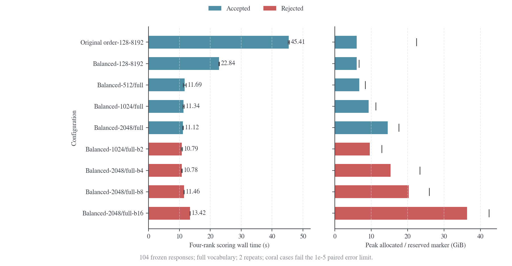
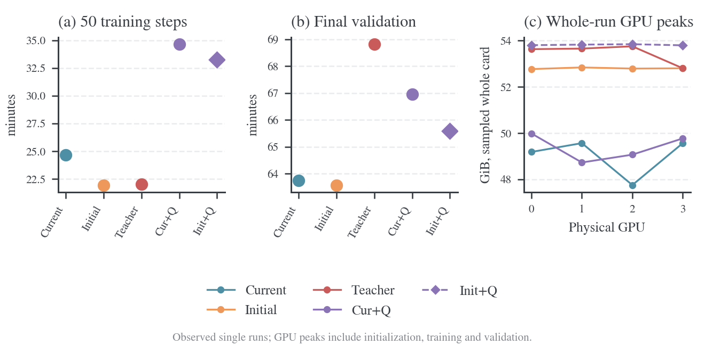

# 速度与显存

准确率与训练预算见[实验入口](2026-10-19-rollout来源与logit融合实验.md)，任务成绩见[准确率与训练指标](2026-10-19-rollout准确率与训练指标.md)。本页区分原生实时生成、固定缓存对照和独立推理基准；不同范围的吞吐不互相替代。

## 计量口径

Native generate 是原生生成调用墙钟时间，包含调度和返回，不等于纯 GPU kernel 时间。训练 step 包含生成/读取、student/teacher 评分、更新与权重发布；最终验证在 step 之外。嵌套 timer 不重复相加。冷启动、训练和验证分别记录。

整卡显存来自 GPU 0–3 的采样；allocator 的 allocated/reserved 只描述对应进程。整卡采样可能漏掉短峰值，峰值也不能与 allocator 高水位相加；原生运行采用约二秒一次的遥测，固定缓存对照使用 W&B 系统采样。GPU busy 是采样窗口内 kernel 执行时间比例，不是 SM occupancy、FLOPs 利用率或显存占用。[^nvml-util]

## Validation 的独立资源配置

验证使用独立的纯 student 引擎，训练来源、学习 batch 与生成预算保持原设置。下面的参数只进入验证 manager 的配置副本；`null` 继承原 rollout 配置，不能用增大学习 batch 来代替增加验证并发。

| 参数                                         | 控制内容                                                                                   |
| -------------------------------------------- | ------------------------------------------------------------------------------------------ |
| `generation_eval_max_num_seqs`               | 每个验证引擎的最大活跃序列数，独立于训练 mini-batch                                        |
| `generation_eval_max_num_batched_tokens`     | 每个验证引擎一次调度的 token 预算                                                          |
| `generation_eval_memory_utilization`         | 验证引擎的显存预算比例，训练预算不变                                                       |
| `generation_eval_enforce_eager`              | 验证引擎是否禁用 CUDA Graph                                                                |
| `generation_eval_engine_kwargs`              | 仅验证的 vLLM 高级参数，例如 Graph 捕获尺寸与 custom ops                                   |
| `data.val_batch_size`                        | 一次提交的题目数；每题仍采样十六次，总验证题目不变                                         |
| `trainer.validation_kl.forward_batch_size`   | 一次 backbone 前向的响应数；大于 1 的 CUDA 路径要求 FlashAttention2，候选值须验收精度/显存 |
| `trainer.validation_kl.position_chunk_size`  | KL head 一次投影的位置数                                                                   |
| `trainer.validation_kl.vocab_chunk_size`     | FP32 归约块；达到有效词表大小时使用整块归约                                                |
| `trainer.validation_kl.balance_records`      | 按相近前缀长度安排 collective 轮次，评分后恢复原始顺序                                     |
| `trainer.validation_metrics_mode=math_exact` | 保留精确 `eval/*`，跳过重复 bootstrap 辅助指标；长度/EOS/KL 仍计算                         |

`+experiment=validation_fast` 提供验证专用组合。KL 的负载平衡和整块词表已通过下文的真实四卡配对测试；生成参数与中间验证恢复另行验收。配置保留所有响应、全部有效位置与完整词表。`forward_batch_size` 维持 1：大于 1 的实验路径未通过配对精度门槛。

验证阶段另记 `validation_performance/*`：引擎准备、`generate_sequences` 调用、有效 token 解码、答案分数提取、记录收集、KL 总调用、恢复、dump 调用与整轮时间。生成调用可以包含后端 verifier，分数提取不等于新增一次神经网络评分；KL 总调用又包含其内部 scoring RPC，不重复相加。计时是 API 墙钟，不是 CUDA kernel 时间。

## 可提前计算的显存组件

[容量估算器](../../eval/estimate_validation_memory.py)只读取模型配置与 safetensors 文件头，不导入 Torch 或建立 CUDA context。当前资产为 339 个张量、1,777,088,000 个参数，BF16 权重每模型 3,554,176,000 byte，约 3.31 GiB；四卡改为八卡的独立推理副本仍各保留一份完整权重。

单模型、TP=1、BF16 KV、全注意力时，每条序列每个位置的 KV 为

$$
c_{\mathrm{KV}}=2\times28\times2\times128\times2=28{,}672\ \mathrm{byte}=28\ \mathrm{KiB}.
$$

因子分别是 K/V、层数、KV head 数、head 维度和精度字节数。活跃序列 $b$、上下文 $L$ 下，KV 张量约为 $bLc_{\mathrm{KV}}$。它不包括分页取整、prefix sharing、CUDA Graph、临时激活或其他进程。

| 每卡活跃序列 | 全部上下文 5,120 时 KV | 全部上下文 32,768 时 KV |
| -----------: | ---------------------: | ----------------------: |
|           16 |               2.19 GiB |                  14 GiB |
|           32 |               4.38 GiB |                  28 GiB |
|           64 |               8.75 GiB |                  56 GiB |
|          128 |              17.50 GiB |                 112 GiB |

因此 `max_num_seqs=128` 不保证一百二十八条响应都能同时达到 32K。需要结合真实长度分布、KV pool 和 preemption 决定并发。V1 的重计算抢占可以防止直接超出 KV 容量，但有额外代价；提高预算、减少并发/token 预算都是可测的调节项。[^vllm-tuning]

给定单卡总容量 $M$、实例预算比例 $u$、权重 $W$、预留的非 KV 余量 $R$，容量估算器计算

$$
C_{\mathrm{KV}}\approx\frac{\max(0,uM-W-R)}{c_{\mathrm{KV}}}.
$$

$R$ 是显式假设或独立测量值，不能由模型配置准确推导。默认 4 GiB 只作为估算余量；其他进程、FSDP 恢复、Graph 池及 allocator 碎片须另列。活跃 batch 变小会释放池内块，不保证预分配池立即还给其他模型。

KL 评分时生成引擎先休眠，不再同时保留活跃生成 KV。以位置块 1,024、有效词表 151,665、head 宽 151,936 为例，两模型 BF16 logits 约 593.5 MiB；FP32 归约工作区的保守组件估计约 4.63 GiB，student head 快照约 0.435 GiB，32K 的两套选中 hidden 上界约 0.188 GiB。估算器列出这些组件及两份完整 BF16 权重之和约 12.45 GiB；FSDP 的实际分片/收集、主权重精度、前向 workspace 和 allocator 另计，这不是整卡峰值保证。

```bash
.venv/bin/python eval/estimate_validation_memory.py \
    --model ../models/DeepSeek-R1-Distill-Qwen-1.5B \
    --gpus 4 --prompt-batch 32 --samples 16 --max-sequences 64 \
    --memory-budget 0.55 --context-cap 32768 --mean-context 6301 \
    --position-chunk 1024 --vocabulary-chunk 151665
```

## 四卡与八卡的参数起点

下面保持同一模型、每题十六次和学习 batch 64。八卡假设仍为 H800 80GB，采用八个 TP=1 完整副本；不是将一个 1.5B 模型改为 TP=8。这里是容量与配置起点，尚无实际八卡吞吐证据。

| 参数                     |        四卡起点 |         八卡起点 |
| ------------------------ | --------------: | ---------------: |
| 训练全局 batch           |              64 |               64 |
| `data.val_batch_size`    |              32 |               64 |
| 每题样本数               |              16 |               16 |
| 每批提交响应数           |             512 |            1,024 |
| 平均每卡排队响应         |             128 |              128 |
| 验证 `max_num_seqs` 候选 |              64 |               64 |
| 验证 batched-token 候选  |          32,768 |           32,768 |
| 验证显存比例候选         |       0.55–0.70 |        0.55–0.70 |
| KL 位置块候选            | 512/1,024/2,048 | 先用四卡已验收值 |

只增加卡数而保持一次总提交量不变，会减少每卡请求；不应因此自动把每卡并发上限翻倍。八卡优先增大验证提交窗口以维持每卡排队量；总 570×16 条响应不变，最后一批按实际题数处理。FSDP 的每卡分片会缩小，但推理副本权重和每序列 KV 系数不变。

启动入口已参数化并通过四/八卡的 CPU 命令转发检查。八张设备均分配给当前任务后，可使用下面的配置；当前实测仍只使用物理卡 0–3。

```bash
N_GPUS_PER_NODE=8 CUDA_VISIBLE_DEVICES=0,1,2,3,4,5,6,7 \
    bash recipe/math_native.sh student_fresh +experiment=validation_fast \
    data.val_batch_size=64
```

每卡实际空闲容量、模型大小或硬件改变时，重新计算与测量。`max_num_batched_tokens` 同时影响 prefill 和 decode 的调度，较大值可以提高 prompt 处理量，也可能增加激活峰值和 token 间隔；不按卡数机械翻倍。[^vllm-tuning]

## Validation 优化的 CPU 证据

[语义与配置检查](results/native-rollout/validation-performance/cpu.json)覆盖分片逆排、补齐、整块数值、批量前向、周期验证和独立资源配置。[真实 tokenizer 的解码对照](results/native-rollout/validation-performance/decode-cpu.json)使用固定抽取的 256 条实际验证响应，按 padded/effective/effective/padded 顺序计量，四次输出文本哈希完全相同；padded 为 0.7701/0.7587 s，effective 为 0.2833/0.2829 s。该结果只说明 CPU 解码成本，不外推整轮或 GPU 加速。

## KL 评分的四卡配对测试

从完整验证保留的原始 token 中，按每个基准的响应长度分位数各取 32 条，再取 p0/q 各 4 条 bank 响应，共 104 条。主响应覆盖 1,019,424 个有效位置；这不是 104 道独立题目。所有条件读取相同 token，用初始 student 和冻结 teacher 评分，模型为 BF16、FSDP1、四卡，未创建 optimizer 或启用 CPU offload。原始 student2 的最终权重未保存，因此此对照不宣称复现其 KL 数值或完整 trainer 耗时。输入和模型身份见[工作量清单](results/native-rollout/validation-performance/scoring-input.json)。

旧评分器固定在 b528c6d，新实现字节与 139fd21 一致。每项预热一次、正式计量两次，第二遍逆序；主响应始终覆盖全部有效位置，使用 151,665 个有效词表项。先对相同量化 logits 独立用 FP64 计算四项散度/熵，再检查各响应归一化统计与旧实现的差；两类检查均保留绝对误差不超过 $10^{-5}$ 的门槛。以下时间取两遍平均，显存取四 rank、两遍中的最大 allocator 高水位。

| 配置                             | 四卡时间 / s | 相对旧实现 | Allocated / GiB | Reserved / GiB |        最大配对误差 | 验收             |
| -------------------------------- | -----------: | ---------: | --------------: | -------------: | ------------------: | ---------------- |
| 原顺序，位置块 128、词表块 8,192 |       45.408 |      1.00× |            6.02 |          22.44 |                   0 | 通过             |
| 平衡顺序，128 / 8,192            |       22.836 |      1.99× |            6.02 |           6.63 |                   0 | 通过             |
| 平衡顺序，512 / 完整词表         |       11.689 |      3.88× |            6.74 |           8.37 | $8.45\times10^{-7}$ | 通过             |
| 平衡顺序，1,024 / 完整词表       |       11.335 |      4.01× |            9.34 |          11.27 | $8.45\times10^{-7}$ | 采用             |
| 平衡顺序，2,048 / 完整词表       |       11.119 |      4.08× |           14.55 |          17.63 | $8.45\times10^{-7}$ | 通过，增量收益小 |
| 1,024 / 完整词表，前向 batch 2   |       10.785 |          — |            9.62 |          12.88 | $1.31\times10^{-3}$ | 不通过           |
| 2,048 / 完整词表，前向 batch 4   |       10.785 |          — |           15.31 |          23.36 | $1.31\times10^{-3}$ | 不通过           |
| 2,048 / 完整词表，前向 batch 8   |       11.465 |          — |           20.34 |          25.96 | $1.31\times10^{-3}$ | 不通过           |
| 2,048 / 完整词表，前向 batch 16  |       13.421 |          — |           36.35 |          42.37 | $1.31\times10^{-3}$ | 不通过           |

负载平衡把四 rank 的有效主位置从约 69k/186k/347k/417k 调整为 255k/256k/257k/251k，使 collective 同一轮的长度更接近。单独改变顺序没有改变各响应统计；完整词表分块随后减少小循环、重复读取及同步。每个 rank 的 API 分项仍含 collective 等待，不能作为纯 kernel 时间。前向 batch 2–16 虽然能执行，但配对差约为门槛的一百三十一倍，且没有足够的速度收益，保持默认 1。



横线表示两次计时范围，右图实心条为 allocated，竖标为 reserved；红色配置未通过数值验收。Reserved 是 allocator 池的历史高水位，不等于实际同时存活张量或整卡显存。完整[测量记录](results/native-rollout/validation-performance/scoring-gpu.json)与[整卡采样](results/native-rollout/validation-performance/scoring-gpu.csv)分别保存，图由[绘图脚本](../../eval/plot_validation_performance.py)生成。这约 4 倍只适用于此评分工作量，不能直接写成整个 validation 加速 4 倍。

## 原生实时生成的实际设置

五组共享四张 H800、B64、五十步、4K 训练响应、完整 570×16 末步验证、d59a7c3 源码及同一 prompt 顺序。每卡单模型推理 TP=PP=DP=1，全局请求平均约 16/卡；actor 与 teacher 评分采用 FSDP 和 CPU offload。

| 项目                        | 三种单模型                                      | 两种 λ=0.5 原生 fusion                        |
| --------------------------- | ----------------------------------------------- | --------------------------------------------- |
| 生成模型                    | 当前 student / 固定 p0 / 固定 q                 | 当前或初始 student + 固定 q                   |
| 每卡训练生成引擎            | 单模型原生 Qwen2                                | 同一 vLLM 采样循环内两套 Qwen2 backbone/head  |
| 训练 context / max_num_seqs | 5,120 / 64                                      | 5,120 / 64                                    |
| 训练/验证预算               | 共同生成预算 0.55；验证独立使用完整预算         | 同左，双模型 KV 计入共同预算                  |
| 图执行                      | CUDA Graph，capture sizes=1/2/4/8/16/32/64      | 同左                                          |
| 每步 actor 发布             | 仅当前来源需要；固定 p0/q 跳过                  | 当前 fusion 更新 base；初始 fusion 两套均冻结 |
| 最终验证                    | 独立纯 student，context=32,768，max_num_seqs=64 | 同左                                          |

实际配置、源码和来源身份分别保存在各组 [native-acceptance](results/native-rollout/formal/) 与 W&B 核验中。`max_num_seqs` 是引擎上限，实际活跃序列数取决于提交量、长度和调度；它不代表每卡始终有六十四条请求。

## 五组耗时、吞吐与逐卡显存

| 计量项                      |                    当前来源 |                固定初始来源 |                Teacher 来源 |                   Cur+Q 0.5 |                  Init+Q 0.5 |
| --------------------------- | --------------------------: | --------------------------: | --------------------------: | --------------------------: | --------------------------: |
| 有效训练响应 token          |                  12,370,198 |                  12,484,215 |                  12,473,493 |                  12,439,895 |                  12,419,694 |
| Native generate / s         |                      825.85 |                      833.52 |                      834.31 |                    1,414.86 |                    1,451.79 |
| Native 生成吞吐 / token·s⁻¹ |                   14,978.74 |                   14,977.73 |                   14,950.76 |                    8,792.34 |                    8,554.74 |
| Student 重新评分 / s        |                      106.87 |                       86.62 |                       87.94 |                       95.52 |                       89.45 |
| Teacher 评分 / s            |                       99.54 |                       96.95 |                       97.03 |                       99.67 |                       98.01 |
| Actor 更新 / s              |                      256.28 |                      222.68 |                      223.19 |                      249.86 |                      247.15 |
| 训练侧权重发布 / s          |                  121.303793 |                    0.000605 |                    0.000625 |                  132.897414 |                    0.000472 |
| 五十步训练 timer / min      |                       24.65 |                       21.96 |                       22.02 |                       34.66 |                       33.25 |
| 最终验证 timer / min        |                       63.74 |                       63.58 |                       68.82 |                       66.96 |                       65.59 |
| 运行计时 / min              |                       92.16 |                       89.35 |                       94.72 |                      105.77 |                      102.94 |
| GPU 0/1/2/3 整卡峰值 / MiB  | 50,369/50,759/48,905/50,759 | 54,037/54,109/54,059/54,071 | 54,917/54,943/55,043/54,071 | 51,187/49,903/50,249/50,969 | 55,093/55,119/55,137/55,087 |



当前与初始来源的生成吞吐接近，约 14.98k token/s；五十步训练差 161.73 s，其中权重发布差 121.30 s，约占 75%。固定初始来源仍每步实时生成，没有减少 rollout 次数；其他评分/更新差异尚未做因果归因。

Current fusion 生成吞吐约为当前单模型的 58.7%，五十步训练多约 10.01 min。双 backbone/head 带来额外计算，但现有墙钟数据不能分离 kernel、调度和通信的贡献。五组各卡整轮峰值为 48,905–55,137 MiB，均低于单卡 81,559 MiB 可见容量；未采到的瞬时峰值仍未知，剩余容量不全等于可安全增加的 KV。

新增的 teacher→当前 student、k=2,048 分段组使用同一正式协议；以下为完整结束后的实际数据，不含 validation KL。前五组图保持原比较范围。

| 计量项                         | Teacher→当前 student，k=2,048 |
| ------------------------------ | ----------------------------: |
| Native generate / s            |                        849.95 |
| Student / teacher 重新评分 / s |                 97.16 / 99.68 |
| Actor 更新 / s                 |                        271.90 |
| 权重发布 / s                   |                        125.90 |
| 五十步训练 timer / min         |                         25.34 |
| 最终验证 timer / min           |                         66.20 |
| 进程起止 / min                 |                         96.45 |
| GPU 0/1/2/3 整卡峰值 / MiB     |   49,882/49,952/49,902/49,914 |

该组于 09:44（Asia/Shanghai）结束，逐步数据、逐题结果和来源身份见[归档](results/native-rollout/formal/teacher_current_k2048/)。阶段之和不包含所有初始化与退出环节，不能将运行总时间直接当作训练吞吐。

## 固定缓存对照的运行设置

此对照的四组共同采用 B64、五十次更新、T=1、4K 训练响应与相同末步完整验证。缓存预生成、在线原生生成和 HF fusion 的执行参数如下；它们不作为原生重构的同配置加速比。

| 设置                          | 在线 student               | Teacher 轨迹       | Semi-OPD           | Fusion λ=0.5                             |
| ----------------------------- | -------------------------- | ------------------ | ------------------ | ---------------------------------------- |
| 训练响应来源                  | 每步当前 student           | 训练前冻结 teacher | 训练前初始 student | 每步当前 student 与 teacher 融合         |
| 生成后端                      | vLLM 0.10.0                | 离线 vLLM 0.10.0   | 离线 vLLM 0.10.0   | HF 双模型、CUDA Graph、FlashAttention KV |
| 每次提交量                    | 全局 64                    | 每卡 64，共 256    | 每卡 64，共 256    | 全局 64                                  |
| 每卡生成请求                  | 平均约 16                  | 64，末批 32        | 64，末批 32        | 16                                       |
| 推理并行                      | 四个单卡副本，TP/DP/PP=1   | 同左               | 同左               | 四个单卡双模型副本                       |
| 生成时的 log-probability      | vLLM 返回已采样 token 分数 | 不请求             | 不请求             | 记录融合行为分数                         |
| 生成引擎长度上限              | 32,768                     | 5,120              | 5,120              | 双 StaticCache 容量 5,120                |
| vLLM `max_num_seqs`           | 64                         | 64                 | 64                 | 原生验证引擎为 64；HF 训练不使用此调度器 |
| vLLM `max_num_batched_tokens` | 32,768                     | 8,192              | 8,192              | 原生验证引擎为 32,768                    |
| vLLM `gpu_memory_utilization` | 0.55                       | 离线生成 0.65      | 离线生成 0.65      | 原生验证引擎为 0.55；不是 HF 总显存限制  |
| 原生 vLLM eager 模式          | 开启                       | 开启               | 开启               | 验证开启；HF decode 使用 CUDA Graph      |
| 训练时的 teacher 评分         | 每步计算                   | 每步计算           | 每步计算           | 每步计算                                 |

四组都保有可训练 student 和 optimizer。Actor 参数/optimizer 与 teacher 参数开启 CPU offload；生成结束后 vLLM sleep，训练完成再恢复生成。缓存组训练只读 token，teacher log-prob 仍每步计算；验证前切回最终 student。

### 阶段成本与显存

| 设置         | 缓存准备 | 50 步训练 | 完整验证 | 三者合计 | 训练期整卡最高采样 | 验证期整卡最高采样 | 最高占容量比例 |
| ------------ | -------: | --------: | -------: | -------: | -----------------: | -----------------: | -------------: |
| 在线 student |   不适用 |     39.14 |    95.39 |   134.53 |              45.17 |              45.77 |         57.47% |
| Teacher 轨迹 |     9.09 |      6.83 |   101.14 |   117.06 |              34.02 |              62.32 |         78.25% |
| Semi-OPD     |     8.96 |      6.84 |    95.14 |   110.93 |              37.15 |              47.43 |         59.55% |
| Fusion λ=0.5 |   不适用 |     49.98 |    98.46 |   148.44 |              59.30 |              59.21 |         74.45% |

总时间为表中已计时阶段之和，没有覆盖全部启动环节。缓存预生成缺少整卡遥测，缺失值不填零。完整验证是这些运行中最大的独立阶段；在线/Semi 仅训练循环时间比为 5.73，计入准备后为 2.48，再计入最终验证后为 1.21。


下表为累计秒数；teacher 评分从其外层 adv 计时中扣除后单列。

| 阶段                   | 在线 student | Teacher 轨迹 | Semi-OPD | Fusion λ=0.5 |
| ---------------------- | -----------: | -----------: | -------: | -----------: |
| 训练前缓存准备         |       不适用 |       545.42 |   537.48 |       不适用 |
| 训练中生成或读取缓存   |     1,787.12 |         3.32 |     3.46 |     2,450.59 |
| 当前 student 评分      |        99.26 |        85.51 |    81.92 |       102.30 |
| 冻结 teacher 评分      |        99.77 |        96.70 |    95.89 |        98.81 |
| 优势计算，扣除 teacher |         0.19 |         0.03 |     0.03 |         0.03 |
| Actor 更新             |       247.80 |       218.13 |   222.86 |       233.66 |
| 权重同步与恢复         |       114.17 |         5.59 |     5.65 |       113.25 |
| 其余训练开销           |         0.40 |         0.34 |     0.36 |         0.36 |
| 训练循环合计，不含准备 |     2,348.70 |       409.61 |   410.17 |     2,999.00 |

| 设置         | 生成或准备阶段吞吐，响应 token/s | 50 步训练循环吞吐，响应 token/s | Actor 分配高水位 | Actor 保留高水位 | 训练期 GPU busy 均值 | 验证期 GPU busy 均值 |
| ------------ | -------------------------------: | ------------------------------: | ---------------: | ---------------: | -------------------: | -------------------: |
| 在线 student |                            6,943 |                           5,283 |            15.59 |            20.90 |               42.69% |               51.45% |
| Teacher 轨迹 |                           22,907 |                          30,501 |            15.61 |            37.18 |               67.25% |               56.37% |
| Semi-OPD     |                           23,223 |                          30,432 |            15.62 |            37.46 |               66.00% |               52.69% |
| Fusion λ=0.5 |                            5,075 |                           4,147 |            15.59 |            20.88 |               83.82% |               53.01% |

缓存准备吞吐包含导入、模型构造/加载、生成、shard 汇总、SQLite 写入和签名；训练循环吞吐又已经省去生成。二者均不能直接解释为纯解码速度。Actor 列是各 rank 的 PyTorch 历史高水位最大值，单位 GiB；整卡阶段统计与嵌套计时核对见[资源汇总](results/resources/summary.json)。

### 在线与离线差异的依据

首轮在线与初始 student 离线都生成 3,200 条响应，分别为 12,407,645 和 12,482,086 个输出 token；离线多约 0.60%，没有节省生成次数。在线每步全局六十四条请求，平均十六条/卡，形成五十批；离线固定权重每卡可一次提交六十四条，形成十二满批和一末批。

较大实际 batch 可以摊销 decode 的权重读取与调度成本；更大的引擎上限或显存预算不会自动补充不存在的请求。在线同时请求采样 token 的 log-probability，离线不请求，且两者预算、context 与服务路径不同。现有差距不能只归因于某一个因素，也不支持“更新权重持续占满 GPU，迫使在线每卡只有十六条”的解释。

首轮在线对 Semi 的计时净差为 1,401.05 s：生成/准备和读缓存差 1,246.18 s，权重同步差 108.52 s，其余评分/更新差 46.35 s。这是时间分解，不是 batch、log-prob 或预算的因果贡献。完整核验见[工作量与调用分析](results/rollout-cost-audit/summary.json)。再次消费缓存时才会实际省去重复 rollout。

固定 checkpoint、实际每卡 batch、输入/输出长度、采样、返回分数、后端和硬件负载后，纯 rollout 工作应相近；总任务仍可能因同步、训练切换、缓存读写和初始化而不同。只统一 YAML 上限不等于统一这些条件。


上排整卡显存，下排 busy，灰区为完整验证；验证边界由 W&B 时间戳与计时估计，不包含未观测的离线生成轨迹。数据范围、实际设置和图件哈希见[资源图审计](figures/resources/audit.json)，容量见[设备记录](results/resources/device-capacity.json)。

## 推理、batch、多卡与 KV 的关系

自回归推理分为预填充（prefill）与逐 token 解码（decode）。prefill 的 prompt token 已知，各层可并行处理这些位置并建立 K/V；decode 对每条序列每次产生一个新 token，下一 token 依赖已生成结果，随后继续前向。KV cache 保存每层过去位置的 K/V，避免重新计算旧 token 的这些投影；新 token 仍需经过模型各层，并读取过去的 K/V 做注意力。[^hf-kv] 这里的 KV cache 是生成过程内部的中间张量，与 Semi 保存整条响应的 SQLite 轨迹缓存不同。

以单卡单模型、全注意力、固定 KV 精度且不计 prefix sharing 为例，设活跃序列数为 $b$、第 $i$ 条当前上下文长度为 $L_i$，推理显存可分为

$$
M_{\mathrm{GPU}}\approx M_W+c_{\mathrm{KV}}\sum_{i=1}^{b}L_i+M_{\mathrm{temp}}(b,\{L_i\})+M_{\mathrm{runtime}}.
$$

$M_W$ 是固定模型权重，$c_{\mathrm{KV}}$ 是单序列每 token 的 KV 字节数，$M_{\mathrm{temp}}$ 包括激活、logits 和 kernel workspace，$M_{\mathrm{runtime}}$ 包括 context、调度缓冲等。减小 batch 会降低活跃 KV 和部分临时工作量，但不会减小同一模型的参数量。分页取整、共享 prefix、量化和静态预分配会改变实际分配量，因此该式不是整卡最高采样的预测式。

两个 BF16 权重文件各约 3.31 GiB。按本地配置，单模型的 KV 系数为

$$
2\times28\times2\times128\times2=28{,}672\ \mathrm{bytes/token}.
$$

各因子依次为 K/V、层数、KV head 数、head 维度、BF16 字节数，即每序列每 token 28 KiB。模型有 12 个 query head，但只有 2 个 KV head，KV 存储按后者计算。若每条上下文都达到 5,120 token，单卡 batch 16/64/128 的单模型 KV 分别约为 2.19/8.75/17.50 GiB；Fusion 双模型在 batch 16 时约 4.38 GiB。把上下文从 5,120 增到 32,768，KV 需求再乘 6.4；短训练与长验证的可用 batch 因此可能不同。

vLLM 0.10.0 先按实例预算减去非 KV 开销，确定 KV 容量，再分配底层缓存张量。[^vllm-kv-pool] 活跃 batch 下降可以增加池内空闲块，却不自动降低整个池的预留量。若要把这部分空间交给另一个模型，需要调整预算或释放缓存池；仅把请求数从 64 降到 16 不保证整卡占用随之下降。StaticCache 与 CUDA Graph 也可能保留按容量建立的缓冲，须同时检查容量与生命周期。

在单卡 decode 中，较大 batch 可以让多个序列共同摊销权重读取和 kernel 调度，将更多工作合成较大的矩阵运算。prefill 通常更偏计算受限，decode 则常受访存限制；上下文更长时，读取 KV 的成本也会上升。[^nvidia-inference] 设相近长度 $L$ 下、一轮 decode 的耗时为 $\tau(b,L)$，忽略起步、收尾与请求排队，单卡输出吞吐约为

$$
Q_{\mathrm{GPU}}(b,L)\approx\frac{b}{\tau(b,L)}.
$$

同一轮每条序列贡献一个 token，因此合计 $b$ 个 token；单条序列的 token 间隔约为 $\tau(b,L)$。增加 batch 若使每轮耗时增长慢于 $b$，总吞吐就提高，但单条响应可能变慢。达到算力或带宽饱和后，收益会减小；KV 不足时还可能排队或抢占重算，进一步伤害吞吐与延迟。[^vllm-tuning] 空闲显存能容纳更长上下文、更大模型或额外缓冲，但不会自动增加显存带宽或减少前向算子。

当前四卡生成属于四个独立的完整模型副本，按请求分发，类似数据并行；每个引擎自己的 TP/DP/PP 均为 1。这与把一个模型切到四卡的张量并行（TP）不同：TP 每轮需要卡间通信，主要用于模型放不下或需要降低每卡权重压力的情况。[^vllm-dp][^vllm-tuning] 在完整副本模式下，$G$ 张卡均衡分担全局 batch $B$，每卡约 $b=B/G$，稳态总输出吞吐约为

$$
Q_{\mathrm{total}}\approx G\frac{B/G}{\tau(B/G,L)}=\frac{B}{\tau(B/G,L)}.
$$

这不是关于 $G$ 的线性保证：增加卡数同时减小每卡 batch，会改变 $\tau$ 与每卡效率。固定每卡 batch 并提供足够请求，更有机会接近线性扩展，但全局工作量也随卡数增加。以下为上下文全部达到 5,120 token 的张量存储估计，不是实测显存或测速结果。

| 推理卡数 | 全局活跃 batch | 平均每卡 batch | 每卡单模型 KV 估计 |
| -------- | -------------: | -------------: | -----------------: |
| 1        |             64 |             64 |           8.75 GiB |
| 2        |             64 |             32 |           4.38 GiB |
| 4        |             64 |             16 |           2.19 GiB |
| 4        |            256 |             64 |           8.75 GiB |

每卡仍需完整模型权重；增加副本会增加总权重存储。较多卡可以分担相同的 64 条请求，但每卡更小的 batch 也可能降低每 GPU 的吞吐效率，不能仅按总显存或卡数判断速度。固定缓存对照的在线与离线处于表中后两种提交规模，batch/预算/生成分数等贡献仍待受控实验，不由这些近似公式直接给出实际加速比。

`gpu_memory_utilization` 是单实例预算，包含权重、非 KV 开销和 KV pool，不是整个作业的整卡上限。[^vllm-memory] 增大预分配池可能提高占用但不提高有效吞吐；HF fusion 的双 StaticCache 与原生双模型的分页 KV 属于不同执行路径，不能混用其容量和调度解释。

## 完整验证 KL 的成本与瓶颈

完整工程 gate 从启动至归档共 **218.17 min**，其中实际训练进程为 217.02 min。两次 B8 更新后生成 570×16 条响应，对全部 56,737,088 个有效位置和固定 bank 做完整词表评分；这不是五十步质量结果。[阶段核算](results/native-rollout/validation-kl-full/performance-audit.json)绑定原始 batch、训练 CSV、评分报告和任务起止记录，互斥分项如下。

| 阶段           | 耗时 / min | 范围                                                       |
| -------------- | ---------: | ---------------------------------------------------------- |
| 原生准确率生成 |     160.45 | 十八批，56,737,088 个输出 token，5,893.68 token/s          |
| KL 评分 RPC    |      45.70 | 最终 student/teacher 前向、完整词表投影与归约，含通信/等待 |
| 其余验证处理   |       6.49 | 验证总 timer 扣除上述两项的残差，不进一步作因果分配        |
| 验证之外       |       5.53 | 初始化、两次训练更新、退出和 gate 归档等剩余工作           |
| 总计           |     218.17 | 不将嵌套 timer 再次相加                                    |

生成配置继承了工程训练 B8，实际验证 `max_num_seqs=8`；正式当前来源是 64。正式 student50 生成 46,151,368 token、耗时 3,734.41 s、12,358.42 token/s；工程 student2 则生成更多且更长的响应。两组权重、输出工作量、并发和源码不同，这些观察不是并发的独立加速实验。验证并发已可独立配置，但本次冻结运行未使用该后加设置。

KL 评分按每 rank 相同条数划分，每个 rank 各 2,325 条，但其计算量不均衡：

| Rank | 有效评分位置 | Student forward / min | Teacher forward / min | Head + KL / min |
| ---- | -----------: | --------------------: | --------------------: | --------------: |
| 0    |   12,254,348 |                 26.53 |                  7.81 |           11.18 |
| 1    |   12,683,885 |                 26.06 |                  7.81 |           11.63 |
| 2    |   12,608,296 |                 26.08 |                  7.81 |           11.62 |
| 3    |   19,191,999 |                 20.22 |                  7.82 |           17.40 |

各 rank 分项包含 collective 等待，不代表纯计算；尤其某 rank 完成 head 较早后，等待可出现在下一次 student forward 内。不能取各列最大值再相加，也不能仅据表中 student 时间宣布它是唯一 kernel 瓶颈。

冻结基线有三个可核验的效率限制：每条响应分别执行模型前向；按条数而不是实际长度/评分位置分配工作；位置块 128、词表块 8,192 的小块循环中包含频繁的 GPU 标量检查。按实际位置和冻结循环静态核算，共 447,787 个位置块，每块两次张量真值检查、每遍十九个词表块；这是代码调用计数，不是 CUDA profiler 的实际同步耗时。评分整卡采样约 10.7 GiB，为测试更大分块提供了空间；实际收益以上文配对测试为准。

上述问题已分别测试：负载平衡与整块词表通过真实配对验收，位置块先采用 1,024；批量 causal forward 未通过配对门槛。词表大小重复查询也已移出循环，[CPU 对照](results/native-rollout/tokenizer-vocab-cache-cpu.json)验证其输出一致。整个 validation 仍需把生成、CPU 处理、评分及恢复分开计量，不能把评分器的小规模加速比直接套到整轮耗时。

## 独立推理基准与待测项

已完成的四卡 overlap、Graph、B64/cap128 固定工作量观测中，单模型约 16.35k token/s、双向分段约 15.60k、50/50 batch 混合约 8.91k、原生 fusion 约 9.36k。每项一次预热、两次计量；测时屏蔽 EOS，只描述推理调用，不含 FSDP 更新，见[原始记录](results/native-rollout/throughput/overlap4-graph.json)。

相同 B64/cap128、50/50 整轨迹配额下，batch 混合在单卡双模型、四卡各双模型、四卡按 2+2 分模型时分别约 8.29k/8.91k/15.43k token/s；实际模型副本数分别为 2/8/4，不能只按卡数计算扩展效率。2+2 的一次自然 EOS、cap4096 观测生成 259,012 token、耗时 16.56 s，约 15.64k token/s。它不是训练吞吐或稳定加速比，见[统一基准](results/native-rollout/throughput/combined/receipt.json)。


| 待测范围        | 控制与判据                                                                             |
| --------------- | -------------------------------------------------------------------------------------- |
| 生产 split 布局 | 六组两步正确性；四组五步 overlap/split 顺序观测，核验实际 GPU 与最终 student 恢复      |
| 调度与资源      | 十五条件：1/2/4 卡、seq 并发、batched tokens、chunked prefill、KV 预算、eager/Graph    |
| 模型驻留        | 八条件对照单引擎分阶段换权重与双引擎驻留；同时核对 logits 与共享预算                   |
| 请求边界        | 同模型分两次请求，APC 开/关，分离模型切换与请求切分的影响                              |
| 版本与执行      | 隔离的 vLLM 0.15/plugin/batch-invariance 探针；不升级共享训练环境                      |
| 内核归因        | 原生 profiler 记录 prefill/decode/mixed 与异步 kernel 关联；不把墙钟补写成 kernel 时间 |
| 验证并发        | B8 的继承值与独立验证上限 64 对照；训练参数保持原值，核对实际 worker 回执              |

以上为排队验收，尚未形成 GPU 结果或优化结论。已完成的完整 KL 工程 gate 训练/验证 `max_num_seqs=8`，不同于正式 B64 的 64，不能把其生成耗时直接用于正式矩阵的速度比较。优化保持学习预算与准确率协议，优先比较同 checkpoint、工作量和实际 batch，不以填满显存为目标。

### 参考文献

[^nvml-util]: NVIDIA. NVML API Reference Guide, nvmlUtilization_t. NVIDIA 2024. [GPU utilization 定义](https://docs.nvidia.com/deploy/archive/R535/nvml-api/structnvmlUtilization__t.html).

[^hf-kv]: Hugging Face. Caching. Transformers v4.57.1, 2025. [Caching](https://huggingface.co/docs/transformers/v4.57.1/cache_explanation).

[^nvidia-inference]: Verma S, Vaidya N. Mastering LLM Techniques: Inference Optimization. NVIDIA Technical Blog 2023. [Prefill、decode、batch 与访存](https://developer.nvidia.com/blog/mastering-llm-techniques-inference-optimization/).

[^vllm-kv-pool]: vLLM contributors. GPU worker and GPU model runner. vLLM v0.10.0, 2025. [KV 预算与初始化](https://github.com/vllm-project/vllm/blob/v0.10.0/vllm/v1/worker/gpu_worker.py)、[KV 张量分配](https://github.com/vllm-project/vllm/blob/v0.10.0/vllm/v1/worker/gpu_model_runner.py).

[^vllm-tuning]: vLLM contributors. Optimization and Tuning. vLLM v0.10.0, 2025. [Prefill、decode 与调参](https://docs.vllm.ai/en/v0.10.0/configuration/optimization.html).

[^vllm-dp]: vLLM contributors. Data Parallel Deployment. vLLM v0.10.0, 2025. [完整模型副本与独立 KV cache](https://docs.vllm.ai/en/v0.10.0/serving/data_parallel_deployment.html).

[^vllm-memory]: vLLM Team. Engine Arguments, v0.10.0. vLLM 文档，访问于 2026. [显存预算参数](https://docs.vllm.ai/en/v0.10.0/configuration/engine_args.html).
