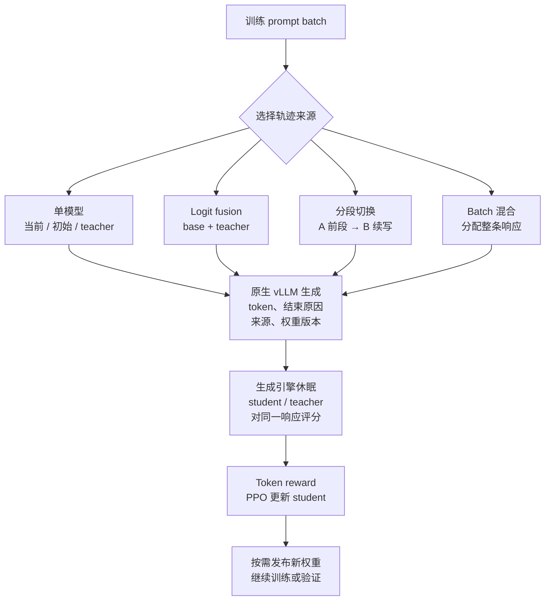
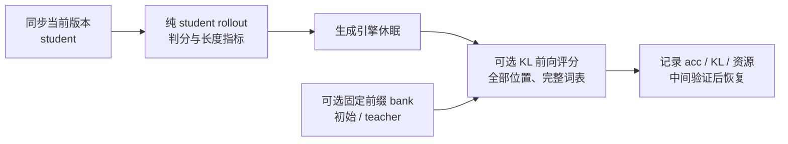

# Rollout 策略与训练语义

本项目沿用 One-Shot-OPD 的训练基线。[^one-shot-opd] 本页说明已有 recipe 路径的策略、更新、配置和运行方法。模型效果与证据覆盖由[研究主报告](../experiment/2026-10-19-rollout来源与logit融合实验.md)维护；正在提出的 Hydra 重构不在本页提前声明为完成。

## State、轨迹来源与训练对象

State 是预测下一个 token 前的完整前缀，action 是随后生成的 token：

$$
s_t=(x,y_{<t}),\qquad a_t=y_t.
$$

$x$ 为训练 prompt。记更新前的当前 student 为 $p_k$、冻结的初始 student 为 $p_0$、冻结 teacher 为 $q$，实际生成策略为 $\mu$。来源策略决定访问哪些 prefix，以及在这些 prefix 上采到哪些 action；**所有变体都只更新 student，teacher rollout 指 teacher 生成轨迹，不更新 teacher。**

### 已支持的实时来源

| 变体                          | 生成规则                                                     | `recipe/math_native.sh` 的策略名与参数                 |
| ----------------------------- | ------------------------------------------------------------ | ------------------------------------------------------ |
| 当前 student                  | 每步由更新前的 $p_k$ 重新生成                                | `student_fresh`                                        |
| 初始 student                  | 每步由同一个冻结 $p_0$ 重新生成                              | `initial_student_fresh`                                |
| Teacher                       | 每步由冻结 $q$ 重新生成                                      | `teacher_fresh`                                        |
| 当前 student + teacher fusion | 每 token 融合 $p_k$ 与 $q$ 的 logits 再采样                  | `student_teacher_fusion`，`TEACHER_WEIGHT`             |
| 初始 student + teacher fusion | 每 token 融合 $p_0$ 与 $q$ 的 logits 再采样                  | `initial_teacher_fusion`，`TEACHER_WEIGHT`             |
| Teacher 与当前 student 分段   | 前段由一种模型生成，后段由另一种续写                         | `teacher_current` / `current_teacher`，`SWITCH_TOKENS` |
| Teacher 与初始 student 分段   | 同上，两种生成模型均冻结                                     | `teacher_initial` / `initial_teacher`，`SWITCH_TOKENS` |
| Batch 内来源混合              | 一部分整条响应由 teacher 生成，其余由当前或初始 student 生成 | `batch_current` / `batch_initial`，`TEACHER_FRACTION`  |

三种单模型、两种 fusion、四个分段方向和两种 batch 混合均有四卡短训练证据。实现边界如下。

- **Fusion**：$z_\mu=(1-\lambda)z_{\mathrm{base}}+\lambda z_q$，再从 softmax 采样；是 logit 融合。默认 $\lambda=0.5$，端点复用单模型。每个 token 需要两个 backbone/head 前向。
- **分段**：默认在 response 的第 2,048 token 后切换；前后段共享总 response 预算，提前 EOS 就结束。第二模型接收原始 token prefix，重新 prefill，不跨模型复用 KV。策略配置还支持按总预算比例确定边界。
- **Batch 混合**：按全局整数配额路由整条轨迹，生成后恢复原顺序；默认 teacher 占比 0.5，不是逐 token 随机换模型。
- **初始模型与固定缓存**：`initial_student_fresh` 每次都重新采样。Semi-OPD 缓存对照在训练前用初始 student 一次性生成响应，再读取固定轨迹；它属于单独的对照协议，见[实验报告](../experiment/2026-10-19-rollout来源与logit融合实验.md#轨迹来源与共同更新)。

当前采用平面策略，不做分段中嵌入 fusion、batch 中嵌入分段等嵌套组合。TCOD 不在当前实现范围内。

## 共同训练 pipeline



对实际生成的 $a_t\sim\mu(\cdot\mid s_t)$，共同评分阶段计算

$$
r_t=\log q(a_t\mid s_t)-\log p_k(a_t\mid s_t).
$$

Student 可以对任意来源生成的 token 计算概率和梯度，无需另采一条 student 响应。`token_reward_direct` 将该 reward 作为停止梯度的 token advantage，使用以更新前 student 为参考的 PPO surrogate 更新参数。生成策略的行为概率不替代 `old_log_probs`；数学答案 verifier 用于成绩和诊断，当前纯 OPD 更新使用 teacher 的 token 信号。

当前来源协议设置 `LOG_PROB_TOP_K=0`、`METRIC_TOP_K=0`、`algorithm.rollout_correction=null`：**fusion、teacher 来源不会自动切成 top-k，也没有做行为重要性修正。**当 $\mu=p_k$ 时，固定 state 上 reward 的期望为 $-D_{\mathrm{KL}}(p_k\Vert q)$；其他来源下通常不成立。现有比较同时改变 prefix 和 action 分布，不能把结果全部解释为 state 覆盖差异。严格只改变 state、统一条件动作目标的训练对照仍需另行实现；validation 的 full-vocab KL 只做诊断，不参与反向传播。

### 原生推理与资源调度

[策略编译器](../../verl/verl/workers/rollout/policy.py)生成路由和长度预算，[模型池](../../verl/verl/workers/rollout/native_pool.py)管理副本，[协调器](../../verl/verl/trainer/ppo/rollout_coordinator.py)连接生成、评分、权重发布和验证。

生成使用原生 vLLM：fusion 在同一采样循环内执行双模型；分段和 batch 混合通过 token-in/token-out 请求路由实现，不回退到 HF。当前 student 以训练版本标识，固定 $p_0/q$ 以资产指纹标识；只向需要当前 student 的副本发布权重。Teacher 和初始 student 生成权重保持冻结。

当前实测采用四张 H800 80GB、每个推理副本 TP=PP=DP=1，按请求分发。训练和纯 student 验证使用独立引擎，生成与 FSDP 评分/更新分阶段调度。`overlap` 为默认多来源布局，`split` 可将来源放到不同卡组；布局的独立推理结果与完整训练证据分开记录。

## Validation、KL 与状态诊断

所有训练来源都用该 valid step 的**当前 student**做准确率验证。`trainer.validation_kl.enabled=True` 时，在同一验证调用中复用准确率响应，计算当前 student 与冻结 teacher 的双向完整词表条件 KL 和熵，无需保存 checkpoint。中间 valid 和末步 valid 共用流程。



| 状态集合               | 来源与评分范围                                             | 作用                                          |
| ---------------------- | ---------------------------------------------------------- | --------------------------------------------- |
| `on_validation_states` | 本轮 student 的 570×16 响应，全部有效 response 位置        | 当前验证轨迹上的条件 KL 与累计量              |
| `on_initial_states`    | 固定 $p_0$ 的 90 条响应，每条至多 8 个分层位置，带区间权重 | 在共同初始模型 prefix 上比较不同 student 版本 |
| `on_teacher_states`    | 固定 $q$ 的 90 条响应，采用相同位置预算与权重规则          | 在共同 teacher prefix 上比较不同 student 版本 |

Token KL 报告 nat/token，另保留每条响应的累计条件 KL，单位 nat/response。准确率采样使用 T=0.7、top-p=0.9；其访问测度不同于原始模型分布，因此累计量不直接命名为严格 sequence KL。固定 bank 只参与验证，不用于训练更新。

配套指标包括响应长度均值/分位数、有效 token 数、EOS 与 cap 截断比例、解析率、答案多样性、重复率、正确/错误分层和不同生成深度的 KL。定义、归约、覆盖审计及 W&B 绑定见[验证 KL 与状态诊断](../experiment/2026-10-19-rollout验证KL与状态诊断.md)。

## 性能优化 pipeline

优化保持学习预算、准确率采样、全部有效评分位置和完整词表；通过独立验证资源、减少多卡等待及计算分块提高吞吐。

| 环节          | 当前采用的策略                                                             | 实测依据                                                                        |
| ------------- | -------------------------------------------------------------------------- | ------------------------------------------------------------------------------- |
| 验证生成      | 独立配置 seq/token/显存预算；四卡窗口 64 题、每卡 seq128、预算 0.55、Graph | 8K 压力子集中 seq64→128 吞吐提高约 37%；单纯提高预算至 0.70 无明显收益          |
| KL 评分调度   | 按 prefix 长度平衡 FSDP collective 轮次；评分后恢复原顺序再去补齐          | 新评分器与平衡调度组合约 1.99×，未独立拆分两者收益                              |
| KL 投影与归约 | 位置块 1024、词表块 151665，FP32 归约，backbone 前向 batch1                | 固定真实 token 测试相对旧评分器累计约 4.01×；大于 1 的前向 batch 未通过数值门槛 |
| CPU 与记录    | 只解码有效 token、复用词表大小、精确数学指标、逐阶段计时                   | 局部 CPU 对照通过；与 GPU、RPC 和恢复成本分开计量                               |
| 显存规划      | 分开计量权重、KV、临时 logits 及运行时；按阶段 sleep/offload               | 完整优化运行各卡整轮峰值约 47.7–49.6 GiB，KL 阶段约 14.35 GiB                   |

四卡两步工程更新后的完整 570×16 验证，从 212.64 降至 67.00 分钟，约**3.17×**；其中生成节省约 109 分钟，KL 评分节省约 32 分钟。两轮输出 token 数相差约 0.5%，没有复用同一最终 checkpoint。该工程基线继承 seq8，正式五十步矩阵已使用 seq64，不能将 3.17×直接套给正式训练；固定模型/token 的配对测试承担数值和组件验证。

采用的配置为[validation_fast](../../verl/verl/trainer/config/experiment/validation_fast.yaml)。四/八卡参数、容量估算器、逐卡图和完整归因见[速度与显存](../experiment/速度与显存.md)。八卡尚无 GPU 实测；建议先将验证题目窗口 64→128，每卡并发、token 预算和显存比例保持四卡起点。

## 实验现状

| 范围              | 已完成                                                                                     | 尚缺少的证据                     |
| ----------------- | ------------------------------------------------------------------------------------------ | -------------------------------- |
| 单模型与 fusion   | 三种单模型、两种λ=0.5 fusion 的 50 步训练与完整 570×16 评测                                | 多训练 seed 与长时预算           |
| 分段与 batch 混合 | 四方向分段、两种 batch 混合的四卡短训练；teacher→当前 student、k=2048 另完成 50 步完整评测 | 其余正式配置的完整质量比较       |
| 验证 KL 与性能    | 固定 bank、全部主响应位置、step2/4 周期验证与恢复、完整规模优化复测                        | 新 50 步质量协议、八卡与更多负载 |

六组正式质量实验未启用新增 validation KL，也未保存最终权重，不能只凭响应文本补算最终模型 KL。前五组相对当前 student 来源的题目 bootstrap 区间均跨零；新增分段组尚无对应配对区间。已有单 seed、50 步结果不足以给来源策略排序或证明长时收敛；剩余正式矩阵保持暂停。

## 本机运行入口

已验收的 math 环境为 Python 3.12、Torch 2.7.1+cu126、vLLM 0.10.0+cu126、Transformers 4.57.6。默认训练 Python 为工作区的`../envs/opd-state/bin/python`，可用`OPD_TRAIN_PYTHON`覆盖；默认模型目录为`../models`，验证数据为`../MD-OPD/data`。训练环境与根目录维护`.venv`分开，详见[开发指南](../development.md#训练环境与验收)。

原生训练使用完整去重 prompt 池；已准备的 DAPO 池含 17,235 道唯一题，50 步×64 只消费其中 3,200 道不同题。准备方法见[data README](../../data/README.md#fresh-math-prompt-pool)。默认入口要求`runs/native-data/math-full/manifest.json`存在；`NATIVE_DATA_MANIFEST`可选择其他准备好的清单，缺失或身份不匹配会在 GPU 训练前失败。

在模型、数据和独立环境已准备好的本机，使用现有清单启动：

```bash
NATIVE_DATA_MANIFEST=runs/native-rollout-implementation/fresh-math-data-v2/manifest.json \
CUDA_VISIBLE_DEVICES=0,1,2,3 N_GPUS_PER_NODE=4 \
    bash recipe/math_native.sh student_fresh +experiment=validation_fast \
    data.val_batch_size=64 ray_kwargs.ray_init.object_store_memory=8589934592
```

将`student_fresh`替换为上表策略名即可切换来源，参数通过环境变量或追加 Hydra 覆盖传入。默认 50 步、全局 batch64、训练 response cap4096、末步完整 eval16、不保存 checkpoint，W&B project 固定为`OPD-State`。普通配方默认关闭 validation KL；`+experiment=validation_fast`显式开启。追加`trainer.test_freq=10`可每十步验证并计算 KL。

普通 launcher 的训练生成默认 eager；上述 profile 只开启验证 Graph。正式来源实验显式开启训练 Graph；需要沿用该设置时追加以下两个覆盖，组合的完整 50 步质量结果仍需独立验收：

```text
actor_rollout_ref.rollout.enforce_eager=False
++actor_rollout_ref.rollout.cudagraph_capture_sizes=[1,2,4,8,16,32,64]
```

当前原生路径验收范围为单轮纯文本、兼容的 Qwen2 student/teacher、每副本TP=PP=DP=1、每题一条训练响应。其他模型、嵌套策略、八卡扩展和无偏top-k tail 不计入已通过范围。

## 代码、文档与维护

| 入口                                                                                                       | 职责                                           |
| ---------------------------------------------------------------------------------------------------------- | ---------------------------------------------- |
| [`recipe/`](../../recipe)                                                                                  | 训练配方、来源策略与 Hydra 参数                |
| [`verl/verl/`](../../verl/verl)                                                                            | 原生生成、FSDP student/teacher评分、损失与验证 |
| [`data/prep/`](../../data/prep) / [`eval/`](../../eval)                                                    | 数据准备、评测、审计和可复现绘图               |
| [实验报告](../experiment/2026-10-19-rollout来源与logit融合实验.md)                                         | 设置、进度、准确率、速度/显存和 KL 专题        |
| [访问测度研究](../research/occupancy/2026-10-17-OPD访问测度与收敛机制研究.md)                              | 对齐指标、梯度、状态访问与收敛分析             |
| [原生推理 Agent Note](../../.agents/notes/proposed/architecture/2026-10-18-可组合rollout与原生vLLM推理.md) | 方案、替代实现、推理调研与未决取舍             |
| [代码结构](../architecture.md) / [开发指南](../development.md)                                             | 修改入口、环境、维护检查和 hooks               |

维护环境安装与检查：

```bash
python3 -m venv .venv
.venv/bin/python -m pip install --require-hashes -r requirements-dev.lock
npm ci
.venv/bin/python scripts/install_dev_binaries.py
.venv/bin/python scripts/setup.py
PATH="$PWD/.venv/bin:$PATH" .venv/bin/python scripts/run_checks.py --config scripts/checks.json --mode ci
```

二进制安装器支持 Linux x86-64；其他平台需安装对应 AutoCorrect 和 gitleaks。`node_modules/`、`.venv/`、模型、训练数据和大型运行产物由 Git 忽略。

## 来源与许可

上游代码归属及导入记录见[来源说明](../provenance.md)，代码许可见[LICENSE](../../LICENSE)与[NOTICE](../../NOTICE)。模型和数据沿用各自资产的许可。

### 参考文献

[^one-shot-opd]: Thinking-Space. One-Shot-OPD. GitHub 2026. [Thinking-Space/One-Shot-OPD](https://github.com/Thinking-Space/One-Shot-OPD).
