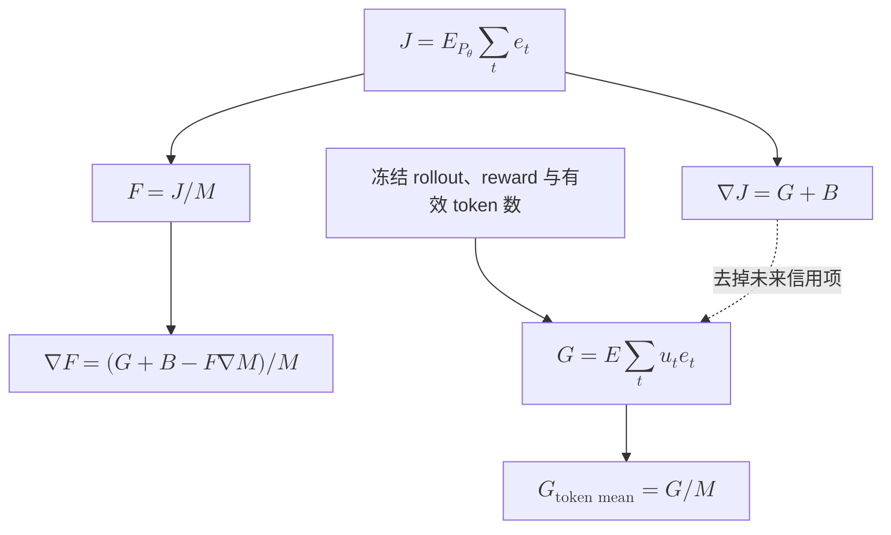
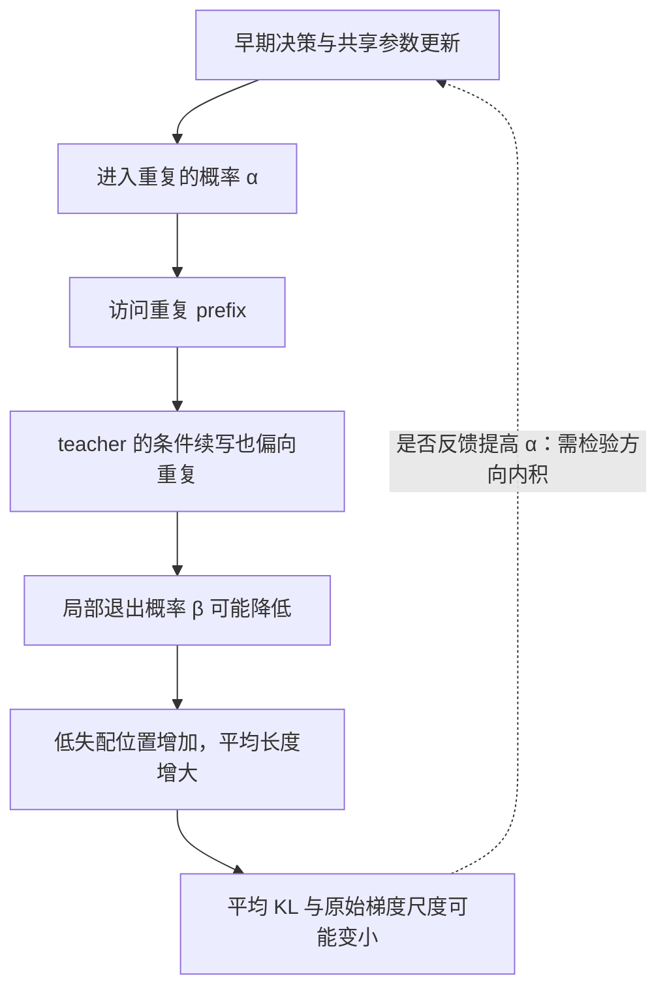
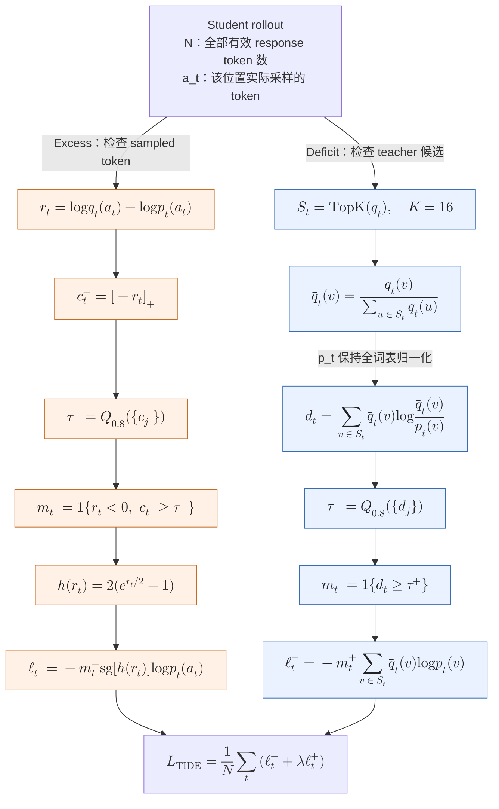

# OPD 访问测度、KL 对齐与重复退化：理论与实验协议

更新时间：2026-10-18。本文研究同策略蒸馏（on-policy distillation，OPD）的状态来源、对齐指标、局部优化动态与重复退化。Student 统一记为 $p_\theta$，固定 teacher 记为 $q$。原文献、一般推导与待检验机制分别标明；公式回归和短训练验收不作为真实 LLM 收敛或失败原因的证据。

阅读路线按分析依赖排列：

| 阅读目标                             | 章节                                                                              |
| ------------------------------------ | --------------------------------------------------------------------------------- |
| 确定对齐指标及其与 accuracy 的关系   | [第 3 节](#3-对齐指标与准确率)                                                    |
| 区分局部梯度、序列梯度、长度归约     | [第 4 节](#4-局部梯度与未来信用)、[第 5 节](#5-长度归一化与有限-batch-偏差)       |
| 判断不同来源为何同极限或不同平台     | [第 6 节](#6-访问测度与收敛条件)、[第 7 节](#7-六种-rollout-来源)                 |
| 分析重复进入、持续与监督弱化         | [第 8 节](#8-重复退化的条件机制)                                                  |
| 区分 sampled、无偏 head-tail 与 TIDE | [第 9 节](#9-action-估计与无偏-head-tail)、[第 10 节](#10-tide-的判据loss-与机制) |
| 核对论文设置并设计机制实验           | [第 11 节](#11-论文证据与模型配对)至[第 14 节](#14-双向实验的实现与观测协议)      |

## 1. 研究范围与主要结论

主要观测量采用独立数学 prompt 上、当前 student 真实采样分布相对于 teacher 的有限时域 sequence reverse KL，同时记录 pooled token KL、平均长度和共同固定 prefix 的条件 KL。训练 prompt 的局部残差反映优化吸收，独立 prompt 反映泛化；固定与 live 状态互相补充。

核心关系是 $J=\mathbb E[L]F$。固定有限时域内，完整平均 token KL 趋于零同样保证 sequence KL 趋于零；数值较小的均值、小 sampled reward 或小局部梯度都没有自动达到这个条件。相同 prompt、解码和判分协议下，小 sequence KL 保证 accuracy 接近 teacher，但不保证准确率单调提高，也不支持由准确率相近反推策略相同。

局部 OPD 在固定 prefix 上估计条件 reverse-KL 梯度，通常遗漏 action 对未来状态失配的影响。Tabular 独立 logits 在明确条件下仍能逐状态收敛；共享参数则允许不同状态梯度抵消。状态来源可能改变有限预算的吸收效率，也可能改变非零残差处的投影和稳定点；来源名称本身不能决定极限。

重复状态中的 teacher–student 一致，与从干净 prompt 进入重复的概率一致，是两个要求。长而低失配的尾部可掩盖关键进入误差；若 teacher 在坏 prefix 上更偏好重复，局部对齐也可以降低退出概率。TIDE 通过 gated 有界抑制与 teacher top-K 交叉熵改变监督，仍使用局部 token-mean，并不保持完整 teacher 为一般精确固定点。

| 来源                               | 已有证据                                                          | 本文采用的边界                                                |
| ---------------------------------- | ----------------------------------------------------------------- | ------------------------------------------------------------- |
| 2608.16647：泛化与同源性[^dual]    | 同源配对的跨领域迁移通常更广                                      | 支持共享参数迁移分析，不证明所有条件分布已匹配                |
| 2609.04172：One-Shot OPD[^oneshot] | 单 query 覆盖较广教师表示簇，固定轨迹上的吸收持续数百步           | 表示簇覆盖不等于完整 prefix 测度；one-shot 不等于一次 rollout |
| 2610.11291：Semi-OPD[^semi]        | 固定来源改变表现，不同热启动转入同一 OPD 后接近相似 accuracy 平台 | 有限时域任务分数接近，不等于策略或参数固定点相同              |
| 2608.09836：TIDE[^tide]            | 强失配组出现重复退化；组件干预改善任务与生成行为                  | 未单独识别长度分母、未来信用或重复反馈的因果贡献              |

2610.11291 的 handoff 图中，两组非思考配对在 4K/16K 训练上限下的平台标注分别约为 35%/29% 和 60%/50%，口径为 AIME24/25 avg@32。其 top-32 消融仍保留 Semi-OPD 优势，不能把全部现象归因于单个 sampled action 的噪声；该 top-32 也不是完整条件 KL 的无偏实现。

同架构、全参数可训练的 student 通常可以通过复制 teacher 权重实现 teacher。因而“参数共享”不等于“teacher 不可实现”；全局零误差可实现与实际优化是否到达它需要分别分析。真实训练成绩与进度归[实验报告](../../experiment/2026-10-18-rollout来源与logit融合实验.md)，本文只保留对应结论的条件与证据口径。

## 2. 统一记号与训练语义

### 2.1 Prefix、策略与访问测度

令 $x\sim\rho$ 为 prompt，$s_t=(x,y_{<t})$ 为第 $t$ 个 action 产生前的 prefix，$a_t=y_t$ 为 token。固定教师为 $q(a\mid s)$，当前学生为 $p_\theta(a\mid s)$，初始学生为 $p_0$，行为策略为 $\mu$。理论部分先取有限状态与动作、固定时域 $H$、共同 tokenizer 和采样温度，所有参与 log-ratio 的非终止 action 概率严格为正；EOS 后使用共同吸收状态，其后损失为零。

定义每个深度的访问分布及深度平均测度：

$$
d_t^\mu(s)=\Pr_{x\sim\rho,y\sim\mu}(s_t=s),\qquad
\nu_\mu(s)=\frac1H\sum_{t=1}^H d_t^\mu(s).
$$

$s_t$ 包含 prompt 与深度。不同 prompt 的原始 prefix 不同，即使它们在教师表示空间中很接近。精确 prefix 测度与表示簇测度是两个对象。

将训练用的状态分布记为 $\nu$，在给定状态上参与梯度估计的 action 分布记为 $b(a\mid s)$。直接使用行为轨迹时，通常 $\nu=\nu_\mu,b=\mu$；也可以保持 $s\sim\nu_\mu$，独立重采 $a\sim p_\theta(\cdot\mid s)$。后者有意保留状态变化，同时控制 action 估计器。

### 2.2 条件目标、序列目标与任务指标

固定状态分布的条件反向 KL 为

$$
\ell_s(\theta)=\operatorname{KL}(p_\theta(\cdot\mid s)\Vert q(\cdot\mid s)),\qquad
L_\nu(\theta)=\sum_s\nu(s)\ell_s(\theta).
$$

完整生成分布分别记为 $P_\theta(y\mid x)$ 和 $Q(y\mid x)$，序列目标为

$$
J(\theta)=\mathbb E_{x\sim\rho}\operatorname{KL}(P_\theta(\cdot\mid x)\Vert Q(\cdot\mid x)).
$$

任务正确率由外部判分器 $R$ 定义：

$$
\operatorname{Acc}(\theta)=\mathbb E_{x\sim\rho_{\rm eval},y\sim P_\theta}R(x,y),\qquad 0\le R\le1.
$$

减小 $L_\nu$、减小 $J$ 和提高 accuracy 是不同命题。训练和评估若使用不同 prompt、温度或长度上限，还引入额外的分布变化。

### 2.3 在线数据采样与停止梯度

用 $\vartheta$ 表示收集 batch 时冻结的 student 参数，用 $\theta$ 表示对 batch 求导的参数。来源规则 $R$ 产生

$$
m_R^\vartheta(s,a)=\nu_R^\vartheta(s)b_R^\vartheta(a\mid s).
$$

原始 sampled-token 更新在本节定义为：使用轨迹 action，reward 为停止梯度的 $\log q-\log p_\theta$，不加行为 action 修正。其期望场为

$$
G_R^{\rm raw}(\theta)=\sum_{s,a}m_R^\theta(s,a)
\log\frac{p_\theta(a\mid s)}{q(a\mid s)}\nabla_\theta\log p_\theta(a\mid s).
$$

条件 KL 更新的期望场则为

$$
G_R^{\rm KL}(\theta)=\left.\nabla_\theta\sum_s\nu_R^\vartheta(s)\ell_s(\theta)\right|_{\vartheta=\theta}.
$$

这两个式子都冻结采样测度后求导，最后令 $\vartheta=\theta$。对在线来源，它们通常不等于把采样分布也作为 $\theta$ 的函数进行全导数所得到的梯度。

本仓使用 PPO 风格 surrogate。只有在当前 student 重算 anchor、reward 冻结、单 batch 一次完整更新且无额外项改变起点梯度时，首步梯度才对应上面的原始 score 场。优化锚点比率 $p_\theta/p_{\rm old}$ 不自动等于行为 action 修正 $p_\theta/b$；实现中存在 ratio 不代表已消除来源偏差。

### 2.4 变长轨迹与有限缓存

全局有效 token 平均的总体极限对应

$$
\nu_{\rm token}^\mu(s)=
\frac{\mathbb E_\mu\sum_{t\le L(y)}\mathbf1\{s_t=s\}}{\mathbb E_\mu L(y)}.
$$

先对每条轨迹除以其长度再平均，则对应

$$
\nu_{\rm seq}^\mu(s)=\mathbb E_\mu\left[\frac1{L(y)}\sum_{t\le L(y)}\mathbf1\{s_t=s\}\right].
$$

二者一般不同。由于最终长度还依赖当前 action 和未来续写，逐序列长度权重也可能改变给定 prefix 的有效 action 分布。下面的定理使用固定时域或显式固定的状态权重；真实实验需记录有效 token 归约、EOS、cap 截断和行为概率。

固定 $p_0$ 每步重新采样，与只生成一份有限缓存后反复训练，也有不同的数据极限。前者针对总体分布，后者针对经验分布。继续优化固定缓存不会补充未见过的状态或 action。

### 2.5 数值、信用分配与 action 估计的三个选择

全文另记 $k_\theta(s)=\ell_s(\theta)$、$M(\theta)=\mathbb E_\theta L$、$F(\theta)=J(\theta)/M(\theta)$。$F$ 表示总体 pooled token 平均，$G=\mathbb E\sum_{t\le L}u_te_t$ 表示累计局部梯度；$B$ 表示未来信用项，和 batch 位置集合 $\mathcal B$ 不同。熵、KL 与 log-ratio 均用自然对数，单位为 nats。

| 选择轴      | 两端                                                       | 改变的对象                                       |
| ----------- | ---------------------------------------------------------- | ------------------------------------------------ |
| 长度归约    | 全 batch token-mean、固定分母 token-sum、逐轨迹 token-mean | 梯度尺度、有限样本偏差或轨迹权重                 |
| 时间信用    | 当前 reward、未来 return-to-go                             | 期望更新方向                                     |
| Action 估计 | 单个 sampled token、完整词表、无偏 head-tail               | 条件采样噪声；有偏截断还改变目标                 |
| Prefix 来源 | 当前 student、固定 student、teacher、fusion、混合和切换    | 状态访问权重；沿用其 action 时也改变 action 分布 |

本文将“对齐完成”限定为指定 prompt、状态与解码协议上的分布匹配。实际优化器的 stationary point、有限预算的平台，以及某个 benchmark 的 accuracy 平台均需单独命名。

## 3. 对齐指标与准确率

### 3.1 建议的主指标与辅助指标

主指标采用**独立诊断 prompt 上、当前 student rollout 的完整条件反向 KL 按轨迹求和后的平均 $J$**，并报告 pooled token 平均 $F$ 和平均长度 $M$。固定 prefix probe 用于判断相同状态上的吸收，两类读数共同解释访问变化。所有 sequence 解释要求生成和评分概率一致。

| 数据或测度                                  | 推荐记录                                                | 用途与解释边界                                                    |
| ------------------------------------------- | ------------------------------------------------------- | ----------------------------------------------------------------- |
| 当步训练 prompt、当前 student rollout       | 完整条件 KL 的无偏估计、尾部质量、每轨迹总和            | 训练分布上的行为匹配；不能代替泛化验证                            |
| 独立 DAPO 诊断 prompt、当前 student rollout | 同上，按 prompt、长度、深度统计                         | 主要的过程对齐指标；诊断题不进入参数更新                          |
| 固定初始 R1 和固定初始 JustRL prefix 池     | 两个方向的条件 KL、完整词表校准                         | 所有 checkpoint 使用同一批状态，分离模型更新与访问变化            |
| Teacher rollout                             | $\operatorname{KL}(q(\cdot\mid s)\Vert p(\cdot\mid s))$ | 在 teacher 访问测度上求和才对应序列前向 KL；诊断 teacher 模式覆盖 |
| 最终数学评测 prompt、当前 student rollout   | 相同生成协议下的序列 KL 与 accuracy                     | 检验对齐和任务差距；该集合不用于选择超参数                        |

在 student rollout 上计算条件前向 KL 也是有意义的诊断，但它通常不等于完整序列前向 KL。反向与前向 KL 各自的链式法则分别要求 student 与 teacher 访问测度。不要只交换 KL 的参数顺序，却保持错误的状态测度并沿用序列解释。

总变差和 Jensen–Shannon 散度可以辅助描述分布差异；条件 top-$K$ overlap、entropy 差和 reward 均值只能作辅助。相同 entropy 不意味着概率相同；有限样本的 sampled reward 均值可能因正负抵消而接近零；合并 tail 的 KL 又只识别粗粒化分布。理想 on-policy 条件下，原始 log-ratio reward 的总体期望确实是负 KL，这与有限样本的不确定性并不矛盾。

### 3.2 命题 1：变长轨迹上，token KL 与序列 KL 的正确关系

**命题陈述。** 固定 prompt 分布 $\rho$ 和最大生成时域 $H$，两模型使用相同 EOS 与截断规则。轨迹在 EOS 或 $H$ 处结束，EOS 是有效 action；到达 cap 不人为添加 EOS。令 $L=\min(T_{\rm EOS},H)$，完整条件反向 KL 为 $k_p(s)$。则停止轨迹分布的序列 KL 满足

$$
J_{\rho,H}(p\Vert q)
=\mathbb E_{x\sim\rho,y\sim p}\sum_{t=1}^{L(y)}k_p(s_t)
=\mathbb E_p L\;\overline k_{\rm token},
$$

其中 $\overline k_{\rm token}=\mathbb E_p[\sum_{t\le L}k_p(s_t)]/\mathbb E_pL$ 是有效 token 加权平均。

若只测到较短 cap $h<H$，则

$$
J_{\rho,H}=J_{\rho,h}
+\mathbb E_{x,y_{\le h}\sim p}
\operatorname{KL}\bigl(P_{>h}(\cdot\mid x,y_{\le h})\Vert Q_{>h}(\cdot\mid x,y_{\le h})\bigr),
$$

已 EOS 的轨迹后项定义为零。因此训练 cap 上的 KL 不直接约束更长评估 cap 上的分布。

**证明。** 将 EOS 后的过程扩展为双方相同的吸收 action，直到 $H$。吸收位置的 log-ratio 为零，轨迹概率的比值只保留 $t\le L$ 的乘积。取对数、按 student 轨迹取期望，并在各 prefix 对 action 取条件期望，得到第一式。更明确地，对每个深度，存活事件 $\{L\ge t\}$ 只依赖采样前历史，故

$$
\mathbb E[\mathbf1\{L\ge t\}e_t]
=\mathbb E[\mathbf1\{L\ge t\}\mathbb E(e_t\mid s_t)]
=\mathbb E[\mathbf1\{L\ge t\}k_p(s_t)].
$$

对 $t$ 求和即可交换 sampled log-ratio 与完整条件 KL 的期望。第二个等号来自总体 pooled token 平均的定义；它不能替换成逐轨迹先除以 $L$ 的平均。

把序列划分为前 $h$ 步与后缀，写 $P=P_{\le h}P_{>h\mid\le h}$、$Q=Q_{\le h}Q_{>h\mid\le h}$。其 log-ratio 分成两个和项；前项期望为 $J_{\rho,h}$，后项先按 prefix 条件化，再对 student 后缀取期望，得到条件 KL，证毕。

**适用边界。** token 平均 KL 下降时，若生成长度增长，序列 KL 仍可能增大。应同时记录 `KL/token`、`KL/trajectory` 和平均长度。若只测若干固定位置，应标为位置诊断；只有采用有明确纳入概率的采样及相应权重，才能把稀疏位置值解释为整个序列 KL 的无偏估计。

### 3.3 定理 2：序列 KL 分成任务结果差异与类内生成差异

**定理陈述。** 对同一个 prompt $x$、同一生成协议和固定二元判分器 $R(y)\in\{0,1\}$，令 $a=\Pr_P(R=1)$、$b=\Pr_Q(R=1)$，先设 $a,b\in(0,1)$。则

$$
\begin{aligned}
\operatorname{KL}(P\Vert Q)
=&\operatorname{kl}(a\Vert b)\\
&+a\operatorname{KL}(P(\cdot\mid R=1)\Vert Q(\cdot\mid R=1))\\
&+(1-a)\operatorname{KL}(P(\cdot\mid R=0)\Vert Q(\cdot\mid R=0)),
\end{aligned}
$$

其中 $\operatorname{kl}(a\Vert b)=a\log(a/b)+(1-a)\log((1-a)/(1-b))$ 是 Bernoulli KL。于是序列对齐足以控制成功概率差异，但同样成功概率不识别正确轨迹内部或错误轨迹内部的分布。

**证明。** 将序列空间按 $R=1$ 和 $R=0$ 分组。对正确组，$P(y)=aP(y\mid R=1)$、$Q(y)=bQ(y\mid R=1)$，所以

$$
\begin{aligned}
\sum_{R(y)=1}P(y)\log\frac{P(y)}{Q(y)}
&=a\log\frac ab\sum_{R(y)=1}P(y\mid R=1)\\
&\quad+a\sum_{R(y)=1}P(y\mid R=1)\log\frac{P(y\mid R=1)}{Q(y\mid R=1)}\\
&=a\log(a/b)+a\operatorname{KL}(P(\cdot\mid R=1)\Vert Q(\cdot\mid R=1)).
\end{aligned}
$$

错误组以 $1-a,1-b$ 作相同计算；相加得到结论。概率为零的端点按连续极限或无穷 KL 的约定处理，证毕。

**研究含义。** Accuracy 只观察上式中的成功质量，忽略两个类内分布项。若生成差异主要集中在同样正确的不同解法、格式、推理长度或同样错误的轨迹之间，KL 可以继续下降，而 accuracy 几乎不变。反之，两模型也可能平均 accuracy 相同却在不同问题上成功，故还需按题比较，不能仅比较宏平均。

### 3.4 定理 3：小序列 KL 保证 accuracy 接近，但不保证单调改进

**定理陈述。** 令 $a(x),b(x)$ 是 student、teacher 在共同 prompt 分布 $\rho$ 下的成功概率，$J=\mathbb E_x\operatorname{KL}(P_x\Vert Q_x)$。则

$$
\mathbb E_x[(a(x)-b(x))^2]\le J/2,
\qquad
\mathbb E_x|a(x)-b(x)|\le\sqrt{J/2},
$$

$$
|\operatorname{Acc}(P)-\operatorname{Acc}(Q)|\le\sqrt{J/2}.
$$

因此 $J\to0$ 强迫平均逐题差异和总体 accuracy 差异趋零。反向推断一般不成立，KL 的下降顺序也不一般决定 accuracy 差距的下降顺序。

**证明。** 固定 $b\in(0,1)$，考虑

$$
f(a)=\operatorname{kl}(a\Vert b)-2(a-b)^2.
$$

有 $f(b)=f'(b)=0$，且

$$
f''(a)=\frac1{a(1-a)}-4\ge0,
$$

因为 $a(1-a)\le1/4$。故 $f$ 在 $b$ 处取得最小值零，得到 $\operatorname{kl}(a\Vert b)\ge2(a-b)^2$。由定理 2 的非负类内 KL，逐题有 $2(a(x)-b(x))^2\le\operatorname{KL}(P_x\Vert Q_x)$。取 $\rho$ 期望得到第一项；Cauchy–Schwarz 给出第二项；最后由 $|\mathbb E_x(a-b)|\le\mathbb E_x|a-b|$ 得到第三项。

对逆命题，定理 2 允许 $a=b$ 而类内条件分布仍不同，其 KL 没有由 $|a-b|$ 给出的普遍上界。对单调性，降低类内项可以补偿成功质量项的增加，所以仅观察总 KL 降低不能推出 $|a-b|$ 降低；要作这种推断还需约束类内项及优化路径。证毕。

**适用边界。** 该界对相同概率策略与相同判分协议成立。若 KL 用温度 1 的完整支持，而 benchmark 用温度 0.7、top-$p=0.9$ 或 greedy，则比较的是不同分布，不能直接代入。截断采样的两侧支持还可能不同，导致某个方向的 KL 无穷；不应靠任意概率下限将其伪装成有限对齐值。

这个上界还可能很松：以自然对数计，要仅靠该界保证 accuracy 差距不超过 1 个百分点，需要 $J\le2\times10^{-4}$ nats/trajectory。它用于明确逻辑关系，不应替代实际 accuracy 评测，也不将普通规模的 token KL 降幅直接翻译为准确率提升。

定理中的 $J$ 是总体期望，不能把一个 batch 的带噪无偏估计直接代入，尤其不能把负估计截成零再宣布准确率差距为零。实际报告需给出 KL 的不确定性；若要据此提供高概率 accuracy 界，需要先建立有效的 KL 上置信界。按题聚类统计可处理同题多响应，但对罕见尾部事件仍需增加完整词表校准与采样。

### 3.5 固定 probe 与 live rollout 必须同时记录

Live student KL 的状态测度随模型改变。它下降既可能来自原状态上的条件分布匹配，也可能来自模型转向更容易匹配的状态。固定 probe 能区分这两部分，但只能说明该 probe 覆盖区域的变化，不能单独证明部署生成已对齐。

对任意两个 checkpoint 与两个固定测度，存在精确分解

$$
L_{\nu_1}(\theta_1)-L_{\nu_0}(\theta_0)
=\underbrace{L_{\nu_0}(\theta_1)-L_{\nu_0}(\theta_0)}_{\text{同一状态上的模型变化}}
+\underbrace{L_{\nu_1}(\theta_1)-L_{\nu_0}(\theta_1)}_{\text{新模型下的测度变化}}.
$$

这是在左侧加减 $L_{\nu_0}(\theta_1)$ 得到的恒等式。实际诊断应保存旧/新模型在旧/新 prefix 池上的交叉读数，而不只比较每个模型自己的平均 KL。两部分的数值还取决于采用哪个模型作参照，因此不将其解释为唯一的因果分解。

Prompt 也属于测度的一部分。one-shot query 上的 KL 趋零，不保证其他问题上的生成分布接近 teacher；训练 DAPO 上的结果也不能自动替代 MATH-500/AMC23/AIME25。若比较三个数学基准的宏平均 accuracy，对应的 KL 也应先对各基准按题平均，再对三个基准等权，不能直接按全体 token 或全部题目合并。

### 3.6 指标的经验估计与判读

对 $n$ 条相同协议下的 fresh student 轨迹，建议报告

$$
\widehat J=\frac1n\sum_i\sum_{t\le L_i}\widehat k_{it},\qquad
\widehat F=\frac{\sum_i\sum_{t\le L_i}\widehat k_{it}}{\sum_iL_i},\qquad
\widehat M=\frac1n\sum_iL_i.
$$

同一批数据上始终有 $\widehat J=\widehat M\widehat F$。完整条件 KL 或条件无偏估计给出 $\widehat J$ 的轨迹平均解释；随机分母的 $\widehat F$ 有第 5 节的有限样本问题。固定 $H$ 时 $J\le HF$，故 $F\to0$ 足以保证 $J\to0$；数值较小的有限 $F$ 必须结合 $M$ 解读。不同 checkpoint 的 $M$ 相同，则 $J$ 与 $F$ 只是常数倍，没有不同的排序信息。

小完整 KL 的总体声明、负的单次 sampled 估计、小桶 KL、少数位置上的低 KL，以及训练 surrogate 数值较低，是不同观测。只有第一类可直接使用上面的分布与 accuracy 界。

## 4. 局部梯度与未来信用

### 4.1 定理 4：当前 student action 给出无偏条件 KL 梯度

**定理陈述。** 固定 prefix $s$，教师 $q$ 不依赖参数，学生分布严格正且可微。定义

$$
u_\theta(s,a)=\nabla_\theta\log p_\theta(a\mid s),\qquad
e_\theta(s,a)=\log\frac{p_\theta(a\mid s)}{q(a\mid s)}.
$$

此处 $u_\theta$ 是 score 向量。若 $a\sim p_\theta(\cdot\mid s)$，则 $e_\theta(s,a)u_\theta(s,a)$ 是 $\nabla\ell_s$ 的无偏估计；它是对 surrogate $-\operatorname{stopgrad}(\log q-\log p_\theta)\log p_\theta$ 求导得到的梯度。

**证明。** 概率归一化给出 score 恒等式：

$$
\sum_a p_\theta(a\mid s)u_\theta(s,a)
=\sum_a\nabla p_\theta(a\mid s)
=\nabla1=0.
$$

对条件 KL 逐项求导：

$$
\begin{aligned}
\nabla\ell_s
&=\sum_a\nabla p_\theta(a\mid s)
\left[\log\frac{p_\theta(a\mid s)}{q(a\mid s)}+1\right]\\
&=\sum_a p_\theta(a\mid s)u_\theta(s,a)e_\theta(s,a)
 +\sum_a p_\theta(a\mid s)u_\theta(s,a)\\
&=\mathbb E_{a\sim p_\theta}[e_\theta(s,a)u_\theta(s,a)].
\end{aligned}
$$

surrogate 中 reward 的梯度被停止，只剩 $-\operatorname{stopgrad}(\log q-\log p_\theta)u_\theta=e_\theta u_\theta$。两种表达相同，证毕。

**适用边界。** 这是固定 prefix 上的梯度恒等式。旧 action、不同采样温度、top-$p$ 截断、额外 action 权重以及错误的 reward 反向传播都可能破坏条件。surrogate 的显示数值也不是 KL。

### 4.2 定理 5：局部 OPD 遗漏未来状态项

**定理陈述。** 在有限时域与共同 prompt 分布下，记 $e_t=e_\theta(s_t,a_t)$、$u_t=u_\theta(s_t,a_t)$，则

$$
J(\theta)=\sum_{t=1}^H\mathbb E_{s_t\sim d_t^{p_\theta}}\ell_{s_t}(\theta)
=H L_{\nu_{p_\theta}}(\theta),
$$

但其完整梯度为

$$
\nabla J=G_{\rm loc}+B,\qquad
G_{\rm loc}=\mathbb E\sum_tu_te_t,
\qquad B=\mathbb E\sum_tu_t\sum_{j>t}e_j.
$$

其中 $G_{\rm loc}=H G_{\rm on}^{\rm KL}$ 是局部 OPD 的求和期望梯度。局部更新具有序列 KL 的一阶下降方向，当且仅当 $\lVert G_{\rm loc}\rVert^2+\langle B,G_{\rm loc}\rangle>0$；等于零时需要看高阶项。

**证明。** 自回归分解使轨迹 log-ratio 等于 $\sum_t e_t$。逐个 prefix 对 action 取条件期望，$\mathbb E[e_t\mid s_t]=\ell_{s_t}$，得到第一组等式。

令 $E(y)=\sum_j e_j$。对轨迹期望求导，测度导数与被积函数导数分别为

$$
\begin{aligned}
\nabla J
&=\sum_y\nabla P_\theta(y)E(y)+\sum_yP_\theta(y)\nabla E(y)\\
&=\mathbb E\left[\left(\sum_tu_t\right)\left(\sum_je_j\right)\right]
+\mathbb E\sum_j u_j.
\end{aligned}
$$

第二项由定理 4 的 score 恒等式为零。若 $j<t$，$e_j$ 已被 $s_t$ 的历史确定，故

$$
\mathbb E[u_te_j\mid s_t]=e_j\mathbb E[u_t\mid s_t]=0.
$$

仅剩 $j\ge t$，分出 $j=t$ 和 $j>t$ 即得 $G_{\rm loc}+B$。沿更新 $\theta^+=\theta-\eta G_{\rm loc}$ 作一阶 Taylor 展开：

$$
J(\theta^+)-J(\theta)
=-\eta\langle\nabla J,G_{\rm loc}\rangle+O(\eta^2)
=-\eta\bigl(\lVert G_{\rm loc}\rVert^2+\langle B,G_{\rm loc}\rangle\bigr)+O(\eta^2).
$$

一阶项的符号给出结论，证毕。

**适用边界。** 全词表求和可以消除给定 prefix 的 action 采样噪声，但不会补回 $B$。加入未来 return-to-go 是另一种更新，不是单纯增大 action 样本数。MiniLLM 已讨论局部与长期梯度的区分[^minillm]；本文不把这一差异当作新的算法发现，也不据此断定 $B$ 是实际失败的主因。

### 4.3 定理 6：离线 action 改变目标，action 修正只修正条件梯度

**定理陈述。** 固定状态分布 $\nu$ 和 action 分布 $b$。未经修正的 sampled-token 期望梯度是

$$
G_{\nu,b}^{\rm raw}=\nabla F_{\nu,b},\qquad
F_{\nu,b}(\theta)=\frac12\sum_{s,a}\nu(s)b(a\mid s)e_\theta(s,a)^2.
$$

它与 $\nabla L_\nu$ 的偏差为

$$
G_{\nu,b}^{\rm raw}-\nabla L_\nu
=\sum_{s,a}\nu(s)\bigl[b(a\mid s)-p_\theta(a\mid s)\bigr]e_\theta(s,a)u_\theta(s,a).
$$

若 $b$ 覆盖 $p_\theta$ 的支持，使用停止梯度的 action 权重 $p_\theta/b$，可恢复 $\nabla L_\nu$，但不改变状态测度 $\nu$。

**证明。** $\nu,b,q$ 固定，所以 $\nabla(e_\theta^2/2)=e_\theta\nabla\log p_\theta=e_\theta u_\theta$。对所有状态和 action 求和，得到第一个等式。减去定理 4 中按 $p_\theta$ 加权的表达即得偏差式。最后，逐项约去 $b$：

$$
\begin{aligned}
\mathbb E_{s\sim\nu,a\sim b}
\left[\frac{p_\theta(a\mid s)}{b(a\mid s)}e_\theta u_\theta\right]
&=\sum_{s,a}\nu(s)p_\theta(a\mid s)e_\theta u_\theta\\
&=\sum_s\nu(s)\nabla\ell_s=\nabla L_\nu.
\end{aligned}
$$

这里的权重是估计器系数，不对其反向传播。权重只改变 action 求和项，$\nu$ 原样保留，证毕。

**适用边界。** 在线来源可写为 $\nabla_\theta F_R(\theta;\vartheta)|_{\vartheta=\theta}$，通常没有一个固定的 $F_{\nu,b}$ 沿训练单调下降。重要性权重裁剪产生偏差，缺失支持无法靠有限权重恢复。状态基线在 $a\sim p_\theta$ 时因 score 均值为零而不改变期望，在未修正的 $a\sim b$ 下则不一定成立。

## 5. 长度归一化与有限 batch 偏差

### 5.1 定理 7：平均 KL 的完整梯度与 token-mean 局部更新不同

**定理陈述。** 在共同的有限时域、EOS 规则和当前 student 采样下，记平均有效长度 $M(\theta)=\mathbb E_\theta L$、总体 token 平均 $F(\theta)=J(\theta)/M(\theta)$。令 $G=\mathbb E\sum_{t\le L}u_te_t$，$B=\mathbb E\sum_{t\le L}u_t\sum_{j>t}e_j$。则

$$
\nabla J=G+B,\qquad
\nabla M=\mathbb E\sum_{t\le L}u_t(L-t),\qquad
\nabla F=\frac{G+B-F\nabla M}{M}.
$$

对冻结 rollout 做全 batch token-mean 的局部更新，其大 batch 极限为 $G/M$，一般不等于 $\nabla F$。对任意参数方向 $v$，若 $F>0$ 且

$$
0<\mathrm dJ[v]<F\,\mathrm dM[v],
$$

则沿该方向 sequence KL 增大、平均 token KL 减小。这个条件证明的是指标背离；任务 accuracy 是否恶化仍需判分。

**证明。** 定理 5 已给出 $\nabla J=G+B$。有限时域允许交换有限求和与导数。每条停止轨迹的长度 $L(y)$ 是由轨迹决定的固定函数，因此

$$
\nabla M
=\sum_y L(y)\nabla P_\theta(y)
=\mathbb E\left[L\sum_{t\le L}u_t\right].
$$

事件 $\{L\ge t\}$ 在第 $t$ 个 action 采样前已知。于是 $\mathbb E[\mathbf1\{L\ge t\}u_t]=0$，从每个 score 的系数中减去 $t$ 不改变期望，得到 $\nabla M=\mathbb E\sum_{t\le L}u_t(L-t)$。对 $F=J/M$ 使用商法则：

$$
\nabla F=\frac{M\nabla J-J\nabla M}{M^2}
=\frac{G+B-F\nabla M}{M}.
$$

对 $n$ 条独立轨迹，令 $X_i=\sum_{t\le L_i}e_{it}u_{it}$。实际冻结 batch 的梯度是 $\widehat G_{\rm tm}=\sum_iX_i/\sum_iL_i$。在可积条件下，大数定律给出 $\widehat G_{\rm tm}\to G/M$；停止梯度的离散长度分母没有产生 $-F\nabla M$，冻结的采样测度也没有产生 $B$。最后，沿 $v$ 的商法则为

$$
\mathrm dF[v]=\frac{\mathrm dJ[v]-F\mathrm dM[v]}{M}.
$$

代入命题中的不等式，分子为负而 $\mathrm dJ[v]>0$，证毕。

**研究含义。** 平均 KL 的确存在长度稀释，但不能据此认定局部 token-mean 优化器直接获得了“增加长度、改善分母”的完整梯度。遗漏的 $B$ 在所有轨迹长度完全固定时仍可非零；它表示未来状态的信用分配，不能统称为长度项。

对实际局部梯度流 $\dot\theta=-G/M$，有可检验的方向关系：

$$
\dot J=-\frac{\|G\|^2+\langle B,G\rangle}{M},\qquad
\dot M=-\frac{\langle\nabla M,G\rangle}{M},\qquad
\dot F=\frac{\dot J-F\dot M}{M}.
$$

估计这些内积，需要同一 checkpoint、同一采样分布和独立重复样本。一次带噪估计的负内积不能充当长期退化证据。

### 5.2 命题 8：全 batch 归约改变尺度，逐轨迹归约改变权重

**命题陈述。** 对同一冻结 batch，局部 token-mean 和按轨迹平均的 token-sum 梯度满足

$$
\widehat G_{\rm tm}=\frac{\sum_iX_i}{\sum_iL_i},\qquad
\widehat G_{\rm ts}=\frac1n\sum_iX_i,\qquad
\widehat G_{\rm tm}=\frac n{\sum_iL_i}\widehat G_{\rm ts}.
$$

它们方向相同。总体梯度流 $-G/M$ 与 $-G$ 在 $0<M<\infty$ 时具有相同驻点；在光滑性和 $M$ 有正上下界的条件下，二者的解曲线仅作时间重参数化。逐轨迹先平均的 $n^{-1}\sum_iX_i/L_i$ 则一般改变方向。

**证明。** 前三个式子由分母直接相除得到。正数 $M$ 不改变向量是否为零。设 $\theta(t)$ 满足 $\dot\theta=-G(\theta)/M(\theta)$，定义 $\tau(t)=\int_0^t M(\theta(v))^{-1}\,dv$，则链式法则给出 $\mathrm d\theta/\mathrm d\tau=-G(\theta)$。正上下界保证这项时间变换严格递增且不会在有限优化时间处停止。逐轨迹归约给不同 $X_i$ 不同权重 $1/L_i$，无法提出共同标量，证毕。

**适用边界。** 常数缩放可被理想 Adam 的矩估计抵消一部分；变化的长度、有限 batch、优化器历史、epsilon、weight decay 和裁剪会改变实际更新。归约消融应同时记录参数更新范数和裁剪比例，不能把固定学习率下的差异直接归因为新优化目标。将局部 token loss 从平均改成求和，不会补回 $B$。

### 5.3 命题 9：有限 batch 的随机长度分母引入相关性偏差

**命题陈述。** 将独立轨迹或独立 prompt 组记为 $i=1,\ldots,n$，每组累计局部梯度与长度为 $(X_i,L_i)$。设它们同分布、有界且 $L_i\ge1$，记 $G=\mathbb EX_i$、$M=\mathbb EL_i$。则逐坐标有

$$
\mathbb E\frac{\overline X}{\overline L}
=\frac GM
-\frac{\operatorname{Cov}(X,L)}{nM^2}
+\frac{G\operatorname{Var}(L)}{nM^3}
+O(n^{-3/2}).
$$

该偏差由梯度与长度的联合分布决定，其方向没有普遍的“鼓励变长”符号。

**证明。** 令 $\delta_X=\overline X-G$、$\delta_L=\overline L-M$。函数 $f(x,l)=x/l$ 在 $l\ge1$ 上作二阶 Taylor 展开：

$$
\frac{G+\delta_X}{M+\delta_L}
=\frac GM+\frac{\delta_X}{M}-\frac{G\delta_L}{M^2}
-\frac{\delta_X\delta_L}{M^2}
+\frac{G\delta_L^2}{M^3}+R_n.
$$

独立组平均给出 $\mathbb E\delta_X=\mathbb E\delta_L=0$、$\mathbb E[\delta_X\delta_L]=\operatorname{Cov}(X,L)/n$、$\mathbb E\delta_L^2=\operatorname{Var}(L)/n$。有界性保证三阶导数和三阶绝对矩受控，故 $\mathbb E|R_n|=O(n^{-3/2})$。取期望得到结论，证毕。

同题多响应应作为一个聚类单元或显式处理相关性。非独立数据、随训练变化的采样和极端长尾不自动满足这个展开的固定分布条件。

### 5.4 命题 10：逐 token 的常数惩罚不等于期望长度惩罚

**命题陈述。** 在当前 student、完整支持与有限停止规则下，将每个有效 action 的局部 cost 从 $e_t$ 改为 $e_t+c$，不改变累计局部期望梯度；而目标 $J+cM$ 的完整梯度增加 $c\nabla M$。

**证明。** 因为 $\mathbb E\sum_{t\le L}u_t=0$，所以

$$
\mathbb E\sum_{t\le L}u_t(e_t+c)=G.
$$

另一方面，由导数线性性，$\nabla(J+cM)=G+B+c\nabla M$。长度成本的影响来自 action 对未来有效步数的作用；只保留当前 action 的同一个常数成本，会将它变成零均值 baseline，证毕。

有限 batch 的随机归约、基线估计和非线性裁剪可能破坏精确抵消，但这些效应不等于正确优化了 $J+cM$。若要惩罚长度，应先定义目标，再实现对应信用分配。

### 5.5 目标与更新的关系图



实线连接定义或实际计算步骤，虚线标明近似。把局部求和改成局部平均，只发生在图的 $G\to G/M$，不会走到 $\nabla F$ 或 $\nabla J$。

## 6. 访问测度与收敛条件

### 6.1 定理 11：零条件误差的识别与覆盖界

**定理陈述。** 教师在学生函数类中可实现，$\nu(s)>0$ 覆盖全部研究状态。则 $L_\nu$ 的任何全局最小策略都在这些状态上等于 teacher。即使 $\nu$ 改变，只要支持与可实现性保持、并达到全局零误差，这个策略结论不变。

更一般地，若最终 student 的测度 $\nu_p$ 满足 $\nu_p\ll\nu$ 和 $\nu_p(s)/\nu(s)\le C$，则

$$
J(p)\le HC L_\nu(p).
$$

在相同 prompt 和生成协议下，还满足

$$
|\operatorname{Acc}(p)-\operatorname{Acc}(q)|\le\sqrt{HC L_\nu(p)/2}.
$$

**证明。** KL 非负，可实现 teacher 给出 $L_\nu=0$。任何全局最小解必须使正权重和 $\sum_s\nu(s)\ell_s=0$，故每个被覆盖状态的 KL 都为零，条件分布相等。

覆盖界由非负性和密度比直接得到：

$$
J(p)=H\sum_s\nu(s)\frac{\nu_p(s)}{\nu(s)}\ell_s(p)
\le HC\sum_s\nu(s)\ell_s(p).
$$

对每个 prompt，$0\le R\le1$ 使其期望差不超过轨迹总变差距离；由 Pinsker 不等式，再用平方根的凹性，

$$
\begin{aligned}
|\operatorname{Acc}(p)-\operatorname{Acc}(q)|
&\le\mathbb E_x\operatorname{TV}(P(\cdot\mid x),Q(\cdot\mid x))\\
&\le\mathbb E_x\sqrt{\operatorname{KL}(P(\cdot\mid x)\Vert Q(\cdot\mid x))/2}\\
&\le\sqrt{J(p)/2}\le\sqrt{HC L_\nu(p)/2}.
\end{aligned}
$$

证毕。

**适用边界。** 这是总体损失与覆盖的结论。有限缓存通常不能覆盖原始 prefix 空间，$C$ 可能无穷；隐藏向量聚类覆盖率也不能直接代替 $C$。准确率误差上界下降不意味着准确率逐步提高，更不约束训练 prompt 支持之外的泛化。

### 6.2 定理 12：完整支持的独立 logits 模型只有 teacher 内部驻点

**定理陈述。** 每个 prefix 拥有独立可调的 logits。若在候选内部策略处，所有研究状态 $\nu(s)>0$ 且所有 action 的训练概率 $b(a\mid s)>0$，则原始 sampled-token 更新的驻点当且仅当所有状态上的 $p=q$。该结论允许 $\nu,b$ 随当前策略改变。条件 KL 取 $b=p$，有相同结论。

**证明。** 固定状态，简写 $p_a,q_a,b_a$ 和 $e_a=\log(p_a/q_a)$，定义 $c_s=\sum_ab_ae_a$。softmax 的 score 为 $\partial\log p_a/\partial z_c=\mathbf1\{a=c\}-p_c$，故

$$
G_{s,c}^{\rm raw}=\nu(s)\bigl(b_ce_c-p_cc_s\bigr).
$$

若梯度为零，因 $\nu(s)>0$，则

$$
\log(p_c/q_c)=c_s p_c/b_c.
$$

$p_c/b_c>0$。若 $c_s>0$，所有 $p_c>q_c$，与两分布概率和均为 1 矛盾；若 $c_s<0$，同理所有 $p_c<q_c$ 也矛盾。因此 $c_s=0$，每个 $p_c=q_c$。反过来，$p=q$ 使全部 log-ratio 为零，故为驻点。状态参数独立使该论证可逐状态应用，证毕。

**适用边界。** 唯一内部驻点不等于任意离散优化器必然收敛。共享网络中不同状态的梯度会通过同一参数相加，证明中的“逐状态梯度分别为零”不再由总梯度为零推出。

### 6.3 定理 13：独立 logits 的局部 reverse-KL 梯度流收敛到 teacher

**定理陈述。** 固定有限 prompt 集合、有限词表和有限时域。每个存活 prefix 有独立 logits $z_{s,a}$；teacher 与初始 student 在可选 action 上严格正。使用当前 student 的精确期望局部 KL 梯度流，不含额外 reward、参数正则或自适应优化器。状态权重取访问概率，或访问概率除以平均有效长度。则所有可达 prefix 的 $p_\theta(\cdot\mid s)$ 收敛到 $q(\cdot\mid s)$，因此同一 prompt 分布上的停止序列分布也对齐。

**证明。** 固定状态，记 $k=\operatorname{KL}(p\Vert q)$、$e_a=\log(p_a/q_a)$。对 softmax 求导：

$$
\frac{\partial k}{\partial z_a}
=\sum_b p_b(e_b+1)(\mathbf1\{a=b\}-p_a)
=p_a(e_a-k).
$$

令该状态的权重为 $c_s(t)>0$，则 $\dot z_a=-c_s(t)p_a(e_a-k)$。定义相对于 teacher 的 logits

$$
v_a=z_a-\log q_a,\qquad
p_a=\frac{q_ae^{v_a}}{\sum_bq_be^{v_b}},\qquad
\bar v=\sum_bp_bv_b.
$$

由 $e_a=v_a-\log\sum_bq_be^{v_b}$ 和 $k=\bar v-\log\sum_bq_be^{v_b}$，有

$$
\dot v_a=-c_s(t)p_a(v_a-\bar v).
$$

最大 $v_a$ 的导数非正，最小 $v_a$ 的导数非负。令 $D_s=\max_av_a-\min_av_a$，极值函数局部 Lipschitz，几乎处处满足

$$
\dot D_s\le-c_s(t)\min_ap_a(t)D_s.
$$

各坐标始终保持在各自状态的初始极值区间内。有限维向量场在这个紧集上光滑，解不会在有限时间逃逸，故梯度流对所有时间存在。范围不扩大还给出

$$
p_a(t)\ge q_a e^{-D_s(0)}>0.
$$

这一界对每个 prefix 成立。可达 prefix 有限，其访问概率是正 prompt 质量与有限个祖先 action 概率的乘积，因此存在统一正下界。若使用 token 平均，$1\le M\le H$ 保留权重下界。故存在 $\kappa_s>0$ 使 $\dot D_s\le-\kappa_sD_s$，积分得到 $D_s(t)\le D_s(0)e^{-\kappa_st}\to0$。所有相对 logits 趋于同一个值，代入归一化式得 $p_a\to q_a$。有限状态下逐项极限可代入序列 KL 链式法则，得到 $J\to0$，证毕。

**适用边界。** 这个证明给出普通 logits 的精确梯度流结论，补足了“只有一个内部驻点”尚不足以证明收敛的缺口。它不覆盖有限样本 AdamW，也不把 sampled-token 的条件无偏性自动升级为随机优化器的全局收敛。深层 prefix 的下界可以极小，因此数学收敛不保证现实预算内有效。只有 softmax 输出层而没有逐 prefix 独立参数的 LLM，不满足 tabular 假设。

Czarnecki 等在有限 tabular 策略下分析了同类局部蒸馏收敛与非梯度场现象[^policy-distillation]。这里的直接证明专门针对当前 student 来源和 reverse KL；下面的自然梯度结论覆盖更广的行为 action 来源，两种优化动态不混用。

### 6.4 定理 14：自然梯度流下的共同全局极限

**定理陈述。** 在定理 12 的有限表格模型中，初始 student、固定 teacher 和初始生成策略均在非终止 action 上严格正。行为来源属于固定初始 student、teacher、固定初始 fusion、在线 fusion、batch 混合或固定时刻切换，混合参数固定。按总体期望、每状态类别 Fisher 度量作自然梯度流，则原始 sampled-token 与条件 KL 都从任意内部初值收敛到 teacher。

**证明。** 对给定时刻冻结的 $\nu,b$，概率单纯形上的自然梯度流为

$$
\dot p_a=-\nu(s)\bigl[b_a e_a-p_a c_s\bigr].
$$

其和为零，因而保持概率归一化。这个式子来自平方目标的概率导数 $\nu b_ae_a/p_a$：乘 $p_a$，再减去其按 $p$ 加权的均值以投影到单纯形切空间，即得上式。条件 KL 对应 $b=p$。

定义与来源无关的函数

$$
V(p)=\sum_s\operatorname{KL}(q(\cdot\mid s)\Vert p(\cdot\mid s)).
$$

逐状态求导：

$$
\begin{aligned}
\dot V_s
&=-\sum_a\frac{q_a}{p_a}\dot p_a\\
&=\nu(s)\left[\sum_ab_a\frac{q_a}{p_a}e_a-c_s\right]\\
&=\nu(s)\sum_ab_a\left(\frac{q_a}{p_a}-1\right)\log\frac{p_a}{q_a}\le0.
\end{aligned}
$$

每项非正，且在正权重下，仅 $p_a=q_a$ 时相应项为零。由于状态有限、$q_a>0$，任何 $p_a\to0$ 都会使 $V$ 发散；因此 $V(p(t))\le V(p(0))$ 将轨迹限制在内部紧集。所列来源在这个紧集上连续且完整支持，$\nu(s)b(a\mid s)$ 具有统一正下界。

该紧集正向不变，向量场在其中光滑，故解对所有时间存在；轨迹至少有一个极限点。$V$ 单调且下有界，所以存在极限 $V_\infty$。若 $p(t_n)\to p_*$，对任意固定 $\tau\ge0$，解对初值的连续依赖给出 $p(t_n+\tau)\to\Phi_\tau(p_*)$，其中 $\Phi_\tau$ 是该流。于是 $V(\Phi_\tau(p_*))=V_\infty$ 对所有 $\tau$ 成立，沿这条极限轨迹必有 $\dot V=0$。前面的严格等号条件强迫 $p_*=q$。全部极限点只有 $q$，紧性排除了其他逃逸行为，因此 $p(t)\to q$，证毕。

**适用边界。** 这是一个理想优化动态的定理，不是 AdamW 收敛定理。有限缓存、参数共享、截断支持和正则化均可能破坏其条件。它的研究用途是确认：来源名称本身不足以推出不同极限，必须识别实际训练在哪个条件上偏离理想模型。

### 6.5 定理 15：固定状态权重改变受限函数类的最优投影

**定理陈述。** 将状态划分为若干组，每组 $c$ 的学生共享一个完整 action 分布 $p_c$，教师可在组内随状态变化。固定 $\nu$，并令 $W_c=\sum_{s\in c}\nu(s)>0$、$\alpha_c(s)=\nu(s)/W_c$。条件 KL 的唯一组内最优分布为

$$
p_c^*(a)=
\frac{\exp\left(\sum_{s\in c}\alpha_c(s)\log q(a\mid s)\right)}
{\sum_v\exp\left(\sum_{s\in c}\alpha_c(s)\log q(v\mid s)\right)}.
$$

因此，只要教师在共享组内不同，改变访问权重就可能改变最优投影，即使状态支持没有变化。

**证明。** 合并同组的 KL，除以正数 $W_c$：

$$
L_c/W_c=\sum_a p_c(a)\log p_c(a)
-\sum_a p_c(a)\sum_{s\in c}\alpha_c(s)\log q(a\mid s).
$$

令 $r_a=\sum_s\alpha_c(s)\log q(a\mid s)$，为概率和约束加入乘子 $\xi$。一阶条件为

$$
\log p_c(a)+1-r_a+\xi=0,
\qquad p_c(a)=e^{r_a-1-\xi}.
$$

由 $\sum_ap_c(a)=1$ 求出 $e^{1+\xi}=\sum_ve^{r_v}$，代回即得公式。目标中的负熵在单纯形内部严格凸，剩余项线性；教师严格正使解为内部正分布，因此该解唯一，证毕。

**适用边界。** 这是一般状态分组函数类的投影定理，不是对 Transformer 全局极限的直接计算。它说明状态权重可以影响不完全可实现的条件目标；不能据此认定真实 student 的容量不足。原始 sampled-token 使用不同目标，不能套用此几何平均解。

对原始目标，仍可得到精确驻点方程。定义

$$
A_{c,a}=\sum_{s\in c}\nu(s)b(a\mid s),\qquad
\beta_{c,a}=\frac{\sum_{s\in c}\nu(s)b(a\mid s)\log q(a\mid s)}{A_{c,a}}.
$$

**驻点结论。** 若 $A_{c,a}>0$，原始目标在组内的任何内部驻点都满足

$$
A_{c,a}\bigl[\log p_c(a)-\beta_{c,a}\bigr]=\kappa_c p_c(a),\qquad\sum_ap_c(a)=1.
$$

**证明。** 对每个 action 的平方项配方，可将组内目标写成

$$
F_c=\frac12\sum_a A_{c,a}\bigl[\log p_c(a)-\beta_{c,a}\bigr]^2+C_c,
$$

其中 $C_c$ 与 $p_c$ 无关。求偏导并加概率约束，得到 $A_{c,a}[\log p_c(a)-\beta_{c,a}]/p_c(a)+\xi_c=0$。取 $\kappa_c=-\xi_c$ 即得结论。该目标在概率坐标中未必凸，所以这里只给出必要驻点条件，不声称唯一性。

### 6.6 定理 16：共同 teacher 点的局部动态相同

**定理陈述。** 一般参数化学生存在 $\theta_T$ 在所有相关状态精确实现 teacher，来源概率与 student 概率在邻域内光滑。纯在线 student、在线 logit fusion、当前 student/teacher 的 batch 混合，以及两者的固定分段，均使用相同支持、温度与损失归约。则这些来源在 $\theta_T$ 的原始 sampled-token Jacobian 相同：

$$
\mathrm DG_R^{\rm raw}(\theta_T)
=\sum_{s,a}\nu_q(s)q(a\mid s)u_T(s,a)u_T(s,a)^\top=:H_T.
$$

条件 KL 更新有相同 Jacobian。若 $H_T$ 在可辨识参数子空间正定，则这些更新在该子空间的一阶连续时间恢复速率相同。

**证明。** 原始场为 $G_R=\sum m_R^\theta e_\theta u_\theta$。按乘积法则，其导数分别包含 $\nabla m_R$、$\nabla e_\theta$、$\nabla u_\theta$ 三项。在 $\theta_T$，逐状态逐 action 的 $e_{\theta_T}=0$，所以第一与第三项消失。又有 $\nabla e_\theta=u_\theta$，因此

$$
\mathrm DG_R(\theta_T)=\sum_{s,a}m_R^{\theta_T}(s,a)u_Tu_T^\top.
$$

因为此时所有生成分量都等于 $q$，fusion、batch 与分段均产生同一 teacher 轨迹分布，故 $m_R^{\theta_T}=\nu_q q$。对条件 KL，可从定理 4 把它写成 $b=p_\theta$ 的原始场，同样在零残差处消去测度导数项，得到同一矩阵。

在 teacher 附近令 $\delta=\theta-\theta_T$，则 $\dot\delta=-H_T\delta+o(\lVert\delta\rVert)$。正定子空间上，将 $H_T$ 正交对角化，每个线性方向按 $e^{-\lambda_i t}$ 衰减，证毕。

**适用边界。** 参数冗余导致的零特征方向不在保证内。固定初始 student 或固定初始 fusion 在 student 到达 teacher 后仍不改变来源，通常不具有同一矩阵。带权重衰减、不同采样变换或归一化支持的实际优化器，也不能直接继承本结论。

### 6.7 定理 17：相近热启动汇合的充分条件

**定理陈述。** 设实际分析的平均更新场 $G$ 在 $\theta^*$ 附近连续可微，$G(\theta^*)=0$，且 $A=\mathrm DG(\theta^*)$ 的全部特征值实部为正。则连续时间流 $\dot\theta=-G(\theta)$ 的 $\theta^*$ 局部渐近稳定：存在一个邻域，其中不同初始点均收敛到它。该结论只保证局部吸引域。

**证明。** 令 $\delta=\theta-\theta^*$。可微性给出 $G(\theta^*+\delta)=A\delta+r(\delta)$，其中 $\lVert r(\delta)\rVert=o(\lVert\delta\rVert)$。由于 $-A$ 的特征值实部为负，下列积分收敛：

$$
P=\int_0^\infty e^{-A^\top t}e^{-At}\,\mathrm dt.
$$

任意非零向量 $v$ 有 $v^\top Pv=\int_0^\infty\lVert e^{-At}v\rVert^2\mathrm dt>0$，所以 $P$ 正定。对被积函数求时间导数并积分，得到 $A^\top P+PA=I$。

取 $V(\delta)=\delta^\top P\delta$。沿流求导：

$$
\dot V=-\delta^\top(A^\top P+PA)\delta-2\delta^\top P r(\delta)
=-\lVert\delta\rVert^2-2\delta^\top P r(\delta).
$$

在充分小邻域内，$2\lVert P\rVert\lVert r(\delta)\rVert\le\lVert\delta\rVert/2$，因而 $\dot V\le-\lVert\delta\rVert^2/2<0$。结合 $P$ 的正定性，可选择完全包含在该邻域中的小子水平集，使轨迹保持在内并收敛到原点。不同初值只要在该集合内就有相同极限，证毕。

**适用边界。** 在线条件 KL 场的 Jacobian 包含

$$
\mathrm DG_R^{\rm KL}
=\sum_s\nu_R^\theta(s)\nabla^2\ell_s
+\sum_s\nabla\ell_s\bigl(\nabla\nu_R^\theta(s)\bigr)^\top.
$$

第二项是访问反馈，通常不对称。它可能稳定或破坏某个平衡点；并无一般唯一固定点保证。AdamW 还需把动量变量纳入系统，离散步长要满足相应的谱半径条件。论文的相同 accuracy 平台只是该定理可能适用的线索，没有给出 $G=0$、Jacobian 稳定或共同策略极限的证据。

## 7. 六种 rollout 来源

固定来源可讨论人口或经验目标的极小点，在线来源通常需要分析自洽固定点。Teacher 始终为 $q$，融合分布不自动成为蒸馏目标。以下分别给出条件 KL 与未作 action 修正的原始 sampled-token 更新。

### 7.1 Initial student rollout

行为为 $\mu=p_0$，故 $\nu=\nu_{p_0}$、$b=p_0$。条件 KL 针对 $L_{\nu_{p_0}}$，原始 sampled-token 针对 $F_{\nu_{p_0},p_0}$。在独立参数、完整支持条件下，两者的内部驻点都只能是 teacher；共享或受限模型则由不同目标的加权折中决定。

一次生成的有限缓存应将上述总体测度换成经验测度。若每个独特 prefix 只观察一个 action，原始平方目标可能只识别这个 action 的概率。将缓存训练更久，不等于从 $p_0$ 再取得更多监督。

### 7.2 Teacher rollout

行为为 $\mu=q$，故 $\nu=\nu_q$、$b=q$。条件 KL 针对 teacher 经常访问的 prefix 上的 $L_{\nu_q}$；原始更新针对 $F_{\nu_q,q}$。teacher rollout 加 log-ratio reward 不等于监督微调：SFT 的 action 梯度是 $-\mathbb E_q\nabla\log p$，这里还乘 $\log(p/q)$。

teacher 来源可能增加优质轨迹覆盖，也可能减少 student 错误区域的训练权重。它不保证优于 initial student 来源；必须结合 student 可实现的条件分布、动作估计器和部署测度分析。

### 7.3 固定 initial student–teacher logit fusion

固定 $\lambda$，定义

$$
\mu_{0,\lambda}(a\mid s)=\frac{p_0(a\mid s)^{1-\lambda}q(a\mid s)^\lambda}{Z_{0,\lambda}(s)}.
$$

这是固定行为策略，分别优化 $L_{\nu_{\mu_{0,\lambda}}}$ 或 $F_{\nu_{\mu_{0,\lambda}},\mu_{0,\lambda}}$。初始模型不随当前 student 更新，所以它与在线 fusion 有不同的反馈结构。$\lambda=0,1$ 回到前两种来源；中间系数不意味着最终 student 等于几何融合分布。

### 7.4 在线 student–teacher logit fusion

定义

$$
\mu_{\theta,\lambda}(a\mid s)=\frac{p_\theta(a\mid s)^{1-\lambda}q(a\mid s)^\lambda}{Z_{\theta,\lambda}(s)}.
$$

两种语义的固定点分别满足

$$
\sum_s\nu_{\mu_{\theta^*,\lambda}}(s)\nabla\ell_s(\theta^*)=0,
$$

$$
\sum_{s,a}\nu_{\mu_{\theta^*,\lambda}}(s)\mu_{\theta^*,\lambda}(a\mid s)e_{\theta^*}(s,a)u_{\theta^*}(s,a)=0.
$$

行为测度由待求策略自己决定。若 teacher 可实现，teacher 是共同解；在非零残差下可能出现来源相关的稳定点。不同 $\lambda$ 的稳定性和最终 accuracy 不能从这两个方程直接排序。

### 7.5 Batch 内混合完整 teacher/student 轨迹

每条轨迹开始前独立选择来源。teacher 比例为 $\lambda$，当前 student 比例为 $1-\lambda$，则

$$
M_{\theta,\lambda}=(1-\lambda)P_\theta+\lambda Q,\qquad
\nu_M=(1-\lambda)\nu_{p_\theta}+\lambda\nu_q.
$$

于是

$$
G_{\rm batch}^{\rm KL}=(1-\lambda)G_{\rm on}^{\rm KL}+\lambda\nabla L_{\nu_q},\qquad
G_{\rm batch}^{\rm raw}=(1-\lambda)G_{\rm on}^{\rm KL}+\lambda\nabla F_{\nu_q,q}.
$$

这两个场不同。若 student 来源也冻结为 $p_0$，则相应地优化两个固定目标的线性组合；否则 online 部分依赖当前策略，不能把终点解释为两个训练完毕模型的参数平均。

给定 prefix 后，teacher 来源的后验份额为

$$
\lambda_s=\frac{\lambda d_t^q(s)}{(1-\lambda)d_t^{p_\theta}(s)+\lambda d_t^q(s)}.
$$

所以边缘 action 分布使用 $\lambda_s$，不是固定的 $\lambda$。计算行为概率或 importance weight 时必须区分边缘分布与已知来源条件分布。

### 7.6 同一 rollout 内切换 teacher/student

切换点 $K$ 在生成前确定。两种方向为

$$
P_{S\to T,K}(y\mid x)=\prod_{j\le K}p_\theta(a_j\mid s_j)\prod_{j>K}q(a_j\mid s_j),
$$

$$
P_{T\to S,K}(y\mid x)=\prod_{j\le K}q(a_j\mid s_j)\prod_{j>K}p_\theta(a_j\mid s_j).
$$

第 $t$ 个 prefix 仅依赖前 $t-1$ 个 action。条件 KL 在两段都使用 $\nabla\ell_s$；原始 sampled-token 则在 student 段使用 $b=p_\theta$，teacher 段使用 $b=q$。后段接收前段历史，故通常不能把整个更新写成纯 teacher 和纯 student 更新的固定比例组合。

如果只替换最后一个 action 的来源，固定时域下所有训练 prefix 均不改变：条件 KL 场不变，原始 sampled-token 场可以改变。这提供一个严格的 action 对照，而不是训练效果预测。若 student 冻结为 $p_0$，整个分段来源固定；若切换点随机，其参数无关混合对应各 $K$ 更新场的平均。内容自适应切换则需要把停止规则纳入访问测度。

### 7.7 命题 18：logit fusion 的条件折中与 batch 混合的覆盖保证

**命题陈述。** 在一个固定 prefix 上，几何融合 $\mu_\lambda\propto p^{1-\lambda}q^\lambda$ 唯一最小化

$$
(1-\lambda)\operatorname{KL}(r\Vert p)+\lambda\operatorname{KL}(r\Vert q).
$$

其对 $q$ 的条件 KL 随 $\lambda$ 非增，对 $p$ 的条件 KL 非减。但逐 token 融合的完整序列分布一般不是 $P^{1-\lambda}Q^\lambda$ 的全局归一化。

完整轨迹 batch 混合在 $0<\lambda<1$ 时，则对每个深度满足

$$
\frac{d_t^p(s)}{d_t^M(s)}\le\frac1{1-\lambda},\qquad
\frac{d_t^q(s)}{d_t^M(s)}\le\frac1\lambda.
$$

**证明。** 展开融合的加权 KL，并加入概率和约束，一阶条件为 $\log r_a+1-(1-\lambda)\log p_a-\lambda\log q_a+\xi=0$，归一化后即得几何融合；负熵严格凸给出唯一性。

设 $v_a=\log(q_a/p_a)$、$\psi(\lambda)=\log\sum_ap_ae^{\lambda v_a}$，则 $\psi'=\mathbb E_{\mu_\lambda}v$、$\psi''=\operatorname{Var}_{\mu_\lambda}(v)$。分别展开两个 KL 并求导：

$$
\begin{aligned}
\operatorname{KL}(\mu_\lambda\Vert p)&=\lambda\psi'-\psi,
&\partial_\lambda\operatorname{KL}(\mu_\lambda\Vert p)&=\lambda\psi''\ge0,\\
\operatorname{KL}(\mu_\lambda\Vert q)&=(\lambda-1)\psi'-\psi,
&\partial_\lambda\operatorname{KL}(\mu_\lambda\Vert q)&=(\lambda-1)\psi''\le0.
\end{aligned}
$$

但完整路径概率为 $P^{1-\lambda}Q^\lambda/\prod_tZ_{s_t}(\lambda)$，分母依赖实际路径，不能一般改写为一个常数。至于 batch 混合，$d_t^M=(1-\lambda)d_t^p+\lambda d_t^q$ 分别不小于两个非负分量，直接除法得到密度比上界，证毕。

**适用边界。** 条件 KL 的单调性不保证随访问状态变化后的 prefix 距离或 accuracy 单调。变长 token-mean 下，batch 的有效 teacher 份额需改为 $\lambda\mathbb E_qL/[(1-\lambda)\mathbb E_pL+\lambda\mathbb E_qL]$。GKD、MiniLLM 和已有 logit-fusion 研究已涉及相关混合思路[^gkd][^minillm][^fusion]；研究贡献应通过机制辨识与受控收益体现，不能仅由混合形式宣称新意。

## 8. 重复退化的条件机制

### 8.1 重复进入概率、局部一致与序列残差

在共同 prompt 的联合轨迹空间上，令 $E$ 为在共同有限时域内满足预先固定重复判据的轨迹事件，$\alpha=P_\theta(E)$、$\alpha_T=Q(E)$。判据应固定重复单元、最小连续次数、覆盖比例及 EOS/cap 处理。将定理 2 的二元事件换成 $E$，得到

$$
J=\operatorname{kl}(\alpha\Vert\alpha_T)
+\alpha\operatorname{KL}(P_\theta(\cdot\mid E)\Vert Q(\cdot\mid E))
+(1-\alpha)\operatorname{KL}(P_\theta(\cdot\mid\neg E)\Vert Q(\cdot\mid\neg E)).
$$

因此 $J\ge\operatorname{kl}(\alpha\Vert\alpha_T)$。重复区域里的条件续写已经一致，不会消除进入该区域的频率差异。需要分别测量从干净 prompt 进入重复的概率，以及给定重复 prefix 后继续或退出的条件概率；teacher 接手 prefix 的成功率不能代替其原生 rollout 的进入概率。

### 8.2 命题 19：局部对齐可以降低重复状态的退出概率

**命题陈述。** 固定一个已经重复的 prefix，将词表分为退出当前重复模式的集合 $E_s$ 与继续模式的集合 $C_s$。Student 与 teacher 的退出质量分别为 $\beta,b\in(0,1)$。固定两类内部的条件分布，令其 KL 为 $K_E,K_C$，以 $z=\log(\beta/(1-\beta))$ 参数化质量。则

$$
k(s)=\operatorname{kl}(\beta\Vert b)+\beta K_E+(1-\beta)K_C,
$$

$$
\frac{\partial k}{\partial z}
=\beta(1-\beta)
\left[\log\frac{\beta(1-b)}{b(1-\beta)}+K_E-K_C\right].
$$

若类内分布已匹配且 $\beta>b$，局部 KL 梯度下降会降低 student 的退出概率。它在这个状态上提高了条件对齐，同时延长了重复的持续性。

**证明。** 将两类中的概率分别写成 $p_v=\beta p(v\mid E_s)$ 与 $p_v=(1-\beta)p(v\mid C_s)$，teacher 同理。代入 KL 并分组，质量部分组成 Bernoulli KL，类内部分分别带系数 $\beta$ 和 $1-\beta$，得到第一式。再使用

$$
\frac{\partial\operatorname{kl}(\beta\Vert b)}{\partial\beta}
=\log\frac{\beta(1-b)}{b(1-\beta)},\qquad
\frac{\partial\beta}{\partial z}=\beta(1-\beta),
$$

得到第二式。$K_E=K_C=0$ 且 $\beta>b$ 时括号为正，故 $z$ 和 $\beta$ 沿下降方向减小，证毕。

**适用边界。** 这是固定 prefix 与类内分布的质量调整结论。它没有声称实际 Transformer 更新仅改变这个自由度，也没有将 greedy 延续概率当作随机采样退出质量。若 teacher 在该 prefix 上偏好继续重复，蒸馏目标本身不提供语义上的重复惩罚。

### 8.3 命题 20：严格正的逐步退出概率不保证快速终止

**命题陈述。** 给定已进入某个重复模式，令 $\beta_j=\Pr(N=j\mid N\ge j,\text{已进入})$ 是持续到第 $j$ 步时退出该模式的条件概率。则持续至少 $n$ 步的概率为

$$
\Pr(N>n\mid\text{已进入})=\prod_{j=1}^{n}(1-\beta_j).
$$

恒定 $\beta_j=\beta$ 时，$\mathbb EN=1/\beta$。在无穷时域中，若全部 $0<\beta_j<1$，则永久持续有正概率当且仅当 $\sum_j\beta_j<\infty$。

**证明。** 连乘式来自逐步条件概率，不需要独立假设。恒定情形用非负整数随机变量的尾和公式得到几何级数 $\mathbb EN=\sum_{n\ge0}(1-\beta)^n=1/\beta$。对无穷乘积，$\log(1-x)\le-x$ 给出 $\sum\beta_j=\infty$ 时乘积为零；反之，收敛级数使 $\beta_j\to0$，最终有 $\beta_j\le1/2$，利用 $-2\beta_j\le\log(1-\beta_j)\le-\beta_j$ 得到对数和有限，有限前缀乘积也严格正，证毕。

**适用边界。** 已有 LLM 实验有有限生成 cap，观测到的是持续到上限或异常长的循环，不能据此宣称无穷生成有正概率。即使几乎必然退出，期望长度也可能很大；讨论无穷时域时必须单独检查终止与可积性，不能直接沿用有限树收敛定理。

### 8.4 命题 21：低失配长尾可以掩盖进入错误并减小原始局部梯度

**命题陈述。** 将有效位置按事先定义的轨迹规则分成重要位置 $U$ 与重复位置 $R$，记期望数量为 $M_U,M_R$，累计条件 KL 为 $J_U,J_R$。若 $J_U\ge c>0$、$J_R\le\varepsilon M_R$，则

$$
J\ge c,\qquad F\le\frac{J_U}{M_U+M_R}+\varepsilon.
$$

定义位置上的完整条件梯度和 $G_U=\mathbb E\sum_{t\in U}\nabla k(s_t)$、$G_R$ 同理。若 $\|G_U\|\le C M_U$、$\|G_R\|\le\delta M_R$，则

$$
\left\|\frac{G_U+G_R}{M_U+M_R}\right\|
\le C\frac{M_U}{M_U+M_R}+\delta.
$$

当重要位置的累计损失与数量保持有界、重复区域变长且 $\varepsilon,\delta$ 很小时，平均 KL 和原始局部梯度可以很小，而累计序列残差仍存在。

**证明。** 位置分组给出 $J=J_U+J_R$ 和 $M=M_U+M_R$。KL 非负给出下界；代入 $J_R$ 上界并除以 $M$ 得到平均值上界。梯度部分使用三角不等式，再代入两个范数界即可，证毕。

**适用边界。** 若分组依赖当前 action 或后续轨迹，本命题只是对完整条件梯度和的代数分解，不能把分组后的 sampled-token 均值直接当作各组条件梯度的无偏估计。低 KL 也没有自动保证上述梯度范数界，必须分别测量。固定 $H$ 时 $J\le HF$ 仍成立；“数值很小”不等于严格零。对固定学习率 SGD，尺度减小直接影响步长；AdamW 的实际步长需单独记录。

### 8.5 共享参数中的驻点与反馈条件

总体局部 token-mean 场为 $G/M$。在候选点 $\theta_*$，若不同状态梯度相消使 $G(\theta_*)=0$，完整序列梯度仍可为 $B(\theta_*)\ne0$。这说明局部驻点与序列驻点不同；它没有声称每个 prefix 的条件 KL 均已归零。该点是否稳定，还需检查平均更新场的 Jacobian，不能仅凭一个小梯度 batch 判断吸引域。

对重复进入概率 $\alpha(\theta)$，局部梯度流满足

$$
\dot\alpha=-\frac1M\langle\nabla\alpha,G_U+G_R\rangle.
$$

内积为负时，局部更新提高进入概率；若被访问重复状态上的退出概率又按命题 19 降低，就形成进入频率与持续时间同时增加的反馈。两项都需要真实模型的方向测量。Teacher 与 student 在重复后缀相等只意味着没有条件修正信号，本身不能证明优化主动提高了进入频率。



实线表示分析对象之间的依赖；条件性的梯度符号由相应命题给出，虚线不是已确立的 LLM 因果结论。

### 8.6 定理 22：完整序列目标也会偏好较易匹配的后缀

**定理陈述。** 固定当前 prefix 后每个 action 的 student 与 teacher 续写策略，仅调整当前 action 分布 $p$。令 $V_a$ 为进入 action $a$ 后剩余序列分布的 KL，EOS 后 $V_a=0$。则从该 prefix 出发的序列 KL 为

$$
J_s(p)=\operatorname{KL}(p\Vert q)+\sum_ap_aV_a.
$$

其唯一最优当前分布为

$$
p^*_a=\frac{q_ae^{-V_a}}{\sum_bq_be^{-V_b}}.
$$

**证明。** 轨迹概率分解为当前 action 概率乘条件后缀概率。对其 log-ratio 按 action 条件化，得到第一式。记 $Z=\sum_aq_ae^{-V_a}$、$\widetilde q_a=q_ae^{-V_a}/Z$，则

$$
\operatorname{KL}(p\Vert\widetilde q)
=\sum_ap_a\left(\log\frac{p_a}{q_a}+V_a+\log Z\right)
=J_s(p)+\log Z.
$$

$Z$ 与当前 $p$ 无关，KL 在且仅在 $p=\widetilde q$ 时为零，故得到唯一解，证毕。

**研究含义。** 若重复后缀的 $V$ 小而正常推理后缀尚未学好，完整序列目标的当前决策可相对 teacher 更偏好前者。这是固定后续策略时的局部优化结论；所有后续策略可实现并最终匹配 teacher 时，$V_a\to0$，偏好消失。完整 sequence KL 的全局零点仍是 teacher。

已经发生的进入成本不能无差别地罚给所有后续 token：对过去累计 log-ratio $C(s_t)$，$\mathbb E[u_tC(s_t)\mid s_t]=0$。若重复后缀处处 $p=q$，其未来 log-ratio 也为零，补回 return-to-go 不会从该后缀生成新的重复惩罚。修复进入概率、改变 teacher 的条件监督、增加任务或长度目标，是不同干预。

## 9. Action 估计与无偏 head-tail

无偏 head-tail 属于已有估计方法；TT-OPD 给出相关构造[^tt-opd]。本节区分数值估计、条件梯度与未来信用，不将三者混为“完整 KL 无偏”。

### 9.1 定理 23：状态方差与 action 方差可以分别辨识

**定理陈述。** 冻结模型和教师，独立抽取 $B$ 个状态 $s_i\sim\nu$；每个状态独立重采 $m$ 个 action $a_{ij}\sim p_\theta(\cdot\mid s_i)$。令

$$
X(s,a)=e_\theta(s,a)u_\theta(s,a),\qquad
g(s)=\mathbb E[X\mid s],\qquad\Sigma_a(s)=\operatorname{Cov}(X\mid s),
$$

$$
\widehat G=\frac1B\sum_{i=1}^B\frac1m\sum_{j=1}^mX(s_i,a_{ij}).
$$

则 $\mathbb E\widehat G=\nabla L_\nu$，且

$$
\operatorname{Cov}(\widehat G)
=\frac1B\operatorname{Cov}_{s\sim\nu}(g(s))
+\frac1{Bm}\mathbb E_{s\sim\nu}\Sigma_a(s).
$$

增大 $m$ 只缩小第二项，不消除状态间梯度变化，也不消除整体梯度方向不适合任务目标的问题。

**证明。** 对单个状态的平均 $\overline X=m^{-1}\sum_jX(s,a_j)$，条件独立给出

$$
\mathbb E[\overline X\mid s]=g(s),\qquad
\operatorname{Cov}(\overline X\mid s)=\frac1m\Sigma_a(s).
$$

将 $\overline X-\mathbb E\overline X$ 分解为 $\overline X-g(s)$ 与 $g(s)-\mathbb E g(s)$。两个交叉二阶矩为零，因为前一项给定 $s$ 的均值为零。故

$$
\operatorname{Cov}(\overline X)
=\operatorname{Cov}(g(s))+\frac1m\mathbb E\Sigma_a(s).
$$

再利用 $B$ 个状态组独立，将协方差除以 $B$，得到结论。均值由定理 4 得到，证毕。

**适用边界。** 同一原始轨迹中的 token 不独立，且原 action 会决定后续 prefix，不能把真实训练的 token 总数直接当成 $B$。该定理对应冻结 prefix 后的独立 action 重采样诊断；训练日志的不确定性应按轨迹或 prompt 聚类估计。采用 top-$K$ 重归一化会改变均值目标，不能作为只降低第二项的严格干预。

还需同时测量均值梯度强度。方差大、均值小、跨状态梯度抵消，以及梯度与任务改进方向不一致，是不同现象。reward 的方差、正 reward 比例或 top-$K$ overlap 均不能替代梯度协方差。

### 9.2 命题 24：稀有 teacher 候选同时面临弱均值与低信噪比

**命题陈述。** 固定有限词表和严格正的 teacher 分布 $q$。考虑 token $v$，令 $p_v=\varepsilon\to0$。原始无 baseline 的 sampled-token 梯度在 logit $z_v$ 上为 $\widehat g_v=e_A(\mathbf1\{A=v\}-p_v)$，其中 $A\sim p$。则

$$
\mathbb E\widehat g_v
=p_v(e_v-\ell_s)
=\varepsilon\log\varepsilon+O(\varepsilon),
$$

$$
\operatorname{Var}(\widehat g_v)
\sim\varepsilon(\log\varepsilon)^2,
\qquad
\frac{\operatorname{Var}(\widehat g_v)}{(\mathbb E\widehat g_v)^2}
\sim\varepsilon^{-1}.
$$

完整词表求和消除这一条件 action 采样噪声，但保留相同的弱平均梯度。

**证明。** 对 sampled action 求期望：

$$
\sum_ap_ae_a(\mathbf1\{a=v\}-p_v)
=p_ve_v-p_v\sum_ap_ae_a=p_v(e_v-\ell_s).
$$

固定正 teacher 上有 $0\le\ell_s\le\log(1/\min_aq_a)$；又有 $e_v=\log\varepsilon-\log q_v$，得到均值展开。二阶矩为

$$
\mathbb E\widehat g_v^2
=\varepsilon(1-\varepsilon)^2e_v^2
+\varepsilon^2\sum_{a\ne v}p_ae_a^2.
$$

函数 $x\log^2x$ 在 $[0,1]$ 连续延拓且有界，固定 $q_a>0$ 与有限词表保证后一求和有统一上界。故第一项渐近为 $\varepsilon\log^2\varepsilon$，第二项为 $O(\varepsilon^2)$；减去 $O(\varepsilon^2\log^2\varepsilon)$ 的均值平方，得到方差与相对方差，证毕。

**适用边界。** 这是固定 prefix、固定 teacher 和原始无 baseline 估计器的渐近结论，不能套到 teacher 随 prefix 同时变化的极限。Baseline、head 枚举和控制变量会改变方差；完整求和不改变 reverse KL 的均值几何。未采到的 token 也可经 softmax 分母获得间接更新，因此“没有直接采样”不等于该 logit 完全没有梯度。

### 9.3 未来 reward 的方差代价

Revisiting OPD 区分了局部估计器与完整序列估计器的偏差和保守方差上界[^revisiting]。若 $|e_t|\le C_e$、$\|u_t\|\le C_u$，且常数不随分析时域增大，则三角不等式给出

$$
\|\widehat G\|\le HC_eC_u,\qquad
\|\widehat G_{\rm RTG}\|
=\left\|\sum_tu_t\sum_{j\ge t}e_j\right\|
\le\frac{H(H+1)}2C_eC_u.
$$

用 $\mathbb E\|X-\mathbb EX\|^2\le\mathbb E\|X\|^2$ 得到相应的 $O(H^2)$ 和 $O(H^4)$ 上界。它们不是实际方差的等式，也不证明每个问题中两种估计器必按这个顺序表现。双方使用同一固定尺度归约时，方差和平均梯度应同时缩放，不能只比较绝对方差。

给定 $(s_t,a_t)$ 的未来期望失配可以代替该位置的 sampled future return，保持该位置的期望贡献，并消除其后缀采样噪声。不同位置之间仍有协方差；学习近似 value 还引入新的估计偏差。选择局部监督的方差理由与 tabular 收敛定理是两个独立论点。

### 9.4 命题 25：合并尾桶 KL 是完整 KL 的下界

**命题陈述。** 在固定 prefix 上，选定 head 集合 $S$，令 $T=\mathcal V\setminus S$、$\tau=\sum_{a\in T}p_a$、$\upsilon=\sum_{a\in T}q_a$。合并尾部成一个类别的 KL 为

$$
D_{\rm bucket}=\sum_{a\in S}p_a\log(p_a/q_a)+\tau\log(\tau/\upsilon).
$$

若两侧尾部质量为正，则

$$
\operatorname{KL}(p\Vert q)=D_{\rm bucket}
+\tau\operatorname{KL}(p(\cdot\mid T)\Vert q(\cdot\mid T))\ge D_{\rm bucket}\ge0.
$$

**证明。** 对尾部写 $p_a=\tau p(a\mid T)$、$q_a=\upsilon q(a\mid T)$，得到

$$
\sum_{a\in T}p_a\log(p_a/q_a)
=\tau\log(\tau/\upsilon)+\tau\sum_{a\in T}p(a\mid T)\log\frac{p(a\mid T)}{q(a\mid T)}.
$$

加上 head 项即得分解。两个 KL 均非负。空尾部按零贡献处理；student 尾部有质量而 teacher 尾部为零时使用无穷值约定，证毕。

**适用边界。** 桶 KL 为零不意味着尾部内部已经对齐；仅有小尾部质量也不够，仍需控制尾部条件 KL。MirrorOPD 的 `grouped_kl` 实现此粗粒化量，生产 `topj_tail` 用于相应中心或诊断；它本身不是完整尾部误差的无偏补偿。

### 9.5 定理 26：无偏 KL 数值估计与无偏梯度需要分别实现

**定理陈述。** 固定 prefix 与采样前选定的集合 $S$，令 $e_a=\log(p_a/q_a)$、$u_a=\nabla\log p_a$，从当前 student 取 $A\sim p$。对任意不依赖该次 action 的标量 $\beta$，

$$
\widehat D_\beta=\sum_{a\in S}p_ae_a+\tau\beta+\mathbf1\{A\in T\}(e_A-\beta)
$$

无偏估计完整 KL。取 $\beta=\log(\tau/\upsilon)$ 时，前两项是桶 KL，最后一项补回被忽略的尾部条件误差。

训练使用的无偏梯度则可取

$$
\widehat g=\sum_{a\in S}p_ae_au_a+\mathbf1\{A\in T\}e_Au_A.
$$

在冻结当前锚点 $\bar\theta$、只更新一次完整 batch 的条件下，它可以由以下 score surrogate 实现：

$$
\widehat L(\theta;\bar\theta)=
\sum_{a\in S}\operatorname{stopgrad}(p_{\bar\theta,a}e_{\bar\theta,a})\log p_{\theta,a}
+\operatorname{stopgrad}(\mathbf1\{A\in T\}e_{\bar\theta,A})\log p_{\theta,A}.
$$

若实际 action 来自行为分布 $b$，并且 $b_a>0$ 覆盖所有 $p_a>0$ 的尾部 action，令 $w_A=p_A/b_A$。同一定理的修正版为

$$
\widehat D_{\beta,b}=\sum_{a\in S}p_ae_a+\tau\beta+\mathbf1\{A\in T\}w_A(e_A-\beta),
\qquad
\widehat g_b=\sum_{a\in S}p_ae_au_a+\mathbf1\{A\in T\}w_Ae_Au_A.
$$

surrogate 的尾部冻结系数同步乘 $w_A$；这两个估计在固定 prefix 上仍然无偏。

**证明。** 对数值估计，尾部指示项的期望为 $\sum_{a\in T}p_a(e_a-\beta)$。其中 $-\tau\beta$ 与前项相消，留下全词表 $\sum_ap_ae_a$。对梯度估计，同样将尾部指示项按 $p$ 展开，得到全词表 $\sum_ap_ae_au_a$，由定理 4 它等于完整条件 KL 梯度。

surrogate 中所有系数都停止梯度，所以在 $\theta=\bar\theta$ 的导数恰好等于该 $\widehat g$。head 仍使用完整词表概率，未在 $S$ 内重归一化。对行为分布扩展，任意函数 $h$ 满足 $\mathbb E_b[\mathbf1_Tw_Ah(A)]=\sum_{a\in T}b_a(p_a/b_a)h(a)=\sum_{a\in T}p_ah(a)$，分别代入 $h=e-\beta$ 和 $h=eu$ 即可复用前述证明，证毕。

**适用边界。** 不应直接对 $\widehat D_\beta$ 数值反向传播并认为梯度也无偏。特别地，对 live head 项 $\sum_Sp_ae_a$ 直接求导，会得到 $\sum_Sp_a(e_a+1)u_a$；若仅再接 sampled tail 的 $e_Au_A$，就多出 $\sum_Sp_au_a$。使用上面的冻结 score 形式可避免这个遗漏的抵消项。

head 必须只依赖 prefix 和冻结 anchor，不能依赖该次 sampled action；实现可以在 rollout 后重算它，但本次更新必须保持相同 token ID。把 sampled action 事后强行加入 head，再原样使用该公式，会破坏上述固定集合的推导。若复用旧 action 或使用 teacher/fusion action，必须使用行为概率修正版并重新检查支持；权重裁剪会引入偏差。

这个修正没有将 $\nu_b$ 变成 $\nu_p$。校正后的条件 KL 按实际轨迹求和，估计的是 $\mathbb E_{y\sim B}\sum_t\operatorname{KL}(p(\cdot\mid s_t)\Vert q(\cdot\mid s_t))$，只有实际行为与评分策略一致时才等于 $\operatorname{KL}(P\Vert Q)$。另一个可直接估计的量是 $\mathbb E_B\sum_t[\log b(A_t\mid s_t)-\log q(A_t\mid s_t)]=\operatorname{KL}(B\Vert Q)$，其单 action 方差通常更大，但序列解释不同，不能把二者混称。

### 9.6 方差、尾部稀有事件与数值稳定性

对于上述标量估计，令 $m_T=\mathbb E[e_A\mid A\in T]$，直接展开二阶矩可得

$$
\operatorname{Var}(\widehat D_\beta)
=\tau\operatorname{Var}(e_A\mid A\in T)
+\tau(1-\tau)(m_T-\beta)^2.
$$

证明是 head 与 $\tau\beta$ 均为常数，随机项 $I_T(e_A-\beta)$ 的二阶矩为 $\tau\mathbb E_T(e_A-\beta)^2$，均值平方为 $\tau^2(m_T-\beta)^2$。两者相减得到上式。选择桶 log-ratio 作 $\beta$ 是可计算的控制量，不保证它总是方差最优。

无偏梯度的方差也不保证随 $k$ 单调降低，因为 head 和 tail 的梯度方向会影响协方差。应记录 tail 质量、命中数、残差和按轨迹估计的不确定性；少量或零次 tail 命中不能证明尾部已经对齐。每隔若干 checkpoint 需要完整词表校准，不能以桶 KL 的下降替代这一检查。

行为修正的随机尾项二阶矩为 $\sum_{a\in T}p_a^2(e_a-\beta)^2/b_a$；它揭示真正的风险是相关尾部位置上的 $p_a^2/b_a$ 与 log-ratio 共同变大，而不是一个没有指定权重的 top-$k$ overlap 数字。当 $b=p$ 时不存在这个重要性权重风险，仍可能有条件 log-ratio 方差和定理 23 的状态方差。

尾部 log-mass 使用补集的 logsumexp，避免以 FP32 的 $1-\sum_Sp$ 相减产生灾难性消减；head 与 action 使用相同有效词表、相同温度和完整归一化。KL 单次无偏估计可以为负，不做逐 token 截零。EOS 和预算末 action 都参与监督，padding 在概率算术之前排除。

MirrorOPD 的相关依据为[分组 KL](../../../../MirrorOPD/src/mirroropd/core/distributions.py)、[诊断与中心](../../../../MirrorOPD/src/mirroropd/core/diagnostics.py)及[KL 恒等式核验](../../../../MirrorOPD/tests/reference/test_kl_theory.py)。本文采用其已区分的“桶 KL”和“采样尾部补偿”语义，不将生产 `topj_tail` 配置误称为已经训练了完整 KL。

## 10. TIDE 的判据、loss 与机制

### 10.1 基本 OPD、student top-K 与 teacher top-K

本节统一用 $p_\theta$ 表示 student、$q$ 表示 teacher；TIDE 原文使用相反字母，以下已换成全文记号[^tide]。令 $\mathcal B$ 为 batch 中全部有效 response 位置，$N=|\mathcal B|$，$a_t$ 为 student 实际采样的 token，$r_t=\log q(a_t\mid s_t)-\log p_\theta(a_t\mid s_t)=-e_t$。在单 batch 一次更新和冻结 reward 的条件下，基本 sampled-token surrogate 是

$$
L_{\rm OPD}=-\frac1N\sum_{t\in\mathcal B}\operatorname{sg}(r_t)\log p_\theta(a_t\mid s_t).
$$

该显示值不是 KL 数值，允许为负；其 anchor 处的期望梯度才由定理 4 解释。

| 形式               | 显式监督的候选                | 候选来源                            | 梯度目标或边界                                   |
| ------------------ | ----------------------------- | ----------------------------------- | ------------------------------------------------ |
| Sampled-token OPD  | 当前实际 action               | Student 采样                        | 当前 action 分布匹配时估计条件 reverse-KL 梯度   |
| Student top-K 变体 | Student 最可能的候选          | $\operatorname{TopK}(p)$            | 是否重归一化、补尾部决定实际目标，名称本身不唯一 |
| 本文无偏 head-tail | Student head 与 sampled tail  | $\operatorname{TopK}(p)$ 加尾部校正 | 保留完整条件 reverse-KL 的 anchor 梯度           |
| TIDE excess        | 已采样 action                 | Student 采样                        | 在选中位置进行有界负向抑制                       |
| TIDE deficit       | Teacher 最可能的全部 K 个候选 | $\operatorname{TopK}(q)$            | Teacher 归一化目标对完整 student 概率的交叉熵    |

Top-K 的候选来源与 rollout 来源不同：TIDE 的 prefix 仍由 student 生成，deficit 的候选由 teacher 提供。候选无需被 student 实际采到。

### 10.2 Excess 与 deficit 的精确判据

为避免和全文的带符号 cost $e_t$ 混淆，记 excess 分数为 $c_t^-=[-r_t]_+$。对整个 batch 计算

$$
\tau^-=\operatorname{Quantile}_{1-\rho^-}\{c_j^-:j\in\mathcal B\},\qquad
m_t^-=\mathbf1\{r_t<0,\ c_t^-\ge\tau^-\}.
$$

只有 sampled token 被 student 高估、且高估程度达到该批阈值的位置进入 excess 分支。它使用

$$
h(r)=2(e^{r/2}-1),\qquad
\ell_t^-=-m_t^-\operatorname{sg}[h(r_t)]\log p_\theta(a_t\mid s_t).
$$

Deficit 分支先取 teacher 支持并只归一化 teacher：

$$
S_t=\operatorname{TopK}_v q(v\mid s_t),\qquad
Z_{q,t}=\sum_{u\in S_t}q(u\mid s_t),\qquad
\bar q_t(v)=\frac{q(v\mid s_t)}{Z_{q,t}}\quad(v\in S_t).
$$

$\bar q_t$ 读作 q bar，是 teacher 给定候选属于 $S_t$ 的条件分布，不是跨位置或跨模型的平均。集合外将 $\bar q_t$ 定义为零。Student 使用全词表归一化的 $p_\theta(v\mid s_t)$，不在 $S_t$ 内重新归一化。Deficit 分数、阈值与 gate 为

$$
d_t=\sum_{v\in S_t}\bar q_t(v)\log\frac{\bar q_t(v)}{p_\theta(v\mid s_t)},\qquad
\tau^+=\operatorname{Quantile}_{1-\rho^+}\{d_j:j\in\mathcal B\},\qquad
m_t^+=\mathbf1\{d_t\ge\tau^+\}.
$$

这是位置上的整体覆盖分数，不要求所有候选逐个满足 $p_v<q_v$。两个 gate 独立，可以同时激活一个位置；分位点的并列分数使实际比例不必恰好等于指定值。

### 10.3 完整 loss 与带公式的处理流程

TIDE 用两个分支替换基本 OPD，未选中的位置没有回退的普通 OPD 项。完整 surrogate 为

$$
\begin{aligned}
L_{\rm TIDE}
={}&-\frac1N\sum_{t\in\mathcal B}
 m_t^-\operatorname{sg}[h(r_t)]\log p_\theta(a_t\mid s_t)\\
&-\frac\lambda N\sum_{t\in\mathcal B}m_t^+
 \sum_{v\in S_t}\bar q_t(v)\log p_\theta(v\mid s_t).
\end{aligned}
$$

Reward、候选、teacher 目标和位置选择均在本次更新中冻结。默认 $K=16$、$\rho^- =\rho^+=0.2$、$\lambda=1$。分母仍是全部有效 response token 数 $N$，不是选中位置数量。Positive sampled reward 不会自动作为普通 OPD 项保留，需看 deficit gate 是否激活。



图中 $p_t$ 始终是完整词表 student 概率，$Q_{0.8}$ 是整批有效位置的经验分位数。Gate 为零时对应分支 loss 为零。图支持 Mermaid 10.9.0 及以上的 KaTeX 数学语法[^mermaid-math]；公式同时完整保留在正文中。三张图的实际渲染和公式检查见[图语法核验记录](results/mermaid-document-check.json)。

| $m_t^-$ | $m_t^+$ | 该位置的监督                  |
| ------- | ------- | ----------------------------- |
| 0       | 0       | 无 loss                       |
| 1       | 0       | Sampled token 的有界负向 loss |
| 0       | 1       | Teacher top-K 交叉熵          |
| 1       | 1       | 两者相加                      |

“显式监督某些候选”不等于其他 logits 不更新。两条分支中的 log-softmax 都含完整 student 分母。

### 10.4 命题 27：有界 excess 系数与未筛选的 Hellinger 恒等式

**命题陈述。** 令 $r_v=\log(q_v/p_v)$、$h(r)=2(e^{r/2}-1)$。当 $r<0$ 时，$-2<h(r)<0$ 且 $h(r)=r+O(r^2)$。在固定 prefix、未应用任何 gate 时，

$$
\mathbb E_{v\sim p}[-h(r_v)\nabla\log p_v]
=4\nabla H^2(p,q),\qquad H^2(p,q)=1-\sum_v\sqrt{p_vq_v}.
$$

**证明。** $r<0$ 给出 $0<e^{r/2}<1$，得到界；在零点作 Taylor 展开得到局部近似。利用概率归一化，

$$
\begin{aligned}
\mathbb E_p[-h(r_v)\nabla\log p_v]
&=-2\sum_v\left(\sqrt{q_v/p_v}-1\right)\nabla p_v\\
&=-2\sum_v\sqrt{q_v/p_v}\nabla p_v
=4\nabla\left(1-\sum_v\sqrt{p_vq_v}\right).
\end{aligned}
$$

第二行用到 $\sum_v\nabla p_v=0$，证毕。

**适用边界。** TIDE 实际只保留负向且达到分位阈值的项，不能把未筛选恒等式直接当作其完整 gated loss 的无偏 Hellinger 声明。选中位置的 logit score 的一范数为 $2(1-p_a)$，因此有界 excess 项的一范数不超过 4；Transformer 参数梯度还乘网络 Jacobian，不能据此宣称全参数梯度统一有界。

### 10.5 命题 28：deficit 同时恢复头部质量与候选比例，并改变固定点

**命题陈述。** 固定 teacher 集合 $S$、归一化目标 $\bar q$ 和选择 mask。令 $P_S=\sum_{v\in S}p_v$、$p^S_v=p_v/P_S$。则

$$
d=\sum_{v\in S}\bar q_v\log\frac{\bar q_v}{p_v}
=\operatorname{KL}(\bar q\Vert p^S)-\log P_S\ge0.
$$

完整 student softmax 上的交叉熵梯度为 $\partial L_{\rm def}/\partial z_v=p_v-\bar q_v$。若该分支被激活，且 teacher 的 $S$ 外质量非零，则即使 $p=q$，单个 tabular prefix 上的该梯度仍非零。

**证明。** 用 $p_v=P_Sp^S_v$ 展开 log-ratio，并用 $\sum_S\bar q_v=1$ 得到分解。KL 和 $-\log P_S$ 均非负，等号要求 $p^S=\bar q$ 且 $P_S=1$。由 $\partial\log p_u/\partial z_v=\mathbf1\{u=v\}-p_v$，

$$
\frac{\partial[-\sum_u\bar q_u\log p_u]}{\partial z_v}
=-\bar q_v+p_v\sum_u\bar q_u=p_v-\bar q_v.
$$

最后设 $p=q$，$Z_q=\sum_Sq_v<1$。此时 $p^S=\bar q$，$d=-\log Z_q>0$；集合内 $q_v-\bar q_v=q_v(1-1/Z_q)<0$，集合外梯度为 $q_v>0$。因此这一分支仍将质量移向 $S$，证毕。

**研究含义。** 对 $p_v\to0$ 而 $\bar q_v>0$ 的候选，deficit 梯度趋于 $-\bar q_v$，避免了命题 24 中 reverse KL 的弱均值。这既改变 action 获取方式，也改变平均条件目标。TIDE 在一般情况下不把完整 teacher 分布作为精确固定点；共享参数下可能有额外抵消，但不恢复逐状态的 teacher 固定点保证。不能把 TIDE 的准确率改善解释为完整 KL 估计更无偏。

### 10.6 改进的机制解释与证据边界

原始负 reward 对 sampled action $a$ 的 logits 更新为 $\Delta z_v=-\eta e_a(\mathbf1\{v=a\}-p_v)$。压低 $a$ 时，其他 logits 的增量按当前 $p_v$ 分配，并不直接指定 teacher 推荐的替代项。有界 excess 限制极端项的相对权重，deficit 则直接增强 teacher 候选；它们在抑制与恢复上互补。全局梯度裁剪只能缩小已经聚合的向量，不能撤销极端位置对方向的主导。

位置 gate 依据分布失配，不识别数学正确性或重复语义。它改变有效监督位置与候选，不能凭“丢弃 matched token”就声称移除了长度分母效应：分母仍是全部有效 token 数，原本梯度精确为零的位置也不会因删除而释放新的梯度。

缺失支持分支改善正常推进、改写或结束作答候选的学习，再通过后续 rollout 改变访问测度，是与算法一致的解释。它主要减少进入循环，还是增加进入后的退出率，论文尚未直接分离。对已经高度 teacher–student 一致的重复状态，TIDE 没有独立的任务信号保证逃离。组件与权重消融的事实集中列在第 11 节；本文不把它们扩大为完整的因果链。

## 11. 论文证据与模型配对

### 11.1 证据口径与版本

2610.11291 的来源切换结果支持有限预算下的 accuracy 平台差异；它没有单独识别完整 KL 固定点。2608.09836v1 的方法与配置按正文、算法 1、表 1/3/4/5/9 及附录核对；正文摘要、旧注释和正式表格之间有少量数值差异时，以正式结果表为准[^tide]。下面只摘录支撑机制判读的量，完整逐基准结果留在原文。

| TIDE 论文中的 teacher → student                      | 初始 student Avg@8 | OPD   | TIDE  | 本文用途                 |
| ---------------------------------------------------- | ------------------ | ----- | ----- | ------------------------ |
| JustRL-DeepSeek-1.5B → DeepSeek-R1-Distill-Qwen-1.5B | 37.1%              | 45.7% | 46.7% | 已报告的有效蒸馏对照     |
| Qwen3-8B → Qwen3-1.7B-Base                           | 6.9%               | 6.9%  | 20.3% | 重复与任务退化的复现候选 |

强失配组 OPD 的评测平均长度为 22,395、缺少 boxed 答案的比例为 65.5%；TIDE 对应 7,294 和 5.4%。这些数值描述任务与生成行为，不证明 OPD 的完整条件 KL 已经收敛。JustRL → R1-1.5B 不是该论文的失败组，反方向也没有在该文报告；坚持非 Qwen3 时应使用下面独立文献中的失败候选。

### 11.2 TIDE 的训练与评测协议

| 项目       | 论文报告的设置                                                                             |
| ---------- | ------------------------------------------------------------------------------------------ |
| 数据与顺序 | DAPO-Math-17K，1 epoch，shuffle=False                                                      |
| Batch      | 64 prompts，每题 4 responses；policy mini-batch 64；每 GPU micro-batch 1                   |
| 训练长度   | Prompt 1,024，response 7,168，总 context 8,192                                             |
| 推理与评分 | vLLM；student 与 teacher 温度均为 1；repetition penalty=1                                  |
| 更新       | Detached sampled reward，token-mean，每 rollout batch 一次更新，无激活的 PPO clipping      |
| 优化器     | AdamW，LR $10^{-6}$ 恒定，无 warmup；betas=(0.9,0.999)，weight decay=0.01，gradient clip=1 |
| 其他监督   | 无 reference-policy KL、格式奖励或显式重复惩罚                                             |
| TIDE       | Teacher K=16；两个分支各按 20% 分位选择；$\lambda=1$                                       |
| 硬件与精度 | 8 GPUs、FSDP；student FP32，teacher FP32/BF16                                              |
| 评测       | 九个数学基准宏平均 Avg@8/Pass@8；温度 0.7、top-p=0.95、cap=31,744；thinking 关闭；规则判分 |
| Checkpoint | 一轮训练后的最终 checkpoint，不用 benchmark 选择中间 checkpoint                            |

九个基准为 AIME24、AIME25、AMC23、MATH-500、Minerva Math、OlympiadBench、BRUMO25、CMIMC25、HMMT25。正文的正式超参数表没有明确给出训练 top-p，不能由评测 0.95 推断；复现还需核对发布脚本与固定版本。作者代码入口见官方仓库[^tide-code]，本文的方法推导对应论文算法 1，不把未实跑的代码路径当作本地复现结果。

22,395 是评测长度，不能与训练 token KL 直接相乘；训练与评测的时域、温度和 top-p 均不同。本仓四卡实验若保留相同全局 batch，应通过 micro-batch 与梯度累积安排资源，并记录与原八卡配置的差异，而不能直接宣称硬件条件一致。

### 11.3 TIDE 的组件证据与未识别原因

| 强失配组组件                  | Avg@8  | 评测平均长度 |
| ----------------------------- | ------ | ------------ |
| Sampled OPD                   | 6.87%  | 22.4K        |
| 仅 selection                  | 14.58% | 29.7K        |
| Selection 与 Hellinger excess | 18.57% | 23.6K        |
| Deficit 分支                  | 18.32% | 13.9K        |
| 完整 TIDE                     | 20.34% | 7.3K         |

Selection 单独提高准确率但增加长度，因此“移除 matched 位置即可避免循环”不符合该消融。缺失支持分支对长度行为影响明显：固定其余组件，将 $\lambda$ 从 0.25 增至 1，Avg@8 从 20.09% 变为 20.34%，长度从 26.9K 降至 7.3K。它支持分支改变生成行为，不定位受益 token 是 EOS、推理转折还是其他候选。

论文还报告自然重复 rollout 比例从 16.8% 升至 48.4%；增加重复 prefix 的受控干预降低了后续失配；teacher greedy 接手后有 93% 保持模式。93% 是给定选中重复 prefix 后的 greedy 条件结果，不是 teacher 从干净 prompt 的重复率，也不是温度 1 下的随机退出 hazard。

两个配对和所有 TIDE 分支都使用局部 token-mean，因而这些结果不支持“token-mean 单独充分导致失败”或“TIDE 靠恢复 sequence credit 解决问题”。它们支持监督位置、负向信号形状及 teacher 支持恢复的重要性；分母偏差、未来信用与进入/退出反馈还需要独立干预。

### 11.4 首选配对与阳性对照

在第 14 节的 R1/JustRL 双向对齐实验之后，建议扩展到 **DeepSeek-R1-Distill-Qwen-1.5B student ← DeepSeek-R1-Distill-Qwen-7B teacher**；阳性对照保持 student 不变，将 teacher 换成 **JustRL-DeepSeek-1.5B**。它们基于 Qwen2.5 系列，不是 Qwen3[^deepseek-models]。

Rethinking OPD 的 §4.1 报告前一配对没有明显提升，后一配对有效；其默认失败对照已使用 student top-16，而非仅用一个 sampled token。该文还报告失败 teacher 的平均 reward 能区分轨迹正确性，但梯度较弱；作者将方向抵消作为待验证解释，并未完成因果证明[^rethinking]。因此，这个配对适合研究真实失败，但不能预设原因只剩“单 action 方差”与“teacher off-policy”二选一。

这个选择还有实践优势：student 与 JustRL 对照已在本地使用，新增的是 7B teacher；可固定 student 初始化、训练代码、数据、模板和评测，仅改变监督源。若后续需要控制 teacher 参数量，可再加入同为 7B 的数学后训练 teacher，但这属于第二阶段。

| 角色              | 精确模型 ID                                 | 固定 revision                              |
| ----------------- | ------------------------------------------- | ------------------------------------------ |
| Student           | `deepseek-ai/DeepSeek-R1-Distill-Qwen-1.5B` | `ad9f0ae0864d7fbcd1cd905e3c6c5b069cc8b562` |
| 失败 teacher 候选 | `deepseek-ai/DeepSeek-R1-Distill-Qwen-7B`   | `916b56a44061fd5cd7d6a8fb632557ed4f724f60` |
| 阳性 teacher      | `hbx/JustRL-DeepSeek-1.5B`                  | `0637e4096c789c67f9eecbe8355e0bdeddede1c2` |

revision、配置、tokenizer 文件哈希和比较结果来自官方仓库的只读核验，见[模型核验清单](results/recommended-models.json)及其[生成程序](experiments/inspect_recommended_models.py)。这不是对 7B 权重加载或 GPU 训练已经通过的声明。

### 11.5 先消除词表归一化混杂

上述三者的 tokenizer 模型、added tokens、归一化器、预分词器、后处理器和 decoder 内容一致；所查 tokenizer 配置字段也一致。共同有效 token 数为 151,665，最大 token ID 为 151,664。但 student 输出层大小为 151,936，7B teacher 为 152,064。两者不能简单按输出层大小直接融合或在不同支持上归一化。

实验应在相同有效 token 集上处理 logits，并核验生成、student 评分和 teacher 评分的概率口径一致；记录被屏蔽 padding 词表质量。相同 token ID、EOS、chat template 和 `<think>` 预填充也要实际核验。该问题与 teacher 在学生 prefix 上是否可靠不同，应在机制比较前解决。

四张物理 GPU 0–3 的型号已读到为 H800、每张约 80 GB。它们使 1.5B/7B 配对具有可尝试的资源规模，但长序列反向传播与全词表条件 KL 的峰值显存尚需独立 canary；不以权重大小替代运行验证。

### 11.6 其他候选的取舍

| 候选                                        | 已有证据                                                                                                     | 选择判断                                                                   |
| ------------------------------------------- | ------------------------------------------------------------------------------------------------------------ | -------------------------------------------------------------------------- |
| R1-Distill-1.5B ← JustRL-1.5B，增加训练长度 | 同一研究报告较长 rollout 可出现后期失稳[^rethinking]                                                         | 适合后续控制模型身份、专门研究深度；它是长度条件下失败，不是该配对普遍无效 |
| Qwen2.5-7B-Instruct ← OpenThinker3-7B       | Revisiting OPD 的 sampled baseline 已将平均分从 28.2 提高到 36.4，特殊 token 处理进一步提高结果[^revisiting] | 可研究监督质量和 tokenizer 混杂，但不满足“原 OPD 完全无收益”的首选标准     |
| Qwen3-Instruct/Thinking 的新组合            | 2610.11291 的主要失败 student 多为原 Qwen3 检查点；不能把其负例直接转移到任意新组合                          | 可作外推实验，不先把未验证配对写成已知失败                                 |
| Llama 或 OLMo 的 One-Shot OPD 配对          | 2609.04172 中这些组用于成功泛化验证[^oneshot]                                                                | 当前所核材料不足以将它们选作有直接失败证据的主组                           |

对首选配对，当前优先级是检查“有效梯度与任务可迁移能力”，再区分其中的 action 噪声和状态监督效用。这个优先级依据已有负例的估计器和诊断，仍需实验验证，不能提前给出最终失败归因。

## 12. State 分析与 teacher 监督效用

### 12.1 2609.04172 提供的表示空间覆盖方案

One-Shot OPD 的 state 分析方法可以复用，但其结果是表示空间的粗粒度覆盖，不是原始 prefix 的精确重叠[^oneshot]。流程如下：

1. 将 $s=(x,y_{<t})$ 输入固定 teacher，取 prefix 最后一个 token 的最终层隐藏向量 $h_T(s)$。这是预测下一个 action 前的表示，不能误取 action 已经输入后的隐藏向量。
2. 每条 rollout 均匀取八个位置。附录从 full-data 运行的 1–500 步各取五条轨迹，其中三条构成参考池、两条留作 held-out；因此有 12,000 个参考状态和 8,000 个 held-out 状态。
3. 参考向量经 PCA 降至 50 维，再以 $K=200$ 的 k-means 划分簇；后续方法共用这一固定坐标变换和簇中心。
4. 对每个方法按相同预算采样轨迹、分配到最近中心，统计累计至少访问过一次的簇比例。300 步的比较使用每步两条、共 600 条轨迹，采样重复 30 次。

覆盖率定义为

$$
\operatorname{Cov}(S)=\frac1K\left|\{c(s):s\in S\}\right|.
$$

论文报告 one-shot 在 300 步时为 71.5%，16-shot 为 98.9%；one-shot 在前 100 步已达到 65.9%。误差条来自轨迹下采样，不是训练 seed 的变异。主文数学 one-shot 结果使用 student top-16，状态覆盖与吸收分析使用 sampled-token；复现时应保留这种区别。

该度量会忽略簇内差异、访问频率和未吸收的 teacher 信号。即使一个状态远离所有参考样本，最近中心规则仍会强行将它分配到某个簇，因此“覆盖了更多簇”并不自动意味着覆盖了更有用的状态。

### 12.2 论文提供的稳健性检查

附录改变簇数 $K\in\{50,100,200,500\}$、参考池来源以及状态抽取位置。八个相对位置、固定第 2,000/4,000 个位置和末 token 产生不同的覆盖绝对值，但其主要比较顺序保持。复现时应保留至少两个簇数和位置方案，避免只报告有利的一组参数。

论文还在未降维的教师隐藏空间中，计算一个状态与十个最近参考状态的平均余弦距离，以 held-out full-data 的第 95 百分位作阈值。one-shot 的阈值超出率为 17.2%，且相对 held-out full-data 的距离分类 AUROC 为 0.552。该结果提示远距离尾部存在，同时也限制了把两个整体表示分布视为明显分离的解释。

更换到 7B teacher 后，隐藏维度以实际配置为准，不能沿用原 1.5B 实验的 1,536 维。跨教师比较时，应保持一个共同、冻结的表示编码器；不能把不同教师各自的隐藏坐标直接放在同一个距离图里比较。

### 12.3 我们应增加的三层测量

| 层次         | 建议测量                                                                        | 可以回答的问题                                                                |
| ------------ | ------------------------------------------------------------------------------- | ----------------------------------------------------------------------------- |
| 表示访问     | 固定簇覆盖、簇概率向量、参考质量加权覆盖、近邻距离尾部                          | 是否访问了相近区域，访问频率是否集中到少数区域                                |
| 精确策略距离 | 按深度的 prefix log-density ratio、条件双向 KL、teacher 头部的 student 概率质量 | 行为分布在两侧偏离多少；单个 sampled action 是否有机会看到 teacher 重要 token |
| 监督与优化   | 同 prefix 的 teacher/student 续写成功率、action 梯度方差、平均梯度强度与方向    | 偏离是否伴随监督效用下降；失败来自噪声、弱信号还是梯度抵消                    |

为避免模型更新与 probe 分布同时漂移，所有 checkpoint 都评估同一批冻结 probe，再额外评估各自 live rollout。表示坐标、聚类中心、归一化和距离阈值只在独立校准池拟合一次。原论文使用整段 full-data 轨迹构造参考空间，适合事后描述；若要据此提前选择 rollout 策略，应使用训练前确定的参考池，避免用未来状态定义早期指标。

初始诊断可在独立于最终测试集的 128 个 DAPO prompt 上，每来源采样两条轨迹、每条取八个位置，共 2,048 个状态。该预算用于估计差异与资源成本，不预先视为有足够统计功效。随后按方差和置信区间决定是否扩大样本。梯度测量可先在其中分层抽取少量状态，使用固定参数子集或固定梯度投影，并明确结果只代表该子空间。

### 12.4 命题 29：prefix 密度比测量的含义

**命题陈述。** 对相同 prompt 分布、深度与结束约定，若行为策略 $\mu$ 的支持被 teacher 覆盖，则

$$
D_T(t):=\operatorname{KL}(d_t^\mu\Vert d_t^q)
=\mathbb E_{s_t\sim d_t^\mu}\sum_{j<t}\log\frac{\mu(a_j\mid s_j)}{q(a_j\mid s_j)}.
$$

将 $q$ 换成当前 $p$，得到 student 侧的 $D_S(t)$。固定 $K$ 的 student→teacher 切换，在切换后的深度继续使用 teacher action，不会消除切换前已累积的完整 prefix KL。

**证明。** 完整 prefix 的概率为 $\rho(x)\prod_{j<t}\mu(a_j\mid s_j)$。两侧 prompt 因子相消，取对数得到逐步 log-ratio 之和；按行为 prefix 分布取期望，就是 KL 的定义。对于固定切换点，$j>K$ 时行为 action 与 teacher 条件相同，其 log-ratio 为零，故之后的完整 prefix KL 保留切换时的值，证毕。

**适用边界。** 该距离衡量分布偏离，不等于教师答题能力。若筛选“仍存活到第 $t$ 步”的轨迹，应加入存活条件化的归一化；若生成策略含随机来源或随机切换点，应使用正确的边缘概率，或明确报告含该隐变量的联合距离。直接用轨迹来源的条件概率冒充边缘行为概率会改变指标。

### 12.5 教师过于 off-policy 必须通过续写检验

定义 $V_T(s)$ 为在固定 prefix 后让 teacher 继续生成的成功率，$V_S(s)$ 为 student 的对应成功率。对每个冻结 prefix，用相同剩余生成预算、同一判分器和多个续写样本估计两者，并按深度、长度、推理阶段和 $D_T$ 分层。已终止或已给出最终答案的 prefix 单独统计，避免把没有续写空间解释成教师监督失效。

需要同时报告 $V_T$ 的绝对值和 $V_T-V_S$。仅看差值下降，可能只是 student 变强；仅看长 prefix 上 teacher 失败，可能是早期历史已不可恢复。还应比较相同问题、相同深度下 teacher 自身 prefix 的续写表现，控制剩余 token 预算、截断与问题难度。

如果 $D_T$ 较大，但 teacher 在这些 prefix 上仍有稳定的续写优势，就不能把失败简单归因于“teacher 不认识这些 state”。如果 $D_T$ 增长同时伴随绝对续写成功率和有效条件梯度恶化，则为该机制提供更有针对性的证据。低 entropy、低 teacher NLL 和较多正 reward 均不能替代这项验证。

当前本仓的 [analyze_cached_states.py](../../../eval/analyze_cached_states.py)计算的是配对响应的精确词法 prefix 重叠与长度统计，**尚不等于上述教师隐藏向量覆盖分析**。后续实现需单独保存状态位置、共同表示、参考池版本和分层指标。

## 13. 机制干预与实验判读

### 13.1 固定训练和评测协议

主实验使用 DAPO-Math-17K 的固定训练/诊断拆分，记录预处理、去重后的行数、模板和哈希，并排除跨集合重复。第一阶段分析 R1/JustRL 双向对齐，再扩展到真实失败配对；one-shot 是独立的状态供给干预。若数据拆分、响应数或评测协议与论文不同，应明确这是受控迁移实验。

| 项目     | 建议主协议                                       | 依据与限制                                                      |
| -------- | ------------------------------------------------ | --------------------------------------------------------------- |
| Student  | R1/JustRL 两方向分别固定初始权重                 | 每个方向使用自己的固定 teacher                                  |
| Batch    | 64 条 rollout，每题一条；每 batch 一次完整更新   | 对齐 One-Shot OPD；micro-batch 只积累梯度                       |
| 训练采样 | 温度 1、top-$p=1$、不做 top-$k$ 截断             | 便于定义当前 student action 分布                                |
| 长度     | prompt 1,024，response 7,168                     | 对齐 One-Shot OPD 的数学训练；4K 只用于 canary 时不称为完整复现 |
| 优化     | AdamW，学习率 $10^{-6}$，裁剪 1.0，权重衰减 0.01 | 主组固定；机制诊断另记录裁剪前梯度                              |
| 训练预算 | 主观察 300 步；若残差仍变化，再延长至 600 步     | 有限预算不等于数学收敛                                          |
| 验证     | 第 0 步及每 50 步，MATH-500、AMC23、AIME25       | 每题 16 次，报告各基准和等权宏平均                              |
| 验证生成 | response cap 31,744，温度 1、top-$p=1$           | 用于与同协议 sequence KL 联系；历史温度 0.7、top-p=0.9 分数另报 |
| 随机性   | 最终比较至少三个独立训练 seed                    | 按题目与训练 seed 报告不确定性                                  |

One-Shot OPD 的主要数学结果使用 student top-16，机制章节使用 sampled-token[^oneshot]。因此先分别保留 student top-16 和原始 sampled-token 两个基线，不将其合并为同一个设置。Rethinking OPD 的默认 rollout 数和验证集合与上表不完全一致；若迁移协议后失败消失，应保留原结论的适用条件，不能宣称原论文被直接复现或反驳。

one-shot 阶段可使用已有中等 query `t22`，固定 prompt 内容而非只依赖容易改变的行号；需要检查该题与当前数据版本一致。三基准测试题不参与选择混合系数、状态阈值或最佳 checkpoint。avg@16 表示平均单次正确率，pass@16 表示多次采样覆盖，两者分别报告。

### 13.2 先定义“失败”的可观察形式

将失败拆成三种不同结果：

- **能力迁移不足：** teacher 在相同本地评测协议下优于初始 student，但 OPD 的增益在独立 seed 上接近零，或明显弱于阳性对照。
- **训练退化：** 已有增益随训练下降，并伴随长度、重复、EOS 或条件分布的异常；应保存退化前后 checkpoint。
- **优化未完成：** accuracy 平台存在，但固定 probe 的条件 KL、梯度或行为分布仍持续变化。此时不能说数学目标已经收敛。

同时验证 teacher 自身能力：外部 leaderboard 分数不代替相同模板、tokenizer、长度与数据上的本地 teacher 评测。没有这个对照，就无法区分 teacher 能力不足与蒸馏未迁移。

### 13.3 方差干预：固定 prefix，只改 action 估计器

在相同 checkpoint 和同一冻结 prefix 池上比较三个估计器：独立当前 student action 的 $m=1$、$m=16$，以及完整词表条件 KL。三者使用同一条件目标，前两者的差别应符合定理 23 中 $1/m$ 的 action 方差缩放。精确 KL 可分 prefix 和词表块计算，但保留完整归一化，不采用 top-$K$ 重新归一化代替。

记录每个状态的条件平均梯度、action 协方差、均值范数以及相对于固定参考梯度的夹角。需要控制相同状态数量和有效更新步数，另报告计算成本。仅增加整条 rollout 数，会同时降低状态与 action 的噪声，不是单独的 action 方差干预。

对更新效用，在冻结 prefix 池上做相同预算的短程条件优化，验证 $m$ 增大是否改善共同 probe 上的误差和稳定性。真实在线长训练中，各组参数与后续状态会逐渐分叉，所以还需在多个共同 checkpoint 上重复配对测量，避免把后续 state 变化误称为估计器的瞬时方差差异。

若精确 KL 仍失败，只能排除“action 蒙特卡洛噪声是充分解释”；它不能自动证明 teacher off-policy，因为局部梯度方向、状态覆盖、截断、参数化和序列信用分配仍可能有问题。

### 13.4 状态干预：固定条件目标，只改 prefix 来源

使用相同 teacher、同一 student 初始化与条件 KL 估计器，比较在线 student、初始 student fresh sampling、teacher fresh sampling 和固定初始 fusion 的 prefix。固定来源的有限缓存另设一组，用于分辨缓存重复与总体来源。匹配 prompt、深度、结束阶段与训练 token 预算；同时保留未匹配长度的实际效率结果。

把每个来源的 prefix 交给相同的 teacher/student 评分，在训练外统一计算 $D_S,D_T$、表示簇频率及续写成功率。单纯换来源往往同时改变正确率、长度和推理阶段，不能只用一个距离数值宣布因果。更有说服力的组合是：action 噪声已控制、来源干预改变了 teacher 条件续写效用、并且共同 probe 与任务结果随之改变。

在轨迹中只替换最后 action 来源的对照，可以验证 action 权重处理是否符合第 7.6 节；它用于实现语义核验，不用于证明某种来源更优。正式 state 结论来自真实模型、多来源和多 seed 的完整比较。

### 13.5 两因素矩阵与判读规则

| Prefix 来源           | 独立 student action，$m=1$ | 独立 student action，$m=16$ | 完整条件 KL |
| --------------------- | -------------------------- | --------------------------- | ----------- |
| 当前 student          | A1                         | A16                         | A∞          |
| 固定初始 student 来源 | B1                         | B16                         | B∞          |
| Teacher 来源          | C1                         | C16                         | C∞          |

原始缓存 action 的 Semi-OPD 另作复现组，不混入上述“同一个条件目标”的矩阵。为控制规模，先在冻结 checkpoint 上完成全部诊断，再选最有区分力的 A1/A∞/B∞ 或 C∞ 运行完整训练。

| 观察                                                               | 支持的解释                       | 仍不能推出                                  |
| ------------------------------------------------------------------ | -------------------------------- | ------------------------------------------- |
| 同 prefix 下 action 方差很大，增加 $m$ 或精确积分明显恢复优化      | sampled action 噪声是重要因素    | 不能据此排除长时状态漂移                    |
| 精确条件 KL 下仍失败，换来源后改善；teacher 续写与深度指标同时改善 | 状态相关的监督效用与访问权重重要 | 不等于单一的 teacher 距离指标已被证明为原因 |
| 精确平均梯度仍很弱，或不同状态梯度明显抵消                         | 局部优化几何或可迁移信号受限     | 不等于 teacher 的任务能力一定不足           |
| 统一 tokenizer、有效词表或特殊 token 处理后恢复                    | 实现或概率定义不一致影响结果     | 不应将修复前的退化算作纯算法机制证据        |
| 只有 accuracy 不变，固定 probe 仍改进                              | 任务指标饱和或指标不够敏感       | 不等于策略驻点或真正收敛                    |

还应保留一个第三假设：teacher 的独立数学分数较高，但在 student 当前访问的条件分布上未提供可有效利用的新信号。它可以表现为低均值梯度、方向抵消或局部改进与任务改进脱节；并不被“方差”和“off-policy”两个标签穷尽。

### 13.6 正交干预与可证伪判据

| 待检验机制           | 保持不变                               | 改变的因素                                                    | 主要判据与边界                                                               |
| -------------------- | -------------------------------------- | ------------------------------------------------------------- | ---------------------------------------------------------------------------- |
| 长度归约             | 同一局部信号、同一 rollout 来源        | 全 batch token-mean 与固定分母 token-sum                      | 比较实际更新范数、裁剪及长度；纯共同缩放不解释成新的总体驻点                 |
| 未来信用             | 相同条件梯度估计器、初始模型和采样协议 | Local、部分 return-to-go、完整 return-to-go 或 value 控制变量 | 检查 $\langle G,\nabla J\rangle$ 和估计噪声；只看训练 loss 降低不足          |
| Action 噪声          | 冻结 prefix 与完整 reverse-KL 均值目标 | 单 action、多 action、无偏 head-tail、完整枚举                | 改善需与条件梯度方差变化对应；student/teacher top-K 重归一化不属于同均值对照 |
| 缺失支持的弱恢复力   | 相同状态来源和候选访问成本             | 无偏 reverse KL 与 teacher-support 交叉熵                     | 比较均值梯度、teacher 候选质量和任务结果；这是目标改变，不能仅称方差降低     |
| Teacher conditioning | 同问题、同深度与剩余预算               | 自然 prefix、重复 prefix、等长度打乱及正常续写对照            | 测完整条件 KL、teacher 随机续写成功率和退出 hazard；greedy 结果单独报告      |
| 访问测度             | 固定条件目标、概率定义和优化预算       | 六种来源中的少量有辨识力对照                                  | 共用冻结 probe 与 live 轨迹；prefix 效应与未修正 action 效应分别报告         |

实验分两阶段。冻结 checkpoint 的诊断先估计状态和 action 方差、均值梯度、进入/退出概率及各层误差；再选择有区分力的条件进行多 seed 训练。所有对照记录 prompt 数、生成 token 数、反向传播 token 数、teacher forward 成本和墙钟时间，避免相同 step 实际对应不同预算。

若要支持“局部更新主动增加重复”，需要检验 $-\langle\nabla\alpha,G/M\rangle>0$，并在匹配预算的实际小步更新后确认进入率变化。若要支持“局部优化损害 sequence 对齐”，需要检验 $\langle\nabla J,G\rangle<0$，而非只观察两个带噪曲线反向移动。全参数内积难以计算时可以使用固定参数子集或随机投影，但结论只覆盖所测子空间。

缺失支持分支对已经陷入 teacher–student 一致的循环是否有用，应与它是否减少早期进入分开测。选择重复发生前、刚开始重复、深度重复三个时间窗口，使用同一重复检测器和相同剩余预算，分别记录 teacher 候选质量、进入概率、随机退出 hazard 与终止率。TIDE 不是显式的重复检测算法，不能预设其作用只发生在重复区。

## 14. 双向实验的实现与观测协议

### 14.1 两个方向的实验应如何判读

记初始 R1-Distill-1.5B 为 $R_0$、初始 JustRL-1.5B 为 $J_0$。两个实验分别为：

| 实验                   | 初始 student | 固定 teacher | 主要对齐目标          |
| ---------------------- | ------------ | ------------ | --------------------- |
| A：JustRL → R1-Distill | $R_0$        | $J_0$        | $J(P_{A,k}\Vert J_0)$ |
| B：R1-Distill → JustRL | $J_0$        | $R_0$        | $J(P_{B,k}\Vert R_0)$ |

如果两组各自的序列 KL 都趋近零，定理 3 分别要求 $\operatorname{Acc}(P_{A,k})\to\operatorname{Acc}(J_0)$ 和 $\operatorname{Acc}(P_{B,k})\to\operatorname{Acc}(R_0)$。若共同协议下 JustRL 更强，那么 B 组的 accuracy 下降可以与更好的分布对齐同时发生，应称为“向较弱 teacher 对齐”，不能仅凭 accuracy 下降宣布蒸馏优化失败。

两组的 target 不同、初始 KL 方向也相反，不能把原始 KL 大小直接排成算法优劣。应报告各自的初始值、绝对残差、下降速率与尾部误差，并共用 prompt 和固定 prefix 银行。可以额外报告 $J_k/J_0$，但初始值接近零时不使用这个比率。

以下读数组合具有不同含义：固定与 live probe 的完整 KL 都下降而 accuracy 向 teacher 靠近，支持有效对齐；只有 live KL 下降而固定 probe 不变，需检查测度变化；只有桶 KL 下降而完整 KL 校准值不降，需检查尾部内部误差；accuracy 相近而 KL 大，则任务分数不足以描述行为相似性。

### 14.2 训练实现与约束

[无偏 head-tail 模块](../../../verl/verl/trainer/ppo/opd_topk_tail.py)实现定理 26：head 使用完整 student 概率，tail 使用原 student action 的补偿；learner 对冻结系数与当前 log-probability 的 score surrogate 求导。训练时固定 anchor 的 head token ID，不重新选择候选集合。没有在 head 内重归一化，也没有将桶 KL 直接作为训练目标。

训练路径限定为当前 student 的 fresh rollout、温度 1、top-$p=1$、无 top-$k$ 截断、单 batch 一次完整更新。该 head-tail 入口的缓存和 fusion 来源被拒绝；其他 rollout 实验入口的开发状态见实验报告。当前实现使用 unfused FSDP、sequence parallel size 1 和共同有效词表。微批梯度按全局有效 token 归约；梯度裁剪和 AdamW 不改变“裁剪前估计器无偏”的定义，但不能据此声称整个优化器步长也无偏。

实际 vLLM 生成与 learner 评分存在数值差异，因此当前 fresh 模式也使用逐 token 的实际 `rollout_log_probs` 计算未裁剪 $p/b$，只修正尾部项。这里的精确无偏声明限于固定 prefix 的 action 估计器；它不保证访问测度完全相同，也不涵盖有限精度误差。支持缓存或 fusion 还需要接通其真实行为概率、验证支持和明确新的状态目标，当前入口没有放开这些来源。

另一个归约细节是：每个 prefix 的估计以及按因果停止规则求和的期望保持上述无偏性质，但用一个随机长度 batch 的总 token 数作分母，通常是总体 token 加权均值的比率估计，有限样本下并非严格无偏。因此不能把“尾部 action 估计无偏”扩大为“完整随机训练步骤对某个总体目标无偏”。

MirrorOPD 的数学结构作为参照，OPD-State 的实现接入本仓原有 student 评分、teacher worker 与 actor loss；没有把 MirrorOPD 的 BPO/MDPO 或 power reward 一并迁入。

### 14.3 主要日志

| 日志字段                                           | 含义                                                                                 |
| -------------------------------------------------- | ------------------------------------------------------------------------------------ |
| `opd_alignment/kl_unbiased_token_mean`             | 条件 KL 的无偏 action 估计，按当前 batch 的有效 token 平均；总体均值有随机分母问题   |
| `opd_alignment/kl_unbiased_sequence_mean`          | 同一估计按轨迹求和后平均；在当前 student 与匹配采样条件下估计有限时域序列 KL         |
| `opd_alignment/kl_unbiased_sequence_se`            | batch 内轨迹和的标准误，属于有限样本诊断；同 prompt 多响应或非独立样本需另作聚类统计 |
| `opd_alignment/kl_grouped_token_mean`              | 合并尾桶 KL，下界指标                                                                |
| `opd_alignment/tail_residual_token_mean`           | 补回的尾部内部差异估计                                                               |
| `opd_alignment/student_tail_mass_token_mean`       | student 在当前 head 之外的概率质量                                                   |
| `opd_alignment/sample_in_tail_token_mean`          | rollout action 落入 tail 的比例                                                      |
| `opd_alignment/action_importance_ratio_token_mean` | learner 与实际 rollout 的 $p/b$，用于检查生成和评分差异                              |
| `opd_alignment/behavior_kl_sequence_mean`          | 实际生成 log-prob 与 teacher log-prob 的逐轨迹和，估计 $\operatorname{KL}(B\Vert Q)$ |
| `opd_alignment/mean_response_tokens`               | 每轨迹平均有效长度，用于检查 token 与 sequence 读数关系                              |
| `actor/score_surrogate`                            | 训练 surrogate，不解释为 KL 数值                                                     |

训练日志来自训练 prompt。独立 DAPO 诊断集和最终数学评测集的 KL 应另测，并明确数据来源。当前 live 日志不能直接回答泛化对齐；固定 prefix 银行仍需在 checkpoint 之间重复评分。

配方默认读取已有 DAPO 训练文件，不自动拆出独立诊断集。正式实验前需固定诊断题 ID、从训练数据去除这些题及重复项，并通过 `TRAIN_FILES` 指向剩余训练 parquet；两个方向使用同一拆分和哈希。在未完成这一步时不能把训练 DAPO 上的 KL 标为 held-out。

### 14.4 两个方向的正式运行入口

[双向配方](../../../recipe/math_alignment.sh)固定上述采样与训练语义，采用 DAPO、每步 64 条响应、7,168 token 训练 cap、默认 300 步和每 50 步三基准验证。两方向使用相同 prompt 分布和预算，并始终只更新 student。以下是正式运行入口，不表示这两个长时实验已执行：

配方使 epoch 上限足够覆盖声明的步数，由 `total_training_steps` 停止，避免 DAPO 的单 epoch 不足 300 个 batch 而提前结束。

```bash
DIRECTION=forward bash recipe/math_alignment.sh
DIRECTION=reverse bash recipe/math_alignment.sh
```

两条命令应依次运行，使用物理 GPU 0–3。配方将验证温度与 top-$p$ 设为 1，以便对齐指标和 accuracy 使用相同概率策略。与历史 One-Shot-OPD 的温度 0.7、top-$p=0.9$ 分数作比较时，可另报一组该协议的 accuracy，但不能将它直接代入定理 3 的界。

配方每 50 步保存完整 HF 模型，便于独立 KL 校准；此轻量保存不含优化器状态，不作为中断续训的恢复点。正式观察包含第 0 步、每 50 步和最终 checkpoint。主图同时放每轨迹完整 KL、每 token 完整 KL、平均长度、桶 KL 与 accuracy；按题和训练 seed 计算不确定性。先验证两个固定 teacher 的本地分数，再判断 accuracy 是向各自 teacher 靠近还是偏离。

### 14.5 完整词表校准

[完整 KL 校准工具](../../../eval/measure_student_kl.py)从给定的不可变 HF student checkpoint 生成 fresh rollout，再让 teacher 在同一 prefix 上评分。它按完整有效词表计算反向 KL，并同时计算 head-tail 估计、桶 KL 和 student 状态上的条件前向 KL。最后一项不标为序列前向 KL。

工具保留 Transformers `generate` 实际采样使用的全词表 scores 作为 student 概率，不用第二次 student 前向近似原采样分布；teacher 对相同完整序列作因果评分。它还记录单 action log-ratio 作对照。这是独立校准后端，不能在不检查后端数值差异的情况下宣称完全等同于 vLLM 部署分布。

生成时显式设置 `use_model_defaults=False`，避免保存 checkpoint 的 `generation_config.json` 把校准温度与 top-$p$ 改回模型默认值；有效词表内若出现截断或非有限 score，工具直接报错。

示例从仓库根目录执行，`--student` 可替换为训练 checkpoint 导出的完整 HF 权重目录：

```bash
../envs/opd-state/bin/python eval/measure_student_kl.py \
    --student ../models/DeepSeek-R1-Distill-Qwen-1.5B \
    --teacher ../models/JustRL-DeepSeek-1.5B \
    --prompts ../MD-OPD/data/math/MATH-500/test.parquet \
    --limit 16 --samples 2 --max-new-tokens 1024 --top-k 16 \
    --gpu 0 --output runs/alignment/full-kl-calibration.json
```

该短预算命令用于工具与估计器校准，不是完整 benchmark，也不用于报告收敛。正式对齐和 accuracy 的比较应使用相同 prompt 规则、样本数和生成 cap；输出记录这些预算及来源哈希。工具拒绝覆盖现有结果，GPU 参数只允许物理 0–3。

### 14.6 判断对齐完成的证据

只有在独立 prompt 的 live 完整 KL、共同固定 probe 和尾部校准上均达到预先设定的小残差，且加倍采样或延长优化没有改变结论，才讨论“在所测分布上近似对齐”。不把单个 batch 的无偏估计接近零或为负、桶 KL 接近零、accuracy 平台，单独当作对齐完成。

反向实验的关键判别是：JustRL student 的 accuracy 是否向 R1 teacher 靠近，同时完整 KL 持续下降。如果成立，它表明分布蒸馏按目标工作，而该目标没有要求保留 student 原有的更高任务分数。若 accuracy 下降但完整 KL 不降，则仍要检查估计器、访问漂移、尾部和优化实现。

### 14.7 截至 2026-10-18 的实现核验范围

[实现核验记录](results/alignment-implementation-check.json)保存测试数量、源文件和日志哈希、真实模型短训练读数与完整词表校准输出。该次验收的 8 项 head-tail 产品测试通过，连同当时的相关测试共 38 项通过。最终实现已在物理 GPU 0–3 上完成正向 1 步与反向 2 步，每步 8 条响应、64 token cap；反向使用 $k=2$，两步分别命中 15 与 39 个尾部 action，验证了补偿路径实际执行。反向 HF 导出已重新加载并完成 KL 校准；两个初始方向也各用 2 道 MATH-500 题完成完整词表校准。

这些记录验证实现链路和概率语义，不用于支持收敛、accuracy 改善或方差主因判断。正式 300 步实验、完整三基准评测、独立诊断题拆分与跨 checkpoint 固定 probe 分析尚未执行；配方的正式长度和 batch 预算也不能由 64 token 的短验证推断为已经完成显存验收。

### 参考文献

[^dual]: Zhaoyi Li 等。Every Coin Has Two Sides: On the Dual Nature of Generalization in On-Policy Distillation of Large Language Models. arXiv 2026. [arXiv:2608.16647](https://arxiv.org/abs/2608.16647).

[^oneshot]: Zixuan Fu 等。Rethinking On-Policy Distillation of Large Language Models II: One Training Example. arXiv 2026，§4–5 与附录状态覆盖、训练设置。 [arXiv:2609.04172](https://arxiv.org/abs/2609.04172).

[^semi]: Siyan Zhao 等。When Do We Need On-Policy Distillation? Distilling on Offline Student Rollouts Is Often Better. arXiv 2026. [arXiv:2610.11291](https://arxiv.org/abs/2610.11291).

[^rethinking]: Yaxuan Li 等。Rethinking On-Policy Distillation of Large Language Models: Phenomenology, Mechanism, and Recipe. arXiv 2026，§4.1、§6、附录 A.2/B.2。 [arXiv:2604.13016v2](https://arxiv.org/html/2604.13016v2).

[^revisiting]: Yuqian Fu 等。Revisiting On-Policy Distillation: Empirical Failure Modes and Simple Fixes. arXiv 2026，§2.1、附录 D 与 Table 1。 [arXiv:2603.25562](https://arxiv.org/html/2603.25562).

[^deepseek-models]: DeepSeek-AI。DeepSeek-R1-Distill 模型卡，原始基座与发布模型。Hugging Face，2026-10-18 核验。 [官方模型卡](https://huggingface.co/deepseek-ai/DeepSeek-R1-Distill-Qwen-7B).

[^minillm]: Yuxian Gu 等。MiniLLM: On-Policy Distillation of Large Language Models. arXiv 2023，查阅 v6。 [arXiv:2306.08543v6](https://arxiv.org/html/2306.08543v6).

[^gkd]: Rishabh Agarwal 等。On-Policy Distillation of Language Models: Learning from Self-Generated Mistakes. ICLR 2024. [GKD](https://arxiv.org/html/2306.13649).

[^fusion]: Juzheng Zhang 等。Learning from Mixed Rollouts: Logit Fusion as a Bridge Between Imitation and Exploration. 作者研究说明 2026-02-25. [作者页面](https://juzhengz.notion.site/Learning-from-Mixed-Rollouts-Logit-Fusion-as-a-Bridge-Between-Imitation-and-Exploration-30d4b5c2cba980699447d62939206f3e).

[^tt-opd]: Linjian Meng 等。Unbiased Top-k Estimation for On-Policy Distillation. arXiv 2026，§4.1。 [arXiv:2609.34447v2](https://arxiv.org/html/2609.34447v2).

[^tide]: Zichao Yu 等。Mismatch Matters: On-Policy Distillation Beyond Token Agreement. arXiv 2026，v1，§2–4、算法 1、表 1/3/4/5/9 与附录 C–D。[arXiv:2608.09836v1](https://arxiv.org/html/2608.09836v1).

[^tide-code]: TIDE 作者。官方实现与运行入口，2026-10-18 只读核验仓库说明。[GitHub](https://github.com/yzc-666/TIDE).

[^policy-distillation]: Wojciech M. Czarnecki 等。Distilling Policy Distillation. AISTATS 2019，Proposition 1 与 §3.1。[PMLR](https://proceedings.mlr.press/v89/czarnecki19a/czarnecki19a.pdf).

[^mermaid-math]: Mermaid。Math Configuration，数学公式支持自 10.9.0 起，2026-10-18 核验。[官方文档](https://mermaid.js.org/config/math).
