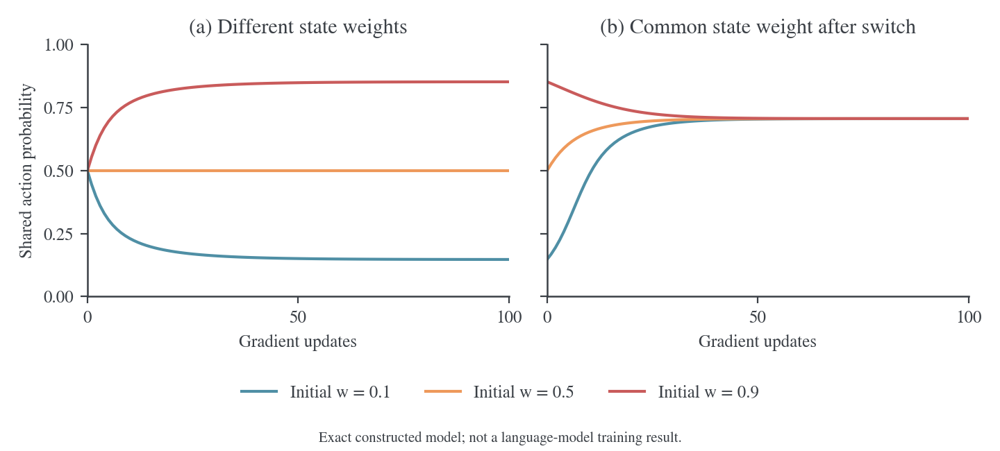

# OPD 访问测度与收敛机制研究

更新时间：2026-10-18。

本文阅读三篇指定论文，分析同策略蒸馏（on-policy distillation，OPD）的状态访问分布与训练平台，并推导混合 rollout 的研究方案。文中的“论文观察”“数学结论”和“待验证假设”分别标明；本文的数学核验使用可精确枚举的合成模型；真实大语言模型实验另见[统一实验报告](../../experiment/2026-10-18-rollout来源与logit融合实验.md)。六种 rollout 来源的逐项极限、固定点与可解实例集中在第 10 节。

## 1. 研究判断与假设修订

研究的核心应是：**在固定教师、学生参数化和优化预算下，prefix 访问测度如何改变学生可实现的蒸馏解，以及在线采样如何反馈到这一解。** 仅用“overlap 太小导致高方差”解释现象不够。至少要分开四个机制：条件目标的 action 采样偏差、局部更新遗漏的未来状态项、有限容量与共享参数产生的投影误差、有限数据和优化造成的有效覆盖不足。

用户提出的“充分训练后 student 应当趋于 teacher”在明确的理想条件下成立：教师在学生函数类中可实现，训练覆盖相关状态，目标确实识别完整条件分布，并达到零蒸馏误差。在这些条件下，访问测度不能任意改变最终策略。现实中的准确率平台通常没有满足或验证这些条件。

| 原始猜测                            | 证据与推导后的判断                                                                                       | 可检验的替代命题                                                                             |
| ----------------------------------- | -------------------------------------------------------------------------------------------------------- | -------------------------------------------------------------------------------------------- |
| 一次 rollout 的大量状态会被很快学完 | 2609.04172 的固定轨迹实验仍持续改进约 200 步，对齐需要数百步；one-shot 指单个 query，不指只 rollout 一次 | 状态供给效率高，但不同状态和参数方向的吸收速率不同；需要固定探针直接测量                     |
| OPD 相当于课程学习，起点无关        | 在线状态分布形成反馈；2610.11291 的 handoff 支持特定配对、预算和初始化范围内的近似平台一致               | 若后续更新动力系统存在共同局部吸引域，不同热启动可趋于相近平台；课程收益与全局唯一性仍待检验 |
| 访问测度决定最终收敛                | 在不可实现或欠覆盖情况下，测度可以改变最优解；但还取决于教师、参数化、action 测度、正则化和优化          | 测度改变共享参数的误差权衡，并通过在线反馈改变稳定点                                         |
| overlap 太大导致 OPD 不工作         | 指定论文报告的方向相反：低 overlap 时，Semi-OPD 相对 OPD 的优势更大                                      | overlap 是条件分布兼容性的代理；需要分别测量 student 和 teacher 的 prefix 分布偏离           |

建议优先完成“固定 prefix、更换 action 估计器”的辨识实验，再比较 logit fusion、分段 rollout 和 batch 混合。否则，更换 rollout 时同时改变状态和 action 分布，实验不能确定收益来自访问测度。

## 2. 三篇论文提供的证据

### 2.1 2608.16647：同源迁移与共享参数的跨领域影响

Li 等的 _Every Coin Has Two Sides_[^dual]研究领域内分布偏移、跨领域迁移和多教师蒸馏。数学难度实验按每题四次教师采样，将问题划分为 4/4、0/4 和随机子集，各取 25K 题；这些条件下的最终数学准确率接近。这里的“教师从未解决”严格指这四次采样均失败，不能推出教师真实成功概率为零。

同源教师通常由与学生相同的起点经后训练得到。论文报告同源配对的跨语言、长推理和跨领域迁移更广，而更强的跨源教师未必产生更强的学生。多教师蒸馏中，改变教师的训练份额会同时改变多个领域的能力，即使每个领域的 prompt 已固定路由给对应专家。固定路由不能隔离共享参数中的迁移和干扰。

对访问测度研究，这些结果支持考察“访问哪些参数方向”，而不只是“访问多少文本 prefix”。不同 query 的原始 prefix 可以完全不同，却通过共享网络产生相似梯度。论文中的整体策略迁移是对实验的解释，不能仅凭若干基准准确率和 top-$K$ overlap 证明全策略分布一致。

本地依据：[目标与设置](../../../../Awesome-OPD-Paper/2608.16647/sections/preliminary.tex)、[难度与域内泛化](../../../../Awesome-OPD-Paper/2608.16647/sections/findings_1.tex)、[跨领域与多教师](../../../../Awesome-OPD-Paper/2608.16647/sections/findings23.tex)、[同源性讨论](../../../../Awesome-OPD-Paper/2608.16647/sections/discussion.tex)。

### 2.2 2609.04172：状态供给快，吸收未必快

Fu 等的 _One Training Example_[^oneshot]表明，单个 query 上持续生成轨迹能够恢复相当部分全数据 OPD 的收益。需要分开两组目标：主要数学 one-shot 结果采用 student top-16 形式；状态覆盖和吸收速率分析采用 sampled-token 形式。论文的不同准确率不能跨这两种设置直接比较。

其“状态覆盖”通过教师最终层隐藏向量构造：每条轨迹抽取八个位置，将参考特征经主成分分析（principal component analysis，PCA）降至 50 维，再聚为 200 簇。覆盖率统计至少访问过一次的簇比例。300 步时，one-shot 达到 71.5%，16-shot 达到 98.9%；one-shot 的 65.9% 已在前 100 步达到。该指标是表示空间的粗粒度覆盖，既不是原始 prefix 的精确支持集重叠，也不包含访问频率。

固定状态实验一次性缓存初始学生的 64 条轨迹，之后重复训练。准确率仍在约 200 步内逐渐提高，对齐指标也需要数百步。这直接限制了“每批状态很快学完，所以必须不断换新状态”的解释。论文的 sampled-token 绝对 log-ratio 距离在 300 步时仍为第 30 步的 16%–22%，并未达到零。

还有两个测量边界。第一，覆盖率误差条来自 30 次轨迹下采样，不等于 30 个训练随机种子。第二，在线距离在不断变化的状态上测量；距离下降同时混入模型更新和状态更替。固定探针上的对齐速率才能更直接回答“这批状态学会了多少”。

本地依据：[预备知识](../../../../Awesome-OPD-Paper/2609.04172/Sections/2_Preliminaries.tex)、[one-shot 设置](../../../../Awesome-OPD-Paper/2609.04172/Sections/3_One-shot.tex)、[状态覆盖](../../../../Awesome-OPD-Paper/2609.04172/Sections/4_Mechanism-Data.tex)、[缓慢对齐](../../../../Awesome-OPD-Paper/2609.04172/Sections/5_Mechanism-Algo.tex)、[附录中的覆盖构造与吸收率表](../../../../Awesome-OPD-Paper/2609.04172/Sections/Appendix.tex)。

### 2.3 2610.11291：rollout 来源、action 权重与 handoff 平台

Zhao 等的 _When Do We Need On-Policy Distillation?_[^semi]是这里最直接的研究起点。Semi-OPD 从初始学生生成固定轨迹，缓存教师 log-probability，每一步重新计算当前学生 log-probability 和优势。正文公式没有 action 重要性修正；因此“使用相同更新式”不意味着在不同 action 采样测度下优化相同的条件 KL。

论文在 17 组配对中报告 Semi-OPD 在 14 组上具有更高的训练曲线平均表现。其主要增益指标是两条准确率曲线面积差除以共同训练跨度，不全是最终检查点差值。例如附录中的 JustRL-1.5B 配对，AUC 差值为 −1.36，但最后一步差值为 +1.4 个百分点。不能把曲线平均收益、末步准确率和数学上的渐近极限混为一谈。

| 相关实验                         | 论文报告                                                                                 | 对因果解释的限制                                                                  |
| -------------------------------- | ---------------------------------------------------------------------------------------- | --------------------------------------------------------------------------------- |
| `fig_source_coverage` 的来源对比 | 两组配对中，初始学生缓存优于教师缓存；完整推理阶段覆盖优于仅保留早期部分                 | 更换来源同时改变 prefix、被采样 action、长度和推理内容，并未纯粹隔离 state        |
| `fig_handoff`                    | Semi-OPD 或教师轨迹蒸馏检查点切换至 OPD 后，准确率靠近相同 rollout cap 下从头 OPD 的水平 | 观测的是有限时域准确率；未证明参数、条件分布、访问测度或所有初始化都相同          |
| `fig_cache_switch_polaris`       | 高 overlap 配对切回 OPD 可提升，并弥合大部分差距                                         | 支持有限范围内的共同后续动力学，仍非全局收敛定理                                  |
| `fig_objective`                  | top-32 反向 KL 下仍有 Semi-OPD 优势                                                      | 排除了“所有现象仅由单个 sampled action 的噪声造成”；top-$k$ 本身仍有截断误差      |
| `fig_signal`、长度消融           | Semi-OPD 有更多正 log-ratio token；低 overlap 下增加训练长度更不利                       | 正比例不是 teacher on-policy 的严格指标；长度还会改变状态加权、结束行为及有效预算 |

进一步核对 handoff 原图，两个低 overlap 配对都是 non-thinking，切换大约发生在第 50 步。图中准确率只平均 AIME24/25 的 avg@32，与主结果的四基准平均不同。原图标示的平台为：

| 学生 ← 教师                            | 4K 训练 rollout cap | 16K 训练 rollout cap |
| -------------------------------------- | ------------------: | -------------------: |
| Qwen3-1.7B ← Qwen3-4B-Instruct-2507    |              约 35% |               约 29% |
| Qwen3-4B ← Qwen3-30B-A3B-Instruct-2507 |              约 60% |               约 50% |

这些是原图给出的平台标注，不是重新估计的置信区间。它们同时支持两个有限范围的观察：相同 cap 下不同热启动接近，同一配对在不同 cap 下平台明显不同。rollout cap 改变的不止最大长度，还改变结束覆盖、训练 token 的阶段构成及更新权重。

初始 overlap 使用学生初始轨迹上的 top-64 集合交集比例。它与 Semi-OPD 相对收益的相关系数为 −0.73，方向是低 overlap 更偏向 Semi-OPD。这个相关关系不能单独证明 teacher off-policy 是原因，论文也将教师监督质量这一机制表述为假设。

训练设置为去重后的 14,116 个 DAPO prompt，每步 128 个 prompt、每题一条轨迹，采样温度和 top-$p$ 都为 1；学习率 $10^{-6}$，AdamW，梯度裁剪 1.0，权重衰减 0.01。主要模型对比中非思考配置训练上限为 4,096，长思考配置为 16,384；基线比较表另将标准 OPD 统一设为 16K。评估通常允许 32K。比较平台时必须固定对应的训练 cap，不能把不同图表中的“OPD”当成完全相同的处理条件。

本地依据：[更新式与 Semi-OPD](../../../../Awesome-OPD-Paper/2610.11291/sections/02_method.tex)、[核心机制消融](../../../../Awesome-OPD-Paper/2610.11291/sections/05_why.tex)、[handoff 讨论](../../../../Awesome-OPD-Paper/2610.11291/sections/06_more.tex)、[设置与模型对表](../../../../Awesome-OPD-Paper/2610.11291/sections/09_appendix.tex)。原图：[来源与覆盖](../../../../Awesome-OPD-Paper/2610.11291/figures/fig_source_coverage.pdf)、[handoff](../../../../Awesome-OPD-Paper/2610.11291/figures/fig_handoff.pdf)。

## 3. 明确区分状态测度、action 测度和目标

### 3.1 记号和访问测度

令 $x\sim\rho$ 为 prompt，$s_t=(x,y_{<t})$ 为 prefix，$a_t=y_t$ 为 token。固定教师为 $q(a\mid s)$，当前学生为 $p_\theta(a\mid s)$，生成轨迹的行为策略为 $\mu(a\mid s)$。先考虑有限词表、固定时域 $H$，所有参与 log-ratio 的概率严格为正；EOS 后进入两模型共享的吸收状态，后续损失为零。所有对训练样本的求导均将已采样 prefix 视为固定输入。

每个深度的访问分布以及归一化访问测度定义为

$$
d_t^\mu(s)=\Pr_{x\sim\rho,y\sim\mu}(s_t=s),\qquad
 d^\mu(s)=\frac1H\sum_{t=1}^H d_t^\mu(s).
$$

状态中包含深度和 prompt。若两条轨迹的 prompt 不同，它们的精确状态就不同；在隐藏向量空间中相近，不会改变这个事实。

训练 prefix 的分布记为 $\nu$，在该 prefix 上用于估计梯度的 action 分布另记为 $b(a\mid s)$。完整轨迹直接供给 action 时，通常 $\nu=d^\mu,b=\mu$；也可以保留 $s\sim d^\mu$，独立重新采样 $a\sim p_\theta(\cdot\mid s)$。后者保留混合 rollout 引入的状态变化，同时消除条件梯度的 action 失配。

### 3.2 三个不同的优化对象

固定状态权重的条件反向 Kullback–Leibler 散度（KL 散度）为

$$
\ell_s(\theta)=\operatorname{KL}(p_\theta(\cdot\mid s)\Vert q(\cdot\mid s)),\qquad
L_\nu(\theta)=\mathbb E_{s\sim\nu}\ell_s(\theta).
$$

完整轨迹分布分别为 $P_\theta(y\mid x)$ 和 $Q(y\mid x)$。序列目标为

$$
J(\theta)=\mathbb E_{x\sim\rho}\operatorname{KL}(P_\theta(\cdot\mid x)\Vert Q(\cdot\mid x))
=\sum_{t=1}^H\mathbb E_{s\sim d_t^{p_\theta}}\ell_s(\theta).
$$

等号是 KL 的链式法则：展开轨迹 log-ratio 为逐 token log-ratio 之和，再对每个 prefix 的 action 条件期望求和。数值上 $J=H L_{d^{p_\theta}}$，但求导时 $d^{p_\theta}$ 也随 $\theta$ 变化，不能把它当常数。

任务指标另记为

$$
\operatorname{Acc}(\theta)=\mathbb E_{x\sim\rho_{\rm eval},y\sim P_\theta}[R(x,y)],\qquad 0\le R\le1.
$$

它由正确性判分器定义，并且可能使用不同 prompt 分布、温度和生成上限。最小化条件 KL、最小化序列 KL、提高任务准确率，是三个需要分别验证的命题。

### 3.3 长度归一化会改变测度

真实实现通常忽略 EOS 后的 padding。若按所有有效 token 求平均，大样本极限对应

$$
\nu_{\rm token}^\mu(s)=\frac{\mathbb E_\mu\sum_{t\le L(y)}\mathbf1\{s_t=s\}}{\mathbb E_\mu L(y)}.
$$

若先对每条轨迹除以其长度，再按轨迹平均，则对应

$$
\nu_{\rm seq}^\mu(s)=\mathbb E_\mu\left[\frac1{L(y)}\sum_{t\le L(y)}\mathbf1\{s_t=s\}\right].
$$

两者一般不同。若 $L(y)$ 取决于当前 action 和未来轨迹，逐序列 $1/L$ 加权还会改变给定 prefix 的有效 action 分布。即使原始 rollout 来自 student，也不能无条件套用下节的标准无偏恒等式。有限 batch 的随机 token 总数作分母也有比率估计误差。以下严格证明使用固定 $H$ 的求和目标；实验同时记录实际归约方式、有效 token 数和终止原因。

## 4. Sampled-token 更新为什么不能保证持续改进

### 4.1 固定 prefix、当前 student action：梯度本身没有必然偏差

固定一个状态 $s$，简写 $p=p_\theta(\cdot\mid s)$、$q=q(\cdot\mid s)$，令 $u_a=\nabla_\theta\log p(a)$。由于 $\sum_a p(a)=1$，有

$$
\sum_a p(a)u_a=\nabla_\theta\sum_a p(a)=0.
$$

直接对条件反向 KL 求导：

$$
\begin{aligned}
\nabla_\theta\ell_s
&=\sum_a\nabla p(a)\left[\log\frac{p(a)}{q(a)}+1\right]\\
&=\sum_a p(a)u_a\log\frac{p(a)}{q(a)}.
\end{aligned}
$$

定义停止梯度的奖励 $A(a,s)=\log q(a\mid s)-\log p_\theta(a\mid s)$。从当前 $p_\theta$ 采样 action，反向传播 $-\operatorname{stopgrad}(A)\log p_\theta$，其梯度估计为

$$
\widehat g_s=\log\frac{p_\theta(a\mid s)}{q(a\mid s)}\nabla_\theta\log p_\theta(a\mid s),\qquad
\mathbb E_{a\sim p_\theta}\widehat g_s=\nabla_\theta\ell_s.
$$

因此，不能声称 sampled-token 形式在理想 on-policy 条件下一开始就朝错误的条件 KL 方向更新。这个恒等式要求 reward 停止梯度、action 真正来自当前被求导的分布，以及没有另加改变期望的 action 权重、裁剪或截断。rollout 与训练温度不同、多次复用旧 action、top-$p$ 截断，都需要另作处理。

若固定 $\nu$，$L_\nu$ 的梯度是 $M$-Lipschitz，精确梯度更新满足下降引理：

$$
L_\nu(\theta-\eta g)\le L_\nu(\theta)-\eta\left(1-\frac{M\eta}{2}\right)\lVert g\rVert^2,\qquad g=\nabla L_\nu.
$$

只要 $0<\eta<2/M$，非零梯度给出下降。若使用无偏、方差为 $\sigma^2$ 的独立单样本估计的 $B$ 样本平均，则

$$
\mathbb E L_\nu(\theta-\eta\widehat g)
\le L_\nu(\theta)-\eta\left(1-\frac{M\eta}{2}\right)\lVert g\rVert^2
+\frac{M\eta^2\sigma^2}{2B}.
$$

这是将下降引理中的 $\mathbb E\widehat g=g$、$\mathbb E\lVert\widehat g\rVert^2=\lVert g\rVert^2+\sigma^2/B$ 代入所得。接近驻点时信号小，固定学习率与噪声会破坏逐步下降。轨迹内 token 相关，实际 $B$ 不能直接取 token 总数；应估计协方差或按轨迹聚合。

### 4.2 局部 token 奖励遗漏未来状态的影响

令 $e_t=\log p_\theta(a_t\mid s_t)-\log q(a_t\mid s_t)$、$u_t=\nabla\log p_\theta(a_t\mid s_t)$，则 $J=\mathbb E_{P_\theta}\sum_t e_t$。对有限轨迹空间逐项求导：

$$
\begin{aligned}
\nabla J
&=\mathbb E\left[\left(\sum_tu_t\right)\left(\sum_je_j\right)\right]
 +\mathbb E\sum_j u_j\\
&=\mathbb E\sum_t u_t\sum_{j\ge t}e_j.
\end{aligned}
$$

第二项为零，因为每个 $u_j$ 在给定 $s_j$ 时条件均值为零。第一项中 $j<t$ 的 $e_j$ 是 $s_t$ 的已知历史，故 $\mathbb E[u_te_j\mid s_t]=e_j\mathbb E[u_t\mid s_t]=0$。剩余项为

$$
\nabla J=G(\theta)+B(\theta),\qquad
G(\theta)=\mathbb E\sum_tu_te_t,
\qquad B(\theta)=\mathbb E\sum_tu_t\sum_{j>t}e_j.
$$

$G$ 是实际局部 sampled-token 更新在理想 on-policy 情况下的期望；$B$ 是当前动作对未来状态中蒸馏误差的影响。将动作后剩余条件 KL 的期望记为 $V_{t+1}^{\rm KL}(s_t,a_t)$，也可写成

$$
B(\theta)=\sum_t\mathbb E[u_tV_{t+1}^{\rm KL}(s_t,a_t)].
$$

沿局部更新方向 $-G$ 的一阶变化是

$$
J(\theta-\eta G)-J(\theta)
=-\eta\left(\lVert G\rVert^2+\langle B,G\rangle\right)+O(\eta^2).
$$

只要 $\langle B,G\rangle<-\lVert G\rVert^2$，足够小的更新也会增大序列 KL。词表全枚举能消除 action 的蒙特卡洛噪声，却不能自动补回 $B$。MiniLLM[^minillm]已区分 single-step 和 long-term 梯度；这里的结论针对三篇指定论文讨论的局部 token 更新，不应扩展成“所有 OPD 算法都遗漏未来项”。

若要估计完整序列梯度，应使用含未来累计 log-ratio 的 return-to-go，并加入合法的状态基线降低方差。这样得到的是另一个目标更完整但方差通常更高的估计器，也仍不直接保证任务准确率单调上升。

### 4.3 可实现、全支持、零采样噪声的两步反例

考虑根节点选择分支 $L/R$，第二步选择成功/失败。三个状态都有独立可训练的 Bernoulli logit，故教师完全可实现。表中记录根节点选择 $L$ 的概率，以及两个子节点成功的概率。

| 策略 | 根节点选 $L$ | $L$ 上成功 | $R$ 上成功 |
| ---- | -----------: | ---------: | ---------: |
| 学生 |          0.8 |      0.001 |        0.9 |
| 教师 |          0.9 |      0.999 |        0.9 |

写 $z_i=\operatorname{logit}(p_i)$，Bernoulli 条件 KL 的 logit 梯度为

$$
\frac{\partial\operatorname{KL}(p_i\Vert q_i)}{\partial z_i}
=p_i(1-p_i)\bigl(z_i-\operatorname{logit}(q_i)\bigr).
$$

根、左、右状态的访问权重分别为 $1,p_0,1-p_0$，所以

$$
G=(-0.1297488,-0.0110398,0),\qquad
B=(1.1028706,0,0),\qquad
\langle\nabla J,G\rangle=-0.1261395.
$$

根节点更新希望学生更常选择教师偏好的 $L$，但学生当前几乎不会完成 $L$。子节点的成功概率很小，logit 梯度也受 $p_L(1-p_L)$ 抑制，尚不能同步补齐能力。步长 $\eta=0.01$ 的精确期望更新结果为：

| 指标                             |      更新前 |      更新后 |
| -------------------------------- | ----------: | ----------: |
| 固定旧 prefix 权重的条件 KL 求和 | 5.558756023 | 5.558586657 |
| 重新计算访问权重的序列 KL        | 5.558756023 | 5.560017061 |
| 学生准确率                       | 0.180800000 | 0.180613530 |

教师准确率为 0.9891。三个概率均严格在 $(0,1)$，没有 action 支持缺失，也没有有限 batch 噪声。这证明“局部 OPD 不保证持续改善序列 KL 或准确率”不需要诉诸高方差。它没有证明这个可实现模型最终无法到达教师，也没有证明该项是真实 LLM 劣化的主导原因。

### 4.4 低 overlap 与方差：绝对方差和信噪比要分开

取单状态二动作模型，教师成功概率 $q\in(0,1)$ 固定，学生成功概率 $p=\varepsilon\to0$，参数为其 logit。裸 sampled-token 估计器有两个取值：

$$
\widehat g=
\begin{cases}
(1-\varepsilon)\log(\varepsilon/q),&a=1,\ \Pr(a=1)=\varepsilon,\\
-\varepsilon\log((1-\varepsilon)/(1-q)),&a=0,\ \Pr(a=0)=1-\varepsilon.
\end{cases}
$$

其均值为

$$
g=\varepsilon(1-\varepsilon)\left[\operatorname{logit}(\varepsilon)-\operatorname{logit}(q)\right]
=\varepsilon\log\varepsilon+O(\varepsilon).
$$

由两个取值的二阶矩减去均值平方，可得

$$
\operatorname{Var}(\widehat g)=\Theta(\varepsilon\log^2\varepsilon)\to0,\qquad
\frac{\operatorname{Var}(\widehat g)}{g^2}=\Theta(1/\varepsilon)\to\infty.
$$

这里恶化的是相对方差与有效信噪比，绝对方差反而趋于零。采到至少一次稀有成功 action 的概率为 $1-(1-\varepsilon)^B$，需要 $B$ 达到 $1/\varepsilon$ 的量级。若 $\varepsilon=10^{-6}$，即使奖励幅度大，通常也采不到关键 action；同时，精确反向 KL 的普通 logit 梯度本身也很小。

当 teacher 对 student 常采 action 的概率趋近零时，log-ratio 又可很大；其梯度方差取决于完整的 $p,q$ 和 score 范数。top-$K$ 集合交集不包含这些概率大小，不能据此推得一个统一方差结论。合法基线、多个 action 样本、全词表求和可以改变方差；上面的渐近式特指无基线的裸估计器。

### 4.5 蒸馏奖励不是任务优势函数

设 $V_t^p(s)$ 是按学生继续生成的成功率，$Q_t^p(s,a)$ 是先选 $a$ 再按学生续写的成功率，任务优势为 $A_t^{p,R}=Q_t^p-V_t^p$。对任意新策略 $p'$，有限时域的性能差可以由望远镜求和得到：

$$
\operatorname{Acc}(p')-\operatorname{Acc}(p)
=\sum_t\mathbb E_{s_t\sim d_t^{p'},a_t\sim p'}A_t^{p,R}(s_t,a_t).
$$

证明是将每项写为 $\mathbb E[V_{t+1}^p(s_{t+1})-V_t^p(s_t)]$，中间价值相消，终端为实际奖励、起点为旧策略期望奖励。这里要求相同 prompt 分布、环境和结束规则。OPD 的 $\log q-\log p$ 没有理由等于 $A_t^{p,R}$；教师偏好的动作可能需要学生尚未掌握的后续能力，两步反例正是这种情况。

即使序列 KL 下降，也只控制与教师的行为差异。以相同评估协议，Pinsker 不等式和 Jensen 不等式给出

$$
\left|\operatorname{Acc}(p)-\operatorname{Acc}(q)\right|
\le\mathbb E_x\operatorname{TV}(P(\cdot\mid x),Q(\cdot\mid x))
\le\sqrt{J/2}.
$$

缩小上界不保证准确率每一步增加。例如单步三结果中只有第一个正确，令 $q=(0.6,0.39,0.01)$、$p=(0.5,0.001,0.499)$。沿 $v=(-0.01,0.1,-0.09)$ 移动足够小的正距离，$\sum_a v_a=0$ 且 $\sum_a v_a\log(p_a/q_a)\approx-0.947<0$，所以 KL 下降，但正确率以 $0.01$ 的速率下降。这是“KL 下降本身不能蕴含准确率上升”的逻辑反例；该方向不声称是 OPD 梯度。

## 5. 离线 sampled-token 蒸馏同时改变了 action 目标

### 5.1 无重要性修正时的精确偏差

在固定 $s$ 上改为 $a\sim b(\cdot\mid s)$，原式的期望梯度变成

$$
g_b(s)=\sum_a b(a\mid s)\log\frac{p_\theta(a\mid s)}{q(a\mid s)}\nabla\log p_\theta(a\mid s).
$$

相对于条件 KL 梯度，其偏差是

$$
g_b(s)-\nabla\ell_s
=\sum_a\bigl(b(a\mid s)-p_\theta(a\mid s)\bigr)
\log\frac{p_\theta(a\mid s)}{q(a\mid s)}\nabla\log p_\theta(a\mid s).
$$

因此，替换初始学生缓存为教师缓存时，改变的不止 $\nu$，还有 $b$。继续重算当前学生 log-probability，可以保证奖励随模型变化，但不能消除上述偏差。用旧 action 计算的新 reward 仍不是当前 on-policy action 样本。

当 $\nu,b$ 固定时，这个裸更新恰好是另一个标量目标的梯度：

$$
F_{\nu,b}(\theta)=\frac12\mathbb E_{s\sim\nu,a\sim b}
\left[\log p_\theta(a\mid s)-\log q(a\mid s)\right]^2,
\qquad \nabla F_{\nu,b}=\mathbb E_\nu g_b(s).
$$

证明是逐项对平方求导，$\nu,b,q$ 均固定。这里说的是梯度等价，不是带 stop-gradient 的 surrogate 数值等于 $F$。若固定数据为每个独特 prefix 只保存一个 action，那么只约束该 action 的 log-probability；在三动作及以上的表格模型中，即使该值完全拟合，剩余概率如何分配仍可能不唯一。共享语言模型会在不同 prefix 间迁移约束，但这种迁移需要验证。

该平方目标并不意味着 Semi-OPD 注定失败：若 $b$ 全支持、教师可实现且全局达到零损失，$p=q$ 仍是解。它说明中途梯度、误差权衡和不完全拟合的最优解会不同。如果 $b$ 随学生变化而每步重新冻结，则每一步可以作类似的局部解释，却不能认为整个过程在下降一个固定的 $F_{\nu,b}$。

### 5.2 中心化和 surrogate 数值的边界

on-policy 条件下减去任意只依赖 $s$ 的基线 $c(s)$，不改变期望，因为 $\mathbb E_p\nabla\log p=0$。但 $\mathbb E_b\nabla\log p$ 一般不为零。把 on-policy 的中心化直接搬到离线 action 上，会进一步改变期望梯度。若基线由同一个 sampled action 估计，也不能直接当作与 action 无关。

surrogate $-\operatorname{stopgrad}(A)\log p$ 的显示数值也不是 KL；随模型更新重算 $A$ 后，其数值曲线未必是优化进展。应另外记录固定探针上的完整条件 KL、原始 log-ratio 的分布以及参数梯度。

### 5.3 三种可区分的修正

| 方案                                                            | 固定 prefix 下的条件梯度          | 是否保留混合状态测度 |
| --------------------------------------------------------------- | --------------------------------- | -------------------- |
| 全词表精确计算 $\operatorname{KL}(p_\theta\Vert q)$             | 精确                              | 保留                 |
| 在缓存 prefix 上独立重新采样 $a\sim p_\theta$                   | 无偏；有 action 方差              | 保留                 |
| 对 $a\sim b$ 使用停止梯度的 $p_\theta(a\mid s)/b(a\mid s)$ 权重 | 在 $b$ 覆盖 $p_\theta$ 支持时无偏 | 保留                 |

第三种方案的恒等式为

$$
\mathbb E_{a\sim b}\left[\frac{p_\theta(a\mid s)}{b(a\mid s)}
\log\frac{p_\theta(a\mid s)}{q(a\mid s)}\nabla\log p_\theta(a\mid s)\right]
=\nabla\ell_s.
$$

该权重只修正 action，不修正 prefix。若再乘 $d^{p_\theta}(s)/\nu(s)$，得到的是在线局部场 $G$ 的估计，而不是自动得到完整 $\nabla J$；未来项 $B$ 仍需单独加入。若研究问题正是改变状态测度的作用，应有意保留 $\nu$，否则修正会消除想研究的干预。

重要性比率裁剪会引入偏差。截断采样导致 $b(a\mid s)=0$ 而 $p_\theta(a\mid s)>0$ 时，缺失支持无法靠有限权重恢复。student top-$k$ 归一化目标也不等于全词表 KL，需记录两模型在截断集合上的概率质量，不能把 top-$k$ 的负结果视为精确全词表结论。

## 6. Prefix 访问测度与最终收敛的关系

### 6.1 零误差定理：哪些条件下直觉成立

**命题 1：固定测度的零损失识别。** 设状态、动作有限，教师 $q$ 严格正，存在 $\theta_T$ 在所有待研究状态上满足 $p_{\theta_T}=q$。若 $\nu(s)>0$ 覆盖这些状态，那么任何达到 $L_\nu$ 全局最小值的策略都在这些状态上等于教师。

证明：KL 非负，因此 $L_\nu\ge0$；可实现性给出 $L_\nu(\theta_T)=0$。最小解满足 $\sum_s\nu(s)\ell_s=0$。每个被覆盖状态的权重严格正、损失非负，只能逐项为零。离散 KL 为零当且仅当两分布相同，故 $p=q$。若某状态的 $\nu$ 为零，论证对它没有约束；若学生无法实现教师，零下界也不能达到。

**命题 2：在线访问状态上零 KL 蕴含轨迹相等。** 在相同 prompt 分布和有限时域下，若

$$
\sum_t\mathbb E_{d_t^{p}}\operatorname{KL}(p(\cdot\mid s)\Vert q(\cdot\mid s))=0,
$$

则对 $\rho$ 几乎处处的 prompt，$P(\cdot\mid x)=Q(\cdot\mid x)$。

证明：由链式法则，左边就是 $\mathbb E_x\operatorname{KL}(P\Vert Q)$；零值推出每个正权重 prompt 上轨迹 KL 为零。也可从根节点归纳：根处条件分布相同，第一步到达分布相同；每个已到达状态上的条件分布相同，下一步到达分布继续相同，直至终端。它不约束训练 prompt 分布之外的泛化。

这两条命题回答了最初的反直觉：**如果真正实现了相关条件分布的零误差，student 确实应当趋于 teacher。** 实验所说的“收敛”通常只是准确率变平，甚至 sampled-token 距离仍明显非零；此时不能调用零误差结论。

### 6.2 一个可证明起点无关的理想更新

进一步考虑每个 prefix 有独立概率参数的表格模型。在某状态的一次更新中，求解

$$
p^+=\arg\min_{r\in\Delta}\left\{
\alpha\operatorname{KL}(r\Vert q)+(1-\alpha)\operatorname{KL}(r\Vert p)
\right\},\qquad 0<\alpha\le1.
$$

令拉格朗日乘子处理 $\sum_ar_a=1$，逐 action 的一阶条件为

$$
\log r_a+1-\alpha\log q_a-(1-\alpha)\log p_a+\xi=0.
$$

归一化得到唯一解

$$
p_a^+=\frac{p_a^{1-\alpha}q_a^\alpha}{\sum_b p_b^{1-\alpha}q_b^\alpha}.
$$

选参考 action $a_0$，消去归一化常数后，teacher 相对 log-odds 误差满足

$$
\log\frac{p_a^+}{p_{a_0}^+}-\log\frac{q_a}{q_{a_0}}
=(1-\alpha)\left[\log\frac{p_a}{p_{a_0}}-\log\frac{q_a}{q_{a_0}}\right].
$$

每个状态在第 $k$ 次全局迭代的有效更新系数记为 $\alpha_{s,k}$，未访问时取零。重复上式，误差乘上 $\prod_k(1-\alpha_{s,k})$。若各系数在 $[0,1]$，且每个相关状态都有 $\sum_k\alpha_{s,k}=\infty$，则由 $1-u\le e^{-u}$，乘积趋零，所有条件概率收敛到教师。有限次中某系数为 1 时，该状态直接精确对齐。

这是充分探索、独立参数和精确分布更新下的起点无关结论。访问频率影响速度，不改变极限；被永远遗漏的状态仍不受保证。普通神经网络 AdamW、梯度裁剪和 sampled-token 更新不等于这个闭式步骤，不能直接继承其保证。

### 6.3 共享参数使不同状态的误差不能同时归零

构造两个状态 $s_A,s_B$，教师分别为 $q(1\mid s_A)=0.9$、$q(1\mid s_B)=0.1$。学生被限制为在两个状态上使用同一个概率 $p=\sigma(z)$。访问测度为 $\nu(s_A)=w,\nu(s_B)=1-w$，其中 $0<w<1$，两状态都被覆盖。

条件目标为

$$
L_w(p)=w\operatorname{KL}(\operatorname{Ber}(p)\Vert\operatorname{Ber}(0.9))
+(1-w)\operatorname{KL}(\operatorname{Ber}(p)\Vert\operatorname{Ber}(0.1)).
$$

对 $p$ 求导并令零：

$$
\frac{\mathrm dL_w}{\mathrm dp}
=\operatorname{logit}(p)-\left[w\operatorname{logit}(0.9)+(1-w)\operatorname{logit}(0.1)\right]=0.
$$

由于 $\mathrm d^2L_w/\mathrm dp^2=1/[p(1-p)]>0$，最优概率唯一：

$$
p_w^*=\sigma\bigl((2w-1)\log9\bigr).
$$

当 $w=0.1,0.5,0.9$，最优概率分别为 $0.147069,0.5,0.852931$。三个条件都有 100% 状态支持覆盖，但教师不可同时实现，所以访问频率改变最终投影。若评估状态 $A$ 占 80%，正确 action 分别是 $A$ 的 1 和 $B$ 的 0，则准确率为 $0.2+0.6p$，对应 $0.288241,0.5,0.711759$。

该构造可嵌入生成树：令外部控制的首步以概率 $w$ 选择两个 prefix，再只训练共享的下一步输出。不同首步行为策略就产生上述不同访问测度。实验本身是精确的条件蒸馏模型，未模拟 LLM 全部参数更新。



图中左侧固定不同 $w$，普通 logit 梯度下降趋于不同概率；右侧统一改为 $w=0.7$，三个起点趋于同一个 $p^*=0.706592$。这是合成模型的精确期望数值结果，不是三篇论文曲线的重绘，也不证明在线 OPD 总具有该行为。[绘图源](experiments/plot_results.py)、[矢量图](figures/2026-10-17-状态权重与切换平台.pdf)。

### 6.4 一般共享模型中的局部投影

为了把两状态例子推广为可测量对象，在参考参数 $\theta_0$ 附近线性化学生 logits：

$$
z_\theta(s)\approx z_0(s)+J_s\delta,\qquad \delta=\theta-\theta_0,
\qquad \Delta_s=z_T(s)-z_0(s).
$$

$J_s$ 是 logits 对参数的 Jacobian；$z_T(s)$ 是教师 logits 的一个代表，任意加性常数不影响 softmax。若师生差距足够小，围绕教师分布展开 KL，得到二阶近似

$$
\ell_s(\theta)\approx\frac12(J_s\delta-\Delta_s)^\top F_q(s)(J_s\delta-\Delta_s),\qquad
F_q(s)=\operatorname{diag}(q_s)-q_sq_s^\top.
$$

这来自 softmax log-partition 的 Hessian；零阶与一阶项在分布相等处消失，$F_q$ 自动消除 logits 的常数方向。对 $\nu$ 取期望并求导，正规方程为

$$
H_\nu\delta=b_\nu,\qquad
H_\nu=\mathbb E_\nu[J_s^\top F_q(s)J_s],\qquad
b_\nu=\mathbb E_\nu[J_s^\top F_q(s)\Delta_s].
$$

在可辨识子空间上，解为 $H_\nu^\dagger b_\nu$；零空间方向不被目标识别。若存在一个共同 $\delta_T$ 对所有状态实现教师，且 $H_\nu$ 在研究子空间正定，则最优解仍是共同的 $\delta_T$。否则不同 $\nu$ 改变误差投影；即使最优解相同，小特征值也可使有限预算下的平台不同。

这只是局部二阶模型，不是对大幅 LLM 更新的精确等式。它给出比“簇覆盖百分比”更接近优化机制的研究对象：梯度子空间覆盖、条件 Fisher 信息和不同状态的梯度冲突。2608.16647 的跨领域迁移提示这些方向存在共享，尚未直接测量 $H_\nu$。

固定状态下“越学越慢”也有一个不依赖课程的局部解释。假设上述二次模型的 $H_\nu$ 固定、对称正定，采用连续时间普通梯度下降。令最优解误差在特征方向上的初值为 $c_i$，特征值为 $\lambda_i>0$，则误差满足 $e_i(t)=c_i e^{-\lambda_i t}$，目标剩余量为

$$
E(t)=\frac12\sum_i\lambda_i c_i^2e^{-2\lambda_i t},\qquad
r(t)=-\frac{\mathrm d}{\mathrm dt}\log E(t)
=2\sum_i\omega_i(t)\lambda_i,
\quad \omega_i(t)=\frac{\lambda_i c_i^2e^{-2\lambda_i t}}{\sum_j\lambda_j c_j^2e^{-2\lambda_j t}}.
$$

由于 $\dot\omega_i=-2\omega_i(\lambda_i-\sum_j\omega_j\lambda_j)$，再次求导得到

$$
\dot r(t)=-4\operatorname{Var}_{i\sim\omega(t)}(\lambda_i)\le0.
$$

快方向先被吸收，剩余误差逐渐集中在慢方向，因此相对吸收率可以持续下降，即使状态完全不变。这解释了“为何固定状态也可能长期学习”的一种机制；论文记录的是 sampled log-ratio 的绝对值而非这个二次目标，实际还用 AdamW，故不能将该公式直接当作论文吸收率的拟合定律。可通过固定 probe 的梯度谱近似及学习率缩放实验检验其适用程度。

### 6.5 在线访问分布产生自洽固定点

对精确条件梯度的在线局部更新，连续时间近似可写为

$$
\dot\theta=-G_{\rm on}(\theta),\qquad
G_{\rm on}(\theta)=\mathbb E_{s\sim d^{p_\theta}}\nabla\ell_s(\theta).
$$

平衡点满足 $G_{\rm on}(\theta^*)=0$。它只要求加权梯度和为零；共享参数下，多个非零状态梯度可以相互抵消，因而不能推出各状态 KL 为零。

在平衡点附近的线性化包含两部分：

$$
\mathrm DG_{\rm on}(\theta^*)=
\mathbb E_{d^{p_{\theta^*}}}\nabla^2\ell_s(\theta^*)
+\sum_s\nabla\ell_s(\theta^*)\bigl(\nabla d^{p_\theta}(s)\rvert_{\theta^*}\bigr)^\top.
$$

第一项是固定状态上的局部优化曲率，第二项是策略改变状态访问频率带来的反馈。第二项通常不对称，因此该更新场未必是某个全局标量势能的梯度。若该 Jacobian 的特征值实部全为正，平衡点局部渐近稳定；足够小离散步长下还需更新 Jacobian 的谱半径小于 1。

2610.11291 的 handoff 可解释为几个热启动进入同一稳定区域，但这只是与证据相容的解释。真实 AdamW 还有一阶、二阶动量状态；是否重置优化器、学习率和衰减都影响动力学。相同准确率也可能对应不同稳定点。验证共同吸引域，需要额外比较同一固定 probe 上的策略距离、访问分布及多种初始化，而不只比较 accuracy。

### 6.6 状态覆盖如何变成泛化界

设最终学生的归一化访问测度为 $d^p$，训练人口测度为 $\nu$，并有有限的覆盖系数

$$
C=\sup_{s:\nu(s)>0}\frac{d^p(s)}{\nu(s)}<\infty,\qquad d^p\ll\nu.
$$

因为 $\ell_s\ge0$，逐项乘密度比可得

$$
J=H\sum_s\nu(s)\frac{d^p(s)}{\nu(s)}\ell_s
\le HC L_\nu.
$$

结合前面的准确率界，得到

$$
|\operatorname{Acc}(p)-\operatorname{Acc}(q)|\le\sqrt{HC L_\nu/2}.
$$

它同时要求训练误差小和评估访问分布被覆盖。若 $\nu$ 是有限缓存的原始 prefix 经验分布，大量在线 prefix 没出现过，$C$ 通常无穷，界就没有信息。用教师隐藏向量聚类后获得有限覆盖率，只能作为代理；除非另有簇内条件分布或梯度的平滑性假设，不能把聚类覆盖直接代入这个严格界。

若训练与测试的 prompt 支持不同，还需额外的跨 prompt 泛化论证。访问测度理论不会自动证明 one-shot 对全题库泛化；这部分恰好需要参数共享、表示和梯度几何的证据。

## 7. 分别衡量 student 与 teacher 的 on-policy 性质

### 7.1 条件分布相似不等于 prefix 分布相似

给定 $s$ 的 top-$K$ overlap 只比较两个模型下一步概率排序的前列集合。即使集合完全相同，概率也能差很多；例如 $(0.99,0.01)$ 与 $(0.51,0.49)$ 的 top-1 相同。反之，同一 prefix 极少被教师访问，并不表示教师在该 prefix 的下一步预测一定错误。

对行为策略 $\mu$，应分别定义深度 $t$ 的偏离：

$$
D_S(t)=\operatorname{KL}(d_t^\mu\Vert d_t^{p}),\qquad
D_T(t)=\operatorname{KL}(d_t^\mu\Vert d_t^{q}).
$$

这里比较相同 prompt、深度、温度和终止约定下的 prefix 分布。$D_S=0$ 表示该深度真正匹配学生访问分布，$D_T=0$ 表示匹配教师访问分布。它们衡量分布，不直接衡量任务质量。

当行为策略可计算、没有丢失支持，且 prompt 分布相同时，对完整 prefix 有精确密度比

$$
\log\frac{d_t^\mu(s_t)}{d_t^q(s_t)}
=\sum_{j<t}\log\frac{\mu(a_j\mid s_j)}{q(a_j\mid s_j)}.
$$

对 $s_t\sim d_t^\mu$ 求平均，就得到 $D_T(t)$；将 $q$ 换成 $p$ 得到 $D_S(t)$。可同时报告总 prefix KL 和除以 $t-1$ 的每步 KL，前者保留长序列误差累积，后者便于比较长度。

对于固定初始学生缓存，$\mu=p_0$，需保存初始模型或行为 log-probability。该估计针对生成缓存的人口策略，不是说有限缓存的经验概率等于 $p_0$。按是否存活到深度 $t$ 筛选轨迹会带来条件化；应保留 EOS 吸收状态或明确加入存活概率的归一化项。

两个距离不能任意同时接近零。以总变差（total variation，TV）距离，三角不等式直接给出

$$
\operatorname{TV}(d_t^p,d_t^q)
\le\operatorname{TV}(d_t^p,d_t^\mu)+\operatorname{TV}(d_t^\mu,d_t^q).
$$

当学生与教师访问分布本身远离，至少一侧偏离不小。算法需要选择可用的折中，而不应要求两侧在每个深度都严格 on-policy。

### 7.2 区分“训练样本偏离目标”和“目标区域没有覆盖”

$\operatorname{KL}(\nu\Vert d^p)$ 检查训练状态是否偏离 student；$\operatorname{KL}(d^p\Vert\nu)$ 和密度比 $d^p/\nu$ 则检查 student 会访问的状态是否得到训练覆盖。两个方向不能互换。teacher 一侧同理。

推荐保留一组指标，而不急于压缩为一个分数：

| 层面               | 建议指标                                                                       | 回答的问题                                                 |
| ------------------ | ------------------------------------------------------------------------------ | ---------------------------------------------------------- |
| 精确 prefix 测度   | 按深度的 $D_S(t),D_T(t)$；反向覆盖比率及其分位数                               | 训练在哪里偏离两侧策略，哪些部署状态可能缺少监督           |
| 表示空间的访问频率 | 固定教师表示与固定聚类下，簇概率向量的 Jensen–Shannon 散度；深度和推理阶段分层 | 访问质量是否集中到少数区域；跨 prompt 的粗粒度分布是否变化 |
| 带阈值的覆盖       | 目标参考簇的质量加权覆盖，并要求最少样本数及最近邻距离阈值                     | 覆盖的是重要且相近的区域，还是只偶然命中过一个远点         |
| 条件动作分布       | 全词表双向 KL、总变差、教师头部的 student 概率质量、尾部质量                   | action 支持与概率失配是否阻碍估计                          |
| 梯度               | 均值范数、按轨迹估计的协方差、信噪比、不同来源梯度余弦                         | 更新是否存在噪声、抵消或相反方向                           |
| 教师续写能力       | 同一 prefix 后教师/学生续写的成功率差                                          | 教师在该状态是否提供可用的任务能力                         |

所有方法共用一组冻结 probe 和同一表示空间，另报告各自 live rollout 上的指标。若每个模型都只测自己的轨迹，平均 KL 或 entropy 的变化可能只是换到了更容易的状态。高维 raw prefix 上缺乏重复样本时，经验 JS 不应冒充人口 JS；此时使用可计算的策略密度比，或明确标注为表示空间代理。

定义教师头部 $T_K(s)=\operatorname{TopK}(q(\cdot\mid s),K)$，可记录

$$
M_{S\to T,K}(s)=\sum_{a\in T_K(s)}p(a\mid s).
$$

它直接反映 student 多大概率采到 teacher 的头部，比“集合有多少交集”更贴近 sampled action 的可见性，但依然只是条件指标，不能替代 prefix 测度。

重要性采样的有效样本量（effective sample size，ESS）也有方向。若从 $\nu$ 独立采样并用 $w=d^p/\nu$ 修正，在二阶矩有限时，人口极限满足

$$
\frac{\mathrm{ESS}}N\longrightarrow\frac{(\mathbb E_\nu w)^2}{\mathbb E_\nu w^2}
=\frac1{1+\chi^2(d^p\Vert\nu)}.
$$

第一步来自 ESS 的定义 $(\sum_iw_i)^2/\sum_iw_i^2$ 和大数定律；第二步使用 $\mathbb E_\nu w=1$ 及 $\chi^2=\mathbb E_\nu(w-1)^2$。轨迹内相关性使 token 级 ESS 过于乐观，应在轨迹或独立 prompt 层计算不确定性。

### 7.3 正奖励比例和教师 NLL 都不足以证明 on-policy

论文记录的正奖励比例是

$$
f_+(\nu,b)=\Pr_{s\sim\nu,a\sim b}[q(a\mid s)>p(a\mid s)].
$$

当 $p=q$ 时，严格正奖励比例为零，但两者完全对齐；当 $b$ 更偏向 teacher 的高概率 action 时，即使 prefix 不变，$f_+$ 也可增加。它是一个有用的信号构成指标，不是 teacher on-policy 的一致估计量，更不能把负奖励直接称为有害监督。

在固定状态上的教师负对数似然（negative log-likelihood，NLL）满足

$$
\mathbb E_{a\sim\mu}[-\log q(a\mid s)]
=H(\mu(\cdot\mid s))+\operatorname{KL}(\mu(\cdot\mid s)\Vert q(\cdot\mid s)).
$$

低 NLL 可能来自低熵模板、重复片段或短输出。需扣除行为熵、比较相同深度及完整轨迹阶段，并单独记录重复率、EOS 率和答案完成率。教师 entropy 低也不证明其正确，entropy 高也不必然表示它不能提供有用梯度。

### 7.4 教师访问概率与教师监督质量应当分别检验

定义 $V_T(s)$ 为在给定 prefix 后让 teacher 续写的真实成功率，$V_S(s)$ 为 student 续写的成功率。按 $D_T$、深度、推理阶段和 prefix 错误类型分层，用多次续写估计两者。若 $D_T$ 增大而 $V_T-V_S$ 仍保持较大正值，就不能简单断言这些 prefix 的教师监督已失效。

仅观察教师自己完整 rollout 的 accuracy 无法替代这个实验：教师被迫接收学生错误前缀时，任务可能已经不可修复。另一方面，条件 next-token 分布“忠于给定错误前缀”也不等于监督计算错误。需要区分不可恢复的历史、teacher 的续写能力、student 的可学习能力，以及局部 log-ratio 与最终正确性的关系。

## 8. 混合 rollout 算法的数学定义

本节始终固定最终蒸馏目标教师 $q$，只改变用于访问 prefix 的行为策略。融合分布用来采样，不作为新的蒸馏教师；若把训练目标也改为融合分布，则是另一个实验变量。

### 8.1 Logit fusion：条件几何混合及其限制

令 $\lambda\in[0,1]$ 表示 teacher 权重，同一词表、token ID、prefix、模板和共同温度 $\tau$ 下，定义

$$
\mu_\lambda(a\mid s)=\operatorname{softmax}\left(\frac{(1-\lambda)z_S(s)+\lambda z_T(s)}\tau\right)_a
=\frac{p_\tau(a\mid s)^{1-\lambda}q_\tau(a\mid s)^\lambda}{Z_s(\lambda)}.
$$

端点分别是 student 与 teacher。不同温度应先明确定义 $p_\tau,q_\tau$，不能把任意 logit 尺度的变化误认为 $\lambda$ 的效果。不同 tokenizer 的 token 无法按同一编号直接融合，第一版只使用严格对齐词表的配对。

对每个固定 $s$，$\mu_\lambda$ 是以下问题的唯一解：

$$
\arg\min_r(1-\lambda)\operatorname{KL}(r\Vert p)+\lambda\operatorname{KL}(r\Vert q).
$$

证明：展开目标为 $\sum_ar_a[\log r_a-(1-\lambda)\log p_a-\lambda\log q_a]$，再加归一化约束，一阶条件给出 $r_a\propto p_a^{1-\lambda}q_a^\lambda$。这与第 6.2 节的理想分布更新有同一代数形式，但这里更新的是 rollout 行为策略，未直接更新学生参数。

它还有一个严格的条件折中性质。记 $r_a=\log(q_a/p_a)$、$\psi(\lambda)=\log\sum_ap_ae^{\lambda r_a}$，则 $\psi'=\mathbb E_{\mu_\lambda}r$、$\psi''=\operatorname{Var}_{\mu_\lambda}(r)$。因此

$$
\begin{aligned}
\operatorname{KL}(\mu_\lambda\Vert p)&=\lambda\psi'-\psi,
&\frac{\mathrm d}{\mathrm d\lambda}\operatorname{KL}(\mu_\lambda\Vert p)&=\lambda\psi''\ge0,\\
\operatorname{KL}(\mu_\lambda\Vert q)&=(\lambda-1)\psi'-\psi,
&\frac{\mathrm d}{\mathrm d\lambda}\operatorname{KL}(\mu_\lambda\Vert q)&=(\lambda-1)\psi''\le0.
\end{aligned}
$$

提高 $\lambda$ 在同一固定 prefix 上确实使行为分布更接近 teacher、远离 student。但 prefix 本身也随 $\lambda$ 改变，所以上式不能保证 $D_T(t)$ 随 $\lambda$ 单调，更不能保证准确率单调。

此外，逐 token 几何混合生成的轨迹分布满足

$$
P_{\mu_\lambda}(y\mid x)
=\frac{P(y\mid x)^{1-\lambda}Q(y\mid x)^\lambda}
{\prod_t Z_{s_t}(\lambda)}.
$$

分母依赖整条轨迹所经的 prefix，故一般不等于“先在完整序列分布上取几何平均，再用一个全局常数归一化”。几何混合也偏向两者共同支持的 action；若某一方对有用 action 的概率极小，融合仍可能压低它。top-$p$ 或 top-$k$ 截断会使有效支持问题更明显。

### 8.2 逐 token 概率混合是一个必要对照

另定义算术混合

$$
\mu_\lambda^{\rm arith}(a\mid s)=(1-\lambda)p(a\mid s)+\lambda q(a\mid s).
$$

它不同于 logit fusion，并满足每个状态的 action 覆盖界

$$
\frac{p(a\mid s)}{\mu_\lambda^{\rm arith}(a\mid s)}\le\frac1{1-\lambda},\qquad
\frac{q(a\mid s)}{\mu_\lambda^{\rm arith}(a\mid s)}\le\frac1\lambda.
$$

但是 prefix 密度比是前面 action 比率的乘积，上界可随长度呈指数增长；条件覆盖良好不等于整条轨迹覆盖良好。MiniLLM[^minillm]已有逐 token 的 teacher/student 概率混合与重要性采样讨论，故它应进入基线。

### 8.3 Student→teacher 与 teacher→student 分段生成

在轨迹开始前，按预先指定的分布采样切换点 $K\in\{0,\ldots,H\}$。student→teacher 定义为前 $K$ 个 token 用 $p$，其余用 $q$；teacher→student 交换顺序。$K=0,H$ 保留纯策略端点。不要依赖完整响应长度的事后比例来决定切换，因为长度在生成前未知；第一版可按 cap 的比例，或固定 token 数设置 $K$，同时记录实际切换和提前 EOS。

teacher 接管后仍条件于已有的 student prefix，它并未重置历史。固定 $K$ 时，student→teacher 的轨迹分布为

$$
P_{S\to T}(y)=\prod_{t\le K}p(a_t\mid s_t)\prod_{t>K}q(a_t\mid s_t).
$$

与纯教师相比，后半段条件比率全部抵消，所以

$$
\operatorname{KL}(P_{S\to T}\Vert Q)
=\operatorname{KL}(P_{\le K}\Vert Q_{\le K}).
$$

同理，对任意 $t>K+1$，完整 prefix 的 $\operatorname{KL}(d_t^{S\to T}\Vert d_t^q)$ 等于切换时已经累积的 prefix KL：teacher 续写不再增加该方向的 KL，却不会消除原始历史差异。其语义状态可能得到修复，但这是另一个指标。teacher→student 则从教师的早期状态出发，后半段逐渐累积 student 的条件偏离。

随机切换点应先分层报告上述指标。若参照教师也附带相同的切换点先验，直接累加实际切换点对应的行为 log-probability，测量的是包含该隐变量的联合 KL；将切换点边缘化后的 prefix KL 一般更小。要报告边缘访问测度，应计算边缘行为概率，不能将条件于切换点的值直接替代它。

这两种安排适合检验推理阶段作用：teacher→student 更直接控制早期解题方向，student→teacher 检验教师能否补全或修复学生已有路径。需固定教师生成 token 预算，并允许“无法修复的早期错误”作为分层条件。

### 8.4 Batch 内整条轨迹混合：访问测度有直接保证

每条轨迹开始前独立采样 $Z\sim\operatorname{Bernoulli}(\lambda)$；$Z=0$ 全程用 student，$Z=1$ 全程用 teacher。固定 student 快照时，轨迹与各深度的 prefix 分布为

$$
M_\lambda=(1-\lambda)P+\lambda Q,\qquad
d_t^{M_\lambda}=(1-\lambda)d_t^p+\lambda d_t^q.
$$

对 $0<\lambda<1$，逐状态有

$$
\frac{d_t^p(s)}{d_t^{M_\lambda}(s)}\le\frac1{1-\lambda},\qquad
\frac{d_t^q(s)}{d_t^{M_\lambda}(s)}\le\frac1\lambda.
$$

证明仅需分母分别不小于 $(1-\lambda)d_t^p$ 和 $\lambda d_t^q$。这个界不随深度指数恶化。因此，在人口测度、相同深度和相同学生快照下，batch 混合提供了同时覆盖 student 与 teacher 的直接工具；几何融合没有这种统一保证。对归一化固定时域测度也有相同结论。

TV 距离还恰好满足

$$
\operatorname{TV}(d_t^{M_\lambda},d_t^p)=\lambda\operatorname{TV}(d_t^q,d_t^p),\qquad
\operatorname{TV}(d_t^{M_\lambda},d_t^q)=(1-\lambda)\operatorname{TV}(d_t^p,d_t^q).
$$

这是将混合减去相应端点后，利用 TV 的绝对齐次性得到的。在 TV 意义下，它达到第 7.1 节三角不等式的等号。这使 batch 混合成为研究两侧 on-policy 折中的清楚基线，但覆盖界不保证条件误差小、任务准确率更高或有限缓存已覆盖所有重要区域。

给定 prefix 后，轨迹属于 teacher 来源的后验概率一般不是原来的 $\lambda$，而是

$$
\lambda_s=\frac{\lambda d_t^q(s)}{(1-\lambda)d_t^p(s)+\lambda d_t^q(s)}.
$$

因此合并数据的边缘 action 分布为 $(1-\lambda_s)p+\lambda_s q$，不能用固定权重的逐 token 混合密度替代。采用全词表条件目标或重新采样 student action，可避免在主实验中处理这个后验重要性比率。若保留来源标签作分层估计，各来源须使用各自正确的行为分母。

长度可变且采用全局 token-mean 时，teacher 的有效 token 份额变为

$$
\lambda_{\rm token}=\frac{\lambda\mathbb E_qL}{(1-\lambda)\mathbb E_pL+\lambda\mathbb E_qL}.
$$

应报告轨迹份额和 token 份额。若目标是固定 token 份额，应通过分层抽样或显式 loss 权重实现，不能默认“各一半轨迹”就是“各一半状态”。

### 8.5 第一版算法：混合 prefix、独立 student action

为识别 state 的作用，推荐将状态采样与 action 梯度估计分离。每个 outer batch 冻结一个 student 快照；使用选择的混合行为生成轨迹；在访问到的 prefix 上独立采样 student action，或枚举全词表；教师始终为原始 $q$。

```pseudocode
\begin{algorithm}
\caption{混合访问测度上的条件 OPD\\{\small\textit{Semantics: 根据正文重构}}}
\begin{algorithmic}
\INPUT student $p_\theta$; fixed teacher $q$; prompts $\rho$; horizon $H$; update count $N$; mixing rule $\mu_\lambda$
\OUTPUT updated student $p_\theta$
\FOR{$k=1$ \TO $N$}
    \STATE $\bar\theta\gets\theta$
    \STATE $X\sim\rho^{\otimes B}$
    \STATE sample one trajectory per prompt using frozen $\mu_\lambda(p_{\bar\theta},q)$ until EOS or $H$
    \STATE $S\gets$ all valid prefixes, including the prefix that predicts EOS
    \IF{$S\ne\varnothing$}
        \FOR{each $s_i\in S$}
            \STATE $a_i\sim p_{\bar\theta}(\cdot\mid s_i)$ independently of the continuation used to construct $S$
            \STATE $A_i\gets\operatorname{stopgrad}(\log q(a_i\mid s_i)-\log p_{\bar\theta}(a_i\mid s_i))$
        \ENDFOR
        \STATE $\mathcal L\gets-|S|^{-1}\sum_i A_i\log p_\theta(a_i\mid s_i)$
        \STATE perform one complete optimizer update on $\theta$ using $\nabla_\theta\mathcal L$
    \ENDIF
\ENDFOR
\RETURN $p_\theta$
\end{algorithmic}
\end{algorithm}
```

这里每个 outer batch 仅有一次完整参数更新；梯度累积的 micro-batch 不更新参数。新采样的 action 只用于该 prefix 的梯度，不替换原轨迹，也不生成后续状态，因此状态测度仍由 $\mu_\lambda$ 决定。空有效集合时跳过更新。实现时采用全局有效 token 归约；若研究固定深度测度，则另用对应的显式权重。想在同一 prefix 缓存上多次更新时，必须每步重新采样当前 student action、重算完整 KL，或正确修正旧 action。

若使用全词表目标，应直接求导 $\sum_ap_\theta\log(p_\theta/q)$，让学生概率权重参与求导。不能把整个求和权重无意 detach 后仍声称等于此目标；中心化的 score-surrogate 可以给出相同期望梯度，但需要单独核验。

### 8.6 研究新意应放在机制辨识

GKD[^gkd]已将固定教师/标注轨迹与在线学生轨迹混合，并允许选择不同散度。MiniLLM[^minillm]已有逐 token 概率混合。Zhang 等的公开研究说明 _Learning from Mixed Rollouts_[^fusion]也明确提出逐步线性融合 teacher/student logits，并结合重要性修正；这里仅据作者公开说明确认思路重叠，不采用它尚未在本文核验的实验结论。

因此，值得争取的贡献是：在同一条件目标下独立干预 prefix 测度，建立两侧 on-policy 指标与投影/稳定点的联系，解释 handoff 平台何时出现及何时消失，并据此选择混合方式或调度。若仅扫描 $\lambda$ 报告一个更高准确率，难以排除 action 重加权、长度或额外教师计算带来的影响。

## 9. 已完成的精确验证与下一阶段实验

### 9.1 已完成的 CPU 验证

[验证程序](experiments/exact_checks.py)使用 NumPy float64，精确枚举有限分布，无随机采样；[结果 JSON](results/summary.json)保留参数、梯度和误差，[曲线 CSV](results/curves.csv)供独立重绘。程序显式检查以下命题，失败即退出。

| 验证                                              | 结果                                                                 | 可以支持的结论                                 |
| ------------------------------------------------- | -------------------------------------------------------------------- | ---------------------------------------------- |
| 三动作 on-policy 梯度与条件 KL 中心差分           | 最大绝对误差约 $1.1\times10^{-11}$                                   | 第 4.1 节恒等式与实现相符                      |
| 固定离线 action 梯度与平方 log-ratio 目标中心差分 | 最大绝对误差约 $7.9\times10^{-11}$                                   | 第 5.1 节目标解释与实现相符                    |
| action 重要性修正                                 | 与精确条件 KL 梯度误差在该构造中为零                                 | 正确修正能去掉 action 失配                     |
| 两步可实现模型                                    | 固定状态 KL 下降，序列 KL 和准确率恶化                               | 不存在一般的逐步改进保证；不需要采样噪声       |
| 两状态共享参数模型                                | 三种权重分别收敛到解析解；统一权重后最终概率相差小于 $10^{-10}$      | 不可实现性与状态权重足以产生不同平台及后续汇合 |
| 两状态独立参数模型                                | 不同访问权重均恢复教师 $(0.9,0.1)$，误差小于 $10^{-8}$               | 理想可实现模型中，权重可只改变速度             |
| 稀有 action 梯度方差                              | $p$ 从 $10^{-2}$ 降到 $10^{-7}$，绝对方差下降，相对方差大幅上升      | “低概率导致绝对方差必然发散”不成立             |
| 两步混合策略                                      | batch 混合、逐 token 算术混合、logit fusion 和序列几何混合的分布不同 | 几种算法不能用同一个“中间分布”代替             |
| student→teacher 切换                              | 序列对教师的 KL 为 0.831776617，等于首步 KL                          | teacher 续写不能抹去完整 prefix 的历史差异     |

这些结果验证数学构造，不确定真实 LLM 中各机制的贡献比例。尤其，合成 handoff 使用共同固定状态权重，没有直接证明在线访问反馈存在唯一稳定点。图的机器审计结果为零问题，另已人工检查图例、尺度和裁切。[审计记录](results/figure-audit.json)。

在工作根目录执行：

```bash
CUDA_VISIBLE_DEVICES='' OPD-State/.venv/bin/python OPD-State/docs/research/occupancy/experiments/exact_checks.py
CUDA_VISIBLE_DEVICES='' OPD-State/.venv/bin/python OPD-State/docs/research/occupancy/experiments/plot_results.py
```

论文与所读 MirrorOPD 文件的版本和逐文件 SHA-256 见[来源清单](results/source-manifest.json)；公式语法、本地链接和脚注检查见[文档检查](results/document-check.json)。

第一条仅依赖 NumPy；第二条还依赖 matplotlib 和工作区 `figure-viz/assets/mpl`。没有启动 GPU 任务，也没有修改 MirrorOPD 实现或模型权重。

### 9.2 先隔离 state 与 action，再做算法比较

建议先用同一初始学生 $p_0$、同一教师和同一组训练 prompt，生成初始学生、教师、融合三类 prefix 池。固定训练起点、有效 token/深度分布和优化器状态，交叉比较三个 action 估计器：原始缓存 action、独立当前 student action、精确全词表条件 KL。精确 KL 可在固定抽样的 prefix 位置上分块计算；其位置选择与 loss 权重在所有来源间保持一致。

这构成一个小型的“prefix 来源 × action 估计器”实验。若来源差异在独立 action 和精确 KL 下消失，原现象主要不能归因于 prefix；若仍然保留，就值得研究状态投影。若增加同一 prefix 的 action 样本数即可恢复效果，支持方差解释；若全枚举仍劣化，则该失效不依赖 action 蒙特卡洛噪声。

同一实验还应记录更新前后的固定 probe 梯度。对目标 probe 测度 $\nu_{\rm eval}$ 和候选训练测度 $\nu$，小步条件误差变化近似为

$$
L_{\nu_{\rm eval}}(\theta-\eta g_\nu)-L_{\nu_{\rm eval}}(\theta)
\approx-\eta\langle g_{\nu_{\rm eval}},g_\nu\rangle.
$$

这个量比单独看训练 loss 更直接衡量候选状态能否改善部署区域的蒸馏误差，但仍不是任务正确率。大模型中可在固定层、固定低维梯度投影上近似测量，报告所用参数子空间，避免称为全模型精确梯度。

### 9.3 检验“状态快速吸收”与课程解释

每次外层采样后冻结一个 prefix 池，保留同源独立轨迹作为验证池。记录 1、2、4、8、16、32 次内层更新后的精确条件 KL、梯度范数、教师头部质量与验证池误差。若使用 sampled action，每次内层更新独立重采样；保留旧 action 的版本单独作为离线目标对照。

预先定义“快速吸收”为固定 pool 的可减少 KL 在前 8 次更新下降至少 90%，并报告这一定义对预算和学习率的敏感性。“可减少量”不能默认是初始 KL 本身，应以长预算下可重复达到的参考误差估计，同时报告原始 KL，防止把不可实现残差当作尚未学习的信号。若主要进展持续到数百步，就否定该设置下的快速吸收假设。

为了区分模型更新与状态更替，构造两次测量的交叉矩阵：旧模型/新模型分别评估旧 prefix 池/新 prefix 池。旧池上误差下降测量吸收，新池相对旧池的误差差异测量访问变化。若要称为课程收益，还需在相同 prefix 总池和预算下比较自然时间顺序、打乱顺序及逆序；仅有状态随训练变化不足以证明有益课程。

### 9.4 Handoff 平台的辨识实验

选择初始学生、Semi-OPD 检查点、教师轨迹蒸馏检查点三个起点；必要时增加不同随机种子或不同 SFT 起点，避免只比较相互接近的热启动。统一后续 rollout cap、采样、条件目标、优化器和训练 prompt 顺序。主要对照重置优化器动量；另以少量运行保留动量，检验平台是否受优化器历史影响。

后续分别使用在线 student、固定公共缓存、固定比例 batch 混合三种测度。测量每个起点是否在同一测度下汇合，以及切换测度是否稳定改变平台。以固定 probe 上的 student 间双向 KL、访问簇概率、按深度 prefix KL 和准确率联合判断。参数欧氏距离不适合作为唯一标准，因为网络存在重参数化与置换等价。

平台的操作定义可预注册为：末 50 步准确率趋势的 95% 置信区间完全落在预先选定的等效区间内（例如每 50 步 ±0.2 个百分点），固定 probe KL 的相对变化小于 5%，将训练预算延长一倍后结论保持。准确率置信区间过宽时应判为证据不足，不能用“不显著”代替等效；阈值须在主实验前固定。该标准只叫“操作性平台”，不叫数学收敛。如果准确率已平但 probe KL 仍持续改变，结论应是指标饱和；如果不同起点准确率相同而策略距离较大，否定“同一个策略固定点”的强版本。

### 9.5 算法矩阵、预算与判分

在前两类辨识实验明确后，再扩展至下列比较。所有方法固定同一蒸馏教师和条件目标，原始无修正 sampled-token 只作为复现原论文的独立分组。

| 组别           | 行为或缓存                                            | 关键比较                                          |
| -------------- | ----------------------------------------------------- | ------------------------------------------------- |
| 基线           | 当前 student、初始 student 固定缓存、teacher 固定缓存 | 对接论文三类来源；另控制缓存是否刷新              |
| Logit fusion   | $\lambda\in\{0.25,0.5,0.75\}$，端点由基线覆盖         | 与算术混合比较，检验共同支持偏好                  |
| Token 算术混合 | 同一 $\lambda$ 网格                                   | 与 MiniLLM 类型行为策略对接                       |
| Batch 混合     | 整条轨迹的 teacher 比例同一网格                       | 检验访问覆盖界对应的实证效果                      |
| 分段           | 两种方向，预先采样 $K$                                | 在相同 teacher 生成 token 预算下比较早期/晚期作用 |

第一阶段只筛选 $\lambda=0.5$ 和一个切换点，避免立即开展大网格。候选调度可以在后期降低 teacher 比例，但先验证固定比例：若切回纯 OPD 后收益消失，衰减 $\lambda\to0$ 可能把模型重新带回原平台。自适应 $\lambda$ 可以根据 $D_S,D_T$、覆盖和梯度一致性选择，但“同时受限”可能无可行解，需显式保留冲突状态并报告，不能宣称总能满足两侧阈值。

比较分三种预算口径：相同有效训练 token、相同完整参数更新次数、相同 GPU 时间。逐步融合需要两个模型同步为同一 prefix 解码，batch 混合则可分开生成；即使 token 数一样，墙钟成本也可能明显不同。记录 student/teacher 生成 token、teacher 评分 token、训练 token、长度分位数、EOS 与 cap 截断比例，缓存生成和评分费用计入总成本。

正式准确率以完整 MATH-500、AMC23、AIME25 为起点，每题 16 次采样；固定各数据集及其宏平均，不把 avg@16 写成 pass@16。至少三个独立训练种子，置信区间同时反映题目层与训练种子变异；同一题的 16 次采样不能算成 16 个独立题目。选择超参数使用独立验证题，不用最后报告的测试集选最佳 checkpoint。小规模链路实验只报告可运行性和数值诊断，不称为正式任务成绩。

### 9.6 MirrorOPD 的可复用部分与实现差异

已只读核验 MirrorOPD 的 [目标实现](../../../../MirrorOPD/src/mirroropd/core/objectives.py)、[信号变换](../../../../MirrorOPD/src/mirroropd/core/signal.py)、[配置定义](../../../../MirrorOPD/src/mirroropd/core/config.py)、[缓存](../../../../MirrorOPD/src/mirroropd/core/cache.py)、[模型配对](../../../../MirrorOPD/src/mirroropd/profiles/models/deepseek-justrl.json)和[四卡配方](../../../../MirrorOPD/src/mirroropd/profiles/recipes/math-four-gpu.json)。可复用其显式缓存版本、prefix/action 分离、全词表分块、全局 token 归约和审计机制。

当前四卡配方默认是 BPO，包含 16 个 inner steps 和经过变换的 power reward，不能直接称为论文中的 OPD 基线。要研究裸 log-ratio OPD，至少需要明确设为 `on_policy`、每个新 batch 一次完整更新，并使 power reward 退化为 log-ratio，例如 `kappa=0, eta=1`。当前实现还有状态中心化：理想当前 action 下它不改变期望梯度，但改变方差；固定旧 action 下则可能改变目标。复现论文裸优势和研究中心化应分别记录。

MirrorOPD 的 on-policy 缓存冻结当前锚点，并由 runtime 约束更新次数。将该生产路径直接改成固定轨迹多轮训练，会破坏原接口语义。Semi-OPD 或“混合 prefix、独立 action”应先写成独立实验入口，经过梯度与缓存验证后再决定如何纳入生产代码。本文没有声称这些新行为已由现有配置支持。

本地已有 DeepSeek-R1-Distill-Qwen-1.5B 与 JustRL-DeepSeek-1.5B，适合先做同源控制；2610.11291 对应配对的初始 top-64 overlap 为 79.7%，不能把它当作论文中低 overlap 失效的代表。验证广泛结论还需另加低 overlap 配对，并控制 tokenizer、初始能力、thinking 模式和长度。仅人为给同源模型加噪声可以作机制实验，不能替代真实跨源配对。

资源上，只能使用物理 GPU 0、1、2、3。后续启动器应显式限制 `CUDA_VISIBLE_DEVICES=0,1,2,3`，同时将资源调度列表限制到这四张卡，启动前检查占用与预约；子进程不能重新暴露其他 GPU。先跑单个小 canary 验证 action、mask、EOS、末 token 和 teacher/student 概率，再决定是否开展训练。本文的所有数值验证都在 CPU 完成。

## 10. 六种 rollout 来源的收敛解与固定点

这一节直接比较六种设置。第 1–3 种固定生成模型；第 4 种每步更新 fusion 中的 student；第 5–6 种默认使用当前 student，并另列冻结为初始 student 时的变化。所有设置训练的都是当前 student，监督教师始终是固定的 $q$，融合分布只负责采样。

能够严格求出的对象分三层：独立参数、完整支持下的共同解；共享参数简化模型中的具体极限；一般神经网络中的固定点方程及局部稳定性。仅凭六个来源名称，不能求出真实 LLM 的最终 accuracy，也不能给出普遍的优劣排序。

### 10.1 两种更新语义和统一的收敛问题

以下使用固定时域 $H$、共同 prompt 分布、温度 1、无 top-$p$ 截断的总体期望。每个非终止 prefix 的 action 概率严格为正。正则化、Adam 动量和有限步长暂不纳入定理；它们的影响在第 10.13 节讨论。

用 $\vartheta$ 表示生成 batch 时冻结的学生参数，用 $\theta$ 表示对该 batch 求导的参数。对来源规则 $R$ 定义联合访问权重

$$
m_R^\vartheta(s,a)=\sum_{t=1}^H\Pr_R^\vartheta(s_t=s,a_t=a),\qquad
w_R^\vartheta(s)=\sum_a m_R^\vartheta(s,a),\qquad
b_R^\vartheta(a\mid s)=\frac{m_R^\vartheta(s,a)}{w_R^\vartheta(s)}.
$$

这里用未归一化权重，$\sum_sw_R^\vartheta(s)=H$。除以共同常数 $H$ 只重缩时间，不改变驻点。零权重状态无需定义其 $b_R$。先保留 $\vartheta$，是为了明确更新时不对已经生成的数据求导。

**条件 KL 更新。** 在这些 prefix 上求全词表反向 KL，或独立重采当前 student action，或正确使用 action 重要性权重，得到

$$
L_R(\theta;\vartheta)=\sum_sw_R^\vartheta(s)\ell_s(\theta),\qquad
G_R^{\rm KL}(\theta)=\left.\nabla_\theta L_R(\theta;\vartheta)\right|_{\vartheta=\theta}.
$$

**原始 sampled-token 更新。** 直接使用轨迹原有 action，不加 action 重要性修正，得到

$$
F_R(\theta;\vartheta)=\frac12\sum_{s,a}m_R^\vartheta(s,a)
\left[\log p_\theta(a\mid s)-\log q(a\mid s)\right]^2,
$$

$$
G_R^{\rm raw}(\theta)=\left.\nabla_\theta F_R(\theta;\vartheta)\right|_{\vartheta=\theta}
=\sum_{s,a}m_R^\theta(s,a)e_\theta(s,a)u_\theta(s,a),
$$

其中 $e_\theta=\log(p_\theta/q)$、$u_\theta=\nabla\log p_\theta$。这就是论文裸 log-ratio、stop-gradient 更新的期望。固定来源时 $m_R$ 不依赖当前参数，$G_R^{\rm raw}$ 是一个固定平方目标的梯度。在线来源时，它只对第一个参数求偏导；$\nabla_\theta F_R(\theta;\theta)$ 还包含数据分布导数，通常不是实际更新。

两种语义的连续时间参照分别为 $\dot\theta=-G_R^{\rm KL}$ 与 $\dot\theta=-G_R^{\rm raw}$。收敛到内部有限点的必要条件是相应的 $G_R(\theta^*)=0$。驻点是否吸引、是否唯一、离散优化器能否到达，还需要额外论证。下面明确区分这些层次。

### 10.2 完整支持的表格模型：六种来源的内部驻点都只能是 teacher

设每个 prefix 有独立可调的 logits $z_s$，没有参数共享。固定某个状态，简写 $p_a=p(a\mid s)$、$q_a=q(a\mid s)$、$b_a=b_R(a\mid s)$，并设 $w_R(s)>0$、$b_a>0$。定义

$$
e_a=\log\frac{p_a}{q_a},\qquad C_s=\sum_a b_ae_a.
$$

由 $\partial\log p_a/\partial z_c=\mathbf1\{a=c\}-p_c$，原始 sampled-token 的每个 logit 梯度为

$$
G_{s,c}^{\rm raw}=w_R(s)\bigl[b_ce_c-p_cC_s\bigr].
$$

若该状态梯度为零，则对所有 action 都有

$$
\log\frac{p_c}{q_c}=C_s\frac{p_c}{b_c}.
$$

右侧的 $p_c/b_c$ 严格正。如果 $C_s>0$，所有 $p_c>q_c$，与两分布概率和均为 1 矛盾；如果 $C_s<0$，所有 $p_c<q_c$，同样矛盾。因此只能 $C_s=0$，于是每个 $p_c=q_c$。反过来，$p=q$ 令每个 log-ratio 为零，必是驻点。

这个证明允许 $b_R$ 和 $w_R$ 来自初始 student、teacher、fusion、batch 混合或分段策略，也允许它们在不同更新之间随当前 student 改变；在驻点处，只使用当时权重的严格正性。条件 KL 是其中 $b=p$ 的特例，结论相同。

**命题 3：** 在有限状态、独立 logits、所有相关状态与 action 均有正训练权重的模型中，六种来源的唯一内部策略驻点都是 $p=q$。因此，不存在一个仅由“初始 rollout、teacher rollout 或 fusion rollout”名称决定的不同内部极限；fusion 也不会把最终 student 必然变成固定的 teacher/student 几何平均，因为训练目标仍是 $q$。

这一命题比“全局零损失时相等”更强，但仍不是对普通 SGD 的无条件收敛定理。策略可能接近边界、有限步长可能不稳定，神经网络又不具备独立的状态参数。第 10.3 节给出一种确实能证明全局收敛的理想优化动态。

### 10.3 自然梯度流的共同 Lyapunov 函数

在上述表格模型中，对每个状态使用类别分布 Fisher 度量的自然梯度。忽略 logits 的加性常数后，概率空间的流为

$$
\dot p_a=-w_R(s)\bigl[b_ae_a-p_aC_s\bigr],\qquad
\sum_a\dot p_a=0.
$$

推导如下。概率空间对平方目标的导数是 $w_Rb_ae_a/p_a$，Fisher 自然梯度在概率单纯形上的形式为 $-p_a$ 乘该导数再减去其 $p$ 均值，恰好得到上式。条件 KL 则对应 $b=p$。这不是普通 Euclidean logit 梯度流，也不是 AdamW。

取与 rollout 来源无关的函数

$$
V(p)=\sum_{s\in\mathcal S}\operatorname{KL}(q(\cdot\mid s)\Vert p(\cdot\mid s)).
$$

沿自然梯度流求导，逐状态计算：

$$
\begin{aligned}
\dot V_s
&=-\sum_a\frac{q_a}{p_a}\dot p_a\\
&=w_R(s)\left[\sum_a b_a\frac{q_a}{p_a}e_a-C_s\right]\\
&=w_R(s)\sum_a b_a\left(\frac{q_a}{p_a}-1\right)\log\frac{p_a}{q_a}\le0.
\end{aligned}
$$

最后一步逐项成立：若 $p_a>q_a$，两个因子分别为负和正；若 $p_a<q_a$，符号相反；只有 $p_a=q_a$ 时乘积为零。正权重使 $\dot V=0$ 当且仅当所有状态的 $p=q$。

为使这一步成为收敛证明，进一步假设 prompt、状态和动作有限，初始 $p$、$p_0$、$q$ 在非终止动作上严格正，混合参数固定，来源按总体分布持续采样。因为 $q_a>0$，任一 $p_a\to0$ 都会使 $\operatorname{KL}(q\Vert p)$ 发散；$V$ 不增将轨迹限制在单纯形内部的紧子集。六种来源的概率和访问权重在这个紧集上连续且严格正，故有统一正下界。于是远离 $q$ 的任意闭集上，$\dot V$ 都有严格负上界，轨迹不能无限停留在那里；唯一极限为 $q$。

**命题 4：** 在这些条件和自然梯度流下，六种来源都从任意内部初始策略收敛到同一 teacher。不同来源可以改变速度，不能改变极限。有限缓存、共享参数、截断支持、正则化或其他优化器均不自动继承此定理。

固定来源的原始 sampled-token 还有普通梯度流下的补充结论：其人口平方目标 $F_R$ 非负，在完整支持下，任何概率趋零都会使 $F_R$ 发散。固定每个状态 logits 的零和规范后，有限损失子水平集是紧的；结合 $\dot F_R=-\lVert\nabla F_R\rVert^2$ 和命题 3 的唯一驻点，普通 logit 梯度流也趋于 teacher。在线来源不再有这个固定 $F_R$，不能照搬这一证明。

### 10.4 共享参数后可以精确求出的投影

为得到各来源的显式解，考虑一个可解析的参数共享模型：将状态分为若干组，每组 $c$ 共享同一完整 action 分布 $p_c$。这是限制学生函数类的模型，不要求教师在组内相同。固定来源的条件 KL 为

$$
L_R=\sum_c\sum_{s\in c}w_R(s)\sum_a p_c(a)\log\frac{p_c(a)}{q(a\mid s)}.
$$

令 $W_c=\sum_{s\in c}w_R(s)>0$、$\alpha_{R,c}(s)=w_R(s)/W_c$。将同组项合并：

$$
\frac{L_{R,c}}{W_c}=\sum_a p_c(a)\log p_c(a)
-\sum_a p_c(a)\sum_{s\in c}\alpha_{R,c}(s)\log q(a\mid s).
$$

对 $p_c$ 加概率和约束并求导，唯一最优分布为

$$
p_{R,c}^*(a)=
\frac{\exp\!\left(\sum_{s\in c}\alpha_{R,c}(s)\log q(a\mid s)\right)}
{\sum_v\exp\!\left(\sum_{s\in c}\alpha_{R,c}(s)\log q(v\mid s)\right)}.
$$

唯一性来自负熵 $\sum_ap_a\log p_a$ 在概率单纯形内部严格凸。若组内只有一个状态，或教师在该组所有状态上的条件分布相同，结果就是 teacher；否则它是**被访问权重加权的、不同状态教师分布之间的几何平均**。这里的平均对象是不同 prefix 上的教师条件分布，不是同一 prefix 的 teacher/student fusion。

原始 sampled-token 的同组目标不同。令

$$
A_{c,a}=\sum_{s\in c}m_R(s,a),\qquad
\beta_{c,a}=\frac{\sum_{s\in c}m_R(s,a)\log q(a\mid s)}{A_{c,a}},\qquad
r_{c,a}=e^{\beta_{c,a}}.
$$

对每个 action 分别配方，得到

$$
F_{R,c}(p_c)=\frac12\sum_a A_{c,a}\left[\log p_c(a)-\beta_{c,a}\right]^2+\text{与 }p_c\text{ 无关的常数}.
$$

在 $A_{c,a}>0$ 下，内部驻点满足某个标量 $\kappa_c$ 的方程

$$
A_{c,a}\log\frac{p_c(a)}{r_{c,a}}=\kappa_c p_c(a),\qquad \sum_ap_c(a)=1.
$$

这是可数值求解的有限维系统。它一般不是把 $r_c$ 简单归一化：归一化令各 action 的 log-ratio 为同一常数，而上式要求它们与 $p_c(a)/A_{c,a}$ 成比例。由于不同 action 使用不同的状态权重，$r_c$ 本身也未必归一化。该平方目标不保证在 $p_c$ 上凸，不能无证据宣布共享模型中的最优解或驻点唯一。

在线来源下，这两个公式分别成为自洽方程：先用候选 $p^*$ 产生 $w_R^{p^*},m_R^{p^*}$，再要求它满足对应的投影或驻点条件。这个“分布由解自己决定”的步骤，正是固定来源和在线来源的实质差别。

### 10.5 初始 student rollout

固定生成策略 $\mu=p_0$ 时，完整轨迹分布、状态权重和联合权重为

$$
P_0(y\mid x)=\prod_t p_0(a_t\mid s_t),\qquad
w_0(s)=\sum_t d_t^{p_0}(s),\qquad
m_0(s,a)=w_0(s)p_0(a\mid s).
$$

条件 KL 的极限候选是 $\arg\min_\theta L_{w_0}(\theta)$；共享分组模型中，第 10.4 节的几何平均公式给出唯一最优策略。原始 sampled-token 则使用 $m_0$ 求解平方 log-ratio 目标，不能用同一几何平均公式替代。一般神经网络可能只到达局部驻点，故这里的 $\arg\min$ 描述全局优化目标，而非无条件保证训练到达。

初始 student 偏好的 prefix 在整个训练中持续得到高权重。当前 student 改变后，真实生成时更常访问的新区域未必得到足够监督；共享参数同时又可能将旧区域学到的方向迁移出去。因此这种来源可能优于、也可能劣于在线来源，没有普遍排序。

还必须分开两种数据采集方式。固定 $p_0$ 每步重新采样，在无限数据和合适随机优化条件下针对人口目标；只生成有限缓存后反复训练，则针对经验目标 $\widehat F_0$ 或 $\widehat L_0$。若一个状态每条轨迹出现的概率为 $d$，独立采样 $N$ 条轨迹仍未见过它的概率为 $(1-d)^N$；继续重复相同缓存不会降低这个缺失概率。完整 softmax 的数学正支持，不能替代有限数据的有效覆盖。

在单个 prefix 仅缓存一个 action 的表格模型中，原始目标只强迫该 action 的概率等于教师值；其余两个以上 action 如何分配剩余质量可以不唯一。因而“把 initial student 缓存训练无限久”与“从 initial student 分布采样无限多数据”是不同极限。2610.11291 的 Semi-OPD 属于前者。

### 10.6 Teacher rollout

此时

$$
Q(y\mid x)=\prod_tq(a_t\mid s_t),\qquad
w_T(s)=\sum_t d_t^q(s),\qquad m_T(s,a)=w_T(s)q(a\mid s).
$$

条件 KL 对教师自己经常访问的 prefix 加权，得到 $L_{w_T}$ 的投影；原始 sampled-token 则最小化 $F_{m_T}$。**Teacher rollout 加上 log-ratio reward 不等于 teacher SFT。** SFT 的条件梯度是 $-\mathbb E_q\nabla\log p$，对应前向 KL；这里的原始梯度是 $\mathbb E_q[\log(p/q)\nabla\log p]$，对应固定测度的平方 log-ratio。

在命题 3–4 的理想模型中仍收敛到 teacher。共享参数下，teacher 经常访问的状态决定误差折中，可能忽略 student 自身容易进入的错误区域；另一方面，它也可能补充 initial student 几乎到达不了的有效推理区域。两种作用的净结果依赖具体学生函数类和任务。

Teacher 轨迹是有限缓存时，仍有经验覆盖和 action 识别问题。即使每条 teacher 轨迹都正确，也不能据此证明其 token 条件目标在学生函数类中可同时实现，更不能证明部署准确率高于 initial-student rollout。

### 10.7 初始 student 与 teacher 的固定 logit fusion rollout

定义

$$
\mu_{0,\lambda}(a\mid s)=
\frac{p_0(a\mid s)^{1-\lambda}q(a\mid s)^\lambda}{Z_{0,\lambda}(s)}.
$$

$\lambda$ 固定时，$\mu_{0,\lambda}$、$w_{0,\lambda}$ 和 $m_{0,\lambda}=w_{0,\lambda}\mu_{0,\lambda}$ 均不随训练改变。因此它在收敛结构上属于固定来源：条件 KL 求 $L_{w_{0,\lambda}}$ 的投影，原始 sampled-token 求 $F_{m_{0,\lambda}}$ 的驻点。无限次更新不会把行为策略中的 $p_0$ 自动替换成当前 student。

在共享分组模型中，条件 KL 的显式解就是第 10.4 节的公式，将 $\alpha_{R,c}$ 替换为由 $w_{0,\lambda}$ 计算的权重。它不是 $p_0^{1-\lambda}q^\lambda$，也一般不是 initial-rollout 与 teacher-rollout 两个已训练学生的线性或几何平均。

原因是访问分布来自逐步相乘：

$$
d_t^{\mu_{0,\lambda}}(x,y_{<t})
=\rho(x)\prod_{j<t}\frac{p_0(a_j\mid s_j)^{1-\lambda}q(a_j\mid s_j)^\lambda}{Z_{0,\lambda}(s_j)}.
$$

路径上的归一化因子依赖访问历史，所以状态权重一般不是 $w_0,w_T$ 的线性插值。$\lambda=0,1$ 恢复前两种来源；中间 $\lambda$ 的最终任务表现没有单调保证。

### 10.8 在线 student 与 teacher 的 logit fusion rollout

现在每次收集数据都使用更新后的 student：

$$
\mu_{\theta,\lambda}(a\mid s)=
\frac{p_\theta(a\mid s)^{1-\lambda}q(a\mid s)^\lambda}{Z_{\theta,\lambda}(s)}.
$$

状态权重和 action 权重都随 $\theta$ 改变。条件 KL 的固定点为

$$
\sum_s w_{\theta^*,\lambda}(s)\nabla\ell_s(\theta^*)=0,
$$

原始 sampled-token 的固定点为

$$
\sum_{s,a}w_{\theta^*,\lambda}(s)\mu_{\theta^*,\lambda}(a\mid s)
\log\frac{p_{\theta^*}(a\mid s)}{q(a\mid s)}\nabla\log p_{\theta^*}(a\mid s)=0.
$$

在共享分组模型中，条件 KL 可以写成

$$
p_c^*(a)\propto\exp\left(\sum_{s\in c}\alpha_{\lambda,c}(s;p^*)\log q(a\mid s)\right).
$$

右边包含待求策略诱导的访问权重，因而是非线性固定点问题。teacher 若可精确实现，$p=q$ 始终是解；存在参数冲突时，则可能出现不同的近似投影、自洽稳定点，甚至多个吸引域。不能把“融合总使行为接近 teacher”直接升级为“训练必定收敛到 teacher”。

$\lambda=0$ 恢复纯在线 OPD；$\lambda=1$ 恢复固定 teacher 来源。$0<\lambda<1$ 控制的是访问反馈强度和 action 权重，未提供一般的全局收敛保证。第 10.11–10.12 节分别给出唯一固定点与多个固定点的可解实例。

### 10.9 Batch 中一部分 teacher、一部分 student

设每条完整轨迹以概率 $\lambda$ 选择 teacher，否则选择 student；分配与 prompt 独立。若 student 为当前模型，完整轨迹及状态测度满足

$$
M_{\theta,\lambda}=(1-\lambda)P_\theta+\lambda Q,\qquad
w_{\theta,\lambda}^{\rm batch}=(1-\lambda)w_{p_\theta}+\lambda w_T.
$$

因此条件 KL 的更新场精确分解为

$$
G_{\rm batch}^{\rm KL}(\theta)
=(1-\lambda)G_{\rm on}^{\rm KL}(\theta)+\lambda\nabla L_{w_T}(\theta).
$$

原始 sampled-token 的联合权重也线性混合，但其 teacher 部分使用 $q$ action，故

$$
G_{\rm batch}^{\rm raw}(\theta)
=(1-\lambda)G_{\rm on}^{\rm KL}(\theta)+\lambda\nabla F_{m_T}(\theta).
$$

两个方程不相同，teacher 权重不能在未说明 action 估计器时直接解释为“两个条件 KL 梯度的插值”。在线部分还依赖自身访问分布，因此一般既不是两个固定损失的加权优化，也不是两个最终参数的插值。

若 student 换成固定 $p_0$，两个来源都是固定的。条件 KL 最小化 $(1-\lambda)L_{w_0}+\lambda L_{w_T}$；原始更新最小化 $(1-\lambda)F_{m_0}+\lambda F_{m_T}$。共享分组模型可以将混合权重直接代入第 10.4 节求解。例如所有状态只共享一个 action 分布，且两来源的总状态权重同为 $H$，条件 KL 最优解满足

$$
p_{\rm batch}^*(a)\propto
\bigl[p_{\rm initial}^*(a)\bigr]^{1-\lambda}
\bigl[p_{\rm teacher}^*(a)\bigr]^\lambda.
$$

证明是两固定来源的平均 teacher log-probability 线性组合，分别的归一化常数仅贡献与 action 无关的项。多组参数时，各组两来源访问质量不同，混合系数应改为组内有效 teacher 份额；一般神经网络和在线 student 情形没有这个简单恒等式。

有限 batch 的精确配额只将 $\lambda$ 改为实际边缘比例，并引入来源选择之间的相关性；边缘期望分解仍成立，方差计算则要考虑相关性。变长轨迹按 token-mean 归约时，必须使用第 8.4 节的长度加权，不能沿用相同轨迹份额。

### 10.10 同一 rollout 内一部分 teacher、一部分 student

先取确定切换点 $K$。student→teacher 与 teacher→student 的轨迹概率分别为

$$
P_{S\to T,K}^\theta(y\mid x)=\prod_{j\le K}p_\theta(a_j\mid s_j)\prod_{j>K}q(a_j\mid s_j),
$$

$$
P_{T\to S,K}^\theta(y\mid x)=\prod_{j\le K}q(a_j\mid s_j)\prod_{j>K}p_\theta(a_j\mid s_j).
$$

状态 $s_t$ 由前 $t-1$ 个 action 决定，所以其权重的乘积上限是 $t-1$，而不是 $t$。切换处当前 action 的来源改变，不会立刻改变同一位置已经给定的 prefix；其影响从下一个状态开始。这一点决定了“只改末 token 来源”的对照能否隔离 action 效应。

以 student→teacher 为例，条件 KL 的场为

$$
G_{S\to T,K}^{\rm KL}
=\sum_{t\le K}\mathbb E_{d_t^{p_\theta}}\nabla\ell_s
+\sum_{t>K}\mathbb E_{d_t^{S\to T,K}}\nabla\ell_s.
$$

注意 $t=K+1$ 的 prefix 仍全部由 student 生成，只是从该位置起由 teacher 选择 action。原始 sampled-token 在前段使用 $b=p_\theta$，后段使用 $b=q$：

$$
G_{S\to T,K}^{\rm raw}
=\sum_{t\le K}\mathbb E_{d_t^{p_\theta}}\nabla\ell_s
+\sum_{t>K}\mathbb E_{d_t^{S\to T,K},a\sim q}[e_\theta u_\theta].
$$

teacher→student 的对应分解为

$$
G_{T\to S,K}^{\rm raw}
=\sum_{t\le K}\mathbb E_{d_t^q,a\sim q}[e_\theta u_\theta]
+\sum_{t>K}\mathbb E_{d_t^{T\to S,K}}\nabla\ell_s,
$$

其条件 KL 版本则在两段都使用 $\nabla\ell_s$。这些公式直接定义各自固定点。一般不能将两段写成某个 $\lambda G_{\rm teacher}+(1-\lambda)G_{\rm student}$，因为后半段是在另一模型先前生成的历史上续写，其状态分布不等于任一纯来源分布。

一种特殊但有判别力的情形是 $K=H-1$，仅最后一个 action 换来源。条件 KL 监督的位置仍为第 1 到 $H$ 个 prefix，它们全部在最后 action 产生前确定。因此：student→teacher 的条件 KL 场与纯在线 student 完全相同；teacher→student 的条件 KL 场与纯 teacher 完全相同。原始 sampled-token 一般不相同，因为末 action 的采样权重变了。

这一等价要求固定时域或按共同 EOS 吸收约定计量，不含“观察到最终 action 后按正确性过滤样本”的额外选择。切换更早时，后段会产生新的混合历史，等价不再成立。若两段中的 student 都冻结为 $p_0$，整个来源固定，再分别优化固定的 $L_R$ 或 $F_R$。

若切换点从与模型参数无关的固定分布 $\omega(K)$ 抽取，人口更新场是 $\sum_K\omega(K)G_K$。若切换由当前 entropy、log-ratio 或内容触发，则停止规则本身改变访问分布，必须一并放入 $m_R^\theta$；“teacher 生成 token 比例相同”不足以确定更新场或极限。

### 10.11 同一自回归模型中求出六种实际平台

以下构造把状态分布和参数更新放进同一棵生成树，进一步加强第 6.3 节的固定外部权重例子。时域为两步，第一步 action 1 到 $L$，action 0 到 $R$；第二步 action 1 判为成功。教师为

$$
q(1\mid s_0)=c=0.3,\qquad q(1\mid L)=a=0.1,\qquad q(1\mid R)=b=0.9.
$$

学生三个状态共用一个 logit：

$$
p_z(1\mid s_0)=p_z(1\mid L)=p_z(1\mid R)=r=\sigma(z),\qquad r_0=0.1.
$$

教师不能被这个共享参数模型精确实现，所有概率与状态访问权重都严格正。成功率只看第二步，因此学生部署准确率为 $r$，教师为 $ca+(1-c)b=0.66$。这里的数值是人工构造的任务，不是任何 LLM 基准成绩。

#### 条件 KL：三个固定来源有闭式解，其余求一维自洽根

设行为策略在根选择 $L$ 的概率为 $h$。三个 prefix 的权重是 $1,h,1-h$，所以冻结这些状态权重时

$$
L_h(z)=\operatorname{KL}(\operatorname{Ber}(r)\Vert\operatorname{Ber}(c))
+h\operatorname{KL}(\operatorname{Ber}(r)\Vert\operatorname{Ber}(a))
+(1-h)\operatorname{KL}(\operatorname{Ber}(r)\Vert\operatorname{Ber}(b)).
$$

定义 $\gamma=\operatorname{logit}(c)$、$\alpha=\operatorname{logit}(a)$、$\beta=\operatorname{logit}(b)$、$\Delta=\alpha-\beta$。直接对每个 Bernoulli KL 求导：

$$
G_h^{\rm KL}(z)=r(1-r)\left[2z-\gamma-\beta-h\Delta\right].
$$

因子 2 来自两个 token 位置的总权重。固定 $h$ 时，唯一内部根为

$$
z_h^*=\frac{\gamma+\beta+h\Delta}{2},\qquad r_h^*=\sigma(z_h^*).
$$

本例 $\Delta=-4.394449155$，故可写为

$$
z_h^*=0.674963358-2.197224577h.
$$

六种来源仅需分别确定根处的行为概率：

| 来源                   | 根处选择 $L$ 的概率 $h$                                      | 条件 KL 的极限方程                                         |
| ---------------------- | ------------------------------------------------------------ | ---------------------------------------------------------- |
| 初始 student           | $r_0$                                                        | 上述固定 $h$ 闭式解                                        |
| Teacher                | $c$                                                          | 固定 $h=c$ 闭式解                                          |
| 初始 fusion            | $\sigma((1-\lambda)\operatorname{logit}(r_0)+\lambda\gamma)$ | 固定 fusion 的 $h$ 闭式解                                  |
| 在线 fusion            | $\sigma((1-\lambda)z+\lambda\gamma)$                         | $2z=\gamma+\beta+\Delta\sigma((1-\lambda)z+\lambda\gamma)$ |
| Batch，当前 student    | $(1-\lambda)\sigma(z)+\lambda c$                             | $2z=\gamma+\beta+\Delta[(1-\lambda)\sigma(z)+\lambda c]$   |
| Student→teacher，$K=1$ | $\sigma(z)$                                                  | $2z=\gamma+\beta+\Delta\sigma(z)$                          |
| Teacher→student，$K=1$ | $c$                                                          | 与 teacher 来源相同                                        |

所有在线规则的 $h(z)$ 非递减，而本例 $\Delta<0$。令 $f_R(z)=2z-\gamma-\beta-\Delta h_R(z)$，有

$$
f_R'(z)=2-\Delta h_R'(z)\ge2>0.
$$

同时 $h\in[0,1]$，所以 $f_R(z)$ 在 $z\to\pm\infty$ 时分别趋于 $\pm\infty$，恰有一个根。普通连续时间 logit 梯度流 $\dot z=-r(1-r)f_R(z)$ 在根左侧为正、右侧为负。任意有限初值的解单调靠近该根，且始终被初值与根夹住，因此全局收敛。这个证明覆盖本例所有条件 KL 设置，不依赖局部线性化。

#### 原始 sampled-token：还需要每个状态的 action 权重

为与论文裸 sampled-token 形式对照，令 $M_R(i,j)$ 是两步轨迹 $(i,j)$ 的行为概率，$q_1^{(2)}=a$、$q_0^{(2)}=b$。两位置对同一 student logit 的 score 都是 action 减 $r$，所以精确期望为

$$
\begin{aligned}
G_R^{\rm raw}(z)=\sum_{i,j\in\{0,1\}}M_R(i,j)\bigg[
&(i-r)\log\frac{r^i(1-r)^{1-i}}{c^i(1-c)^{1-i}}\\
+&(j-r)\log\frac{r^j(1-r)^{1-j}}{(q_i^{(2)})^j(1-q_i^{(2)})^{1-j}}
\bigg].
\end{aligned}
$$

该式只有四条轨迹，可直接枚举。固定来源的 $M_R$ 不变；在线来源在每次更新前按当前 $r$ 重算，但求梯度时不对 $M_R$ 反向传播。根的求解仍是一维，但一般不简化成只含 $h$ 的条件 KL 公式。

取 $\lambda=0.5$，结果如下。数值列是最终 student 的 $r$，也就是这个构造任务的准确率：

| 来源                                  | 条件 KL 极限 | 原始 sampled-token 的数值稳定根 |
| ------------------------------------- | -----------: | ------------------------------: |
| 初始 student                          |     0.611885 |                        0.698902 |
| Teacher                               |     0.503949 |                        0.476965 |
| 初始 student–teacher fusion           |     0.569884 |                        0.596568 |
| 在线 student–teacher fusion           |     0.461528 |                        0.457096 |
| Batch：当前 student 与 teacher 各一半 |     0.460070 |                        0.451855 |
| 前 student、后 teacher                |     0.431914 |                        0.432547 |
| 前 teacher、后 student                |     0.503949 |                        0.512021 |
| 纯在线 student，参照                  |     0.431914 |                        0.431914 |

条件 KL 列的唯一性和连续时间全局收敛已由上式证明。原始 sampled-token 列通过区间 $z\in[-12,12]$ 的根搜索、根处正导数及三个初值的确定性迭代核验；这给出被实际迭代到达的局部稳定根，不将有限区间搜索声称为对全部实数域的唯一性证明。迭代使用步长 0.05、1,800 步、初始概率 0.1/0.5/0.9，最大 logit 残差小于 $10^{-9}$。

若第 5–6 类中的 student 冻结为 $p_0$，结果又会改变：

| 固定来源变体                          | 条件 KL 极限 | 原始 sampled-token 的数值稳定根 |
| ------------------------------------- | -----------: | ------------------------------: |
| Batch：初始 student 与 teacher 各一半 |     0.558609 |                        0.599347 |
| 前初始 student、后 teacher            |     0.611885 |                        0.537409 |
| 前 teacher、后初始 student            |     0.503949 |                        0.627395 |

两张表给出几个直接判断。不同来源的状态支持完全相同，仅频率不同，条件 KL 就产生不同极限；这并不需要采样噪声或遗漏某个状态。另一方面，前初始 student 后 teacher 与纯初始 student 的条件 KL 极限相同，但原始 sampled-token 结果明显不同，因为两步模型中只改了末 action 来源。若实验只说“同样的 state 上训练”，却没有固定 action 估计器，仍不足以预测最终结果。

原始 initial-student 结果 0.698902 高于该构造教师的 0.66，不构成矛盾：它没有在分布上匹配 teacher，任务成功率也不受教师准确率硬性封顶。这个人工任务同样不能用于声称实际 Semi-OPD 会超过教师。

#### 不同平台以及切回 OPD 后汇合的完整机制

初始 student 的 $r_0=0.1$ 使训练轨迹大多进入 $R$，那里教师偏好 action 1。固定该来源，就持续要求共享 logit 提高成功概率。学生概率提高后，在线 rollout 却更常进入 $L$，而教师在那里偏好 action 0；这个新区域的监督通过同一参数抵消了原有方向。故纯在线极限约为 0.431914，而固定初始来源可达更高值。

从任一列、任一来源训练得到的点切换到纯在线 student 后，后续方程统一为

$$
\dot z=-r(1-r)\left[2z-\gamma-\beta-\Delta r\right].
$$

本例该方程具有刚证明的唯一全局吸引根。因此所有有限热启动均会趋于 0.431914，包括高于该平台的起点；数值核验中，各来源平台切换后都收敛到该根。这个结果同时重现“不同 rollout 来源有不同平台”和“后续统一 OPD 后汇合”，并且已明确其充分机制是共享参数冲突与在线访问反馈。

它不表示“之前训练什么都不重要”。固定初始来源的目标本身一直使用 $p_0$，更换初始生成策略会改变其最优解；切换后则是放弃原目标、进入另一动力系统。如果只换 student 权重却继续使用原缓存，通常不会得到同样的汇合结论。

### 10.12 在线反馈还可以产生多个稳定平台

为了检验“起点无关”是否普遍，保留同一个共享 logit 两步模型，改用

$$
c=\tfrac12,\qquad a=\sigma(6),\qquad b=\sigma(-6).
$$

此时 $\gamma=0,\beta=-6,\Delta=12$。纯在线 student 的条件 KL 固定点满足

$$
z=-3+6\sigma(z)=3\tanh(z/2).
$$

令 $f(z)=3\tanh(z/2)-z$。它是奇函数，$f(0)=0$、$f'(0)=1/2>0$；在正半轴上 $f''(z)<0$，且 $f(z)\to-\infty$。因此正半轴恰有一个额外根，负半轴由对称性有一个根，总共三个：

$$
z^*\approx-2.575679,\ 0,\ 2.575679,
\qquad r^*\approx0.070720,\ 0.5,\ 0.929280.
$$

实际流为 $\dot z=2r(1-r)f(z)$，所以中心根不稳定，两个外侧根稳定。正初值流向高概率平台，负初值流向低概率平台。所有状态和 action 仍全支持；多稳定点来自共享参数与正反馈，不是有限采样造成的假象。

加入在线 logit fusion，teacher 在根的 logit 为零，固定点改为

$$
z=3\tanh((1-\lambda)z/2).
$$

右边在零点的导数为 $3(1-\lambda)/2$。故 $\lambda<1/3$ 时仍有两个稳定外侧根；$\lambda\ge1/3$ 时只有中心根。边界 $\lambda=1/3$ 的线性恢复系数为零，靠更高阶项恢复，不能称为指数收敛。数值上，$\lambda=0.2$ 时稳定概率约为 0.121777 与 0.878223；$\lambda=0.5$ 时只剩 0.5。

Batch 混合在同一模型中给出另一方程

$$
z=3(1-\lambda)\tanh(z/2).
$$

两者恰有相同的临界比例，但非零根一般不同。即使 teacher 比例相同，batch 混合和 token fusion 也不是同一个动力系统。

这个反例给出与上一小节互补的结论：在线访问反馈可以是负反馈，产生共同吸引平台；也可以是正反馈，产生多个平台。2610.11291 的 handoff 证据说明其展示的几个热启动在实验预算内靠近相同 accuracy，不足以排除其他初始化的吸引域。

### 10.13 在精确 teacher 附近，三种在线混合有相同的一阶动态

假设一般参数化学生存在 $\theta_T$，在所有相关状态上精确实现 teacher。原始更新为 $G_R^{\rm raw}=\sum_{s,a}m_R^\theta e_\theta u_\theta$。对 $\theta$ 求 Jacobian，乘积法则产生三项：测度导数乘 $e u$、$e$ 的导数乘 $m u$、score 导数乘 $m e$。在 $\theta_T$，每个 $e_{\theta_T}=0$，第一、第三项全部消失；又有 $\nabla e=u$，因此

$$
\mathrm DG_R^{\rm raw}(\theta_T)
=\sum_{s,a}m_R^{\theta_T}(s,a)u_T(s,a)u_T(s,a)^\top.
$$

对于在线 fusion、当前 student/teacher batch 混合、当前 student/teacher 任意固定分段，以及纯在线 student，当 $p_{\theta_T}=q$ 时，所有生成分量都相同，所以 $m_R^{\theta_T}(s,a)=w_T(s)q(a\mid s)$。于是它们共享

$$
\mathrm DG_R^{\rm raw}(\theta_T)=
\sum_s w_T(s)\sum_aq(a\mid s)u_T(s,a)u_T(s,a)^\top=:H_T.
$$

条件 KL 的一阶线性化也为 $H_T$：teacher 点的每个条件梯度为零，状态权重导数不贡献一阶项，条件 Hessian 正是上述 Fisher 项。固定 teacher rollout 也有同样的局部矩阵；固定 initial student 或 initial fusion 一般没有，因为它们在 student 到达 teacher 后仍不改变来源。

若 $H_T$ 在可辨识参数子空间正定，这些在线方案在该子空间都局部稳定，普通梯度流的一阶收敛速率相同，与固定 $\lambda$ 和切换点无关。参数冗余产生零特征值时，结论只针对可辨识方向，不能宣布参数唯一或全部方向指数收敛。

**命题 5：** 对精确可实现、共同支持、相同损失归约的 teacher，在线融合和切换的作用主要体现于远离 teacher 时的路径、覆盖、噪声和吸引域；不能将它们在非零残差平台的差异解释为“即使已完全匹配 teacher，混合比例仍规定不同的一阶极限”。非平凡温度变换、teacher/student 词表支持不同或不同的采样后处理，会破坏“到达 teacher 后所有行为策略相同”的前提。

### 10.14 对 2610.11291 现象的解释与不能排除的替代原因

第 10.11 节给出一个充分解释：改变来源改变共享参数的加权投影；在线 OPD 则使投影权重随参数反过来变化，形成自洽平台。切回统一在线规则后，先前不同来源只留下不同的初始点，若它们处于共同吸引域，就会汇合。这个机制与论文现象一致，但精确构造本身不能确定真实 LLM 的主导机制。

尤其，同架构、同词表、全参数可训练的同源 student/teacher 通常存在一个直接可实现的候选：将 student 参数设为 teacher 参数。对此不能仅凭“参数共享”宣称 teacher 不可实现；共享参数可能影响优化路径，却没有自动制造非零的全局最优残差。不同架构或更小 student 则不保证这种精确可实现性，参数量不同本身也不是形式化的不可实现证明。

判断真实平台需要区分以下几种条件破坏：

| 机制                     | 数学上改变什么                                         | 有区分力的证据                                                    |
| ------------------------ | ------------------------------------------------------ | ----------------------------------------------------------------- |
| 容量或可训练子空间受限   | 完整条件目标的全局最小值可能大于零，投影随状态权重变化 | 放宽可训练参数、匹配架构，比较共同 probe 残差；不能只看训练准确率 |
| 有限缓存及 action 欠覆盖 | 人口目标变成经验目标，存在未识别的条件分布             | 固定生成模型但刷新样本、增大缓存；保持更新 token 预算可比         |
| 共享网络的优化障碍       | 可实现的全局零解存在，但优化停在局部驻点或极慢方向     | 在多个 warm start、学习率和预算下测固定 probe 梯度与残差          |
| 原始 action 失配         | $L_R$ 换成 $F_R$ 或在线 semi-gradient 场               | 同一 prefix 池下比较原始 action、重新采样 action、全词表 KL       |
| 长度、EOS 与损失归约     | 有效状态和 action 权重、训练与评估时域改变             | 相同深度和结束阶段的重加权；比较固定 cap 与完整推理覆盖           |
| 正则化与优化器状态       | 平衡方程包含额外漂移，teacher 不一定是实际固定点       | 关闭权重衰减、重置动量并分别对照；保持其他设置相同                |

以 AdamW 的连续近似说明最后一行：若更新为 $\dot\theta=-D_kG_R(\theta)-\omega\theta$，其中 $D_k$ 是随优化器状态变化的预条件矩阵，则即使 $G_R(\theta_T)=0$，权重衰减项仍可使 $\dot\theta_T\ne0$。不能直接把它解释为普通梯度下降最小化 $F_R+\omega\lVert\theta\rVert^2/2$，除非相应预条件处理满足额外条件。实际 AdamW 的动量变量还应纳入状态。

固定学习率还会使非零残差附近的“平台”成为一个波动区域。若在稳定点附近线性化，令 $x_k=\theta_k-\theta^*$、$A=\mathrm DG_R(\theta^*)$，无偏梯度噪声为 $\xi_k$，则

$$
x_{k+1}=(I-\eta A)x_k-\eta\xi_k.
$$

当噪声与当前误差不相关、噪声协方差为 $\Sigma_R$ 且线性系统稳定时，对二阶矩展开可得稳态协方差方程

$$
S=(I-\eta A)S(I-\eta A)^\top+\eta^2\Sigma_R.
$$

来源改变 $A$ 和 $\Sigma_R$，即使期望驻点相同，有限学习率下的波动和平均任务分数也可能不同。这里的持续噪声要求仍有逐样本非零梯度或其他随机性；在无 dropout、精确匹配 teacher 的理想裸 log-ratio 模型中，每个 action 的奖励都为零，不能再假设有同样的非零 action 采样噪声。逐步减小学习率与固定学习率长期训练必须分别讨论。

本仓的真实训练使用 PPO 风格 surrogate。只有在 anchor 用当前 student 重算、reward 冻结、每个 batch 一次完整更新、没有额外修正或裁剪改变该起点梯度等条件下，其第一步梯度才与这里的原始 score 公式对应。$p_\theta/p_{\rm old}$ 是相对优化锚点的比率，不自动等于 $p_\theta/b_R$；不能因为代码中存在一个 ratio 就认定 action 分布已被修正。相关位置是[当前 student 评分和训练循环](../../../verl/verl/trainer/ppo/ray_trainer.py)与[策略损失](../../../verl/verl/trainer/ppo/core_algos.py)。

六种设置也不存在一般的 accuracy 排序。即使固定来源的损失在一个区域内严格凸，令 $\theta_\lambda^*$ 满足 $\nabla L_\lambda(\theta_\lambda^*)=0$，在 Hessian $H_\lambda$ 可逆时对 $\lambda$ 求导可得

$$
\frac{\mathrm d\theta_\lambda^*}{\mathrm d\lambda}
=-H_\lambda^{-1}\sum_s\frac{\partial w_\lambda(s)}{\partial\lambda}\nabla\ell_s(\theta_\lambda^*).
$$

右边还依赖不同状态梯度的方向和参数曲率。再与任务准确率的梯度取内积，其符号一般不确定。在线来源则应使用整个更新场的 Jacobian 隐式求导，不能只保留固定状态 Hessian。因而实际最优 $\lambda$、最佳切换方向或 teacher 份额需要测量，不能从 on-policy 距离的单调性直接推出。

### 10.15 验证范围与下一步判别

新增[六种来源精确验证程序](experiments/convergence_cases.py)枚举两步树的四条轨迹，输出[各来源稳定根与校验结果](results/convergence-cases.json)。它核验固定来源平方目标的有限差分梯度、六种来源的条件 KL 和原始 score 根、三个初值的确定性迭代、统一后续 OPD 的汇合、自然梯度 Lyapunov 导数、teacher 附近的局部矩阵，以及多个稳定平台的反例。没有开展新的 GPU 训练。

从仓库根目录复现：

```bash
CUDA_VISIBLE_DEVICES='' .venv/bin/python docs/research/occupancy/experiments/convergence_cases.py
node docs/research/occupancy/experiments/check_document.cjs
```

这些构造不替代本仓已完成的真实模型结果。[统一实验报告](../../experiment/2026-10-18-rollout来源与logit融合实验.md)记录了当前 student、teacher 缓存、initial student 缓存和在线 fusion 的 50 步结果；单 seed、单预算的末步比较不能作为六种设置的渐近极限。报告中的训练进度和准确率保持在其原页面维护，这里只分析其数学含义。

最有判别力的下一组实验是：固定 teacher 和初始 student，先在相同 prefix 上控制 action 估计器；再对固定来源分别比较有限缓存与 fresh sampling；最后从几个不同平台切到同一在线来源，联合观察固定 probe 残差、策略距离和 accuracy。若同一 prefix 上换 action 就改变平台，优先研究 $F_R$ 与 $L_R$ 的差异；若 action 已控制而来源差异仍在，才进一步归因于状态投影和访问反馈；若不同起点只在 accuracy 上接近，则仍不能称为同一个策略固定点。

### 参考文献

[^dual]: Zhaoyi Li 等。Every Coin Has Two Sides: On the Dual Nature of Generalization in On-Policy Distillation of Large Language Models. arXiv 2026. [arXiv:2608.16647](https://arxiv.org/abs/2608.16647).

[^oneshot]: Zixuan Fu 等。Rethinking On-Policy Distillation of Large Language Models II: One Training Example. arXiv 2026. [arXiv:2609.04172](https://arxiv.org/abs/2609.04172).

[^semi]: Siyan Zhao 等。When Do We Need On-Policy Distillation? Distilling on Offline Student Rollouts Is Often Better. arXiv 2026. [arXiv:2610.11291](https://arxiv.org/abs/2610.11291).

[^minillm]: Yuxian Gu, Li Dong, Furu Wei, Minlie Huang. MiniLLM: On-Policy Distillation of Large Language Models. arXiv 2023，查阅 v6（2026）§2.2. [arXiv:2306.08543v6](https://arxiv.org/html/2306.08543v6).

[^gkd]: Rishabh Agarwal 等。On-Policy Distillation of Language Models: Learning from Self-Generated Mistakes. arXiv 2023，ICLR 2024. [arXiv:2306.13649](https://arxiv.org/html/2306.13649).

[^fusion]: Juzheng Zhang, Abhimanyu Hans, John Kirchenbauer, Micah Goldblum, Ashwinee Panda, Tom Goldstein. Learning from Mixed Rollouts: Logit Fusion as a Bridge Between Imitation and Exploration. 作者研究说明 2026-02-25. [作者页面](https://juzhengz.notion.site/Learning-from-Mixed-Rollouts-Logit-Fusion-as-a-Bridge-Between-Imitation-and-Exploration-30d4b5c2cba980699447d62939206f3e).
