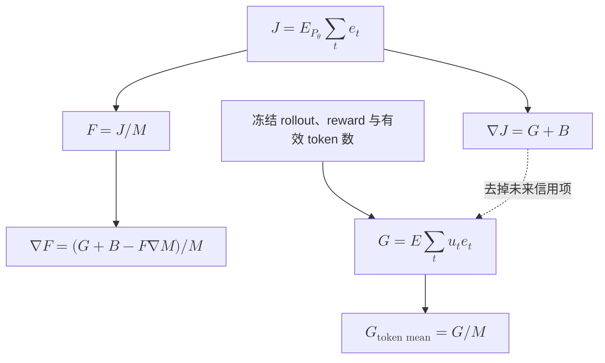

# 局部梯度与长度归约

更新时间：2026-10-18。本篇从实际 score surrogate 出发，区分局部 OPD、完整序列 KL 梯度和平均 token KL 的完整梯度，再分析不同归约与有限 batch 的长度偏差。

[返回研究导读](2026-10-17-OPD访问测度与收敛机制研究.md)。定理与命题在本篇独立编号；跨篇引用直接链接到目标。

相关约定：[共用记号与 KL 定义](2026-10-18-对齐指标与基本记号.md)。

本篇用 $p_\theta$ 表示 student、$q$ 表示 teacher；$J$ 为 sequence KL，$M$ 为平均长度，$F=J/M$ 为 pooled token KL。

本篇导航：[1. 局部梯度与未来信用](#1-局部梯度与未来信用) · [2. 长度归约与有限样本](#2-长度归约与有限样本)。

## 1. 局部梯度与未来信用

### 1.1 定理 1：当前 student action 给出无偏条件 KL 梯度

**定理陈述。** 固定 prefix $s$，教师 $q$ 不依赖参数，学生分布严格正且可微。定义

$$
u_\theta(s,a)=\nabla_\theta\log p_\theta(a\mid s),\qquad
e_\theta(s,a)=\log\frac{p_\theta(a\mid s)}{q(a\mid s)}.
$$

此处 $u_\theta$ 是 score 向量。若 $a\sim p_\theta(\cdot\mid s)$，则 $e_\theta(s,a)u_\theta(s,a)$ 是 $\nabla\ell_s$ 的无偏估计；它是对 surrogate $-\operatorname{stopgrad}(\log q-\log p_\theta)\log p_\theta$ 求导得到的梯度。

**证明。** 概率归一化给出 score 恒等式：

$$
\sum_a p_\theta(a\mid s)u_\theta(s,a)
=\sum_a\nabla p_\theta(a\mid s)
=\nabla1=0.
$$

对条件 KL 逐项求导：

$$
\begin{aligned}
\nabla\ell_s
&=\sum_a\nabla p_\theta(a\mid s)
\left[\log\frac{p_\theta(a\mid s)}{q(a\mid s)}+1\right]\\
&=\sum_a p_\theta(a\mid s)u_\theta(s,a)e_\theta(s,a)
 +\sum_a p_\theta(a\mid s)u_\theta(s,a)\\
&=\mathbb E_{a\sim p_\theta}[e_\theta(s,a)u_\theta(s,a)].
\end{aligned}
$$

surrogate 中 reward 的梯度被停止，只剩 $-\operatorname{stopgrad}(\log q-\log p_\theta)u_\theta=e_\theta u_\theta$。两种表达相同，证毕。

**适用边界。** 这是固定 prefix 上的梯度恒等式。旧 action、不同采样温度、top-$p$ 截断、额外 action 权重以及错误的 reward 反向传播都可能破坏条件。surrogate 的显示数值也不是 KL。

### 1.2 定理 2：局部 OPD 遗漏未来状态项

**定理陈述。** 在有限时域与共同 prompt 分布下，记 $e_t=e_\theta(s_t,a_t)$、$u_t=u_\theta(s_t,a_t)$，则

$$
J(\theta)=\sum_{t=1}^H\mathbb E_{s_t\sim d_t^{p_\theta}}\ell_{s_t}(\theta)
=H L_{\nu_{p_\theta}}(\theta),
$$

但其完整梯度为

$$
\nabla J=G_{\rm loc}+B,\qquad
G_{\rm loc}=\mathbb E\sum_tu_te_t,
\qquad B=\mathbb E\sum_tu_t\sum_{j>t}e_j.
$$

其中 $G_{\rm loc}=H G_{\rm on}^{\rm KL}$ 是局部 OPD 的求和期望梯度。局部更新具有序列 KL 的一阶下降方向，当且仅当 $\lVert G_{\rm loc}\rVert^2+\langle B,G_{\rm loc}\rangle>0$；等于零时需要看高阶项。

**证明。** 自回归分解使轨迹 log-ratio 等于 $\sum_t e_t$。逐个 prefix 对 action 取条件期望，$\mathbb E[e_t\mid s_t]=\ell_{s_t}$，得到第一组等式。

令 $E(y)=\sum_j e_j$。对轨迹期望求导，测度导数与被积函数导数分别为

$$
\begin{aligned}
\nabla J
&=\sum_y\nabla P_\theta(y)E(y)+\sum_yP_\theta(y)\nabla E(y)\\
&=\mathbb E\left[\left(\sum_tu_t\right)\left(\sum_je_j\right)\right]
+\mathbb E\sum_j u_j.
\end{aligned}
$$

第二项由[定理 1](#11-定理-1当前-student-action-给出无偏条件-kl-梯度) 的 score 恒等式为零。若 $j<t$，$e_j$ 已被 $s_t$ 的历史确定，故

$$
\mathbb E[u_te_j\mid s_t]=e_j\mathbb E[u_t\mid s_t]=0.
$$

仅剩 $j\ge t$，分出 $j=t$ 和 $j>t$ 即得 $G_{\rm loc}+B$。沿更新 $\theta^+=\theta-\eta G_{\rm loc}$ 作一阶 Taylor 展开：

$$
J(\theta^+)-J(\theta)
=-\eta\langle\nabla J,G_{\rm loc}\rangle+O(\eta^2)
=-\eta\bigl(\lVert G_{\rm loc}\rVert^2+\langle B,G_{\rm loc}\rangle\bigr)+O(\eta^2).
$$

一阶项的符号给出结论，证毕。

**适用边界。** 全词表求和可以消除给定 prefix 的 action 采样噪声，但不会补回 $B$。加入未来 return-to-go 是另一种更新，不是单纯增大 action 样本数。MiniLLM 已讨论局部与长期梯度的区分[^minillm]；本文不把这一差异当作新的算法发现，也不据此断定 $B$ 是实际失败的主因。

### 1.3 定理 3：离线 action 改变目标，action 修正只修正条件梯度

**定理陈述。** 固定状态分布 $\nu$ 和 action 分布 $b$。未经修正的 sampled-token 期望梯度是

$$
G_{\nu,b}^{\rm raw}=\nabla F_{\nu,b},\qquad
F_{\nu,b}(\theta)=\frac12\sum_{s,a}\nu(s)b(a\mid s)e_\theta(s,a)^2.
$$

它与 $\nabla L_\nu$ 的偏差为

$$
G_{\nu,b}^{\rm raw}-\nabla L_\nu
=\sum_{s,a}\nu(s)\bigl[b(a\mid s)-p_\theta(a\mid s)\bigr]e_\theta(s,a)u_\theta(s,a).
$$

若 $b$ 覆盖 $p_\theta$ 的支持，使用停止梯度的 action 权重 $p_\theta/b$，可恢复 $\nabla L_\nu$，但不改变状态测度 $\nu$。

**证明。** $\nu,b,q$ 固定，所以 $\nabla(e_\theta^2/2)=e_\theta\nabla\log p_\theta=e_\theta u_\theta$。对所有状态和 action 求和，得到第一个等式。减去[定理 1](#11-定理-1当前-student-action-给出无偏条件-kl-梯度) 中按 $p_\theta$ 加权的表达即得偏差式。最后，逐项约去 $b$：

$$
\begin{aligned}
\mathbb E_{s\sim\nu,a\sim b}
\left[\frac{p_\theta(a\mid s)}{b(a\mid s)}e_\theta u_\theta\right]
&=\sum_{s,a}\nu(s)p_\theta(a\mid s)e_\theta u_\theta\\
&=\sum_s\nu(s)\nabla\ell_s=\nabla L_\nu.
\end{aligned}
$$

这里的权重是估计器系数，不对其反向传播。权重只改变 action 求和项，$\nu$ 原样保留，证毕。

**适用边界。** 在线来源可写为 $\nabla_\theta F_R(\theta;\vartheta)|_{\vartheta=\theta}$，通常没有一个固定的 $F_{\nu,b}$ 沿训练单调下降。重要性权重裁剪产生偏差，缺失支持无法靠有限权重恢复。状态基线在 $a\sim p_\theta$ 时因 score 均值为零而不改变期望，在未修正的 $a\sim b$ 下则不一定成立。

## 2. 长度归约与有限样本

### 2.1 定理 4：平均 KL 的完整梯度与 token-mean 局部更新不同

**定理陈述。** 在共同的有限时域、EOS 规则和当前 student 采样下，记平均有效长度 $M(\theta)=\mathbb E_\theta L$、总体 token 平均 $F(\theta)=J(\theta)/M(\theta)$。令 $G=\mathbb E\sum_{t\le L}u_te_t$，$B=\mathbb E\sum_{t\le L}u_t\sum_{j>t}e_j$。则

$$
\nabla J=G+B,\qquad
\nabla M=\mathbb E\sum_{t\le L}u_t(L-t),\qquad
\nabla F=\frac{G+B-F\nabla M}{M}.
$$

对冻结 rollout 做全 batch token-mean 的局部更新，其大 batch 极限为 $G/M$，一般不等于 $\nabla F$。对任意参数方向 $v$，若 $F>0$ 且

$$
0<\mathrm dJ[v]<F\,\mathrm dM[v],
$$

则沿该方向 sequence KL 增大、平均 token KL 减小。这个条件证明的是指标背离；任务 accuracy 是否恶化仍需判分。

**证明。** [定理 2](#12-定理-2局部-opd-遗漏未来状态项) 已给出 $\nabla J=G+B$。有限时域允许交换有限求和与导数。每条停止轨迹的长度 $L(y)$ 是由轨迹决定的固定函数，因此

$$
\nabla M
=\sum_y L(y)\nabla P_\theta(y)
=\mathbb E\left[L\sum_{t\le L}u_t\right].
$$

事件 $\{L\ge t\}$ 在第 $t$ 个 action 采样前已知。于是 $\mathbb E[\mathbf1\{L\ge t\}u_t]=0$，从每个 score 的系数中减去 $t$ 不改变期望，得到 $\nabla M=\mathbb E\sum_{t\le L}u_t(L-t)$。对 $F=J/M$ 使用商法则：

$$
\nabla F=\frac{M\nabla J-J\nabla M}{M^2}
=\frac{G+B-F\nabla M}{M}.
$$

对 $n$ 条独立轨迹，令 $X_i=\sum_{t\le L_i}e_{it}u_{it}$。实际冻结 batch 的梯度是 $\widehat G_{\rm tm}=\sum_iX_i/\sum_iL_i$。在可积条件下，大数定律给出 $\widehat G_{\rm tm}\to G/M$；停止梯度的离散长度分母没有产生 $-F\nabla M$，冻结的采样测度也没有产生 $B$。最后，沿 $v$ 的商法则为

$$
\mathrm dF[v]=\frac{\mathrm dJ[v]-F\mathrm dM[v]}{M}.
$$

代入命题中的不等式，分子为负而 $\mathrm dJ[v]>0$，证毕。

**研究含义。** 平均 KL 的确存在长度稀释，但不能据此认定局部 token-mean 优化器直接获得了“增加长度、改善分母”的完整梯度。遗漏的 $B$ 在所有轨迹长度完全固定时仍可非零；它表示未来状态的信用分配，不能统称为长度项。

对实际局部梯度流 $\dot\theta=-G/M$，有可检验的方向关系：

$$
\dot J=-\frac{\|G\|^2+\langle B,G\rangle}{M},\qquad
\dot M=-\frac{\langle\nabla M,G\rangle}{M},\qquad
\dot F=\frac{\dot J-F\dot M}{M}.
$$

估计这些内积，需要同一 checkpoint、同一采样分布和独立重复样本。一次带噪估计的负内积不能充当长期退化证据。

### 2.2 命题 5：全 batch 归约改变尺度，逐轨迹归约改变权重

**命题陈述。** 对同一冻结 batch，局部 token-mean 和按轨迹平均的 token-sum 梯度满足

$$
\widehat G_{\rm tm}=\frac{\sum_iX_i}{\sum_iL_i},\qquad
\widehat G_{\rm ts}=\frac1n\sum_iX_i,\qquad
\widehat G_{\rm tm}=\frac n{\sum_iL_i}\widehat G_{\rm ts}.
$$

它们方向相同。总体梯度流 $-G/M$ 与 $-G$ 在 $0<M<\infty$ 时具有相同驻点；在光滑性和 $M$ 有正上下界的条件下，二者的解曲线仅作时间重参数化。逐轨迹先平均的 $n^{-1}\sum_iX_i/L_i$ 则一般改变方向。

**证明。** 前三个式子由分母直接相除得到。正数 $M$ 不改变向量是否为零。设 $\theta(t)$ 满足 $\dot\theta=-G(\theta)/M(\theta)$，定义 $\tau(t)=\int_0^t M(\theta(v))^{-1}\,dv$，则链式法则给出 $\mathrm d\theta/\mathrm d\tau=-G(\theta)$。正上下界保证这项时间变换严格递增且不会在有限优化时间处停止。逐轨迹归约给不同 $X_i$ 不同权重 $1/L_i$，无法提出共同标量，证毕。

**适用边界。** 常数缩放可被理想 Adam 的矩估计抵消一部分；变化的长度、有限 batch、优化器历史、epsilon、weight decay 和裁剪会改变实际更新。归约消融应同时记录参数更新范数和裁剪比例，不能把固定学习率下的差异直接归因为新优化目标。将局部 token loss 从平均改成求和，不会补回 $B$。

### 2.3 命题 6：有限 batch 的随机长度分母引入相关性偏差

**命题陈述。** 将独立轨迹或独立 prompt 组记为 $i=1,\ldots,n$，每组累计局部梯度与长度为 $(X_i,L_i)$。设它们同分布、有界且 $L_i\ge1$，记 $G=\mathbb EX_i$、$M=\mathbb EL_i$。则逐坐标有

$$
\mathbb E\frac{\overline X}{\overline L}
=\frac GM
-\frac{\operatorname{Cov}(X,L)}{nM^2}
+\frac{G\operatorname{Var}(L)}{nM^3}
+O(n^{-3/2}).
$$

该偏差由梯度与长度的联合分布决定，其方向没有普遍的“鼓励变长”符号。

**证明。** 令 $\delta_X=\overline X-G$、$\delta_L=\overline L-M$。函数 $f(x,l)=x/l$ 在 $l\ge1$ 上作二阶 Taylor 展开：

$$
\frac{G+\delta_X}{M+\delta_L}
=\frac GM+\frac{\delta_X}{M}-\frac{G\delta_L}{M^2}
-\frac{\delta_X\delta_L}{M^2}
+\frac{G\delta_L^2}{M^3}+R_n.
$$

独立组平均给出 $\mathbb E\delta_X=\mathbb E\delta_L=0$、$\mathbb E[\delta_X\delta_L]=\operatorname{Cov}(X,L)/n$、$\mathbb E\delta_L^2=\operatorname{Var}(L)/n$。有界性保证三阶导数和三阶绝对矩受控，故 $\mathbb E|R_n|=O(n^{-3/2})$。取期望得到结论，证毕。

同题多响应应作为一个聚类单元或显式处理相关性。非独立数据、随训练变化的采样和极端长尾不自动满足这个展开的固定分布条件。

### 2.4 命题 7：逐 token 的常数惩罚不等于期望长度惩罚

**命题陈述。** 在当前 student、完整支持与有限停止规则下，将每个有效 action 的局部 cost 从 $e_t$ 改为 $e_t+c$，不改变累计局部期望梯度；而目标 $J+cM$ 的完整梯度增加 $c\nabla M$。

**证明。** 因为 $\mathbb E\sum_{t\le L}u_t=0$，所以

$$
\mathbb E\sum_{t\le L}u_t(e_t+c)=G.
$$

另一方面，由导数线性性，$\nabla(J+cM)=G+B+c\nabla M$。长度成本的影响来自 action 对未来有效步数的作用；只保留当前 action 的同一个常数成本，会将它变成零均值 baseline，证毕。

有限 batch 的随机归约、基线估计和非线性裁剪可能破坏精确抵消，但这些效应不等于正确优化了 $J+cM$。若要惩罚长度，应先定义目标，再实现对应信用分配。

### 2.5 目标与更新的关系图

实线连接定义或实际计算步骤，虚线标明近似。把局部求和改成局部平均，只发生在图的 $G\to G/M$，不会走到 $\nabla F$ 或 $\nabla J$。

## 延伸阅读

[研究共同极限](2026-10-18-访问测度与六种rollout的收敛.md)；[分析重复退化](2026-10-18-重复退化与TIDE机制.md)；[选择 action 估计器](2026-10-18-Sampled-token与无偏尾部估计.md)。

### 参考文献

[^minillm]: Yuxian Gu 等。MiniLLM: On-Policy Distillation of Large Language Models. arXiv 2023，查阅 v6。 [arXiv:2306.08543v6](https://arxiv.org/html/2306.08543v6).
