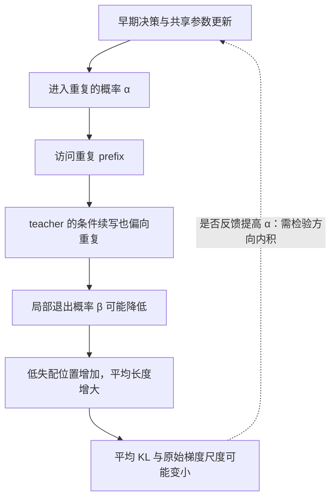
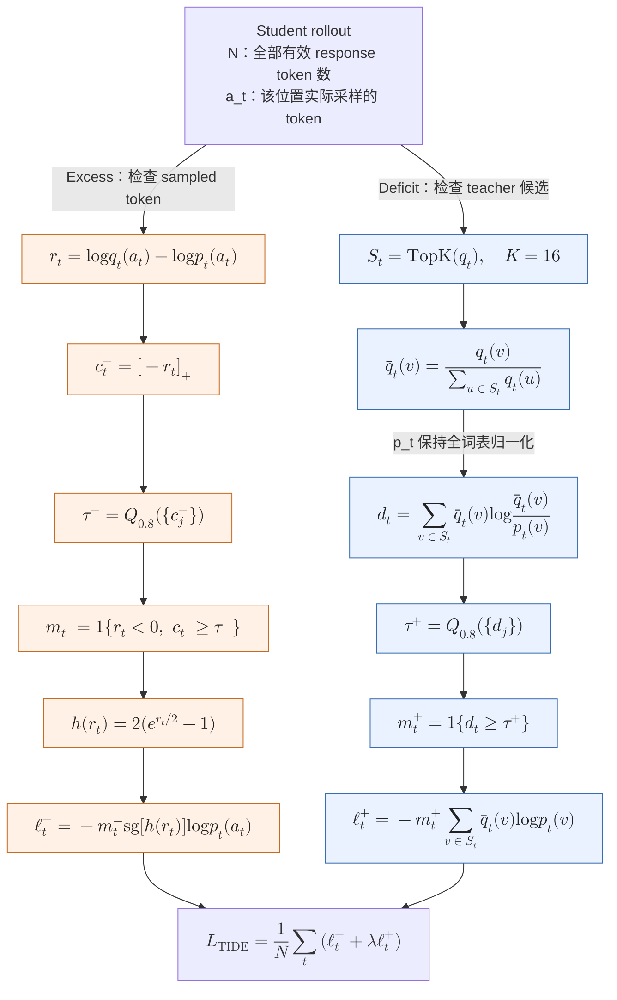

# 重复退化与 TIDE 机制

更新时间：2026-10-18。本篇围绕重复进入概率、退出概率和低 KL 长尾建立条件机制，再给出 TIDE 的完整判据、loss、流程图和论文消融。理论上允许的机制与已经观测到的证据分别标明。

[返回研究导读](2026-10-17-OPD访问测度与收敛机制研究.md)。定理与命题在本篇独立编号；跨篇引用直接链接到目标。

相关约定：[对齐指标](2026-10-18-对齐指标与基本记号.md)；[局部与序列梯度](2026-10-18-局部梯度与长度归约.md)。

本篇用 $p_\theta$ 表示 student、$q$ 表示 teacher；$J$ 为 sequence KL，$M$ 为平均长度，$F=J/M$ 为 pooled token KL。状态权重记为 $\nu$，累计局部梯度记为 $G$。

本篇导航：[1. 重复的进入、持续与监督弱化](#1-重复的进入持续与监督弱化) · [2. TIDE 的判据、loss 与机制](#2-tide-的判据loss-与机制) · [3. TIDE 的实验证据与设置](#3-tide-的实验证据与设置)。

## 1. 重复的进入、持续与监督弱化

### 1.1 重复进入概率、局部一致与序列残差

在共同 prompt 的联合轨迹空间上，令 $E$ 为在共同有限时域内满足预先固定重复判据的轨迹事件，$\alpha=P_\theta(E)$、$\alpha_T=Q(E)$。判据应固定重复单元、最小连续次数、覆盖比例及 EOS/cap 处理。将[指标·定理 2](2026-10-18-对齐指标与基本记号.md#23-定理-2序列-kl-分成任务结果差异与类内生成差异) 的二元事件换成 $E$，得到

$$
J=\operatorname{kl}(\alpha\Vert\alpha_T)
+\alpha\operatorname{KL}(P_\theta(\cdot\mid E)\Vert Q(\cdot\mid E))
+(1-\alpha)\operatorname{KL}(P_\theta(\cdot\mid\neg E)\Vert Q(\cdot\mid\neg E)).
$$

因此 $J\ge\operatorname{kl}(\alpha\Vert\alpha_T)$。重复区域里的条件续写已经一致，不会消除进入该区域的频率差异。需要分别测量从干净 prompt 进入重复的概率，以及给定重复 prefix 后继续或退出的条件概率；teacher 接手 prefix 的成功率不能代替其原生 rollout 的进入概率。

### 1.2 命题 1：局部对齐可以降低重复状态的退出概率

**命题陈述。** 固定一个已经重复的 prefix，将词表分为退出当前重复模式的集合 $E_s$ 与继续模式的集合 $C_s$。Student 与 teacher 的退出质量分别为 $\beta,b\in(0,1)$。固定两类内部的条件分布，令其 KL 为 $K_E,K_C$，以 $z=\log(\beta/(1-\beta))$ 参数化质量。则

$$
k(s)=\operatorname{kl}(\beta\Vert b)+\beta K_E+(1-\beta)K_C,
$$

$$
\frac{\partial k}{\partial z}
=\beta(1-\beta)
\left[\log\frac{\beta(1-b)}{b(1-\beta)}+K_E-K_C\right].
$$

若类内分布已匹配且 $\beta>b$，局部 KL 梯度下降会降低 student 的退出概率。它在这个状态上提高了条件对齐，同时延长了重复的持续性。

**证明。** 将两类中的概率分别写成 $p_v=\beta p(v\mid E_s)$ 与 $p_v=(1-\beta)p(v\mid C_s)$，teacher 同理。代入 KL 并分组，质量部分组成 Bernoulli KL，类内部分分别带系数 $\beta$ 和 $1-\beta$，得到第一式。再使用

$$
\frac{\partial\operatorname{kl}(\beta\Vert b)}{\partial\beta}
=\log\frac{\beta(1-b)}{b(1-\beta)},\qquad
\frac{\partial\beta}{\partial z}=\beta(1-\beta),
$$

得到第二式。$K_E=K_C=0$ 且 $\beta>b$ 时括号为正，故 $z$ 和 $\beta$ 沿下降方向减小，证毕。

**适用边界。** 这是固定 prefix 与类内分布的质量调整结论。它没有声称实际 Transformer 更新仅改变这个自由度，也没有将 greedy 延续概率当作随机采样退出质量。若 teacher 在该 prefix 上偏好继续重复，蒸馏目标本身不提供语义上的重复惩罚。

### 1.3 命题 2：严格正的逐步退出概率不保证快速终止

**命题陈述。** 给定已进入某个重复模式，令 $\beta_j=\Pr(N=j\mid N\ge j,\text{已进入})$ 是持续到第 $j$ 步时退出该模式的条件概率。则持续至少 $n$ 步的概率为

$$
\Pr(N>n\mid\text{已进入})=\prod_{j=1}^{n}(1-\beta_j).
$$

恒定 $\beta_j=\beta$ 时，$\mathbb EN=1/\beta$。在无穷时域中，若全部 $0<\beta_j<1$，则永久持续有正概率当且仅当 $\sum_j\beta_j<\infty$。

**证明。** 连乘式来自逐步条件概率，不需要独立假设。恒定情形用非负整数随机变量的尾和公式得到几何级数 $\mathbb EN=\sum_{n\ge0}(1-\beta)^n=1/\beta$。对无穷乘积，$\log(1-x)\le-x$ 给出 $\sum\beta_j=\infty$ 时乘积为零；反之，收敛级数使 $\beta_j\to0$，最终有 $\beta_j\le1/2$，利用 $-2\beta_j\le\log(1-\beta_j)\le-\beta_j$ 得到对数和有限，有限前缀乘积也严格正，证毕。

**适用边界。** 已有 LLM 实验有有限生成 cap，观测到的是持续到上限或异常长的循环，不能据此宣称无穷生成有正概率。即使几乎必然退出，期望长度也可能很大；讨论无穷时域时必须单独检查终止与可积性，不能直接沿用有限树收敛定理。

### 1.4 命题 3：低失配长尾可以掩盖进入错误并减小原始局部梯度

**命题陈述。** 将有效位置按事先定义的轨迹规则分成重要位置 $U$ 与重复位置 $R$，记期望数量为 $M_U,M_R$，累计条件 KL 为 $J_U,J_R$。若 $J_U\ge c>0$、$J_R\le\varepsilon M_R$，则

$$
J\ge c,\qquad F\le\frac{J_U}{M_U+M_R}+\varepsilon.
$$

定义位置上的完整条件梯度和 $G_U=\mathbb E\sum_{t\in U}\nabla k(s_t)$、$G_R$ 同理。若 $\|G_U\|\le C M_U$、$\|G_R\|\le\delta M_R$，则

$$
\left\|\frac{G_U+G_R}{M_U+M_R}\right\|
\le C\frac{M_U}{M_U+M_R}+\delta.
$$

当重要位置的累计损失与数量保持有界、重复区域变长且 $\varepsilon,\delta$ 很小时，平均 KL 和原始局部梯度可以很小，而累计序列残差仍存在。

**证明。** 位置分组给出 $J=J_U+J_R$ 和 $M=M_U+M_R$。KL 非负给出下界；代入 $J_R$ 上界并除以 $M$ 得到平均值上界。梯度部分使用三角不等式，再代入两个范数界即可，证毕。

**适用边界。** 若分组依赖当前 action 或后续轨迹，本命题只是对完整条件梯度和的代数分解，不能把分组后的 sampled-token 均值直接当作各组条件梯度的无偏估计。低 KL 也没有自动保证上述梯度范数界，必须分别测量。固定 $H$ 时 $J\le HF$ 仍成立；“数值很小”不等于严格零。对固定学习率 SGD，尺度减小直接影响步长；AdamW 的实际步长需单独记录。

### 1.5 共享参数中的驻点与反馈条件

总体局部 token-mean 场为 $G/M$。在候选点 $\theta_*$，若不同状态梯度相消使 $G(\theta_*)=0$，完整序列梯度仍可为 $B(\theta_*)\ne0$。这说明局部驻点与序列驻点不同；它没有声称每个 prefix 的条件 KL 均已归零。该点是否稳定，还需检查平均更新场的 Jacobian，不能仅凭一个小梯度 batch 判断吸引域。

对重复进入概率 $\alpha(\theta)$，局部梯度流满足

$$
\dot\alpha=-\frac1M\langle\nabla\alpha,G_U+G_R\rangle.
$$

内积为负时，局部更新提高进入概率；若被访问重复状态上的退出概率又按[命题 1](#12-命题-1局部对齐可以降低重复状态的退出概率) 降低，就形成进入频率与持续时间同时增加的反馈。两项都需要真实模型的方向测量。Teacher 与 student 在重复后缀相等只意味着没有条件修正信号，本身不能证明优化主动提高了进入频率。

实线表示分析对象之间的依赖；条件性的梯度符号由相应命题给出，虚线不是已确立的 LLM 因果结论。

### 1.6 定理 4：完整序列目标也会偏好较易匹配的后缀

**定理陈述。** 固定当前 prefix 后每个 action 的 student 与 teacher 续写策略，仅调整当前 action 分布 $p$。令 $V_a$ 为进入 action $a$ 后剩余序列分布的 KL，EOS 后 $V_a=0$。则从该 prefix 出发的序列 KL 为

$$
J_s(p)=\operatorname{KL}(p\Vert q)+\sum_ap_aV_a.
$$

其唯一最优当前分布为

$$
p^*_a=\frac{q_ae^{-V_a}}{\sum_bq_be^{-V_b}}.
$$

**证明。** 轨迹概率分解为当前 action 概率乘条件后缀概率。对其 log-ratio 按 action 条件化，得到第一式。记 $Z=\sum_aq_ae^{-V_a}$、$\widetilde q_a=q_ae^{-V_a}/Z$，则

$$
\operatorname{KL}(p\Vert\widetilde q)
=\sum_ap_a\left(\log\frac{p_a}{q_a}+V_a+\log Z\right)
=J_s(p)+\log Z.
$$

$Z$ 与当前 $p$ 无关，KL 在且仅在 $p=\widetilde q$ 时为零，故得到唯一解，证毕。

**研究含义。** 若重复后缀的 $V$ 小而正常推理后缀尚未学好，完整序列目标的当前决策可相对 teacher 更偏好前者。这是固定后续策略时的局部优化结论；所有后续策略可实现并最终匹配 teacher 时，$V_a\to0$，偏好消失。完整 sequence KL 的全局零点仍是 teacher。

已经发生的进入成本不能无差别地罚给所有后续 token：对过去累计 log-ratio $C(s_t)$，$\mathbb E[u_tC(s_t)\mid s_t]=0$。若重复后缀处处 $p=q$，其未来 log-ratio 也为零，补回 return-to-go 不会从该后缀生成新的重复惩罚。修复进入概率、改变 teacher 的条件监督、增加任务或长度目标，是不同干预。

## 2. TIDE 的判据、loss 与机制

### 2.1 基本 OPD、student top-K 与 teacher top-K

本节统一用 $p_\theta$ 表示 student、$q$ 表示 teacher；TIDE 原文使用相反字母，以下已换成文档集的统一记号[^tide]。令 $\mathcal B$ 为 batch 中全部有效 response 位置，$N=|\mathcal B|$，$a_t$ 为 student 实际采样的 token，$r_t=\log q(a_t\mid s_t)-\log p_\theta(a_t\mid s_t)=-e_t$。在单 batch 一次更新和冻结 reward 的条件下，基本 sampled-token surrogate 是

$$
L_{\rm OPD}=-\frac1N\sum_{t\in\mathcal B}\operatorname{sg}(r_t)\log p_\theta(a_t\mid s_t).
$$

该显示值不是 KL 数值，允许为负；其 anchor 处的期望梯度才由[梯度·定理 1](2026-10-18-局部梯度与长度归约.md#11-定理-1当前-student-action-给出无偏条件-kl-梯度) 解释。

| 形式               | 显式监督的候选                | 候选来源                            | 梯度目标或边界                                   |
| ------------------ | ----------------------------- | ----------------------------------- | ------------------------------------------------ |
| Sampled-token OPD  | 当前实际 action               | Student 采样                        | 当前 action 分布匹配时估计条件 reverse-KL 梯度   |
| Student top-K 变体 | Student 最可能的候选          | $\operatorname{TopK}(p)$            | 是否重归一化、补尾部决定实际目标，名称本身不唯一 |
| 本文无偏 head-tail | Student head 与 sampled tail  | $\operatorname{TopK}(p)$ 加尾部校正 | 保留完整条件 reverse-KL 的 anchor 梯度           |
| TIDE excess        | 已采样 action                 | Student 采样                        | 在选中位置进行有界负向抑制                       |
| TIDE deficit       | Teacher 最可能的全部 K 个候选 | $\operatorname{TopK}(q)$            | Teacher 归一化目标对完整 student 概率的交叉熵    |

Top-K 的候选来源与 rollout 来源不同：TIDE 的 prefix 仍由 student 生成，deficit 的候选由 teacher 提供。候选无需被 student 实际采到。

### 2.2 Excess 与 deficit 的精确判据

为避免和共用记号中的带符号 cost $e_t$ 混淆，记 excess 分数为 $c_t^-=[-r_t]_+$。对整个 batch 计算

$$
\tau^-=\operatorname{Quantile}_{1-\rho^-}\{c_j^-:j\in\mathcal B\},\qquad
m_t^-=\mathbf1\{r_t<0,\ c_t^-\ge\tau^-\}.
$$

只有 sampled token 被 student 高估、且高估程度达到该批阈值的位置进入 excess 分支。它使用

$$
h(r)=2(e^{r/2}-1),\qquad
\ell_t^-=-m_t^-\operatorname{sg}[h(r_t)]\log p_\theta(a_t\mid s_t).
$$

Deficit 分支先取 teacher 支持并只归一化 teacher：

$$
S_t=\operatorname{TopK}_v q(v\mid s_t),\qquad
Z_{q,t}=\sum_{u\in S_t}q(u\mid s_t),\qquad
\bar q_t(v)=\frac{q(v\mid s_t)}{Z_{q,t}}\quad(v\in S_t).
$$

$\bar q_t$ 读作 q bar，是 teacher 给定候选属于 $S_t$ 的条件分布，不是跨位置或跨模型的平均。集合外将 $\bar q_t$ 定义为零。Student 使用全词表归一化的 $p_\theta(v\mid s_t)$，不在 $S_t$ 内重新归一化。Deficit 分数、阈值与 gate 为

$$
d_t=\sum_{v\in S_t}\bar q_t(v)\log\frac{\bar q_t(v)}{p_\theta(v\mid s_t)},\qquad
\tau^+=\operatorname{Quantile}_{1-\rho^+}\{d_j:j\in\mathcal B\},\qquad
m_t^+=\mathbf1\{d_t\ge\tau^+\}.
$$

这是位置上的整体覆盖分数，不要求所有候选逐个满足 $p_v<q_v$。两个 gate 独立，可以同时激活一个位置；分位点的并列分数使实际比例不必恰好等于指定值。

### 2.3 完整 loss 与带公式的处理流程

TIDE 用两个分支替换基本 OPD，未选中的位置没有回退的普通 OPD 项。完整 surrogate 为

$$
\begin{aligned}
L_{\rm TIDE}
={}&-\frac1N\sum_{t\in\mathcal B}
 m_t^-\operatorname{sg}[h(r_t)]\log p_\theta(a_t\mid s_t)\\
&-\frac\lambda N\sum_{t\in\mathcal B}m_t^+
 \sum_{v\in S_t}\bar q_t(v)\log p_\theta(v\mid s_t).
\end{aligned}
$$

Reward、候选、teacher 目标和位置选择均在本次更新中冻结。默认 $K=16$、$\rho^- =\rho^+=0.2$、$\lambda=1$。分母仍是全部有效 response token 数 $N$，不是选中位置数量。Positive sampled reward 不会自动作为普通 OPD 项保留，需看 deficit gate 是否激活。

图中 $p_t$ 始终是完整词表 student 概率，$Q_{0.8}$ 是整批有效位置的经验分位数。Gate 为零时对应分支 loss 为零。图支持 Mermaid 10.9.0 及以上的 KaTeX 数学语法[^mermaid-math]；公式同时完整保留在正文中。三张图的实际渲染和公式检查见[图语法核验记录](results/mermaid-document-check.json)。

| $m_t^-$ | $m_t^+$ | 该位置的监督                  |
| ------- | ------- | ----------------------------- |
| 0       | 0       | 无 loss                       |
| 1       | 0       | Sampled token 的有界负向 loss |
| 0       | 1       | Teacher top-K 交叉熵          |
| 1       | 1       | 两者相加                      |

“显式监督某些候选”不等于其他 logits 不更新。两条分支中的 log-softmax 都含完整 student 分母。

### 2.4 命题 5：有界 excess 系数与未筛选的 Hellinger 恒等式

**命题陈述。** 令 $r_v=\log(q_v/p_v)$、$h(r)=2(e^{r/2}-1)$。当 $r<0$ 时，$-2<h(r)<0$ 且 $h(r)=r+O(r^2)$。在固定 prefix、未应用任何 gate 时，

$$
\mathbb E_{v\sim p}[-h(r_v)\nabla\log p_v]
=4\nabla H^2(p,q),\qquad H^2(p,q)=1-\sum_v\sqrt{p_vq_v}.
$$

**证明。** $r<0$ 给出 $0<e^{r/2}<1$，得到界；在零点作 Taylor 展开得到局部近似。利用概率归一化，

$$
\begin{aligned}
\mathbb E_p[-h(r_v)\nabla\log p_v]
&=-2\sum_v\left(\sqrt{q_v/p_v}-1\right)\nabla p_v\\
&=-2\sum_v\sqrt{q_v/p_v}\nabla p_v
=4\nabla\left(1-\sum_v\sqrt{p_vq_v}\right).
\end{aligned}
$$

第二行用到 $\sum_v\nabla p_v=0$，证毕。

**适用边界。** TIDE 实际只保留负向且达到分位阈值的项，不能把未筛选恒等式直接当作其完整 gated loss 的无偏 Hellinger 声明。选中位置的 logit score 的一范数为 $2(1-p_a)$，因此有界 excess 项的一范数不超过 4；Transformer 参数梯度还乘网络 Jacobian，不能据此宣称全参数梯度统一有界。

### 2.5 命题 6：deficit 同时恢复头部质量与候选比例，并改变固定点

**命题陈述。** 固定 teacher 集合 $S$、归一化目标 $\bar q$ 和选择 mask。令 $P_S=\sum_{v\in S}p_v$、$p^S_v=p_v/P_S$。则

$$
d=\sum_{v\in S}\bar q_v\log\frac{\bar q_v}{p_v}
=\operatorname{KL}(\bar q\Vert p^S)-\log P_S\ge0.
$$

完整 student softmax 上的交叉熵梯度为 $\partial L_{\rm def}/\partial z_v=p_v-\bar q_v$。若该分支被激活，且 teacher 的 $S$ 外质量非零，则即使 $p=q$，单个 tabular prefix 上的该梯度仍非零。

**证明。** 用 $p_v=P_Sp^S_v$ 展开 log-ratio，并用 $\sum_S\bar q_v=1$ 得到分解。KL 和 $-\log P_S$ 均非负，等号要求 $p^S=\bar q$ 且 $P_S=1$。由 $\partial\log p_u/\partial z_v=\mathbf1\{u=v\}-p_v$，

$$
\frac{\partial[-\sum_u\bar q_u\log p_u]}{\partial z_v}
=-\bar q_v+p_v\sum_u\bar q_u=p_v-\bar q_v.
$$

最后设 $p=q$，$Z_q=\sum_Sq_v<1$。此时 $p^S=\bar q$，$d=-\log Z_q>0$；集合内 $q_v-\bar q_v=q_v(1-1/Z_q)<0$，集合外梯度为 $q_v>0$。因此这一分支仍将质量移向 $S$，证毕。

**研究含义。** 对 $p_v\to0$ 而 $\bar q_v>0$ 的候选，deficit 梯度趋于 $-\bar q_v$，避免了[估计器·命题 2](2026-10-18-Sampled-token与无偏尾部估计.md#12-命题-2稀有-teacher-候选同时面临弱均值与低信噪比) 中 reverse KL 的弱均值。这既改变 action 获取方式，也改变平均条件目标。TIDE 在一般情况下不把完整 teacher 分布作为精确固定点；共享参数下可能有额外抵消，但不恢复逐状态的 teacher 固定点保证。不能把 TIDE 的准确率改善解释为完整 KL 估计更无偏。

### 2.6 改进的机制解释与证据边界

原始负 reward 对 sampled action $a$ 的 logits 更新为 $\Delta z_v=-\eta e_a(\mathbf1\{v=a\}-p_v)$。压低 $a$ 时，其他 logits 的增量按当前 $p_v$ 分配，并不直接指定 teacher 推荐的替代项。有界 excess 限制极端项的相对权重，deficit 则直接增强 teacher 候选；它们在抑制与恢复上互补。全局梯度裁剪只能缩小已经聚合的向量，不能撤销极端位置对方向的主导。

位置 gate 依据分布失配，不识别数学正确性或重复语义。它改变有效监督位置与候选，不能凭“丢弃 matched token”就声称移除了长度分母效应：分母仍是全部有效 token 数，原本梯度精确为零的位置也不会因删除而释放新的梯度。

缺失支持分支改善正常推进、改写或结束作答候选的学习，再通过后续 rollout 改变访问测度，是与算法一致的解释。它主要减少进入循环，还是增加进入后的退出率，论文尚未直接分离。对已经高度 teacher–student 一致的重复状态，TIDE 没有独立的任务信号保证逃离。组件与权重消融的事实集中列在[3. TIDE 的实验证据与设置](#3-tide-的实验证据与设置)；本文不把它们扩大为完整的因果链。

## 3. TIDE 的实验证据与设置

### 3.1 证据口径与版本

2610.11291 的来源切换结果支持有限预算下的 accuracy 平台差异；它没有单独识别完整 KL 固定点。2608.09836v1 的方法与配置按正文、算法 1、表 1/3/4/5/9 及附录核对；正文摘要、旧注释和正式表格之间有少量数值差异时，以正式结果表为准[^tide]。下面只摘录支撑机制判读的量，完整逐基准结果留在原文。

| TIDE 论文中的 teacher → student                      | 初始 student Avg@8 | OPD   | TIDE  | 本文用途                 |
| ---------------------------------------------------- | ------------------ | ----- | ----- | ------------------------ |
| JustRL-DeepSeek-1.5B → DeepSeek-R1-Distill-Qwen-1.5B | 37.1%              | 45.7% | 46.7% | 已报告的有效蒸馏对照     |
| Qwen3-8B → Qwen3-1.7B-Base                           | 6.9%               | 6.9%  | 20.3% | 重复与任务退化的复现候选 |

强失配组 OPD 的评测平均长度为 22,395、缺少 boxed 答案的比例为 65.5%；TIDE 对应 7,294 和 5.4%。这些数值描述任务与生成行为，不证明 OPD 的完整条件 KL 已经收敛。JustRL → R1-1.5B 不是该论文的失败组，反方向也没有在该文报告；非 Qwen3 的文献候选归[失败配对与阳性对照](2026-10-18-State诊断与实验设计.md#2-失败配对与阳性对照)。

### 3.2 TIDE 的训练与评测协议

| 项目       | 论文报告的设置                                                                             |
| ---------- | ------------------------------------------------------------------------------------------ |
| 数据与顺序 | DAPO-Math-17K，1 epoch，shuffle=False                                                      |
| Batch      | 64 prompts，每题 4 responses；policy mini-batch 64；每 GPU micro-batch 1                   |
| 训练长度   | Prompt 1,024，response 7,168，总 context 8,192                                             |
| 推理与评分 | vLLM；student 与 teacher 温度均为 1；repetition penalty=1                                  |
| 更新       | Detached sampled reward，token-mean，每 rollout batch 一次更新，无激活的 PPO clipping      |
| 优化器     | AdamW，LR $10^{-6}$ 恒定，无 warmup；betas=(0.9,0.999)，weight decay=0.01，gradient clip=1 |
| 其他监督   | 无 reference-policy KL、格式奖励或显式重复惩罚                                             |
| TIDE       | Teacher K=16；两个分支各按 20% 分位选择；$\lambda=1$                                       |
| 硬件与精度 | 8 GPUs、FSDP；student FP32，teacher FP32/BF16                                              |
| 评测       | 九个数学基准宏平均 Avg@8/Pass@8；温度 0.7、top-p=0.95、cap=31,744；thinking 关闭；规则判分 |
| Checkpoint | 一轮训练后的最终 checkpoint，不用 benchmark 选择中间 checkpoint                            |

九个基准为 AIME24、AIME25、AMC23、MATH-500、Minerva Math、OlympiadBench、BRUMO25、CMIMC25、HMMT25。正文的正式超参数表没有明确给出训练 top-p，不能由评测 0.95 推断；复现还需核对发布脚本与固定版本。作者代码入口见官方仓库[^tide-code]，本文的方法推导对应论文算法 1，不把未实跑的代码路径当作本地复现结果。

22,395 是评测长度，不能与训练 token KL 直接相乘；训练与评测的时域、温度和 top-p 均不同。本仓四卡实验若保留相同全局 batch，应通过 micro-batch 与梯度累积安排资源，并记录与原八卡配置的差异，而不能直接宣称硬件条件一致。

### 3.3 TIDE 的组件证据与未识别原因

| 强失配组组件                  | Avg@8  | 评测平均长度 |
| ----------------------------- | ------ | ------------ |
| Sampled OPD                   | 6.87%  | 22.4K        |
| 仅 selection                  | 14.58% | 29.7K        |
| Selection 与 Hellinger excess | 18.57% | 23.6K        |
| Deficit 分支                  | 18.32% | 13.9K        |
| 完整 TIDE                     | 20.34% | 7.3K         |

Selection 单独提高准确率但增加长度，因此“移除 matched 位置即可避免循环”不符合该消融。缺失支持分支对长度行为影响明显：固定其余组件，将 $\lambda$ 从 0.25 增至 1，Avg@8 从 20.09% 变为 20.34%，长度从 26.9K 降至 7.3K。它支持分支改变生成行为，不定位受益 token 是 EOS、推理转折还是其他候选。

论文还报告自然重复 rollout 比例从 16.8% 升至 48.4%；增加重复 prefix 的受控干预降低了后续失配；teacher greedy 接手后有 93% 保持模式。93% 是给定选中重复 prefix 后的 greedy 条件结果，不是 teacher 从干净 prompt 的重复率，也不是温度 1 下的随机退出 hazard。

两个配对和所有 TIDE 分支都使用局部 token-mean，因而这些结果不支持“token-mean 单独充分导致失败”或“TIDE 靠恢复 sequence credit 解决问题”。它们支持监督位置、负向信号形状及 teacher 支持恢复的重要性；分母偏差、未来信用与进入/退出反馈还需要独立干预。

## 延伸阅读

[区分目标修改与无偏估计](2026-10-18-Sampled-token与无偏尾部估计.md)；[设计进入率与退出率实验](2026-10-18-State诊断与实验设计.md)。

### 参考文献

[^tide]: Zichao Yu 等。Mismatch Matters: On-Policy Distillation Beyond Token Agreement. arXiv 2026，v1，§2–4、算法 1、表 1/3/4/5/9 与附录 C–D。[arXiv:2608.09836v1](https://arxiv.org/html/2608.09836v1).

[^mermaid-math]: Mermaid。Math Configuration，数学公式支持自 10.9.0 起，2026-10-18 核验。[官方文档](https://mermaid.js.org/config/math).

[^tide-code]: TIDE 作者。官方实现与运行入口，2026-10-18 只读核验仓库说明。[GitHub](https://github.com/yzc-666/TIDE).
