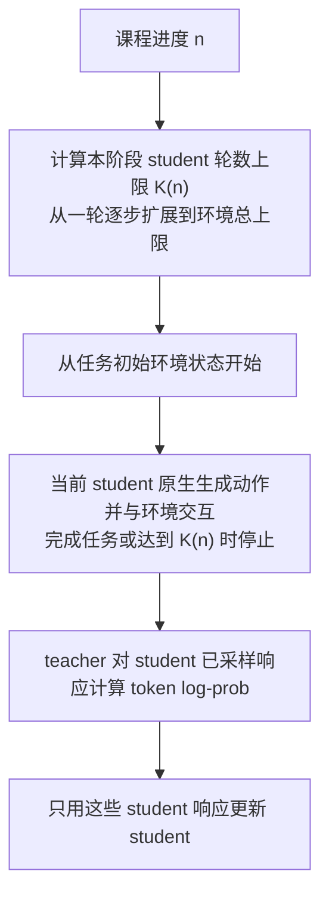
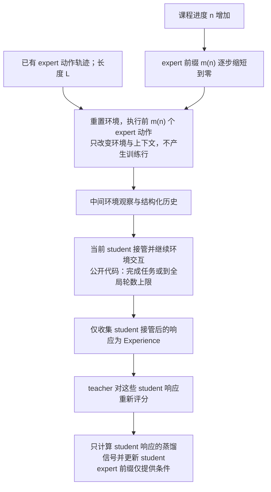

# 原生推理与课程机制调研

本页保留选取原生推理实现时的外部源码调查、候选方案与课程机制边界。TCOD 与多轮 Agent 训练不属于当前 rollout 实验的已实现能力。

设计与未完成条件见[所属提案](../../../.agents/notes/proposed/architecture/2026-10-18-可组合rollout与原生vLLM推理.md)。本文记录提案引用的固定证据或设计调查，不把它们自动视为当前接口或已完成的正式实验。

## vLLM 后端能力与实现边界

| 生成策略                  | vLLM 实现路径                                  | 当前状态                                       |
| ------------------------- | ---------------------------------------------- | ---------------------------------------------- |
| 当前 student 单模型       | 现有原生 `generate` 与 actor 参数同步          | 已有正式在线结果                               |
| 固定 initial / teacher    | 原生 `generate`，增加独立加载与恢复            | 离线与独立原型已验证；训练内生命周期待接入     |
| teacher→student，反向亦然 | 两次原生 token-in/token-out 请求，传递已有前缀 | 独立原型已验证；正式 worker/coordinator 待接入 |
| batch 内来源混合          | 原生请求按来源聚合、路由与重排                 | 独立原型已验证；正式 worker/coordinator 待接入 |
| 同 prefix 的精确 fusion   | 注册原生双模型，必要时适配 V1 model runner     | 新扩展待验证；现有已验收版本仍是 HF 计算后端   |

本仓原生服务已接受 token ID 前缀和显式 `max_tokens`。分段协调器预先核对两个模型的上下文容量：第二段输入长度是原 prompt 加第一段响应，不能再次套用原始 prompt 的 1,024 token 截断。服务目前会把预算限制到可用上下文，且把 0 提升到 1；协调器必须提前跳过零长度阶段并拒绝不满足总预算的请求，避免静默多生成或少生成。

原生返回适配器目前还将 vLLM 的 `finish_reason=stop/length` 都映射为 `stop_reason=completed`。分段实现需要保留原始 finish reason 与具体 stop reason，区别阶段 token 配额用尽、EOS/stop 条件和总响应上限；不能仅凭响应正好长 $k$ 就决定续写。abort/取消也不能当成切换边界。每个请求和阶段使用独立的采样参数副本，避免当前 `generate` 的 `pop` 修改影响后续阶段；seed 由 run、prompt ID、访问轮次、响应序号与阶段确定，路由和生成 seed 分开记录。

第一阶段返回之后，第二模型必须用自己的权重为整段输入建立 KV。teacher 与 student 的 token 相同也不代表各层 K/V 相同，PagedAttention 或 KV-transfer 都不能直接跨权重复用这段 KV。若同一模型、同一权重版本存在命中的 prefix cache，可以按实际命中减少 prefill；切换模型或更新 actor 后不能沿用旧身份的命中。相邻同源阶段应在编译时合并。

精确 fusion 优先尝试 vLLM 的仓外模型注册机制：将两套原生 Qwen2 组件封装为一个组合模型，forward 对同一批 token 和 position 分别前向，`compute_logits` 在有效词表中融合 FP32 logits，再交给同一个原生 sampler。模型注册是已有扩展入口，组合模型可用性是待验证方案。[^vllm-register] 一个调度器管理同一组请求与位置，两套 attention 层保留独立 KV 存储；复用逻辑 block 编号不等于共享 K/V 数值。

源码中存在需要先解决的限制：`get_kv_cache_spec` 从已注册 attention 层收集缓存规格，有机会让两组 full-attention 层共同计入容量；但 `bind_kv_cache` 仍按单个整数层号排序，两个原生模型都从第 0 层开始会触发 `NotImplementedError`。只给层名加 `base/teacher` 前缀不足以解决冲突。组合模型需要全局唯一的缓存层编号或一个局部绑定适配器，同时保持 checkpoint 参数名与 attention 层身份的映射。双 hidden-state 的返回、`logits_indices` 选择、profile、参数加载与 CUDA Graph 也必须核验。若仅注册模型不能满足这些约束，再用受控的 V1 worker/model-runner 适配器；不直接改共享环境的 site-packages。[^vllm-runner]

当前 0.10.0 V1 明确拒绝请求级自定义 `SamplingParams.logits_processors`；`worker_extension_cls` 用于增加 RPC 方法，还会检查与 worker 既有名称的冲突，也不能直接覆盖 `execute_model`。因此“加一个 processor”与“添加一个 RPC”都不等于把第二模型接入原生采样循环。[^vllm-extension] 不采用每个 token 经 Python/Ray 往返两个引擎、导出完整词表再采样的主路径，也不把 top-k logits 近似或以单模型为目标的普通 speculative decoding 当成精确 fusion。以融合分布为验证目标的 CoS 是不同方案，见下面的调研。

Fusion 的优先收益是复用 vLLM 的分页 KV、连续批处理和调度能力，减少已有 HF 路径的固定 padding 与逐步调度开销；它仍然要做两个模型的前向，不能承诺与单模型一样快。原生双模型扩展按相同 prefix 比较完整 logits、分布和实际 token 成本，现有 HF decoder 用作参考实现，不作为新 pipeline 的自动回退。

## 相关推理实现与复用判断

2026-10-18 核对了两个公开仓库的固定提交，以及两篇论文的相关实现章节。代码保存在忽略的研究缓存，提交、文件哈希与 CPU 语义核验归[同一代码核验清单](../../experiment/results/2026-10-18-rollout-refactor-code-audit.json)。以下区分源码支持的行为、作者报告与本项目待验证事项，未运行这些项目的 GPU 推理。

| 项目或论文           | 已核对的实现                                              | 对本项目的用途与限制                                                                   |
| -------------------- | --------------------------------------------------------- | -------------------------------------------------------------------------------------- |
| `vllm-logits`        | 单个 vLLM 模型内的双原生 backbone 与两个 LM head          | 最接近 paired wrapper；依赖 0.15.x，需移植并补训练热更新与严格数值验收                 |
| CoS，ICML 2025       | vLLM fork 的 ensemble worker/sampler 与融合目标拒绝采样   | 可参考双 KV 预算和后续 speculative fusion；基于 0.6.5 安装路径，不能替换当前 V1 worker |
| UltraFuser，ACL 2025 | 附录 C 描述多个 vLLM 实例逐步交换 hidden/logits、统一采样 | 证明独立引擎协作路线有先例；这里仅核对论文，未核验独立可运行源码和同条件吞吐           |
| ThinkMerge           | 多条 reasoning context 的共享答案 logits 聚合             | 可参考多流同步；主要是同模型多上下文，不是本项目同 prefix 的两套权重                   |

`vllm-logits` 的审阅提交为 `a987755`，提交日期为 2026-08-18。`forward` 分别计算两个 native backbone，将 hidden states 拼接；`compute_logits` 分别经过两个 LM head 后组合 logits。源码注释中的“hidden-state mixing”与 README 的“no extra forward”不能理解为省掉第二模型计算，更不能在两个 LM head 不同的情况下直接混 hidden 再投影。普通 logit 模式可借鉴，但原实现默认为部分 token 保留 specialist 的值，`alpha=1` 仍先执行 ancestor 前向，且以进程环境变量选择模式；这些都不能照搬为当前实验语义或请求级策略。[^vllm-logits-backbones]

该项目声明 `vllm>=0.15,<0.16`，用 general plugin 注册模型；现有 Qwen GPU canary 是同一 checkpoint 作为两分支、eager 模式生成 5 个确定 token。它支持作者的短加载检查，尚不足以证明本项目两个不同 checkpoint、长上下文、CUDA Graph、actor 热更新和冻结引用正确。[^vllm-logits-package][^vllm-logits-test] 层号平移的思路可参考，但该提交在模型构造后重排 ModuleList；移植到 0.10.0 时必须同时检查 attention 注册表与 KV 层名，不能假设参数注册名的变化已经修改缓存身份。权重加载器最后返回全部参数名，也应改为只报告实际成功加载的集合，拒绝缺失或错误映射。

CoS 的审阅提交为 `b7c5553`，提交日期为 2025-06-16。`EnsembleDecodeWorker` 用相同请求调用多个原生 worker，分别维护 KV，再交给一个 sampler；其缓存块容量按各 worker 每块 KV 字节总和计算。[^cos-worker] `EnsembleSampler` 区分 `raw-logits/logits/probs` 三种目标，但默认 `we.yaml` 是概率加权，不能直接当作当前 logit fusion 的复现。移植应选择 raw-logits、在 FP32 混合后应用共同温度/截断；行为分数须从最终融合分布重算，不能沿用默认配方返回的第一模型 log-prob。[^cos-sampler]

CoS 的 speculative 路径先得到候选 token，再以组合分布做验证与残差重采样；因此优化目标可以保持为融合分布，而非单一 teacher 分布。论文报告相对普通协作解码 1.11–2.23 倍加速，该数字属于其模型与配置，未在本项目复现。[^cos-paper] 本项目两个 1.5B 组件规模相近，收益还取决于接受率、block 长度、有效 batch 和 KV 回退开销。先完成非 speculative 的原生精确基线，再以同一个 $\mu_\lambda$ 为目标验证 CoS；不直接迁入整个旧 vLLM fork。接受/拒绝统计、拒绝后的 KV 截断、actor 版本锁定与融合 log-prob 是额外验收项。

UltraFuser 附录 C 采用分割显存、多实例分别计算、逐步返回 hidden states 后融合并恢复生成的方案；不同模板与多模型 KV 是其动机。该路线适合参考协议，跨实例同步和逐步交换成本仍需本项目实测，论文的描述不能替代可用代码。[^ultrafuser] ThinkMerge 则先生成多条推理轨迹，再将各自的问题、推理轨迹和共同答案前缀拼接计算 logits；其两阶段实验使用 vLLM，单阶段 FlexAttention 版本使用 HF，不能因摘要提到 vLLM/SGLang 就视为现成双 checkpoint 插件。[^thinkmerge]

最终目标保持四层职责：不可变/可变模型引用 → 可组合策略计划 → 原生执行与资源管理 → 统一轨迹及 student 训练。单模型叶节点直接走单模型引擎；分段和 batch 混合在请求或阶段边界调度；真正需要两份 logits 时才使用 paired 模型。λ=0/1、空配额与同源相邻阶段在编译时消去，不为统一接口让所有请求都跑两套 backbone。第一版按同一策略聚合请求，后续若支持同引擎不同请求的 λ，须把系数随请求重排传到 GPU logits 行，替代进程全局环境变量。

复用次序是：借鉴 `vllm-logits` 的仓外注册、双 hidden/LM head 与权重映射，结合本仓已审阅的 V1 缓存身份和 actor 传输规则实现最小 paired wrapper；若 runner 限制阻碍正确执行，再局部适配。CoS 的双 worker 和拒绝采样作为后续优化参考；选择是否升级 vLLM 或引入更大改动，取决于独立环境中的长序列基准与训练恢复证据。

## 分段切换与 batch 混合的实现调研

进一步核对了 Relay-OPD、Prefix-RFT、TRL GKD 和 LUFFY 的固定提交，文件、审阅范围和 SHA 归[组合生成源码核验](../../experiment/results/rollout-composition/review.json)。这些项目提供了不同层面的实现先例，生成来源、损失和复用方式需要分别比较，不能因都出现 teacher/student 就当作同一算法。

| 实现与审阅提交        | 实际生成方式                                                              | 可复用机制                                                    | 与拟议实验的差别                                                                             |
| --------------------- | ------------------------------------------------------------------------- | ------------------------------------------------------------- | -------------------------------------------------------------------------------------------- |
| Relay-OPD `eab21451`  | student 草稿流在条件触发后由 teacher 接管，按段落/token 预算交还或终止    | 请求级接管状态、实际输出 token 的来源标记、切换与停止事件     | 动态触发和多次接管，运行锁定 vLLM 0.21.0；不是固定位置的一次切换                             |
| Prefix-RFT `5f5d2a1f` | 从离线示范切前缀，student 续写；重建完整响应和 prefix mask                | 前缀/后缀分别保留来源，再统一送入 learner                     | 比例以已知示范长度为分母，代码经过文本和模板再编码；不是实时 teacher 生成                    |
| TRL GKD `6d6901c5`    | 每次 training_step 整批随机选择 student；否则在 seq_kd 开启时调用 teacher | 来源选择与 learner 分离，EOS-aware mask 与 prompt loss mask   | 不是同 batch 精确配额；seq_kd 关闭时另一来源是已有数据，所审阅生成函数调用 HF model.generate |
| LUFFY `01f4ae06`      | 每 prompt 展开多响应，其中部分拼接离线示范 token 前缀，其他纯 student     | n 只展开一次，raw token 拼接、prefix mask、on/off-policy 诊断 | teacher 轨迹来自离线数据，且带 mixed-policy GRPO/policy shaping，不能直接沿用其 loss         |

Relay-OPD 在原生 rejection-sampler 路径记录每次实际输出的 token，而非只记录每个 speculative chunk 的一个来源。teacher takeover 分支还会丢弃越过已验证前缀的 bonus token，以保留清楚的控制来源；段落预算和接管次数在请求状态中维护。[^relay-opd] 它说明原生 worker 内多次切换有公开先例，但引入的是动态策略及更深的版本适配。本轮先验证固定 k 的两阶段原生请求，不复制其触发器、反射词表或私有停止标记。

Prefix-RFT 的 `_get_prefix` 对完整示范 tokenize 后按示范长度取比例，decode 为文本，再通过 `continue_final_message=True` 构造带前缀的输入；trainer 将前缀重新放回 responses 并建立 prefix mask。[^prefix-rft] 这可参考数据归属，不能证明跨模型 token 序列精确保留。我们的实时分段直接传递原 token IDs，ρ 的分母为共同总预算；结束后前段仍属于响应，两段默认都参与现有 OPD 更新。

TRL GKD 的来源随机数在 `training_step` 中抽取一次，作用于整批输入。只有 `seq_kd=True` 才在非 student 分支调用 teacher；否则沿用输入数据。[^trl-gkd] 本项目的 batch_mix 是对全局响应身份分配精确配额，再按来源聚合到引擎，含义与整批 Bernoulli 切换不同。LUFFY 的 vLLM rollout 则先展开每题 n 份，在一部分样本上追加离线 target 前缀，生成后重建 prefix mask；来源元数据值得复用，其优势归约和重要性修正不随生成重构一起迁入。[^luffy]

原生 multi-LoRA 也是一种高效请求级混合：多个 adapter 共享基座并可与基座请求共同调度。[^vllm-lora] 当前 teacher、初始 student 和训练 actor 都是完整 checkpoint/全参数更新，不能假设它们可无损表示为共享冻结基座加 LoRA；这条路线保留为未来明确采用 adapter 训练时的候选，不作为当前双全参数模型的替代。

## TCOD：时序课程与 teacher 前缀条件化

TCOD（Temporal Curriculum On-Policy Distillation，时序课程式 on-policy 蒸馏）研究多轮 agent，state 包含环境观察和动作历史，每轮动作又包含一段模型响应。论文 v3 的 F2B 从初始环境状态出发，逐渐放宽 student 的交互轮数；B2F 先执行成功 expert 轨迹的前缀，再把 student 的接管位置逐渐向轨迹起点移动。两者均只更新 student。[^tcod-paper]

以初始 student 窗口为一轮为例，记 $n$ 为课程进度、$\eta$ 为增长间隔、$T_{\max}$ 为环境总轮数上限、$L$ 为成功 expert 轨迹长度，则 F2B 的最大 student 轮数和 B2F 的 expert 前缀长度分别为

$$
K_n^{\mathrm{F2B}}=\min\!\left(1+\left\lfloor\frac{n}{\eta}\right\rfloor,T_{\max}\right),\qquad
m_n^{\mathrm{B2F}}=\max\!\left(L-1-\left\lfloor\frac{n}{\eta}\right\rfloor,0\right).
$$

这里的 $K_n,m_n$ 均以环境 turn 计数，与本方案按 response token 定义的切换位置 $k$ 不同。F2B 的截断后没有 teacher 续写；B2F 的 expert 前缀不计直接蒸馏 loss，student 的后续响应才是训练目标。[^tcod-paper]

公开实现固定审阅到 `465eef4406ad0cff675b36bd46f37f28b1736ff9`。三个环境都有单独的 F2B/B2F workflow；下面的 B2F 图按公开代码的阶段与训练样本归属绘制。ALFWorld、WebShop 从任务的 `actions` 读取 expert 动作并在环境中回放，接管阶段只返回 student 的 `Experience`，没有把 expert 前段变成训练响应。[^tcod-b2f-code]

论文与公开实现需要分开使用，以下源码行为已逐项核对。

| 核对项         | 固定提交中的实际行为                                                                                                   | 对本项目的含义                                                                        |
| -------------- | ---------------------------------------------------------------------------------------------------------------------- | ------------------------------------------------------------------------------------- |
| F2B 轮数       | `_compute_distill_window()` 为 `1 + batch_id // checkpoint_steps`，训练时取与 `max_env_steps` 的最小值；评测用完整上限 | F2B 是 student 交互深度课程，不是 student→teacher 接力                                |
| B2F 起点与后段 | 前缀为 `max(L−1−batch_id//checkpoint_steps, 0)`；student 循环为 `range(start_step, max_env_steps)`                     | expert 起点由 $L$ 决定，student 实际可用轮数由全局上限决定，不能承诺后段恰好 $K_n$ 轮 |
| Expert 来源    | ALFWorld/WebShop 用任务中的离线 `actions`；ScienceWorld 调用环境 `get_gold_action_sequence()`                          | 不能将三个公开 workflow 都描述成训练时实时调用 teacher 生成前段                       |
| 接管上下文     | ALFWorld 历史满两轮时格式化最近两轮，不足时使用无 history 模板；接管后的 student 对话继续累积                          | 这与本方案原始 token 直接拼接、保留完整 teacher token 前缀不同                        |
| 训练行归属     | 仅 student 的响应进入 `turn_responses`；expert 前缀回放已完成任务则返回空列表，评测跳过 expert 前缀                    | 借鉴 B2F 时需明确 prefix 的直接 loss mask，不能沿用“两段全部作为目标”的默认值         |

F2B 的循环与评测分支见其 workflow；[^tcod-f2b-code] B2F 的前缀来源、接管循环与返回训练行见对应 workflow 和环境恢复函数，ScienceWorld 的 gold 路径需单独识别。[^tcod-b2f-code][^tcod-sci-code] 对原始 ALFWorld workflow 的 AST 做了十个纯 CPU 控制流检查，用替身环境与模型验证前缀回放、训练行排除、评测绕过、缺 expert 回退和后段预算：例如 expert 长六轮、全局上限三十轮、初始课程阶段回放五轮后，student 可以继续二十五轮，并非只允许一轮。这些检查没有运行真实环境、GPU 模型或复现论文成绩；源码哈希、输入和结果见[TCOD 核验](../../experiment/results/rollout-composition/tcod-review.json)。

训练信号也需按源码解释：论文公式写 $D_{\mathrm{KL}}(q\Vert p_\theta)$，公开 `multi_turn_opd` 实现则在 student 已采样 token 上计算 `teacher_logprobs - old_log_probs` 作为 advantage，默认通过 PPO policy loss 更新，并按轨迹累计 sampled log-ratio 指标。它没有为每个位置枚举全词表计算该论文公式，不能将累计日志值直接当成精确 forward KL。[^tcod-paper][^tcod-opd-code]

推理走 Trinity 的异步模型接口：student 使用 `chat_async`，teacher 使用 `logprobs_async`；默认 vLLM 后端通过已有 token 的 prompt log-prob 评分，不需要逐 token 协调两个生成模型。公开 ALFWorld 配置使用过期版本过滤、最大滞后二，TP=2 的两个 student 引擎与一个 teacher 引擎；`checkpoint_steps=5`，不能把论文讨论的其他增长间隔当作该配置实际参数。这里的 workflow checkpoint 表示环境中间状态，与保存模型 checkpoint 是两件事。[^tcod-runtime-code][^tcod-config-code]

对当前 math 方案的判断是：可以借鉴“课程进度控制接管位置”和“前缀只作条件、只训练后段”这两个独立选择；它们均不要求嵌套生成策略。本方案现有 teacher→student 使用 fresh token 前缀、固定切换位置，并默认训练两段；TCOD-B2F 使用 expert 环境前缀、逐渐前移的接管位置和 student-only 目标。若后续比较 TCOD 风格的 token 迁移，应单列前缀来源、成功筛选、进度调度与直接 loss 范围，保留原全响应对照；单轮 math 的 token 课程结果不等于原论文多轮环境复现。该方向作为调研候选保留，首轮实施范围保持前述四类平面模式。

### 参考文献

[^tcod-paper]: Jiaqi Wang, Wenhao Zhang, Weijie Shi, Yaliang Li, James Cheng. TCOD: Exploring Temporal Curriculum in On-Policy Distillation for Multi-turn Autonomous Agents. arXiv 2604.24005v3, 2026. [论文 §3–4 与附录 C](https://arxiv.org/html/2604.24005v3).

[^tcod-b2f-code]: TCOD authors. ALFWorld B2F workflow and environment replay. GitHub，提交 465eef4406ad0cff675b36bd46f37f28b1736ff9，2026. [接管、student 训练行与后段上限](https://github.com/kokolerk/TCOD/blob/465eef4406ad0cff675b36bd46f37f28b1736ff9/trinity/common/workflows/envs/TCOD/alfworld/TCOD_b2f_workflow.py)、[动作回放与历史格式](https://github.com/kokolerk/TCOD/blob/465eef4406ad0cff675b36bd46f37f28b1736ff9/trinity/common/workflows/envs/TCOD/alfworld/utils.py).

[^tcod-f2b-code]: TCOD authors. ALFWorld F2B workflow. GitHub，提交 465eef4406ad0cff675b36bd46f37f28b1736ff9，2026. [训练轮数窗口与完整评测](https://github.com/kokolerk/TCOD/blob/465eef4406ad0cff675b36bd46f37f28b1736ff9/trinity/common/workflows/envs/TCOD/alfworld/TCOD_f2b_workflow.py).

[^tcod-sci-code]: TCOD authors. ScienceWorld B2F workflow. GitHub，提交 465eef4406ad0cff675b36bd46f37f28b1736ff9，2026. [环境 gold action sequence 与接管](https://github.com/kokolerk/TCOD/blob/465eef4406ad0cff675b36bd46f37f28b1736ff9/trinity/common/workflows/envs/TCOD/scienceworld/TCOD_b2f_workflow.py).

[^tcod-opd-code]: TCOD authors. OPD advantage and algorithm defaults. GitHub，提交 465eef4406ad0cff675b36bd46f37f28b1736ff9，2026. [逐 token 信号与轨迹累计指标](https://github.com/kokolerk/TCOD/blob/465eef4406ad0cff675b36bd46f37f28b1736ff9/trinity/algorithm/advantage_fn/on_policy_distill_advantage.py)、[默认 PPO policy loss](https://github.com/kokolerk/TCOD/blob/465eef4406ad0cff675b36bd46f37f28b1736ff9/trinity/algorithm/algorithm.py).

[^tcod-runtime-code]: TCOD authors. Native vLLM inference and staleness control. GitHub，提交 465eef4406ad0cff675b36bd46f37f28b1736ff9，2026. [vLLM 生成与 prompt log-prob](https://github.com/kokolerk/TCOD/blob/465eef4406ad0cff675b36bd46f37f28b1736ff9/trinity/common/models/vllm_model.py)、[过期版本过滤](https://github.com/kokolerk/TCOD/blob/465eef4406ad0cff675b36bd46f37f28b1736ff9/trinity/algorithm/sample_strategy/sample_strategy.py).

[^tcod-config-code]: TCOD authors. ALFWorld TCOD-B2F example configuration. GitHub，提交 465eef4406ad0cff675b36bd46f37f28b1736ff9，2026. [课程参数与模型资源设置](https://github.com/kokolerk/TCOD/blob/465eef4406ad0cff675b36bd46f37f28b1736ff9/TCOD_examples/alfworld/tcod_b2f.yaml).

[^vllm-register]: vLLM contributors. Registering a Model. vLLM v0.10.0, 2025. [仓外模型注册](https://docs.vllm.ai/en/v0.10.0/contributing/model/registration.html).

[^vllm-runner]: vLLM contributors. V1 GPU model runner and KV binding. vLLM v0.10.0, 2025. [gpu_model_runner.py](https://github.com/vllm-project/vllm/blob/v0.10.0/vllm/v1/worker/gpu_model_runner.py)、[worker/utils.py](https://github.com/vllm-project/vllm/blob/v0.10.0/vllm/v1/worker/utils.py).

[^vllm-extension]: vLLM contributors. V1 input processor and worker extension loader. vLLM v0.10.0, 2025. [processor.py](https://github.com/vllm-project/vllm/blob/v0.10.0/vllm/v1/engine/processor.py)、[worker_base.py](https://github.com/vllm-project/vllm/blob/v0.10.0/vllm/worker/worker_base.py).

[^vllm-logits-backbones]: Nizar Islah. vllm-logits, DualQwen2ForCausalLM. GitHub，提交 a987755，2026. [双模型前向、logits 与权重映射源码](https://github.com/NizarIslah/vllm-logits/blob/a987755aad1a94689745843676d491bc77201e51/src/vllm_logits/backbones.py).

[^vllm-logits-package]: Nizar Islah. vllm-logits package configuration. GitHub，提交 a987755，2026. [版本范围与插件入口](https://github.com/NizarIslah/vllm-logits/blob/a987755aad1a94689745843676d491bc77201e51/pyproject.toml).

[^vllm-logits-test]: Nizar Islah. vllm-logits Qwen dual-load canary. GitHub，提交 a987755，2026. [GPU 短生成检查的实际范围](https://github.com/NizarIslah/vllm-logits/blob/a987755aad1a94689745843676d491bc77201e51/tests/test_dual_load_qwen.py).

[^cos-worker]: Jiale Fu et al. CoS EnsembleDecodeWorker. GitHub，提交 b7c5553，2025. [原生 worker 与双 KV 预算](https://github.com/Kamichanw/CoS/blob/b7c555324539bb476d39a4002922973e296d1e18/vllm/vllm/ensemble_decode/ensemble_decode_worker.py).

[^cos-sampler]: Jiale Fu et al. CoS ensemble sampling and weighted-ensemble configuration. GitHub，提交 b7c5553，2025. [三种融合目标](https://github.com/Kamichanw/CoS/blob/b7c555324539bb476d39a4002922973e296d1e18/vllm/vllm/ensemble_decode/ensemble_sampler.py)、[默认概率混合配置](https://github.com/Kamichanw/CoS/blob/b7c555324539bb476d39a4002922973e296d1e18/configs/method/we.yaml).

[^cos-paper]: Jiale Fu, Yuchu Jiang, Junkai Chen et al. Fast Large Language Model Collaborative Decoding via Speculation. ICML，2025. [论文与官方代码入口](https://proceedings.mlr.press/v267/fu25c.html).

[^ultrafuser]: Ning Ding, Yulin Chen, Ganqu Cui et al. Fusing Highly Specialized Language Models for Comprehensive Expertise. ACL，2025，附录 C. [多实例 vLLM 推理](https://aclanthology.org/2025.acl-long.42.pdf).

[^thinkmerge]: Haonan Wang, Chao Du, Kenji Kawaguchi, Tianyu Pang. Think in Parallel, Answer as One: Logit Averaging for Open-Ended Reasoning. arXiv:2512.02874v1，2025，§4.1. [两阶段 vLLM 与单阶段 HF 的实现区别](https://arxiv.org/html/2512.02874v1#S4.SS1).

[^relay-opd]: ZJU-REAL. Relay-OPD native vLLM sampler patch and locked runtime. GitHub，提交 eab21451，2026. [接管状态与 token 来源](https://github.com/ZJU-REAL/Relay-OPD/blob/eab21451f99e1a40fbb244f556de766d153c88f5/relay-opd/opd/patches/vllm/speculative_decode.py)、[锁定依赖](https://github.com/ZJU-REAL/Relay-OPD/blob/eab21451f99e1a40fbb244f556de766d153c88f5/relay-opd/environment/requirements.lock.txt).

[^prefix-rft]: Zeyu Huang et al. Prefix-RFT. GitHub，提交 5f5d2a1f，2025. [示范前缀与输入构造](https://github.com/ZeroYuHuang/prefix_rft/blob/5f5d2a1fb18f0efb6d5ac51839b2750490cefaf8/recipe/prefix_rft/rl_dataset.py)、[完整响应和 prefix mask](https://github.com/ZeroYuHuang/prefix_rft/blob/5f5d2a1fb18f0efb6d5ac51839b2750490cefaf8/recipe/prefix_rft/ray_trainer.py).

[^trl-gkd]: Hugging Face. GKDTrainer. GitHub，提交 6d6901c5，2026. [training_step 的整批来源选择](https://github.com/huggingface/trl/blob/6d6901c5e3963108076131ac4979d344566b13a2/trl/experimental/gkd/gkd_trainer.py).

[^luffy]: Jianhao Yan et al. LUFFY. GitHub，提交 01f4ae06，2026. [多响应展开、原生生成与离线前缀](https://github.com/ElliottYan/LUFFY/blob/01f4ae066249e6965ce0d5512ccdf99a12895c74/luffy/verl/verl/mix_src/mix_vllm_rollout.py).

[^vllm-lora]: vLLM contributors. LoRA Adapters. vLLM v0.10.0，2025. [请求级多 adapter 调度](https://docs.vllm.ai/en/v0.10.0/features/lora.html).
