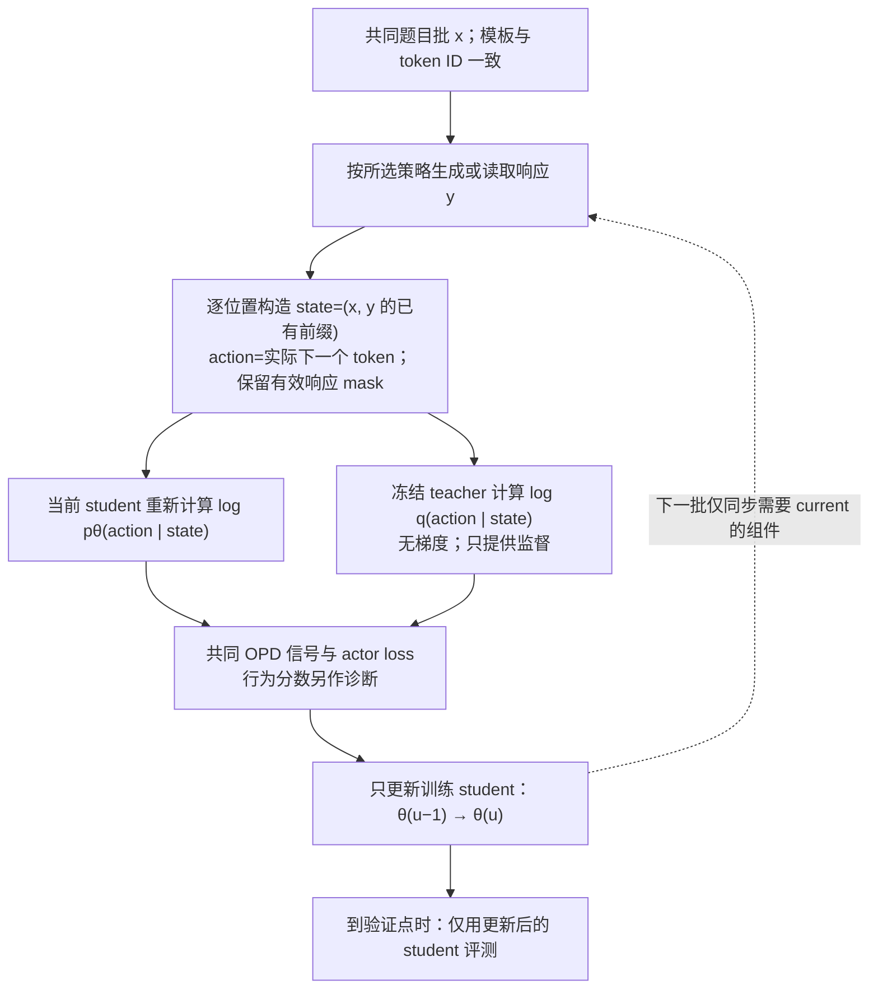
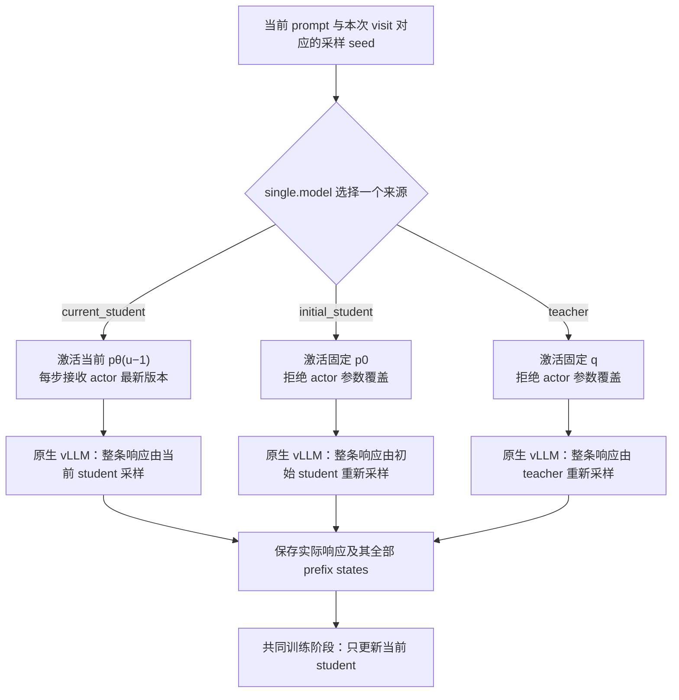
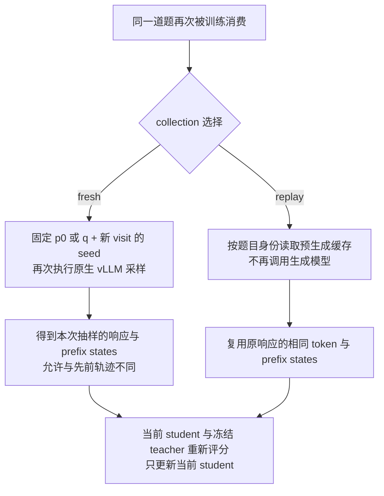
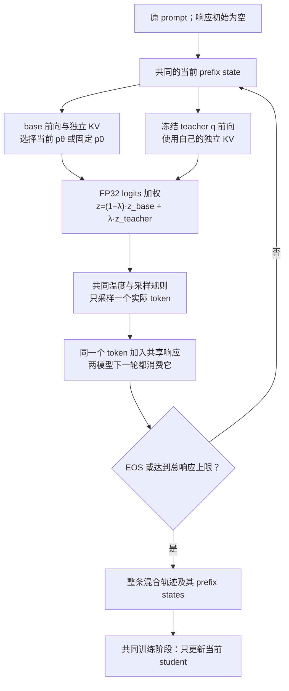
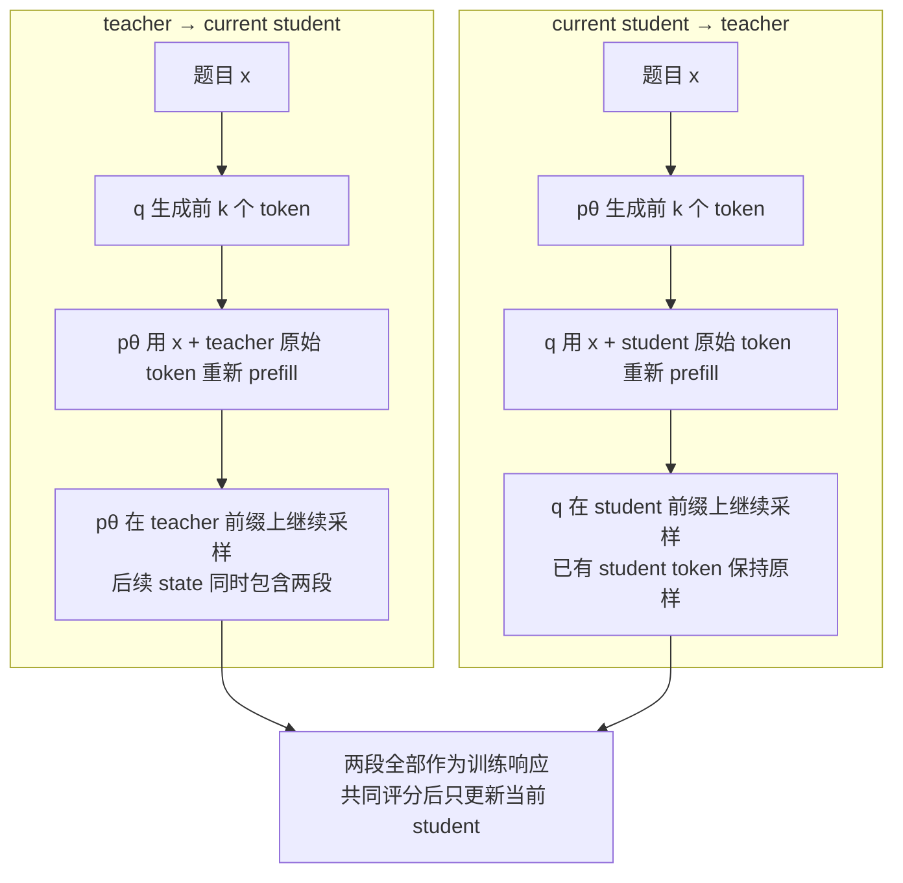
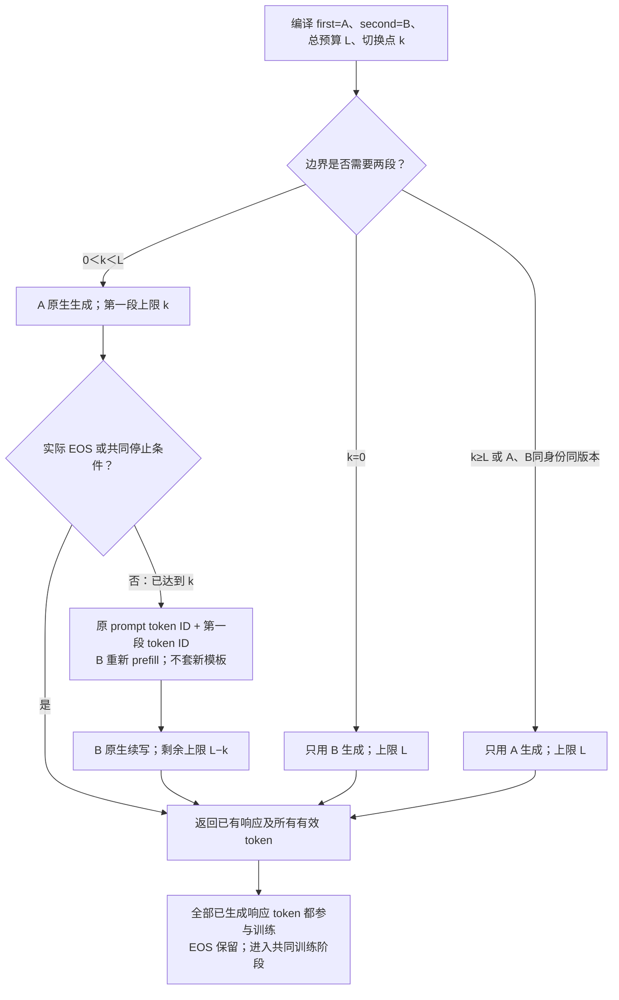
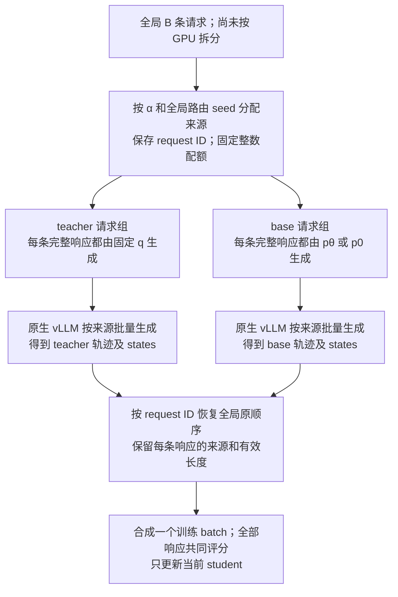

# 多来源 rollout 的目标与策略

本页说明状态与动作测度、更新目标、融合和混合策略的数学区别。当前已支持的范围由[实验主报告](../../experiment/2026-10-19-rollout来源与logit融合实验.md)和实际源码限定；这里的推导不等于全部策略已经交付。

设计与未完成条件见[所属提案](../../../.agents/notes/proposed/architecture/2026-10-18-可组合rollout与原生vLLM推理.md)。本文记录提案引用的固定证据或设计调查，不把它们自动视为当前接口或已完成的正式实验。

## 目标与算法含义

建议将新实验统一为训练时实时生成（fresh rollout），把生成权重来源单独配置。所有设置都只训练当前 student $p_\theta$，teacher $q$ 始终冻结；初始 student $p_0$ 是训练开始前的固定权重。实时生成描述生成时机，on-policy 描述生成分布与当前 student 的关系，二者不能混用。

### State 的定义与共同训练阶段

第 $u$ 次训练更新前使用 actor 参数 $\theta_{u-1}$。对题目 $x$ 和实际生成的响应 $y$，第 $t$ 个动作之前的 state 定义为

$$
s_t=(x,y_{<t}),\qquad a_t=y_t,\qquad s_{t+1}=(x,y_{\le t}).
$$

state 是 token 前缀；同一个前缀在不同模型中的隐藏表示和 KV 数值可以不同。训练对每个有效响应 token 取其生成前的 prefix；返回的 EOS 也是有效动作，终止后的前缀不再额外产生训练位置。对同一道题，所有来源的第一个 state 都是题目本身，差异从生成动作及其后续前缀开始。方案中的变体通过改变采样策略 $\mu$ 形成不同的轨迹及 state 访问分布；它们也同时改变 action、长度和截断，不能仅凭最终准确率把效果全部归因于 state。

下图是所有变体共用的训练阶段。生成组件只决定响应及前缀；当前 student 和冻结 teacher 都在相同的实际 prefix/action 上重新评分。$p_0$ 和生成用的 teacher 都不接收优化器更新。

### 基础变体与模型版本

`single` 选择一个模型负责整条响应。`student_fresh` 随 actor 更新改变生成分布；`initial_student_fresh` 和 `teacher_fresh` 保持生成权重固定，每次消费 prompt 时仍重新采样。后两者的分布固定，不意味着每次抽到同一条有限轨迹。

| 设置名                   | 生成策略                   | 生成权重是否随 student 更新 | 需要每步同步 actor 的生成组件 |
| ------------------------ | -------------------------- | --------------------------- | ----------------------------- |
| `student_fresh`          | 当前 $p_\theta$            | 是                          | 当前 student                  |
| `initial_student_fresh`  | 固定 $p_0$                 | 否                          | 无                            |
| `teacher_fresh`          | 固定 $q$                   | 否                          | 无                            |
| `student_teacher_fusion` | 当前 $p_\theta$ 与固定 $q$ | λ<1 时更新                  | λ<1 时为当前 student          |
| `initial_teacher_fusion` | 固定 $p_0$ 与固定 $q$      | 否                          | 无                            |

### 三种单模型 state 来源

表中前三行对应下面三个互斥分支；后两行的双模型流程见“逐 token 融合的 state 来源”。

执行上复用原生 `generate`，区别在模型引用和权重恢复路径。第 $u$ 步中 current 的生成版本固定为 $u-1$；$p_0/q$ 按不可变 checkpoint 身份恢复。不能因为生成来源是 teacher 就将 actor 初始化改成 teacher。三种模式使用同一 prompt 清单与训练预算，state 来源不决定题目池大小。

### 固定模型 fresh 与固定轨迹 replay

`initial_student_fresh` 每次消费 prompt 都重新采样，不能继续称为论文的固定缓存 Semi-OPD。历史缓存保留为 `collection=replay` 的复现适配器；新实验默认 `fresh`，响应复用策略与模型来源分开。固定生成来源可以更早预取，但首轮公平对照先统一逐步生成，避免只给固定来源跨步大批量预取而引入另一个性能变量。

Semi-OPD 的 replay 固定的是有限响应和 state 集；initial fresh 固定的是模型 $p_0$，抽样的有限 state 集可随访问变化。缓存 teacher 与 teacher fresh 也有同样区别。重复消费多少题、每题访问几次仍由数据清单与训练预算决定，不能从 `fresh/replay` 自动推导。

### 逐 token 融合的 state 来源

双模型模式保持现有 logit fusion 的数学语义：对同一 state $s$，取 base 模型 $b\in\{p_\theta,p_0\}$ 和 teacher 的 logits，先在 FP32 中组合，再使用共同的词表支持、温度与采样规则。

$$
z_\lambda(s)=(1-\lambda)z_b(s)+\lambda z_q(s),\qquad
\mu_\lambda(\cdot\mid s)=\operatorname{softmax}(z_\lambda(s)/T).
$$

上式在共同有效词表内定义，首版保持 $T=1$、top-p=1、top-k=-1、repetition penalty=1。两个模型每次都接收同一个实际采样 token，保留各自 KV；不能让它们先独立续写再混合答案。λ=0/1 的计划可以归约为只激活相应单模型，避免无用前向；端点的分布与正常采样仍需核验。

图示为 $0<\lambda<1$ 的执行语义。`student_teacher_fusion` 的 base 是当前 actor 的推理副本，state 分布会随训练更新；`initial_teacher_fusion` 的 base 固定为 $p_0$，teacher 也固定，因此在固定采样设置下行为分布不随 actor 更新，但每次 fresh 抽样的轨迹仍可不同。两者都由融合分布逐 token 形成一条连续前缀，不能把每个 token 简单归为“teacher 生成”或“student 生成”。

历史 current fusion 使用 HF 双模型；原生扩展现已将两套 backbone、独立 KV 和 logits 融合接入同一个 vLLM 采样循环，两种 base 均通过四卡短训练。完整 50 步质量矩阵尚未完成，历史 HF 结果保留原运行身份。

在 $T=1$、共同有效词表 $V$ 上 logits 有限的条件下，令 $p_V=\operatorname{softmax}(z_b)$、$q_V=\operatorname{softmax}(z_q)$。对 $0<\lambda<1$，将 $z_b(v)=\log p_V(v)+\log Z_b$ 与 $z_q(v)=\log q_V(v)+\log Z_q$ 代入并消去与 token 无关的归一化因子，可得

$$
\mu_\lambda(v\mid s)=
\frac{p_V(v\mid s)^{1-\lambda}q_V(v\mid s)^\lambda}
{\sum_{u\in V}p_V(u\mid s)^{1-\lambda}q_V(u\mid s)^\lambda}.
$$

因此 λ=0.5 是归一化的几何平均，通常不同于概率算术平均 $0.5p_V+0.5q_V$。λ=0/1 直接取单模型端点；此处 $p_V/q_V$ 是生成端有效词表上的分布，不能据此忽略后文说明的 FSDP 评分归一化差异。

## 三种混合方式与参数

逐 token 的 logit fusion、轨迹内分段切换和 batch 内分配生成来源改变分布的方式不同，分别配置。四类平面配置共用统一生成入口，各自独立选择，首轮不递归嵌套。

| 策略类型          | 控制参数                      | 生成行为                                              | 默认训练范围                 |
| ----------------- | ----------------------------- | ----------------------------------------------------- | ---------------------------- |
| `single`          | `model`                       | 整条响应由一个来源生成                                | 整条响应，只更新当前 student |
| `logit_fusion`    | `base`、`teacher_weight=λ`    | 每个 token 都在同一 prefix 上融合两模型 logits 后采样 | 整条响应，只更新当前 student |
| `sequence_switch` | `first`、`second`、`boundary` | 前 $k$ 个响应 token 用第一模型，随后换第二模型续写    | 两段响应，只更新当前 student |
| `batch_mix`       | `components`、权重、分配规则  | 一个 batch 的不同完整响应分别交给选定单模型           | 所有响应，只更新当前 student |

### 双向分段切换的 state 来源

分段切换的第一版支持两个单模型叶节点：teacher→current student、current student→teacher，以及把 current 换成 initial 的设置。给定 prompt $x$、生成中的响应 $y_{<t}$ 与切换位置 $k$，第 $t$ 个响应 token 的行为分布为

$$
\mu_t(\cdot\mid x,y_{<t})=
\begin{cases}
a(\cdot\mid x,y_{<t}), & t\le k,\\
b(\cdot\mid x,y_{<t}), & t>k.
\end{cases}
$$

这里 $a,b$ 是选定来源及共同采样变换后的分布，位置从 1 开始，只计算新生成的响应 token。优先支持 `response_tokens: k`；也可用 `budget_fraction: ρ`，规定 $k=\lfloor\rho L_{\max}\rfloor$，其中 $L_{\max}$ 为总响应上限。ρ 不能解释成“最终实际响应的前 ρ 比例”，因为生成前不知道 EOS 会出现在哪里。$k=0$ 直接使用第二来源，$k\ge L_{\max}$ 直接使用第一来源。第一段遇到 EOS 或共同停止条件就结束整条响应，禁止为了凑够比例继续生成。第一段因达到 $k$ 而停止只代表阶段完成，不代表整条响应被截断。

第二阶段接收原 prompt token 与第一段响应 token 的直接拼接，不再应用 chat template，也不经过文本解码再编码。总响应预算始终是 $L_{\max}$，不是每段各生成 $L_{\max}$。第一段 token 仍属于训练响应，训练 mask 覆盖两段；若以后研究仅训练某一段，需要另设实验条件。

| 方向            | 前 $k$ 个 token 的来源 | 第二段如何形成 state                                                  |
| --------------- | ---------------------- | --------------------------------------------------------------------- |
| teacher→current | 冻结 $q$               | 当前 $p_\theta$ 在 teacher 已生成的前缀上继续采样，随后继承自己的续写 |
| current→teacher | 当前 $p_\theta$        | $q$ 在 student 已生成的前缀上继续采样，保留已有 token                 |
| teacher→initial | 冻结 $q$               | 固定 $p_0$ 在 teacher 前缀上继续采样                                  |
| initial→teacher | 固定 $p_0$             | $q$ 在初始 student 前缀上继续采样                                     |

下面两条路径显示方向差异，均以第一段没有提前结束为前提。第二段起点的 state 由第一模型已经生成的 token 决定；换模型不会重置题目或改写第一段。

具体执行计划将 `first=A`、`second=B` 和边界编译为最多两次原生调用。两模型之间仅传递实际 token，B 用自己的权重建立 KV，A 的 KV 不直接交给 B。下面的结束判断使用实际 EOS token 和语义停止状态，而非只看原生 `finish_reason`。

例如总 cap 为 4,096、$k=2,048$ 时，第一段最多生成 2,048 个 token，第二段最多再生成 2,048 个。切换后第一个 action 所处的 state 仍是完整第一段前缀；B 的第一个 token 只从下一个 state 起加入访问轨迹。`budget_fraction=0.5` 表示总预算的一半，提前 EOS 时不保证实际响应恰好一半来自各模型。原型已支持整数 `boundary`，比例到整数的配置编译仍属正式接入方案。

第一版沿当前 math 设置使用 EOS 与长度停止，不新增文字 stop、最小响应长度或非平凡的 frequency/presence penalty。以后开放这些选项时，判定必须针对完整响应，包含跨切换边界的 stop 字符串，不能在第二段重新从零计数。

### Batch 混合的 state 来源

batch 混合默认以响应为路由单位，用最大余数法分配整数配额：先对每个组件的理想条数向下取整，再将剩余名额依次分给余数最大的组件，余数平局按 `components` 声明顺序决定，与原型 `exact_routes` 一致。二来源的 teacher 配置权重为 α，base 为 $1-\alpha$；记 teacher 在 $B$ 条响应中实际分到 $N_q$ 条，其余交给 base。用有 seed 的随机排列分配位置，再按来源聚合请求，生成后恢复原顺序。多来源也使用相同取整规则，保证总数为 $B$；独立 Bernoulli 分配可作为另一选项，但不保证每个 batch 的比例相同，必须记录实际数量。

base 选 $p_\theta$ 时为 current/teacher batch 混合，选 $p_0$ 时为 initial/teacher batch 混合；首轮分别比较这两种二来源设置。单条响应不会在模型之间接力，批内 state 集来自各来源的不同完整轨迹。比如 $B=64,\alpha=0.25$ 时有 16 条 teacher 和 48 条 base 响应；这不能解释为每条响应有 25% teacher token，也不能解释为逐 token 的 λ=0.25 fusion。图中的分叉表示来源分组；两组可以串行执行，是否并发由模型驻留与联合显存预算决定。

路由在全局 batch 上决定，随后按模型负载分发到副本，避免每个 GPU 单独取整造成比例偏差。每题多响应时，选择“每题同一来源”还是“每条响应独立来源”必须显式配置；当前训练 $n=1$，两者相同。来源占 50% 的响应不等于占 50% 的 token：不同来源的响应长度和提前 EOS 比例会改变实际 token 占比。

batch 混合先采样整条响应的来源，再从该来源生成。精确配额的实际比例为 $\alpha_B=N_q/B$，对随机路由取边缘后，每条响应的序列分布为

$$
P_{\mathrm{mix}}(y\mid x)=(1-\alpha_B)P_b(y\mid x)+\alpha_B P_q(y\mid x).
$$

整数取整时 $\alpha_B$ 可以与配置的 α 不同；Bernoulli 分配的边缘权重才直接为 α。精确配额会让同批来源选择相关，但每条响应仍只有一个来源。batch 混合与每步融合 logits 的 $\mu_\lambda$ 不相同，α、λ 和切换位置 $k$ 分别控制三个独立维度。若记录行为分数，应同时标记来源条件分数与是否计算了边缘混合分数，不能把前者冒充后者。

首轮将单模型、logit fusion、单次分段与简单 batch 混合列为独立模式。`sequence_switch` 的两段均为单模型，`batch_mix` 的组件也均为单模型；暂不设计或安排“batch 混合包含分段”和“分段中使用 fusion”这两类嵌套组合。配置编译阶段拒绝这些嵌套设置，已有原型的相关测试仅保留为历史能力证据，不扩大首轮实施与实验范围。
